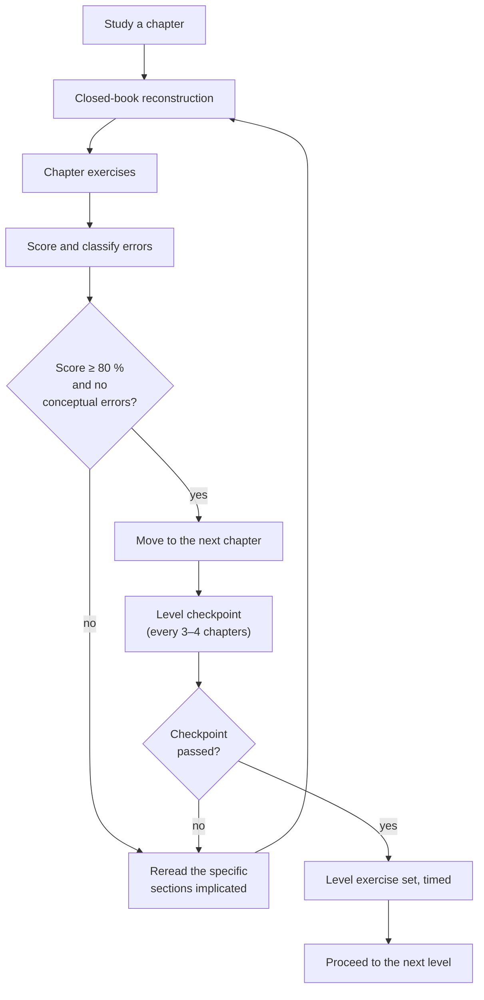

# Assessment Guide

> **Purpose:** how to test yourself, how to score it, and what score means "move on".
> **Time to read:** 15 minutes.

Assessment in this repository is diagnostic, not competitive. The only useful
question a test can answer is *which chapter do I need to reread?*

---

## 1. The assessment cycle

---

## 2. How assessment works here

### 2.1 Error classification

Every wrong answer gets one of four labels. The label determines the remedy.

| Label | Description | Remedy |
|---|---|---|
| **K** — knowledge | You did not know a fact or definition | Reread the section; make a card |
| **M** — method | You knew the facts but chose the wrong approach | Rework 3 similar problems, writing the strategy first |
| **A** — algebra | The chemistry was right, the manipulation was wrong | Practice the manipulation in isolation |
| **U** — units | Right chemistry, wrong or missing units | Always carry units; redo with unit tracking |
| **R** — reading | Misread the question or the data | Slow down; underline given quantities |

A page of **K** errors means reread. A page of **M** errors means practise. A page of
**A** or **U** errors means the chapter is understood but the technique is not
automatic — that is what the exercise sets are for.

### 2.2 Estimation as a scoring aid

Before computing, write an order-of-magnitude estimate. If the calculated answer is
off by more than a factor of three, you have an error regardless of how confident the
arithmetic felt.

### 2.3 Marking your own work

Chemistry rewards method. Award marks as follows when marking your own solutions:

| Element | Share of the marks |
|---|---|
| Correctly identified the relationship | 30 % |
| Correct algebraic rearrangement with symbols | 25 % |
| Correct substitution with units | 20 % |
| Correct numerical answer with significant figures | 15 % |
| Sanity check stated | 10 % |

This mirrors how university examinations allocate marks, and it explains why "I got
the right number" is not the same as "I earned full marks".

---

## 3. Diagnostic A — Foundations

**Time:** 30 minutes. **Closed book.** **Pass mark:** 8/10.

1. Classify each as element, compound, homogeneous mixture or heterogeneous mixture:
   air, seawater filtered of sand, graphite, brass, $\ce{CO2}$, granite.
2. Give the state symbols for iron at 25 °C, mercury at 25 °C, and bromine at 25 °C.
3. Which of these are physical changes: melting ice, rusting iron, dissolving salt,
   burning paper, evaporating ethanol?
4. Write the symbol for: sodium, potassium, iron, copper, lead, silver, tungsten.
5. How many atoms of each element are in $\ce{Al2(SO4)3}$?
6. Convert 3.50 kg to g and to mg, keeping three significant figures.
7. How many significant figures in each: 0.00450, 1200, 1200., $1.20\times10^{3}$?
8. Convert 72 km h⁻¹ to m s⁻¹.
9. Name three pieces of glassware used to measure volume precisely, and one that is
   not.
10. State two things you must never do in a laboratory, and why.

**Marking:**

| Score | Interpretation |
|---|---|
| 10/10 | Start at Level 1 |
| 8–9 | Skim Level 0 chapters 8–9, then start Level 1 |
| 5–7 | Work through Levels 0 chapters 1–9 |
| < 5 | Start at Level 0 chapter 1 |

---

## 4. Diagnostic B — Elementary

**Time:** 45 minutes. **Closed book.** **Pass mark:** 8/10.

1. Give the number of protons, neutrons and electrons in $\ce{^{56}_{26}Fe^{3+}}$.
2. Write the full electron configuration of $\ce{S}$ and of $\ce{S^{2-}}$.
3. Why is the first ionisation energy of neon greater than that of sodium?
4. Rank Na, Mg, Al, Si by atomic radius, largest first.
5. Draw dot-and-cross diagrams for $\ce{H2O}$ and $\ce{MgCl2}$.
6. Explain why solid $\ce{NaCl}$ does not conduct electricity but molten $\ce{NaCl}$ does.
7. Balance: $\ce{C3H8 + O2 -> CO2 + H2O}$.
8. Write the formula of: iron(III) sulfate, ammonium phosphate, dinitrogen tetroxide,
   sulfurous acid.
9. Write the net ionic equation for mixing $\ce{AgNO3(aq)}$ and $\ce{NaCl(aq)}$.
10. Distinguish a strong acid from a concentrated acid, with an example of each.

**Marking:** as Diagnostic A. A score of 8 or more means Level 2 is the correct entry
point; below 8, read the Level 1 chapters your errors point to.

---

## 5. Diagnostic C — Intermediate

**Time:** 60 minutes. **Closed book.** **Pass mark:** 8/10.

1. How many molecules are in 4.40 g of $\ce{CO2}$?
2. $\ce{2.00 g}$ of $\ce{H2}$ reacts with $16.00\ \mathrm{g}$ of $\ce{O2}$. Identify
   the limiting reactant and the mass of water formed.
3. What volume of 0.250 mol dm⁻³ $\ce{HCl}$ contains 0.0125 mol?
4. A gas occupies 250 cm³ at 20 °C and 98 kPa. What volume at STP (0 °C, 100 kPa)?
5. Rank $\ce{H2O}$, $\ce{H2S}$, $\ce{H2Se}$ by boiling point, and explain.
6. Predict the shape and bond angle of $\ce{NH3}$ and of $\ce{BF3}$.
7. The enthalpy of combustion of methane is −890 kJ mol⁻¹. How much heat is released
   by burning 8.00 g?
8. For $\ce{N2(g) + 3H2(g) <=> 2NH3(g)}$, predict the effect of (a) raising the
   pressure, (b) raising the temperature given $\Delta H < 0$, (c) removing $\ce{NH3}$.
9. Calculate the pH of 0.020 mol dm⁻³ $\ce{CH3COOH}$ ($K_\mathrm{a} = 1.8\times10^{-5}$).
10. Balance the redox reaction in acid:
    $\ce{MnO4^- + Fe^{2+} -> Mn^{2+} + Fe^{3+}}$.

---

## 6. Diagnostic D — Advanced

**Time:** 90 minutes. **Closed book.** **Pass mark:** 7/10 (these are harder).

1. State the postulates of quantum mechanics and explain what an eigenvalue means
   physically.
2. Give the four quantum numbers for the highest-energy electron in $\ce{Cu}$ and
   justify the configuration.
3. Sketch the MO diagram of $\ce{O2}$ and explain why it is paramagnetic.
4. Calculate $\Delta G^\circ$ at 298 K for a reaction with
   $\Delta H^\circ = +45.0\ \mathrm{kJ\ mol^{-1}}$ and
   $\Delta S^\circ = +120\ \mathrm{J\ K^{-1}\ mol^{-1}}$. Is it spontaneous?
5. Derive the integrated first-order rate law and show that the half-life is
   independent of initial concentration.
6. Explain why a catalyst does not change the equilibrium constant.
7. Calculate the pH of a buffer of 0.100 mol dm⁻³ acetic acid and
   0.150 mol dm⁻³ sodium acetate.
8. Calculate $E_\text{cell}$ for a Daniell cell at 298 K when
   $[\ce{Zn^{2+}}] = 0.010$ and $[\ce{Cu^{2+}}] = 1.0\ \mathrm{mol\ dm^{-3}}$.
9. Predict the number of unpaired electrons in $\ce{[Fe(CN)6]^{3-}}$ and in
   $\ce{[Fe(H2O)6]^{3+}}$, and explain the difference.
10. Assign the IR and NMR signals of ethanol and explain the splitting pattern of the
    $\ce{CH2}$ signal.

---

## 7. Level checkpoints

After every three or four chapters, close the book and answer these in writing.

### Level 0

- Draw the classification tree for matter and label four examples on each branch.
- Convert between 0.250 kg, 250 g and $2.50\times10^{5}$ mg without a calculator.
- Explain, in three sentences, the difference between a compound and a mixture.

### Level 1

- Draw the electron configuration of $\ce{Cl}$, $\ce{Cl^-}$, $\ce{K}$, $\ce{K+}$.
- Explain the trend in first ionisation energy across period 3, including the two dips.
- Balance five unfamiliar equations by inspection in under ten minutes.

### Level 2

- Solve a limiting-reactant problem without being told which quantities to compare.
- Predict the effect of four different disturbances on a given equilibrium.
- Compute the pH of a strong acid, a weak acid, and a buffer, and explain the
  difference in one sentence each.

### Level 3

- Sketch $\Delta G$ against $T$ for a reaction and identify the crossover temperature.
- Derive the Nernst equation from $\Delta G = \Delta G^\circ + RT\ln Q$.
- Explain the Jahn–Teller distortion for a $d^{9}$ octahedral complex.

### Level 4

- Draw a full curly-arrow mechanism for an $\mathrm{S_N2}$ and an $\mathrm{S_N1}$
  reaction, and explain the stereochemical outcome of each.
- Assign $R/S$ to a molecule with two stereocentres.
- Propose a three-step synthesis of a target from a given starting material.

### Levels 5–10

Each level's `README.md` ends with its study routine; the checkpoint is the level
exercise set, taken closed-book and timed. The pass mark is 80 %.

---

## 8. Practical (laboratory) assessment

Theory and practice are assessed differently. For laboratory competence, the
following rubric mirrors what accredited courses use.

| Criterion | Weight | Evidence |
|---|---|---|
| Risk assessment before starting | 15 % | Written, hazard-specific, controls identified |
| Technique and accuracy | 25 % | Repeatability, correct use of volumetric glassware |
| Data recording | 20 % | Contemporaneous, units, signed and dated |
| Calculation and treatment | 20 % | Correct method, uncertainty reported |
| Safety and housekeeping | 10 % | PPE, waste segregation, clean bench |
| Communication | 10 % | Clear report, honest about deviations |

A report that does not state its uncertainty cannot score above 60 %, however good
the result. See [13-laboratory](../13-laboratory/README.md).

---

## 9. Mastery criteria

Put together, "mastery of a chapter" means all six of:

- [ ] You can state the learning objectives as answers, not as headings.
- [ ] You can reproduce the chapter's central equation from memory and define every
      symbol with its unit.
- [ ] You can reproduce the chapter's central diagram from memory.
- [ ] You score ≥ 80 % on the chapter's exercises without looking at solutions.
- [ ] You can explain the chapter's main idea to someone who has not read it.
- [ ] You can state one situation in which the chapter's main model fails.

The last criterion is what separates a student who has memorised from a chemist who
understands.

---

## 10. Progress log

Copy this table and keep it with your notes.

| Date | Chapter | Exercises (score) | Error labels | Next review |
|---|---|---|---|---|
| | | | | |
| | | | | |
| | | | | |
