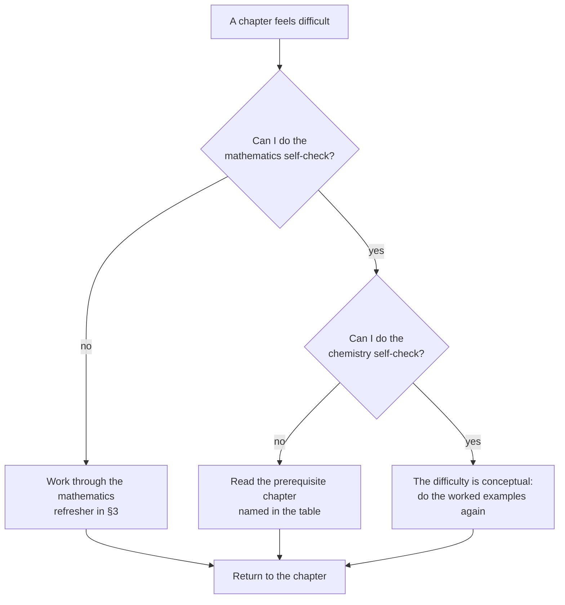
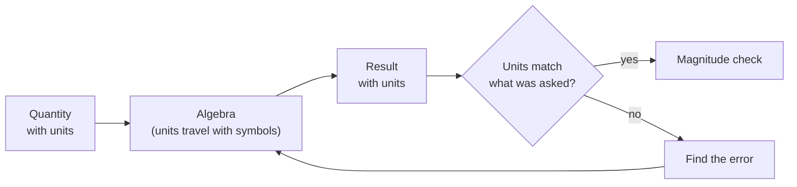

# Chemistry Prerequisites

> **Purpose:** exactly what each level assumes, in chemistry *and* in mathematics,
> with a self-check for every assumption.
> **Time to read:** 20 minutes; return to it whenever a chapter feels opaque.

---

## 1. How to use this page

Each level below lists (a) the chemistry it assumes, (b) the mathematics it assumes,
and (c) a **two-minute self-check**. If you cannot do the self-check, you have found
the chapter you must read first. That is the entire point of this page.

---

## 2. Level-by-level prerequisites

### Level 0 — Foundations

| Assumes | Self-check |
|---|---|
| Arithmetic with decimals and fractions | Compute $\frac{3}{8} + 1.25$ without a calculator. *(1.625)* |
| Percentages | A sample loses 12 % of its mass. If it started at 4.50 g, what remains? *(3.96 g)* |
| Reading a two-axis graph | Given a straight line through $(0, 2)$ and $(4, 10)$, state the slope. *(2)* |
| Powers of ten | Write 0.000 042 in scientific notation. *($4.2 \times 10^{-5}$)* |
| Chemistry | None. |

### Level 1 — Elementary Chemistry

| Assumes | Self-check |
|---|---|
| All of Level 0, especially symbols and formulas | Name the elements in $\ce{CaCO3}$. *(calcium, carbon, oxygen)* |
| Rearranging a simple equation | Solve $a = \frac{b}{c}$ for $c$. *($c = b/a$)* |
| Substitution into a formula | If $E = h\nu$ and $h = 6.63\times10^{-34}\ \mathrm{J\ s}$, $\nu = 5.0\times10^{14}\ \mathrm{Hz}$, find $E$. *($3.3\times10^{-19}\ \mathrm{J}$)* |
| Chemistry | Level 0 chapters 1–8 in full. |

### Level 2 — Intermediate Chemistry

| Assumes | Self-check |
|---|---|
| Ratio and proportion; the mole idea | If 1 mol of $\ce{X}$ has mass 44 g, what mass is 0.25 mol? *(11 g)* |
| Rearranging multi-variable equations | Solve $pV = nRT$ for $T$. *($T = pV/nR$)* |
| Logarithms | Compute $\log_{10}(2\times10^{-3})$. *($-2.70$)* |
| Units and dimensional analysis | Convert $1.50\ \mathrm{g\ cm^{-3}}$ to $\mathrm{kg\ m^{-3}}$. *($1.50\times10^{3}$)* |
| Chemistry | Level 1 in full, especially bonding, formulas and nomenclature. |

### Level 3 — Advanced Chemistry

| Assumes | Self-check |
|---|---|
| Calculus: differentiation | Differentiate $y = 3x^{2} + \ln x$. *($6x + 1/x$)* |
| Calculus: integration | Evaluate $\int_{1}^{2} \frac{1}{x}\,\mathrm{d}x$. *($\ln 2 \approx 0.693$)* |
| Partial derivatives | For $p = nRT/V$, find $\left(\partial p/\partial T\right)_{V}$. *($nR/V$)* |
| Exponentials | Solve $0.693 = e^{-kt}$ for $t$ with $k = 0.010\ \mathrm{s^{-1}}$. *($t = 36.7\ \mathrm{s}$, sign handled carefully)* |
| Complex numbers (quantum chapters) | Compute $i^{2}$ and $\lvert 1 + i\rvert$. *($-1$ and $\sqrt{2}$)* |
| Chemistry | Level 2 in full: moles, equilibrium, acid–base, redox, thermochemistry, geometry. |

### Level 4 — Organic Chemistry

| Assumes | Self-check |
|---|---|
| Lewis structures and formal charge | Draw $\ce{CH3COO^-}$ and assign formal charges. *(carboxylate with delocalised negative charge)* |
| VSEPR and hybridization | Predict the geometry at each carbon in $\ce{CH3-C#N}$. *(tetrahedral, linear)* |
| Electronegativity and polarity | Rank $\ce{C-F}$, $\ce{C-Cl}$, $\ce{C-Br}$ by bond polarity. *(C–F most polar)* |
| Chemistry | Level 1 bonding chapters; Level 2 geometry and polarity. |

### Level 5 — Inorganic Chemistry

| Assumes | Self-check |
|---|---|
| Periodic trends | Why is the first ionisation energy of Mg higher than that of Al? *(3s² is filled and 3p is higher in energy)* |
| Redox and electrode potentials | Assign oxidation states in $\ce{KMnO4}$. *(K +1, Mn +7, O −2)* |
| Symmetry vocabulary (used from Chapter 3) | Identify the point group of water. *($C_{2v}$)* |
| Chemistry | Level 1 chapters 2–5; Level 3 coordination chapter is helpful. |

### Level 6 — Physical Chemistry

| Assumes | Self-check |
|---|---|
| Multivariable calculus | State the total differential of $U(S,V)$. *($\mathrm{d}U = T\,\mathrm{d}S - p\,\mathrm{d}V$)* |
| Linear algebra | Find the eigenvalues of $\begin{pmatrix}2&0\\0&3\end{pmatrix}$. *(2 and 3)* |
| Probability | For a two-level system with energies $0$ and $\varepsilon$, write the Boltzmann ratio $p_1/p_0$. *($e^{-\varepsilon/k_\mathrm{B}T}$)* |
| Differential equations | Solve $\mathrm{d}[A]/\mathrm{d}t = -k[A]$. *($[A] = [A]_0 e^{-kt}$)* |
| Chemistry | Level 3 thermodynamics, quantum and kinetics. |

### Level 7 — Analytical Chemistry

| Assumes | Self-check |
|---|---|
| Concentration and dilution | Dilute 10.0 mL of 0.500 mol dm⁻³ to 250.0 mL. New concentration? *(0.0200 mol dm⁻³)* |
| Equilibrium and pH | Compute the pH of 0.010 mol dm⁻³ $\ce{HCl}$. *(2.00)* |
| Descriptive statistics | Mean and sample standard deviation of 2.0, 2.2, 2.1, 2.3. *(2.15, ≈0.129)* |
| Chemistry | Level 2 in full, especially equilibrium, acid–base and solubility. |

### Level 8 — Biochemistry

| Assumes | Self-check |
|---|---|
| Functional groups | Identify the functional groups in a fatty acid. *(carboxylic acid, alkene)* |
| Acid–base equilibria | Write the Henderson–Hasselbalch equation and state its assumptions. *($\mathrm{pH} = \mathrm{p}K_\mathrm{a} + \log([\ce{A^-}]/[\ce{HA}])$)* |
| Gibbs energy | State the relation between $\Delta G^\circ$ and $K$. *($\Delta G^\circ = -RT\ln K$)* |
| Chemistry | Level 4 chapters 1–3, 9–11; Level 2 acid–base. |

### Level 9 — Materials and Environmental Chemistry

| Assumes | Self-check |
|---|---|
| Redox and electrochemistry | Write the half-reaction for $\ce{O2}$ reduction in acid. *($\ce{O2 + 4H+ + 4e- -> 2H2O}$)* |
| Kinetics | Distinguish order from molecularity. *(order is experimental; molecularity is mechanistic)* |
| Solid-state basics | How many atoms per unit cell in a body-centred cubic lattice? *(2)* |
| Chemistry | Any two of Levels 3–8, depending on the sub-topic. |

### Level 10 — Research Chemistry

| Assumes | Self-check |
|---|---|
| Linear algebra and eigenvalue problems | Explain why the secular equations of Hückel theory produce a determinant. *(variational principle applied to a linear combination of basis functions)* |
| Quantum mechanics | State the variational principle in one sentence. *(the energy of any trial wavefunction is an upper bound to the true ground-state energy)* |
| Statistics | Distinguish a confidence interval from a tolerance interval. *(interval for a parameter vs interval covering a proportion of the population)* |
| Chemistry | Any two specialist levels; Level 6 for the theoretical chapters. |

---

## 3. Mathematics refresher

Chemistry at Level 3 and above uses mathematics as a language. The following is the
complete list of what is actually needed; each item is worth a 20-minute refresher if
it is unfamiliar.

### 3.1 Algebra

- Rearranging equations with several variables.
- Solving simultaneous linear equations (two and three unknowns).
- Quadratic formula: $x = \dfrac{-b \pm \sqrt{b^{2} - 4ac}}{2a}$.
- Exponents and logarithms: $\log(ab) = \log a + \log b$,
  $\ln e^{x} = x$, $\log 10^{x} = x$, $\mathrm{p}X = -\log_{10} X$.

### 3.2 Proportional reasoning

Many chemistry laws are proportionalities dressed as equations:

$$
p \propto \frac{1}{V} \quad (n, T \text{ constant}), \qquad
V \propto n \quad (p, T \text{ constant}), \qquad
k = A e^{-E_\mathrm{a}/RT}.
$$

Learn to see the *shape* of a relationship: which quantity rises with which, and
whether linearly, as a power, or exponentially.

### 3.3 Calculus

| Operation | Needed for | Typical use |
|---|---|---|
| $\mathrm{d}/\mathrm{d}x$ of $x^{n}$, $e^{x}$, $\ln x$, $\sin x$, $\cos x$ | kinetics, thermodynamics, quantum | rate laws, Maxwell relations |
| Product, quotient, chain rules | everything | — |
| Definite integrals of $1/x$, $e^{-ax}$, $\sin^{2}(ax)$ | thermodynamics, quantum | work integrals, normalisation |
| Partial derivatives | thermodynamics | $\left(\partial G/\partial T\right)_{p} = -S$ |
| Total differentials | thermodynamics | $\mathrm{d}U = T\,\mathrm{d}S - p\,\mathrm{d}V$ |
| Simple first-order ODEs | kinetics | $[A] = [A]_0 e^{-kt}$ |

### 3.4 Linear algebra

- Vectors, dot products, orthogonality.
- Matrices, determinants, eigenvalues and eigenvectors (used for molecular orbitals).
- Basis sets and linear combinations (used for MO theory and vibrational normal modes).

### 3.5 Statistics

- Mean, variance, standard deviation (sample vs population).
- Normal and $t$ distributions.
- Linear regression and residuals (used for calibration curves).
- Propagation of uncertainty.

### 3.6 A note on units

Dimensional analysis is not bookkeeping — it is a correctness check. If an equation
claims to give an energy but the units work out to $\mathrm{J\ s^{-1}}$, the equation
is wrong. Carry units through every step until it becomes automatic.

---

## 4. Study skills that are prerequisites

These are not chemistry, but their absence mimics a chemistry problem.

| Skill | Why it matters | Where it is taught |
|---|---|---|
| Retrieval practice | Rereading feels productive but is weak | [how-to-use §4](how-to-use-this-repository.md#4-spaced-repetition) |
| Error logging | A right answer from a wrong method hides a latent error | [how-to-use §8](how-to-use-this-repository.md#8-working-with-the-exercise-and-solution-files) |
| Working backwards | Half of stoichiometry is choosing the right starting point | Level 2 chapter 2 |
| Estimation | Detects most arithmetic errors | [assessment-guide §2](assessment-guide.md#2-how-assessment-works-here) |
| Drawing | Chemistry is spatial; sketching is thinking | Level 1 chapter 6 |

---

## 5. If you are returning to study after a long break

A three-week ramp works well:

1. **Week 1** — Level 0 chapters 8 and 9 (formulas, measurement). These two repair
   most of the damage time does to basic chemistry.
2. **Week 2** — the Level 1 diagnostic in the [assessment guide](assessment-guide.md).
   Any topic you fail points to one chapter; read it.
3. **Week 3** — start Level 2 chapter 1 (the mole) and work forward. If chapter 2
   (stoichiometry) is comfortable, you are ready.

Skip this ramp only if you can complete the Level 2 self-checks in §2 above without
hesitation.
