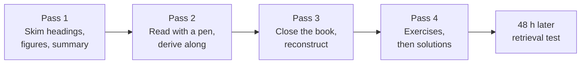
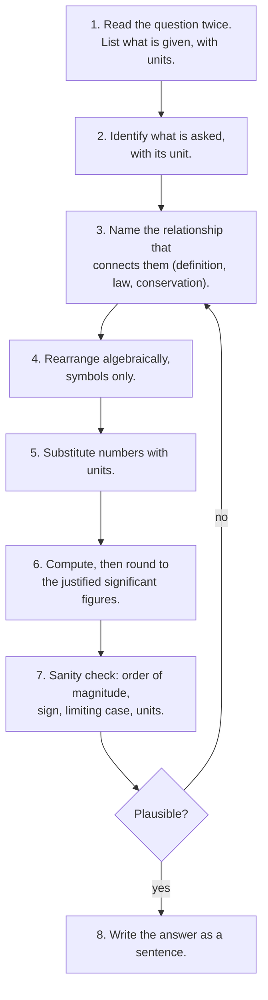

# How to Use This Repository

> **Purpose:** the mechanics of studying here — notation, reading strategy,
> retrieval practice, tools, and the problem-solving protocol.
> **Time to read:** 20 minutes, once.

---

## 1. What this repository is, and what it is not

It is a **textbook**, a **problem book** and a **reference**. It is not a
laboratory course: chemistry cannot be learned entirely from text, and no amount of
Markdown replaces supervised practical work. Safety-critical content is confined to
[13-laboratory](../13-laboratory/README.md) and is written for readers working under
professional supervision.

Read this page once, then never again. Everything else is linked from the
[curriculum map](../CURRICULUM.md).

---

## 2. Notation conventions

Consistent notation is not pedantry: most student errors in chemistry are symbolic
errors. This repository uses the following.

### 2.1 Quantities and units

| Symbol | Quantity | SI unit |
|---|---|---|
| $n$ | amount of substance | mol |
| $m$ | mass | kg (chemists usually write g) |
| $M$ | molar mass | g mol⁻¹ |
| $c$ | amount concentration | mol dm⁻³ |
| $V$ | volume | m³ (chemists usually write dm³ or cm³) |
| $T$ | thermodynamic temperature | K |
| $p$ | pressure | Pa |
| $q$ | heat | J |
| $w$ | work | J |
| $H$ | enthalpy | J |
| $S$ | entropy | J K⁻¹ |
| $G$ | Gibbs energy | J |
| $E$ | energy (general), or electrode potential | J, or V |
| $k$ | rate constant | depends on order |
| $K$ | equilibrium constant | dimensionless (relative activities) |
| $Z$ | atomic number | — |
| $A$ | mass number | — |
| $\nu$ | frequency | Hz |
| $\lambda$ | wavelength | m |
| $\hbar$ | reduced Planck constant | J s |

Rules that follow from this:

- **A quantity is italic, a unit is upright:** $m = 5.0\ \mathrm{g}$, not $m = 5.0g$.
- **A space separates number and unit**, except for °, ′ and ″: $25.0\ \mathrm{^\circ C}$,
  $90^\circ$.
- **Concentration is $c$, not $M$.** Writing "0.1 M" is tolerated in the older
  literature, but this repository writes $c = 0.1\ \mathrm{mol\ dm^{-3}}$.
- **"Amount of substance" is not "number of moles".** The unit is mol; the symbol is $n$.

### 2.2 Chemical notation

| Form | Meaning | Example |
|---|---|---|
| $\ce{H2O}$ | molecular formula | water |
| $\ce{Ca(OH)2}$ | formula unit with brackets | calcium hydroxide |
| $\ce{SO4^{2-}}$ | ion with charge | sulfate |
| $\ce{H2O(l)}$ | state symbol | liquid water |
| $\ce{->}$ | reaction | — |
| $\ce{<=>}$ | equilibrium | — |
| $\ce{->[\text{conditions}]}$ | reaction with conditions | — |
| $\ce{^{\circ}}$ | standard state | $\ce{^{\circ}}$ |

State symbols: **s** solid, **l** liquid, **g** gas, **aq** aqueous.

### 2.3 Mathematics

- Multiplication: $\times$ or juxtaposition; never a centred dot in algebra.
- Logarithms: $\log$ is base 10, $\ln$ is base $e$. Chemistry uses both; the pH
  definition uses $\log_{10}$.
- Standard state: $\ce{^{\circ}}$ (1 bar, 1 mol dm⁻³), biological standard state:
  $^{\circ\prime}$ (pH 7).
- Change: $\Delta$; standard change: $\Delta H^\circ$; at constant pressure $q_p = \Delta H$.
- Approximate: $\approx$; proportional: $\propto$; therefore: $\therefore$.

### 2.4 Significant figures

Reported answers carry the number of significant figures justified by the least
precise input. Intermediate results may keep one extra digit, marked with a trailing
bracket, e.g. $12.34\ (12.3)$. Chapter 9 of Level 0 is the reference.

---

## 3. How to read a chapter

Reading a chemistry chapter is not reading a novel. Use four passes.



**Pass 1 — orientation (5 min).** Read the learning objectives, the headings, every
figure caption and the chapter summary. You are building a map, not learning detail.

**Pass 2 — active reading (45–90 min).** Read with the chapter open and a pen in
hand. At every equation, cover the next line and try to produce it yourself. At
every diagram, say out loud what it shows before reading the caption.

**Pass 3 — reconstruction (15 min).** Close the chapter. Write down: the definitions,
the central equation, the central diagram, and one worked example. Compare with the
source. The gap between what you wrote and what is there is your actual learning.

**Pass 4 — retrieval and application (30–60 min).** Do the exercises in section 12
before opening any solutions. Mark every item you got wrong with a symbol, and note
*why* — knowledge gap, algebraic slip, unit slip, or misread question. Each cause has
a different remedy.

---

## 4. Spaced repetition

Understanding decays. Schedule reviews at expanding intervals:

| Review | When | What to do |
|---|---|---|
| R1 | same day | Redo the three exercises you found hardest |
| R2 | 48 h | Closed-book reconstruction of the chapter |
| R3 | 1 week | Level exercise set, relevant items only |
| R4 | 1 month | Mixed problem set spanning 3 chapters |
| R5 | 3 months | Full level checkpoint |

A simple card is enough:

```text
Front: State the first law of thermodynamics for a closed system.
Back:  ΔU = q + w,  with w the work done ON the system (IUPAC sign convention).
```

Keep cards **atomic** — one idea per card. "Explain thermodynamics" is not a card.

---

## 5. Reproducing diagrams

Every Mermaid diagram is source, not a picture. That makes it a study tool:

1. Read the diagram and its caption.
2. Close the page and **write the Mermaid source from memory** in a scratch file.
3. Render it and compare structure, not wording.

If you can reproduce the topology of a diagram, you own the relationship it encodes.
This is far more effective than re-reading, because a diagram is a compressed
argument.

---

## 6. The problem-solving protocol

Use this for every quantitative problem, at every level.



**Step 7 is the one students skip.** A molar mass of $5\times10^{6}\ \mathrm{g\ mol^{-1}}$
for water, a negative absolute temperature, or a yield of 130 % are all detectable in
two seconds if you look.

---

## 7. Rendering the repository

Everything is plain Markdown; any renderer works. For the full experience (Mermaid,
LaTeX, relative links) use one of these.

| Tool | Mermaid | LaTeX | Notes |
|---|---|---|---|
| GitHub / GitHub web | yes | yes | No setup; best default |
| VS Code + Markdown Preview Mermaid Support | yes | yes (built-in math) | Best for editing; `Ctrl/Cmd+Shift+V` |
| Obsidian | yes | yes | Good for a personal knowledge base; enable MathJax |
| MkDocs Material | yes (plugin) | yes | Good for publishing a site |
| Jupyter (via `jupytext`) | yes | yes | Good for computational chapters |

For `\ce{}` (mhchem) support, the renderer must load the mhchem extension. If your
renderer shows raw `\ce{...}`, either enable mhchem or read the equation as written —
the source is unambiguous.

---

## 8. Working with the exercise and solution files

Each level has:

```
NN-level/
├── exercises/level-N-exercises.md    # problems only
└── solutions/level-N-solutions.md    # full worked solutions
```

Guidelines:

- **Never read the solution first.** A read solution is worth roughly 10 % of a
  struggled solution.
- If you are stuck for more than 20 minutes, read **only the first line** of the
  solution (the strategy), then close it and continue.
- After solving, compare *method*, not just the final number. A right answer from a
  wrong method is a latent error.
- Log every error in a single running list. That list, not the textbook, is what you
  revise before an exam.

---

## 9. Contributing corrections

If something here is wrong, the fastest fix is a pull request. See
[CONTRIBUTING.md](../CONTRIBUTING.md) for the review checklist and the two quality
scripts. Scientific corrections are always welcome and are treated as high priority.

---

## 10. A one-page summary

1. Skim, then read actively, then reconstruct, then practise, then review.
2. Never read a solution you have not earned.
3. Carry units through every calculation.
4. Reproduce diagrams from memory.
5. Log errors; revise the log, not the book.
6. Move on only when you can reconstruct the chapter closed-book.
