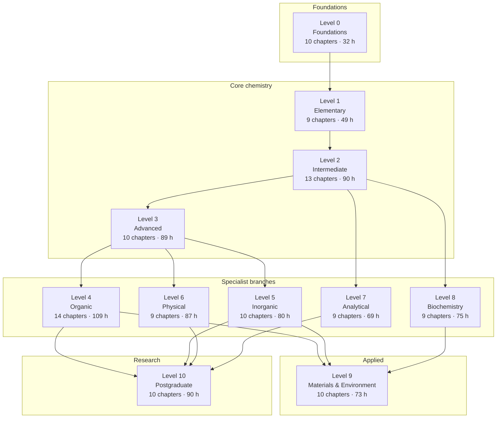
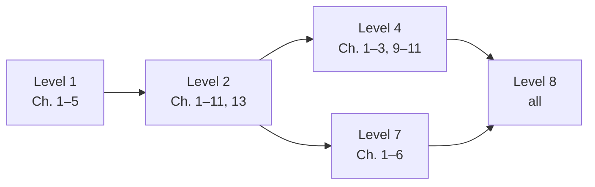
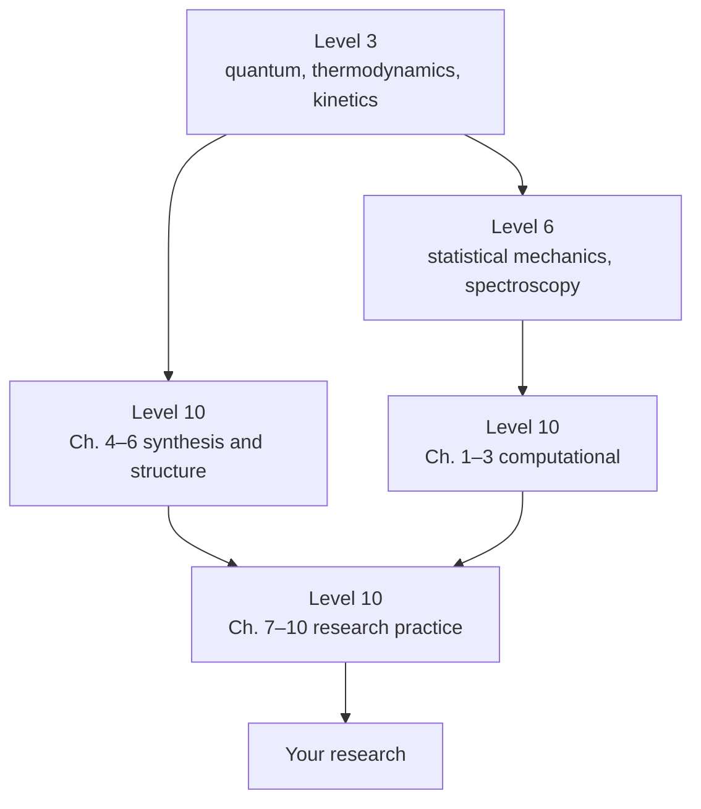
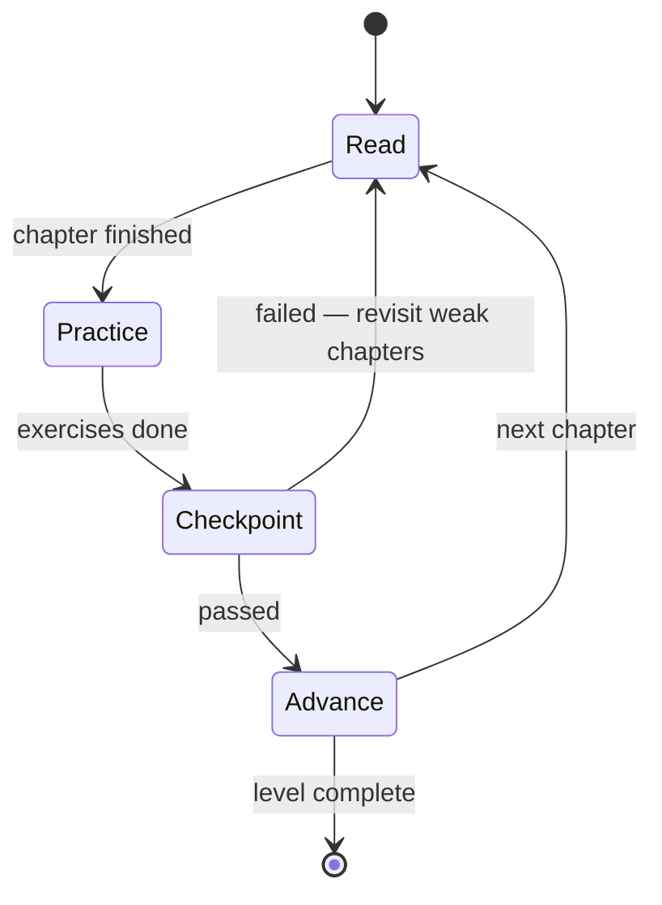

# Learning Path

> **Purpose:** choose a route through the curriculum that matches where you are
> now and where you want to end up.
> **Time to read:** 15 minutes.

The repository has eleven levels and roughly 113 chapters. Nobody should read all of
them in order unless they are building a degree. This page gives you four routes,
the prerequisite graph behind them, and the checkpoints that tell you whether you
are ready to move on.

---

## 1. The dependency graph

**Reading the graph.** An arrow means "the material at the tail is assumed by the
material at the head". Levels 4, 5, 6, 7 and 8 are largely independent of one
another — you may take them in any order, or take only those you need. Level 10 has
several independent entry points because research chemistry is not one subject.

The per-chapter prerequisite is listed in the table in [CURRICULUM.md](../CURRICULUM.md)
and at the top of every chapter.

---

## 2. Four routes

### Route A — Complete foundation (recommended if you have never studied chemistry)

| Stage | Chapters | Time | Checkpoint |
|---|---|---|---|
| 1 | Level 0, all | ≈ 32 h | [Diagnostic A](../00-learning-guide/assessment-guide.md#3-diagnostic-a--foundations) |
| 2 | Level 1, all | ≈ 49 h | [Diagnostic B](assessment-guide.md#4-diagnostic-b--elementary) |
| 3 | Level 2, all | ≈ 90 h | [Diagnostic C](assessment-guide.md#5-diagnostic-c--intermediate) |
| 4 | Level 3, all | ≈ 89 h | [Diagnostic D](assessment-guide.md#6-diagnostic-d--advanced) |
| 5 | Two specialist levels of your choice | ≈ 160 h | Level exercises |
| 6 | Level 10, selectively | ≈ 40 h | — |

Total: roughly 450 h to a solid undergraduate-equivalent foundation, spread over
12–24 months of part-time study.

### Route B — Fast track to a specific goal

If you already have some chemistry, use the diagnostics to find your first failure
and start there. A typical fast track for a **biology or medicine student**:

A **materials or engineering student** instead takes Level 2 → Level 3 (Ch. 4, 9) →
Level 5 (Ch. 6–7) → Level 9.

An **analytical or pharmacy student** takes Level 2 → Level 3 (Ch. 7, 10) → Level 7
→ Level 8 (Ch. 1–3).

### Route C — Exam repair

You have an exam in eight weeks and one topic keeps failing. Work backwards:

1. Find the topic in [CURRICULUM.md](../CURRICULUM.md).
2. Read its **Prerequisites** column.
3. Follow the prerequisite chain back until you reach something you can already do.
4. Study forward from that point, doing the exercises in every chapter you cross.
5. Finish with the level's exercise set under timed conditions.

Repairing a prerequisite is almost always faster than re-reading the topic you are
failing. A student who cannot balance equations will not learn equilibrium no matter
how many times they read about it.

### Route D — Research preparation

For a new postgraduate student entering a research group:

The research-practice chapters (7–10) are useful to *everyone* entering a research
environment, whatever their sub-discipline.

---

## 3. Study-time budgeting

| Level | Reading | Exercises | Total |
|---|---|---|---|
| 0 | ≈ 12 h | ≈ 20 h | 32 h |
| 1 | ≈ 22 h | ≈ 27 h | 49 h |
| 2 | ≈ 41 h | ≈ 49 h | 90 h |
| 3 | ≈ 41 h | ≈ 48 h | 89 h |
| 4 | ≈ 51 h | ≈ 58 h | 109 h |
| 5 | ≈ 39 h | ≈ 41 h | 80 h |
| 6 | ≈ 44 h | ≈ 43 h | 87 h |
| 7 | ≈ 33 h | ≈ 36 h | 69 h |
| 8 | ≈ 36 h | ≈ 39 h | 75 h |
| 9 | ≈ 36 h | ≈ 37 h | 73 h |
| 10 | ≈ 45 h | ≈ 45 h | 90 h |

These assume an adult learner studying part-time, with no tutor. If you have a
teacher and a lab, subtract about 30 %. If you are learning a new language of study
at the same time, add 30–50 %.

**A sustainable rhythm:** 4–6 focused hours per week, in 60–90 minute blocks, with a
30-minute review after each block. Two blocks per week plus one review session will
carry you through a level in about two months.

---

## 4. Checkpoints

A checkpoint is a short, closed-book test. Do not proceed past a checkpoint you
cannot pass; instead, return to the chapters that feed it.

Checkpoints are defined in the [assessment guide](assessment-guide.md). The rule of
thumb is simple: **if you cannot reconstruct the chapter's central diagram and
central equation from memory, you have not finished the chapter.**

---

## 5. When you get stuck

| Symptom | Likely cause | Fix |
|---|---|---|
| "I understand the words but cannot do the problems" | Passive reading | Do exercises before reading the solution; redo at 48 h |
| "Every chapter feels equally hard" | Missing prerequisite | Run the relevant diagnostic; go back one level |
| "I forget everything after two weeks" | No retrieval practice | Switch to spaced repetition; see [how-to-use](how-to-use-this-repository.md#4-spaced-repetition) |
| "I cannot follow the algebra" | Mathematics gap | Work through [chemistry-prerequisites.md](chemistry-prerequisites.md) §3 |
| "I cannot picture the molecules" | Under-practised visualisation | Reproduce the diagrams, then use the [visual-learning](../15-visual-learning/README.md) galleries |
| "I can do the maths but the chemistry makes no sense" | Symbol-pushing without mechanism | Read the mechanism chapter again and annotate every electron movement |

---

## 6. Where to go next

- **How to study:** [how-to-use-this-repository.md](how-to-use-this-repository.md)
- **Prerequisite detail:** [chemistry-prerequisites.md](chemistry-prerequisites.md)
- **Diagnostics and rubrics:** [assessment-guide.md](assessment-guide.md)
- **Full chapter list:** [CURRICULUM.md](../CURRICULUM.md)
