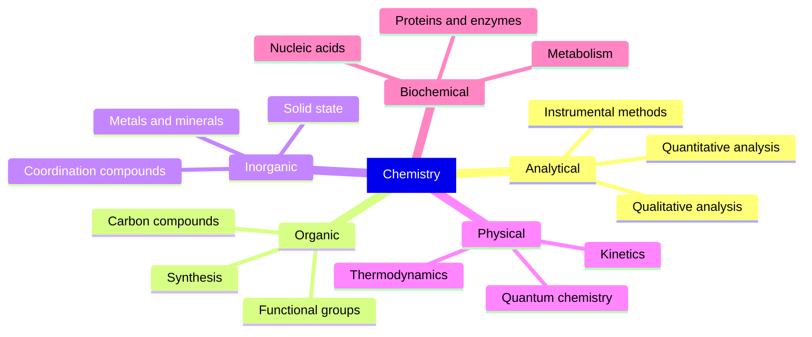
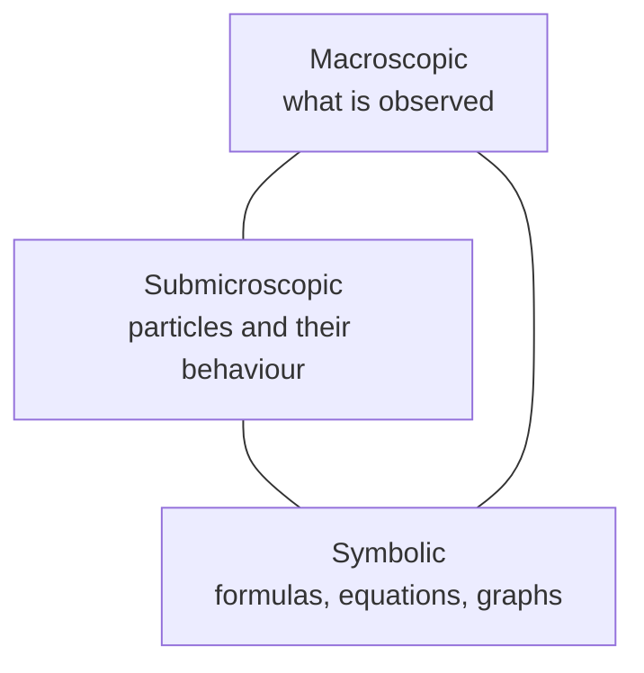
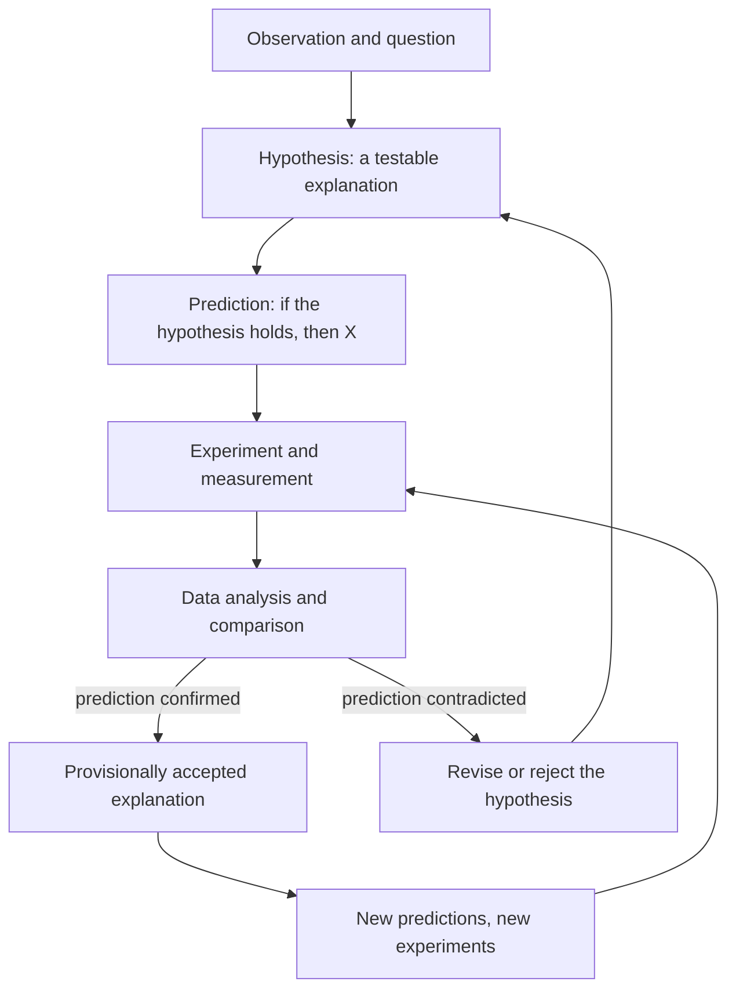
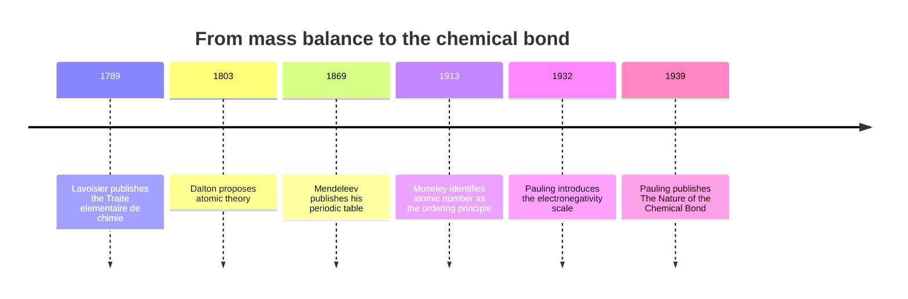

# Chapter 1 — What Is Chemistry?

> **Level:** Beginner (Level 0 — Foundations)
> **Estimated study time:** 3 hours (2 h reading + 1 h exercises)
> **Prerequisites:** None
> **Related chapters:** [Matter and Its Classification](02-matter-and-its-classification.md), [Solids, Liquids, Gases and Plasma](03-states-of-matter.md)
> **Difficulty:** ★☆☆☆☆ (1–5)

---

## 1. Learning Objectives

After working through this chapter you will be able to:

- Define chemistry as the study of matter, its composition, structure and properties, and the transformations it undergoes.
- Name the five classical branches of chemistry and give one concrete question that each branch asks.
- Distinguish the macroscopic, submicroscopic and symbolic levels of representation, and translate a simple observation between all three.
- Describe the hypothesis–experiment–theory cycle and state what makes a hypothesis scientifically testable.
- Outline four historical milestones — Lavoisier's quantitative mass balance, Dalton's atomic theory, Mendeleev's periodic system and Pauling's chemical-bond theory — and explain what each one changed.
- State why chemistry is described as a "central science" lying between physics and biology.
- Perform simple unit conversions and density calculations with correct SI units and significant figures.

---

## 2. Introduction

A candle burns, iron rusts, bread rises, a battery discharges, a wound heals. Each of these events is a chemical process, and each can be described at three levels at once: what you see, what the particles are doing, and what the symbols say. Chemistry is the discipline that connects those three descriptions into one coherent account of matter.

The subject is often introduced as a list of facts to memorize — symbols, formulas, reactivity series. That framing is misleading. Chemistry is a *quantitative* science with a small number of organizing ideas: matter is made of atoms, atoms combine in fixed ratios, energy is conserved, and the rate and extent of any change are governed by thermodynamics and kinetics. Everything else follows from those ideas. A student who understands the logic can reconstruct most of the facts; a student who memorizes the facts without the logic can do neither.

Chemistry also has an unusual position among the sciences. It is the natural continuation of physics — atoms, electrons and energy are physical objects — and the necessary foundation of biology, because every living process is a controlled sequence of chemical reactions. That double role is why a widely used university textbook calls the subject *the central science*. The phrase is a description of the curriculum, not a claim of superiority: chemistry borrows its fundamental laws from physics and lends its vocabulary to biology.

This chapter establishes the vocabulary and the map. It defines the discipline, surveys its branches, introduces the three levels of representation that recur in every later chapter, describes how chemical knowledge is made and tested, and gives an honest, brief history of the ideas that turned alchemy into a science. No prior chemistry is assumed; arithmetic and an ability to read a graph are enough.

---

## 3. Fundamental Concepts

### 3.1 Matter and its transformations

**Matter** is anything that has mass and occupies volume. **Chemistry** is the study of matter: its composition (what it is made of), its structure (how those parts are arranged), its properties (how it behaves), and the transformations it undergoes. A **chemical change**, or chemical reaction, produces one or more new substances with different compositions and properties. A **physical change** alters form, state or appearance without changing composition.

The distinction matters because it defines the boundary of the subject. Ice melting is a physical change: the substance is still $\ce{H2O}$. Water decomposing into hydrogen and oxygen is a chemical change: the products are different substances with different properties. Chapter 4 treats this distinction in detail.

### 3.2 The five classical branches

Chemistry is conventionally divided into five overlapping branches. The division is administrative and pedagogical, not fundamental: the same reaction can be studied by three branches at once.

| Branch | Central question | Typical object of study |
|---|---|---|
| Analytical chemistry | What is present, and how much? | Detection and quantification of substances |
| Biochemistry | How do the molecules of life work? | Proteins, nucleic acids, metabolites, enzymes |
| Inorganic chemistry | How do the elements other than carbon behave? | Minerals, metals, salts, coordination compounds |
| Organic chemistry | What can carbon compounds do? | Hydrocarbons, polymers, drugs, biomolecules |
| Physical chemistry | Why do reactions happen, and how fast? | Energy, equilibrium, rates, quantum structure |

**Analytical chemistry** answers two different questions. *Qualitative analysis* identifies what is present; *quantitative analysis* measures how much. A clinical test for glucose is analytical chemistry, and so is the mass spectrometry that confirms a new compound's structure.

**Biochemistry** studies the chemistry of living systems. It borrows the tools of organic and physical chemistry and applies them to molecules that evolved rather than were designed. Enzyme catalysis, DNA replication and photosynthesis are biochemistry.

**Inorganic chemistry** covers every element, though in practice it concentrates on metals, minerals and compounds without carbon–hydrogen bonds. Catalysts, pigments, semiconductors and batteries are its products.

**Organic chemistry** is the chemistry of carbon compounds. Carbon forms stable chains and rings with itself and with hydrogen, oxygen, nitrogen, sulfur and the halogens, which yields millions of possible structures. Pharmaceuticals, plastics, fuels, dyes and most biomolecules belong here.

**Physical chemistry** supplies the theoretical framework: thermodynamics says whether a change is favourable, kinetics says how fast it goes, quantum mechanics says why bonds have the shapes and energies they do, and spectroscopy says how to measure them.

### 3.3 The three levels of representation

In 1991 the chemistry educator Alex H. Johnstone argued that chemistry is difficult precisely because it is taught at three levels simultaneously, and that students who are fluent in only one level cannot reason reliably. The three levels are:

- **Macroscopic** — what can be observed: colour, mass, temperature, pH, a precipitate forming, a gas bubbling off.
- **Submicroscopic** — the particulate model: atoms, ions, molecules, electrons, and the motion and interactions between them. This level is inferred, never seen directly in a school laboratory.
- **Symbolic** — the formal language: chemical formulas, balanced equations, graphs, mathematical expressions, and IUPAC nomenclature.

A single event, such as a zinc granule dissolving in hydrochloric acid, has a description at each level. Macroscopically, the metal disappears and a colourless gas evolves. Submicroscopically, zinc atoms lose electrons to hydrogen ions, producing $\ce{Zn^2+}$ ions and $\ce{H2}$ molecules. Symbolically, the event is written

$$
\ce{Zn(s) + 2HCl(aq) -> ZnCl2(aq) + H2(g)}
$$

Fluent chemists move between these levels without effort. Beginners often do not, and the mismatch produces the characteristic errors described in Section 10: balancing an equation as a purely algebraic puzzle, or treating a formula as a picture of a molecule.

### 3.4 Key terms

| Term | Working definition |
|---|---|
| Matter | Anything with mass that occupies volume |
| Substance | Matter with a definite, reproducible composition |
| Chemical change | A change that produces new substances |
| Physical change | A change of form or state with no new substance |
| Model | A deliberately simplified description used to explain observations |
| Theory | A well-tested explanatory framework that unifies many observations and predicts new ones |
| Law | A concise statement of a regularity that holds without known exception |

### 3.5 The scientific method as a cycle

Science is not a fixed sequence of steps but a loop. An **observation** raises a **question**. A **hypothesis** — a testable, falsifiable proposed explanation — is derived from existing theory. An **experiment** produces data, which are compared with the prediction. If prediction and data disagree, the hypothesis is revised or rejected; if they agree repeatedly under varied conditions, the explanation may be elevated to a **theory**. Theories generate further predictions, and the loop continues.

Two features distinguish this from mere opinion. First, a scientific claim must be **falsifiable**: there must be a possible observation that would count against it. "The liquid is flammable because it contains a hidden fire principle" cannot be tested, because no observation could refute it. Second, results must be **reproducible** by others. A single measurement is an anecdote; a measurement repeated by independent groups under stated conditions is evidence.

---

## 4. Detailed Scientific Explanation

### 4.1 What makes a chemical explanation explanatory

A chemical explanation is a chain that runs from macroscopic observation through a particle model to a symbolic statement, and back again to a prediction. Consider the observation that $16.0\ \text{g}$ of methane reacts completely with $64.0\ \text{g}$ of oxygen to give $44.0\ \text{g}$ of carbon dioxide and $36.0\ \text{g}$ of water. The symbolic summary is

$$
\ce{CH4(g) + 2O2(g) -> CO2(g) + 2H2O(l)}
$$

The submicroscopic reading is that one molecule of methane, containing one carbon atom and four hydrogen atoms, combines with two molecules of oxygen, containing four oxygen atoms, to give one molecule of carbon dioxide and two molecules of water. The mass arithmetic follows because atoms are conserved: one carbon, four hydrogen and four oxygen atoms appear on both sides. The macroscopic prediction — that the total mass of the products equals the total mass of the gases consumed — is then a consequence of the model, not an independent fact.

This is what makes chemistry predictive rather than merely descriptive. Once the particle model and the conservation of atoms are accepted, the mass relations of every reaction are fixed in advance.

### 4.2 Chemistry between physics and biology

Physics studies the most general properties of matter and energy: particles, fields, forces, conservation laws. Chemistry applies those laws to a specific and enormously rich case — systems of many electrons and nuclei arranged in molecules. Nothing in chemistry contradicts physics; chemical bonding *is* electrostatics plus quantum mechanics. The reason chemistry is a separate discipline is one of scale and complexity: a single protein may contain tens of thousands of atoms, and solving the Schrödinger equation exactly for such a system is impossible, so chemistry develops its own approximate models — valence bond theory, molecular orbital theory, valence-shell electron-pair repulsion (VSEPR) theory, thermodynamics — that are accurate enough to be useful and simple enough to be taught.

Biology sits above chemistry. A cell is a chemical reactor that maintains itself far from equilibrium: enzymes lower activation barriers, membranes control concentrations, and coupled reactions store and release energy. When a biological question reduces to "which molecules, in what quantities, at what rate", it has become a chemical question. That reduction does not make biology "just chemistry" — natural selection, ecology and physiology are not chemical laws — but it does explain why biochemistry is a required subject for anyone who wants to understand living systems.

### 4.3 A short and honest history

Chemistry has a prehistory in alchemy, a practical tradition of metallurgy, dyeing, glassmaking and medicine that accumulated a great deal of useful technique and a great deal of unfalsifiable theory. The transition to a quantitative science was gradual, and it is honest to present it as a sequence of corrections rather than a sequence of triumphs.

**Antoine-Laurent Lavoisier (1743–1794)** established the quantitative habit that made modern chemistry possible. By weighing reactants and products in sealed vessels, he showed that the total mass is unchanged in combustion and in respiration, and he interpreted combustion as combination with a component of air that he named *oxygène*. His *Traité élémentaire de chimie* (1789) presented a list of simple substances and a systematic nomenclature. The older phlogiston theory, which treated combustion as the release of a fiery principle, could not survive careful mass accounting. Lavoisier did not discover that mass is conserved — the idea had been suggested before — but he made it a working, quantitative law, and he was executed in 1794 during the French Revolution.

**John Dalton (1766–1844)** supplied the particle interpretation. In a series of papers from 1803 and in *A New System of Chemical Philosophy* (1808), he proposed that each element consists of identical atoms of a characteristic mass, that compounds contain atoms in fixed small whole-number ratios, and that reactions are rearrangements of atoms. This explained the law of definite proportions and the law of multiple proportions, and it gave chemistry its first table of relative atomic masses. Dalton's atoms were indivisible spheres; the electron, discovered in 1897, and Rutherford's nucleus, inferred in 1911, showed that this picture was a simplification.

**Dmitri Mendeleev (1834–1907)** found order in the elements. In 1869 he arranged them by atomic weight and by chemical similarity, and he had the courage to leave gaps and predict the properties of the missing elements. Gallium, scandium and germanium were subsequently isolated and matched his predictions closely. The ordering principle was later corrected: Henry Moseley showed in 1913 that the true ordering variable is nuclear charge, the atomic number, which resolved several anomalies in the weight-ordered table.

**Linus Pauling (1901–1994)** explained the bond. Applying quantum mechanics to molecules, he developed the concepts of hybridization, resonance and electronegativity, and summarized them in *The Nature of the Chemical Bond* (1939), a book that shaped chemistry for decades. Electronegativity — a relative measure of how strongly an atom attracts shared electrons — allowed chemists to predict bond polarity and molecular behaviour across the periodic table. Pauling received the Nobel Prize in Chemistry in 1954 and the Nobel Peace Prize in 1962.

None of these figures worked alone, and none of their models is final. The history is worth knowing because it shows what scientific progress actually looks like: a better model replaces a worse one because it accounts for more data with fewer exceptions.

---

## 5. Visual Diagrams

### 5.1 The five classical branches

**Figure 1.1 — The five classical branches of chemistry.** Each branch is a perspective on the same matter rather than a separate territory. A single pharmaceutical project uses organic synthesis to make a candidate, analytical methods to confirm its purity, physical chemistry to model its stability, inorganic chemistry for the metal catalyst, and biochemistry to understand its target. The mind map should be read as a set of tools, not a set of boxes.

### 5.2 Johnstone's triangle

**Figure 1.2 — Johnstone's triangle: the three levels of chemical representation.** The three vertices are not stages in a procedure; they are simultaneous descriptions of one event. Expertise consists in moving along the edges at will. A student who can only describe the macroscopic level cannot explain; a student who can only manipulate symbols cannot interpret an experiment. The triangle is the single most useful diagnostic diagram in this curriculum.

### 5.3 The scientific method as a loop

**Figure 1.3 — The hypothesis–experiment–theory cycle.** The loop has two exits from the data step, and both are productive: confirmation supports a hypothesis, while contradiction forces a better one. Note that a confirmed prediction never proves a hypothesis; it only fails to refute it. This asymmetry is why scientific knowledge is described as provisional and why a single reproducible contradiction outweighs any number of supporting observations.

### 5.4 Four milestones

**Figure 1.4 — A timeline of four foundational contributions.** The spacing is not to scale, and the figure deliberately omits dozens of equally important contributors. What it shows is a change in the *kind* of question being asked: from "what mass is conserved?" to "what are the particles?" to "what is the pattern among the elements?" to "why does the bond exist at all?". Each step made the previous model more precise rather than simply discarding it.

---

## 6. Mathematical Formulas

Chemistry at this level needs only a small amount of mathematics: unit conversion, density, and the arithmetic of conservation.

### 6.1 SI base units used in chemistry

| Quantity | Symbol | SI unit | Unit symbol |
|---|---|---|---|
| Length | $l$ | metre | m |
| Mass | $m$ | kilogram | kg |
| Time | $t$ | second | s |
| Amount of substance | $n$ | mole | mol |
| Thermodynamic temperature | $T$ | kelvin | K |
| Electric current | $I$ | ampere | A |
| Luminous intensity | $I_\text{v}$ | candela | cd |

The kilogram is the SI base unit of mass, but laboratory work usually reports grams. The conversion is exact: $1\ \text{kg} = 1000\ \text{g}$.

### 6.2 Density

$$
\rho = \frac{m}{V}
$$

| Symbol | Meaning | SI unit |
|---|---|---|
| $\rho$ | density | kg m⁻³ |
| $m$ | mass | kg |
| $V$ | volume | m³ |

Assumption: the sample is uniform, so that every part has the same density. Density is an **intensive** property: it does not depend on how much material is present. A common laboratory unit is $\text{g cm}^{-3}$, and since $1\ \text{g} = 10^{-3}\ \text{kg}$ and $1\ \text{cm}^3 = 10^{-6}\ \text{m}^3$,

$$
1\ \text{g cm}^{-3} = \frac{10^{-3}\ \text{kg}}{10^{-6}\ \text{m}^{3}} = 10^{3}\ \text{kg m}^{-3}
$$

### 6.3 Conservation of mass

$$
\sum m_{\text{reactants}} = \sum m_{\text{products}}
$$

This holds for every closed system in every chemical reaction. It fails only where mass is converted to energy on a measurable scale, which requires nuclear rather than chemical change; the mass equivalent of a typical reaction enthalpy is far below the resolution of any balance.

### 6.4 Amount of substance

$$
n = \frac{m}{M}
$$

| Symbol | Meaning | SI unit |
|---|---|---|
| $n$ | amount of substance | mol |
| $m$ | mass | g |
| $M$ | molar mass | g mol⁻¹ |

The mole is defined by fixing the Avogadro constant at exactly $N_\text{A} = 6.022\,140\,76 \times 10^{23}\ \text{mol}^{-1}$. The mole concept is developed fully in Level 2; here it is used only to check mass arithmetic.

---

## 7. Chemical Equations

A chemical equation is the symbolic-level description of a reaction. It must be balanced: the number of atoms of each element is the same on both sides, because atoms are conserved.

### 7.1 Combustion of methane

$$
\ce{CH4(g) + 2O2(g) -> CO2(g) + 2H2O(l)}
\qquad \Delta H^\circ = -890.3\ \text{kJ mol}^{-1}
$$

One mole of methane reacts with two moles of oxygen to give one mole of carbon dioxide and two moles of liquid water. The negative enthalpy change means the reaction releases energy. Counting atoms confirms the balance: one C, four H and four O on each side. The value $\Delta H^\circ$ refers to the reaction as written, per mole of methane, at standard pressure and with water in the liquid state.

### 7.2 Formation of water from its elements

$$
\ce{2H2(g) + O2(g) -> 2H2O(l)}
\qquad \Delta H^\circ = -571.6\ \text{kJ mol}^{-1}
$$

This is the reaction that Lavoisier used to demonstrate conservation of mass, and the one used in fuel cells. The enthalpy value is per mole of reaction as written, that is, per two moles of water formed; per mole of water it is $-285.8\ \text{kJ mol}^{-1}$. Reporting an enthalpy without saying what it is per mole of is a common error.

### 7.3 Dissolution of zinc in acid

$$
\ce{Zn(s) + 2HCl(aq) -> ZnCl2(aq) + H2(g)}
$$

This is a redox reaction: zinc is oxidized from oxidation state 0 to +2, and hydrogen is reduced from +1 to 0. Chloride is a spectator ion. Writing the net ionic equation,

$$
\ce{Zn(s) + 2H+(aq) -> Zn^2+(aq) + H2(g)}
$$

removes the ions that do not change and shows the actual chemical event.

---

## 8. Worked Examples

### Worked Example 8.1 — Density, units and identification

**Problem.** A rectangular block of a silver-coloured metal measures $2.00\ \text{cm} \times 3.00\ \text{cm} \times 5.00\ \text{cm}$ and has a mass of $81.0\ \text{g}$. Calculate its density in $\text{g cm}^{-3}$ and in $\text{kg m}^{-3}$, and decide whether the block is likely to be pure aluminium ($\rho = 2.70\ \text{g cm}^{-3}$).

**Strategy.** Compute the volume from the dimensions, divide mass by volume, then convert the result to SI units using $1\ \text{g cm}^{-3} = 10^{3}\ \text{kg m}^{-3}$.

**Solution.** The volume is

$$
V = 2.00\ \text{cm} \times 3.00\ \text{cm} \times 5.00\ \text{cm} = 30.0\ \text{cm}^{3}
$$

Both factors have three significant figures, so the volume has three. Then

$$
\rho = \frac{m}{V} = \frac{81.0\ \text{g}}{30.0\ \text{cm}^{3}} = 2.70\ \text{g cm}^{-3}
$$

In SI units,

$$
\rho = 2.70 \times 10^{3}\ \text{kg m}^{-3}
$$

**Check.** The dimensions give $30\ \text{cm}^3$, and $30 \times 2.70 = 81.0$, so the arithmetic is self-consistent. The value agrees with the tabulated density of aluminium to three significant figures, and the block is therefore consistent with pure aluminium. Density alone cannot *prove* identity — an alloy could coincidentally match — so a real identification would add a melting-point measurement or a spectroscopic test.

### Worked Example 8.2 — Conservation of mass and stoichiometry

**Problem.** $4.00\ \text{g}$ of methane is burned completely in excess oxygen, producing $11.0\ \text{g}$ of carbon dioxide and $9.00\ \text{g}$ of water. Use conservation of mass to find the mass of oxygen consumed, then confirm the result from the balanced equation.

**Strategy.** Apply $\sum m_{\text{reactants}} = \sum m_{\text{products}}$ first, then check independently with amounts of substance.

**Solution.** Conservation of mass gives

$$
m(\ce{CH4}) + m(\ce{O2}) = m(\ce{CO2}) + m(\ce{H2O})
$$

$$
4.00\ \text{g} + m(\ce{O2}) = 11.0\ \text{g} + 9.00\ \text{g} = 20.0\ \text{g}
$$

$$
m(\ce{O2}) = 16.0\ \text{g}
$$

Now check with the equation $\ce{CH4 + 2O2 -> CO2 + 2H2O}$. The amount of methane is

$$
n(\ce{CH4}) = \frac{4.00\ \text{g}}{16.04\ \text{g mol}^{-1}} = 0.249\ \text{mol}
$$

The stoichiometry requires twice as much oxygen:

$$
n(\ce{O2}) = 2 \times 0.249\ \text{mol} = 0.499\ \text{mol}
$$

$$
m(\ce{O2}) = 0.499\ \text{mol} \times 32.00\ \text{g mol}^{-1} = 16.0\ \text{g}
$$

**Check.** The two routes agree to three significant figures. As a further check, the product masses follow from the same amount: $0.249\ \text{mol} \times 44.01\ \text{g mol}^{-1} = 11.0\ \text{g}$ of $\ce{CO2}$ and $0.499\ \text{mol} \times 18.02\ \text{g mol}^{-1} = 8.99\ \text{g}$ of $\ce{H2O}$, matching the stated data. Consistency across three independent calculations is strong evidence that no arithmetic slip has occurred.

### Worked Example 8.3 — Reading the three levels

**Problem.** A colourless solution of lead(II) nitrate is added to a colourless solution of potassium iodide, and a bright yellow solid appears. Write the balanced equation, identify the precipitate, and state what happens at each of the three representational levels.

**Strategy.** Identify the ions present, apply the solubility rule that lead(II) iodide is insoluble, and write the net ionic equation.

**Solution.** The full equation is

$$
\ce{Pb(NO3)2(aq) + 2KI(aq) -> PbI2(s) + 2KNO3(aq)}
$$

and the net ionic equation is

$$
\ce{Pb^2+(aq) + 2I-(aq) -> PbI2(s)}
$$

Macroscopically: two colourless solutions are mixed and a yellow solid settles out. Submicroscopically: hydrated $\ce{Pb^2+}$ and $\ce{I-}$ ions collide and assemble into an ionic lattice in which each $\ce{Pb^2+}$ is surrounded by iodide ions; nitrate and potassium ions remain dissolved and are spectators. Symbolically: the net ionic equation records only the species that change.

**Check.** Charge balances: $+2 + 2(-1) = 0$ on the left, and the solid is neutral. Atom counts balance: one Pb and two I on each side. The observation is consistent with the known low solubility of lead(II) iodide in cold water.

---

## 9. Real-World Applications

**Materials.** The hardness of steel depends on the carbon content and on the microstructure formed during cooling; alloy design for aircraft, implants and cutting tools is applied inorganic and physical chemistry. Polymers, from polyethylene packaging to Kevlar, are products of organic chemistry.

**Medicine.** Drug discovery is a pipeline of organic synthesis, analytical characterization and biochemical testing. Aspirin, ibuprofen and penicillin all exist because a specific molecule could be made, purified and shown to interact with a biological target.

**Energy.** Combustion, batteries, fuel cells, solar cells and hydrogen storage are all chemical technologies. The energy transition is, in large part, a materials-chemistry problem: better electrodes, cheaper catalysts, more stable electrolytes.

**Environment.** Ozone depletion was understood through the chemistry of chlorine radicals in the stratosphere; the Montreal Protocol then restricted the responsible compounds. Climate modelling depends on the spectroscopy of greenhouse gases, and water treatment depends on analytical chemistry and redox reactions.

**Everyday life.** Cooking is chemistry: the Maillard reaction browns food, denaturation stiffens egg white, and fermentation acidifies milk. Cleaning, dyeing, preserving and brewing are chemical crafts long before they were chemical sciences.

---

## 10. Common Mistakes

| Mistake | Why it happens | Correct approach |
|---|---|---|
| Treating chemistry as a list of facts to memorize | Symbol-heavy presentation in early courses | Learn the small set of principles; derive the facts from them |
| Confusing the three levels of representation | The levels are taught together but rarely separated explicitly | For every observation, state the macroscopic, particle and symbolic descriptions separately |
| Believing a formula shows molecular shape | Formulas are symbolic, not pictorial | A formula gives composition; shape requires a structural model |
| Thinking a theory is "just a guess" | Everyday use of the word "theory" | A scientific theory is a well-tested explanatory framework; a guess is a hypothesis |
| Assuming a balanced equation is a recipe that always goes | Thermodynamics and kinetics are separate from stoichiometry | Balance says what *can* be conserved; it does not say the reaction occurs or how fast |
| Reporting an enthalpy without its basis | The value is quoted per mole of reaction | Always state "per mole of ..." alongside $\Delta H$ |
| Treating alchemy and chemistry as identical | Both used furnaces and glassware | Chemistry requires quantitative, falsifiable laws; alchemy did not |

---

## 11. Chapter Summary

- Chemistry is the study of matter — its composition, structure, properties and transformations.
- The five classical branches (analytical, biochemical, inorganic, organic, physical) are perspectives on the same subject and routinely overlap.
- Johnstone's triangle distinguishes the macroscopic, submicroscopic and symbolic levels; competent chemical reasoning moves between all three.
- The scientific method is a loop: hypothesis, prediction, experiment, comparison, revision. Falsifiability and reproducibility separate science from assertion.
- Lavoisier made mass balance quantitative; Dalton made atoms explanatory; Mendeleev made the elements systematic; Pauling explained the bond in quantum-mechanical terms.
- Chemistry is central because it applies physical laws to molecular systems and supplies the molecular vocabulary of biology.
- Density, unit conversion and conservation of mass are the quantitative tools assumed by every later chapter.

---

## 12. Exercises

### 12.1 Conceptual questions

1. Explain the difference between the macroscopic and symbolic levels of representation, using the combustion of methane as your example.
2. Why is chemistry described as the "central science"? Give one example of a chemical explanation that supports physics and one that supports biology.

### 12.2 Basic problems

3. Assign each activity to the most appropriate branch of chemistry: (a) measuring lead concentrations in drinking water; (b) designing a new biodegradable polymer; (c) measuring how fast ozone is destroyed by chlorine radicals; (d) determining how an enzyme lowers an activation energy; (e) extracting a metal from its ore.
4. Classify each statement as a hypothesis, a law or a theory: (a) "The total mass of the reactants equals the total mass of the products in a closed vessel."; (b) "The sample fizzes because it contains carbonate ions."; (c) "Matter consists of atoms that rearrange during reaction."

### 12.3 Intermediate problems

5. A student argues that alchemy and chemistry are the same enterprise because both use furnaces, glassware and distillation. State the decisive difference, referring to falsifiability and quantitative law.
6. Lavoisier's sealed-vessel combustion experiments are often said to have "refuted phlogiston". Explain what feature of the data made the phlogiston account untenable, and why a sealed vessel was essential.

### 12.4 Advanced problems

7. Explain why teaching chemistry only at the symbolic level produces fragile understanding. Illustrate with the error of balancing an equation purely by trial and error without reference to particles.
8. Pauling's electronegativity allows chemists to predict bond polarity. State one prediction it makes successfully and one situation in which the concept is insufficient.

### 12.5 Calculation problems

9. A $250.0\ \text{mL}$ sample of a liquid has a mass of $197.5\ \text{g}$. Calculate its density in $\text{g cm}^{-3}$ and in $\text{kg m}^{-3}$, to the correct number of significant figures.
10. $8.00\ \text{g}$ of methane is burned completely in oxygen. Using $\ce{CH4 + 2O2 -> CO2 + 2H2O}$ and the molar masses $16.04$, $32.00$, $44.01$ and $18.02\ \text{g mol}^{-1}$, calculate the mass of oxygen required and the masses of carbon dioxide and water formed. Verify that mass is conserved.

### 12.6 Answers

1. Macroscopic: a gas burns with a blue flame and water condenses on a cool surface. Symbolic: $\ce{CH4 + 2O2 -> CO2 + 2H2O}$. The symbolic level encodes the atom count; the macroscopic level is the evidence.
2. It applies physical laws to molecules and provides biology with its molecular vocabulary. Example for physics: bonding is electrostatic and quantum-mechanical. Example for biology: enzyme catalysis is transition-state stabilization.
3. (a) analytical; (b) organic (with materials chemistry); (c) physical; (d) biochemical; (e) inorganic.
4. (a) law; (b) hypothesis; (c) theory.
5. Chemistry requires quantitative, falsifiable laws; alchemy relied on unfalsifiable principles and qualitative analogies.
6. In a sealed vessel the total mass did not change, and the mass gained by the metal on calcination equalled the mass lost by the air. No material "fiery principle" was needed, and none could be detected.
7. Symbols can be manipulated without meaning; the student cannot predict or interpret observations. Balancing becomes arbitrary trial and error instead of atom accounting.
8. Success: $\ce{HCl}$ is polar because $\chi(\ce{Cl}) > \chi(\ce{H})$. Insufficiency: electronegativity is a qualitative average and does not by itself predict molecular geometry or reaction rate.
9. $V = 250.0\ \text{cm}^{3}$, so $\rho = 197.5/250.0 = 0.790\ \text{g cm}^{-3} = 7.90 \times 10^{2}\ \text{kg m}^{-3}$.
10. $n(\ce{CH4}) = 0.4988\ \text{mol}$; $m(\ce{O2}) = 31.9\ \text{g}$; $m(\ce{CO2}) = 22.0\ \text{g}$; $m(\ce{H2O}) = 18.0\ \text{g}$. Reactants $39.9\ \text{g}$, products $40.0\ \text{g}$; the difference is rounding.

> Worked solutions for this level are maintained in the `solutions/` directory of the level.

---

## 13. Further Reading

- OpenStax, *Chemistry 2e*, Rice University, Chapter 1 ("Essential Ideas") and Chapter 2 ("Atoms, Molecules, and Ions"). <https://openstax.org/details/books/chemistry-2e>
- Atkins, P.; Jones, L. *Chemical Principles: The Quest for Insight*, 7th ed., W. H. Freeman. Chapter 1 introduces the atomic and molecular perspective.
- Brown, T. L.; LeMay, H. E.; Bursten, B. E. *Chemistry: The Central Science*, Pearson. Any recent edition; the title is the origin of the phrase discussed in Section 2.
- Johnstone, A. H. "Why is science difficult to learn? Things are seldom what they seem." *Journal of Computer Assisted Learning*, 1991. The source of the three-level model.
- IUPAC. *Compendium of Chemical Terminology* (the "Gold Book"), 2nd ed. (corrected version). <https://goldbook.iupac.org/>
- Scerri, E. R. *The Periodic Table: Its Story and Its Significance*, Oxford University Press. A scholarly history of the table's construction.
- [CURRICULUM.md](../CURRICULUM.md) — where this chapter sits in the full programme.
- [REFERENCES.md](../REFERENCES.md) — the repository's verified source list.

> Only sources that can be checked are cited here. No DOI, page number or edition is invented.
