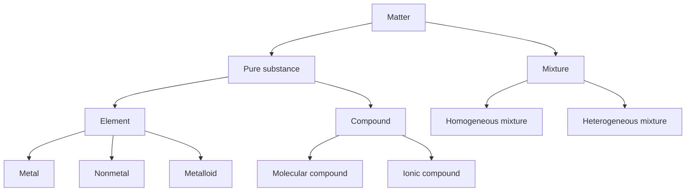
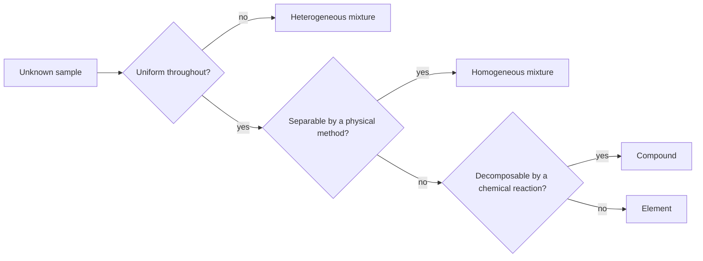
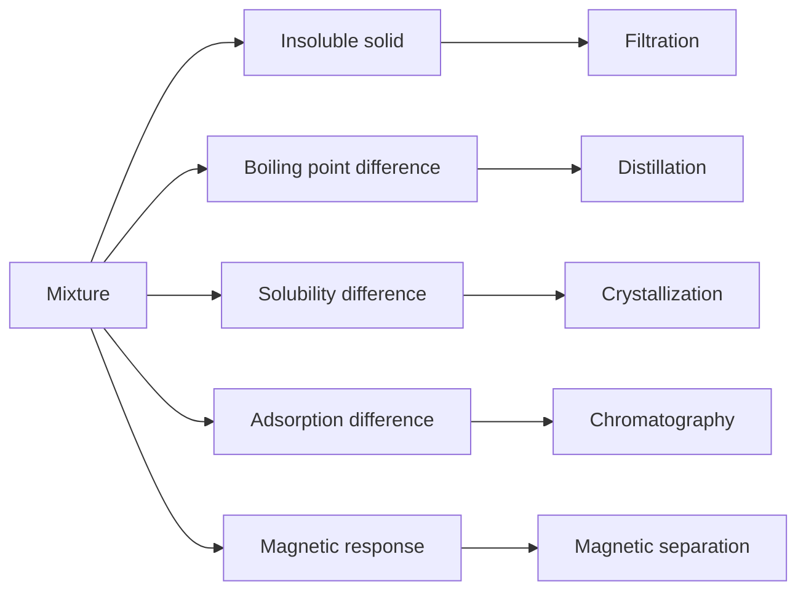
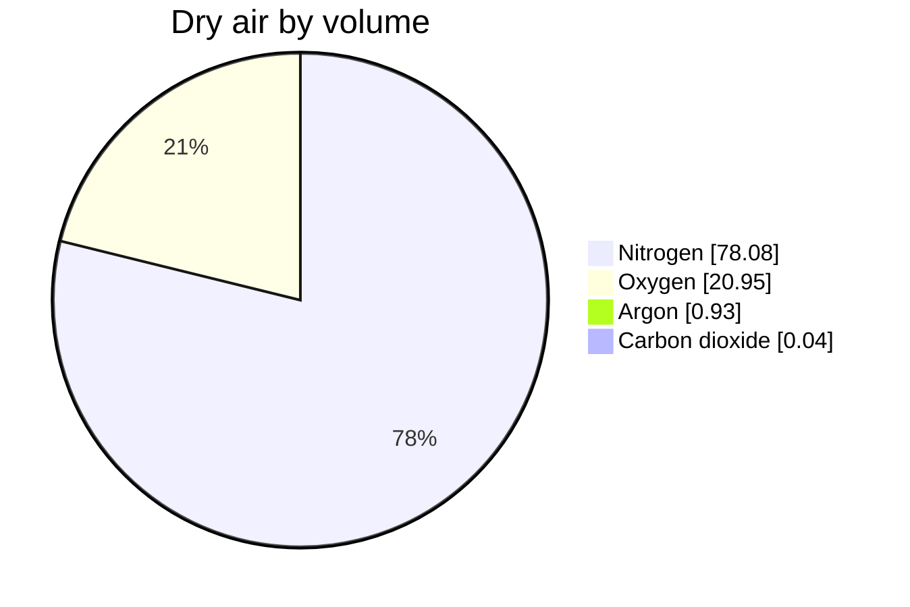

# Chapter 2 — Matter and Its Classification

> **Level:** Beginner (Level 0 — Foundations)
> **Estimated study time:** 3 hours (2 h reading + 1 h exercises)
> **Prerequisites:** [Chapter 1 — What Is Chemistry?](01-what-is-chemistry.md)
> **Related chapters:** [Solids, Liquids, Gases and Plasma](03-states-of-matter.md), [Physical and Chemical Properties and Changes](04-physical-and-chemical-properties-and-changes.md)
> **Difficulty:** ★☆☆☆☆ (1–5)

---

## 1. Learning Objectives

After working through this chapter you will be able to:

- Define matter, mass, volume and inertia, and distinguish mass from weight.
- Separate the material world into pure substances and mixtures, and justify each classification with evidence.
- Distinguish elements from compounds and homogeneous from heterogeneous mixtures.
- Reproduce and interpret the full classification tree for matter.
- Describe a particle-level picture for each category of matter.
- Select an experimental technique — melting point, boiling point, filtration, distillation or chromatography — that decides a given classification question.
- Distinguish extensive from intensive properties and give examples of each.
- Calculate density, mass percentage and mean molar mass for simple mixtures.

---

## 2. Introduction

Every material decision in chemistry begins with the same question: *what is this stuff?* A pharmacist must know whether a white powder is a single compound or a mixture; a metallurgist must know whether a bar is an alloy or a pure metal; an environmental chemist must know whether a water sample contains dissolved salts or suspended solids. Classification is not a labelling exercise. It determines which separation method will work, which analytical technique is appropriate, and which physical laws can be applied.

The classification system in this chapter is hierarchical and, at first sight, almost trivially simple: matter is either a pure substance or a mixture; a pure substance is either an element or a compound; a mixture is either homogeneous or heterogeneous. The difficulty lies not in the tree but in the evidence. "Pure" in chemistry does not mean "clean" or "natural" or "safe". It means that the composition is fixed and that no physical process can separate the sample into two or more different substances. Bottled water advertised as "pure" is a homogeneous mixture of water and dissolved ions; the label is marketing, not chemistry.

This chapter builds the classification, then attaches each branch to an observable test. It ends with the properties — density, melting point, boiling point — that make classification quantitative. The chapter assumes only Chapter 1: the idea that matter is particulate, and that macroscopic observations have submicroscopic explanations.

---

## 3. Fundamental Concepts

### 3.1 Matter, mass, volume and inertia

**Matter** is anything that has mass and occupies volume. Both criteria are needed. Light has energy and momentum but no rest mass and no definite volume; a thought has neither. Ordinary matter — rocks, air, water, living tissue — satisfies both.

- **Mass** ($m$) is a measure of the quantity of matter in a body. The SI unit is the kilogram. Mass is invariant: it does not change when the body is moved to the Moon.
- **Volume** ($V$) is the amount of three-dimensional space occupied. The SI unit is the cubic metre; the laboratory unit is the cubic centimetre or the millilitre, and $1\ \text{cm}^3 = 1\ \text{mL}$ exactly.
- **Inertia** is a body's resistance to a change in its state of motion. It is quantified by the same mass that appears in Newton's second law, $F = ma$.

**Weight** is different. Weight is the gravitational force on a body, $W = mg$, measured in newtons. A $1.00\ \text{kg}$ mass has a weight of $9.81\ \text{N}$ on Earth and about $1.62\ \text{N}$ on the Moon, but its mass remains $1.00\ \text{kg}$. Balances measure mass by comparison; spring scales measure weight.

### 3.2 Pure substances and mixtures

A **pure substance** has a definite, fixed composition and a set of characteristic properties that do not depend on how the sample was prepared. Pure water always contains hydrogen and oxygen in a $2:1$ atom ratio and always boils at $100\ ^\circ\text{C}$ at $1\ \text{atm}$. A **mixture** contains two or more substances that are not chemically combined; its composition can vary, and its components retain their individual properties.

The operational test is separation. A mixture can be separated into its components by **physical** processes — filtration, distillation, evaporation, chromatography, magnetic attraction — because the components are not bonded to one another in fixed ratios. A pure substance cannot be separated by any physical process; separating it requires a **chemical** reaction that breaks bonds.

This gives the first useful decision rule:

> If a sample can be separated into two or more substances with different properties by a physical method, it is a mixture. If it cannot, it is a pure substance.

### 3.3 Elements and compounds

A **pure substance** is either an element or a compound.

An **element** is a substance that cannot be decomposed into simpler substances by chemical means. It consists of a single kind of atom. Iron, sulfur, oxygen and argon are elements. Of the 118 confirmed elements, 94 occur naturally on Earth — two of them, technetium and promethium, only in trace amounts — and the rest are produced artificially in nuclear reactions.

A **compound** is a substance composed of two or more elements chemically combined in a fixed ratio by mass. Water, carbon dioxide, sodium chloride and glucose are compounds. A compound has properties that differ from those of its constituent elements: sodium is a soft, violently reactive metal and chlorine is a toxic gas, yet sodium chloride is a stable, edible solid.

Two laws summarize compound composition:

- The **law of definite proportions** (Proust): a given compound always contains the same elements in the same proportion by mass. Pure water is $11.19\%$ hydrogen and $88.81\%$ oxygen by mass, wherever it comes from.
- The **law of multiple proportions** (Dalton): when two elements form more than one compound, the masses of one element that combine with a fixed mass of the other are in a ratio of small whole numbers. Carbon and oxygen form $\ce{CO}$ and $\ce{CO2}$; for a fixed mass of carbon, the oxygen masses are in the ratio $1:2$.

### 3.4 Homogeneous and heterogeneous mixtures

A **homogeneous mixture**, or **solution**, has the same composition and properties throughout any sample, down to the molecular scale. Salt water, air, brass and vinegar are homogeneous. The components are mixed at the level of individual ions or molecules, so no boundary can be seen even with an optical microscope.

A **heterogeneous mixture** has composition that varies from point to point. The components are present in distinct regions or phases that can be seen, or at least detected with a microscope. Granite, sand and water, oil and water, and a chocolate chip cookie are heterogeneous.

The distinction is a matter of scale, not of appearance. Milk looks uniform to the eye but is a **colloid** — fat droplets roughly $0.1$–$10\ \mu\text{m}$ across dispersed in water. Such droplets scatter light (the Tyndall effect) and will eventually separate on standing. Colloids occupy the boundary between solutions and coarse suspensions; for classification purposes they are treated as heterogeneous at the particle level even when they look homogeneous.

### 3.5 Key terms

| Term | Working definition |
|---|---|
| Phase | A physically distinct, uniform region of a sample |
| Solution | A homogeneous mixture of two or more substances |
| Solute | The component present in the smaller amount in a solution |
| Solvent | The component present in the larger amount, or the one that dissolves the solute |
| Alloy | A homogeneous solid mixture of a metal with other elements |
| Colloid | A dispersion with particle sizes between about $1\ \text{nm}$ and $1\ \mu\text{m}$ |
| Suspension | A dispersion of particles large enough to settle on standing |
| Precipitate | A solid that forms from a solution during a chemical reaction |

---

## 4. Detailed Scientific Explanation

### 4.1 Why the classification is hierarchical

The tree has three successive questions, and each question removes an ambiguity left by the previous one.

1. **Is the composition fixed?** If not, the sample is a mixture. If yes, it is a pure substance.
2. **Can it be decomposed chemically?** If yes, it is a compound. If no, it is an element.
3. **Is it uniform at the particle scale?** This question applies only to mixtures: a mixture is homogeneous if the components are dispersed as individual atoms, ions or molecules, and heterogeneous if they form distinct regions.

The order matters. A homogeneous mixture such as brine is uniform, but its composition is not fixed — evaporate some water and the salt concentration rises. A compound such as $\ce{NaCl}$ has fixed composition and is also uniform. Uniformity alone therefore cannot distinguish a solution from a compound; only the fixed-composition and separability criteria can.

### 4.2 Particle-level pictures

Chemists describe each category with a schematic at the submicroscopic level. The pictures below are descriptions rather than drawings; each could be rendered as a box of circles.

| Category | Particle-level description |
|---|---|
| Element, metallic solid | Identical atoms packed in a regular lattice, with delocalized electrons between them |
| Element, molecular gas | Identical molecules, each containing one or a few identical atoms, far apart and moving rapidly |
| Compound, molecular | Identical molecules, each with a fixed number of atoms of each element in a fixed arrangement |
| Compound, ionic | A lattice of alternating cations and anions in a fixed ratio; no discrete molecules |
| Homogeneous mixture | Two or more kinds of particle mixed randomly at the atomic or molecular scale; composition uniform on average |
| Heterogeneous mixture | Two or more kinds of particle segregated into regions, so that composition varies from place to place |

Two consequences follow. First, a compound's particles are all identical, whereas a mixture contains more than one kind of particle. Second, an ionic compound contains ions but is electrically neutral overall because the charges balance exactly.

### 4.3 Deciding the category experimentally

Classification is settled by measurement, not by appearance.

**Melting point** is the most useful single test for purity. A pure crystalline solid melts over a very narrow range, typically less than $1\ ^\circ\text{C}$ at ordinary heating rates. An impure solid melts lower and over a wider range, because dissolved impurities disrupt the crystal lattice. A sharp melting point is strong evidence of purity; a broad range is strong evidence of contamination. The test is quick, requires only a few milligrams, and is standard practice in every synthesis laboratory.

**Boiling point** performs the same function for liquids. A pure liquid boils at a single temperature at a given pressure; a mixture boils over a range and, for ideal mixtures, the vapour becomes richer in the more volatile component as boiling proceeds.

**Filtration** separates an insoluble solid from a liquid. The solid is retained on the filter medium and the liquid passes through as the **filtrate**. It works only when one component is insoluble; it cannot separate dissolved salt from water.

**Distillation** separates components with different boiling points. The mixture is heated, the more volatile component vaporizes, and the vapour is condensed in a cooler. **Fractional distillation** repeats the vaporization–condensation cycle many times in a column and can resolve boiling points that differ by only a few degrees; it is the basis of petroleum refining and of the industrial separation of liquid air.

**Chromatography** separates components according to how strongly they adsorb on a stationary phase versus how readily they dissolve in a mobile phase. A component that prefers the mobile phase travels further. Paper chromatography of ink or of leaf pigments is the standard school demonstration; high-performance liquid chromatography and gas chromatography are its industrial descendants.

**Evaporation and crystallization** recover a dissolved solid from a solution by removing solvent. **Magnetic separation** removes ferromagnetic solids such as iron. **Sublimation** exploits the fact that some solids (iodine, naphthalene, solid carbon dioxide) pass directly to vapour, leaving non-volatile impurities behind.

### 4.4 Extensive and intensive properties

A property is **extensive** if its value depends on the amount of material: mass, volume, length, total heat capacity. A property is **intensive** if its value does not: density, melting point, boiling point, temperature, pressure, concentration, colour, refractive index, hardness.

Only intensive properties are diagnostic of identity. Two samples of pure aluminium of different size have different masses and volumes but the same density and melting point. Consequently, a classification argument based on mass or volume tells you nothing about what the substance is.

The distinction also has a practical edge. When a sample is divided into two equal parts, every extensive property halves, whereas every intensive property is unchanged. If a measured quantity changes when you take a subsample, it was extensive.

### 4.5 Composition of everyday mixtures

Most real materials are mixtures. Dry air is a homogeneous gas mixture of nitrogen ($78.08\%$ by volume), oxygen ($20.95\%$), argon ($0.93\%$), carbon dioxide ($0.04\%$) and trace gases. Seawater is a homogeneous mixture with a typical salinity of about $35\ \text{g}$ of dissolved salts per kilogram of solution. Brass is a homogeneous solid mixture of copper and zinc. Steel is iron with a small, controlled amount of carbon and other elements. Granite is heterogeneous: visibly distinct crystals of quartz, feldspar and mica.

Each of these can be separated by a physical process, which is precisely why none of them is a compound. Desalination distils seawater or forces it through a reverse-osmosis membrane; fractional distillation separates air; alloy components can in principle be separated by differences in volatility or by electrolysis.

---

## 5. Visual Diagrams

### 5.1 The classification tree

**Figure 2.1 — The classification tree for matter.** Every sample belongs to exactly one leaf of this tree. The tree is exhaustive: there is no fifth category of ordinary matter. Note that the branches on the left depend on chemical decomposability, whereas the branches on the right depend on uniformity of mixing. A common error is to place a homogeneous mixture under "pure substance" simply because it looks uniform; the tree forbids this, because mixtures are defined by variable composition, not by appearance.

### 5.2 The experimental decision path

**Figure 2.2 — A decision path from observation to classification.** The questions are ordered from cheapest and least destructive to most expensive. Uniformity is judged by eye or microscope, physical separability by filtration, distillation or chromatography, and chemical decomposability by electrolysis or thermal decomposition. Following the path in this order avoids unnecessary reactions: there is no reason to electrolyse a sample that filtration already resolves into two components.

### 5.3 Separation methods and the property they exploit

**Figure 2.3 — Separation techniques and the property each exploits.** A separation works only if the components differ in some physical property. Choosing a technique without identifying that property is guesswork. Filtration exploits particle size and insolubility, distillation exploits volatility, crystallization exploits temperature-dependent solubility, chromatography exploits differential affinity for two phases, and magnetic separation exploits ferromagnetism.

### 5.4 Composition of dry air

**Figure 2.4 — The composition of dry air by volume.** Nitrogen and oxygen account for $99.03\%$ of the volume; argon is the third most abundant gas, and carbon dioxide — the gas most discussed in climate science — is present at only $0.04\%$. The small slice is a reminder that abundance and importance are different quantities. Because air is a mixture, its composition can vary slightly with location and humidity, unlike the fixed composition of a compound.

---

## 6. Mathematical Formulas

### 6.1 Density

$$
\rho = \frac{m}{V}
$$

| Symbol | Meaning | SI unit |
|---|---|---|
| $\rho$ | density | kg m⁻³ |
| $m$ | mass | kg |
| $V$ | volume | m³ |

Density is intensive, so it can be used to identify a substance but not to determine how much of it is present.

### 6.2 Mass percentage

$$
w_{\text{A}} = \frac{m_{\text{A}}}{m_{\text{total}}} \times 100\%
$$

| Symbol | Meaning | SI unit |
|---|---|---|
| $w_{\text{A}}$ | mass fraction of component A, expressed as a percentage | % (dimensionless) |
| $m_{\text{A}}$ | mass of component A | kg |
| $m_{\text{total}}$ | total mass of the sample | kg |

This is the natural measure for solid mixtures and for solutions of solids in liquids. For seawater with $35\ \text{g}$ of salts per $1000\ \text{g}$ of solution, $w = 3.5\%$.

### 6.3 Volume percentage

$$
\phi_{\text{A}} = \frac{V_{\text{A}}}{V_{\text{total}}} \times 100\%
$$

For gas mixtures the volumes are additive to a good approximation at the same temperature and pressure, so volume percentage is the conventional measure. It is used for air composition and for ethanol–water mixtures, where the volumes are *not* exactly additive and the deviation must be stated.

### 6.4 Mean molar mass of a mixture

$$
\bar{M} = \sum_{i} x_i M_i
$$

| Symbol | Meaning | SI unit |
|---|---|---|
| $\bar{M}$ | mean molar mass of the mixture | g mol⁻¹ |
| $x_i$ | mole fraction of component $i$ | dimensionless |
| $M_i$ | molar mass of component $i$ | g mol⁻¹ |

For gases at the same temperature and pressure, volume fraction equals mole fraction, so volume percentages can be used directly as the $x_i$.

### 6.5 Mass balance in a separation

$$
m_{\text{initial}} = \sum m_{\text{fractions}} + m_{\text{loss}}
$$

Every separation must satisfy this balance. A recovery of $101\%$ indicates contamination or incomplete drying; a recovery of $85\%$ indicates material lost on the apparatus or during transfer. Reporting the balance is part of reporting the method.

---

## 7. Chemical Equations

### 7.1 Decomposition of water by electrolysis

$$
\ce{2H2O(l) -> 2H2(g) + O2(g)}
$$

This reaction proves that water is a compound and not a mixture of hydrogen and oxygen: the gases are produced in a fixed $2:1$ volume ratio, and the mass of water consumed equals the combined mass of the gases. A mixture of hydrogen and oxygen could be made in any proportion, and it would not need electrolysis to separate.

### 7.2 Decomposition of mercury(II) oxide

$$
\ce{2HgO(s) -> 2Hg(l) + O2(g)}
$$

Heating red mercury(II) oxide yields liquid mercury and oxygen gas. Joseph Priestley isolated a gas by this route in the 1770s, and Lavoisier used the result in constructing his oxygen theory of combustion. The equation shows a compound decomposing into its elements, which is the definitive chemical evidence that $\ce{HgO}$ is a compound.

### 7.3 Thermal decomposition of calcium carbonate

$$
\ce{CaCO3(s) -> CaO(s) + CO2(g)}
$$

At about $900\ ^\circ\text{C}$, limestone decomposes to quicklime and carbon dioxide. This is the first step in cement manufacture and a classic test for a carbonate: the gas evolved turns limewater milky.

$$
\ce{CO2(g) + Ca(OH)2(aq) -> CaCO3(s) + H2O(l)}
$$

### 7.4 Formation of water from its elements

$$
\ce{2H2(g) + O2(g) -> 2H2O(l)}
$$

The reverse of the electrolysis reaction. Together the two equations show that the change is reversible in principle, but they also show why the products of electrolysis cannot simply be called a mixture: the $2:1$ ratio is enforced by the composition of water itself.

---

## 8. Worked Examples

### Worked Example 8.1 — Classifying six samples

**Problem.** Classify each sample as an element, a compound, a homogeneous mixture or a heterogeneous mixture, and give the decisive evidence: (a) graphite; (b) dry ice, solid $\ce{CO2}$; (c) brass; (d) granite; (e) a filtered, colourless solution of table salt in water; (f) ozone, $\ce{O3}$.

**Strategy.** Ask three questions in order: fixed composition? decomposable chemically? uniform at the particle scale?

**Solution.**

| Sample | Classification | Decisive evidence |
|---|---|---|
| Graphite | Element | Composed only of carbon atoms; cannot be decomposed chemically |
| Dry ice | Compound | Fixed composition, $27.29\%$ C and $72.71\%$ O by mass; it sublimes as intact $\ce{CO2}$ molecules and can be decomposed into carbon and oxygen only under severe conditions |
| Brass | Homogeneous mixture | Copper and zinc in a variable ratio; the composition differs between grades |
| Granite | Heterogeneous mixture | Visible crystals of different minerals with distinct boundaries |
| Salt solution | Homogeneous mixture | Uniform, but evaporating the water recovers salt; composition can be varied at will |
| Ozone | Element | Composed only of oxygen atoms; all atoms are the same element |

**Check.** Every sample is assigned to exactly one leaf of the tree in Figure 2.1, and each assignment is supported by a physical or chemical observation rather than by appearance. Note that brass and the salt solution are both homogeneous mixtures despite being a solid and a liquid respectively; the state of matter is irrelevant to the classification.

### Worked Example 8.2 — Using melting points to judge purity

**Problem.** Two white crystalline samples are believed to be the same compound. Sample A melts at $156.0$–$156.8\ ^\circ\text{C}$. Sample B softens at $148\ ^\circ\text{C}$ and is completely liquid at $156\ ^\circ\text{C}$. Which sample is pure, and what does the comparison suggest about sample B?

**Strategy.** A pure crystalline solid melts sharply, typically over less than $1\ ^\circ\text{C}$. Impurities depress the melting point and broaden the range.

**Solution.** Sample A melts over $0.8\ ^\circ\text{C}$, which is consistent with a pure substance. Sample B melts over an $8\ ^\circ\text{C}$ range and begins melting $8\ ^\circ\text{C}$ below A, which is the signature of an impure sample: the impurity disrupts the crystal lattice, lowering the temperature at which the solid collapses and smearing the transition over a range.

**Check.** The upper end of B's range coincides with A's melting point, which is what happens when a sample is the same compound contaminated by a small amount of impurity — the impurity lowers the start of melting but the bulk still melts near the true value. A definitive identification would require comparing the melting point with literature data and confirming with a spectroscopic method such as infrared or nuclear magnetic resonance spectroscopy.

### Worked Example 8.3 — Mass balance in a separation

**Problem.** A $50.00\ \text{g}$ sample of a sand–salt mixture is treated with water, filtered, and the sand is dried. The dry sand weighs $32.15\ \text{g}$. The filtrate is evaporated to dryness, leaving $17.60\ \text{g}$ of salt. Calculate the mass percentage of each component, and comment on the recovery.

**Strategy.** Each component's mass percentage is its recovered mass divided by the original mass. The sum of the recovered masses should equal the original mass within experimental error.

**Solution.**

$$
m_{\text{recovered}} = 32.15\ \text{g} + 17.60\ \text{g} = 49.75\ \text{g}
$$

$$
w_{\text{sand}} = \frac{32.15}{50.00} \times 100\% = 64.30\%
\qquad
w_{\text{salt}} = \frac{17.60}{50.00} \times 100\% = 35.20\%
$$

$$
\text{recovery} = \frac{49.75}{50.00} \times 100\% = 99.50\%
$$

**Check.** The two percentages sum to $99.50\%$, matching the recovery exactly, because both are calculated on the same original mass. The missing $0.25\ \text{g}$ is $0.50\%$ of the sample, a plausible loss from transfer, filtration and drying. A recovery above $100\%$ would be a warning that the "dry" sand retained water or that the salt had absorbed moisture.

### Worked Example 8.4 — Mean molar mass of dry air

**Problem.** Using the volume percentages $78.08\%$ $\ce{N2}$, $20.95\%$ $\ce{O2}$, $0.93\%$ $\ce{Ar}$ and $0.04\%$ $\ce{CO2}$, calculate the mean molar mass of dry air. Use $M(\ce{N2}) = 28.014$, $M(\ce{O2}) = 31.998$, $M(\ce{Ar}) = 39.948$ and $M(\ce{CO2}) = 44.01\ \text{g mol}^{-1}$.

**Strategy.** Convert percentages to mole fractions (dividing by 100), multiply each by its molar mass, and sum.

**Solution.**

$$
\bar{M} = 0.7808(28.014) + 0.2095(31.998) + 0.0093(39.948) + 0.0004(44.01)
$$

$$
\bar{M} = 21.87 + 6.70 + 0.37 + 0.02 = 28.96\ \text{g mol}^{-1}
$$

**Check.** The mean molar mass lies between that of pure nitrogen ($28.01$) and pure oxygen ($32.00$), close to nitrogen's value because nitrogen dominates the mixture. This is the expected result and is the reason air is often approximated as having $M \approx 29\ \text{g mol}^{-1}$ in rough calculations.

---

## 9. Real-World Applications

**Water treatment.** Drinking water is classified and treated by exactly these criteria: suspended solids are removed by filtration or coagulation, dissolved ions by ion exchange or reverse osmosis, and dissolved organic compounds by activated carbon adsorption or advanced oxidation.

**Desalination.** Reverse osmosis and multi-stage flash distillation separate a homogeneous mixture — seawater — into potable water and concentrated brine. The classification of seawater as a mixture, not a compound, is what makes the separation physically possible.

**Air separation.** Liquid air is fractionally distilled at temperatures of about $80\ \text{K}$ to produce nitrogen, argon and oxygen on an industrial scale. The differing boiling points of the components of a homogeneous mixture are the whole basis of the process.

**Metallurgy and alloys.** Steel, brass and bronze are homogeneous solid mixtures whose properties depend on composition. Classifying them as mixtures rather than compounds explains why their properties vary continuously with composition, whereas a compound has a fixed melting point.

**Forensic and clinical analysis.** Chromatography separates mixtures in blood, urine or ink; mass spectrometry then identifies the components. A doping test that reports a "positive" result is a classification claim supported by a chromatographic separation and a spectroscopic identification.

**Food and pharmaceuticals.** Purity specifications for a drug substance are written in terms of chromatographic purity and melting or boiling range. A pharmaceutical "pure" substance is typically at least $98\%$ single compound; the remainder is a mixture of impurities whose limits are set by regulators.

---

## 10. Common Mistakes

| Mistake | Why it happens | Correct approach |
|---|---|---|
| Treating "pure" as a marketing word meaning clean or natural | Everyday language | In chemistry, pure means fixed composition and not physically separable |
| Calling a homogeneous mixture a compound | Both look uniform | Test for separable components and variable composition |
| Calling an element a compound because it contains atoms of different isotopes | Isotopes are the same element | An element is defined by atomic number, not by isotopic composition |
| Thinking filtration can remove dissolved salt | The solid disappears on stirring, so it seems to vanish | Dissolved ions pass through the filter; use distillation or reverse osmosis |
| Concluding purity from a single sharp melting point alone | Sharp melting is strong but not sufficient evidence | Confirm identity independently, for example by spectroscopy or mixed melting point |
| Using mass or volume as evidence of identity | Both are extensive | Use intensive properties: density, melting point, refractive index, spectra |
| Assuming a colloid is a true solution because it looks clear | Particle size is below visual resolution | Check for the Tyndall effect and for settling; colloids are heterogeneous at the particle scale |

---

## 11. Chapter Summary

- Matter is anything with mass and volume; mass is invariant, weight depends on gravity.
- Pure substances have fixed composition and cannot be separated by physical methods; mixtures can.
- Elements cannot be decomposed chemically; compounds contain two or more elements in a fixed ratio by mass.
- Homogeneous mixtures are uniform at the particle scale; heterogeneous mixtures contain distinct regions. Colloids are intermediate but are heterogeneous at the particle level.
- Classification must be justified by evidence: sharp melting point, sharp boiling point, filtration, distillation, chromatography or chemical decomposition.
- Density, melting point, boiling point and concentration are intensive and can identify a substance; mass and volume are extensive and cannot.
- Every separation must satisfy a mass balance, and the recovery percentage must be reported.

---

## 12. Exercises

### 12.1 Conceptual questions

1. Explain why a compound is a pure substance whereas a homogeneous mixture is not, even though both appear uniform.
2. Distinguish between an element and a compound, and give one example of each that is a gas at room temperature.

### 12.2 Basic problems

3. Classify each sample: (a) tap water; (b) diamond; (c) air; (d) brass; (e) dry ice; (f) granite.
4. Name the most appropriate separation technique for each task: (a) sand from water; (b) salt from seawater; (c) the pigments in a green leaf; (d) ethanol from a fermentation mixture; (e) iron filings from sulfur powder.

### 12.3 Intermediate problems

5. A clear, colourless liquid boils sharply at $78.4\ ^\circ\text{C}$ at $1\ \text{atm}$ and leaves no residue on evaporation. Another clear liquid boils between $75$ and $82\ ^\circ\text{C}$. Which is likely pure? Justify your answer and name one further test.
6. Explain why melting point is an intensive property while mass is extensive. Give one further example of each.

### 12.4 Advanced problems

7. Design a procedure to separate a mixture of iron filings, sand and sodium chloride into three pure components. State the order of the steps, the property exploited at each step, and one precaution.
8. Milk appears homogeneous but is classified as a colloid. Explain, using particle size and the Tyndall effect, why it is not a true solution, and state whether it is homogeneous or heterogeneous at the particle scale.

### 12.5 Calculation problems

9. A $25.00\ \text{g}$ sample of a sand–salt mixture is extracted with water. After filtration and drying, $14.20\ \text{g}$ of sand remains. Calculate the mass percentage of sodium chloride in the original mixture.
10. Using the composition of dry air given in Figure 2.4, calculate the mass percentage of nitrogen in dry air. Use $\bar{M} = 28.96\ \text{g mol}^{-1}$.

### 12.6 Answers

1. A compound has a fixed composition and cannot be separated physically; a homogeneous mixture has variable composition and can be separated physically.
2. Element: argon or oxygen. Compound: carbon dioxide or water vapour.
3. (a) homogeneous mixture; (b) element; (c) homogeneous mixture; (d) homogeneous mixture; (e) compound; (f) heterogeneous mixture.
4. (a) filtration; (b) evaporation or distillation; (c) chromatography; (d) fractional distillation; (e) magnetic separation.
5. The first liquid; a sharp boiling point and no residue indicate a pure substance. Confirm with a refractive index or a chromatographic purity test.
6. Melting point does not change when the sample size changes; mass doubles when the amount doubles. Other intensive: density, refractive index. Other extensive: volume, total heat capacity.
7. Magnet removes iron; add water and filter to remove sand; evaporate the filtrate to recover sodium chloride. Precaution: dry the sand completely before weighing, and wash it with a little water to remove adhering salt.
8. Fat droplets of $0.1$–$10\ \mu\text{m}$ scatter light and cream on standing; they are not dispersed as individual molecules, so milk is heterogeneous at the particle scale.
9. $m(\ce{NaCl}) = 25.00 - 14.20 = 10.80\ \text{g}$; $w = 10.80/25.00 \times 100\% = 43.2\%$.
10. Mass of nitrogen per mole of air $= 0.7808 \times 28.014 = 21.87\ \text{g}$; $w = 21.87/28.96 \times 100\% = 75.5\%$.

> Worked solutions for this level are maintained in the `solutions/` directory of the level.

---

## 13. Further Reading

- OpenStax, *Chemistry 2e*, Rice University, Chapter 1 ("Essential Ideas"), Sections 1.2–1.3 on the classification and properties of matter. <https://openstax.org/details/books/chemistry-2e>
- Atkins, P.; Jones, L. *Chemical Principles: The Quest for Insight*, 7th ed., W. H. Freeman. The opening chapter develops the particulate view used here.
- IUPAC. *Compendium of Chemical Terminology* (the "Gold Book"), 2nd ed. (corrected version), entries "mixture", "phase" and "solution". <https://goldbook.iupac.org/>
- Skoog, D. A.; West, D. M.; Holler, F. J.; Crouch, S. R. *Fundamentals of Analytical Chemistry*, Cengage. The early chapters treat separation methods systematically.
- [Chapter 1 — What Is Chemistry?](01-what-is-chemistry.md) for the three levels of representation used throughout this chapter.
- [Chapter 3 — Solids, Liquids, Gases and Plasma](03-states-of-matter.md) for the states in which these classifications appear.
- [CURRICULUM.md](../CURRICULUM.md) and [REFERENCES.md](../REFERENCES.md) for the wider programme and the verified source list.

> Only sources that can be checked are cited here. No DOI, page number or edition is invented.
