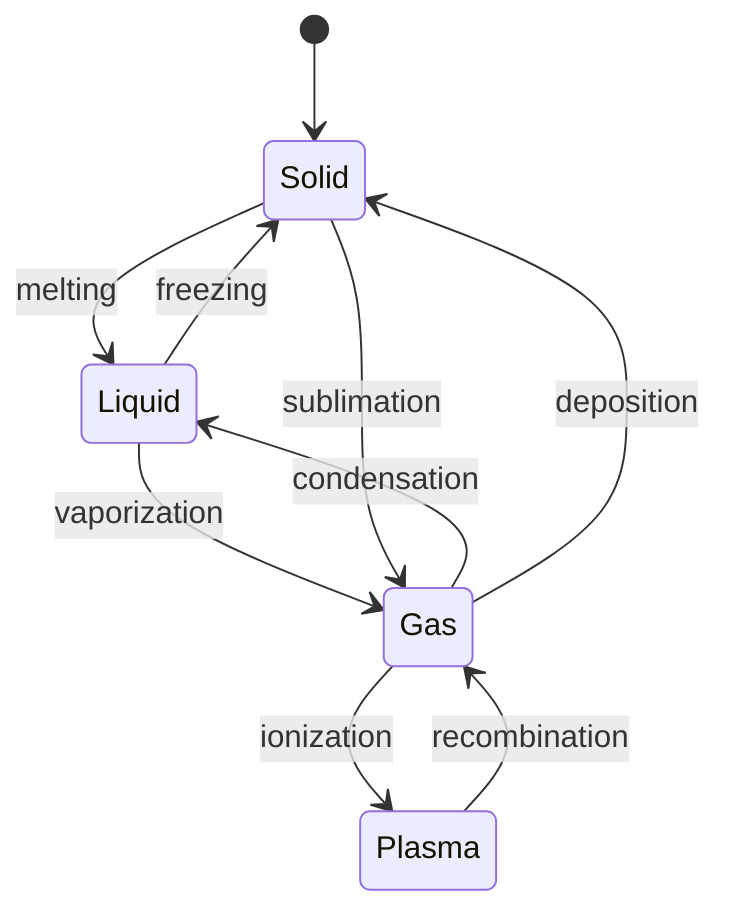
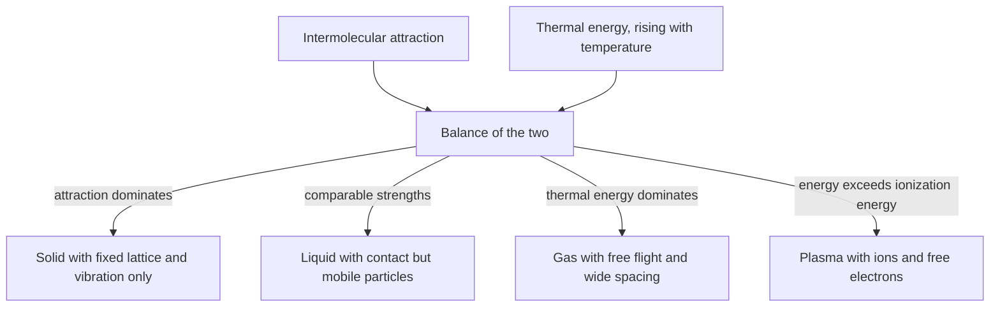
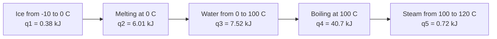
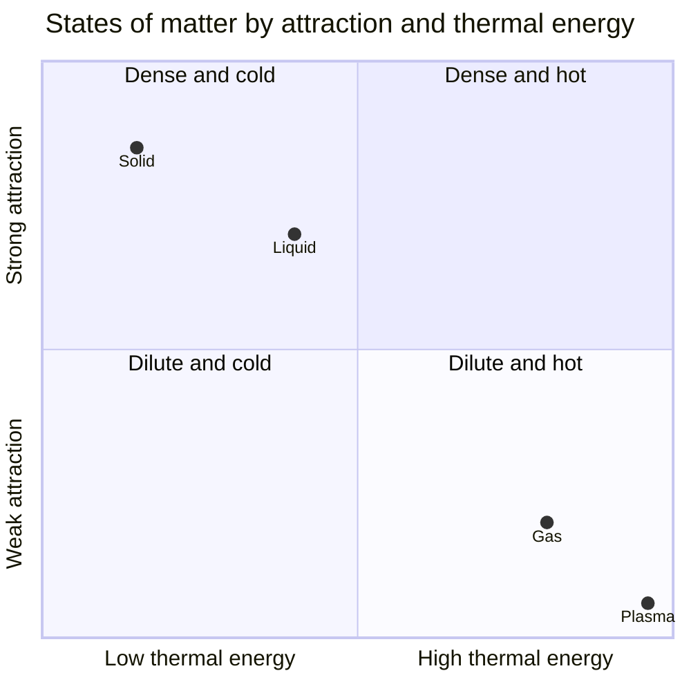

# Chapter 3 — Solids, Liquids, Gases and Plasma

> **Level:** Beginner (Level 0 — Foundations)
> **Estimated study time:** 3 hours (2 h reading + 1 h exercises)
> **Prerequisites:** [Chapter 2 — Matter and Its Classification](02-matter-and-its-classification.md)
> **Related chapters:** [What Is Chemistry?](01-what-is-chemistry.md), [Matter and Its Classification](02-matter-and-its-classification.md)
> **Difficulty:** ★☆☆☆☆ (1–5)

---

## 1. Learning Objectives

After working through this chapter you will be able to:

- Describe the four common states of matter at the particle level and explain each in terms of the balance between thermal energy and intermolecular attraction.
- Compare solids, liquids, gases and plasmas in shape, volume, compressibility, density and diffusion.
- State the assumptions of the kinetic molecular theory and identify where the ideal-gas model breaks down.
- Name every common phase change correctly and state whether it is endothermic or exothermic.
- Interpret a heating curve for water and calculate the energy required for each segment using specific and latent heats.
- Describe the properties of plasma and give four real examples.
- Explain what a supercritical fluid and a liquid crystal are, and give one application of each.
- Explain water's density anomaly and one ecological consequence.

---

## 2. Introduction

The same substance can behave in radically different ways depending on how much energy its particles possess. Water is a rigid solid at $-20\ ^\circ\text{C}$, a mobile liquid at $20\ ^\circ\text{C}$, and an invisible gas at $120\ ^\circ\text{C}$. Nothing about the water molecule changes across these transitions: the same two hydrogen atoms remain bonded to the same oxygen atom. What changes is the arrangement and motion of the molecules relative to one another.

This observation is the foundation of the kinetic molecular model, and it is one of the most productive ideas in science. It explains why gases are compressible and liquids are not, why evaporation cools a surface, why pressure rises when a sealed container is heated, and why steam at $100\ ^\circ\text{C}$ burns far more severely than water at the same temperature.

The chapter begins with the four states — solid, liquid, gas and plasma — and the energy balance that selects between them. It then treats phase changes quantitatively with heating curves, and closes with two extensions that matter in modern technology: supercritical fluids and liquid crystals. One deliberate exception runs through the chapter: water, whose solid is less dense than its liquid. That anomaly is not a curiosity; it is why lakes freeze from the top and why life survives winter in temperate latitudes.

No mathematics beyond multiplication and division is required, although the energy calculations in Section 8 use the specific-heat equation introduced in Section 6.

---

## 3. Fundamental Concepts

### 3.1 The four common states

A **state of matter** is a physically distinct form of a substance characterized by the arrangement and mobility of its particles. Four states occur commonly on Earth and in the laboratory.

A **solid** has a definite shape and a definite volume. Its particles occupy fixed average positions and can only vibrate about those positions. Crystalline solids have long-range order; amorphous solids such as glass have short-range order only.

A **liquid** has a definite volume but no definite shape: it takes the shape of the lower part of its container and forms a free surface. Its particles are close together but mobile, able to slide past one another while remaining in contact.

A **gas** has neither definite shape nor definite volume. It expands to fill any container and is highly compressible because its particles are far apart relative to their own size.

A **plasma** is an ionized gas containing a significant number of free electrons and positive ions. It is electrically conductive and responds strongly to magnetic fields. Although rare on Earth's surface, plasma is the most abundant state of visible matter in the universe: stars, including the Sun, are plasma.

### 3.2 The energy–attraction balance

Two competing quantities determine the state:

- **Thermal energy**, the kinetic energy of the particles, which increases with temperature and tends to disperse them.
- **Intermolecular attraction**, the electrostatic force between molecules or ions, which tends to hold them together.

The state is set by the ratio of the two. When attraction dominates, particles are locked into a lattice and the substance is a solid. When the two are comparable, particles retain contact but move past one another, giving a liquid. When thermal energy greatly exceeds attraction, particles travel freely and the substance is a gas. When thermal energy is so large that electrons are torn from atoms, the result is a plasma.

This is a simplified model, and it should be labelled as one. It treats intermolecular forces as a single quantity when in reality they have several contributions (dispersion, dipole–dipole, hydrogen bonding, ionic attraction). It also says nothing about the *rate* at which a state change occurs; that is the domain of kinetics.

### 3.3 The kinetic molecular theory

The **kinetic molecular theory** (KMT) explains the macroscopic behaviour of gases with five assumptions:

1. A gas consists of particles whose volume is negligible compared with the volume of the container.
2. Particles move randomly and continuously in straight lines until they collide.
3. Collisions between particles, and with the walls, are perfectly elastic: no kinetic energy is lost.
4. There are no attractive or repulsive forces between particles except during collisions.
5. The average kinetic energy of the particles is proportional to the absolute temperature.

Assumptions 1 and 4 define the **ideal gas**, a model that real gases approach at low pressure and high temperature. Real gases deviate because molecules do have volume and do attract one another; the deviation becomes large near condensation, where attraction is about to win. The van der Waals equation corrects for both effects and is met in Level 2.

KMT explains the observable properties directly. Pressure is the average force per unit area exerted by particles colliding with the walls. Raising the temperature increases the average kinetic energy and therefore the collision rate and impulse, so pressure rises at constant volume. Compressibility follows from the large empty space between particles. Diffusion follows from random motion.

### 3.4 Phase changes and their names

A **phase change** is a transition between states. The standard names are worth memorizing precisely, because they appear in every later chapter of the curriculum.

| Transition | Name | Energy change |
|---|---|---|
| Solid → liquid | Melting (fusion) | Endothermic |
| Liquid → solid | Freezing (solidification) | Exothermic |
| Liquid → gas | Vaporization (evaporation below the boiling point; boiling at it) | Endothermic |
| Gas → liquid | Condensation | Exothermic |
| Solid → gas | Sublimation | Endothermic |
| Gas → solid | Deposition | Exothermic |
| Gas → plasma | Ionization | Endothermic |
| Plasma → gas | Recombination (deionization) | Exothermic |

The pattern is simple: every transition that increases the separation or freedom of particles requires energy, and every reverse transition releases it. The magnitude of the energy is the **latent heat** of that transition.

Two distinctions are often blurred. **Evaporation** occurs at any temperature from the liquid surface; **boiling** occurs throughout the liquid when its vapour pressure equals the external pressure. Both are vaporization. Similarly, **melting** is the IUPAC-preferred term for solid → liquid, while **fusion** is the older synonym still used in "heat of fusion".

### 3.5 Key terms

| Term | Working definition |
|---|---|
| Intermolecular force | An attractive or repulsive force between molecules, weaker than a covalent bond |
| Lattice | The regular repeating arrangement of particles in a crystalline solid |
| Vapour pressure | The pressure exerted by a vapour in equilibrium with its liquid or solid |
| Boiling point | The temperature at which vapour pressure equals the external pressure |
| Latent heat | The energy absorbed or released per mole during a phase change at constant temperature |
| Specific heat capacity | The energy needed to raise the temperature of $1\ \text{kg}$ of a substance by $1\ \text{K}$ |
| Supercritical fluid | A substance above both its critical temperature and critical pressure, with no distinct liquid–gas boundary |
| Liquid crystal | A phase with liquid-like mobility but partial orientational or positional order |

---

## 4. Detailed Scientific Explanation

### 4.1 Solids

In a crystalline solid, particles occupy the sites of a periodic lattice held together by intermolecular forces, ionic attraction, metallic bonding or covalent bonding. The lattice has long-range order: the environment of a particle repeats identically throughout the crystal. The external shape of a crystal reflects this internal order, which is why quartz forms hexagonal prisms and sodium chloride forms cubes.

Particles in a solid vibrate about their lattice sites with amplitudes that grow as temperature rises. Melting occurs when the amplitude of vibration becomes large enough that the particles can escape their sites and the lattice collapses. The temperature at which this happens is the **melting point**, and for a pure crystalline substance it is sharp. Amorphous solids such as glass and rubber do not melt sharply; they soften over a temperature range, because their particles are not in equivalent environments.

### 4.2 Liquids

A liquid retains short-range order — each particle is surrounded by neighbours at roughly the right distance — but loses long-range order. The particles are in constant motion, sliding past one another on a timescale of picoseconds while remaining in continuous contact. This explains the combination of definite volume and indefinite shape.

Three properties follow from the balance of forces:

- **Surface tension** arises because molecules at the surface have fewer neighbours than those in the bulk and are therefore pulled inward. It is why small droplets are spherical and why some insects can walk on water.
- **Viscosity** is resistance to flow. It depends on the strength of intermolecular forces and on molecular shape. Liquids become *less* viscous as temperature rises, because thermal motion helps molecules slip past one another; gases become *more* viscous, because their viscosity is governed by momentum transfer through collisions.
- **Vapour pressure** is the pressure of vapour in equilibrium with the liquid. It rises steeply with temperature, because a larger fraction of molecules has enough energy to escape the surface. A liquid boils when its vapour pressure reaches the external pressure; at high altitude, where atmospheric pressure is lower, water boils below $100\ ^\circ\text{C}$.

### 4.3 Gases

Gas particles are separated by distances that are large compared with their own diameters — at ambient conditions, roughly ten molecular diameters apart — so the container is mostly empty space. This accounts for the high compressibility and low density of gases: at $1\ \text{atm}$ and $25\ ^\circ\text{C}$, a gas is typically about a thousand times less dense than the corresponding liquid.

Gas particles move at hundreds of metres per second. The root-mean-square speed of nitrogen molecules at $298\ \text{K}$ is about $515\ \text{m s}^{-1}$, comparable to the speed of sound in the same gas (about $349\ \text{m s}^{-1}$). Diffusion is rapid because of this motion, although a molecule's path is a zigzag of collisions; the net displacement is much slower than the instantaneous speed.

The ideal-gas model treats particles as points with no interactions. It is accurate for most gases at ordinary pressures, but it fails near the conditions where a gas liquefies, where attractions reduce the pressure below the ideal prediction. It also fails at very high pressures, where the volume of the molecules themselves becomes significant.

### 4.4 Plasma

A plasma is produced when a gas receives enough energy to ionize a substantial fraction of its atoms or molecules, freeing electrons from nuclei. The result is a **quasi-neutral** collection of positive ions and free electrons: on scales larger than the Debye length the net charge is essentially zero, but locally there are strong electric fields.

Three properties distinguish plasma from an ordinary gas:

- **Electrical conductivity.** Free electrons carry current, so plasma responds to electric and magnetic fields. This is exploited in plasma televisions, fluorescent lamps and tokamak fusion reactors.
- **Collective behaviour.** Because the particles are charged, their motion generates fields that affect other particles at a distance. A plasma supports waves and instabilities that a neutral gas cannot.
- **Radiation.** Free electrons recombine with ions and emit photons, which is why plasmas glow.

Examples span an enormous range of temperature and density. A neon sign contains a low-pressure glow discharge with electron temperatures of order $10^4\ \text{K}$ while the glass stays close to room temperature. Lightning creates a channel of plasma at roughly $30\,000\ \text{K}$ for a few tens of microseconds. The Sun's visible surface is about $5800\ \text{K}$, while its corona reaches $10^6\ \text{K}$. The Earth's ionosphere is a dilute plasma maintained by solar ultraviolet ionization. Beyond these, degenerate matter in white dwarfs and the quark–gluon plasma produced in particle colliders are further states that lie outside this chapter's scope.

### 4.5 Phase changes and the heating curve

Energy added to a substance does not always raise its temperature. During a phase change, the added energy goes into breaking intermolecular contacts rather than increasing kinetic energy, so the temperature remains constant. The energy required per mole is the **latent heat** (or molar enthalpy) of the transition:

- For water at $0\ ^\circ\text{C}$: $\Delta H_{\text{fus}} = 6.01\ \text{kJ mol}^{-1}$.
- For water at $100\ ^\circ\text{C}$: $\Delta H_{\text{vap}} = 40.7\ \text{kJ mol}^{-1}$.

A **heating curve** plots temperature against heat added. It has sloping segments, where one phase warms up, and flat plateaus, where a phase change occurs. For water at $1\ \text{atm}$ the curve has two plateaus: one at $0\ ^\circ\text{C}$ (melting) and one at $100\ ^\circ\text{C}$ (boiling). The boiling plateau is much longer than the melting plateau, because vaporization requires about $6.8$ times as much energy per mole as melting. Physically, melting only allows molecules to escape their lattice sites, whereas vaporization must separate them completely against the same attractive forces.

The enthalpy of sublimation is the sum of the enthalpies of fusion and vaporization at the same temperature. At $0\ ^\circ\text{C}$, $\Delta H_{\text{sub}} = 6.01 + 45.05 = 51.06\ \text{kJ mol}^{-1}$. This is a useful consistency check: a sublimation enthalpy that is not greater than either of its components is wrong.

### 4.6 Supercritical fluids

Every substance has a **critical point**: a critical temperature $T_\text{c}$ above which it cannot be liquefied by pressure alone, and a critical pressure $p_\text{c}$. Above both, the liquid and gas phases become indistinguishable, and the substance is a **supercritical fluid**.

Supercritical fluids combine properties of both phases: densities comparable to a liquid, viscosities and diffusivities comparable to a gas, and a density that can be tuned continuously by changing pressure and temperature. Supercritical carbon dioxide ($T_\text{c} = 304.1\ \text{K}$, $p_\text{c} = 7.38\ \text{MPa}$) is used industrially to decaffeinate coffee and to extract flavour compounds, because it leaves no toxic solvent residue and its solvating power can be switched off simply by depressurizing. Supercritical water ($T_\text{c} = 647.1\ \text{K}$, $p_\text{c} = 22.06\ \text{MPa}$) is used in oxidation processes for destroying hazardous waste.

### 4.7 Liquid crystals

A **liquid crystal** is a phase in which molecules retain orientational order — they point on average in a common direction — while their centres of mass are mobile, as in a liquid. The **nematic** phase has orientational order only; the **smectic** phase has orientational order plus a layered positional order; the **cholesteric** phase has a helical twist of the director.

Liquid crystals are the working material of liquid-crystal displays. An applied electric field reorients the molecules, changing the optical properties of the cell and therefore the brightness of each pixel. The same phases occur in biological membranes and in soap–water mixtures, where they are called lyotropic liquid crystals.

### 4.8 The exception: water's density anomaly

Most substances are denser as solids than as liquids. Water is not. At $0\ ^\circ\text{C}$, ice has a density of $0.9167\ \text{g cm}^{-3}$, while liquid water at $0\ ^\circ\text{C}$ has $0.9998\ \text{g cm}^{-3}$. Ice therefore floats.

The cause is the hydrogen-bonded structure of ice. Each water molecule can donate two hydrogen bonds and accept two, and the tetrahedral geometry of these bonds forces an open, hexagonal lattice with substantial empty space. When ice melts, the lattice collapses partially and molecules pack more closely, so the density increases. On further heating, the remaining hydrogen-bonded clusters break up and the density continues to rise until about $3.98\ ^\circ\text{C}$, where water reaches its maximum density of $999.97\ \text{kg m}^{-3}$. Above that temperature, ordinary thermal expansion dominates and the density falls again.

The ecological consequence is large. Because water at $4\ ^\circ\text{C}$ is denser than water at $0\ ^\circ\text{C}$, a cooling lake circulates and then stratifies with the densest water at the bottom. Ice forms at the surface and insulates the water below, so lakes freeze from the top down and aquatic organisms survive the winter in liquid water. If ice were denser than water, lakes would freeze from the bottom up and most freshwater life in temperate latitudes would be destroyed each winter.

---

## 5. Visual Diagrams

### 5.1 Transitions between the states

**Figure 3.1 — The phase-change network.** Each arrow is a distinct physical process with its own latent heat; opposite arrows are reverse processes with equal and opposite enthalpy changes (at the same temperature and pressure). The diagram makes an important point explicit: any two states are connected, but the direct solid–gas route is not simply the sum of the two-step route in terms of mechanism, only in terms of overall energy.

### 5.2 Energy against attraction

**Figure 3.2 — The energy–attraction balance that selects the state.** Moving from solid to plasma is not four unrelated phenomena but one trend: an increasing ratio of thermal energy to binding energy. The same figure explains why substances with strong intermolecular forces, such as water, are liquid at temperatures where weaker substances such as methane are already gases.

### 5.3 The heating curve for water

**Figure 3.3 — The five stages of heating $1.00\ \text{mol}$ ($18.0\ \text{g}$) of water from $-10\ ^\circ\text{C}$ to $120\ ^\circ\text{C}$ at $1\ \text{atm}$.** The values are calculated in Worked Example 8.1. The sequence alternates three sloping segments, in which one phase warms up, with two plateaus, in which the temperature is constant while a phase change occurs. Vaporization alone accounts for $40.7$ of the $55.3\ \text{kJ}$ total, which is why steam carries so much more energy than boiling water at the same temperature.

| Stage | Temperature range | Energy / kJ | Cumulative / kJ |
|---|---|---|---|
| Warming ice | $-10$ to $0\ ^\circ\text{C}$ | 0.38 | 0.38 |
| Melting | $0\ ^\circ\text{C}$ (constant) | 6.01 | 6.39 |
| Warming water | $0$ to $100\ ^\circ\text{C}$ | 7.52 | 13.91 |
| Boiling | $100\ ^\circ\text{C}$ (constant) | 40.7 | 54.6 |
| Warming steam | $100$ to $120\ ^\circ\text{C}$ | 0.72 | 55.3 |

### 5.4 Where the four states sit

**Figure 3.4 — A qualitative map of the states.** The axes are deliberately unlabelled numerically, because the boundaries depend on the substance. The useful reading is directional: increasing temperature at fixed attraction moves a substance upward and to the right, through melting and then vaporization, while increasing pressure effectively moves it toward stronger attraction. The map also shows why plasma requires exceptionally high thermal energy: it must overcome not intermolecular attraction but the far stronger electrostatic binding of electrons in atoms.

---

## 6. Mathematical Formulas

### 6.1 Energy to change temperature

$$
q = mc\Delta T
$$

| Symbol | Meaning | SI unit |
|---|---|---|
| $q$ | heat transferred | J |
| $m$ | mass | kg |
| $c$ | specific heat capacity | J kg⁻¹ K⁻¹ |
| $\Delta T$ | temperature change, $T_{\text{final}} - T_{\text{initial}}$ | K |

Assumption: no phase change occurs over the interval, and $c$ is constant over that range. For water, $c = 4.18\ \text{J g}^{-1}\ \text{K}^{-1} = 4.18 \times 10^{3}\ \text{J kg}^{-1}\ \text{K}^{-1}$; for ice, $2.09\ \text{J g}^{-1}\ \text{K}^{-1}$; for steam, $2.01\ \text{J g}^{-1}\ \text{K}^{-1}$.

### 6.2 Energy to change phase

$$
q = n\Delta H_{\text{phase}}
$$

| Symbol | Meaning | SI unit |
|---|---|---|
| $q$ | heat transferred | J |
| $n$ | amount of substance | mol |
| $\Delta H_{\text{phase}}$ | molar enthalpy of the transition | J mol⁻¹ |

The temperature is constant during the transition, so this term is added separately from the $mc\Delta T$ terms.

### 6.3 Average kinetic energy and molecular speed

For an ideal gas,

$$
\langle E_\text{k} \rangle = \frac{3}{2}k_\text{B}T
\qquad
v_{\text{rms}} = \sqrt{\frac{3RT}{M}}
$$

| Symbol | Meaning | SI unit |
|---|---|---|
| $\langle E_\text{k} \rangle$ | mean kinetic energy per particle | J |
| $k_\text{B}$ | Boltzmann constant, $1.380\,649 \times 10^{-23}$ | J K⁻¹ |
| $R$ | molar gas constant, $8.314$ | J K⁻¹ mol⁻¹ |
| $T$ | thermodynamic temperature | K |
| $v_{\text{rms}}$ | root-mean-square speed | m s⁻¹ |
| $M$ | molar mass, in kg mol⁻¹ | kg mol⁻¹ |

The formula shows that mean kinetic energy depends only on temperature, not on the identity of the gas, whereas the speed depends on molar mass: lighter molecules move faster at the same temperature.

### 6.4 Density

$$
\rho = \frac{m}{V}
$$

| Symbol | Meaning | SI unit |
|---|---|---|
| $\rho$ | density | kg m⁻³ |
| $m$ | mass | kg |
| $V$ | volume | m³ |

For water at $3.98\ ^\circ\text{C}$, $\rho = 999.97\ \text{kg m}^{-3}$; for ice at $0\ ^\circ\text{C}$, $\rho = 916.7\ \text{kg m}^{-3}$.

---

## 7. Chemical Equations

Phase changes are written with the state symbols and the associated enthalpy.

### 7.1 Melting and freezing of water

$$
\ce{H2O(s) -> H2O(l)}
\qquad \Delta H^\circ_{\text{fus}} = +6.01\ \text{kJ mol}^{-1}
$$

$$
\ce{H2O(l) -> H2O(s)}
\qquad \Delta H^\circ_{\text{freeze}} = -6.01\ \text{kJ mol}^{-1}
$$

The two values are equal in magnitude and opposite in sign, as they must be for a reversible transition at the melting point.

### 7.2 Vaporization and condensation of water

$$
\ce{H2O(l) -> H2O(g)}
\qquad \Delta H^\circ_{\text{vap}} = +40.7\ \text{kJ mol}^{-1}
$$

$$
\ce{H2O(g) -> H2O(l)}
\qquad \Delta H^\circ_{\text{cond}} = -40.7\ \text{kJ mol}^{-1}
$$

Both values refer to $100\ ^\circ\text{C}$ and $1\ \text{atm}$. At $25\ ^\circ\text{C}$ the vaporization enthalpy is larger, about $44.0\ \text{kJ mol}^{-1}$, because the liquid must first be heated to the boiling point in the conceptual cycle. Quoting a latent heat without its temperature is therefore incomplete.

### 7.3 Sublimation and deposition of carbon dioxide

$$
\ce{CO2(s) -> CO2(g)}
\qquad \Delta H_{\text{sub}} \approx +25\ \text{kJ mol}^{-1}
$$

Solid carbon dioxide sublimes at $1\ \text{atm}$ at $194.7\ \text{K}$ ($-78.5\ ^\circ\text{C}$), which is why "dry ice" produces a dense white vapour without a liquid phase. The enthalpy is quoted at the sublimation temperature and is approximate; the exact value depends on temperature.

### 7.4 Ionization and recombination in an argon plasma

$$
\ce{Ar(g) -> Ar+(g) + e-}
\qquad \Delta H_{\text{ion}} = +15.76\ \text{eV per atom}
$$

$$
\ce{Ar+(g) + e- -> Ar(g)}
\qquad \Delta H_{\text{rec}} = -15.76\ \text{eV per atom}
$$

The ionization energy is quoted in electronvolts because that is the natural unit at the atomic scale; $1\ \text{eV}$ per particle corresponds to $96.485\ \text{kJ mol}^{-1}$, so the molar ionization energy of argon is about $1.52 \times 10^{3}\ \text{kJ mol}^{-1}$.

---

## 8. Worked Examples

### Worked Example 8.1 — The full heating curve for water

**Problem.** Calculate the total energy required to convert $18.0\ \text{g}$ of ice at $-10.0\ ^\circ\text{C}$ into steam at $120.0\ ^\circ\text{C}$ at $1\ \text{atm}$. Use $c_{\text{ice}} = 2.09$, $c_{\text{water}} = 4.18$, $c_{\text{steam}} = 2.01\ \text{J g}^{-1}\ \text{K}^{-1}$, $\Delta H_{\text{fus}} = 6.01\ \text{kJ mol}^{-1}$ and $\Delta H_{\text{vap}} = 40.7\ \text{kJ mol}^{-1}$.

**Strategy.** Divide the path into five segments: warming ice, melting, warming water, boiling, warming steam. Use $q = mc\Delta T$ for the sloping segments and $q = n\Delta H$ for the plateaus.

**Solution.** The amount of water is

$$
n = \frac{18.0\ \text{g}}{18.02\ \text{g mol}^{-1}} = 0.999\ \text{mol} \approx 1.00\ \text{mol}
$$

Segment 1, warming ice:

$$
q_1 = 18.0\ \text{g} \times 2.09\ \text{J g}^{-1}\ \text{K}^{-1} \times 10.0\ \text{K} = 376\ \text{J} = 0.376\ \text{kJ}
$$

Segment 2, melting at constant temperature:

$$
q_2 = 1.00\ \text{mol} \times 6.01\ \text{kJ mol}^{-1} = 6.01\ \text{kJ}
$$

Segment 3, warming liquid water:

$$
q_3 = 18.0 \times 4.18 \times 100.0 = 7524\ \text{J} = 7.52\ \text{kJ}
$$

Segment 4, boiling at constant temperature:

$$
q_4 = 1.00\ \text{mol} \times 40.7\ \text{kJ mol}^{-1} = 40.7\ \text{kJ}
$$

Segment 5, warming steam:

$$
q_5 = 18.0 \times 2.01 \times 20.0 = 724\ \text{J} = 0.724\ \text{kJ}
$$

The total is

$$
q_{\text{total}} = 0.376 + 6.01 + 7.52 + 40.7 + 0.724 = 55.3\ \text{kJ}
$$

**Check.** Vaporization accounts for $40.7/55.3 = 73.6\%$ of the energy, which is consistent with the general rule that vaporization dominates the energy budget of a heating curve. The sloping segments together contribute only $8.6\ \text{kJ}$, about $16\%$. A result in which the melting plateau exceeded the boiling plateau would signal a transcription error, since $\Delta H_{\text{vap}} \gg \Delta H_{\text{fus}}$ for water.

### Worked Example 8.2 — The density of ice and water

**Problem.** A $100.0\ \text{g}$ sample of water at $20\ ^\circ\text{C}$ occupies $100.2\ \text{mL}$. The same mass of ice at $0\ ^\circ\text{C}$ occupies $109.1\ \text{mL}$. Calculate both densities in $\text{g cm}^{-3}$, find the percentage volume expansion on freezing, and comment.

**Strategy.** Use $\rho = m/V$ with $1\ \text{mL} = 1\ \text{cm}^{3}$.

**Solution.** For liquid water,

$$
\rho_{\text{water}} = \frac{100.0\ \text{g}}{100.2\ \text{cm}^{3}} = 0.998\ \text{g cm}^{-3}
$$

For ice,

$$
\rho_{\text{ice}} = \frac{100.0\ \text{g}}{109.1\ \text{cm}^{3}} = 0.917\ \text{g cm}^{-3}
$$

The volume expansion on freezing is

$$
\frac{109.1 - 100.2}{100.2} \times 100\% = 8.9\%
$$

**Check.** The ratio $\rho_{\text{ice}}/\rho_{\text{water}} = 0.917/0.998 = 0.919$ agrees with the tabulated ratio $916.7/999.8 = 0.917$ within rounding. An $8.9\%$ expansion is the reason water pipes burst when they freeze and the reason ice floats: the solid is about $8\%$ less dense than the liquid.

### Worked Example 8.3 — Molecular speeds and the meaning of temperature

**Problem.** Calculate the root-mean-square speed of nitrogen molecules at $298\ \text{K}$. Use $M(\ce{N2}) = 28.014\ \text{g mol}^{-1}$ and $R = 8.314\ \text{J K}^{-1}\ \text{mol}^{-1}$.

**Strategy.** Convert the molar mass to $\text{kg mol}^{-1}$, then apply $v_{\text{rms}} = \sqrt{3RT/M}$.

**Solution.**

$$
M = 28.014\ \text{g mol}^{-1} = 0.028014\ \text{kg mol}^{-1}
$$

$$
v_{\text{rms}} = \sqrt{\frac{3 \times 8.314 \times 298}{0.028014}}
= \sqrt{2.653 \times 10^{5}}\ \text{m s}^{-1}
= 515\ \text{m s}^{-1}
$$

**Check.** The speed of sound in nitrogen at $298\ \text{K}$ is about $349\ \text{m s}^{-1}$. For an ideal diatomic gas the speed of sound is $\sqrt{\gamma RT/M}$ with $\gamma = 1.4$, which gives $0.683\,v_{\text{rms}} = 352\ \text{m s}^{-1}$, in agreement with the measured value. This confirms that the order of magnitude is right. The result also shows why gas diffusion is fast on a laboratory timescale, and why the same calculation for a heavier gas such as $\ce{CO2}$ ($M = 44.01\ \text{g mol}^{-1}$) gives a lower speed, about $411\ \text{m s}^{-1}$.

---

## 9. Real-World Applications

**Cryogenics and food.** Liquid nitrogen boils at $77\ \text{K}$ and is used to freeze food, preserve biological samples and cool superconducting magnets. Dry ice sublimes at $194.7\ \text{K}$ and keeps shipments cold without leaving a liquid residue.

**Steam and power generation.** A large share of the world's electricity is generated by boiling water and expanding the steam through a turbine. The large latent heat of vaporization means that a great deal of energy is carried by steam, and the condensation step in a power station is where the latent heat is rejected to the environment.

**Refrigeration and heat pumps.** A refrigerant is alternately vaporized and condensed in a closed loop; it absorbs latent heat when it evaporates in the cold region and releases it when it condenses in the warm region. The same principle warms a building in winter.

**Plasma technology.** Fluorescent lamps, neon signs, plasma cutting torches, semiconductor etching and plasma-assisted coating all rely on glow discharges. Fusion research aims to confine a hydrogen plasma at $10^8\ \text{K}$ long enough for nuclei to fuse.

**Supercritical fluids.** Supercritical carbon dioxide decaffeinates coffee and extracts hops and essential oils; supercritical water oxidizes hazardous organic waste. The tunable density allows the solvent strength to be adjusted without changing the solvent.

**Liquid crystal displays.** Televisions, monitors and phone screens use nematic liquid crystals whose orientation is switched by an electric field. The same physics appears in thermochromic strips that change colour with temperature.

**Water and climate.** The density anomaly stabilizes lakes in winter, and the large specific heat capacity of water moderates coastal climates. Sea ice floating on the Arctic Ocean insulates the water beneath and reflects sunlight, both of which affect regional and global climate.

---

## 10. Common Mistakes

| Mistake | Why it happens | Correct approach |
|---|---|---|
| Saying "gas particles do not attract each other" | The ideal-gas model assumes no attraction | Real gases do attract; the assumption is a simplification valid at low pressure and high temperature |
| Claiming temperature rises during boiling | Heat is being added continuously | During a phase change the added energy breaks intermolecular contacts, so temperature stays constant |
| Confusing evaporation with boiling | Both are vaporization | Evaporation occurs at the surface at any temperature; boiling occurs throughout the liquid at the boiling point |
| Using the latent heat of vaporization at $100\ ^\circ\text{C}$ for a process at $25\ ^\circ\text{C}$ | The tabulated value is the familiar one | Use the enthalpy at the relevant temperature, or include the heating and cooling segments |
| Believing ice is denser than water because solids are usually denser | The generalization is taught before the exception | Ice is about $8\%$ less dense than water because of its open hydrogen-bonded lattice |
| Treating plasma as "just a hot gas" | Both are gases in appearance | Plasma contains free charges, conducts electricity and exhibits collective behaviour |
| Thinking a supercritical fluid is a very dense gas | The name suggests a gas | Above the critical point there is a single phase with intermediate, tunable properties |
| Using degrees Celsius in gas-law calculations | Laboratory thermometers report Celsius | Thermodynamic relations require absolute temperature in kelvin |

---

## 11. Chapter Summary

- The state of matter is set by the balance between thermal energy and intermolecular attraction.
- Solids have fixed lattice positions; liquids are mobile but cohesive; gases are widely spaced and free; plasmas are ionized and electrically conductive.
- KMT explains pressure, compressibility and diffusion, and defines the ideal gas as a model that real gases approach at low pressure and high temperature.
- Phase changes have precise names: melting, freezing, vaporization, condensation, sublimation, deposition, ionization and recombination.
- During a phase change, temperature is constant and the energy supplied is the latent heat; the vaporization plateau dominates the heating curve for water.
- Supercritical fluids and liquid crystals are intermediate states with major technological uses.
- Water's density maximum at $3.98\ ^\circ\text{C}$ is a consequence of its hydrogen-bonded structure and has profound ecological consequences.

---

## 12. Exercises

### 12.1 Conceptual questions

1. Explain, in terms of the kinetic molecular theory, why a gas fills its container while a liquid does not.
2. Explain why sublimation is endothermic and deposition is exothermic, using the idea of separating particles.

### 12.2 Basic problems

3. Name the phase change in each case: (a) solid to gas; (b) gas to liquid; (c) liquid to solid; (d) gas to plasma; (e) solid to liquid.
4. Match each description to a state: (a) definite volume, no definite shape; (b) neither definite shape nor volume; (c) both definite shape and volume; (d) ionized and electrically conductive.

### 12.3 Intermediate problems

5. Steam at $100\ ^\circ\text{C}$ causes more severe burns than liquid water at $100\ ^\circ\text{C}$. Explain quantitatively, using the latent heat of vaporization.
6. Explain why water reaches its maximum density at about $3.98\ ^\circ\text{C}$ rather than at $0\ ^\circ\text{C}$, and give one ecological consequence.

### 12.4 Advanced problems

7. Explain why a heating curve has flat plateaus, and why the plateau at $100\ ^\circ\text{C}$ for water is much longer than the plateau at $0\ ^\circ\text{C}$.
8. Explain why supercritical carbon dioxide is preferred to liquid organic solvents for decaffeinating coffee, referring to at least two physical properties.

### 12.5 Calculation problems

9. Calculate the energy needed to heat $50.0\ \text{g}$ of liquid water from $20.0\ ^\circ\text{C}$ to $60.0\ ^\circ\text{C}$. Use $c = 4.18\ \text{J g}^{-1}\ \text{K}^{-1}$.
10. Calculate the total energy required to convert $36.0\ \text{g}$ of ice at $0.0\ ^\circ\text{C}$ into steam at $100.0\ ^\circ\text{C}$. Use $\Delta H_{\text{fus}} = 6.01\ \text{kJ mol}^{-1}$, $\Delta H_{\text{vap}} = 40.7\ \text{kJ mol}^{-1}$ and $c_{\text{water}} = 4.18\ \text{J g}^{-1}\ \text{K}^{-1}$.

### 12.6 Answers

1. Gas particles have enough kinetic energy to overcome attraction and travel throughout the container; liquid particles remain in contact because attraction holds them together.
2. Sublimation separates particles that were in contact, so energy is required; deposition forms contacts, so energy is released.
3. (a) sublimation; (b) condensation; (c) freezing; (d) ionization; (e) melting.
4. (a) liquid; (b) gas; (c) solid; (d) plasma.
5. Condensation of $1.00\ \text{g}$ of steam releases about $2.26\ \text{kJ}$ — enough to heat $1.00\ \text{g}$ of water from $0$ to $100\ ^\circ\text{C}$ about five times over.
6. Melting collapses part of the open hydrogen-bonded lattice, so density rises; above $3.98\ ^\circ\text{C}$ thermal expansion dominates. Consequence: ice floats and lakes freeze from the top, allowing aquatic life to survive.
7. During a phase change the energy supplied increases potential energy rather than kinetic energy, so temperature is constant. $\Delta H_{\text{vap}} = 40.7\ \text{kJ mol}^{-1}$ is about $6.8$ times $\Delta H_{\text{fus}} = 6.01\ \text{kJ mol}^{-1}$.
8. Carbon dioxide has a modest critical temperature ($304.1\ \text{K}$), so it is easily brought above its critical point; its density and solvent power are tunable with pressure; and it is non-toxic and leaves no residue after depressurization.
9. $q = 50.0 \times 4.18 \times 40.0 = 8.36 \times 10^{3}\ \text{J} = 8.36\ \text{kJ}$.
10. $n = 2.00\ \text{mol}$; melting $= 12.0\ \text{kJ}$; warming $= 36.0 \times 4.18 \times 100 = 15.0\ \text{kJ}$; boiling $= 81.4\ \text{kJ}$; total $= 108.5\ \text{kJ} \approx 1.1 \times 10^{2}\ \text{kJ}$.

> Worked solutions for this level are maintained in the `solutions/` directory of the level.

---

## 13. Further Reading

- OpenStax, *Chemistry 2e*, Rice University, Chapter 10 ("Liquids and Solids") and Chapter 9 ("Gases"). <https://openstax.org/details/books/chemistry-2e>
- Atkins, P.; Jones, L. *Chemical Principles: The Quest for Insight*, 7th ed., W. H. Freeman. The chapters on states of matter and phase equilibria give the quantitative treatment.
- Atkins, P.; de Paula, J.; Keeler, J. *Atkins' Physical Chemistry*, Oxford University Press. The standard reference for phase diagrams, critical phenomena and liquid crystals.
- IUPAC. *Compendium of Chemical Terminology* (the "Gold Book"), 2nd ed. (corrected version), entries "plasma", "mesophase" and "critical temperature". <https://goldbook.iupac.org/>
- NIST. *CODATA Internationally Recommended Values of the Fundamental Physical Constants*. <https://physics.nist.gov/cuu/Constants/>
- [Chapter 2 — Matter and Its Classification](02-matter-and-its-classification.md) for the classification of matter used here.
- [CURRICULUM.md](../CURRICULUM.md) and [REFERENCES.md](../REFERENCES.md) for the wider programme and the verified source list.

> Only sources that can be checked are cited here. No DOI, page number or edition is invented.
