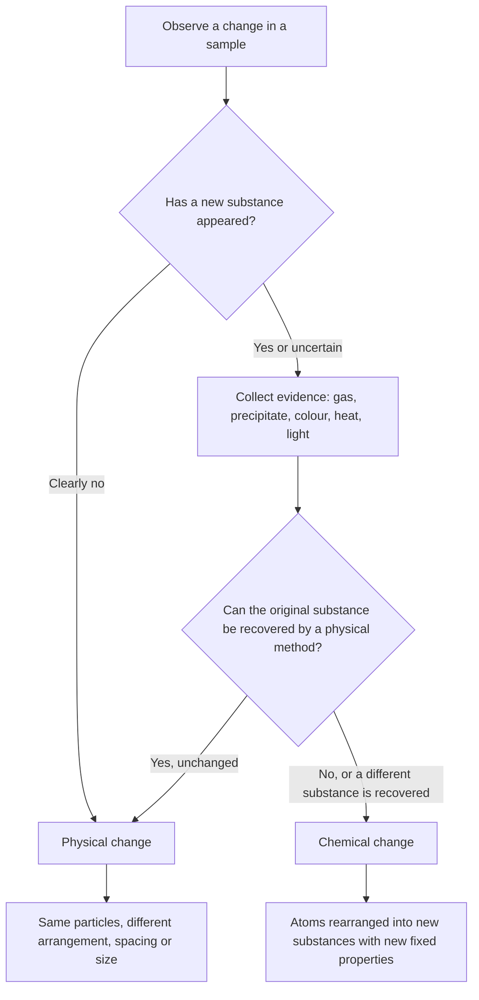
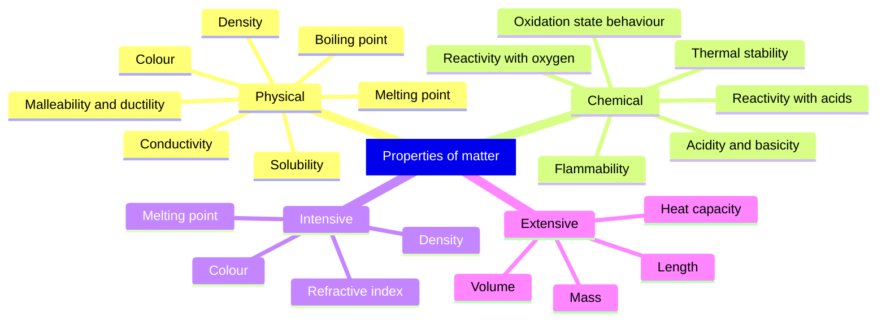
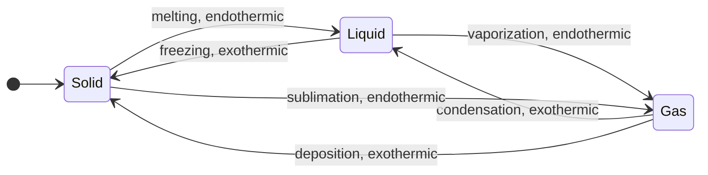
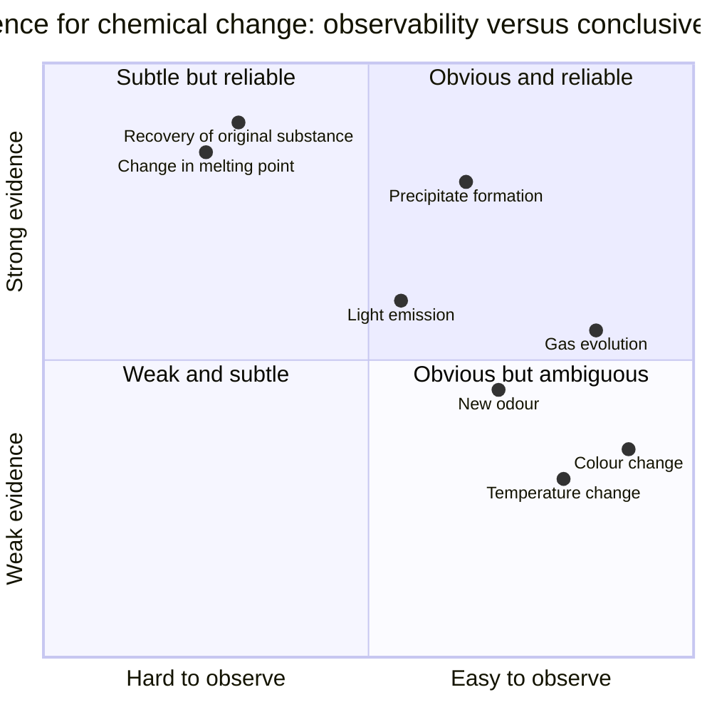

# Chapter 4 — Physical and Chemical Properties and Changes

> **Level:** 0 — Foundations
> **Estimated study time:** 3 hours (reading 2 h + exercises 1 h)
> **Prerequisites:** [Chapter 2 — Matter and Its Classification](02-matter-and-its-classification.md) and [Chapter 3 — Solids, Liquids, Gases and Plasma](03-states-of-matter.md)
> **Related chapters:** [Chapter 5 — Elements, Compounds and Mixtures](05-elements-compounds-and-mixtures.md), [Chapter 8 — Chemical Symbols and Formulas](08-chemical-symbols-and-formulas.md)
> **Difficulty:** ★☆☆☆☆

---

## 1. Learning Objectives

After working through this chapter you will be able to:

- Distinguish a **property** from a **change**, and use the grammatical and experimental tests that separate them.
- Classify a property as **intensive** or **extensive**, and explain why intensive properties are used to identify substances.
- List and define the common **physical properties** and recognize the physical changes that alter only arrangement, spacing or size.
- List and define the common **chemical properties** and recognize the chemical changes that produce new substances.
- Evaluate the five standard pieces of **evidence for chemical change** and explain why none of them is conclusive on its own.
- Explain why **reversibility** is not a reliable criterion for classifying a change.
- Apply **conservation of mass** to open and closed systems, as preparation for the quantitative treatment of equations in Level 1, Chapter 8 and later stoichiometry.
- Design a simple experimental strategy that distinguishes a physical from a chemical change.

---

## 2. Introduction

Strike a match and hold a cool glass above the flame. The match blackens, a gas forms, heat and light are released, and a film of water condenses on the glass. Now drop an ice cube into the same glass. The ice disappears, but the glass contains liquid water that can be frozen back into ice. Both events are conspicuous changes. Only the first has made new substances.

Chemistry is largely the study of that difference. A **physical change** alters the form of a substance without altering its chemical identity; a **chemical change**, or **chemical reaction**, converts one set of substances into another with different composition and different properties. Every later topic in this curriculum depends on this distinction. Stoichiometry (Level 1), equilibrium (Level 2) and thermodynamics (Level 3) all presuppose that we can tell what has reacted, what has merely dissolved, and what has simply changed phase.

The distinction also has economic weight. Corrosion, almost entirely a set of unwanted chemical changes, is estimated by the NACE IMPACT study to cost the world economy roughly 3 % of global GDP each year. Food spoilage, drug degradation and the fading of pigments are chemical changes; the melting of a glacier and the evaporation of a solvent are physical ones. An engineer who confuses the two will specify the wrong container, the wrong coating or the wrong storage temperature.

This chapter assumes only Chapter 2 (matter is classified as elements, compounds and mixtures) and Chapter 3 (the three common states and their interconversion). The treatment is deliberately operational: you will learn how a chemist *decides*, using measurements rather than appearances, which class a given change belongs to. The full thermodynamics that explains *why* reactions release energy arrives much later; here we need only the vocabulary and the experimental logic.

---

## 3. Fundamental Concepts

### 3.1 Property versus change

A **property** is a characteristic of a substance that can be observed or measured. A **change** is a process in which one or more properties alter with time. The two are related but not interchangeable: a property is a disposition that a sample has at a given moment, while a change is an event with a before-state and an after-state.

The simplest grammatical test is useful in the laboratory notebook. Properties are described with "is" or "has": copper *is* reddish-brown, *is* dense, *has* a melting point of 1358 K. Changes are described with a verb of transformation: copper *tarnishes*, *melts*, *conducts* — the last is a property disguised as a verb, which is why the test needs the experimental criterion as well.

| Feature | Property | Change |
|---|---|---|
| What it is | A measurable or observable characteristic | A process that alters characteristics |
| When it is observed | At a single state of the sample | Across a before-and-after interval |
| Example | Density of ethanol is $789\ \mathrm{kg\,m^{-3}}$ | Ethanol evaporates from an open dish |
| Experimental signature | A value, a colour, a response | A difference between two measurements |
| Typical question | "What is it like?" | "What happened to it?" |

### 3.2 Intensive and extensive properties

An **extensive property** depends on the amount of material. Mass, volume, length, total heat capacity and total charge are extensive: double the sample and you double the value.

An **intensive property** does not depend on the amount. Density, melting point, boiling point, colour, refractive index, electrical conductivity and concentration are intensive: a 1 g piece of copper and a 1 kg bar have the same density and the same melting point.

The distinction matters for identification. Because an intensive property is a fingerprint of the substance rather than of the sample, it can be compared with tabulated values. A measured density of $8.96\ \mathrm{g\,cm^{-3}}$ at 293 K identifies copper, whether the sample is a coin or a roofing sheet.

| Property | Class | Reason |
|---|---|---|
| Mass | Extensive | Doubles when the sample doubles |
| Volume | Extensive | Doubles when the sample doubles |
| Density | Intensive | Ratio of two extensive quantities |
| Melting point | Intensive | A temperature, independent of amount |
| Heat capacity | Extensive | Energy needed to raise the whole sample by 1 K |
| Specific heat capacity | Intensive | Energy per kilogram per kelvin |
| Electrical conductivity | Intensive | Normalized by geometry in its definition |
| Colour | Intensive | A spectral response per unit of material |

A useful rule: the ratio of two extensive properties is intensive. Density is mass divided by volume; specific heat capacity is heat capacity divided by mass; concentration is amount divided by volume. This is why density survives when a sample is cut in half, and why a "large" sample is not necessarily a "dense" one.

### 3.3 Physical properties and physical changes

A **physical property** is a property that can be measured without changing the chemical identity of the substance. A **physical change** is a change in which no new substance is formed: the particles keep their chemical identity, but their arrangement, spacing, motion or size changes.

The core physical properties are:

- **Colour** — the wavelengths of visible light the substance absorbs, transmits or reflects; qualitative, but quantifiable as a reflectance or absorption spectrum.
- **Density** — mass per unit volume, $\rho = m/V$, measured in $\mathrm{kg\,m^{-3}}$ (practical unit $\mathrm{g\,cm^{-3}}$).
- **Melting point** — the temperature at which solid and liquid are in equilibrium at a stated pressure, in K (or °C).
- **Boiling point** — the temperature at which the vapour pressure equals the external pressure, in K.
- **Electrical conductivity** — the ability to carry current, in $\mathrm{S\,m^{-1}}$; metals and graphite conduct, most molecular solids do not.
- **Thermal conductivity** — the ability to carry heat, in $\mathrm{W\,m^{-1}\,K^{-1}}$.
- **Malleability and ductility** — the ability to be hammered into sheets or drawn into wires without fracture.
- **Hardness** — resistance to scratching, often compared on the dimensionless Mohs scale.
- **Solubility** — the maximum mass of solute that dissolves in a stated mass of solvent at a stated temperature.
- **Refractive index** — the ratio of the speed of light in vacuum to that in the medium; dimensionless.

Physical changes include all six changes of state (melting, freezing, vaporization, condensation, sublimation, deposition), dissolution of a solid in a liquid, dilution of a solution, cutting, grinding, bending, crushing, mixing of unlike substances, crystallization, filtration, distillation and chromatography. In each case the substance or substances can, in principle, be recovered unchanged by a physical method.

### 3.4 Chemical properties and chemical changes

A **chemical property** describes how a substance behaves when it reacts: its tendency to combine with oxygen, to displace another element from a compound, to donate or accept protons, or to decompose on heating. Chemical properties are *dispositional*: they are potentialities, and they can only be observed by allowing the corresponding change to occur.

The core chemical properties are:

- **Flammability** — the ability to burn in oxygen or air, characterized by an ignition temperature and a flammability limit.
- **Reactivity** — the tendency to react with a named partner: oxygen, water, acids, halogens, or another element.
- **Oxidizing or reducing behaviour** — the ability to increase or decrease the oxidation state of another element; manganese in $\ce{KMnO4}$ is a strong oxidizer, carbon in coke is a reductant.
- **Acidity or basicity** — the ability to donate or accept protons, or to produce $\ce{H3O+}$ or $\ce{OH-}$ in water.
- **Thermal stability** — the temperature at which a compound decomposes; $\ce{CaCO3}$ decomposes near 900 °C in a lime kiln.
- **Tendency to polymerize** — the ability of molecules such as ethene to link into long chains.

A **chemical change** produces one or more new substances with different composition and different properties. Combustion, rusting, tarnishing, fermentation, respiration, photosynthesis, digestion, neutralization, precipitation, electrolysis and thermal decomposition are all chemical changes.

| Change | Class | Reason |
|---|---|---|
| Ice melting | Physical | $\ce{H2O}$ molecules are unchanged; refreezing recovers ice |
| Sodium chloride dissolving in water | Physical | The ions are separated but unchanged; evaporation recovers the salt |
| Copper beaten into a sheet | Physical | The metal is reshaped, not converted into a new substance |
| Methane burning in air | Chemical | $\ce{CO2}$ and $\ce{H2O}$ are new substances with different composition |
| Iron rusting | Chemical | A hydrated iron oxide forms; the metal is consumed |
| Silver tarnishing | Chemical | $\ce{Ag2S}$ forms on the surface |
| Limestone heated in a kiln | Chemical | $\ce{CaCO3}$ decomposes into $\ce{CaO}$ and $\ce{CO2}$ |
| Ethanol evaporating from a spill | Physical | The molecules remain ethanol; condensation recovers the liquid |

Two boundary cases deserve care. **Radioactivity** is a nuclear change, not a chemical one: the nucleus emits particles, but the electron cloud and the bonding may be almost unaffected. **Dissolution** of an ionic solid such as sodium chloride is usually classified as physical because evaporation recovers the unchanged solid, even though ion–dipole interactions form and the ions become mobile. The classification is operational rather than metaphysical; what matters is that the criterion is applied consistently and stated explicitly.

### 3.5 Reversibility

A change is **reversible** if the original substance can be regenerated by reversing the conditions. Many physical changes are easily reversed: ice melts and water freezes; salt dissolves and crystallizes; ethanol evaporates and condenses.

Reversibility is nevertheless a poor test, because many chemical changes are also reversible. Nitrogen and hydrogen combine reversibly to give ammonia in the Haber process, and carbon dioxide dissolves reversibly in water to give carbonic acid. Conversely, many physical changes are irreversible: a shattered glass, a torn sheet of paper and a cut crystal cannot be reassembled by simply reversing the temperature. Section 4.4 develops this point.

### 3.6 Key terms

| Term | Definition |
|---|---|
| Property | A characteristic of a substance that can be observed or measured |
| Physical property | A property measurable without changing chemical identity |
| Chemical property | A disposition to undergo a specified chemical change |
| Intensive property | Independent of the amount of substance |
| Extensive property | Proportional to the amount of substance |
| Physical change | A change of form, state or subdivision with no new substance |
| Chemical change | A change producing new substances with new composition |
| Reaction | A chemical change; reactants are converted into products |
| Reversible change | A change whose original substances can be regenerated by reversing conditions |
| Closed system | A system that exchanges energy but not matter with its surroundings |
| Precipitate | An insoluble solid formed from solution |
| Conservation of mass | Total mass is constant in a closed system |

---

## 4. Detailed Scientific Explanation

### 4.1 What a physical change does at the particle level

In ice, water molecules occupy ordered positions in a hexagonal lattice held together by hydrogen bonds. Melting at 273.15 K does not break the molecules; it supplies enough energy for the molecules to escape their lattice sites and slide past one another. Roughly one hydrogen bond in seven is broken on melting, which is why the process costs $6.01\ \mathrm{kJ\,mol^{-1}}$ but leaves the $\ce{H2O}$ molecule intact. Boiling supplies a further $40.7\ \mathrm{kJ\,mol^{-1}}$ and breaks the remaining hydrogen bonds, producing a gas of intact molecules.

Cutting is subtler. A knife severs covalent bonds across the new surfaces, so bonds *are* broken, yet the material on either side remains the same substance. The operational definition therefore does not say "no bonds are broken"; it says "no new substance is formed". A physical change may break intermolecular forces, and even some covalent bonds, provided the bulk chemical identity survives.

Dissolution of a molecular solid such as sugar disperses intact sucrose molecules among water molecules. Dissolution of an ionic solid such as sodium chloride separates the lattice into hydrated ions, $\ce{Na+(aq)}$ and $\ce{Cl-(aq)}$; the ions already existed in the solid, and evaporation restores the same lattice. This is why dissolution is treated as physical even though the particles become individually solvated.

### 4.2 What a chemical change does at the particle level

A chemical change rearranges atoms. Bonds in the reactants break, new bonds form, and the products contain the same atoms in new combinations. In the combustion of methane, four C–H bonds and two O=O bonds are broken, and two C=O bonds and four O–H bonds are formed. The carbon and hydrogen nuclei are unchanged; only the electron distribution and the connectivity change.

The mass of each element is conserved because atoms are conserved. This is the empirical basis of the law of conservation of mass, and it is why a balanced equation can be written at all (Chapter 8). Nuclear reactions are excluded: there the nuclei themselves change, and measurable mass is converted into energy according to $E = mc^2$.

Chemical changes usually involve an energy transfer. Reactions that release energy to the surroundings are **exothermic**; those that absorb energy are **endothermic**. The energy change arises because the new bonds are, on balance, stronger or weaker than the old ones. A temperature rise is therefore common in chemical change, but, as Section 4.3 shows, it is not diagnostic.

### 4.3 Evidence of chemical change and the limits of each piece of evidence

Five observations are traditionally taught as evidence of a chemical change: gas evolution, precipitate formation, colour change, temperature change, and emission of light. Each is genuinely suggestive and each has a physical counter-example.

| Evidence | Why it often indicates reaction | Counter-example showing it is not conclusive |
|---|---|---|
| Gas evolution | A gaseous product such as $\ce{CO2}$ or $\ce{H2}$ is formed | Boiling water, opening a carbonated drink, dissolved air leaving tap water |
| Precipitate | An insoluble product forms from two solutions | Cooling a saturated solution, adding a poor solvent, sulfur precipitated from $\ce{CS2}$ by evaporation |
| Colour change | A new species absorbs different wavelengths | Dilution, thermochromism, crystal defects, viewing angle |
| Temperature change | Reaction enthalpy is released or absorbed | Dissolution of $\ce{NH4NO3}$ cools the water; dissolution of $\ce{CaCl2}$ warms it |
| Light emission | Chemiluminescence accompanies some reactions | Incandescence of a hot filament, phosphorescence, triboluminescence |
| Odour | A new volatile compound appears | Evaporation of a volatile liquid that was already smelly |
| Mass change | A gas is gained from or lost to the air | Any open-vessel experiment; the mass change is an artefact of the boundary |

The correct conclusion is cumulative. A single observation raises the probability of a chemical change; several independent observations, especially a change in composition, establish it. The decisive evidence is not the drama of the event but the identity of the products. If a new substance can be isolated and shown to have a fixed melting point, a different density and a different composition from the starting material, the change was chemical.

A useful discipline is to ask what else could produce the same observation. Fizzing when two liquids are mixed could be a reaction, or it could be the release of dissolved gas caused by a change in pH or temperature. A white solid appearing when two clear solutions are mixed could be a precipitate, or it could be a change in solubility caused by cooling. Only analysis of the solid distinguishes the two.

### 4.4 Why reversibility is not a criterion

Reversibility concerns the conditions, not the class of change. The dehydration of copper(II) sulfate pentahydrate is a chemical change that is trivially reversed by adding water:

$$
\ce{CuSO4 * 5H2O(s) ->[\Delta] CuSO4(s) + 5H2O(g)}
$$

The white anhydrous salt turns blue again when water is added. The Haber synthesis of ammonia and the dissolution of carbon dioxide in water are further reversible chemical changes. At the same time, cutting, grinding and shattering are irreversible physical changes. A criterion that misclassifies both a reaction and a physical change in the same direction is not a criterion at all.

| Change | Class | Reversible? |
|---|---|---|
| Ice melting | Physical | Yes, by cooling |
| Paper tearing | Physical | No |
| $\ce{CuSO4 * 5H2O}$ dehydration | Chemical | Yes, by adding water |
| $\ce{N2 + 3H2 <=> 2NH3}$ | Chemical | Yes, by heating and lowering the pressure |
| Combustion of methane | Chemical | Not under practical conditions |
| Dissolving sugar | Physical | Yes, by evaporation |

### 4.5 Conservation of mass as the bridge to Chapter 8

Antoine Lavoisier established in the 1780s that the total mass of the substances taking part in a reaction does not change, provided nothing escapes. In a **closed system**, the mass of the reactants equals the mass of the products. This principle converts a qualitative observation into a quantitative tool: if 5.60 g of iron is completely converted into an oxide of mass 7.74 g, then 2.14 g of oxygen has been incorporated.

Open systems mislead. Burning a candle in air appears to destroy matter because the products, carbon dioxide and water vapour, disperse. Heating iron wool in air appears to create matter because oxygen is incorporated. Neither observation violates conservation; both simply show that the system boundary was drawn in the wrong place.

| System | Observation | Explanation |
|---|---|---|
| Steel wool heated in a closed flask | Mass constant | Oxygen is consumed from the trapped air |
| Steel wool heated in open air | Mass increases | Oxygen from the atmosphere is incorporated |
| Candle burned in open air | Mass decreases | $\ce{CO2}$ and $\ce{H2O}$ escape |
| Candle burned in a sealed jar | Mass constant | All products are retained |

The quantitative treatment of these mass relationships is the subject of Level 1, Chapter 8, "Chemical Reactions, Balancing and Conservation of Mass".

### 4.6 How chemists separate physical from chemical change experimentally

A defensible classification rests on measurement, not on appearance. The following strategy is standard:

1. **Record the intensive properties before and after.** Melting point, boiling point, density and refractive index are fingerprints. A sharp, unchanged melting point suggests the substance survived; a new sharp melting point suggests a new substance.
2. **Attempt recovery by a physical method.** Filtration, distillation, crystallization or evaporation will recover the original substance if the change was physical. If the recovered material has different properties, the change was chemical.
3. **Analyse composition.** Elemental analysis, infrared spectroscopy, nuclear magnetic resonance, mass spectrometry or X-ray diffraction can identify the products directly. This is the decisive test.
4. **Follow the mass in a closed system.** A stoichiometric mass change, consistent with a balanced equation, is strong evidence of reaction.
5. **Measure the energy.** Enthalpies of fusion, vaporization and solution are typically tens of $\mathrm{kJ\,mol^{-1}}$; reaction enthalpies are frequently hundreds. The magnitude is suggestive, never conclusive.
6. **Check the stoichiometry.** Reaction consumes reactants in fixed proportions. Dissolution can be repeated with any amount of solvent; a reaction stops when a reactant is exhausted.

In practice, a chemist uses several of these together. A single measurement is rarely enough, and the classification of an unfamiliar process is a research problem rather than a textbook exercise.

### 4.7 Properties are observed through changes

There is a logical loop worth making explicit. A chemical property is a disposition to undergo a change, so it can only be observed by causing that change. Flammability is measured by burning; reactivity with acid is measured by adding acid; oxidizing power is measured by reacting with a test reductant. The property and the change are two descriptions of the same event: the property is the disposition, the change is its manifestation.

Physical properties do not require this loop. Density, melting point and colour can be measured on a sample that is recovered unchanged. That asymmetry is the practical reason why physical properties are the primary means of identifying a substance, and why chemical properties are used to characterize its behaviour.

---

## 5. Visual Diagrams

**Figure 4.1 — Decision procedure for classifying a change.** The flow chart encodes the operational definition used throughout this chapter. The first question is about substance identity, not about the drama of the observation; the second is the recovery test, which is what ultimately separates a dissolution from a reaction. Note that the "uncertain" branch deliberately routes through evidence collection rather than guessing.

**Figure 4.2 — Two independent classifications of properties.** The same property appears in two branches because the classifications answer different questions. The physical/chemical split asks *what kind of information the property gives*; the intensive/extensive split asks *whether the value depends on sample size*. Density is both physical and intensive; mass is both physical and extensive; flammability is chemical and intensive.

**Figure 4.3 — The six changes of state are all physical changes.** Each arrow interconverts two states of the same substance, and the molecular identity is preserved throughout. The labels pair each transition with its enthalpy sign: melting, vaporization and sublimation absorb energy; freezing, condensation and deposition release it. The diagram is a reminder that an energy change on its own does not imply a chemical change.

**Figure 4.4 — Not all evidence is equally strong, and not all strong evidence is easy to see.** The horizontal axis measures how readily an observation is made in a school laboratory; the vertical axis measures how reliably it discriminates a chemical from a physical change. The upper-left region contains the measurements a professional chemist trusts; the lower-right region contains the dramatic observations that beginners over-interpret. The diagram is a qualitative teaching aid, not a calibrated scale.

---

## 6. Mathematical Formulas

Three relationships carry most of the quantitative work in this chapter.

$$
\rho = \frac{m}{V}
$$

$$
m_{\text{reactants}} = m_{\text{products}} \quad \text{(closed system)}
$$

$$
q = mc\,\Delta T
$$

| Symbol | Meaning | SI unit |
|---|---|---|
| $\rho$ | Density | $\mathrm{kg\,m^{-3}}$ |
| $m$ | Mass | $\mathrm{kg}$ |
| $V$ | Volume | $\mathrm{m^{3}}$ |
| $q$ | Heat transferred | $\mathrm{J}$ |
| $c$ | Specific heat capacity | $\mathrm{J\,kg^{-1}\,K^{-1}}$ |
| $\Delta T$ | Temperature change, $T_2 - T_1$ | $\mathrm{K}$ |
| $T$ | Thermodynamic temperature | $\mathrm{K}$ |

**Assumptions and validity.** The density relation is exact for a homogeneous sample; for a porous solid it gives the bulk density, which includes the voids. The conservation statement holds for every chemical reaction in a closed system, to within the mass equivalent of the energy exchanged, which is unmeasurably small in chemistry (of order $10^{-9}$ relative or less). The calorimetric relation assumes that the specific heat capacity is constant over the temperature interval and that no heat is lost to the container; both assumptions are approximations, and the second is the main source of error in a school calorimeter.

**Unit conversions used in this chapter.** $1\ \mathrm{g\,cm^{-3}} = 1000\ \mathrm{kg\,m^{-3}}$; $1\ \mathrm{mL} = 1\ \mathrm{cm^{3}}$; a temperature *difference* of $1\ \mathrm{K}$ equals a temperature difference of $1\ ^\circ\mathrm{C}$, although the numerical values on the Celsius and Kelvin scales differ by 273.15.

---

## 7. Chemical Equations

The combustion of methane is the archetypal exothermic chemical change. One mole of methane requires two moles of oxygen and produces one mole of carbon dioxide and two moles of water:

$$
\ce{CH4(g) + 2O2(g) -> CO2(g) + 2H2O(l)}
$$

The state symbols record that water is liquid at room temperature, which is why the enthalpy of combustion quoted for methane refers to liquid water as a product. Every element is balanced: one carbon, four hydrogen and four oxygen atoms on each side.

The electrolysis of water is a chemical change driven by electrical work. It is the standard demonstration that a compound can be decomposed into its elements, and it is the basis of the industrial production of hydrogen:

$$
\ce{2H2O(l) ->[\text{electrolysis}] 2H2(g) + O2(g)}
$$

Rusting is a slow oxidation of iron by oxygen in the presence of water. The first step produces iron(II) hydroxide:

$$
\ce{2Fe(s) + O2(g) + 2H2O(l) -> 2Fe(OH)2(s)}
$$

which is rapidly oxidized by air:

$$
\ce{4Fe(OH)2(s) + O2(g) + 2H2O(l) -> 4Fe(OH)3(s)}
$$

The iron(III) hydroxide dehydrates to iron(III) oxide hydroxide, $\ce{FeO(OH)}$, and eventually to hydrated iron(III) oxide, $\ce{Fe2O3 * xH2O}$; the familiar reddish-brown rust is a disordered, hydrated mixture. Both equations are balanced simplifications, not a complete mechanism.

A precipitation reaction produces an insoluble solid when two solutions are mixed:

$$
\ce{AgNO3(aq) + NaCl(aq) -> AgCl(s) + NaNO3(aq)}
$$

The silver and chloride ions combine to form a solid with a very low solubility product, while the sodium and nitrate ions remain spectators in solution. The formation of the white precipitate is evidence of reaction, but the identification of the solid by its composition is the proof.

Dissolution of sodium chloride is written with ions to show what happens at the particle level, but it is classified as a physical change because the solid can be recovered by evaporation:

$$
\ce{NaCl(s) ->[H2O] Na+(aq) + Cl-(aq)}
$$

Finally, the thermal decomposition of limestone is the industrial source of quicklime:

$$
\ce{CaCO3(s) ->[\Delta] CaO(s) + CO2(g)}
$$

This reaction is endothermic and requires a kiln temperature of about 900 °C. It illustrates that a gas evolved on heating is not automatically the sign of a "burning" process; here the gas is a decomposition product.

---

## 8. Worked Examples

### Worked Example 8.1 — Classifying five everyday changes

**Problem.** Classify each change as physical or chemical, and justify the classification in one sentence: (a) ice melting in a drink; (b) a silver spoon tarnishing; (c) sugar dissolving in tea; (d) a firework exploding; (e) ethanol evaporating from a spill.

**Strategy.** Apply the operational definition: has a new substance with a different composition been formed? If the original substance can be recovered by a physical method, the change is physical.

**Solution.**

(a) Ice melting is physical. The substance remains $\ce{H2O}$; only the state changes, and refreezing recovers ice.

(b) Tarnishing is chemical. Silver reacts with sulfur compounds in air to form silver sulfide, $\ce{Ag2S}$, a new substance with a different colour and composition.

(c) Sugar dissolving is physical. Sucrose molecules remain intact and can be recovered by evaporating the water.

(d) A firework exploding is chemical. The oxidizer and fuel react to form gases such as $\ce{CO2}$, $\ce{N2}$ and $\ce{SO2}$, accompanied by heat and light.

(e) Evaporation is physical. The molecules remain ethanol; condensation recovers the liquid.

**Check.** In each case the test is recovery, not appearance. The firework and the tarnished spoon fail the recovery test; the ice, the sugar solution and the ethanol spill pass it.

### Worked Example 8.2 — Identifying a metal from its density

**Problem.** A small metal block has a mass of 43.2 g. When it is lowered into a graduated cylinder, the water level rises from 25.0 mL to 41.0 mL. Identify the metal.

**Strategy.** The volume of the block equals the volume of water displaced. Calculate the density and compare it with tabulated values. Density is intensive, so it is a valid identifier regardless of sample size.

**Solution.** The volume displaced is

$$
V = 41.0\ \mathrm{mL} - 25.0\ \mathrm{mL} = 16.0\ \mathrm{mL} = 16.0\ \mathrm{cm^{3}}.
$$

The density is

$$
\rho = \frac{m}{V} = \frac{43.2\ \mathrm{g}}{16.0\ \mathrm{cm^{3}}} = 2.70\ \mathrm{g\,cm^{-3}}.
$$

This matches aluminium, whose density is $2.70\ \mathrm{g\,cm^{-3}}$ at room temperature.

**Check.** Rearranging gives $m = \rho V = 2.70 \times 16.0 = 43.2\ \mathrm{g}$, which reproduces the measured mass. Aluminium is also consistent with the appearance and with the fact that a 16 $\mathrm{cm^{3}}$ block is light enough to handle easily; a block of copper of the same volume would have mass $143\ \mathrm{g}$.

### Worked Example 8.3 — Conservation of mass in an open system

**Problem.** A 5.60 g pad of fine steel wool is heated in a Bunsen flame in open air until it no longer glows. The product has a mass of 7.74 g. (a) Has mass been created? (b) What mass of oxygen has combined? (c) Is the result consistent with complete conversion to $\ce{Fe3O4}$, or does it indicate $\ce{Fe2O3}$?

**Strategy.** The system is open, so oxygen from the air can enter. Apply conservation of mass to the iron plus the oxygen consumed. For part (c), compare with the theoretical mass ratios for the two oxides.

**Solution.** (a) No. The system boundary must include the air. Oxygen is incorporated into the solid product.

(b) By conservation of mass,

$$
m(\ce{O2}) = 7.74\ \mathrm{g} - 5.60\ \mathrm{g} = 2.14\ \mathrm{g}.
$$

(c) For $\ce{Fe3O4}$, the mass ratio of oxide to iron is

$$
\frac{2 \times 231.53}{6 \times 55.845} = \frac{463.06}{335.07} = 1.382,
$$

so complete conversion of 5.60 g of iron would give $5.60 \times 1.382 = 7.74\ \mathrm{g}$. For $\ce{Fe2O3}$ the ratio is $159.69/111.69 = 1.430$, which would give 8.01 g. The observed mass matches $\ce{Fe3O4}$, the oxide actually formed when iron burns in air.

**Check.** The mass gain of 2.14 g is 38.2 % of the original iron mass, exactly the 38.2 % predicted for $\ce{Fe3O4}$. The alternative oxide, $\ce{Fe2O3}$, would have produced 8.01 g, so the measurement distinguishes the two products rather than merely confirming that "an oxide" formed.

### Worked Example 8.4 — Heat release during dissolution

**Problem.** 2.00 g of anhydrous calcium chloride is added to 50.0 g of water in an insulated cup. The temperature rises from 18.0 °C to 24.9 °C. Calculate the heat released, and the enthalpy change per mole of $\ce{CaCl2}$. Is this evidence of a chemical change?

**Strategy.** Use $q = mc\Delta T$ with the total mass of the solution and the specific heat capacity of water. Then divide by the amount of substance. Finally, apply the operational definition: the salt can be recovered by evaporation, so the process is classified as physical, despite the large heat release.

**Solution.** The total mass is $m = 50.0 + 2.00 = 52.0\ \mathrm{g} = 0.0520\ \mathrm{kg}$. The temperature change is $\Delta T = 24.9 - 18.0 = 6.9\ \mathrm{K}$. Thus

$$
q = mc\Delta T = 0.0520 \times 4180 \times 6.9 = 1.50 \times 10^{3}\ \mathrm{J}.
$$

The amount of $\ce{CaCl2}$ is $n = 2.00/110.98 = 1.80 \times 10^{-2}\ \mathrm{mol}$, so

$$
\Delta H = -\frac{q}{n} = -\frac{1.50 \times 10^{3}}{1.80 \times 10^{-2}} = -8.3 \times 10^{4}\ \mathrm{J\,mol^{-1}} \approx -83\ \mathrm{kJ\,mol^{-1}}.
$$

The negative sign indicates that heat is released to the surroundings (exothermic).

**Check.** The tabulated enthalpy of solution of calcium chloride is approximately $-83\ \mathrm{kJ\,mol^{-1}}$, so the calculation is consistent with accepted data. Yet the process is physical: evaporating the water recovers $\ce{CaCl2}$. A large temperature rise is therefore not proof of a chemical change, which is exactly the point of Figure 4.4.

---

## 9. Real-World Applications

**Corrosion control.** Rusting is a chemical change that costs the global economy an estimated 3 % of GDP each year. Protection strategies target the chemistry: barrier coatings exclude water and oxygen, galvanizing sacrifices a zinc layer, and cathodic protection supplies electrons so that iron is not oxidized.

**Fire safety and combustion.** Flammability is a chemical property, and fire suppression works by interrupting the reaction. Carbon dioxide displaces oxygen, water cools below the ignition temperature, and halon replacements chemically inhibit the radical chain reaction. Knowing that the fire is a chemical change, rather than a physical one, explains why smothering works and why water is ineffective on burning magnesium.

**Cooking.** Boiling water is a physical change; browning is chemical. The Maillard reaction between amino acids and reducing sugars produces the colours and flavours of toast, coffee and seared meat, and it begins above about 140 °C. Caramelization is a different set of reactions, and both are distinct from the evaporation of water.

**Pharmaceutical stability.** A drug's shelf life is limited by chemical changes such as hydrolysis and oxidation. Manufacturers control temperature, humidity and light, and they monitor degradation products by chromatography. A change of crystal form (polymorphism) is physical but can alter dissolution rate and bioavailability, which shows why the physical/chemical distinction is not merely academic.

**Refrigeration and heat pumps.** These technologies exploit physical changes: a refrigerant evaporates at low pressure, absorbing heat, and condenses at high pressure, releasing it. No new substance is formed; the same fluid cycles indefinitely.

**Forensic and environmental analysis.** Arson investigators look for the chemical signature of accelerants; environmental chemists distinguish the physical dispersion of a pollutant from its chemical degradation. In both fields, misclassifying the process leads to the wrong remediation strategy.

---

## 10. Common Mistakes

| Mistake | Why it happens | Correct approach |
|---|---|---|
| "Bubbles mean a chemical reaction" | Gas evolution is taught as a standard sign | Boiling and degassing also produce bubbles; test the gas and check whether the liquid can be recovered |
| "Dissolving is always chemical" | The solid disappears and the liquid changes properties | Evaporation usually recovers the solid unchanged; dissolution is classified as physical unless a reaction occurs |
| "A temperature change proves a reaction" | Combustion and neutralization are exothermic | Dissolution of $\ce{CaCl2}$ is strongly exothermic yet physical; measure composition as well |
| "Reversible means physical" | Ice–water is the first example everyone meets | $\ce{N2 + 3H2 <=> 2NH3}$ is a reversible chemical change; cutting is an irreversible physical change |
| "Mass decreased, so mass is not conserved" | The experiment is done in an open vessel | Include the gases in the system boundary or repeat in a closed vessel |
| "Chemical properties can be measured without changing the substance" | The word "property" suggests a passive observation | Chemical properties are dispositions and are observed by causing the change |
| "Colour change always indicates reaction" | Indicators and rusting are memorable examples | Dilution, thermochromism and crystal defects also change colour |
| "A chemical change always involves a new element" | Equations sometimes look as if elements appear | Atoms are conserved; new *compounds* form from the same elements |

---

## 11. Chapter Summary

- A property is a characteristic; a change is a process. Properties describe a state, changes connect two states.
- Intensive properties, such as density and melting point, do not depend on sample size and are used to identify substances; extensive properties, such as mass and volume, do.
- A physical change alters state, shape, subdivision or dispersion without forming a new substance. All six changes of state, dissolution, cutting and distillation are physical.
- A chemical change forms new substances with new composition. Combustion, rusting, fermentation, neutralization and electrolysis are chemical.
- Gas evolution, precipitate formation, colour change, temperature change and light emission are *evidence*, not proof. Each has a physical counter-example.
- The decisive test is the identity of the products: isolation of a new substance with a fixed melting point and a different composition.
- Reversibility does not classify a change; reversible chemical reactions and irreversible physical changes both exist.
- Conservation of mass holds in a closed system and provides the bridge to the stoichiometry of Level 1, Chapter 8.
- Chemical properties are dispositions and can only be observed by making the corresponding change happen.

---

## 12. Exercises

### 12.1 Conceptual questions

1. Explain the difference between a property and a change, using copper as the example. Give one property and one change that a copper roof undergoes over fifty years.

2. Why is density described as an intensive property while mass is extensive? What happens to each value when a block is cut into four equal pieces?

### 12.2 Basic problems

3. Classify each change as physical or chemical: (a) magnesium ribbon burning in air; (b) butter melting; (c) milk turning sour; (d) ethanol dissolving in water; (e) a photographic film darkening on exposure to light; (f) steam condensing on a window.

4. Classify each property as intensive or extensive: mass, melting point, volume, density, colour, heat capacity, electrical conductivity, length.

### 12.3 Intermediate problems

5. A white solid dissolves in water and the beaker becomes cold. When hydrochloric acid is added to a fresh portion of the solid, a colourless gas is produced that turns limewater milky. Which observations are evidence of chemical change, and which are ambiguous? Justify your answer.

6. Two clear, colourless solutions are mixed and a white solid appears. Describe two additional measurements that would help you decide whether the solid is a precipitate formed by reaction or a solid produced by a physical change.

### 12.4 Advanced problems

7. "A change is chemical if it cannot be reversed." Evaluate this statement using at least two counter-examples, one chemical and one physical. State the criterion you would use instead.

8. A sealed flask contains iron wool and air and is heated on a balance. The reading does not change, but the wool crumbles to a dark powder. Explain both observations, and state whether a chemical change has occurred.

### 12.5 Calculation problems

9. A metal sample of mass 78.5 g displaces 10.0 mL of water. Calculate its density and suggest an identity, given that $\rho(\ce{Fe}) = 7.87\ \mathrm{g\,cm^{-3}}$ and $\rho(\ce{Cu}) = 8.96\ \mathrm{g\,cm^{-3}}$.

10. When 6.35 g of copper is heated strongly in air, it is completely converted into 7.95 g of a black oxide. Show, using the mass ratio, whether the product is $\ce{CuO}$ or $\ce{Cu2O}$.

**Answers.**

1. A property is a characteristic (copper is a good conductor); a change is a process (copper roofs develop a green patina of basic copper carbonate). The patina is a chemical change; conductivity is a physical property.

2. Mass is proportional to amount, so each quarter has one quarter of the mass. Density is the ratio of two extensive quantities, so each quarter retains $8.96\ \mathrm{g\,cm^{-3}}$.

3. (a) chemical; (b) physical; (c) chemical; (d) physical; (e) chemical; (f) physical.

4. Intensive: melting point, density, colour, electrical conductivity. Extensive: mass, volume, heat capacity, length.

5. The gas turning limewater milky is strong evidence of $\ce{CO2}$ production, hence a chemical change. The cold beaker is ambiguous: endothermic dissolution of ammonium nitrate produces the same effect without reaction. The gas test is the more reliable evidence.

6. (a) Determine whether the solid has a sharp melting point and compare it with the melting point of a known compound; (b) isolate the solid, weigh it, and compare the mass with the amount expected from the balanced equation; (c) test whether the solid redissolves on warming, which would suggest crystallization rather than precipitation.

7. The statement is false. Chemical and reversible: $\ce{N2(g) + 3H2(g) <=> 2NH3(g)}$; chemical and reversible: hydration of $\ce{CuSO4}$. Physical and irreversible: shattering a glass. The correct criterion is whether a new substance with a different composition is formed.

8. The balance reading is constant because the flask is closed: oxygen is consumed from the trapped air and incorporated into the solid, so no mass enters or leaves. The colour change and the change in texture show that a new substance, an iron oxide, has formed. A chemical change has occurred.

9. $\rho = 78.5/10.0 = 7.85\ \mathrm{g\,cm^{-3}}$, consistent with iron or steel (7.87) rather than copper (8.96).

10. The mass ratio is $7.95/6.35 = 1.252$. For $\ce{CuO}$ the ratio is $79.545/63.546 = 1.252$; for $\ce{Cu2O}$ it is $143.09/(2 \times 63.546) = 1.126$. The product is $\ce{CuO}$.

---

## 13. Further Reading

- OpenStax, *Chemistry 2e*, Rice University. Chapter 1, "Essential Ideas", sections on properties of matter and physical and chemical changes. <https://openstax.org/details/books/chemistry-2e>
- Zumdahl, S. S.; DeCoste, D. J. *Chemical Principles*, 8th ed., Cengage Learning. Chapter 1, "Chemists and Chemistry".
- Brown, T. L.; LeMay, H. E.; Bursten, B. E.; Murphy, C. J.; Woodward, P. M. *Chemistry: The Central Science*, 14th ed., Pearson. Chapter 1, "Introduction: Matter, Energy, and Measurement".
- Atkins, P.; Jones, L. *Chemical Principles: The Quest for Insight*, 7th ed., W. H. Freeman. Fundamentals section on matter and measurement.
- International Union of Pure and Applied Chemistry. *Compendium of Chemical Terminology* ("Gold Book"), 2nd ed. (corrected version). Entries "chemical reaction", "physical change" and "property". <https://goldbook.iupac.org/>
- National Institute of Standards and Technology. *Chemistry WebBook, SRD 69*, for thermochemical and thermophysical data. <https://webbook.nist.gov/chemistry/>
- Lavoisier, A.-L. *Traité élémentaire de chimie*. Paris, 1789. The founding statement of the conservation of mass in chemical reactions.
