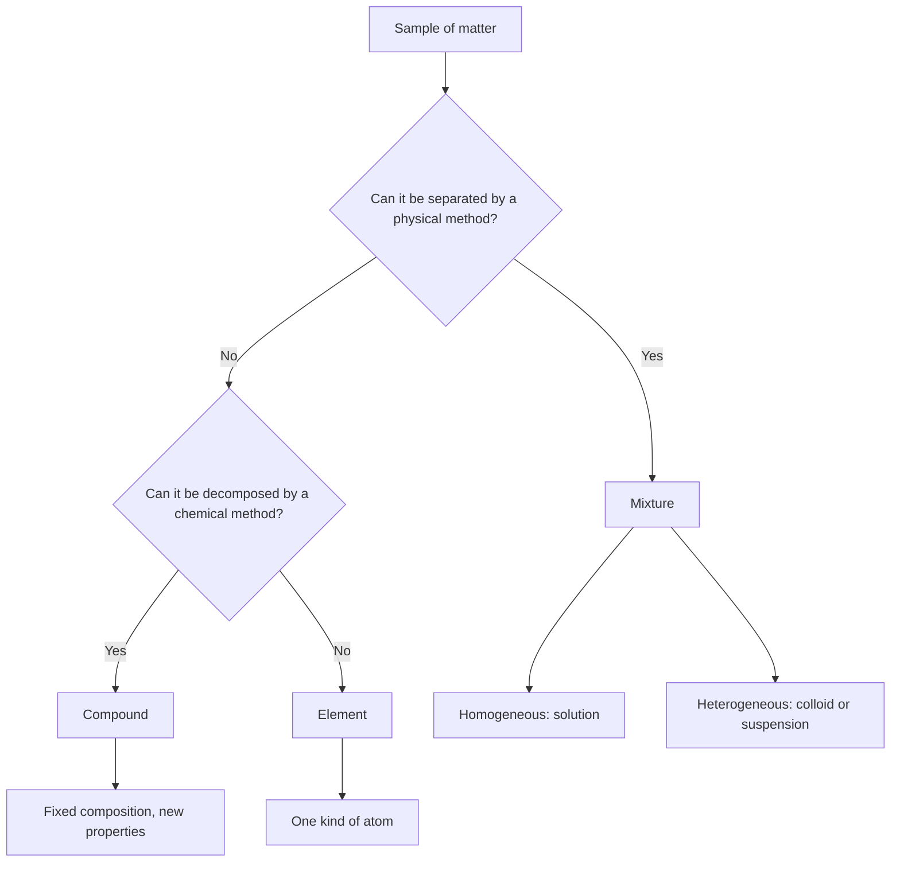
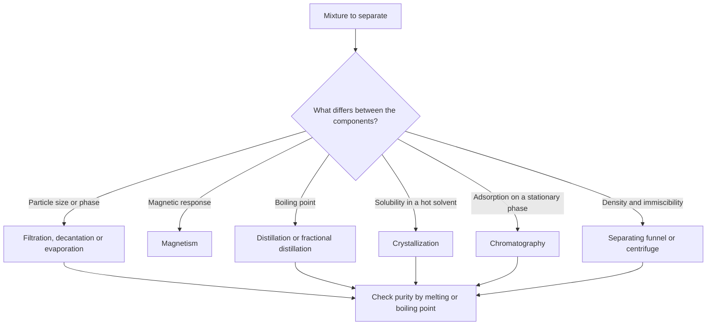
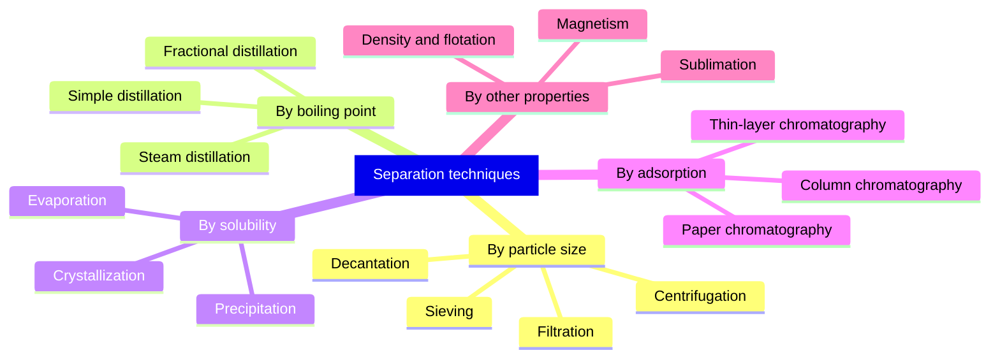
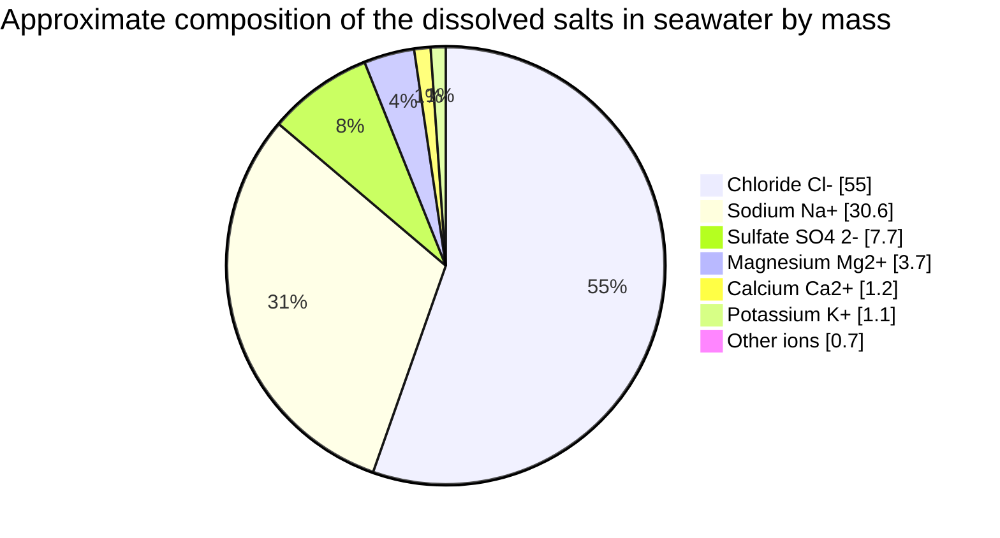

# Chapter 5 — Elements, Compounds and Mixtures

> **Level:** 0 — Foundations
> **Estimated study time:** 3 hours (reading 2 h + exercises 1 h)
> **Prerequisites:** [Chapter 2 — Matter and Its Classification](02-matter-and-its-classification.md) and [Chapter 4 — Physical and Chemical Properties and Changes](04-physical-and-chemical-properties-and-changes.md)
> **Related chapters:** [Chapter 6 — Atoms, Molecules and Ions](06-atoms-molecules-and-ions.md), [Chapter 8 — Chemical Symbols and Formulas](08-chemical-symbols-and-formulas.md)
> **Difficulty:** ★☆☆☆☆

---

## 1. Learning Objectives

After working through this chapter you will be able to:

- Define **element**, **compound** and **mixture** operationally, in terms of how each can be separated.
- Explain the difference between atoms of one kind and atoms chemically combined.
- State the **law of definite proportions** and use it to calculate the mass of each element in a sample of a compound.
- Describe the three experimental criteria that distinguish a compound from a mixture: energy change on formation, fixed melting point, and separation only by chemical means.
- Distinguish **homogeneous** from **heterogeneous** mixtures, and classify **solutions**, **colloids** and **suspensions** by particle size and behaviour.
- Select an appropriate **separation technique** for a given mixture, using a decision procedure.
- Interpret simple **particle diagrams** for elements, compounds and mixtures.
- Explain why the classification of matter is a model with borderline cases rather than a set of absolute categories.

---

## 2. Introduction

A glass of seawater, a piece of granite, a tank of oxygen and a bag of table salt look nothing alike, yet all four are samples of matter that a chemist must place in one of three boxes: element, compound or mixture. The classification is not decorative. It determines how a material can be purified, analysed, stored and used. A pharmaceutical manufacturer must know whether an active ingredient is a pure compound or a mixture with excipients; an environmental chemist must know whether a metal pollutant is dissolved, colloidal or suspended, because the three behave differently in a river and require different remediation.

The classification also has a historical dimension. Around 1799 Joseph Louis Proust argued, against Claude Louis Berthollet, that a compound always contains its elements in fixed proportions by mass. Berthollet maintained that composition could vary continuously. Proust won the argument for the substances he studied, and the **law of definite proportions** became one of the foundations of chemical atomism. We now know that Berthollet was partly right for some solids: non-stoichiometric compounds such as wüstite, $\ce{Fe_{1-x}O}$, do exist. The episode is a useful reminder that a classification is a model, refined as evidence accumulates.

This chapter assumes Chapter 2, which introduced the three classes, and Chapter 4, which supplied the physical/chemical distinction on which the operational definitions depend. Everything here prepares Chapter 6: once you know that a compound contains chemically combined atoms, the next question is what those atoms are and how they are arranged.

---

## 3. Fundamental Concepts

### 3.1 Elements

An **element** is a substance that cannot be decomposed into simpler substances by chemical means. It consists of atoms of one kind, all with the same number of protons in the nucleus (the atomic number, Chapter 6). There are 118 confirmed elements; about 94 occur naturally on Earth, and the rest are produced artificially in nuclear reactions.

The operational part of the definition matters. "Cannot be decomposed by chemical means" does not mean "cannot be changed at all". An element can change state, be subdivided, form compounds and be ionized. Gold can be melted, hammered into leaf and dissolved in aqua regia, but no chemical reaction converts it into a simpler substance. Nuclear reactions can transmute one element into another, but those lie outside chemistry.

| Element | Symbol | Ordinary form | Note |
|---|---|---|---|
| Iron | $\ce{Fe}$ | Metallic solid | One of the most abundant elements in Earth's crust |
| Sulfur | $\ce{S}$ | $\ce{S8}$ molecular solid | Yellow, brittle, insulating |
| Oxygen | $\ce{O2}$ | Diatomic gas | Essential for respiration and combustion |
| Helium | $\ce{He}$ | Monatomic gas | A noble gas; chemically very unreactive |
| Carbon | $\ce{C}$ | Graphite or diamond | Two allotropes with different structures |
| Ozone | $\ce{O3}$ | Triatomic gas | An allotrope of oxygen, not a compound |

Ozone and diamond deserve a comment. Both are elements, even though ozone is a molecule of three atoms and diamond is a network of countless carbon atoms. An element is defined by the identity of its atoms, not by how many atoms a particle contains. Different structural forms of the same element are called **allotropes**.

### 3.2 Compounds

A **compound** is a substance formed when two or more elements are chemically combined in fixed proportions by mass. The atoms are joined by chemical bonds, and the compound has properties that are not the average of those of its elements.

Water is the standard example. It contains hydrogen and oxygen in the mass ratio $2.016 : 15.999$, which is $11.19\ \%$ hydrogen and $88.81\ \%$ oxygen by mass, whatever the source of the water. Hydrogen burns explosively in oxygen, and oxygen supports combustion; liquid water extinguishes a fire. The properties of a compound belong to the new substance, not to its ingredients.

| Compound | Formula | Elements combined | Mass percentage of the first element |
|---|---|---|---|
| Water | $\ce{H2O}$ | H, O | 11.19 % H |
| Carbon dioxide | $\ce{CO2}$ | C, O | 27.29 % C |
| Sodium chloride | $\ce{NaCl}$ | Na, Cl | 39.34 % Na |
| Ethanol | $\ce{C2H5OH}$ | C, H, O | 52.14 % C |
| Glucose | $\ce{C6H12O6}$ | C, H, O | 40.00 % C |
| Ammonia | $\ce{NH3}$ | N, H | 82.24 % N |

Compounds may be **molecular** (water, carbon dioxide, ethanol), **ionic** (sodium chloride, magnesium oxide) or **network covalent** (silicon dioxide in quartz). The classification as a compound depends on fixed composition and chemical combination, not on the type of bonding.

### 3.3 Mixtures

A **mixture** contains two or more substances that are not chemically combined. The components retain their individual identities and properties, and they can usually be separated by physical methods. The composition of a mixture is variable: seawater from the Atlantic and seawater from the Baltic differ in salinity, but both are seawater.

| Feature | Compound | Mixture |
|---|---|---|
| Composition | Fixed by mass, law of definite proportions | Variable within limits |
| Bonding between components | Chemical bonds | No chemical bonds; intermolecular forces only |
| Properties | New, not the average of the elements | Each component retains its properties |
| Melting point | Sharp, characteristic | Range, often below the pure components |
| Energy change on formation | Usually substantial, released or absorbed | Usually small; mixing may release or absorb little |
| Separation | Only by chemical means | By physical methods |
| Example | Water, sodium chloride | Air, seawater, brass, granite |

### 3.4 Homogeneous and heterogeneous mixtures

A **homogeneous mixture** has the same composition throughout, at least at the scale visible to the eye or an optical microscope. Its components are distributed at the molecular or ionic level. Salt water, sugar solution, vinegar, air and brass are homogeneous.

A **heterogeneous mixture** does not have a uniform composition. Different regions, called **phases**, can be distinguished, and the boundary between them is often visible. Granite, oil and water, muddy water, concrete and smoke are heterogeneous.

Between the two lies the **colloid**, a dispersion in which particles of one substance are dispersed in another on a scale between roughly 1 nm and 1 µm. A colloid looks homogeneous to the eye but is heterogeneous at the particle scale. Milk, fog, smoke, foam, gel and mayonnaise are colloids.

| Class | Particle size | Appearance | Settles on standing? | Scatters light? | Separated by filter paper? |
|---|---|---|---|---|---|
| Solution | below 1 nm | Clear, transparent | No | No | No |
| Colloid | 1 nm to 1 µm | Often cloudy or translucent | No, Brownian motion keeps it dispersed | Yes, Tyndall effect | No |
| Suspension | above 1 µm | Cloudy, opaque | Yes, on standing | Yes | Yes |

The boundaries are conventional, not sharp. A dispersion of 900 nm particles is a colloid by one textbook and a fine suspension by another. What matters is the behaviour: whether the particles settle, whether they scatter light, and whether they pass through a filter.

### 3.5 Particle diagrams

Chemists represent the three classes with **particle diagrams**, in which each circle or symbol stands for an atom, ion or molecule. The conventions are simple:

- A single kind of uncombined circle represents an element.
- Two or more different circles joined together represent a compound.
- Different kinds of circles or molecules intermingled without joining represent a mixture.
- A regular repeating array of alternating ions represents an ionic compound.

Thus a box containing only pairs of identical circles is an element such as $\ce{O2}$; a box containing circles of two colours joined in a 2:1 ratio is a compound such as $\ce{H2O}$; a box containing both joined pairs and single circles is a mixture of a compound and an element.

### 3.6 Key terms

| Term | Definition |
|---|---|
| Element | A substance that cannot be decomposed chemically into simpler substances |
| Compound | Two or more elements chemically combined in fixed proportions |
| Mixture | Two or more substances not chemically combined |
| Homogeneous | Uniform composition throughout |
| Heterogeneous | Non-uniform composition; distinct phases |
| Phase | A region of uniform composition and properties |
| Solution | A homogeneous mixture of solute and solvent |
| Solute | The component present in smaller amount in a solution |
| Solvent | The component present in larger amount, or the dissolving medium |
| Colloid | A dispersion with particles between about 1 nm and 1 µm |
| Suspension | A dispersion of particles larger than about 1 µm that settle |
| Tyndall effect | Scattering of light by colloidal particles |
| Allotrope | A structural form of an element |
| Law of definite proportions | A compound always contains its elements in fixed mass ratios |

---

## 4. Detailed Scientific Explanation

### 4.1 Atoms of one kind versus atoms chemically combined

The difference between an element and a compound is not the number of atoms but their identity and connectivity. A sample of oxygen gas contains molecules of two oxygen atoms; a sample of ozone contains three. Both are elements because every atom has eight protons. A sample of water contains two hydrogen atoms bonded to one oxygen atom; it is a compound because two different kinds of atom are joined.

The distinction between a compound and a mixture is connectivity. In a mixture, different molecules or particles coexist but are not bonded to each other. In a compound, the atoms are linked by chemical bonds, and the compound behaves as a single substance. This is why a compound has a sharp melting point: every particle must be separated from the same neighbours, so the process occurs at a single temperature.

### 4.2 Fixed composition and the law of definite proportions

The **law of definite proportions**, stated by Proust around 1799, says that a given compound always contains the same elements in the same ratio by mass, regardless of how the compound was made.

For water, one mole ($18.015\ \mathrm{g}$) contains $2.016\ \mathrm{g}$ of hydrogen and $15.999\ \mathrm{g}$ of oxygen. The mass fractions are

$$
w(\ce{H}) = \frac{2.016}{18.015} = 0.1119, \qquad w(\ce{O}) = \frac{15.999}{18.015} = 0.8881.
$$

A 50.0 g sample of pure water, from any source, contains 5.60 g of hydrogen and 44.4 g of oxygen. If a sample of "water" contains a different ratio, it is not pure water: it is a mixture, or it has been contaminated, or it is a different compound altogether.

A related law, due to Dalton, is the **law of multiple proportions**: when two elements form more than one compound, the masses of one element that combine with a fixed mass of the other are in a ratio of small whole numbers. Carbon and oxygen form $\ce{CO}$ and $\ce{CO2}$; for a fixed mass of carbon, the masses of oxygen are in the ratio $1:2$.

**A caveat.** Some solids deviate from exact stoichiometry. Wüstite is $\ce{Fe_{1-x}O}$ with $x$ typically between 0.05 and 0.15, because some iron sites are vacant and charge balance is maintained by iron(III). Such **non-stoichiometric compounds** are real, and they show that the law of definite proportions is an excellent approximation for molecular compounds rather than a universal law of nature. At Level 0 the idealization is appropriate, but it should be labelled as such.

### 4.3 How a compound differs from a mixture

Three experimental criteria do most of the work.

**Energy change on formation.** Forming a compound from its elements usually releases or absorbs a substantial amount of energy. When sodium and chlorine combine, 822 kJ is released per two moles of sodium chloride formed, equivalent to $-411\ \mathrm{kJ\,mol^{-1}}$ of $\ce{NaCl}$:

$$
\ce{2Na(s) + Cl2(g) -> 2NaCl(s)} \qquad \Delta H^\circ = -822\ \mathrm{kJ}
$$

Mixing sodium chloride with sand releases almost no energy. The energy release during compound formation is a consequence of bond formation, and it is a signature of chemical combination. The magnitude is not by itself a proof; the dissolution of calcium chloride is also strongly exothermic, and that is a physical change (Chapter 4).

**Fixed melting point.** A pure compound melts sharply at a characteristic temperature. A mixture melts over a range, usually beginning below the melting point of the pure components. This is the basis of melting-point determination as a test of purity. Pure benzoic acid melts at about 122 °C; a sample contaminated with a little sand or sugar softens earlier and melts over several kelvin. The same logic applies to boiling point, which is why distillation can purify a liquid.

**Separation only by chemical means.** The components of a mixture can be separated by physical methods: filtration, distillation, crystallization, chromatography, magnetism. A compound cannot. Separating water into hydrogen and oxygen requires electrolysis; separating sodium chloride into sodium and chlorine requires electrolysis of the molten salt. Both are chemical changes.

| Criterion | Compound | Mixture |
|---|---|---|
| Energy on formation | Substantial enthalpy change | Little or none |
| Melting point | Sharp and characteristic | Range, often depressed |
| Separation | Chemical change required | Physical method sufficient |
| Composition | Fixed | Variable |

### 4.4 Solutions, colloids and suspensions

A **solution** is a homogeneous mixture of a solute dispersed in a solvent. The dispersed particles are individual ions or molecules, smaller than about 1 nm. Solutions are transparent, do not settle, do not scatter light appreciably, and cannot be separated by filtration. Salt water, sugar water, vinegar and air are solutions. In air, nitrogen is the solvent and oxygen, argon and carbon dioxide are solutes, even though all are gases.

A **colloid** is a dispersion of particles between about 1 nm and 1 µm. The particles are larger than molecules but small enough that Brownian motion, the random buffeting by solvent molecules, prevents them from settling. Colloids scatter light, which is the **Tyndall effect**: a beam of light is visible as a bright track through milk or fog but not through salt water. Colloids cannot be separated by ordinary filter paper, because the pores are much larger than the particles, but they can be separated by dialysis or ultrafiltration.

A **suspension** contains particles larger than about 1 µm. These particles settle under gravity, can be separated by filtration, and make the liquid cloudy or opaque. Muddy water, chalk in water and sand in water are suspensions. Blood is a suspension of cells in plasma, with the cells large enough to settle if centrifuged.

| Dispersion | Dispersed phase | Continuous phase | Example |
|---|---|---|---|
| Foam | Gas | Liquid or solid | Whipped cream, polystyrene foam |
| Emulsion | Liquid | Liquid | Milk, mayonnaise, butter |
| Aerosol | Solid or liquid | Gas | Smoke, fog, spray |
| Sol | Solid | Liquid | Paint, ink, colloidal gold |
| Gel | Liquid | Solid network | Jelly, silica gel |

Milk illustrates why the classification is useful. It looks homogeneous, but it is an emulsion stabilized by proteins. Two dispersed phases are present: casein micelles of roughly 50–300 nm, which are genuinely colloidal, and fat globules whose size depends on processing (around 1–10 µm in raw milk, reduced to about 0.2–2 µm by homogenization). Milk therefore scatters light and cannot be filtered clear, but its fat can rise as cream on standing, which is a separation by density rather than by filtration.

### 4.5 Separation techniques and the property each exploits

Every separation exploits a difference in a physical property. The choice of technique follows from the property that differs most.

**Filtration** separates an insoluble solid from a liquid or gas by passing the mixture through a porous barrier. The solid is retained on the filter paper, the filtrate passes through. It works for particles larger than the pore size, typically a few micrometres; colloids pass through.

**Decantation** pours off a liquid from a settled solid, or a less dense liquid from a more dense one, without using a barrier. It is quick but incomplete; a centrifuge accelerates the settling of fine particles.

**Distillation** separates components by boiling point. The more volatile component vaporizes, is condensed and collected. Simple distillation works when the boiling points differ by more than about 25 K; **fractional distillation** uses a column with many theoretical plates and can separate components whose boiling points differ by only a few kelvin. Crude oil refining and the separation of liquid air both use fractional distillation.

**Crystallization** purifies a solid by dissolving it in a minimum of hot solvent and allowing it to crystallize on cooling. The lattice rejects most impurities, which remain in the mother liquor. It exploits differences in solubility.

**Chromatography** separates dissolved substances by their differing affinity for a stationary phase and a mobile phase. In paper chromatography, water adsorbed on cellulose is the stationary phase and a solvent is the mobile phase. A component that is strongly adsorbed moves slowly; a component that prefers the mobile phase moves with the solvent front. The **retention factor** $R_f$ is characteristic of a substance under stated conditions.

**Magnetism** removes magnetic materials, usually iron, steel or magnetite, from non-magnetic mixtures. It is used in scrap recycling and in the purification of some industrial minerals.

**Sublimation** exploits the fact that some solids pass directly to vapour on heating. Iodine, dry ice and camphor can be separated from non-subliming solids this way. Care is needed: ammonium chloride appears to sublime, but it actually dissociates into ammonia and hydrogen chloride, which recombine on cooling, so the process is chemical.

**Evaporation** removes a volatile solvent to recover a dissolved solid. It is the standard way to recover salt from salt water, but it does not purify the solid: any soluble impurity remains in the residue.

### 4.6 Choosing a technique

The decision procedure is straightforward if the composition is known. Identify the states of the components, then the property that differs most: particle size, boiling point, solubility, density, magnetism or adsorption.

1. If one component is an insoluble solid and the other a liquid, filter or decant.
2. If one component is magnetic, use a magnet.
3. If a solid is dissolved, evaporate or crystallize.
4. If two liquids are immiscible, use a separating funnel.
5. If two liquids are miscible and have different boiling points, distil; use fractional distillation if the difference is small.
6. If the components are dissolved solutes that differ in adsorption, use chromatography.
7. If the mixture is a gas mixture with different boiling points, liquefy and distil fractionally.

No single technique is universally best. A combination is often required: sand and salt are separated by adding water, filtering off the sand, then evaporating the filtrate; iron filings are removed with a magnet before the water step.

### 4.7 Why the classification matters in practice

The classification determines the analytical strategy. A compound must be identified by its fixed composition and its spectroscopic signature; a mixture must be resolved into components before each can be identified. It also determines the legal and regulatory status of a material: in chemical regulation, a "substance" is a chemical element or compound, while a "mixture" is a combination of substances that do not react. The distinction affects labelling, safety data sheets and the permissible variation in composition between batches.

---

## 5. Visual Diagrams

**Figure 5.1 — Operational classification of matter.** The two questions are tests, not definitions, and they must be applied in this order. A sample that passes the physical-separation test is a mixture, even if it looks uniform; a sample that resists physical separation but yields simpler substances on chemical treatment is a compound. The final branches remind you what each category implies about composition.

**Figure 5.2 — Decision procedure for choosing a separation technique.** Each branch is labelled with the property that the technique exploits, which is the key to choosing rather than memorizing. Notice that all routes converge on a purity check: a separation is only complete when the recovered material has a sharp melting or boiling point, or a single chromatographic spot.

**Figure 5.3 — Techniques grouped by the physical property they exploit.** The five branches are not a list to memorize but a map: once you know which property differs between the components, the branch selects itself. Several techniques appear in more than one practical context, but each belongs to exactly one underlying principle.

**Figure 5.4 — Seawater is a solution, and its dissolved salts are themselves a mixture of ions.** The pie shows only the salt fraction, which is about 3.5 % of the mass of typical seawater; water makes up the remaining 96.5 %. The ions are dispersed individually, at a scale well below 1 nm, so seawater neither scatters light nor settles and is a solution rather than a colloid or suspension. The diagram also shows that a homogeneous mixture can have many components, and that each component is an element or a compound in its own right.

---

## 6. Mathematical Formulas

Composition and chromatography are the two quantitative topics in this chapter.

$$
w_i = \frac{m_i}{m_{\text{total}}} \times 100\ \%
$$

$$
\phi_i = \frac{V_i}{V_{\text{total}}} \times 100\ \%
$$

$$
R_f = \frac{d_{\text{spot}}}{d_{\text{front}}}
$$

| Symbol | Meaning | SI unit |
|---|---|---|
| $w_i$ | Mass fraction of component $i$, expressed as a percentage | dimensionless (per cent) |
| $m_i$ | Mass of component $i$ | $\mathrm{kg}$ |
| $m_{\text{total}}$ | Total mass of the sample | $\mathrm{kg}$ |
| $\phi_i$ | Volume fraction of component $i$ | dimensionless (per cent) |
| $V_i$ | Volume of component $i$ | $\mathrm{m^{3}}$ |
| $V_{\text{total}}$ | Total volume of the mixture | $\mathrm{m^{3}}$ |
| $R_f$ | Retention factor | dimensionless |
| $d_{\text{spot}}$ | Distance travelled by the spot centre | $\mathrm{m}$ |
| $d_{\text{front}}$ | Distance travelled by the solvent front | $\mathrm{m}$ |

**Assumptions and validity.** Mass fractions are exact for any mixture, because mass is additive. Volume fractions are only approximately additive: mixing ethanol and water contracts the total volume, so the sum of the component volumes exceeds the volume of the mixture. Volume percentages are therefore defined operationally, for example as the volume of solute in 100 volumes of solution. The retention factor is defined only when the solvent front is visible and the spot is not at the origin or the front; values between 0 and 1 are expected, and a value of 0 means the substance did not move.

---

## 7. Chemical Equations

A compound can be decomposed into its elements, and this is the definitive demonstration that it is a compound rather than a mixture. Water can be decomposed by electrolysis:

$$
\ce{2H2O(l) ->[\text{electrolysis}] 2H2(g) + O2(g)}
$$

The volume ratio of hydrogen to oxygen is $2:1$, which is consistent with the formula $\ce{H2O}$ once the gases are compared at the same temperature and pressure. No physical method can achieve this separation.

Mercury(II) oxide decomposes on heating, a reaction used by Joseph Priestley and Carl Wilhelm Scheele in the eighteenth century to isolate oxygen:

$$
\ce{2HgO(s) ->[\Delta] 2Hg(l) + O2(g)}
$$

The reverse reactions show compound formation from the elements. Sodium and chlorine combine vigorously:

$$
\ce{2Na(s) + Cl2(g) -> 2NaCl(s)}
$$

Hydrogen and oxygen combine explosively when ignited:

$$
\ce{2H2(g) + O2(g) -> 2H2O(l)}
$$

The contrast between the properties of the product and those of the reactants is the point: hydrogen burns, oxygen supports combustion, and water extinguishes flames. A mixture of hydrogen and oxygen would retain both sets of properties until a spark initiated the reaction.

The thermal decomposition of limestone is another example of a compound being converted into simpler substances:

$$
\ce{CaCO3(s) ->[\Delta] CaO(s) + CO2(g)}
$$

Separations of mixtures, by contrast, are not written as chemical equations. Filtering sand from water, distilling ethanol from water and chromatographing inks are physical processes: the substances are unchanged, so there is no reaction to balance.

---

## 8. Worked Examples

### Worked Example 8.1 — Classifying nine samples

**Problem.** Classify each sample as an element, a compound, a homogeneous mixture or a heterogeneous mixture: (a) air; (b) brass; (c) distilled water; (d) graphite; (e) dry ice; (f) milk; (g) granite; (h) steel; (i) seawater.

**Strategy.** Ask two questions in order. Can the sample be separated by a physical method? If yes, it is a mixture, and its uniformity decides homogeneous versus heterogeneous. If no, can it be decomposed chemically? If yes, it is a compound; if no, an element.

**Solution.**

(a) Air is a homogeneous mixture of nitrogen, oxygen, argon, carbon dioxide and water vapour.

(b) Brass is a homogeneous mixture of copper and zinc; it is a solid solution.

(c) Distilled water is a compound of hydrogen and oxygen.

(d) Graphite is an element, an allotrope of carbon.

(e) Dry ice is solid carbon dioxide, a compound.

(f) Milk is a colloid, and therefore a heterogeneous mixture at the particle scale, although it looks uniform.

(g) Granite is a heterogeneous mixture of quartz, feldspar and mica.

(h) Steel is a homogeneous mixture of iron with a small percentage of carbon and other elements.

(i) Seawater is a homogeneous mixture of water and dissolved salts.

**Check.** Each mixture answer contains components that retain their identities and can in principle be separated by exploiting a physical difference: air by fractional distillation, brass by distillation since zinc is far more volatile than copper, milk by centrifugation, granite by mechanical sorting, seawater by evaporation or reverse osmosis. Some, such as steel, are difficult to separate in practice because the carbon is dissolved in the iron lattice, but the components are still not chemically combined in fixed proportions. Every compound answer requires a chemical change to decompose it.

### Worked Example 8.2 — Using the law of definite proportions

**Problem.** A 50.0 g sample of pure water is decomposed by electrolysis. Calculate the mass of hydrogen and the mass of oxygen obtained, and verify that the result is consistent with the law of definite proportions.

**Strategy.** Use the molar masses of hydrogen and oxygen and the formula $\ce{H2O}$. The mass fraction of each element is fixed by the formula.

**Solution.** One mole of water has mass $2 \times 1.008 + 15.999 = 18.015\ \mathrm{g}$ and contains $2.016\ \mathrm{g}$ of hydrogen. The mass fraction of hydrogen is

$$
w(\ce{H}) = \frac{2.016}{18.015} = 0.1119.
$$

For 50.0 g of water,

$$
m(\ce{H}) = 0.1119 \times 50.0 = 5.60\ \mathrm{g},
$$

and by conservation of mass,

$$
m(\ce{O}) = 50.0 - 5.60 = 44.4\ \mathrm{g}.
$$

**Check.** The oxygen mass fraction is $44.4/50.0 = 0.888$, matching $15.999/18.015 = 0.8881$. The ratio $44.4/5.60 = 7.93$ equals the ratio of the mass of oxygen to the mass of hydrogen in one mole of water, $15.999/2.016 = 7.94$ (the small difference is rounding). The composition is independent of the sample size, as the law requires.

### Worked Example 8.3 — Calculating a retention factor

**Problem.** In a paper chromatogram, a spot of ink travels 3.2 cm from the origin while the solvent front travels 8.4 cm. Calculate the $R_f$ value. A second spot travels 6.7 cm. Which component is more strongly adsorbed on the paper?

**Strategy.** Apply the definition $R_f = d_{\text{spot}}/d_{\text{front}}$, measuring both distances from the same origin. The component that moves further has a higher $R_f$ and is less strongly adsorbed.

**Solution.** For the first spot,

$$
R_f = \frac{3.2\ \mathrm{cm}}{8.4\ \mathrm{cm}} = 0.38.
$$

For the second spot,

$$
R_f = \frac{6.7\ \mathrm{cm}}{8.4\ \mathrm{cm}} = 0.80.
$$

The first component is more strongly adsorbed on the cellulose and spends a larger fraction of its time in the stationary phase, so it moves more slowly. The second component prefers the mobile solvent and moves further.

**Check.** Both values lie between 0 and 1, as they must. A substance that does not move has $R_f = 0$; one that travels with the solvent front has $R_f = 1$. The ratio of the distances, $6.7/3.2 = 2.1$, equals the ratio of the $R_f$ values, $0.80/0.38 = 2.1$.

### Worked Example 8.4 — Mass balance in a separation

**Problem.** A 10.00 g mixture of sand and sodium chloride is separated by adding water, filtering off the sand, and evaporating the filtrate to dryness. The dried sand has a mass of 6.20 g and the recovered salt has a mass of 3.70 g. Calculate the percentage recovery and comment on the result.

**Strategy.** The total mass recovered should equal the original mass if nothing is lost. Calculate the recovery as a percentage of the original mass.

**Solution.** The total recovered mass is

$$
m_{\text{recovered}} = 6.20 + 3.70 = 9.90\ \mathrm{g}.
$$

The percentage recovery is

$$
\frac{9.90}{10.00} \times 100\ \% = 99.0\ \%.
$$

The missing 0.10 g, or 1.0 %, is consistent with small losses during transfer, some salt retained in the filter paper, and incomplete evaporation.

**Check.** The sum of the component masses cannot exceed the original mass; a value above 100 % would indicate that the sample was not dry, that the "sand" retained salt, or that the balance was miscalibrated. A recovery between 98 % and 102 % is typical for a careful school experiment.

---

## 9. Real-World Applications

**Drinking-water treatment.** Raw water is a heterogeneous mixture of suspended solids, colloids and dissolved salts. Treatment applies the separation techniques in sequence: coagulation and flocculation aggregate colloids, sedimentation and filtration remove the flocs, and reverse osmosis or distillation removes dissolved ions. Each step targets a different particle-size range.

**Petroleum refining and air separation.** Crude oil is a complex mixture of hydrocarbons separated by fractional distillation into fractions with different boiling ranges. Liquid air is separated industrially by fractional distillation, exploiting the 13 K difference between the boiling points of nitrogen (77 K) and oxygen (90 K).

**Chromatography in analysis and sport.** Paper and thin-layer chromatography separate pigments, inks and dyes; gas chromatography and liquid chromatography are used in forensic toxicology, doping control and pharmaceutical quality control. A single spot with a characteristic $R_f$ or retention time is evidence of a pure compound.

**Alloys and materials.** Brass, bronze, steel and solder are homogeneous solid mixtures whose properties are tuned by composition. Unlike a compound, an alloy's composition can be varied continuously, which is precisely why metallurgists can optimize hardness, strength and corrosion resistance.

**Food science.** Milk is an emulsion, mayonnaise is an emulsion stabilized by lecithin, whipped cream is a foam and jelly is a gel. Understanding the colloidal structure explains why milk curdles when acid is added, why mayonnaise "breaks" when over-whisked, and why ice cream contains ice crystals, air cells and fat droplets.

**Pharmaceutical purification.** Crystallization is the workhorse of drug purification. The crystal lattice rejects impurities, and the size and habit of the crystals affect filtration, drying and tableting. Polymorphs, different crystal structures of the same compound, can have different solubilities and bioavailabilities.

**Recycling.** Magnetic separation removes steel from shredded waste; density separation and flotation separate plastics; eddy-current separation recovers aluminium. Each is a physical separation chosen to exploit a different property.

---

## 10. Common Mistakes

| Mistake | Why it happens | Correct approach |
|---|---|---|
| "A compound is a mixture of its elements" | The word "contains" suggests a container | The elements are chemically bonded, not merely present; the compound has new properties |
| "All homogeneous substances are compounds" | Solutions are clear and uniform, like pure liquids | Air, seawater and brass are homogeneous mixtures; homogeneity does not imply chemical combination |
| "Air is a compound because it has a fixed composition" | Air's composition is roughly constant | Air varies with location and humidity and can be separated by distillation; it is a mixture |
| "Salt water can be separated by filtration" | Filtration is the first separation technique learned | Dissolved ions pass through filter paper; evaporate or use reverse osmosis |
| "A colloid is a solution" | Both look uniform and do not settle | Colloids scatter light and contain particles of 1 nm to 1 µm; solutions contain individual ions or molecules |
| "A melting range means the substance is impure" | Pure compounds melt sharply | Some pure substances decompose or have polymorphs; a range is evidence, not proof, of impurity |
| "Elements are the same as atoms" | The words are used loosely in everyday speech | An element is a substance; an atom is the smallest unit of that substance |
| "Mixtures always have variable composition, so they have no formula" | Formulas are written for compounds | True: a mixture is described by its composition, not by a single molecular formula |

---

## 11. Chapter Summary

- An element cannot be decomposed chemically; a compound contains two or more elements chemically combined in fixed proportions; a mixture contains substances that are not chemically combined.
- The law of definite proportions states that a compound's elemental mass ratios are fixed, independent of source or preparation method.
- Compounds differ from mixtures in three observable ways: substantial energy change on formation, a sharp melting point, and separation only by chemical means.
- Homogeneous mixtures have uniform composition; heterogeneous mixtures contain distinguishable phases.
- Solutions contain particles below about 1 nm, colloids between about 1 nm and 1 µm, and suspensions above about 1 µm. Colloids scatter light and do not settle; suspensions settle and can be filtered.
- Separation techniques exploit differences in particle size, boiling point, solubility, density, magnetism or adsorption. The property that differs most determines the technique.
- Particle diagrams represent elements, compounds and mixtures by the identity and connectivity of the particles.
- The classification is a model: non-stoichiometric compounds and borderline dispersions show that the boundaries are conventional.

---

## 12. Exercises

### 12.1 Conceptual questions

1. Define element, compound and mixture in terms of how each behaves when a separation is attempted. Give one example of each.

2. Explain why a compound is not simply a mixture of its elements. Your answer should refer to composition, properties and the energy change on formation.

### 12.2 Basic problems

3. Classify each sample as an element, a compound, a homogeneous mixture or a heterogeneous mixture: (a) oxygen gas; (b) vinegar; (c) chalk; (d) bronze; (e) carbon dioxide; (f) fog; (g) helium; (h) sugar solution.

4. Classify each mixture as homogeneous or heterogeneous: (a) seawater; (b) fog; (c) granite; (d) vinegar; (e) mayonnaise; (f) smoke; (g) brass; (h) muddy water.

### 12.3 Intermediate problems

5. A clear, colourless liquid boils sharply at 100.0 °C at 1 atm and leaves no residue when a few drops are evaporated on a watch glass. Is it a pure compound or a solution? Explain your reasoning, and state one additional measurement that would strengthen the conclusion.

6. Design a procedure to separate a mixture of iron filings, sand, table salt and sawdust. State the order of the steps and the property exploited at each step.

### 12.4 Advanced problems

7. Milk looks homogeneous but is classified as a colloid. Describe two experimental observations that support this classification, and explain why milk cannot be separated by filter paper.

8. In paper chromatography, a strongly hydrogen-bonding dye moves more slowly than a weakly hydrogen-bonding dye. Explain this observation in terms of the stationary and mobile phases, and predict the effect of using a more polar solvent.

### 12.5 Calculation problems

9. A 25.0 g sample of an alloy contains 6.00 g of zinc. Calculate the mass percentage of zinc in the alloy.

10. A chromatogram shows a spot at 2.8 cm from the origin and a solvent front at 9.6 cm. Calculate the $R_f$ value, and state whether the substance is more or less strongly adsorbed than a substance with $R_f = 0.65$ under the same conditions.

**Answers.**

1. An element cannot be decomposed chemically and can only be separated into atoms; a compound can be decomposed chemically into simpler substances but not by physical methods; a mixture can be separated by physical methods. Examples: iron, water, seawater.

2. A compound has fixed composition by mass; a mixture can vary. A compound has properties that are not the average of its elements (water extinguishes fire, whereas hydrogen burns). Forming a compound releases or absorbs a substantial enthalpy (for example $-411\ \mathrm{kJ\,mol^{-1}}$ for $\ce{NaCl}$), whereas mixing usually releases little.

3. (a) element; (b) homogeneous mixture; (c) compound; (d) homogeneous mixture; (e) compound; (f) heterogeneous mixture; (g) element; (h) homogeneous mixture.

4. (a) homogeneous; (b) heterogeneous; (c) heterogeneous; (d) homogeneous; (e) heterogeneous; (f) heterogeneous; (g) homogeneous; (h) heterogeneous.

5. A pure compound. A solution would boil over a range and would leave a residue of solute on evaporation. A sharp boiling point at a known value, together with no residue, indicates a pure substance; measuring the refractive index or the density and comparing with tabulated values would strengthen the conclusion.

6. (1) Remove the iron filings with a magnet. (2) Add water and stir: the salt dissolves, while the sand and sawdust remain solid and the sawdust floats. (3) Skim the floating sawdust from the surface, or decant it with a little water. (4) Filter the remaining suspension: the sand is retained and the salt solution passes through as the filtrate. (5) Evaporate the filtrate to recover the salt. Properties exploited: magnetism, solubility, density, particle size.

7. Milk scatters a laser beam, showing the Tyndall effect, and the dispersed particles do not settle rapidly because Brownian motion keeps the smaller ones suspended. The casein micelles are roughly 50–300 nm, and homogenized fat globules are about 0.2–2 µm; both are at or below the upper colloid limit and far smaller than the pores of filter paper, so they pass through. The milk can be separated by centrifugation or by breaking the emulsion.

8. The stationary phase, water adsorbed on cellulose, is polar and holds polar dyes by hydrogen bonding. A strongly hydrogen-bonding dye spends more time in the stationary phase, so it moves more slowly and has a lower $R_f$. A more polar solvent competes for hydrogen-bonding sites and for the dye, so the strongly adsorbed dye moves further and the $R_f$ values increase.

9. $w(\ce{Zn}) = 6.00/25.0 \times 100\ \% = 24.0\ \%$.

10. $R_f = 2.8/9.6 = 0.29$. Since $0.29 < 0.65$, the substance is more strongly adsorbed than the one with $R_f = 0.65$.

---

## 13. Further Reading

- OpenStax, *Chemistry 2e*, Rice University. Chapter 1, "Essential Ideas", for the classification of matter; Chapter 2, "Atoms, Molecules, and Ions", for the laws of definite and multiple proportions. <https://openstax.org/details/books/chemistry-2e>
- Zumdahl, S. S.; DeCoste, D. J. *Chemical Principles*, 8th ed., Cengage Learning. Chapter 1, "Chemists and Chemistry", and Chapter 2 on atomic theory.
- Brown, T. L.; LeMay, H. E.; Bursten, B. E.; Murphy, C. J.; Woodward, P. M. *Chemistry: The Central Science*, 14th ed., Pearson. Chapter 1, "Introduction: Matter, Energy, and Measurement".
- Atkins, P.; Jones, L. *Chemical Principles: The Quest for Insight*, 7th ed., W. H. Freeman. Fundamentals section on the classification of matter.
- International Union of Pure and Applied Chemistry. *Compendium of Chemical Terminology* ("Gold Book"), 2nd ed. (corrected version). Entries "element", "compound", "mixture" and "solution". <https://goldbook.iupac.org/>
- Skoog, D. A.; West, D. M.; Holler, F. J.; Crouch, S. R. *Fundamentals of Analytical Chemistry*, 9th ed., Cengage Learning. Chapters on separation methods and chromatography.
- National Institute of Standards and Technology. *Chemistry WebBook, SRD 69*, for thermochemical data, including the enthalpy of formation of sodium chloride. <https://webbook.nist.gov/chemistry/>
