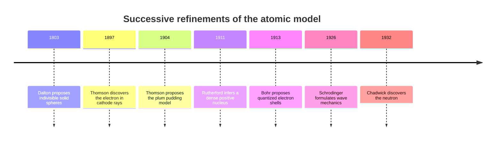
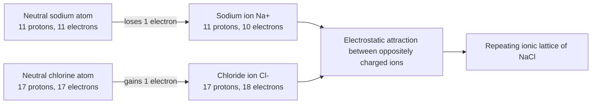
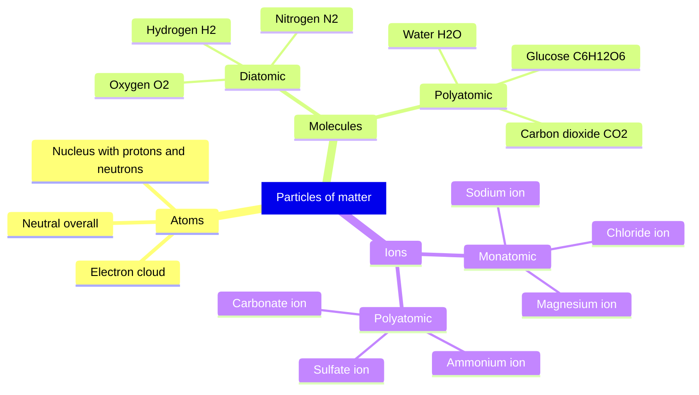
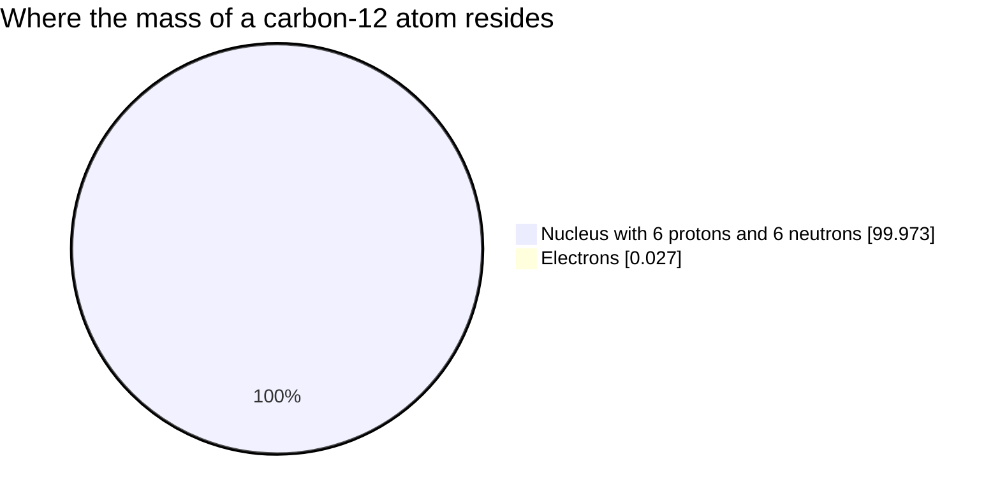

# Chapter 6 — Atoms, Molecules and Ions

> **Level:** 0 — Foundations
> **Estimated study time:** 3 hours (reading 2 h + exercises 1 h)
> **Prerequisites:** [Chapter 5 — Elements, Compounds and Mixtures](05-elements-compounds-and-mixtures.md)
> **Related chapters:** [Chapter 7 — Introduction to the Periodic Table](07-introduction-to-the-periodic-table.md), [Chapter 8 — Chemical Symbols and Formulas](08-chemical-symbols-and-formulas.md)
> **Difficulty:** ★☆☆☆☆

---

## 1. Learning Objectives

After working through this chapter you will be able to:

- Define an **atom** as the smallest unit of an element that retains the element's identity in chemical reactions.
- Describe the **proton**, **neutron** and **electron** in terms of charge, relative mass and location.
- Explain the structure of the atom as a small, dense **nucleus** surrounded by an **electron cloud**.
- Use **atomic number** and **mass number** qualitatively to describe a nuclide and to count its subatomic particles.
- Distinguish **atoms**, **molecules** and **ions**, and write **molecular formulas** for common substances.
- Explain how **cations** and **anions** form by electron transfer, and distinguish monatomic from polyatomic ions.
- Describe an **ionic compound** as a lattice of ions rather than a collection of molecules.
- Estimate the **scale of atoms** using powers of ten and a physical analogy.
- Outline the **historical development** of atomic models from Dalton to quantum mechanics, and explain why each model was superseded.

---

## 2. Introduction

Everything you have met so far — elements, compounds, mixtures, physical and chemical changes — is a description at the level of substances. The next step down is the level of particles. Why does sodium chloride dissolve in water but not in petrol? Why does a compound have a fixed composition? Why do some elements conduct electricity and others not? The answers lie in the structure of atoms and in the way atoms combine into molecules and ions.

The scale is hard to imagine. A typical atom is about $10^{-10}\ \mathrm{m}$ across, a hundred-millionth of a centimetre. A single grain of sand contains of the order of $10^{18}$ atoms. Yet the arrangement of those atoms, and especially the behaviour of the electrons at their edges, determines every chemical property you will study.

The story of how the atom was discovered is also a story about models. Dalton imagined an indivisible sphere; Thomson imagined a sphere of positive charge with electrons embedded in it; Rutherford discovered a dense nucleus; Bohr proposed quantized orbits; quantum mechanics replaced the orbits with probability distributions. Each model kept what its predecessor had explained and added a new layer. The final section of this chapter presents that sequence explicitly as **successive refinements**, because the habit of treating a model as final is one of the most common sources of confusion in chemistry.

This chapter assumes Chapter 5. It prepares Chapter 7, where the periodic table is organized by atomic number, and Chapter 8, where symbols and formulas are written.

---

## 3. Fundamental Concepts

### 3.1 The atom

An **atom** is the smallest unit of an element that retains the identity of that element in chemical reactions. It cannot be divided by chemical means. It can, however, be divided by nuclear means, and it is composed of smaller particles — a distinction that Dalton did not know about and that we must state explicitly.

The atom consists of a tiny, dense **nucleus** containing positively charged **protons** and neutral **neutrons**, surrounded by a cloud of negatively charged **electrons**. The nucleus carries almost all the mass; the electrons occupy almost all the volume. The number of protons in the nucleus determines which element the atom is.

### 3.2 Subatomic particles

| Particle | Symbol | Charge | Charge in coulombs | Relative mass | Mass in kg | Location |
|---|---|---|---|---|---|---|
| Proton | $\ce{p+}$ or $\mathrm{p}$ | $+1$ | $+1.602\,176\,634 \times 10^{-19}$ | $1.0073$ | $1.672\,62 \times 10^{-27}$ | Nucleus |
| Neutron | $\mathrm{n}$ | $0$ | $0$ | $1.0087$ | $1.674\,93 \times 10^{-27}$ | Nucleus |
| Electron | $\ce{e-}$ | $-1$ | $-1.602\,176\,634 \times 10^{-19}$ | $5.486 \times 10^{-4}$ | $9.109\,38 \times 10^{-31}$ | Electron cloud |

The relative masses are quoted on the **unified atomic mass unit** scale, where $1\ \mathrm{u}$ is one-twelfth of the mass of a carbon-12 atom. On this scale the proton and neutron are both close to $1\ \mathrm{u}$, and the electron is about $1/1836$ of a proton. For ordinary chemical purposes the electron's mass is negligible: a carbon atom's mass is almost entirely the mass of its six protons and six neutrons.

The elementary charge $e = 1.602\,176\,634 \times 10^{-19}\ \mathrm{C}$ is now fixed exactly by the definition of the ampere in the International System of Units. The proton and electron carry equal and opposite charges of exactly this magnitude.

### 3.3 Nucleus and electron cloud

The nucleus occupies a region of order $10^{-15}$ to $10^{-14}\ \mathrm{m}$ across, while the atom as a whole is of order $10^{-10}\ \mathrm{m}$ across. The ratio of diameters is therefore between $10^{4}$ and $10^{5}$. In volume terms the nucleus occupies a fraction between $10^{-12}$ and $10^{-15}$ of the atom. The atom is, to a very good approximation, empty space.

The **electron cloud** is not a set of tiny orbiting spheres in the modern model. It is a region of space in which the electrons are likely to be found, described by a probability distribution called an **orbital**. For the purposes of this chapter the cloud picture is enough: the electrons are spread out around the nucleus, and their distribution determines the size of the atom and the way it bonds.

The nucleus is held together by the **strong nuclear force**, which acts over distances of order $10^{-15}\ \mathrm{m}$ and overcomes the electrostatic repulsion between protons. That force is irrelevant to ordinary chemistry, which is governed by electromagnetic interactions between nuclei and electrons.

### 3.4 Atomic number and mass number

The **atomic number** $Z$ is the number of protons in the nucleus. It is the identity of the element: every atom with $Z = 6$ is carbon, every atom with $Z = 26$ is iron, and every atom with $Z = 79$ is gold.

The **mass number** $A$ is the total number of nucleons, protons plus neutrons:

$$
A = Z + N
$$

where $N$ is the number of neutrons. The mass number is an integer count, not a measured mass. It is written as a superscript before the symbol, with the atomic number as a subscript:

$$
\ce{^{56}_{26}Fe}
$$

This notation identifies a **nuclide**: a specific combination of protons and neutrons. Atoms of the same element with different numbers of neutrons are **isotopes**. Carbon has three naturally occurring isotopes, $\ce{^{12}_{6}C}$, $\ce{^{13}_{6}C}$ and $\ce{^{14}_{6}C}$, all with $Z = 6$ but with 6, 7 and 8 neutrons respectively. Isotopes have almost identical chemical behaviour because chemistry depends on electrons, and the electron count is the same.

The **relative atomic mass** quoted in the periodic table is the abundance-weighted average of the isotope masses, which is why it is usually not an integer. Chlorine's relative atomic mass of 35.45 reflects a mixture of about 75 % $\ce{^{35}Cl}$ and 25 % $\ce{^{37}Cl}$. The full quantitative treatment belongs to Level 1.

### 3.5 Molecules

A **molecule** is a group of two or more atoms held together by covalent bonds. The atoms may be of the same element or of different elements.

- **Diatomic molecules** contain two atoms. The elements hydrogen, nitrogen, oxygen, fluorine, chlorine, bromine and iodine exist as diatomic molecules under ordinary conditions: $\ce{H2}$, $\ce{N2}$, $\ce{O2}$, $\ce{F2}$, $\ce{Cl2}$, $\ce{Br2}$, $\ce{I2}$.
- **Polyatomic molecules** contain more than two atoms. Ozone is $\ce{O3}$, white phosphorus is $\ce{P4}$, rhombic sulfur is $\ce{S8}$, and buckminsterfullerene is $\ce{C60}$. Water ($\ce{H2O}$), carbon dioxide ($\ce{CO2}$) and glucose ($\ce{C6H12O6}$) are polyatomic compounds.

A **molecular formula** gives the actual number of each kind of atom in one molecule. The **empirical formula** gives the simplest whole-number ratio. Hydrogen peroxide has the molecular formula $\ce{H2O2}$ and the empirical formula $\ce{HO}$; glucose has $\ce{C6H12O6}$ and $\ce{CH2O}$; ethene has $\ce{C2H4}$ and $\ce{CH2}$. For water the two coincide.

| Substance | Molecular formula | Empirical formula | Atoms per molecule |
|---|---|---|---|
| Water | $\ce{H2O}$ | $\ce{H2O}$ | 3 |
| Hydrogen peroxide | $\ce{H2O2}$ | $\ce{HO}$ | 4 |
| Carbon dioxide | $\ce{CO2}$ | $\ce{CO2}$ | 3 |
| Glucose | $\ce{C6H12O6}$ | $\ce{CH2O}$ | 24 |
| Ethene | $\ce{C2H4}$ | $\ce{CH2}$ | 6 |
| Ozone | $\ce{O3}$ | $\ce{O}$ | 3 |

### 3.6 Ions

An **ion** is an atom or group of atoms with a net electrical charge. A **cation** is positively charged; an **anion** is negatively charged. Ions form when atoms gain or lose electrons, because the number of protons in the nucleus is fixed by the element.

A **monatomic ion** consists of a single atom. Sodium loses one electron to become $\ce{Na+}$; magnesium loses two to become $\ce{Mg^{2+}}$; aluminium loses three to become $\ce{Al^{3+}}$. Chlorine gains one electron to become $\ce{Cl-}$; oxygen gains two to become $\ce{O^{2-}}$; nitrogen gains three to become $\ce{N^{3-}}$.

A **polyatomic ion** consists of a group of atoms covalently bonded together, carrying a net charge. Ammonium is $\ce{NH4+}$, hydroxide is $\ce{OH-}$, nitrate is $\ce{NO3-}$, sulfate is $\ce{SO4^{2-}}$, carbonate is $\ce{CO3^{2-}}$ and phosphate is $\ce{PO4^{3-}}$. The atoms within a polyatomic ion stay together during most reactions; the group behaves as a single charged unit.

The charge of an ion is the difference between the number of protons and the number of electrons:

$$
q = (Z - n_{\mathrm{e}})\,e
$$

where $n_{\mathrm{e}}$ is the number of electrons. A sodium atom has $Z = 11$ and $n_{\mathrm{e}} = 11$, so $q = 0$. The sodium ion has $n_{\mathrm{e}} = 10$, so $q = +1e$. A chloride ion has $Z = 17$ and $n_{\mathrm{e}} = 18$, so $q = -1e$.

### 3.7 Ionic compounds as lattices

An **ionic compound** is a compound composed of cations and anions held together by electrostatic attraction. It does not consist of discrete molecules. Instead, the ions pack into a **lattice**, a repeating three-dimensional array in which each cation is surrounded by anions and each anion by cations.

In sodium chloride, each $\ce{Na+}$ is surrounded by six $\ce{Cl-}$ ions at the corners of an octahedron, and each $\ce{Cl-}$ is surrounded by six $\ce{Na+}$ ions. There is no molecule of $\ce{NaCl}$ in the solid; the formula $\ce{NaCl}$ is an **empirical formula** that records the simplest ratio of ions, which is 1:1.

The lattice explains the properties of ionic solids: high melting points, because many strong electrostatic interactions must be overcome; brittleness, because a shift of one layer brings like charges together; and electrical conductivity when molten or dissolved, because the ions become mobile. Solid ionic compounds do not conduct, because the ions are locked in the lattice.

### 3.8 The scale of atoms

| Quantity | Order of magnitude | Comparison |
|---|---|---|
| Diameter of an atom | $10^{-10}\ \mathrm{m}$ | 0.1 nm; 100 pm; 1 Å |
| Diameter of a nucleus | $10^{-15}$ to $10^{-14}\ \mathrm{m}$ | 1 to 10 fm |
| Diameter of a proton | $1.7 \times 10^{-15}\ \mathrm{m}$ | About 1 fm |
| Diameter of an electron | below $10^{-18}\ \mathrm{m}$ | No measurable size; treated as a point |
| Typical bond length | $10^{-10}\ \mathrm{m}$ | 100 to 200 pm |

The angstrom (Å) is $10^{-10}\ \mathrm{m}$ and the picometre (pm) is $10^{-12}\ \mathrm{m}$, so $1\ \mathrm{\mathring{A}} = 100\ \mathrm{pm}$. Atomic radii range from about 30 pm for helium to about 300 pm for caesium. These are convenient units because chemical bond lengths fall in the same range.

### 3.9 Key terms

| Term | Definition |
|---|---|
| Atom | Smallest unit of an element retaining its identity in chemical reactions |
| Nucleus | Dense central region containing protons and neutrons |
| Proton | Positively charged nucleon; $Z$ counts protons |
| Neutron | Neutral nucleon; contributes to mass but not to charge |
| Electron | Negatively charged particle occupying the electron cloud |
| Atomic number $Z$ | Number of protons in the nucleus |
| Mass number $A$ | Number of protons plus neutrons |
| Isotope | Atoms of the same element with different neutron numbers |
| Nuclide | A specific nucleus defined by $Z$ and $A$ |
| Molecule | Two or more atoms covalently bonded |
| Molecular formula | Actual numbers of atoms in one molecule |
| Empirical formula | Simplest whole-number ratio of atoms or ions |
| Ion | Atom or group with a net charge |
| Cation | Positively charged ion |
| Anion | Negatively charged ion |
| Lattice | Repeating three-dimensional array of ions |

---

## 4. Detailed Scientific Explanation

### 4.1 Inside the atom

The nucleus contains protons and neutrons, collectively called **nucleons**. The number of protons fixes the element; the number of neutrons fixes the isotope. The nucleus is held together by the strong nuclear force, which is attractive between nucleons at short range and much stronger than the electrostatic repulsion between protons. Beyond about $2 \times 10^{-15}\ \mathrm{m}$ the force falls off rapidly, which is why very large nuclei are unstable and undergo radioactive decay.

The electrons occupy the space around the nucleus. In the quantum mechanical model, each electron is described by a wave function whose squared magnitude gives the probability of finding the electron at a point. The electrons are not in definite orbits. The cloud picture should be understood as a simplification: it conveys the spatial extent and the probability interpretation without the mathematics of orbitals.

The atom is electrically neutral because the number of protons equals the number of electrons. An ion is formed when this balance is disturbed. The mass of the atom is concentrated in the nucleus: for carbon-12, the nucleus contains 99.97 % of the mass and the six electrons only 0.03 %.

### 4.2 Isotopes and ions are different things

Isotopes differ in the number of neutrons; ions differ in the number of electrons. The two variations are independent. An atom of $\ce{^{37}Cl}$ can be a neutral atom or a $\ce{^{37}Cl-}$ ion; a $\ce{Cl-}$ ion can contain 18 or 20 neutrons. Confusing the two is a common error because both are written with superscripts.

Isotopes have nearly identical chemical properties because the electron configuration is the same; their small differences in reaction rate are called kinetic isotope effects and are usually minor. Ions have very different chemical properties from their parent atoms because the electron count, and therefore the charge and the electron configuration, has changed. Sodium metal reacts violently with water; sodium ions in solution are stable and essential to nerve function.

### 4.3 How ions form by electron transfer

The driving force for ion formation is the tendency of many atoms to achieve a stable electron configuration, conventionally described as a filled outer shell. Metals on the left of the periodic table have relatively few outer electrons and low ionization energies, so they tend to lose electrons and form cations. Non-metals on the right have relatively high electron affinities, so they tend to gain electrons and form anions.

| Element | $Z$ | Electrons lost or gained | Ion formed | Charge |
|---|---|---|---|---|
| Sodium | 11 | loses 1 | $\ce{Na+}$ | $+1$ |
| Magnesium | 12 | loses 2 | $\ce{Mg^{2+}}$ | $+2$ |
| Aluminium | 13 | loses 3 | $\ce{Al^{3+}}$ | $+3$ |
| Chlorine | 17 | gains 1 | $\ce{Cl-}$ | $-1$ |
| Oxygen | 8 | gains 2 | $\ce{O^{2-}}$ | $-2$ |
| Nitrogen | 7 | gains 3 | $\ce{N^{3-}}$ | $-3$ |

The electron-transfer model is a simplification. In a real ionic solid the electron density is not completely transferred: there is partial sharing, which is why the bonding in ionic compounds has a covalent contribution. The model is nevertheless extremely useful for predicting formulas and for understanding the properties of ionic solids.

Note that the charge of a monatomic ion can be predicted from the group of the periodic table (Chapter 7): group 1 metals form $+1$ ions, group 2 metals form $+2$ ions, group 17 non-metals form $-1$ ions, and group 16 non-metals form $-2$ ions. Transition metals are more variable: iron forms both $\ce{Fe^{2+}}$ and $\ce{Fe^{3+}}$, and copper forms $\ce{Cu+}$ and $\ce{Cu^{2+}}$.

### 4.4 Why ionic compounds are lattices

When oppositely charged ions are brought together, the electrostatic attraction releases energy. The process continues until the attraction is balanced by the repulsion between like charges and by the resistance of the electron clouds to overlap. The result is a lattice in which each ion is surrounded by as many oppositely charged ions as geometry allows.

The **lattice enthalpy** is the energy released when one mole of an ionic solid forms from its gaseous ions. For sodium chloride it is about $-787\ \mathrm{kJ\,mol^{-1}}$. The magnitude reflects the strength of the electrostatic interactions and explains the high melting point of $801\ ^\circ\mathrm{C}$.

| Ionic solid | Cations : anions | Coordination | Melting point |
|---|---|---|---|
| $\ce{NaCl}$ | 1 : 1 | 6 : 6 | $801\ ^\circ\mathrm{C}$ |
| $\ce{CsCl}$ | 1 : 1 | 8 : 8 | $645\ ^\circ\mathrm{C}$ |
| $\ce{MgO}$ | 1 : 1 | 6 : 6 | $2852\ ^\circ\mathrm{C}$ |
| $\ce{CaF2}$ | 1 : 2 | 8 : 4 | $1418\ ^\circ\mathrm{C}$ |

The formula of an ionic compound is fixed by charge neutrality. If calcium ions carry $+2$ and chloride ions carry $-1$, the simplest neutral combination is $\ce{CaCl2}$. If aluminium ions carry $+3$ and oxide ions carry $-2$, the simplest neutral combination is $\ce{Al2O3}$, because $2 \times (+3) + 3 \times (-2) = 0$.

### 4.5 The scale of atoms and a physical analogy

The ratio of atomic diameter to nuclear diameter is between $10^{4}$ and $10^{5}$. If an atom were scaled up to the size of a football stadium about 200 m across, the nucleus would be a sphere between 2 mm and 2 cm across, sitting at the centre of the pitch. The electrons would be a diffuse cloud filling the stands. Almost all the volume would be empty.

The volume ratio is the cube of the diameter ratio, between $10^{-12}$ and $10^{-15}$. If the atom had a volume of $1\ \mathrm{m^{3}}$, the nucleus would occupy between $10^{-12}\ \mathrm{m^{3}}$ and $10^{-15}\ \mathrm{m^{3}}$, which corresponds to a grain between about $0.1\ \mathrm{mm}$ and $10\ \mu\mathrm{m}$ across. This is why alpha particles can pass through a thin gold foil with little deflection: they traverse mostly empty space, and only a tiny fraction come close enough to a nucleus to be scattered strongly.

The analogy should not be pushed too far. The electron cloud is not a solid shell, and the nucleus is not a ball bearing. But the numbers are correct, and they convey the essential fact: matter is mostly empty space, and chemistry is the behaviour of the small, light, negatively charged outer part.

### 4.6 The development of atomic models

**Dalton (1803).** John Dalton proposed that each element consists of indivisible atoms of a single kind, that atoms of different elements have different masses, and that compounds form when atoms combine in simple whole-number ratios. The model explained the conservation of mass and the law of definite proportions. It could not explain electrical phenomena, cathode rays or radioactivity, because it had no internal structure.

**Thomson (1897 and 1904).** J. J. Thomson showed that cathode rays consist of negatively charged particles, now called electrons, and measured their charge-to-mass ratio. In 1904 he proposed the "plum pudding" model: a sphere of positive charge with electrons embedded in it like plums in a pudding. The model explained how a neutral atom could contain charged particles, but it could not explain the results of alpha-particle scattering.

**Rutherford (1911).** Ernest Rutherford and his co-workers fired alpha particles at a thin gold foil. Most passed straight through, but a small fraction were deflected through large angles. Rutherford concluded that the positive charge and most of the mass are concentrated in a tiny nucleus, with electrons outside it. The model explained the scattering but raised a new problem: classical electromagnetism predicts that an orbiting electron should radiate energy and spiral into the nucleus within about $10^{-11}\ \mathrm{s}$. The atom should not be stable.

**Bohr (1913).** Niels Bohr proposed that electrons occupy discrete orbits with fixed energies and that they emit or absorb radiation only when they move between these orbits. The model explained the discrete lines of the hydrogen spectrum and gave a reason for atomic stability. It failed for multi-electron atoms, could not explain the relative intensities of spectral lines, and offered no justification for the quantization beyond an ad hoc assumption.

**Quantum mechanics (1926 onwards).** Erwin Schrödinger formulated a wave equation whose solutions are the orbitals, and Werner Heisenberg's uncertainty principle (1927) showed that an electron cannot have a simultaneously well-defined position and momentum. The modern model describes electrons by probability distributions. It explains the spectra of multi-electron atoms, the periodic table, and chemical bonding.

**Chadwick (1932).** James Chadwick discovered the neutron, completing the picture of the nucleus and explaining why nuclei of the same element can have different masses.

### 4.7 What the quantum model changed

The Bohr model is still useful for teaching because it explains the hydrogen spectrum and introduces quantization. It should be labelled as a simplification whenever it is used. The quantum model differs in three important ways:

1. **Orbitals replace orbits.** An electron does not follow a path. It has a probability distribution with a characteristic shape and energy.
2. **Position and momentum are complementary.** The uncertainty principle forbids simultaneous precise knowledge of both.
3. **Electron spin and the Pauli exclusion principle** limit the number of electrons in each orbital, which is the foundation of shell structure and of the periodic table.

The quantum model does not make the earlier models wrong in every respect. It makes them approximate. A map at 1:1000000 and a map at 1:10000 can both be correct at their own scale; the atomic models behave the same way.

---

## 5. Visual Diagrams

**Figure 6.1 — The atomic model as a sequence of refinements, not replacements.** Each entry kept the successful core of its predecessor and added a new level of structure. Dalton's atoms remain the units of chemical combination; Thomson's electrons remain the particles that carry charge; Rutherford's nucleus remains the centre of mass; Bohr's quantized energy levels remain a useful approximation. The diagram is a timeline of ideas, not of experiments alone, and the dates mark the publication of the model rather than the completion of the debate.

**Figure 6.2 — Ion formation by electron transfer and the assembly of a lattice.** Sodium loses one electron and chlorine gains it, producing ions with noble-gas-like electron counts. The oppositely charged ions then attract one another in three dimensions, forming the lattice rather than isolated ion pairs. The numbers of protons and electrons in each box are the bookkeeping that determines the charge.

**Figure 6.3 — Atoms, molecules and ions as three levels of particle organization.** The branches separate the three entities that are most often confused. An atom is a single nucleus with its electrons; a molecule is a covalently bonded group; an ion is an atom or group with a net charge. A single substance can belong to more than one branch depending on its form: chlorine is a molecule, chloride is an ion, and both contain chlorine atoms.

**Figure 6.4 — Almost all the mass of an atom is in the nucleus.** The figures are approximate mass percentages for carbon-12, calculated from the masses of six protons, six neutrons and six electrons. The electron slice is barely visible, which is the point: chemistry is controlled by the small fraction of the mass that occupies almost all the volume. The diagram also shows why the mass number, which counts nucleons, is a good approximation to the relative atomic mass.

---

## 6. Mathematical Formulas

Four relations are used repeatedly in this chapter.

$$
A = Z + N
$$

$$
q = (Z - n_{\mathrm{e}})\,e
$$

$$
1\ \mathrm{u} = 1.660\,539 \times 10^{-27}\ \mathrm{kg}
$$

$$
\frac{V_{\text{nucleus}}}{V_{\text{atom}}} = \left(\frac{r_{\text{nucleus}}}{r_{\text{atom}}}\right)^{3}
$$

| Symbol | Meaning | SI unit |
|---|---|---|
| $A$ | Mass number (nucleons) | dimensionless integer |
| $Z$ | Atomic number (protons) | dimensionless integer |
| $N$ | Neutron number | dimensionless integer |
| $q$ | Net charge of an ion | $\mathrm{C}$ |
| $n_{\mathrm{e}}$ | Number of electrons | dimensionless integer |
| $e$ | Elementary charge, $1.602\,176\,634 \times 10^{-19}$ | $\mathrm{C}$ |
| $\mathrm{u}$ | Unified atomic mass unit | $\mathrm{kg}$ |
| $V$ | Volume | $\mathrm{m^{3}}$ |
| $r$ | Radius | $\mathrm{m}$ |

**Assumptions and validity.** The relation $A = Z + N$ is exact by definition for a single nuclide. The charge relation is exact for any isolated ion, but it uses the integer electron count, so it does not describe partial charges in a bond. The atomic mass unit is defined as one-twelfth of the mass of a carbon-12 atom, so $1\ \mathrm{u}$ is exact by definition; the value in kilograms depends on the measured mass of the carbon-12 atom. The volume ratio assumes spherical nuclei and atoms, which is an approximation; it is quoted only to establish an order of magnitude.

**Useful conversions.** $1\ \mathrm{nm} = 10^{-9}\ \mathrm{m}$; $1\ \mathrm{pm} = 10^{-12}\ \mathrm{m}$; $1\ \mathrm{\mathring{A}} = 10^{-10}\ \mathrm{m} = 100\ \mathrm{pm}$; $1\ \mathrm{fm} = 10^{-15}\ \mathrm{m}$.

---

## 7. Chemical Equations

The formation of a monatomic ion can be written as a half-equation showing the electron transfer:

$$
\ce{Na -> Na+ + e-}
$$

$$
\ce{Cl + e- -> Cl-}
$$

These are not balanced chemical reactions in the usual sense, because a free electron is not a stable species in solution; they are bookkeeping equations for the change in electron count. In an ionic solid the electrons are transferred from the metal to the non-metal as the lattice forms:

$$
\ce{2Na(s) + Cl2(g) -> 2NaCl(s)}
$$

The same pattern produces magnesium chloride and aluminium chloride:

$$
\ce{Mg(s) + Cl2(g) -> MgCl2(s)}
$$

$$
\ce{2Al(s) + 3Cl2(g) -> 2AlCl3(s)}
$$

Magnesium oxide forms from the reaction of a metal with oxygen:

$$
\ce{2Mg(s) + O2(g) -> 2MgO(s)}
$$

The charges in the product are $\ce{Mg^{2+}}$ and $\ce{O^{2-}}$, in a 1:1 ratio because $+2$ and $-2$ balance. Aluminium oxide requires two aluminium ions for every three oxide ions:

$$
\ce{4Al(s) + 3O2(g) -> 2Al2O3(s)}
$$

A polyatomic ion can be formed by proton transfer. Ammonia accepts a proton from an acid to form the ammonium ion:

$$
\ce{NH3(g) + H+(aq) -> NH4+(aq)}
$$

The formula $\ce{NH4+}$ is a single unit: the nitrogen is covalently bonded to four hydrogen atoms, and the group carries a net charge of $+1$. Finally, an ionic solid dissolves by dissociation into its constituent ions, a process classified as physical in Chapter 4:

$$
\ce{NaCl(s) ->[H2O] Na+(aq) + Cl-(aq)}
$$

---

## 8. Worked Examples

### Worked Example 8.1 — Counting subatomic particles

**Problem.** For the ion $\ce{^{56}_{26}Fe^{3+}}$, state the number of protons, neutrons and electrons.

**Strategy.** Read $Z$ from the subscript and $A$ from the superscript. The number of neutrons is $A - Z$. The charge tells you how many electrons have been lost relative to the neutral atom.

**Solution.** The subscript gives $Z = 26$, so there are 26 protons. The superscript gives $A = 56$, so the number of neutrons is

$$
N = A - Z = 56 - 26 = 30.
$$

A neutral iron atom would have 26 electrons. The $3+$ charge means that three electrons have been lost, so the ion has

$$
n_{\mathrm{e}} = 26 - 3 = 23
$$

electrons.

**Check.** The net charge is $(26 - 23)e = +3e$, which matches the stated $3+$ charge. The mass number is $26 + 30 = 56$, which matches the superscript. Both bookkeeping checks pass.

### Worked Example 8.2 — Identifying an unknown species

**Problem.** A particle has 16 protons, 18 neutrons and 18 electrons. Identify the element, the mass number, the charge and the nuclide symbol.

**Strategy.** The number of protons identifies the element. The mass number is the sum of protons and neutrons. The charge follows from the difference between protons and electrons.

**Solution.** $Z = 16$ identifies sulfur. The mass number is

$$
A = 16 + 18 = 34.
$$

The charge is

$$
q = (16 - 18)e = -2e,
$$

so the particle is the sulfide ion, $\ce{^{34}_{16}S^{2-}}$.

**Check.** A neutral sulfur atom with $A = 34$ would have 16 electrons; this particle has 18, so it has gained two, consistent with a $2-$ charge. The mass number $16 + 18 = 34$ matches the notation.

### Worked Example 8.3 — The scale of the atom

**Problem.** An atom has a diameter of $2.0 \times 10^{-10}\ \mathrm{m}$ and its nucleus has a diameter of $2.0 \times 10^{-14}\ \mathrm{m}$. (a) Calculate the ratio of the diameters. (b) If the atom were scaled to a diameter of 200 m, what would the diameter of the nucleus be? (c) Calculate the ratio of the volumes, assuming both are spheres.

**Strategy.** Divide the diameters, apply the same scale factor to the nucleus, and cube the diameter ratio for the volume ratio.

**Solution.** (a) The diameter ratio is

$$
\frac{2.0 \times 10^{-10}}{2.0 \times 10^{-14}} = 1.0 \times 10^{4}.
$$

(b) The scale factor is $200\ \mathrm{m} / (2.0 \times 10^{-10}\ \mathrm{m}) = 1.0 \times 10^{12}$. The nucleus becomes

$$
2.0 \times 10^{-14}\ \mathrm{m} \times 1.0 \times 10^{12} = 2.0 \times 10^{-2}\ \mathrm{m} = 2.0\ \mathrm{cm}.
$$

(c) The volume ratio is the cube of the diameter ratio:

$$
\left(1.0 \times 10^{4}\right)^{3} = 1.0 \times 10^{12}.
$$

The nucleus occupies one part in $10^{12}$ of the atom's volume.

**Check.** A 2 cm sphere at the centre of a 200 m stadium is a reasonable analogy: visible, but occupying a tiny fraction of the space. The volume ratio is consistent with the diameter ratio because both scale as the cube; a factor of $10^{4}$ in diameter gives $10^{12}$ in volume.

### Worked Example 8.4 — Writing a formula from ionic charges

**Problem.** Write the empirical formula of the ionic compound formed between (a) calcium and chlorine and (b) aluminium and oxygen.

**Strategy.** Write the ions with their charges, then find the smallest whole-number ratio of cations to anions that gives zero net charge.

**Solution.** (a) Calcium is in group 2 and forms $\ce{Ca^{2+}}$; chlorine is in group 17 and forms $\ce{Cl-}$. The least common multiple of 2 and 1 is 2, so one $\ce{Ca^{2+}}$ balances two $\ce{Cl-}$:

$$
1 \times (+2) + 2 \times (-1) = 0.
$$

The formula is $\ce{CaCl2}$.

(b) Aluminium forms $\ce{Al^{3+}}$; oxygen forms $\ce{O^{2-}}$. The least common multiple of 3 and 2 is 6, so two $\ce{Al^{3+}}$ balance three $\ce{O^{2-}}$:

$$
2 \times (+3) + 3 \times (-2) = 0.
$$

The formula is $\ce{Al2O3}$.

**Check.** In $\ce{CaCl2}$, the total positive charge is $+2$ and the total negative charge is $-2$; the formula is neutral. In $\ce{Al2O3}$, $+6$ balances $-6$. Both formulas use the smallest possible integers, as an empirical formula must.

---

## 9. Real-World Applications

**Table salt and the chlor-alkali industry.** Sodium chloride is an ionic lattice. Electrolysis of molten sodium chloride produces sodium metal and chlorine gas; electrolysis of aqueous brine produces chlorine, hydrogen and sodium hydroxide. The same lattice that makes salt stable also makes it a feedstock for a large fraction of the chemical industry.

**Lithium-ion batteries.** Lithium ions move between a graphite anode and a metal-oxide cathode during charge and discharge. The battery works because $\ce{Li+}$ ions can enter and leave the layered structures without destroying them. The chemistry is ionic transport, not combustion.

**Medical isotopes.** Technetium-99m is used in about 80 % of nuclear medicine imaging procedures; iodine-131 is used to treat thyroid disease; fluorine-18 is used in positron emission tomography. These are isotopes chosen for their decay properties, and their handling is a nuclear rather than a chemical matter.

**Ion-exchange water softening.** Hard water contains $\ce{Ca^{2+}}$ and $\ce{Mg^{2+}}$ ions. An ion-exchange resin swaps them for $\ce{Na+}$ ions, preventing the precipitation of calcium carbonate scale in pipes and kettles.

**Neon signs and plasma.** A neon sign contains neon at low pressure; an electrical discharge ionizes the gas, and the ions and electrons recombine to emit characteristic colours. The same physics underlies lightning and the plasma in a fusion reactor.

**Mass spectrometry.** A mass spectrometer ionizes molecules, accelerates the ions through electric and magnetic fields and separates them according to their mass-to-charge ratio. It is the standard tool for identifying unknown compounds and for detecting doping agents.

**Semiconductors.** Silicon doped with phosphorus or boron conducts because the dopant changes the number of available charge carriers. The behaviour depends on the electron count around each atom, which is the same bookkeeping used to explain ions.

---

## 10. Common Mistakes

| Mistake | Why it happens | Correct approach |
|---|---|---|
| "The atom is the smallest particle that exists" | The word "atom" means indivisible in Greek | The atom is the smallest unit that retains the element's identity; it contains protons, neutrons and electrons |
| "Electrons orbit the nucleus like planets" | The Bohr model is visually memorable | The quantum model describes probability distributions, not paths |
| "Mass number is the same as relative atomic mass" | Both are quoted for elements | Mass number counts nucleons and is an integer; relative atomic mass is an abundance-weighted average and is usually not an integer |
| "Ions only form by losing electrons" | Metal cations are the first examples taught | Anions form by gaining electrons; the sign of the charge depends on the direction of transfer |
| "A molecule must contain different kinds of atom" | Most examples are compounds | $\ce{O2}$, $\ce{N2}$ and $\ce{S8}$ are molecules of elements |
| "Ionic compounds are made of molecules" | Formulas such as $\ce{NaCl}$ suggest a unit | Ionic solids are lattices; the formula gives the simplest ion ratio |
| "All atoms of an element have the same mass" | The periodic table gives one value per element | Isotopes have different masses; the tabulated value is an average |
| "The nucleus contains electrons" | The atom is drawn as a ball with dots | Electrons occupy the cloud outside the nucleus; the nucleus contains protons and neutrons |

---

## 11. Chapter Summary

- An atom is the smallest unit of an element that retains its identity in chemical reactions; it consists of a nucleus of protons and neutrons surrounded by an electron cloud.
- The proton has charge $+1e$ and relative mass about 1; the neutron has zero charge and relative mass about 1; the electron has charge $-1e$ and relative mass about $1/1836$.
- The atomic number $Z$ is the number of protons and defines the element; the mass number $A = Z + N$ counts nucleons.
- Isotopes are atoms of the same element with different neutron numbers; they have nearly identical chemistry.
- Molecules are covalently bonded groups of atoms. Diatomic elements include $\ce{H2}$, $\ce{N2}$, $\ce{O2}$, $\ce{F2}$, $\ce{Cl2}$, $\ce{Br2}$ and $\ce{I2}$.
- Ions form by electron transfer. Cations are positive, anions are negative; monatomic ions contain one atom, polyatomic ions contain a bonded group.
- The charge of an ion is $(Z - n_{\mathrm{e}})e$.
- Ionic compounds are lattices of ions, not collections of molecules; their formulas record the simplest ratio that gives charge neutrality.
- Atoms are about $10^{-10}\ \mathrm{m}$ across, nuclei about $10^{-14}$ to $10^{-15}\ \mathrm{m}$; the atom is mostly empty space.
- Atomic models developed from Dalton's spheres through Thomson's plum pudding, Rutherford's nucleus and Bohr's orbits to the quantum mechanical model, each a refinement of the last.

---

## 12. Exercises

### 12.1 Conceptual questions

1. Explain why a neutral atom has no net charge while an ion does. Refer to the numbers of protons and electrons in your answer.

2. Distinguish an atom, a molecule and an ion, giving one example of each. Then classify $\ce{O2}$, $\ce{O^{2-}}$, $\ce{O3}$ and $\ce{H2O}$.

### 12.2 Basic problems

3. For each species, state the number of protons, neutrons and electrons: (a) $\ce{^{23}_{11}Na+}$; (b) $\ce{^{35}_{17}Cl-}$; (c) $\ce{^{40}_{20}Ca^{2+}}$; (d) $\ce{^{16}_{8}O^{2-}}$.

4. Write the symbol and charge of the ion most likely formed by (a) magnesium, (b) aluminium, (c) sulfur, (d) bromine. State whether each is a cation or an anion.

### 12.3 Intermediate problems

5. Explain why sodium chloride has a high melting point and conducts electricity when molten but not when solid.

6. Distinguish a molecular formula from an empirical formula. Give both for hydrogen peroxide, glucose and ethene.

### 12.4 Advanced problems

7. Evaluate the Bohr model of the atom. State one observation it explained successfully and two it could not explain, and explain why it was replaced by the quantum mechanical model.

8. In Rutherford's gold-foil experiment, most alpha particles passed through with little deflection, but about one in 8000 was deflected through more than $90^\circ$. Explain what this implies about the size and charge distribution of the atom.

### 12.5 Calculation problems

9. Calculate the mass in kilograms of a single carbon-12 atom, using $1\ \mathrm{u} = 1.660\,539 \times 10^{-27}\ \mathrm{kg}$.

10. Estimate the number of gold atoms in a 1.00 g sample, taking the mass of one gold atom as $196.97\ \mathrm{u}$. Give your answer to three significant figures.

**Answers.**

1. A neutral atom has equal numbers of protons and electrons, so the charges cancel. An ion has lost or gained electrons; for example, $\ce{Na+}$ has 11 protons and 10 electrons, leaving a net charge of $+1$.

2. An atom is a single nucleus with its electrons (for example, a neon atom); a molecule is two or more covalently bonded atoms (for example, $\ce{H2O}$); an ion is an atom or group with a net charge (for example, $\ce{Na+}$). $\ce{O2}$ is a molecule; $\ce{O^{2-}}$ is an ion; $\ce{O3}$ is a molecule; $\ce{H2O}$ is a molecule.

3. (a) 11 protons, 12 neutrons, 10 electrons. (b) 17 protons, 18 neutrons, 18 electrons. (c) 20 protons, 20 neutrons, 18 electrons. (d) 8 protons, 8 neutrons, 10 electrons.

4. (a) $\ce{Mg^{2+}}$, cation; (b) $\ce{Al^{3+}}$, cation; (c) $\ce{S^{2-}}$, anion; (d) $\ce{Br-}$, anion.

5. The ions are held in a lattice by strong electrostatic attractions, so a large amount of energy is needed to overcome them; hence the high melting point. When molten, the ions are free to move and carry current. In the solid, the ions are fixed in position, so there are no mobile charge carriers.

6. A molecular formula gives the actual number of atoms in one molecule; an empirical formula gives the simplest whole-number ratio. Hydrogen peroxide: $\ce{H2O2}$ and $\ce{HO}$. Glucose: $\ce{C6H12O6}$ and $\ce{CH2O}$. Ethene: $\ce{C2H4}$ and $\ce{CH2}$.

7. The Bohr model explained the discrete line spectrum of hydrogen and the stability of the atom. It could not explain the spectra of multi-electron atoms or the relative intensities of spectral lines, and it had no fundamental justification for quantization. It was replaced by the quantum mechanical model, in which electrons are described by wave functions and probability distributions.

8. Most alpha particles passed through because the atom is mostly empty space. The small fraction deflected through large angles implies a very small, dense, positively charged region — the nucleus — that repels the alpha particles strongly when they approach closely. The result sets an upper limit on nuclear size of order $10^{-14}\ \mathrm{m}$.

9. $12 \times 1.660\,539 \times 10^{-27} = 1.9926 \times 10^{-26}\ \mathrm{kg}$.

10. The mass of one atom is $196.97 \times 1.660\,539 \times 10^{-27} = 3.270 \times 10^{-25}\ \mathrm{kg}$. The number of atoms is $1.00 \times 10^{-3} / 3.270 \times 10^{-25} = 3.06 \times 10^{21}$.

---

## 13. Further Reading

- OpenStax, *Chemistry 2e*, Rice University. Chapter 2, "Atoms, Molecules, and Ions". <https://openstax.org/details/books/chemistry-2e>
- Zumdahl, S. S.; DeCoste, D. J. *Chemical Principles*, 8th ed., Cengage Learning. Chapter 2, "Atoms, Molecules, and Ions".
- Brown, T. L.; LeMay, H. E.; Bursten, B. E.; Murphy, C. J.; Woodward, P. M. *Chemistry: The Central Science*, 14th ed., Pearson. Chapter 2, "Atoms, Molecules, and Ions".
- Atkins, P.; Jones, L. *Chemical Principles: The Quest for Insight*, 7th ed., W. H. Freeman. Chapter 1, "Atoms: The Quantum World".
- Dalton, J. *A New System of Chemical Philosophy*. Manchester, 1808.
- Thomson, J. J. "Cathode Rays." *Philosophical Magazine*, 1897.
- Rutherford, E. "The Scattering of α and β Particles by Matter and the Structure of the Atom." *Philosophical Magazine*, 1911.
- Bohr, N. "On the Constitution of Atoms and Molecules." *Philosophical Magazine*, 1913.
- Schrödinger, E. "Quantisierung als Eigenwertproblem." *Annalen der Physik*, 1926.
- Chadwick, J. "Possible Existence of a Neutron." *Nature*, 1932.
- International Union of Pure and Applied Chemistry. *Compendium of Chemical Terminology* ("Gold Book"), 2nd ed. (corrected version). Entries "atom", "molecule", "ion" and "isotope". <https://goldbook.iupac.org/>
- National Institute of Standards and Technology. *CODATA Internationally Recommended Values of the Fundamental Physical Constants*. <https://physics.nist.gov/cuu/Constants/>
