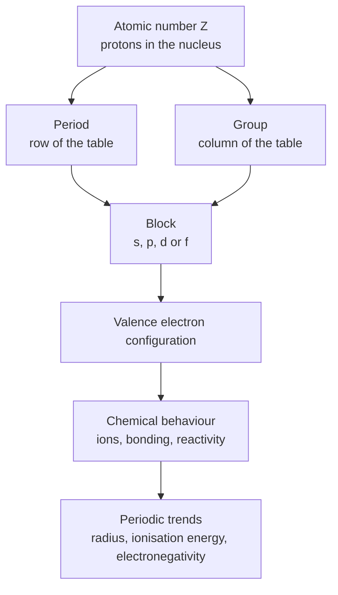
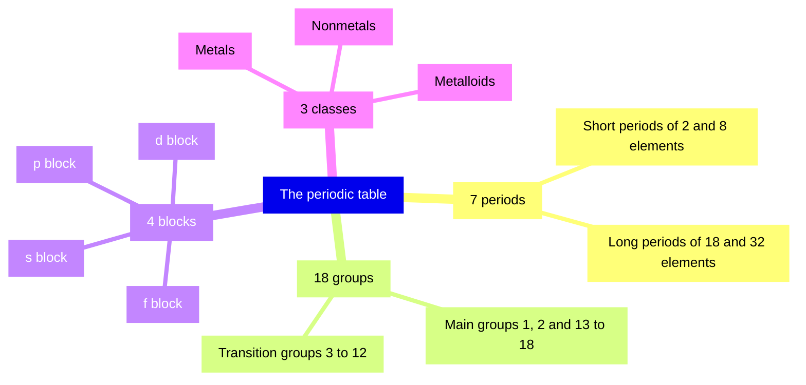
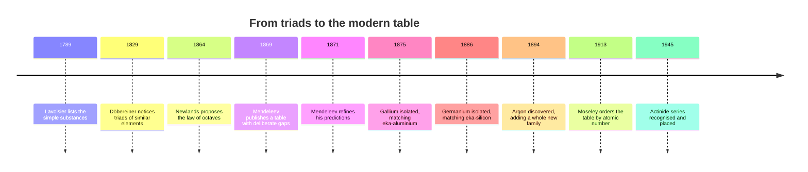
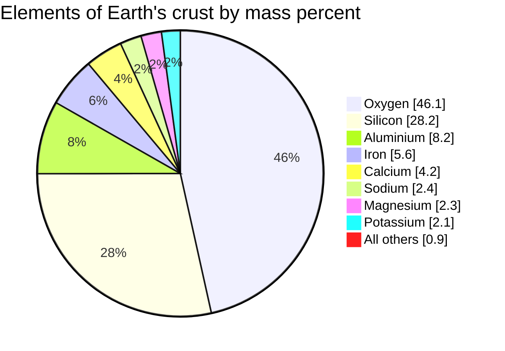

# Chapter 7 — Introduction to the Periodic Table

> **Level:** Level 0 — Foundations
> **Estimated study time:** 3 hours (reading) + 1.5 hours (exercises)
> **Prerequisites:** Chapter 6 — Atoms, Molecules and Ions
> **Related chapters:** Chapter 8 — Chemical Symbols and Formulas; Chapter 9 — Measurement, Units and Significant Figures
> **Difficulty:** ★★☆☆☆ (2 of 5)

---

## 1. Learning Objectives

After working through this chapter you will be able to:

- Explain why recurring chemical properties make a tabular arrangement of the
  elements possible.
- Identify periods, groups and the s, p, d and f blocks, and locate an element
  from its atomic number.
- Classify elements as metals, nonmetals or metalloids and place the dividing
  line on a table.
- Name the alkali metals, alkaline earth metals, halogens and noble gases, and
  give the characteristic ion of each main-group family.
- Read a cell of the table: atomic number, symbol, name and relative atomic mass.
- Describe how atomic radius, first ionisation energy and electronegativity
  change across a period and down a group, and explain why.
- Summarise Mendeleev's predictive method and give one verified example of a
  prediction that was later confirmed.

---

## 2. Introduction

In 1869 Dmitri Mendeleev arranged the sixty-three known elements in order of increasing atomic weight and noticed that properties repeated at regular intervals. He called the pattern the *periodic law*. Where the pattern demanded an element that nobody had isolated, he left a gap and predicted the missing element's properties. When gallium, scandium and germanium were discovered in 1875, 1879 and 1886, their densities, oxides and melting points matched his predictions. That success turned a convenient list into the central organising idea of chemistry.

The modern table contains 118 confirmed elements. Its power is not that it stores facts but that it compresses them: once you know where an element sits, you can predict the charge of its ion, whether it conducts electricity, and roughly how large its atoms are, often without ever having seen the element. Position summarises electron configuration, and electron configuration is the main determinant of chemical behaviour.

This chapter assumes only what Chapter 6 established: atoms have a positively charged nucleus of protons and neutrons surrounded by electrons; the atomic number $Z$ is the number of protons; ions form when electrons are gained or lost. Everything here is qualitative. The quantitative treatment of configuration and periodic trends belongs to Level 1.

---

## 3. Fundamental Concepts

### 3.1 The periodic law and atomic number

The **periodic law** states that when the elements are arranged in order of increasing atomic number, their properties recur periodically. The ordering quantity is the **atomic number** $Z$, the number of protons in the nucleus. It is a dimensionless integer and it fixes an element's identity: a nucleus with 26 protons is iron, and no arrangement of its electrons can make it anything else.

Mendeleev ordered his table by **relative atomic mass** $A_r$, because atomic number was unknown in 1869. That worked almost everywhere but produced three stubborn inversions: argon (39.95) before potassium (39.10), cobalt (58.93) before nickel (58.69), and tellurium (127.60) before iodine (126.90). In each case the chemistry demanded the order that mass forbade. In 1913 Henry Moseley showed that the frequency of the X-rays emitted by an element rises smoothly with an integer now called $Z$. Ordering by $Z$ removed every inversion and explained the anomalies at once.

### 3.2 Periods

A **period** is a horizontal row. There are seven, and their lengths are fixed:

| Period | Elements | Number of elements | Range of $Z$ |
|---|---|---|---|
| 1 | H, He | 2 | 1–2 |
| 2 | Li–Ne | 8 | 3–10 |
| 3 | Na–Ar | 8 | 11–18 |
| 4 | K–Kr | 18 | 19–36 |
| 5 | Rb–Xe | 18 | 37–54 |
| 6 | Cs–Rn | 32 | 55–86 |
| 7 | Fr–Og | 32 | 87–118 |

The period number equals the principal quantum number $n$ of the outermost occupied electron shell. The capacity of shell $n$ is $2n^{2}$ — two, eight, eighteen, thirty-two — which is exactly the sequence of period lengths. The heavier periods are wider because the $d$ and $f$ subshells fill before the outer $p$ subshell is completed.

### 3.3 Groups

A **group** is a vertical column; the modern table has 18, numbered left to right. Elements in the same group have the same number of **valence electrons** — the electrons in the outermost shell — and therefore similar chemistry.

For the **main-group** elements (groups 1, 2 and 13–18) the link is simple: group 1 has one valence electron, group 2 has two, and groups 13–18 have three to eight, obtained as the group number minus 10. This rule is a simplification. It applies cleanly to periods 2 and 3; below that, filled $d$ subshells complicate the count for groups 13–17, and helium sits in group 18 with only two electrons.

Older numbering survives in industry and in older textbooks: main groups were labelled IA to VIIIA, transition groups IB to VIIIB, and a European convention used I to VIII with letter suffixes. The 1–18 numbering is unambiguous and is used throughout this book.

### 3.4 Blocks

The four **blocks** are named after the subshell being filled along the row:

- **s block** — groups 1 and 2, plus helium. The $s$ subshell holds two
  electrons, so the block is two columns wide.
- **p block** — groups 13 to 18. The $p$ subshell holds six electrons, so the
  block is six columns wide.
- **d block** — groups 3 to 12, the **transition metals**; group 12 is sometimes
  excluded by the strict IUPAC definition. Five $d$ orbitals hold ten electrons.
- **f block** — the **lanthanides** and **actinides**, printed below the main
  body. Seven $f$ orbitals hold fourteen electrons.

The block structure records which subshell receives the last electron added, and it is why the d block sits between groups 2 and 13 rather than after group 18.

### 3.5 Metals, nonmetals and metalloids

Most elements are metals. **Metals** occupy the left, centre and lower right; **nonmetals** the upper right; and a diagonal band of **metalloids** separates them. The dividing line runs from boron to astatine through silicon, germanium, arsenic, antimony and tellurium. Polonium is sometimes counted as a metalloid and sometimes as a metal; its chemistry is predominantly metallic.

| Property | Metals | Nonmetals | Metalloids |
|---|---|---|---|
| Electrical conductivity | High, falls with temperature | Low or zero; graphite excepted | Intermediate; rises with temperature |
| Malleability and ductility | Good | Brittle or soft | Brittle |
| Lustre | Metallic | Dull or varied | Metallic to dull |
| Typical ion | Cation | Anion, or covalent bonding | Variable |
| Oxides | Basic or amphoteric | Acidic | Amphoteric or weakly acidic |

The practical definition of a metalloid is electrical: its conductivity lies between that of a metal and an insulator and increases with temperature. Silicon and germanium are the basis of the semiconductor industry for that reason.

### 3.6 Group names and families

Several groups carry traditional names still used in laboratories and in older literature.

| Group | Family name | Members | Characteristic ion | Notes |
|---|---|---|---|---|
| 1 | Alkali metals | Li, Na, K, Rb, Cs, Fr | $+1$ | Soft, low density; react vigorously with water. Hydrogen is not a member. |
| 2 | Alkaline earth metals | Be, Mg, Ca, Sr, Ba, Ra | $+2$ | Harder and less reactive than group 1. |
| 15 | Pnictogens | N, P, As, Sb, Bi | $-3$ | Range from nonmetal to metal. |
| 16 | Chalcogens | O, S, Se, Te, Po | $-2$ | Oxygen and sulfur are the familiar members. |
| 17 | Halogens | F, Cl, Br, I, At | $-1$ | Diatomic; powerful oxidising agents. |
| 18 | Noble gases | He, Ne, Ar, Kr, Xe, Rn | 0 | Full valence shell; almost inert. |
| 11 | Coinage metals | Cu, Ag, Au | Variable | Historically used for coinage; relatively unreactive. |

Two cautions. Hydrogen sits in group 1 because it has one valence electron, but it is a nonmetal and does not behave like sodium: it forms a $+1$ ion only by losing its sole electron, and more often shares it covalently. Second, "family" groups elements by chemistry, not by strict electronic analogy: the f-block elements are more alike within a row than across a column.

### 3.7 Reading a cell of the table

Every cell packs four pieces of information. Using carbon as the example:

| Position in the cell | Value | Meaning |
|---|---|---|
| Top left | 6 | Atomic number $Z$: protons per atom |
| Centre | C | Chemical symbol |
| Below the symbol | Carbon | Element name |
| Bottom | 12.011 | Relative atomic mass $A_r$ |

The **chemical symbol** is a one- or two-letter abbreviation with a capital first letter. The **relative atomic mass** is the abundance-weighted average mass of the element's atoms on a scale where one atom of carbon-12 has exactly 12 units. It is dimensionless, and because it averages the natural isotopes it is rarely a whole number. Chlorine's 35.45 is the classic demonstration: natural chlorine is about three-quarters chlorine-35 and one-quarter chlorine-37.

### 3.8 The first 20 elements

These are the elements you will meet in every introductory course. Learn the symbols and the names together; the symbols are not always obvious from the English names, and several derive from Latin (Chapter 8).

| $Z$ | Symbol | Name | $A_r$ | Group | Period | Class |
|---|---|---|---|---|---|---|
| 1 | H | Hydrogen | 1.008 | 1 | 1 | Nonmetal |
| 2 | He | Helium | 4.0026 | 18 | 1 | Noble gas |
| 3 | Li | Lithium | 6.94 | 1 | 2 | Alkali metal |
| 4 | Be | Beryllium | 9.0122 | 2 | 2 | Alkaline earth metal |
| 5 | B | Boron | 10.81 | 13 | 2 | Metalloid |
| 6 | C | Carbon | 12.011 | 14 | 2 | Nonmetal |
| 7 | N | Nitrogen | 14.007 | 15 | 2 | Nonmetal |
| 8 | O | Oxygen | 15.999 | 16 | 2 | Nonmetal |
| 9 | F | Fluorine | 18.998 | 17 | 2 | Halogen |
| 10 | Ne | Neon | 20.180 | 18 | 2 | Noble gas |
| 11 | Na | Sodium | 22.990 | 1 | 3 | Alkali metal |
| 12 | Mg | Magnesium | 24.305 | 2 | 3 | Alkaline earth metal |
| 13 | Al | Aluminium | 26.982 | 13 | 3 | Metal |
| 14 | Si | Silicon | 28.085 | 14 | 3 | Metalloid |
| 15 | P | Phosphorus | 30.974 | 15 | 3 | Nonmetal |
| 16 | S | Sulfur | 32.06 | 16 | 3 | Nonmetal |
| 17 | Cl | Chlorine | 35.45 | 17 | 3 | Halogen |
| 18 | Ar | Argon | 39.95 | 18 | 3 | Noble gas |
| 19 | K | Potassium | 39.098 | 1 | 4 | Alkali metal |
| 20 | Ca | Calcium | 40.078 | 2 | 4 | Alkaline earth metal |

### 3.9 Locating an element from its atomic number

Given $Z$, you can find the element without a printed table:

1. Subtract the cumulative lengths of the completed periods until the remainder
   is no larger than the next period. That next period is the element's period.
2. Within the period, follow the block order: s block (two elements), then d
   block (ten, in long periods), then p block (six).
3. Count across the block to the element's position and read off the group.

For $Z = 26$, periods 1–3 hold $2 + 8 + 8 = 18$ elements, leaving 8. Period 4 begins at $Z = 19$; its s block holds 19 and 20, and its d block holds 21–30. The eighth element of the period is the sixth d-block element: iron, group 8. Section 8 works this through in full.

---

## 4. Detailed Scientific Explanation

### 4.1 Why the table works

The recurring properties follow from the way electrons occupy shells. Moving one place right across a period adds one proton to the nucleus and one electron to the *same* outer shell. The added electron does not screen the outer electrons from the extra charge effectively, because it sits in the same shell. The net attraction felt by the outer electrons therefore rises. This is summarised by the **effective nuclear charge**:

$$
Z_{\text{eff}} = Z - S
$$

where $S$ is a screening constant counting how much nuclear charge the inner electrons cancel. Across a period $Z$ rises by one per step while $S$ rises by much less, so $Z_{\text{eff}}$ increases. A stronger pull on the outer electrons means the atom contracts (radius falls), removing an electron costs more (ionisation energy rises), and the atom attracts bonding electrons more strongly (electronegativity rises).

Down a group, each step adds a new shell. The outer electrons lie further from the nucleus and are screened by all the inner shells below. Distance dominates, so the radius rises, the outer electron is easier to remove, and electronegativity falls. Chemistry repeats down a group because the valence count repeats; the vigour changes because the valence electrons become more available.

The table is therefore a graph of electron configuration drawn on two axes: principal quantum number and valence-electron count.

### 4.2 Atomic radius

The **atomic radius** is not a sharp boundary, because the electron cloud has no edge. Quoted values are operational: a **covalent radius** is half the distance between two identical bonded nuclei, a **metallic radius** half the nearest-neighbour distance in a solid metal, and a **van der Waals radius** half the closest approach of two non-bonded atoms. The definitions give different numbers for the same element, so comparisons are valid only within one definition.

With that caveat:

- **Across a period, left to right:** radius decreases, because extra protons
  pull the same shell inwards.
- **Down a group:** radius increases, because each step adds a shell.

In period 3 the empirical atomic radius (derived from crystal structures) falls from $186\ \text{pm}$ for sodium to $99\ \text{pm}$ for chlorine; down group 1 it rises from $152\ \text{pm}$ for lithium to $265\ \text{pm}$ for caesium. Values differ slightly between compilations; the trends do not.

### 4.3 First ionisation energy

The **first ionisation energy** $E_{\text{i1}}$ is the minimum energy needed to remove one mole of electrons from one mole of gaseous atoms:

$$
\ce{X(g) -> X+(g) + e-} \qquad \Delta H = E_{\text{i1}} > 0
$$

It is quoted in $\text{kJ mol}^{-1}$ and is always positive. A high value means the electron is held tightly.

- **Across a period:** $E_{\text{i1}}$ generally increases, because the outer
  electron is closer to a more highly charged nucleus.
- **Down a group:** $E_{\text{i1}}$ generally decreases, because the outer
  electron is further away and better screened.

The word *generally* matters. There are small dips at group 13 and at group 16. The drop from magnesium to aluminium occurs because the new electron enters a $p$ orbital, which is slightly higher in energy and better shielded than the filled $s$ orbital. The drop from phosphorus to sulfur occurs because the added electron pairs with an existing electron in a $p$ orbital, and the repulsion partly offsets the extra nuclear charge. These exceptions are fingerprints of subshell structure; Level 1 explains them properly. At Level 0 you need only the broad trend and the knowledge that it is not perfectly smooth.

### 4.4 Electronegativity

**Electronegativity** is the tendency of an atom in a molecule to attract the shared electrons of a bond towards itself. It is not measured directly but derived from bond energies and dipole moments. The most widely used scale is the **Pauling scale**, dimensionless, running from about 0.7 for caesium to 3.98 for fluorine.

- **Across a period:** electronegativity increases; fluorine is the most
  electronegative element.
- **Down a group:** electronegativity decreases.

Noble gases are usually omitted because they form very few stable compounds and their values are ill-defined. For the same reason, electronegativity is a property of an atom *in a bond*, not of an isolated atom.

### 4.5 Mendeleev's predictive success

Mendeleev treated the table as an equation to be solved. If a gap appeared between two elements of similar chemistry, he assumed an undiscovered element belonged there, interpolated its atomic weight from its neighbours, and predicted its properties from theirs.

The most famous case is **eka-silicon**, the gap below silicon. Mendeleev predicted an atomic weight near 72, a density of about $5.5\ \text{g cm}^{-3}$, a dioxide $\ce{EsO2}$ and a chloride $\ce{EsCl4}$. In 1886 Clemens Winkler isolated germanium: $A_r = 72.63$, density $5.35\ \text{g cm}^{-3}$, oxide $\ce{GeO2}$, chloride $\ce{GeCl4}$ with a boiling point of $83\,^\circ\text{C}$ against a predicted value below $100\,^\circ\text{C}$.

| Predicted property | Prediction (1871) | Germanium, observed (1886) |
|---|---|---|
| Atomic weight | about 72 | 72.63 |
| Density | about $5.5\ \text{g cm}^{-3}$ | $5.35\ \text{g cm}^{-3}$ |
| Oxide | $\ce{EsO2}$ | $\ce{GeO2}$ |
| Chloride | $\ce{EsCl4}$ | $\ce{GeCl4}$ |

Eka-aluminium became gallium in 1875 (Lecoq de Boisbaudran) and eka-boron became scandium in 1879 (Nilson). Mendeleev predicted a density of about $5.9\ \text{g cm}^{-3}$ for gallium, within two per cent of the measured $5.91\ \text{g cm}^{-3}$. This episode is the best historical example of a scientific prediction made from a pattern and confirmed by experiment, and it is why the table is taught before the quantum theory that explains it.

The table is a summary, not an oracle. It does not predict which oxidation state a transition metal will adopt, the crystal structure of a solid, or reaction rates. Nor does it show refined effects such as the lanthanide contraction or the relativistic origin of gold's colour; those belong to later levels.

---

## 5. Visual Diagrams

**Figure 7.1 — The table as a summary of electron configuration.** The atomic number fixes both the row and the column; together they fix the block and hence the valence configuration. Chemical behaviour follows from that configuration, so the visible trends are consequences of position rather than independent facts to be memorised.

**Figure 7.2 — Four ways of dividing the same grid.** Periods, groups, blocks and element classes are different partitions of one table. A single element has one value on each axis: chlorine is in period 3, group 17, the p block and the nonmetals.

**Figure 7.3 — How the table acquired its present form.** The table was built empirically and justified theoretically only later. The discovery of the noble gases in 1894 forced a new group, Moseley's work in 1913 supplied the correct ordering principle, and the actinides were placed in the twentieth century.

**Figure 7.4 — Crustal abundance is not uniform across the table.** Eight elements account for more than 99 per cent of the mass of Earth's crust, all of them in the first four periods. Abundance is a geological accident reflecting nuclear synthesis and planetary differentiation, not a periodic property, so it must never be used to infer reactivity.

---

## 6. Mathematical Formulas

The **relative atomic mass** is the abundance-weighted mean of the isotope masses:

$$
A_r = \sum_{i=1}^{k} x_i A_i, \qquad \sum_{i=1}^{k} x_i = 1
$$

| Symbol | Meaning | SI unit |
|---|---|---|
| $A_r$ | relative atomic mass of the element | dimensionless |
| $A_i$ | relative mass of isotope $i$ | dimensionless |
| $x_i$ | abundance of isotope $i$ as a fraction | dimensionless |
| $k$ | number of stable isotopes | dimensionless |

Only a monoisotopic element has a whole-number $A_r$ to within measurement precision. Tin has ten stable isotopes and $A_r = 118.71$; fluorine has one and $A_r = 18.998$.

The **maximum electron capacity** of shell $n$ is

$$
N_{\max}(n) = 2n^{2}
$$

| Symbol | Meaning | SI unit |
|---|---|---|
| $n$ | principal quantum number, $n = 1, 2, 3, \ldots$ | dimensionless |
| $N_{\max}$ | maximum number of electrons in that shell | dimensionless |

This gives 2, 8, 18 and 32 for $n = 1$ to 4, the sequence of period lengths in section 3.2. The formula is exact for shell capacity but does not predict the order in which subshells fill, which is why period 4 contains 18 elements rather than 32.

The **scaling of ionisation energy** with charge and shell is

$$
E_{\text{i}} \propto \frac{Z_{\text{eff}}^{2}}{n^{2}}
$$

| Symbol | Meaning | SI unit |
|---|---|---|
| $E_{\text{i}}$ | ionisation energy | J, usually quoted in kJ mol⁻¹ |
| $Z_{\text{eff}}$ | effective nuclear charge | dimensionless |
| $n$ | principal quantum number of the electron removed | dimensionless |

This is a **hydrogen-like scaling model**, not an exact formula for a many-electron atom. It reproduces the direction of both trends — raising $Z_{\text{eff}}$ raises $E_{\text{i}}$, raising $n$ lowers it — but must not be used to calculate a numerical ionisation energy for a multi-electron element.

---

## 7. Chemical Equations

Alkali metals react with water to give a hydroxide and hydrogen:

$$
\ce{2Na(s) + 2H2O(l) -> 2NaOH(aq) + H2(g)}
$$

The reaction is exothermic enough to ignite the hydrogen. It becomes more violent down the group: potassium burns with a lilac flame, rubidium and caesium react explosively. The equation is balanced: two sodium, four hydrogen and two oxygen atoms on each side.

Alkaline earth metals react with oxygen on heating to give basic oxides:

$$
\ce{2Mg(s) + O2(g) -> 2MgO(s)}
$$

Magnesium burns with a brilliant white flame. Calcium reacts more readily than magnesium and barium more readily still, the same group trend at lower vigour.

Halogens displace one another from solution according to oxidising power, which decreases down the group:

$$
\ce{Cl2(aq) + 2KBr(aq) -> 2KCl(aq) + Br2(aq)}
$$

Chlorine, higher in the group, takes electrons from bromide. The reverse reaction does not occur, because bromine cannot oxidise chloride. Reactivity in group 17 therefore decreases down the group — the opposite of group 1.

The noble gases sit in group 18 because they do not enter reactions of this kind. Their valence shells are full, so first ionisation energies are the highest in each period and neither electron transfer nor sharing offers an energetic advantage. Xenon reacts with fluorine only under extreme conditions, the exception that proves the rule.

---

## 8. Worked Examples

### Worked Example 7.1 — Locating iron from its atomic number

**Problem.** An element has atomic number $Z = 26$. Identify its period, block and group, and name the element.

**Strategy.** Use the cumulative period lengths to find the period, then count through the blocks in order.

**Solution.** Periods 1–3 contain $2 + 8 + 8 = 18$ elements, so the remainder is $26 - 18 = 8$: the element is the eighth member of period 4. Period 4 begins at $Z = 19$; the s block contributes $Z = 19$ (K) and $Z = 20$ (Ca), so the sixth d-block element is $21 + 6 - 1 = 26$. Counting across: Sc (3), Ti (4), V (5), Cr (6), Mn (7), Fe (8). The element is iron, group 8, period 4, d block.

**Check.** Iron's symbol is Fe, $A_r = 55.85$, and it is a transition metal — all consistent with a d-block position in period 4. Its configuration $[\ce{Ar}]\,3d^{6}\,4s^{2}$ confirms six d electrons.

### Worked Example 7.2 — Relative atomic mass from isotope abundances

**Problem.** Natural chlorine is $75.76\ \%$ $^{35}\text{Cl}$ ($A = 34.9689$) and $24.24\ \%$ $^{37}\text{Cl}$ ($A = 36.9659$). Calculate $A_r$ to four significant figures.

**Strategy.** Convert percentages to fractions, multiply each by its isotope mass and add.

**Solution.**

$$
A_r = (0.7576)(34.9689) + (0.2424)(36.9659) = 26.493 + 8.960 = 35.453
$$

To four significant figures, $A_r = 35.45$.

**Check.** The answer lies between the isotope masses, as a weighted average must, and is closer to 35 because chlorine-35 is about three times more abundant. The IUPAC value is 35.45, so the calculation reproduces the table.

### Worked Example 7.3 — Predicting the ion from group position

**Problem.** Predict the charge of the stable ion formed by (a) calcium, (b) sulfur, (c) bromine and (d) argon.

**Strategy.** Use the group number for the valence count, then apply the octet tendency: main-group atoms gain or lose electrons to reach the nearest noble-gas configuration.

**Solution.** (a) Calcium, group 2, has two valence electrons; losing two gives the argon configuration, $\ce{Ca^2+}$. (b) Sulfur, group 16, has six; gaining two gives the argon configuration, $\ce{S^2-}$. (c) Bromine, group 17, has seven; gaining one gives the krypton configuration, $\ce{Br-}$. (d) Argon, group 18, has a full shell and forms no simple ion under ordinary conditions.

**Check.** The charges reproduce the formulas $\ce{CaBr2}$, $\ce{CaS}$ and $\ce{CaO}$, in each of which the charges sum to zero. Argon's lack of ions is consistent with its use as an inert atmosphere.

### Worked Example 7.4 — Ranking by periodic trend

**Problem.** Arrange Na, Mg, Al and Si in order of (a) decreasing atomic radius and (b) increasing first ionisation energy. Justify both orders with one idea.

**Strategy.** All four are in period 3. Across a period $Z$ rises while the shell stays the same, so $Z_{\text{eff}}$ rises. Use that single fact for both properties.

**Solution.** (a) Decreasing radius: $\ce{Na} > \ce{Mg} > \ce{Al} > \ce{Si}$; the increasing nuclear charge pulls the same three-shell cloud inwards. (b) Increasing ionisation energy: $\ce{Na} < \ce{Al} < \ce{Mg} < \ce{Si}$. The general trend is upward, but aluminium falls below magnesium because its outermost electron occupies a higher-energy $3p$ orbital that is better shielded by the filled $3s$ subshell.

**Check.** Empirical radii fall from 186 pm (Na) to 117 pm (Si). The measured first ionisation energies are 496 (Na), 578 (Al), 738 (Mg) and $786\ \text{kJ mol}^{-1}$ (Si); the inversion is the Mg–Al dip discussed in section 4.3, and the broad trend remains upward.

---

## 9. Real-World Applications

**Semiconductors.** Silicon (period 3, group 14) and germanium (period 4, group 14) sit on the metalloid line. Their intermediate conductivity, tunable by doping with group 13 or group 15 elements, underpins the electronics industry.

**Energy storage.** Lithium has the lowest density of any metal and the most negative standard electrode potential, which is why lithium-ion cells dominate portable electronics. Sodium-ion cells are being developed as a cheaper alternative because sodium is far more abundant.

**Lighting.** Sodium vapour lamps exploit the bright yellow emission of excited sodium atoms and are still used where monochromatic light is an advantage, such as near observatories.

**Medicine.** Iodine is essential for thyroid hormones, and iodinated contrast agents are used in X-ray imaging. Barium sulfate is a radiographic contrast medium for the gut because it is insoluble and therefore not absorbed; soluble barium salts are toxic.

**Agriculture.** The three primary fertiliser elements are nitrogen (group 15), phosphorus (group 15) and potassium (group 1). Their positions explain their chemistry: nitrogen and phosphorus form soluble oxyanions such as nitrate and phosphate, while potassium supplies $\ce{K+}$.

**Inert atmospheres and catalysis.** Argon shields welds and fills filament lamps because it is cheap, dense and unreactive. Platinum, palladium and rhodium (d block) catalyse reactions from exhaust treatment to industrial hydrogenation, their partly filled d orbitals binding and activating small molecules.

---

## 10. Common Mistakes

| Mistake | Why it happens | Correct approach |
|---|---|---|
| Calling hydrogen an alkali metal | It sits in group 1 | Hydrogen is a nonmetal; group membership reflects one valence electron, not metallic character. |
| Confusing group and period | Both are "rows or columns" in casual speech | Groups are columns (18); periods are rows (7). |
| Thinking the table is ordered by atomic mass | That is how Mendeleev built it | The modern table is ordered by atomic number $Z$; mass order gives Ar/K, Co/Ni and Te/I inversions. |
| Reading $A_r$ as a mass number | The numbers look similar | $A_r$ is an abundance-weighted average and usually not a whole number; a mass number is an integer nucleon count for one isotope. |
| Treating "metal" as one reactivity level | The category is learned as a binary | Reactivity ranges from caesium, which ignites in air, to gold, which resists concentrated acids. |
| Placing the metalloid line through carbon | The staircase is memorised loosely | The line runs B–Si–Ge–As–Sb–Te–At; carbon is a nonmetal. |
| Expecting a perfectly smooth ionisation trend | The general trend is taught as a rule | Small dips occur at groups 13 and 16 because of subshell structure. |

---

## 11. Chapter Summary

- The table arranges elements by increasing atomic number; properties recur
  because valence-electron configurations recur.
- Periods are rows (7, of lengths 2, 8, 8, 18, 18, 32, 32); groups are columns
  (18).
- The s, p, d and f blocks record which subshell is filling; their widths are 2,
  6, 10 and 14 columns.
- Metals dominate the left and centre, nonmetals the upper right, and metalloids
  form the diagonal staircase from boron to astatine.
- The named families are alkali metals (group 1, excluding hydrogen), alkaline
  earth metals (group 2), halogens (group 17) and noble gases (group 18).
- A cell gives $Z$, the symbol, the name and $A_r$; $A_r$ is an isotopic average
  and usually not an integer.
- Atomic radius decreases across a period and increases down a group; ionisation
  energy and electronegativity generally do the opposite. All three follow from effective
  nuclear charge and shell number.
- Mendeleev's gaps and predictions — above all eka-silicon becoming germanium —
  made the table a predictive theory rather than a catalogue.
- Moseley replaced atomic weight with atomic number as the ordering principle in
  1913 and removed the remaining anomalies.

---

## 12. Exercises

### 12.1 Conceptual questions

1. Explain in two or three sentences why the periodic table can be described as
   a map of electron configuration rather than a list of elements.
2. Why did Mendeleev leave gaps in his table, and what did he gain by doing so?

### 12.2 Basic problems

3. Give the name and symbol of the element with atomic number (a) 12, (b) 17,
   (c) 26, (d) 79.
4. State the period, group and block of (a) calcium, (b) bromine, (c) iron.

### 12.3 Intermediate problems

5. Classify each as metal, nonmetal or metalloid: sulfur, silicon, aluminium,
   argon, germanium.
6. Predict the charge of the most stable ion formed by potassium, magnesium,
   sulfur and bromine, and write its symbol.

### 12.4 Advanced problems

7. Arrange Na, K and Mg in order of decreasing atomic radius and of increasing
   first ionisation energy. Justify both orders with one electrostatic argument.
8. Explain why argon ($A_r = 39.95$) precedes potassium ($A_r = 39.10$) although
   argon has the greater relative atomic mass.

### 12.5 Calculation problems

9. Magnesium is $78.99\ \%$ $^{24}\text{Mg}$ ($23.9850$), $10.00\ \%$
   $^{25}\text{Mg}$ ($24.9858$) and $11.01\ \%$ $^{26}\text{Mg}$ ($25.9826$).
   Calculate $A_r$ to five significant figures.
10. An element has atomic number 35. Identify its period and group, name it, and
    state whether it is a metal, nonmetal or metalloid.

### Answers

1. Position fixes the valence-electron configuration, and valence electrons
   govern chemical behaviour, so elements in the same group behave similarly. The
   table is a two-dimensional summary of configuration.
2. Gaps marked elements he had not yet found. Filling them by interpolation let
   him predict properties; gallium, scandium and germanium later confirmed the
   predictions.
3. (a) Magnesium, Mg; (b) chlorine, Cl; (c) iron, Fe; (d) gold, Au.
4. (a) Period 4, group 2, s block; (b) period 4, group 17, p block; (c) period 4,
   group 8, d block.
5. Sulfur: nonmetal. Silicon: metalloid. Aluminium: metal. Argon: nonmetal
   (noble gas). Germanium: metalloid.
6. $\ce{K+}$, $\ce{Mg^2+}$, $\ce{S^2-}$, $\ce{Br-}$.
7. Radius $\ce{K} > \ce{Na} > \ce{Mg}$; ionisation energy
   $\ce{K} < \ce{Na} < \ce{Mg}$. Potassium lies below sodium, so it has one more
   shell; magnesium lies to the right of sodium, so its higher $Z_{\text{eff}}$
   contracts the atom and raises the ionisation energy.
8. The table is ordered by atomic number: argon has $Z = 18$, potassium
   $Z = 19$. Mass ordering would invert them because argon is unusually heavy for
   its proton count, a consequence of its isotope mix; chemical behaviour and
   X-ray spectra both demand the atomic-number order.
9. $0.7899(23.9850) + 0.1000(24.9858) + 0.1101(25.9826) = 18.9458 + 2.4986 + 2.8607 = 24.3050 \approx 24.305$.
10. Period 4, group 17; bromine; nonmetal (a halogen).

---

## 13. Further Reading

- OpenStax, *Chemistry 2e*, Rice University, chapters 2 and 6.
  <https://openstax.org/details/books/chemistry-2e> — free, peer-reviewed
  treatment of the table and periodic trends.
- Scerri, E. R., *The Periodic Table: Its Story and Its Significance*, 2nd ed.,
  Oxford University Press, 2020. — the standard scholarly history.
- IUPAC, *Periodic Table of the Elements*.
  <https://iupac.org/what-we-do/periodic-table-of-elements/> — authoritative
  table with current atomic weights.
- IUPAC Commission on Isotopic Abundances and Atomic Weights, *Atomic weights of
  the elements*. <https://ciaaw.org/atomic-weights.htm> — source of the $A_r$
  values used here.
- Royal Society of Chemistry, *Periodic Table*.
  <https://www.rsc.org/periodic-table> — accessible interactive table with
  element data.

---

## 14. Navigation

- Level index: [Level 0 — Foundations](README.md)
- Curriculum map: [CURRICULUM.md](../CURRICULUM.md)
- Sources and data: [REFERENCES.md](../REFERENCES.md)
- Next chapter: [Chapter 8 — Chemical Symbols and Formulas](08-chemical-symbols-and-formulas.md)
- Previous chapter: [Chapter 6 — Atoms, Molecules and Ions](06-atoms-molecules-and-ions.md)
