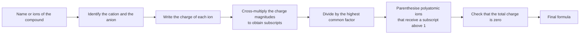
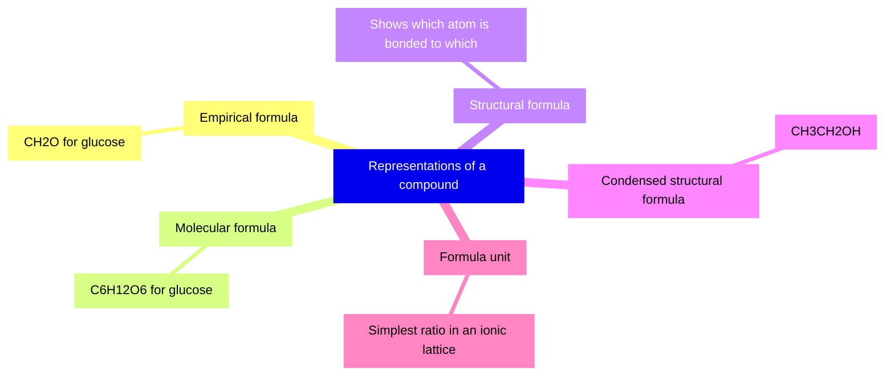
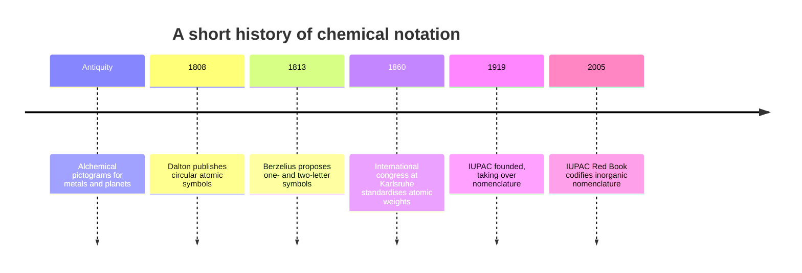
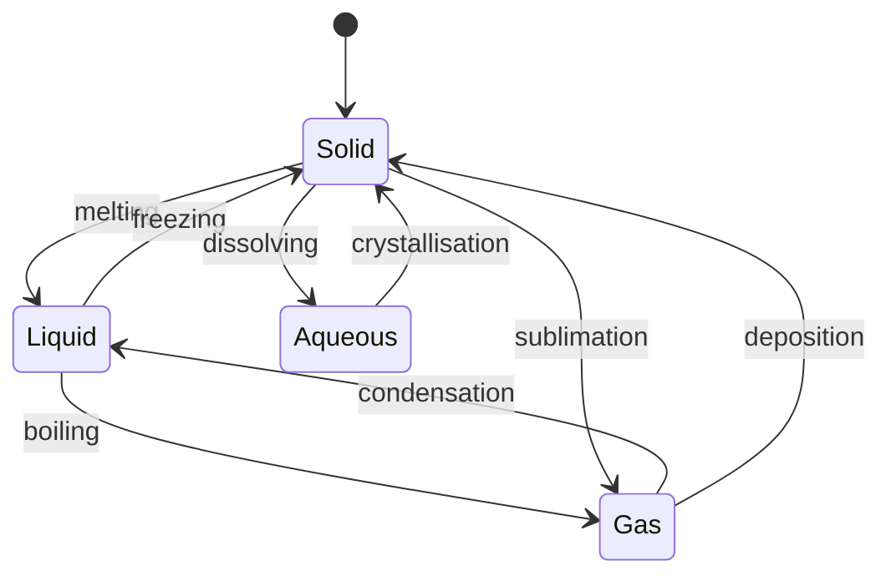

# Chapter 8 — Chemical Symbols and Formulas

> **Level:** Level 0 — Foundations
> **Estimated study time:** 3 hours (reading) + 1.5 hours (exercises)
> **Prerequisites:** Chapter 6 — Atoms, Molecules and Ions; Chapter 7 — Introduction to the Periodic Table
> **Related chapters:** Chapter 9 — Measurement, Units and Significant Figures; Chapter 10 — Laboratory Safety, Equipment and the Scientific Method
> **Difficulty:** ★★☆☆☆ (2 of 5)

---

## 1. Learning Objectives

After working through this chapter you will be able to:

- Write and interpret element symbols, including those derived from Latin names.
- Apply the capitalisation rules that distinguish Co from CO and Hg from HG.
- Explain what a subscript means and how it differs from a coefficient.
- Use parentheses correctly in formulas such as $\ce{Ca(OH)2}$ and $\ce{Al2(SO4)3}$.
- Count the atoms of each element in a formula, including formulas with parentheses and coefficients.
- Distinguish empirical, molecular and structural formulas, and convert a molecular formula into an empirical formula.
- Assign state symbols (s), (l), (g) and (aq) correctly.
- State the charges of the common main-group ions and the polyatomic ions listed in this chapter.
- Derive the formula of an ionic compound from the charges of its ions by the cross-multiply method, and check the result by charge balance.

---

## 2. Introduction

Chemistry needs a notation that is unambiguous across languages. The formula $\ce{H2SO4}$ means the same thing in Tokyo, Lagos and São Paulo, and it encodes composition more compactly than any sentence. A symbol such as Fe identifies one element; a formula such as $\ce{Fe2O3}$ identifies a compound and states the ratio in which its elements are combined. Learning to read that notation is like learning to read music: the symbols are simple, but they support an enormous range of expression.

The notation is also a contract. If you write $\ce{Co}$ you mean cobalt, a metal; if you write $\ce{CO}$ you mean carbon monoxide, a poisonous gas. If you write $\ce{CaOH2}$ you have written something that is not a recognised formula, because the hydroxide ion must be enclosed in parentheses when it appears more than once. These are not pedantic details. A misplaced subscript or a missing capital has caused real errors in prescriptions, industrial batch records and laboratory notebooks.

This chapter builds the notation from the ground up. It assumes that you know what an element, a compound and an ion are (Chapters 5 and 6), and that you can use the periodic table to find an element's group and hence its common ionic charge (Chapter 7). It does not assume any ability to name compounds systematically; nomenclature is a Level 1 topic. The aim here is fluency in reading and writing formulas, because every later chapter depends on it.

---

## 3. Fundamental Concepts

### 3.1 Element symbols and their origin

Modern chemical symbols were introduced by Jöns Jacob Berzelius in 1813. He proposed using one or two letters from the element's name, with the first letter capitalised, and this system replaced the pictographic symbols of alchemy and Dalton's circles. The symbols are international: they are not translated, even when the element's name is.

Most symbols come from the English name: H for hydrogen, C for carbon, O for oxygen, N for nitrogen, Ca for calcium. A significant minority come from Latin, because Latin was the language of European scholarship when the symbols were fixed. These must be memorised, since the English name gives no clue.

| Symbol | Element | Latin name | Notes |
|---|---|---|---|
| Fe | Iron | *ferrum* | The most-used metal in construction |
| Cu | Copper | *cuprum* | From the island of Cyprus |
| Au | Gold | *aurum* | The symbol is unrelated to "gold" |
| Ag | Silver | *argentum* | Gives the name "argent" in French |
| Pb | Lead | *plumbum* | The origin of "plumbing" |
| Sn | Tin | *stannum* | Latin *stannum* also gives "stannous" |
| Hg | Mercury | *hydrargyrum* | Literally "water-silver" |
| Na | Sodium | *natrium* | German still uses *Natrium* |
| K | Potassium | *kalium* | German still uses *Kalium* |
| Sb | Antimony | *stibium* | The mineral stibnite |
| W | Tungsten | *wolfram* | From wolframite; German uses *Wolfram* |

The remaining symbols follow the English name, sometimes with the second letter chosen to avoid a clash: magnesium is Mg because M is not available as a one-letter symbol in a table where many elements begin with the same letter. Elements discovered more recently often honour a place or a person: Am (americium), Es (einsteinium), Md (mendelevium), Cf (californium).

### 3.2 Capitalisation rules

The rules are short and absolute:

1. The first letter of a symbol is always a capital.
2. The second letter, if present, is always lowercase.
3. Symbols contain no full stops, spaces or hyphens: $\ce{NaCl}$, not Na.Cl or Na Cl.
4. Symbols are never pluralised: "two $\ce{Na}$ atoms", not "two Nas".

The second rule carries most of the information. $\ce{Co}$ is cobalt, a metal used in magnets and batteries; $\ce{CO}$ is carbon monoxide, a gas that binds haemoglobin about 200 times more strongly than oxygen does. $\ce{Hf}$ is hafnium; $\ce{HF}$ is hydrogen fluoride. $\ce{No}$ is nobelium; $\ce{NO}$ is nitric oxide, a biological signalling molecule. In each pair the difference is one letter's case.

Handwriting is a known hazard. A lowercase "l" and a capital "I" can look alike, and "Co" written carelessly becomes "CO". Write symbols so that the case is unambiguous, and in typed work never let a word processor capitalise a formula automatically.

### 3.3 How to write a chemical formula

A **chemical formula** uses element symbols and subscripts to show which elements a compound contains and in what ratio. Four conventions govern its writing.

**Order of elements.** For ionic compounds the cation is written first and the anion second: $\ce{NaCl}$, $\ce{CaCO3}$, $\ce{NH4NO3}$. For binary covalent compounds the less electronegative element is usually written first: $\ce{CO2}$, $\ce{SO2}$, $\ce{PCl3}$. Historical exceptions persist, notably $\ce{NH3}$ and $\ce{H2O}$, and organic formulas conventionally put carbon first ($\ce{CH4}$, $\ce{C2H5OH}$).

**Subscripts.** A subscript immediately after a symbol states how many atoms of that element are present. The subscript 1 is never written: the formula is $\ce{NaCl}$, not $\ce{Na1Cl1}$.

**Parentheses.** A polyatomic ion that appears more than once is enclosed in parentheses, with the multiplier written outside: $\ce{Ca(OH)2}$, $\ce{Al2(SO4)3}$.

**No charges in a formula.** A formula for a neutral compound carries no net charge. Charges belong to ions: $\ce{Na+}$ is an ion, $\ce{NaCl}$ is the compound. Writing $\ce{Na+Cl-}$ as a formula confuses the two.

### 3.4 Subscripts and what they mean

A subscript belongs only to the symbol immediately before it. In $\ce{H2O}$, the 2 applies to hydrogen and the absence of a subscript after O means one oxygen atom. In $\ce{Fe2O3}$ there are two iron atoms and three oxygen atoms.

A **coefficient** written before a formula multiplies the whole formula. The difference is fundamental:

- $\ce{2H2O}$ means two molecules of water: 4 H atoms and 2 O atoms.
- $\ce{H2O2}$ means one molecule of hydrogen peroxide: 2 H atoms and 2 O atoms.

The first is a quantity of water; the second is a different compound with different chemistry. Hydrogen peroxide is a bleaching agent and an oxidiser; water is neither.

Subscripts inside parentheses are multiplied by the subscript outside. In $\ce{Ca(OH)2}$ the group $\ce{OH}$ appears twice, giving 2 O and 2 H. In $\ce{Al2(SO4)3}$ the group $\ce{SO4}$ appears three times, giving 3 S and 12 O, in addition to 2 Al.

### 3.5 Counting atoms in a formula

Counting is mechanical once the structure of the formula is clear. Work from left to right, treat each parenthesised group as a unit, and multiply by any coefficient at the front.

| Formula | Element counts | Total atoms |
|---|---|---|
| $\ce{H2SO4}$ | H 2, S 1, O 4 | 7 |
| $\ce{Ca(OH)2}$ | Ca 1, O 2, H 2 | 5 |
| $\ce{Al2(SO4)3}$ | Al 2, S 3, O 12 | 17 |
| $\ce{(NH4)2SO4}$ | N 2, H 8, S 1, O 4 | 15 |
| $\ce{Ca3(PO4)2}$ | Ca 3, P 2, O 8 | 13 |
| $\ce{CuSO4.5H2O}$ | Cu 1, S 1, O 9, H 10 | 21 |
| $\ce{3Ca3(PO4)2}$ | Ca 9, P 6, O 24 | 39 |

The hydrate $\ce{CuSO4.5H2O}$ needs a word of explanation. The dot is not a decimal point and not a multiplication of the whole formula; it separates the anhydrous salt from its water of crystallisation. One formula unit contains one $\ce{CuSO4}$ unit and five $\ce{H2O}$ molecules, hence 9 O and 10 H in total.

### 3.6 Empirical, molecular and structural formulas

Three kinds of formula answer three different questions.

The **empirical formula** gives the simplest whole-number ratio of atoms. The **molecular formula** gives the actual number of atoms in one molecule. The **structural formula** shows which atom is bonded to which.

| Compound | Empirical | Molecular | Structural |
|---|---|---|---|
| Water | $\ce{H2O}$ | $\ce{H2O}$ | H–O–H |
| Hydrogen peroxide | $\ce{HO}$ | $\ce{H2O2}$ | H–O–O–H |
| Ethene | $\ce{CH2}$ | $\ce{C2H4}$ | $\ce{CH2=CH2}$ |
| Glucose | $\ce{CH2O}$ | $\ce{C6H12O6}$ | a six-carbon ring with five $\ce{OH}$ groups |
| Ethanol | $\ce{C2H6O}$ | $\ce{C2H6O}$ | $\ce{CH3CH2OH}$ |

For water, ethanol and many small molecules the empirical and molecular formulas coincide. For hydrogen peroxide they do not, and the difference matters: $\ce{HO}$ would imply one hydrogen and one oxygen, which is a radical, not the stable liquid in the bottle.

Two compounds can share a molecular formula while having different structures. Ethanol and dimethyl ether are both $\ce{C2H6O}$, but ethanol is a liquid that mixes with water and boils at $78\,^\circ\text{C}$, while dimethyl ether is a gas that boils at $-24\,^\circ\text{C}$. They are **isomers**: same formula, different connectivity, different properties. A molecular formula alone cannot distinguish them; a structural formula can.

### 3.7 State symbols

A **state symbol** in parentheses after a formula records the physical state of that substance under the stated conditions:

| Symbol | Meaning | Example |
|---|---|---|
| (s) | solid | $\ce{NaCl(s)}$, $\ce{I2(s)}$ |
| (l) | liquid | $\ce{H2O(l)}$, $\ce{Br2(l)}$ |
| (g) | gas | $\ce{O2(g)}$, $\ce{CO2(g)}$ |
| (aq) | dissolved in water, aqueous | $\ce{NaCl(aq)}$, $\ce{HCl(aq)}$ |

The symbol (aq) means that the substance is dissolved in water. For an ionic compound it also implies that the ions are separated and mobile, which is why aqueous solutions conduct electricity. For a molecular substance such as glucose it implies only that intact molecules are dispersed in water; glucose solutions conduct very poorly.

State symbols are not decoration. The same reaction can have very different thermodynamics depending on the states involved, and an equation without states cannot be used to calculate an enthalpy change reliably.

### 3.8 The formula unit of an ionic compound

An ionic compound such as sodium chloride is not made of discrete molecules. It is a **lattice**: a three-dimensional array in which each $\ce{Na+}$ ion is surrounded by six $\ce{Cl-}$ ions and each $\ce{Cl-}$ by six $\ce{Na+}$ ions, in a ratio of one to one. There is no molecule of $\ce{NaCl}$ to point to.

The **formula unit** is the smallest group of ions that reproduces the compound's composition and is electrically neutral. For sodium chloride the formula unit is $\ce{NaCl}$; for calcium chloride it is $\ce{CaCl2}$; for aluminium oxide it is $\ce{Al2O3}$. The formula unit is a bookkeeping device, not a particle. Saying "a molecule of $\ce{NaCl}$" is a category error; say "a formula unit of $\ce{NaCl}$" or "one $\ce{NaCl}$ unit".

This distinction is a **simplification** only in the sense that real lattices have defects, surfaces and sometimes variable composition. The formula unit itself is exact for a perfect crystal.

### 3.9 Common ions

Most main-group elements form ions with a single, predictable charge, obtained by gaining or losing enough electrons to reach the nearest noble-gas configuration.

| Group | Example element | Ion | Charge |
|---|---|---|---|
| 1 | Na | $\ce{Na+}$ | $+1$ |
| 2 | Mg | $\ce{Mg^2+}$ | $+2$ |
| 13 | Al | $\ce{Al^3+}$ | $+3$ |
| 15 | N | $\ce{N^3-}$ | $-3$ |
| 16 | O | $\ce{O^2-}$ | $-2$ |
| 17 | Cl | $\ce{Cl-}$ | $-1$ |
| 18 | Ne | none | $0$ |

Transition metals are less predictable because their $d$ electrons are available for bonding. Iron forms both $\ce{Fe^2+}$ and $\ce{Fe^3+}$; copper forms $\ce{Cu+}$ and $\ce{Cu^2+}$; manganese forms several. The charge is specified by a Roman numeral in the name: iron(II) chloride is $\ce{FeCl2}$, iron(III) chloride is $\ce{FeCl3}$. Zinc and silver are convenient exceptions: zinc is almost always $\ce{Zn^2+}$ and silver almost always $\ce{Ag+}$.

Polyatomic ions are groups of atoms that carry a net charge and move as a unit. They must be memorised, because their charges cannot be deduced from the periodic table.

| Name | Formula | Charge | Note |
|---|---|---|---|
| Nitrate | $\ce{NO3-}$ | $-1$ | The "-ate" ion of nitrogen |
| Nitrite | $\ce{NO2-}$ | $-1$ | One oxygen fewer |
| Sulfate | $\ce{SO4^2-}$ | $-2$ | The "-ate" ion of sulfur |
| Sulfite | $\ce{SO3^2-}$ | $-2$ | One oxygen fewer |
| Carbonate | $\ce{CO3^2-}$ | $-2$ | Found in limestone and shells |
| Phosphate | $\ce{PO4^3-}$ | $-3$ | The "-ate" ion of phosphorus |
| Hydroxide | $\ce{OH-}$ | $-1$ | A hydroxide is a base |
| Ammonium | $\ce{NH4+}$ | $+1$ | The only common positive polyatomic ion here |
| Hydrogencarbonate | $\ce{HCO3-}$ | $-1$ | Also called bicarbonate |
| Permanganate | $\ce{MnO4-}$ | $-1$ | A strong oxidiser, purple in solution |
| Dichromate | $\ce{Cr2O7^2-}$ | $-2$ | Orange; a strong oxidiser |
| Acetate | $\ce{CH3COO-}$ | $-1$ | The anion of acetic acid |
| Chlorate | $\ce{ClO3-}$ | $-1$ | Related to chlorate(V) chemistry |

The naming pattern is worth noticing. For a given central element, the "-ate" ion has one more oxygen than the "-ite" ion: nitrate/nitrite, sulfate/sulfite. The prefixes "per-" and "hypo-" extend the series further, as in perchlorate ($\ce{ClO4-}$) and hypochlorite ($\ce{ClO-}$). The charge usually stays the same across the series.

### 3.10 Deriving an ionic formula from charges

Because a compound is electrically neutral, the total positive charge must cancel the total negative charge. The **cross-multiply method** turns that constraint into a procedure:

1. Write the symbol and charge of the cation, then the anion.
2. Take the magnitude of each charge and write it as the subscript of the other ion.
3. Divide all subscripts by their highest common factor.
4. Put parentheses around any polyatomic ion that receives a subscript greater than one.
5. Check that the total charge is zero.

Worked Example 8.1 applies the method in full. For magnesium chloride, the ions are $\ce{Mg^2+}$ and $\ce{Cl-}$; crossing gives $\ce{Mg1Cl2}$, simplified to $\ce{MgCl2}$. For aluminium oxide, $\ce{Al^3+}$ and $\ce{O^2-}$ give $\ce{Al2O3}$. For calcium nitrate, $\ce{Ca^2+}$ and $\ce{NO3-}$ give $\ce{Ca(NO3)2}$ — the parentheses are essential, because $\ce{CaNO32}$ would be read as one calcium, one nitrogen, thirty-two oxygens.

---

## 4. Detailed Scientific Explanation

### 4.1 Formulas as ratios, not recipes

A formula states a ratio, not a set of instructions. $\ce{H2O}$ does not mean "take two hydrogens and add one oxygen"; it means that in every water molecule the ratio of hydrogen to oxygen atoms is 2:1. For an ionic compound the ratio applies to the whole lattice, which may contain $10^{20}$ formula units.

This is why formulas are scale-free. A teaspoon of water and a tanker of water have the same formula, because the ratio is the same. It is also why a formula cannot tell you the size of the sample, the yield of a reaction, or the rate at which a substance forms. Those require quantities in moles and are treated in Level 2.

### 4.2 Charges, oxidation states and variable valence

The charge on a main-group ion follows from the octet tendency, as section 3.9 showed. Transition metals behave differently because the $3d$ and $4s$ orbitals are close in energy, so removing a $d$ electron costs a similar amount of energy to removing an $s$ electron. Iron can therefore lose two or three electrons, and manganese can lose two, three, four, six or seven depending on the compound.

The charge assigned to an atom in a compound is its **oxidation state**, a bookkeeping number that treats bonding electrons as belonging to the more electronegative atom. Oxidation states are not the same as ionic charges in covalent compounds, but for simple ionic compounds they coincide. They become essential in redox chemistry (Level 2) and in nomenclature, where Roman numerals distinguish $\ce{FeCl2}$ (iron(II) chloride) from $\ce{FeCl3}$ (iron(III) chloride).

Two conventions prevent most errors. Oxygen is almost always $-2$ in compounds, and hydrogen is almost always $+1$ when bonded to a nonmetal. The sum of oxidation states in a neutral formula is zero; in a polyatomic ion it equals the ion's charge. These rules let you deduce the charge on an unusual element, and they provide the check in the cross-multiply method.

### 4.3 Hydrates and dot notation

Many ionic compounds crystallise with water molecules trapped in the lattice. These are **hydrates**, and their formulas use a dot to separate the salt from the water of crystallisation:

$$
\ce{CuSO4.5H2O(s)}
$$

This is copper(II) sulfate pentahydrate: one $\ce{CuSO4}$ unit per five water molecules. The dot is a separator, not a multiplication sign. Heating drives off the water and leaves the anhydrous salt, which is white rather than blue:

$$
\ce{CuSO4.5H2O(s) -> CuSO4(s) + 5H2O(g)}
$$

The colour change is used as a test for water: anhydrous copper(II) sulfate turns blue when water is added, and the reaction is exothermic. Other common hydrates include gypsum, $\ce{CaSO4.2H2O}$, and washing soda, $\ce{Na2CO3.10H2O}$.

### 4.4 What a formula does not tell you

A formula states composition and ratio, not connectivity, shape, bond order, isotopic composition or solid-state structure: $\ce{C2H6O}$ could be ethanol or dimethyl ether, and $\ce{C}$ could be diamond or graphite. Structural formulas and models fill some of these gaps, but none replaces the formula as a statement of composition.

---

## 5. Visual Diagrams

**Figure 8.1 — The cross-multiply algorithm.** The procedure converts a pair of ionic charges into the smallest whole-number subscripts that give neutrality. Every step is reversible except the simplification, which is why the charge check at the end is essential.

**Figure 8.2 — Five representations, five purposes.** The empirical formula answers "in what ratio?", the molecular formula "how many atoms per molecule?", and the structural formula "in what order are they connected?". The formula unit is the ionic analogue of the molecular formula.

**Figure 8.3 — From pictograms to letters.** The decisive change was Berzelius's insight that letters could be combined and typeset, unlike pictures. Standardisation then moved from individual authors to international bodies.

**Figure 8.4 — The states behind the state symbols.** Every arrow corresponds to a state symbol used in equations: (s), (l), (g) and (aq). Plasma is omitted because it is not encountered in ordinary laboratory chemistry. Note that dissolving is not a change of state in the thermodynamic sense; (aq) records a solution, not a fourth phase.

---

## 6. Mathematical Formulas

The first formula expresses the neutrality that every ionic formula must satisfy:

$$
\sum_i z_i n_i = 0
$$

| Symbol | Meaning | SI unit |
|---|---|---|
| $z_i$ | charge number of ion $i$, in units of the elementary charge | dimensionless |
| $n_i$ | number of ions of type $i$ in one formula unit | dimensionless |
| $i$ | index over the ions in the formula | dimensionless |

For $\ce{Al2(SO4)3}$: $z_{\ce{Al^3+}} = +3$, $n = 2$; $z_{\ce{SO4^2-}} = -2$, $n = 3$. The sum is $2(+3) + 3(-2) = 0$, so the formula is neutral.

The second formula gives the **relative formula mass**, the sum of the relative atomic masses of all atoms in the formula:

$$
M_r = \sum_i n_i A_{r,i}
$$

| Symbol | Meaning | SI unit |
|---|---|---|
| $M_r$ | relative formula mass (or relative molecular mass) | dimensionless |
| $n_i$ | number of atoms of element $i$ in the formula | dimensionless |
| $A_{r,i}$ | relative atomic mass of element $i$ | dimensionless |

$M_r$ is dimensionless because it is a ratio to one-twelfth of the mass of a carbon-12 atom. The **molar mass** $M$ is the corresponding mass per mole, numerically equal to $M_r$ but with units of $\text{g mol}^{-1}$. Thus $\ce{H2O}$ has $M_r = 18.015$ and $M = 18.015\ \text{g mol}^{-1}$.

---

## 7. Chemical Equations

Formulas are the vocabulary of equations. The following three reactions illustrate the notation at work.

When calcium chloride solution is mixed with sodium phosphate solution, calcium phosphate precipitates:

$$
\ce{3CaCl2(aq) + 2Na3PO4(aq) -> Ca3(PO4)2(s) + 6NaCl(aq)}
$$

The formula $\ce{Ca3(PO4)2}$ shows why the coefficients are 3 and 2: three calcium ions and two phosphate groups are needed for neutrality. Check the atom count: Ca 3 on each side, P 2, O 8, Na 6, Cl 6.

Carbon dioxide turns limewater milky by precipitating calcium carbonate:

$$
\ce{Ca(OH)2(aq) + CO2(g) -> CaCO3(s) + H2O(l)}
$$

The parentheses in $\ce{Ca(OH)2}$ are essential: they say that the compound contains two hydroxide ions per calcium ion, not one oxygen and two hydrogens attached in some other order.

Ammonium dichromate decomposes violently when heated, producing a green solid, nitrogen and steam:

$$
\ce{(NH4)2Cr2O7(s) -> Cr2O3(s) + N2(g) + 4H2O(g)}
$$

Count the atoms: N 2, H 8, Cr 2, O 7 on the left; N 2, H 8, Cr 2, O $3 + 4 = 7$ on the right. The reaction is a classic demonstration of a vigorous exothermic decomposition, and it is also a demonstration of why the subscript outside the parentheses must multiply every atom inside them.

---

## 8. Worked Examples

### Worked Example 8.1 — Formula of aluminium sulfate

**Problem.** Aluminium sulfate is composed of aluminium ions and sulfate ions. Derive its formula.

**Strategy.** Identify the charges, cross-multiply, simplify, then check neutrality.

**Solution.** The ions are $\ce{Al^3+}$ and $\ce{SO4^2-}$. Crossing the charge magnitudes gives 2 aluminium ions and 3 sulfate ions:

$$
\ce{2Al^3+ + 3SO4^2- -> Al2(SO4)3}
$$

The subscripts 2 and 3 have no common factor, so the formula is already in its lowest terms. The sulfate group receives parentheses because its subscript is greater than one.

**Check.** Total charge: $2(+3) + 3(-2) = +6 - 6 = 0$. The formula is neutral, as required. No simpler ratio of aluminium to sulfate gives neutrality, because 2 and 3 are coprime.

### Worked Example 8.2 — Counting atoms with a coefficient

**Problem.** How many atoms of each element are present in $\ce{3Ca3(PO4)2}$?

**Strategy.** Count within one formula unit first, then multiply by the coefficient.

**Solution.** One formula unit contains 3 Ca, 2 P and $2 \times 4 = 8$ O. Multiplying by the coefficient 3 gives:

- Ca: $3 \times 3 = 9$
- P: $3 \times 2 = 6$
- O: $3 \times 8 = 24$

The total number of atoms is $9 + 6 + 24 = 39$.

**Check.** The ratio Ca : P : O is 9 : 6 : 24, which simplifies to 3 : 2 : 8 — exactly the subscripts in the formula. Multiplying by a coefficient cannot change the ratio, so this is a useful consistency check.

### Worked Example 8.3 — Relative formula mass of calcium hydroxide

**Problem.** Calculate $M_r$ of $\ce{Ca(OH)2}$ using $A_r(\ce{Ca}) = 40.078$, $A_r(\ce{O}) = 15.999$ and $A_r(\ce{H}) = 1.008$.

**Strategy.** Sum the atomic masses, multiplying each by its count.

**Solution.** The formula contains 1 Ca, 2 O and 2 H:

$$
M_r = 40.078 + 2(15.999) + 2(1.008) = 40.078 + 31.998 + 2.016 = 74.092
$$

To four significant figures, $M_r = 74.09$.

**Check.** The result lies between the mass of CaO (56.08) and CaCO3 (100.09), which is plausible for a hydroxide. A common error is to count one oxygen and one hydrogen instead of two of each; doing so gives 57.09, which is too low by exactly the mass of one $\ce{OH}$ group.

### Worked Example 8.4 — Empirical formula from a molecular formula

**Problem.** Glucose has the molecular formula $\ce{C6H12O6}$. Find its empirical formula and verify that the two formulas are consistent with a molar mass of $180.16\ \text{g mol}^{-1}$.

**Strategy.** Divide the subscripts by their highest common factor, then compare the formula masses.

**Solution.** The subscripts 6, 12 and 6 have highest common factor 6:

$$
\ce{C6H12O6 -> CH2O}
$$

The empirical formula is $\ce{CH2O}$. Its relative formula mass is $12.011 + 2(1.008) + 15.999 = 30.026$. Six times this is $6 \times 30.026 = 180.156$, which matches the given molar mass.

**Check.** The multiplier 6 is an integer, as it must be: a molecular formula is always a whole-number multiple of the empirical formula. If the division had produced 4.5, either the analysis or the molar mass would be wrong.

---

## 9. Real-World Applications

**Fertilisers and the NPK label.** Fertiliser bags are labelled with three numbers, such as 15-10-10, giving the mass percentages of nitrogen, phosphorus and potassium expressed as N, $\ce{P2O5}$ and $\ce{K2O}$. The formula convention is not the same for all three, which is a frequent source of confusion: nitrogen is reported as the element, while phosphorus and potassium are reported as their oxides.

**Pharmaceuticals.** Paracetamol is $\ce{C8H9NO2}$, and its dosage is calculated from its molar mass. A formula error in a prescription is a patient-safety event, which is why pharmacists check the identity and the dose independently.

**Pigments and materials.** Titanium dioxide, $\ce{TiO2}$, is the white pigment in paint, paper and sunscreen. Its opacity depends on particle size and crystal form, not on the formula, which is a reminder that composition is only one part of a material's behaviour.

**Batteries.** Lithium cobalt oxide, $\ce{LiCoO2}$, was the cathode material in the first commercial lithium-ion cells. The formula shows the ratio of lithium to cobalt to oxygen, while the crystal structure determines how many lithium ions can be removed and reinserted.

**Water hardness and scale.** Calcium carbonate, $\ce{CaCO3}$, is the main component of limestone, chalk and scale in kettles. Its precipitation from hard water is described by the limewater equation in section 7.

**Plaster and cement.** Gypsum is $\ce{CaSO4.2H2O}$. Heating it drives off part of the water to give plaster of Paris, $\ce{2CaSO4.H2O}$, which sets when water is added back. The dot notation is doing real work here: the two hydrates have different properties and different uses.

---

## 10. Common Mistakes

| Mistake | Why it happens | Correct approach |
|---|---|---|
| Writing CO for cobalt or Co for carbon monoxide | Case is lost in speech and in hurried typing | Cobalt is $\ce{Co}$; carbon monoxide is $\ce{CO}$. Check the second letter. |
| Reading $\ce{H2O2}$ as two waters | The subscripts look like multipliers of the whole formula | $\ce{H2O2}$ is hydrogen peroxide, a different compound; two waters is $\ce{2H2O}$. |
| Writing $\ce{CaOH2}$ instead of $\ce{Ca(OH)2}$ | Parentheses seem optional | A repeated polyatomic ion must be parenthesised: $\ce{Ca(OH)2}$. |
| Writing $\ce{CaNO32}$ for calcium nitrate | The subscript is applied to the wrong thing | $\ce{Ca(NO3)2}$; the 2 multiplies the whole nitrate group. |
| Writing $\ce{Na1Cl1}$ | The logic of charge balance is applied literally | Subscript 1 is never written: $\ce{NaCl}$. |
| Confusing $\ce{Ca^2+}$ with $\ce{Ca2}$ | The superscript is lost on a keyboard | The charge is a superscript on the right: $\ce{Ca^2+}$. |
| Calling a formula unit a molecule | Everyday language treats all particles as molecules | Ionic compounds contain formula units in a lattice, not molecules. |
| Giving a neutral formula a charge | Charges and formulas are conflated | $\ce{NaCl}$ is neutral; $\ce{Na+}$ is an ion. |

---

## 11. Chapter Summary

- Element symbols are one or two letters, first letter capital, second lowercase; several derive from Latin (Fe, Cu, Au, Ag, Pb, Sn, Hg, Na, K).
- A formula gives the elements and the ratio of atoms; a subscript applies only to the symbol immediately before it.
- A coefficient multiplies the whole formula; a subscript does not.
- Parentheses group polyatomic ions: $\ce{Ca(OH)2}$ has two hydroxide ions, $\ce{Al2(SO4)3}$ has three sulfate ions.
- Empirical, molecular and structural formulas answer different questions: simplest ratio, atoms per molecule, and connectivity.
- State symbols (s), (l), (g) and (aq) record physical state; (aq) means dissolved in water.
- Ionic compounds exist as lattices; the formula unit is the simplest neutral ratio, not a molecule.
- Main-group ions have predictable charges from their group; polyatomic ions must be memorised.
- Ionic formulas are derived by cross-multiplying charge magnitudes, simplifying and checking that the total charge is zero.
- $M_r$ is the sum of the relative atomic masses in the formula; it is dimensionless, and the molar mass in $\text{g mol}^{-1}$ is numerically equal to it.

---

## 12. Exercises

### 12.1 Conceptual questions

1. Explain why element symbols are not simply abbreviations of English names. Give two examples from Latin.
2. Distinguish between an empirical formula and a molecular formula, using glucose and hydrogen peroxide as examples.

### 12.2 Basic problems

3. Name the elements represented by Fe, Cu, Au, Ag and Pb.
4. Write the symbols for potassium, sodium, mercury and tin.

### 12.3 Intermediate problems

5. Count the atoms of each element in (a) $\ce{H2SO4}$, (b) $\ce{Ca(NO3)2}$, (c) $\ce{Al2(SO4)3}$.
6. Write formulas for (a) magnesium chloride, (b) aluminium oxide, (c) calcium nitrate, (d) ammonium sulfate.

### 12.4 Advanced problems

7. Derive the formula of iron(III) sulfate and show that it is neutral.
8. Explain why calcium hydroxide is written $\ce{Ca(OH)2}$ while calcium chloride is written $\ce{CaCl2}$, even though both contain two anions per calcium ion.

### 12.5 Calculation problems

9. Calculate $M_r$ of $\ce{Ca3(PO4)2}$ using $A_r(\ce{Ca}) = 40.078$, $A_r(\ce{P}) = 30.974$ and $A_r(\ce{O}) = 15.999$.
10. A compound has the empirical formula $\ce{CH2}$ and a molar mass of $56.11\ \text{g mol}^{-1}$. Determine its molecular formula.

### Answers

1. Symbols must be language-independent and short, and many were fixed when Latin was the language of scholarship. Examples: Fe from *ferrum* (iron), Pb from *plumbum* (lead), Au from *aurum* (gold), Na from *natrium* (sodium).
2. The empirical formula gives the simplest whole-number ratio; the molecular formula gives the actual number of atoms per molecule. Glucose: $\ce{CH2O}$ empirical, $\ce{C6H12O6}$ molecular. Hydrogen peroxide: $\ce{HO}$ empirical, $\ce{H2O2}$ molecular.
3. Iron, copper, gold, silver, lead.
4. K, Na, Hg, Sn.
5. (a) H 2, S 1, O 4. (b) Ca 1, N 2, O 6. (c) Al 2, S 3, O 12.
6. (a) $\ce{MgCl2}$; (b) $\ce{Al2O3}$; (c) $\ce{Ca(NO3)2}$; (d) $\ce{(NH4)2SO4}$.
7. $\ce{Fe^3+}$ and $\ce{SO4^2-}$ cross to give $\ce{Fe2(SO4)3}$. Charge: $2(+3) + 3(-2) = 0$.
8. Chloride is a single-atom ion, $\ce{Cl-}$, so $\ce{CaCl2}$ is unambiguous. Hydroxide is a polyatomic ion, $\ce{OH-}$; without parentheses, $\ce{CaOH2}$ would suggest one oxygen and two hydrogens not grouped as hydroxide. Parentheses preserve the identity of the group.
9. $3(40.078) + 2(30.974) + 8(15.999) = 120.234 + 61.948 + 127.992 = 310.174 \approx 310.17$.
10. The empirical formula mass is $12.011 + 2(1.008) = 14.027$. The multiplier is $56.11 / 14.027 = 4.00$, so the molecular formula is $\ce{C4H8}$.

---

## 13. Further Reading

- IUPAC, *Nomenclature of Inorganic Chemistry: IUPAC Recommendations 2005* (the "Red Book"), Royal Society of Chemistry, 2005. — the authoritative rules for formulas and names.
- IUPAC, *Compendium of Chemical Terminology* (the "Gold Book"), 2nd ed. <https://goldbook.iupac.org/> — definitions of formula, empirical formula and related terms.
- IUPAC, *Brief Guide to the Nomenclature of Inorganic Chemistry*, 2015. <https://iupac.org/what-we-do/books/color-books/> — a short, free summary of the Red Book rules.
- OpenStax, *Chemistry 2e*, Rice University, chapter 2. <https://openstax.org/details/books/chemistry-2e> — formulas, ions and ionic compounds at introductory level.
- Royal Society of Chemistry, *Periodic Table*. <https://www.rsc.org/periodic-table> — element symbols and relative atomic masses.

---

## 14. Navigation

- Level index: [Level 0 — Foundations](README.md)
- Curriculum map: [CURRICULUM.md](../CURRICULUM.md)
- Sources and data: [REFERENCES.md](../REFERENCES.md)
- Previous chapter: [Chapter 7 — Introduction to the Periodic Table](07-introduction-to-the-periodic-table.md)
- Next chapter: [Chapter 9 — Measurement, Units and Significant Figures](09-measurement-units-and-significant-figures.md)
