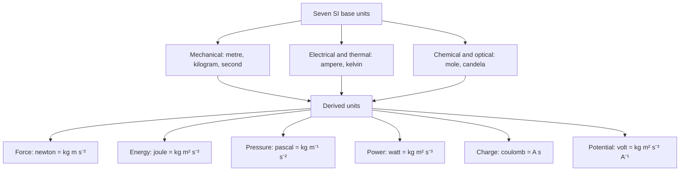
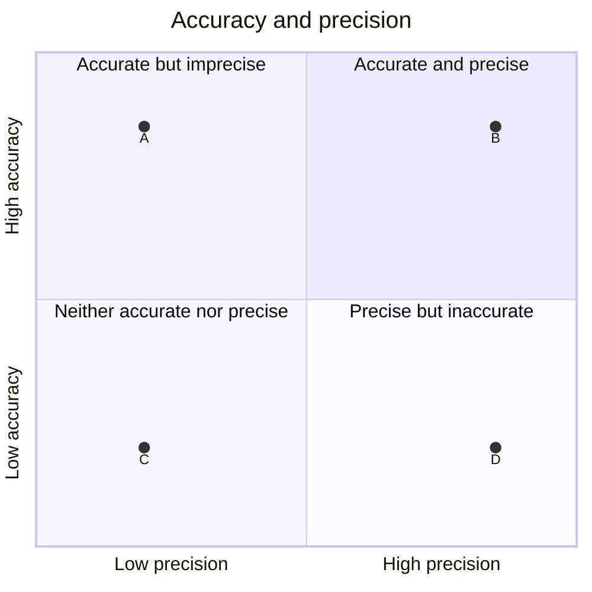
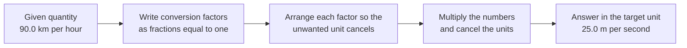

# Chapter 9 — Measurement, Units and Significant Figures

> **Level:** Level 0 — Foundations
> **Estimated study time:** 4 hours (reading) + 2 hours (exercises)
> **Prerequisites:** Chapters 1–8, especially Chapter 7 (the periodic table) and Chapter 8 (chemical formulas)
> **Related chapters:** Chapter 10 — Laboratory Safety, Equipment and the Scientific Method
> **Difficulty:** ★★☆☆☆ (2 of 5)

---

## 1. Learning Objectives

After working through this chapter you will be able to:

- State the seven SI base units, their symbols and the quantities they measure.
- Decompose the derived units N, J, Pa, W, V, C and Hz into SI base units.
- Use SI prefixes from yocto ($10^{-24}$) to yotta ($10^{24}$) correctly.
- Convert between units by dimensional analysis, chaining conversion factors and
  cancelling units.
- Distinguish accuracy from precision, and explain the target analogy.
- Report a measurement with its uncertainty in the last digit.
- Apply the five significant-figure rules to counted, measured and ambiguous
  numbers.
- Apply the different rounding rules for addition/subtraction and for
  multiplication/division.
- Round correctly, express numbers in scientific notation and recognise exact
  numbers.
- Calculate percentage error and choose a defensible number of significant
  figures for a final answer.

---

## 2. Introduction

In 1999 NASA lost the Mars Climate Orbiter. The spacecraft's thrusters had been characterised in pound-force seconds by one contractor and the navigation software expected newton-seconds. The discrepancy was never converted, the trajectory was wrong, and the orbiter was destroyed in the Martian atmosphere. The cost was about 125 million US dollars. The arithmetic was not difficult. The units were.

Chemistry has the same exposure. A concentration reported as "5" is meaningless until you know whether it means $5\ \text{g dm}^{-3}$ (a dilute salt solution), $5\ \text{mol dm}^{-3}$ (concentrated hydrochloric acid) or $5\ \text{mg dm}^{-3}$ (a trace level). A mass of "2.5" could be grams or kilograms. A volume of "10" could be millilitres or cubic metres, a difference of a factor of a million.

This chapter therefore treats measurement as a skill in its own right. It covers the International System of Units (SI), the technique of dimensional analysis, the meaning of uncertainty, and the conventions for significant figures. These are not bureaucratic details. They are the grammar of quantitative chemistry: every calculation you meet later — moles, concentrations, enthalpies, equilibrium constants — assumes that you can carry units through an expression and report a result at the precision the data justify.

---

## 3. Fundamental Concepts

### 3.1 Physical quantities and units

A **physical quantity** is a property that can be measured and expressed as a number multiplied by a unit. The number alone is not the quantity. Writing $m = 5$ is incomplete; writing $m = 5.00\ \text{g}$ is a measurement.

The **International System of Units** (SI, from the French *Système international d'unités*) defines seven **base units**, from which every other unit is derived. The system is maintained by the International Bureau of Weights and Measures (BIPM), and its definitions were revised in 2019 so that the base units now rest on fixed numerical values of fundamental constants rather than on physical artefacts.

### 3.2 The seven SI base units

| Quantity | Unit | Symbol |
|---|---|---|
| Length | metre | m |
| Mass | kilogram | kg |
| Time | second | s |
| Electric current | ampere | A |
| Thermodynamic temperature | kelvin | K |
| Amount of substance | mole | mol |
| Luminous intensity | candela | cd |

Two features of this table cause persistent difficulty. First, the SI base unit of mass is the **kilogram**, not the gram, and it is the only base unit whose name contains a prefix. Prefixes are nevertheless attached to the gram in practice: milligrams (mg) and micrograms (µg) are common, while microkilograms are never used. Second, the **kelvin** is an absolute temperature scale: it starts at absolute zero, and a temperature difference of one kelvin equals a difference of one degree Celsius. Conversion is therefore

$$
T/\text{K} = \theta/^\circ\text{C} + 273.15
$$

where $\theta$ is the Celsius temperature. The equation is exact by definition of the Celsius scale, so 273.15 is an exact number.

### 3.3 Derived units

Derived units are products and quotients of base units. Several have special names, which are convenient abbreviations but must be decomposable for dimensional analysis.

| Quantity | Derived unit | Symbol | Decomposition into base units |
|---|---|---|---|
| Force | newton | N | $\text{kg m s}^{-2}$ |
| Energy | joule | J | $\text{kg m}^{2}\ \text{s}^{-2}$ |
| Pressure | pascal | Pa | $\text{kg m}^{-1}\ \text{s}^{-2}$ |
| Power | watt | W | $\text{kg m}^{2}\ \text{s}^{-3}$ |
| Electric charge | coulomb | C | $\text{A s}$ |
| Electric potential difference | volt | V | $\text{kg m}^{2}\ \text{s}^{-3}\ \text{A}^{-1}$ |
| Frequency | hertz | Hz | $\text{s}^{-1}$ |

The decompositions follow from the defining equations. Force is mass times acceleration, so $1\ \text{N} = 1\ \text{kg m s}^{-2}$. Energy is force times distance, so $1\ \text{J} = 1\ \text{N m} = 1\ \text{kg m}^{2}\ \text{s}^{-2}$. Pressure is force per area, so $1\ \text{Pa} = 1\ \text{N m}^{-2} = 1\ \text{kg m}^{-1}\ \text{s}^{-2}$. Power is energy per time, so $1\ \text{W} = 1\ \text{J s}^{-1} = 1\ \text{kg m}^{2}\ \text{s}^{-3}$. Charge is current times time, so $1\ \text{C} = 1\ \text{A s}$. Potential difference is energy per charge, so $1\ \text{V} = 1\ \text{J C}^{-1} = 1\ \text{kg m}^{2}\ \text{s}^{-3}\ \text{A}^{-1}$. Frequency is reciprocal time, so $1\ \text{Hz} = 1\ \text{s}^{-1}$.

These identities are more than trivia. If a calculation gives a result whose units do not reduce to the expected ones, the calculation is wrong. Dimensional analysis catches errors that arithmetic alone conceals.

### 3.4 SI prefixes

Prefixes multiply a unit by a power of ten. They are convenient, but they are also a source of factor-of-1000 errors, so learn the exponents rather than the names alone.

| Prefix | Symbol | Factor | Power of ten |
|---|---|---|---|
| yocto | y | 0.000000000000000000000001 | $10^{-24}$ |
| zepto | z | 0.000000000000000000001 | $10^{-21}$ |
| atto | a | 0.000000000000000001 | $10^{-18}$ |
| femto | f | 0.000000000000001 | $10^{-15}$ |
| pico | p | 0.000000000001 | $10^{-12}$ |
| nano | n | 0.000000001 | $10^{-9}$ |
| micro | µ | 0.000001 | $10^{-6}$ |
| milli | m | 0.001 | $10^{-3}$ |
| centi | c | 0.01 | $10^{-2}$ |
| deci | d | 0.1 | $10^{-1}$ |
| deca | da | 10 | $10^{1}$ |
| hecto | h | 100 | $10^{2}$ |
| kilo | k | 1000 | $10^{3}$ |
| mega | M | 1 000 000 | $10^{6}$ |
| giga | G | $10^{9}$ | $10^{9}$ |
| tera | T | $10^{12}$ | $10^{12}$ |
| peta | P | $10^{15}$ | $10^{15}$ |
| exa | E | $10^{18}$ | $10^{18}$ |
| zetta | Z | $10^{21}$ | $10^{21}$ |
| yotta | Y | $10^{24}$ | $10^{24}$ |

Three rules govern their use. Prefixes attach directly to the unit symbol with no space: $\text{mm}$, $\text{µL}$, $\text{kPa}$. They cannot be combined: "mkg" is not a unit. And a prefix applies to the unit as a whole, including any exponent: $1\ \text{cm}^{3} = (10^{-2}\ \text{m})^{3} = 10^{-6}\ \text{m}^{3}$, not $10^{-2}\ \text{m}^{3}$.

### 3.5 Dimensional analysis

**Dimensional analysis**, also called the factor-label method, converts units by multiplying by conversion factors written as fractions equal to one. Because a factor such as

$$
\frac{1000\ \text{m}}{1\ \text{km}} = 1
$$

changes only the unit and not the value, multiplying by it is always legitimate. Choose each factor so that the unwanted unit cancels:

$$
90.0\ \frac{\text{km}}{\text{h}} \times \frac{1000\ \text{m}}{1\ \text{km}} \times \frac{1\ \text{h}}{3600\ \text{s}} = 25.0\ \frac{\text{m}}{\text{s}}
$$

The general form is

$$
q_{\text{new}} = q_{\text{old}} \prod_i f_i
$$

where $q_{\text{old}}$ is the given quantity, $q_{\text{new}}$ is the required quantity and each $f_i$ is a conversion factor. Every $f_i$ is dimensionless and equal to one, so the physical value is unchanged.

### 3.6 Accuracy and precision

**Accuracy** is closeness to the true value. **Precision** is closeness of repeated measurements to one another. The two are independent: a set of measurements can be precise but inaccurate, accurate but imprecise, both, or neither.

The standard illustration is a target. Four archers shoot at a bullseye:

- **Accurate and precise:** all arrows clustered in the centre.
- **Accurate but imprecise:** arrows scattered around the centre; their average
  is close to the bullseye, but individual shots vary widely.
- **Precise but inaccurate:** a tight cluster away from the centre, usually
  caused by a systematic error such as a misaligned sight.
- **Neither:** a wide scatter centred away from the bullseye.

A **systematic error** shifts all measurements in the same direction: a balance that reads 0.05 g too high, a thermometer with a calibration offset, a burette with a worn tip. It affects accuracy and cannot be removed by averaging. A **random error** scatters measurements in both directions: fluctuations in temperature, reading a meniscus, electrical noise. It affects precision and can be reduced by averaging repeated measurements.

### 3.7 Uncertainty and the last digit

Every measurement has an **uncertainty**, an estimate of the range within which the true value is expected to lie. It is reported with the same unit and the same number of decimal places as the value:

$$
V = (25.00 \pm 0.05)\ \text{cm}^{3}
$$

The notation says that the volume is probably between 24.95 and 25.05 cm³. The last significant digit is the **first uncertain digit**; here the hundredths place is uncertain, so the measurement has four significant figures.

The uncertainty comes from the instrument's resolution and from the skill of the operator: about $\pm 0.0001\ \text{g}$ for an analytical balance, $\pm 0.01\ \text{g}$ for a top-pan balance, $\pm 0.5\ \text{cm}^{3}$ for a 100 cm$^{3}$ measuring cylinder, $\pm 0.05\ \text{cm}^{3}$ for a burette and $\pm 0.5\ ^{\circ}\text{C}$ for a thermometer. A volumetric flask has a single calibration mark, so its uncertainty is stated by the manufacturer rather than read from a scale.

For an analogue scale, the convention is to estimate one digit beyond the smallest division, so the uncertainty is about half the smallest division. For a digital display, the uncertainty is at least the last displayed digit.

### 3.8 Significant figures: the five rules

**Significant figures** are the digits in a measurement that carry information about its precision. Five rules cover every case.

**Rule 1 — Non-zero digits are always significant.** 123 has three significant figures; 4.7 has two.

**Rule 2 — Zeros between non-zero digits are significant.** 1002 has four; 20.05 has four.

**Rule 3 — Leading zeros are never significant.** They mark the position of the decimal point, nothing more. 0.0045 has two significant figures; 0.000 002 has one.

**Rule 4 — Trailing zeros after a decimal point are significant.** 2.500 has four; 0.010 has two (the leading zeros are not significant, the trailing zero is).

**Rule 5 — Trailing zeros in a whole number without a decimal point are ambiguous.** 1500 could have two, three or four significant figures. Rewrite it in scientific notation to make the intention explicit: $1.5 \times 10^{3}$ (two), $1.50 \times 10^{3}$ (three), $1.500 \times 10^{3}$ (four).

| Number | Significant figures | Reason |
|---|---|---|
| 4.56 | 3 | All non-zero |
| 1002 | 4 | Internal zeros count |
| 0.00450 | 3 | Leading zeros do not count; trailing zero after decimal does |
| 2.500 | 4 | Trailing zeros after a decimal point count |
| 0.010 | 2 | One leading zero group, one trailing zero |
| 1500 | ambiguous | Rewrite as $1.5 \times 10^{3}$ etc. |
| $6.02 \times 10^{23}$ | 3 | The coefficient carries the precision |
| 100.0 | 4 | The decimal point makes all zeros significant |

### 3.9 Arithmetic with significant figures

The rules differ for the two basic operations, because the operations accumulate error differently.

**Addition and subtraction.** Round the result to the **least number of decimal places** among the inputs. The limiting quantity is the one known least precisely in absolute terms.

$$
12.34 + 1.2 + 0.005 = 13.545 \rightarrow 13.5
$$

The input 1.2 has one decimal place, so the answer has one decimal place.

**Multiplication and division.** Round the result to the **least number of significant figures** among the inputs. The limiting quantity is the one known least precisely in relative terms.

$$
4.56 \times 1.2 \times 0.789 = 4.317\ldots \rightarrow 4.3
$$

The input 1.2 has two significant figures, so the answer has two.

**Mixed operations.** Apply the rules in the order of operations, but carry at least one extra digit through the intermediate steps and round only the final answer. Rounding at every step accumulates error and can change the last digit.

### 3.10 Rounding

To round to a specified number of significant figures or decimal places:

1. Identify the **retention digit**, the last digit you will keep.
2. Look at the digit immediately to its right.
3. If that digit is less than 5, leave the retention digit unchanged.
4. If it is greater than 5, increase the retention digit by one.
5. If it is exactly 5 followed by nothing but zeros, the result is halfway between two values. This book rounds **away from zero**, so 2.5 becomes 3 and $-2.5$ becomes $-3$; some scientific conventions round to the nearest even digit instead. The difference affects only the last digit, so state which convention you use.

### 3.11 Scientific notation

**Scientific notation** writes a number as $a \times 10^{n}$, where $1 \leq |a| < 10$ and $n$ is an integer. It removes the ambiguity of trailing zeros and handles very large and very small quantities compactly:

| Number | Scientific notation | Significant figures |
|---|---|---|
| 0.000 045 | $4.5 \times 10^{-5}$ | 2 |
| 0.000 0450 | $4.50 \times 10^{-5}$ | 3 |
| 1500 (two significant figures) | $1.5 \times 10^{3}$ | 2 |
| 1500 (four significant figures) | $1.500 \times 10^{3}$ | 4 |
| 602 000 000 000 000 000 000 000 | $6.02 \times 10^{23}$ | 3 |

### 3.12 Exact numbers

An **exact number** has no uncertainty and therefore does not limit the number of significant figures. There are three common kinds:

- **Counted objects:** 12 eggs, 3 trials, 40 students. Counting is
  exact.
- **Defined conversions:** 1 km = 1000 m, 1 h = 3600 s, 1 in = 2.54 cm (exact by
  definition), 1 L = 1 dm³.
- **Stoichiometric coefficients:** in $\ce{2H2 + O2 -> 2H2O}$, the coefficients
  2, 1 and 2 are exact ratios, not measurements.

An exact number is treated as having infinitely many significant figures. In $4.56 \times 2$ (where 2 is a counted object), the answer has three significant figures, not one.

### 3.13 Percentage error

**Percentage error** compares a measured value with an accepted or true value:

$$
\text{percentage error} = \frac{|x_{\text{meas}} - x_{\text{true}}|}{x_{\text{true}}} \times 100\%
$$

The absolute value is used so that the sign of the difference does not affect the reported error; if the direction matters, state whether the measured value was above or below the accepted value. A percentage error much smaller than the measurement uncertainty is not meaningful, because it claims a precision the data do not support.

---

## 4. Detailed Scientific Explanation

### 4.1 Why significant figures exist

A measured digit is significant if it is known reliably enough to affect the value. The last digit in any measurement is uncertain, and significant figures are a compact way of saying how many digits were actually determined.

Consider a balance that reads 12.34 g. The digits 1, 2 and 3 are certain; the 4 is uncertain by about ±0.01 g. Reporting 12.3400 g would claim two further digits that the instrument cannot support. Reporting 12 g would discard a digit that was measured. The significant-figure convention encodes the instrument's resolution in the way the number is written.

### 4.2 Reading instruments

The number of significant figures is fixed by the instrument, not by the calculator. Read the scale to the smallest division, then estimate one digit further if the scale allows.

On a burette graduated in 0.1 cm³, a reading might be 23.45 cm³: the digits 2, 3 and 4 are certain, and the 5 is estimated. The uncertainty is about $\pm 0.05\ \text{cm}^{3}$. On a digital balance reading 12.34 g, the last displayed digit is the uncertain one, so the uncertainty is $\pm 0.01\ \text{g}$. On a thermometer graduated in 1 °C, a reading of 24.5 °C has an uncertainty of about $\pm 0.5\ ^\circ\text{C}$.

### 4.3 Propagation of uncertainty

When quantities are combined, their uncertainties combine too. The simple worst-case rules are:

- **Addition or subtraction:** absolute uncertainties add.
  If $y = a + b$, then $\Delta y = \Delta a + \Delta b$.
- **Multiplication or division:** fractional uncertainties add.
  If $y = ab$ or $y = a/b$, then
  $\Delta y / y = \Delta a / a + \Delta b / b$.
- **Powers:** if $y = a^{n}$, then $\Delta y / y = n\,\Delta a / a$.

These rules are **simplifications**: they assume the errors are independent and combine in the worst case. A full treatment combines them in quadrature, $\Delta y = \sqrt{(\Delta a)^{2} + (\Delta b)^{2}}$, which gives a smaller and more realistic uncertainty. The worst-case rules are adequate at Level 0 and are conservative, which is the safe direction for a laboratory result.

The practical consequence is the significant-figure rules. Adding numbers with different decimal places cannot produce a result with more decimal places than the least precise input. Multiplying numbers with different relative precisions cannot produce more significant figures than the least precise input.

### 4.4 Units in chemical calculations

Every chemical calculation carries units. A concentration of $0.100\ \text{mol dm}^{-3}$ multiplied by a volume of $25.0\ \text{cm}^{3}$ does not give moles until the volume is converted:

$$
25.0\ \text{cm}^{3} \times \frac{1\ \text{dm}^{3}}{1000\ \text{cm}^{3}} = 0.0250\ \text{dm}^{3}
$$

$$
n = cV = (0.100\ \text{mol dm}^{-3})(0.0250\ \text{dm}^{3}) = 2.50 \times 10^{-3}\ \text{mol}
$$

### 4.5 Resolution, precision and accuracy

These three terms are often conflated. **Resolution** is the smallest change an instrument can display. **Precision** is the reproducibility of repeated readings. **Accuracy** is closeness to the true value.

### 4.6 Choosing the number of significant figures in a final answer

The final answer should carry the precision justified by the least precise input. A practical procedure:

1. Identify the measured quantities and their significant figures.
2. Carry all digits through the calculation, or at least two guard digits.
3. Determine the limiting rule: decimal places for sums and differences,
   significant figures for products and quotients.
4. Round once, at the end.
5. Attach the correct unit.
6. If an uncertainty is known, report it explicitly rather than relying on
   significant figures alone.

Reporting $2.6478\ \text{g cm}^{-3}$ from a mass of 24.36 g and a volume of 9.2 cm³ overstates the precision: the volume has two significant figures, so the density should be reported as $2.6\ \text{g cm}^{-3}$.

---

## 5. Visual Diagrams

**Figure 9.1 — The SI system as a hierarchy.** Seven base units generate every derived unit by multiplication and division. The decompositions on the right are the ones you need in order to check that an equation is dimensionally consistent.

**Figure 9.2 — The target analogy.** Point B is a tight cluster at the centre: accurate and precise. Point A is scattered about the centre: accurate on average but imprecise. Point D is a tight cluster away from the centre: precise but inaccurate, the signature of a systematic error. Point C is neither.

**Figure 9.3 — Dimensional analysis as a chain.** Each link is a legitimate conversion factor, so the value never changes; only the unit does. If the final unit is not the one required, a factor has been inverted, and the cancellation pattern shows where.

---

## 6. Mathematical Formulas

The conversion equation used throughout this chapter is

$$
q_{\text{new}} = q_{\text{old}} \prod_{i=1}^{m} f_i
$$

| Symbol | Meaning | SI unit |
|---|---|---|
| $q_{\text{old}}$ | given quantity | unit of $q_{\text{old}}$ |
| $q_{\text{new}}$ | required quantity | unit of $q_{\text{new}}$ |
| $f_i$ | conversion factor, equal to one | dimensionless |
| $m$ | number of conversion factors | dimensionless |

Density links mass and volume and is a convenient source of unit-conversion practice:

$$
\rho = \frac{m}{V}
$$

| Symbol | Meaning | SI unit |
|---|---|---|
| $\rho$ | density | $\text{kg m}^{-3}$ |
| $m$ | mass | kg |
| $V$ | volume | $\text{m}^{3}$ |

Percentage error measures the discrepancy between a measurement and an accepted value:

$$
\varepsilon = \frac{|x_{\text{meas}} - x_{\text{true}}|}{x_{\text{true}}} \times 100\%
$$

| Symbol | Meaning | SI unit |
|---|---|---|
| $\varepsilon$ | percentage error | % |
| $x_{\text{meas}}$ | measured value | unit of the quantity |
| $x_{\text{true}}$ | accepted or true value | unit of the quantity |

The mean of repeated measurements is

$$
\bar{x} = \frac{1}{n}\sum_{i=1}^{n} x_i
$$

| Symbol | Meaning | SI unit |
|---|---|---|
| $\bar{x}$ | arithmetic mean | unit of $x$ |
| $x_i$ | individual measurement | unit of $x$ |
| $n$ | number of measurements | dimensionless |

The worst-case uncertainty rules are

$$
\Delta y = \Delta a + \Delta b \quad (y = a \pm b)
$$

$$
\frac{\Delta y}{y} = \frac{\Delta a}{a} + \frac{\Delta b}{b} \quad (y = ab \text{ or } y = a/b)
$$

| Symbol | Meaning | SI unit |
|---|---|---|
| $\Delta a, \Delta b$ | absolute uncertainties | unit of the quantity |
| $\Delta y$ | uncertainty in the result | unit of the result |

These rules are conservative approximations, as section 4.3 explains.

---

## 7. Chemical Equations

Stoichiometric coefficients are exact numbers. In

$$
\ce{2H2(g) + O2(g) -> 2H2O(l)}
$$

the coefficients 2, 1 and 2 give the exact ratio of molecules, and they never limit the significant figures of a calculation. If a measurement gives $4.00\ \text{mol}$ of $\ce{H2}$, the equation says that $2.00\ \text{mol}$ of $\ce{O2}$ is required — exact stoichiometry applied to a three-significant-figure measurement.

Gravimetric analysis illustrates how measurement precision enters a chemical calculation. Chloride in solution is precipitated as silver chloride:

$$
\ce{AgNO3(aq) + NaCl(aq) -> AgCl(s) + NaNO3(aq)}
$$

The equation is a 1:1 ratio, so the amount of chloride equals the amount of silver chloride weighed. If the balance reads $0.5732\ \text{g}$, the mass has four significant figures, and the final result should also be reported to four. The equation supplies exact numbers; the balance supplies the precision.

Thermal decomposition of calcium carbonate is used to determine the carbonate content of a sample by mass loss:

$$
\ce{CaCO3(s) -> CaO(s) + CO2(g)}
$$

The mass of carbon dioxide evolved is the difference between two weighings. That difference is itself a measured quantity, so its uncertainty is the sum of the uncertainties of the two masses. This is the addition rule in action: subtracting two masses with uncertainties of $\pm 0.001\ \text{g}$ gives a difference with an uncertainty of about $\pm 0.002\ \text{g}$.

---

## 8. Worked Examples

### Worked Example 9.1 — Converting km h⁻¹ to m s⁻¹

**Problem.** A car travels at $90.0\ \text{km h}^{-1}$. Express this speed in $\text{m s}^{-1}$.

**Strategy.** Multiply by two factors: kilometres to metres, and hours to seconds. Arrange each so the unwanted unit cancels.

**Solution.**

$$
90.0\ \frac{\text{km}}{\text{h}} \times \frac{1000\ \text{m}}{1\ \text{km}} \times \frac{1\ \text{h}}{3600\ \text{s}} = \frac{90.0 \times 1000}{3600}\ \frac{\text{m}}{\text{s}} = 25.0\ \frac{\text{m}}{\text{s}}
$$

**Check.** $90\ \text{km h}^{-1}$ is a typical motorway speed, and $25\ \text{m s}^{-1}$ is a typical sprinting speed for a fast runner over a short distance. The factor is $1000/3600 \approx 0.278$, so $90 \times 0.278 = 25.0$. The units cancel as required. The reverse conversion uses the reciprocal factor: $25.0\ \text{m s}^{-1} \times (3600\ \text{s}/1\ \text{h}) \times (1\ \text{km}/1000\ \text{m}) = 90.0\ \text{km h}^{-1}$.

### Worked Example 9.2 — Converting g cm⁻³ to kg m⁻³

**Problem.** The density of aluminium is $2.70\ \text{g cm}^{-3}$. Express it in $\text{kg m}^{-3}$.

**Strategy.** Convert grams to kilograms and cubic centimetres to cubic metres. Remember that the centimetre-to-metre factor is cubed.

**Solution.**

$$
2.70\ \frac{\text{g}}{\text{cm}^{3}} \times \frac{1\ \text{kg}}{1000\ \text{g}} \times \left(\frac{100\ \text{cm}}{1\ \text{m}}\right)^{3}
= 2.70 \times \frac{10^{6}}{10^{3}}\ \frac{\text{kg}}{\text{m}^{3}}
= 2.70 \times 10^{3}\ \frac{\text{kg}}{\text{m}^{3}}
$$

**Check.** A cubic metre contains a million cubic centimetres, and a kilogram is a thousand grams, so the numerical value must rise by $10^{6}/10^{3} = 1000$. $2.70\ \text{g cm}^{-3}$ becomes $2700\ \text{kg m}^{-3}$, which is consistent with aluminium being a light metal (water is $1000\ \text{kg m}^{-3}$).

### Worked Example 9.3 — A multi-step conversion

**Problem.** A vehicle travels $1.20 \times 10^{2}\ \text{km}$ in $1.50\ \text{h}$. Calculate its average speed in $\text{m s}^{-1}$.

**Strategy.** Convert distance to metres and time to seconds before dividing.

**Solution.**

$$
d = 1.20 \times 10^{2}\ \text{km} \times \frac{1000\ \text{m}}{1\ \text{km}} = 1.20 \times 10^{5}\ \text{m}
$$

$$
t = 1.50\ \text{h} \times \frac{3600\ \text{s}}{1\ \text{h}} = 5.40 \times 10^{3}\ \text{s}
$$

$$
v = \frac{d}{t} = \frac{1.20 \times 10^{5}}{5.40 \times 10^{3}} = 22.2\ \text{m s}^{-1}
$$

**Check.** The speed in km h⁻¹ is $120/1.50 = 80.0\ \text{km h}^{-1}$, which is $80.0 \times 0.278 = 22.2\ \text{m s}^{-1}$. Both routes agree. The answer has three significant figures, matching both inputs.

### Worked Example 9.4 — Significant figures in a product

**Problem.** Calculate $4.56 \times 1.2 \times 0.789$ and report the answer with the correct number of significant figures.

**Strategy.** The multiplication rule limits the answer by the least number of significant figures among the inputs.

**Solution.**

$$
4.56 \times 1.2 \times 0.789 = 4.317408 \rightarrow 4.3
$$

The input 1.2 has two significant figures, so the product has two.

**Check.** Rounding to two significant figures discards the digits that the least precise input cannot justify. Reporting 4.32 would imply three significant figures, which 1.2 does not support.

### Worked Example 9.5 — Percentage error

**Problem.** A student measures the mass of a product as $9.85\ \text{g}$. The theoretical mass is $9.81\ \text{g}$. Calculate the percentage error.

**Strategy.** Apply the percentage-error formula and keep the sign out of the result.

**Solution.**

$$
\varepsilon = \frac{|9.85 - 9.81|}{9.81} \times 100\% = \frac{0.04}{9.81} \times 100\% = 0.41\%
$$

**Check.** The absolute difference is 0.04 g, which is about 0.4 per cent of 9.81 g. A percentage error of a few tenths of a per cent is typical of a careful gravimetric experiment and is consistent with a balance reading to 0.01 g.

---

## 9. Real-World Applications

**Spaceflight.** The Mars Climate Orbiter loss in 1999 came from mixing pound-force seconds with newton-seconds. Unit checking before launch would have caught it at negligible cost, which is why engineers now treat dimensional analysis as a safety requirement rather than a formality.

**Medicine.** Drug doses are specified in mg per kg of body mass, and infusion pumps deliver mL per hour. A misplaced decimal point in a dose calculation can be fatal, so clinical practice uses independent double-checking and standardised units. The significant-figure convention matters: a dose of 0.5 mg is not the same as 0.50 mg when the second digit is the one that was measured.

**Analytical chemistry.** Environmental limits are often expressed in micrograms per litre or parts per million. Reporting a lead concentration as "0.05" without units is not merely incomplete; it is unsafe, because the difference between 0.05 mg L⁻¹ and 0.05 g L⁻¹ is a factor of a thousand.

**Engineering tolerances.** A machined part specified as $25.00 \pm 0.05\ \text{mm}$ has a different cost from one specified as $25.0 \pm 0.5\ \text{mm}$. The number of significant figures communicates the manufacturing tolerance and therefore the price.

---

## 10. Common Mistakes

| Mistake | Why it happens | Correct approach |
|---|---|---|
| Writing a number without a unit | Units are treated as decoration | Every measured quantity carries a unit; $5$ is not a mass, $5.00\ \text{g}$ is. |
| Counting leading zeros as significant | The zeros look like digits | 0.0045 has two significant figures; leading zeros only locate the decimal point. |
| Treating 1500 as four significant figures | The written form is ambiguous | Rewrite as $1.500 \times 10^{3}$ if four figures are intended, or $1.5 \times 10^{3}$ if two. |
| Applying the multiplication rule to a sum | Only one rule is remembered | Addition and subtraction use decimal places; multiplication and division use significant figures. |
| Rounding at every intermediate step | The calculator encourages it | Carry guard digits and round once, at the end. |
| Converting cm³ to m³ by dividing by 100 | The prefix is applied without cubing | $1\ \text{cm}^{3} = 10^{-6}\ \text{m}^{3}$; cube the factor. |

---

## 11. Chapter Summary

- SI has seven base units: metre, kilogram, second, ampere, kelvin, mole and
  candela.
- Derived units decompose into base units: N = kg m s⁻², J = kg m² s⁻²,
  Pa = kg m⁻¹ s⁻², W = kg m² s⁻³, C = A s, V = kg m² s⁻³ A⁻¹, Hz = s⁻¹.
- Prefixes run from yocto ($10^{-24}$) to yotta ($10^{24}$) and apply to powers
  as well as to simple units.
- Dimensional analysis converts units by multiplying by factors equal to one and
  cancelling units.
- Accuracy is closeness to the true value; precision is reproducibility.
  Systematic errors affect accuracy, random errors affect precision.
- The last digit of a measurement is uncertain; the uncertainty is reported with
  the same decimal places as the value.
- Five rules govern significant figures; trailing zeros in a whole number are
  ambiguous unless scientific notation is used.
- Addition and subtraction round to the least number of decimal places;
  multiplication and division round to the least number of significant figures.
- Round once, at the end, and keep guard digits through intermediate steps.
- Exact numbers (counted objects, defined conversions, stoichiometric
  coefficients) do not limit significant figures.
- Percentage error is the absolute difference from the accepted value, divided
  by the accepted value and expressed as a percentage.

---

## 12. Exercises

### 12.1 Conceptual questions

1. Distinguish accuracy from precision, and give one laboratory example of a
   systematic error that would make a precise instrument inaccurate.
2. Explain why a number without a unit is meaningless in chemistry, using a
   concentration as your example.

### 12.2 Basic problems

3. State the SI unit and symbol for length, mass, time and amount of substance.
4. Express the following in scientific notation: (a) 0.000 450, (b) 12 300 with
   three significant figures, (c) $6.02 \times 10^{5}$ in ordinary decimal form.

### 12.3 Intermediate problems

5. State the number of significant figures in (a) 0.00250, (b) 10.0, (c) 1500,
   (d) 1.005, (e) 0.010.
6. Convert $72.0\ \text{km h}^{-1}$ to $\text{m s}^{-1}$.

### 12.4 Advanced problems

7. A cube has edge length $2.50\ \text{cm}$ and mass $42.18\ \text{g}$.
   Calculate its density and report it with the correct number of significant
   figures.
8. Explain why 1500 written without a decimal point is ambiguous, and show two
   scientific-notation forms that remove the ambiguity.

### 12.5 Calculation problems

9. Convert $1.50\ \text{g cm}^{-3}$ to $\text{kg m}^{-3}$.
10. A measurement gives $4.90\ \text{g}$; the accepted value is
    $4.85\ \text{g}$. Calculate the percentage error.

### Answers

1. Accuracy is closeness to the true value; precision is closeness of repeated
   measurements to each other. A balance that reads 0.05 g high on every
   measurement is precise but inaccurate, because the error is systematic.
2. The number specifies a magnitude but not what is being measured. A
   concentration of 5 could be $5\ \text{g dm}^{-3}$, $5\ \text{mol dm}^{-3}$ or
   $5\ \text{mg dm}^{-3}$; these differ by factors of a thousand and describe
   completely different solutions.
3. Length: metre, m. Mass: kilogram, kg. Time: second, s. Amount of substance:
   mole, mol.
4. (a) $4.50 \times 10^{-4}$; (b) $1.23 \times 10^{4}$;
   (c) 602 000.
5. (a) 3; (b) 3; (c) ambiguous (2, 3 or 4, depending on which zeros were
   measured); (d) 4; (e) 2.
6. $72.0 \times 1000/3600 = 20.0\ \text{m s}^{-1}$.
7. $V = (2.50)^{3} = 15.625\ \text{cm}^{3}$, which is $15.6\ \text{cm}^{3}$ to
   three significant figures. $\rho = 42.18/15.625 = 2.6995$, so
   $\rho = 2.70\ \text{g cm}^{-3}$.
8. The trailing zeros may or may not have been measured. $1.5 \times 10^{3}$
   states two significant figures; $1.50 \times 10^{3}$ states three.
9. $1.50 \times 1000 = 1.50 \times 10^{3}\ \text{kg m}^{-3}$.
10. $|4.90 - 4.85|/4.85 \times 100\% = 0.05/4.85 \times 100\% = 1.03\%$.

---

## 13. Further Reading

- BIPM, *The International System of Units (SI Brochure)*, 9th ed., 2019.
  <https://www.bipm.org/en/publications/si-brochure> — the definitive statement
  of the SI, including the 2019 redefinition.
- NIST, *Guide for the Use of the International System of Units (SI)*, NIST
  Special Publication 811. <https://www.nist.gov/pml/special-publication-811> —
  practical guidance on prefixes, units and conversion.
- JCGM, *Evaluation of Measurement Data — Guide to the Expression of Uncertainty
  in Measurement*, JCGM 100:2008.
  <https://www.bipm.org/en/committees/jc/jcgm/publications> — the standard
  treatment of uncertainty.
- IUPAC, *Quantities, Units and Symbols in Physical Chemistry* (the "Green
  Book"), 3rd ed., Royal Society of Chemistry, 2007. — conventions for symbols
  and units in chemistry.
- OpenStax, *Chemistry 2e*, Rice University, chapter 1.
  <https://openstax.org/details/books/chemistry-2e> — an introductory treatment
  of measurement and significant figures.

---

## 14. Navigation

- Level index: [Level 0 — Foundations](README.md)
- Curriculum map: [CURRICULUM.md](../CURRICULUM.md)
- Sources and data: [REFERENCES.md](../REFERENCES.md)
- Previous chapter: [Chapter 8 — Chemical Symbols and Formulas](08-chemical-symbols-and-formulas.md)
- Next chapter: [Chapter 10 — Laboratory Safety, Equipment and the Scientific Method](10-laboratory-safety-equipment-and-methods.md)
