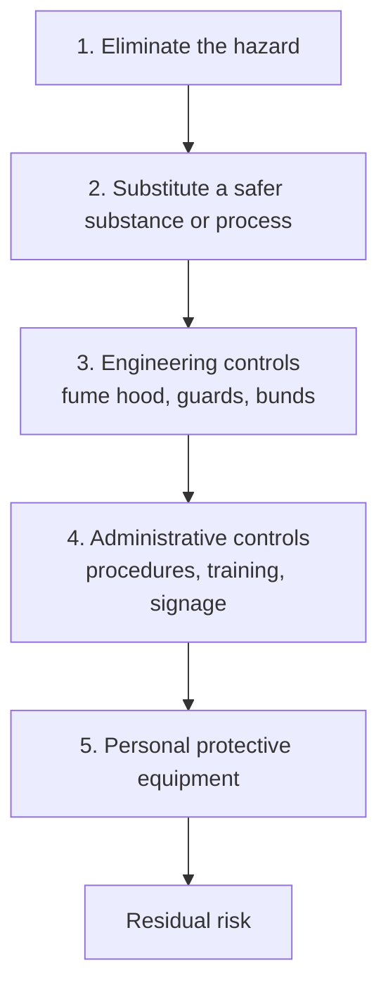
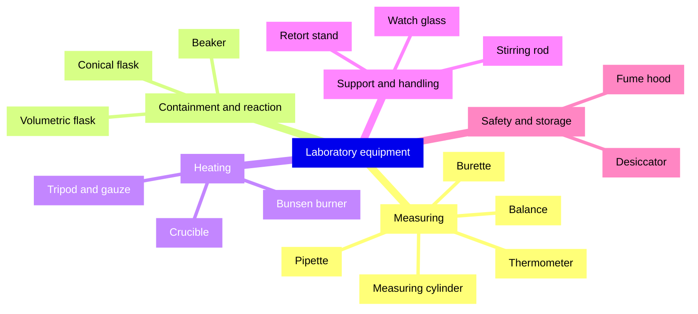
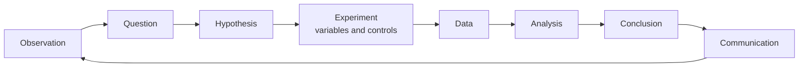
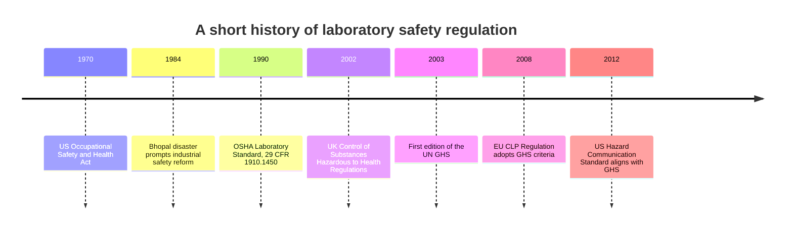

# Chapter 10 — Laboratory Safety, Equipment and the Scientific Method

> **Level:** Level 0 — Foundations
> **Estimated study time:** 4 hours (reading) + 2 hours (exercises)
> **Prerequisites:** Chapters 1–9, especially Chapter 9 (measurement and significant figures)
> **Related chapters:** Chapter 9 — Measurement, Units and Significant Figures
> **Difficulty:** ★★☆☆☆ (2 of 5)

---

> **Safety statement.** The material in this chapter is educational. It describes
> principles, hazards and control measures; it is not a manual for unsupervised
> work. Practical chemistry must be carried out in a properly equipped laboratory
> under the supervision of a trained instructor, with a written risk assessment
> and access to emergency equipment. Nothing here authorises a home experiment.

---

## 1. Learning Objectives

After working through this chapter you will be able to:

- Distinguish a hazard from a risk, and explain why the distinction determines
  the controls required.
- Apply the hierarchy of control to a laboratory procedure, from elimination to
  personal protective equipment.
- Select appropriate personal protective equipment and explain its limitations.
- Recognise the nine GHS hazard pictograms and state the hazard class each
  represents.
- Apply the essential laboratory rules on food, pipetting, fume hoods, waste,
  reagent handling, acid dilution, heating and glassware inspection.
- Locate and use emergency equipment, and describe the correct response to a
  spill, a burn and an eye exposure.
- Classify chemical waste and explain why it must never enter the drain.
- Identify common laboratory equipment and state its purpose.
- Apply the scientific method to a chemistry investigation, distinguishing
  independent, dependent and controlled variables.
- Record data in a laboratory notebook to a standard that another person could
  reproduce the work.

---

## 2. Introduction

Chemistry is a practical science, and practical science carries risk. The same properties that make a reagent useful — its reactivity, its acidity, its volatility, its ability to dissolve things — are the properties that make it dangerous. Concentrated sulfuric acid dehydrates skin; sodium metal reacts violently with water; benzene is a carcinogen; a pressurised gas cylinder stores enough energy to become a projectile. None of these hazards can be abolished by enthusiasm or by careful intentions.

What can be abolished, or at least controlled, is the *risk*: the probability and severity of harm in a particular situation. That is the purpose of laboratory safety. It is not a set of arbitrary restrictions designed to make chemistry less interesting. It is the discipline that allows chemists to work with dangerous substances for decades and go home unharmed. It is also a legal duty: in most countries, employers and institutions must assess risks, provide controls, train staff and record incidents.

The same discipline extends to how investigations are designed and recorded. A result that cannot be reproduced is not evidence, and a result that was obtained without controlling the variables is not an explanation. Safety, equipment and method are therefore a single subject: they are the conditions under which chemical knowledge is produced.

This chapter is the last in Level 0. It assumes the vocabulary of the preceding chapters and prepares you for the practical work in Level 1 and beyond. It is not a substitute for hands-on training under supervision.

---

## 3. Fundamental Concepts

### 3.1 Hazard and risk

A **hazard** is a source of potential harm. A **risk** is the combination of the likelihood that harm occurs and the severity of that harm. The distinction is fundamental because a hazard is intrinsic to a substance or activity, whereas a risk depends on how the substance is used.

Concentrated hydrochloric acid is hazardous: it is corrosive and produces irritant vapour. The risk of using it depends on the volume, the concentration, the ventilation, the equipment and the training of the user. Ten cubic centimetres of $0.1\ \text{mol dm}^{-3}$ acid in an open beaker poses a much lower risk than a litre of the concentrated acid poured in a confined space, even though the hazard label is the same.

A **risk assessment** is the structured process of identifying hazards, deciding who might be harmed and how, evaluating the risk, putting controls in place, recording the decisions and reviewing them. In a teaching laboratory the assessment is usually written by the instructor and explained to the class before work begins. In a research laboratory it is written for each procedure, and it is revised when the procedure changes.

### 3.2 The hierarchy of control

Controls are ranked by effectiveness. The ranking is often drawn as an inverted pyramid, with the most effective measures at the top.

1. **Elimination** — remove the hazard entirely. Replace a hazardous
   demonstration with a video or a simulation.
2. **Substitution** — replace the hazardous substance or process with a safer
   one. Use dilute acid instead of concentrated acid, or a less toxic solvent.
3. **Engineering controls** — isolate people from the hazard by design: fume
   hoods, local exhaust ventilation, guards, bunds, interlocks, closed systems.
4. **Administrative controls** — change the way people work: written procedures,
   training, signage, supervision, restricted access, housekeeping.
5. **Personal protective equipment (PPE)** — protect the individual: goggles,
   gloves, laboratory coat, closed shoes, respirators.

The order matters. PPE is the **last line of defence**, not the first, because it protects only the person wearing it, depends on correct fitting and use, and can fail. A fume hood protects everyone in the room and works even when someone forgets to put on goggles. A procedure that relies on PPE alone is a poorly controlled procedure.

### 3.3 Personal protective equipment

PPE is mandatory in teaching and research laboratories unless a risk assessment explicitly says otherwise. The minimum standard is eye protection, a laboratory coat and closed shoes; gloves are added when the substance or the procedure requires them.

| Item | Protects against | Limitations |
|---|---|---|
| Safety goggles | Splashes, flying particles, vapour | Must fit the face; ordinary spectacles are not a substitute; goggles fog and must be cleaned |
| Laboratory coat | Splashes, spills, contamination of clothing | Must be fastened; not flame-resistant unless specified; must not be worn outside the laboratory |
| Gloves | Skin contact with chemicals, biological material | Not all gloves resist all chemicals; check the compatibility chart; remove before touching door handles, keyboards or your face |
| Closed shoes | Spills, broken glass, dropped objects | Sandals and open shoes leave the foot exposed |
| Face shield | Impact and splash to the whole face | Worn in addition to goggles, not instead of them |
| Respirator | Airborne particles or vapours | Requires fit testing and training; not a substitute for ventilation |

### 3.4 GHS hazard pictograms

The **Globally Harmonized System of Classification and Labelling of Chemicals** (GHS) is an international standard, maintained by the United Nations, for classifying chemicals and communicating their hazards on labels and safety data sheets. It defines nine pictograms, each a red diamond with a black symbol.

| Pictogram | Name | Meaning | Example hazard class |
|---|---|---|---|
| Exploding bomb | Explosive | Explosives, self-reactive substances, organic peroxides | Unstable explosives |
| Flame | Flammable | Flammable gases, liquids, solids; pyrophorics; self-heating substances | Flammable liquid, category 2 |
| Flame over circle | Oxidiser | Oxidising gases, liquids, solids | Oxidising liquid, category 1 |
| Gas cylinder | Gas under pressure | Compressed, liquefied, dissolved or refrigerated gases | Compressed gas |
| Corrosion | Corrosive | Corrosive to metals; skin corrosion; serious eye damage | Skin corrosion, category 1 |
| Skull and crossbones | Acute toxicity | Substances toxic or fatal if swallowed, inhaled or in contact with skin | Acute toxicity, category 2 |
| Exclamation mark | Irritant or harmful | Skin and eye irritation; skin sensitisation; harmful acute toxicity; respiratory irritation; narcotic effects; ozone-layer hazard | Eye irritation, category 2 |
| Health hazard | Chronic health hazard | Carcinogenicity, germ-cell mutagenicity, reproductive toxicity, respiratory sensitisation, target-organ toxicity, aspiration hazard | Carcinogen, category 1 |
| Environment | Environmental hazard | Hazardous to the aquatic environment | Aquatic toxicity, category 1 |

Labels also carry a **signal word** ("Danger" for the more severe categories, "Warning" for the less severe), **hazard statements** (H-codes) and **precautionary statements** (P-codes). A label is a summary; the **safety data sheet** (SDS), which must be available for every hazardous substance, gives the full information: composition, hazards, first-aid measures, fire-fighting measures, accidental release measures, handling, storage, exposure controls, disposal and transport.

### 3.5 Essential laboratory rules

The following rules are not optional. Each exists because a specific type of accident has happened repeatedly.

**No food, drink or chewing gum.** The laboratory is contaminated with chemical residues. Eating, drinking or storing food in the laboratory transfers those residues to the mouth. Apply cosmetics and handle contact lenses outside the laboratory as well.

**No mouth pipetting.** Never draw liquid into a pipette by mouth. Use a pipette filler or a mechanical pipetting device. Mouth pipetting has caused poisoning and infection and is prohibited in every modern laboratory.

**Use the fume hood for volatile or toxic substances.** A fume hood is an enclosed workspace with an extractor that draws air away from the user. Work with concentrated acids, ammonia, organic solvents, and any substance that produces irritating or toxic vapour inside the hood, with the sash as low as is practically possible. A fume hood is not a storage cabinet, and it does not protect against fire or explosion.

**Segregate waste.** Chemical waste goes into the container designated for its category, never into the sink and never into the general refuse. Waste containers must be labelled with their contents.

**Never return unused reagent to the stock bottle.** Once a reagent has been dispensed, it may have been contaminated by the spatula, the air or the reaction vessel. Returning it contaminates the entire stock and can ruin a whole laboratory's work or cause an unexpected reaction. Discard the excess as waste, or share it with another user who needs the same reagent.

**Dilute acid into water, never water into acid.** Dilution of concentrated sulfuric acid is strongly exothermic. If water is added to the acid, the water at the surface boils, spattering acid out of the vessel. Add the acid slowly to the water, with stirring, and allow the mixture to cool. The same rule applies to concentrated alkalis.

**Heat safely.** Use a test-tube holder, point the mouth of a heated tube away from yourself and others, and never heat a closed system. Heat flammable liquids in a water bath or with a heating mantle, never over an open flame. Know the flash point of the solvent you are using.

**Inspect glassware before use.** Reject any vessel with a crack, a star chip, a broken rim or a damaged joint. Damaged glassware can fail under heating, under vacuum or under mechanical stress, producing sharp fragments and a spill.

**Work tidily and know your exits.** Keep benches clear, keep bags off the floor, know the location of the eyewash, the safety shower, the fire extinguisher and the nearest exit before you start work.

> **Supervision.** Every procedure in this chapter requires trained supervision
> and a risk assessment. Students must not attempt any of these operations
> independently, at home or in an unsupervised setting.

### 3.6 Emergency equipment and response

Every laboratory must provide, and every worker must be able to locate:

| Equipment | Purpose | Key point |
|---|---|---|
| Eyewash station | Flush chemicals from the eyes | Flush for at least 15 minutes, holding the eyelids open |
| Safety shower | Flush chemicals from the body and clothing | Remove contaminated clothing while rinsing; flush for at least 15 minutes |
| Fire blanket | Smother a small fire or wrap a person whose clothing is alight | Never wrap a person around the head; smother flames at the source |
| Fire extinguisher | Extinguish a small fire | Match the class of extinguisher to the fuel; never use water on electrical or solvent fires |
| Spill kit | Absorb and contain a spill | Contains absorbent, neutraliser, PPE, bags and a scoop |
| First-aid kit | Treat minor injuries | Only trained first-aiders should treat serious injuries |
| Fume hood | Remove vapours | Not a substitute for good technique |
| Emergency stop | Cut gas and electricity | Located at the laboratory exit |

**Fire extinguisher classes.** Extinguishers are classified by the fuel they are designed for; the letters below follow the European and UK scheme, in which class C denotes flammable gases and electrical equipment is a separate category (in North America, class C denotes electrical equipment and class K denotes cooking oils):

| Class | Fuel | Suitable extinguishers |
|---|---|---|
| A | Ordinary combustibles: paper, wood, cloth | Water, foam, dry powder |
| B | Flammable liquids: solvents, oils, petrol | Foam, CO₂, dry powder |
| C | Flammable gases: methane, propane, hydrogen | Dry powder, CO₂ |
| D | Combustible metals: sodium, magnesium, lithium | Special dry powder for metals; never water |
| F | Cooking oils and fats (class K in North America) | Wet chemical extinguisher |
| Electrical | Energised electrical equipment | CO₂ or dry powder; never water |

**Spill response.** For a small spill of a known, low-hazard substance: warn people nearby, isolate the area, put on the appropriate PPE, consult the SDS, contain the spill with absorbent from the outside inwards, neutralise only if the SDS specifies a suitable neutraliser, collect the residue into a labelled waste container, and clean the area. For a large spill, an unknown substance, a volatile toxic substance or a reactive metal, evacuate the area and call for trained help. Never attempt to clean up a spill that you are not trained and equipped to handle.

**Burn response.** Cool the burn with cool running water for at least 20 minutes, remove jewellery and loose clothing from the area unless it is stuck to the skin, cover the burn with a sterile non-adherent dressing, and seek medical advice. Do not apply ice, butter, ointment or creams; do not burst blisters.

**Eye exposure.** Go immediately to the eyewash, hold the eyelids open and flush with water for at least 15 minutes, including under the eyelids. Remove contact lenses if they come out easily. Seek medical attention immediately, taking the substance's name or SDS with you. Never attempt to neutralise a chemical in the eye.

**Fire response.** Raise the alarm, evacuate by the nearest safe route, close doors behind you and do not use lifts. Use an extinguisher only if the fire is small, you have a clear escape route and you have been trained. Never put yourself between the fire and the exit.

### 3.7 Waste categories

Chemical waste is segregated because different categories require different treatment and because mixing incompatible wastes can produce heat, gas, fire or toxic fumes.

| Category | Examples | Why it is separate |
|---|---|---|
| Halogenated organic | Chloroform, dichloromethane | Toxic and persistent; incinerated under controlled conditions |
| Non-halogenated organic | Ethanol, acetone, hexane | Can be recovered or incinerated |
| Aqueous heavy metals | Solutions containing lead, mercury, cadmium | Toxic and bioaccumulative; precipitated and immobilised |
| Acidic | Dilute and concentrated acids | Corrosive; neutralised under controlled conditions |
| Alkaline | Sodium hydroxide, ammonia solutions | Corrosive; neutralised separately from acids |
| Oxidising | Permanganate, dichromate, peroxides | Can react violently with organic waste |
| Sharps | Needles, broken glass, scalpel blades | Physical injury and contamination risk |
| Biological | Cultures, contaminated media | Requires sterilisation before disposal |

**Why chemical waste must never go down the drain.** A sink is not a treatment system. Heavy metals are not destroyed by water; they accumulate in sediments and enter the food chain. Halogenated solvents are toxic to aquatic life and can contaminate groundwater. Acids and alkalis corrode pipework and disturb the biology of sewage treatment. Some wastes react with water or with each other inside the drain, producing toxic gases or heat. Disposing of chemical waste to the drain is also illegal in most jurisdictions, and the person who does it — not the institution — can be liable.

### 3.8 Common laboratory equipment

The following equipment appears in almost every teaching laboratory. The purpose column states what the item is *for*; using it for something else is a common source of error.

| Equipment | Description | Purpose |
|---|---|---|
| Beaker | Cylindrical vessel with a lip, graduated approximately | Mixing, dissolving and heating liquids; not for accurate volume measurement |
| Conical (Erlenmeyer) flask | Cone-shaped flask with a narrow neck | Titrations, swirling without spilling, heating liquids |
| Volumetric flask | Flask with a single calibration mark on a long neck | Preparing a solution of accurately known concentration |
| Measuring cylinder | Tall graduated cylinder | Measuring volumes approximately, to about one division |
| Pipette | Narrow tube with a bulb or a mechanical filler | Delivering a fixed, accurate volume |
| Burette | Long graduated tube with a stopcock | Delivering variable, accurately measured volumes, especially in titrations |
| Balance | Electronic or mechanical weighing instrument | Measuring mass to the instrument's resolution |
| Bunsen burner | Gas burner with an air hole and a collar | Heating, sterilising, and producing a hot flame |
| Tripod | Three-legged metal stand | Supporting apparatus above a burner |
| Wire gauze | Metal mesh with a ceramic centre | Spreading heat and supporting vessels on a tripod |
| Crucible | Small heat-resistant ceramic or metal cup with a lid | Heating solids to high temperature, including ignition and decomposition |
| Desiccator | Sealed container with a drying agent | Storing hygroscopic substances and cooling samples without absorbing moisture |
| Fume hood | Enclosed workspace with extraction | Containing and removing vapours, fumes and aerosols |
| Watch glass | Shallow glass disc | Covering a beaker, evaporating small quantities, holding a solid during weighing |
| Stirring rod | Glass or plastic rod | Mixing and directing liquid during pouring |
| Retort stand | Heavy base with a vertical rod and clamps | Supporting burettes, flasks and apparatus |
| Thermometer | Glass or digital temperature sensor | Measuring temperature; check the range and the immersion mark |

Two distinctions are worth memorising. A **beaker** measures volume only approximately; a **volumetric flask** measures one volume very accurately. A **pipette** delivers a fixed volume accurately; a **measuring cylinder** delivers a range of volumes approximately. Using the wrong one is not a minor inaccuracy — it can invalidate an entire analysis.

### 3.9 The scientific method

The **scientific method** is a cycle of reasoning and experiment, not a fixed sequence of steps. Its elements are:

1. **Observation.** Notice something that needs explaining: a precipitate forms
   only on heating, a reaction slows down over time, a sample conducts
   electricity.
2. **Question.** Turn the observation into a question that can be answered by
   measurement.
3. **Hypothesis.** Propose a testable explanation. A hypothesis must be
   **falsifiable**: it must be possible to imagine a result that would show it to
   be wrong.
4. **Variables.** Identify the **independent variable** (the one you change), the
   **dependent variable** (the one you measure) and the **controlled variables**
   (the ones you keep constant so that the comparison is fair).
5. **Control.** Include a **control** — a treatment identical in every respect
   except the independent variable — so that the effect of that variable can be
   isolated.
6. **Procedure.** Write a reproducible method, including quantities, equipment,
   conditions and safety controls.
7. **Data.** Record observations and measurements as they are, with units and
   uncertainties.
8. **Analysis.** Process the data: tabulate, graph, calculate means and
   uncertainties, look for patterns and anomalies.
9. **Conclusion.** Decide whether the hypothesis is supported, refuted or
   neither. A conclusion is limited to the range of conditions tested.
10. **Communication.** Report the method, data and conclusion so that others can
    evaluate and repeat the work. Peer review and publication are the formal
    versions of this step.

A hypothesis that cannot fail is not a scientific hypothesis. "The reaction is fast because it is fast" explains nothing. "The rate increases with acid concentration because more acid molecules collide with the surface per second" predicts a specific relationship that can be tested and, in principle, refuted.

### 3.10 Recording data in a laboratory notebook

A laboratory notebook is a legal and scientific record. It must allow another person to reconstruct what was done, with what, and what was observed. The standard entries are:

| Entry | Content |
|---|---|
| Date and title | Date, experiment name and notebook page number |
| Aim | One sentence stating what the experiment is intended to determine |
| Hazard assessment | Substances, hazards and controls, signed before work begins |
| Apparatus and materials | Equipment and reagents, with grades and concentrations |
| Method | Past tense, passive voice, in enough detail to repeat the work |
| Observations | What was actually seen, not what was expected |
| Data | Tables with headings, units, uncertainties and significant figures |
| Calculations | One worked example, then the results |
| Conclusion | What the data show, with limitations and sources of error |
| Signature | Signed and dated by the worker and, where required, a witness |

Rules of good practice: use permanent ink; never erase — cross out an error with a single line, write the correction beside it and initial it; record data directly, not on loose scraps of paper; never back-fill data from memory; number and date every page; keep the notebook in the laboratory, not in a bag.

### 3.11 An example investigation

Consider the question: *how does the concentration of hydrochloric acid affect the rate of reaction with marble chips?*

The reaction is

$$
\ce{CaCO3(s) + 2HCl(aq) -> CaCl2(aq) + H2O(l) + CO2(g)}
$$

The **independent variable** is the concentration of the acid. The **dependent variable** is the rate of reaction, measured as the volume of carbon dioxide collected per unit time, or as the time taken to collect a fixed volume. The **controlled variables** include the mass and surface area of the marble chips, the volume of acid, the temperature and the apparatus.

A suitable **control** is a run with water in place of acid, which should produce no gas; it confirms that the gas comes from the reaction and not from the apparatus or the atmosphere.

The procedure would be carried out under supervision, with goggles and gloves, in a ventilated laboratory, with the gas delivery tube kept clear and the apparatus clamped. Hydrochloric acid is corrosive and irritates the respiratory tract; carbon dioxide is an asphyxiant in a confined space, so the gas is vented away from the breathing zone. The data would be tabulated as concentration, volume of gas and time, and plotted as volume against time for each concentration.

The conclusion would state the relationship observed over the range tested — for example, that the initial rate increases with acid concentration — and would acknowledge the limitations: the surface area of the chips is not perfectly constant, the temperature may drift, and the stopwatch reading introduces a random error. The conclusion does not extend beyond the concentrations and conditions actually used.

---

## 4. Detailed Scientific Explanation

### 4.1 Why safety is non-negotiable

The consequences of a laboratory accident are not limited to the person injured. A fire can destroy years of work and close a department; a spill can contaminate a building; a mislabelled waste container can injure a cleaner who has no training in chemistry. Safety is therefore a collective obligation, not a personal preference.

Legally, employers must provide a safe working environment, assess risks, provide information and training, and consult workers. In the European Union the framework is the Chemical Agents Directive and the CLP Regulation; in the United Kingdom, the Control of Substances Hazardous to Health Regulations (COSHH); in the United States, the Occupational Safety and Health Administration's Laboratory Standard (29 CFR 1910.1450). These frameworks share the same logic: identify the hazard, evaluate the risk, apply controls in order of effectiveness, record the assessment and review it.

### 4.2 Hazard and risk in practice

The same substance can present very different risks at different scales. A few drops of dilute acid on the bench is a minor spill; a litre of the same acid spilled on the floor is a slip hazard, a corrosion hazard and a waste-management problem. A sealed cylinder of nitrogen is inert, but a full cylinder is a pressure vessel that can injure someone if the valve is sheared off.

Risk assessment therefore considers:

- **The hazard:** toxicity, corrosivity, flammability, reactivity, environmental
  effects.
- **The route of exposure:** inhalation, skin contact, eye contact, ingestion,
  injection.
- **The amount and concentration:** small volumes and dilute solutions are
  generally lower risk.
- **The conditions:** temperature, pressure, ventilation, ignition sources.
- **The people:** numbers, training, pregnancy, pre-existing conditions,
  lone working.
- **The consequences:** what happens if the control fails.

### 4.3 Engineering controls in practice

A **fume hood** works by maintaining a negative pressure in the working chamber relative to the room, so that air flows inward through the sash opening and is exhausted outside the building. Its effectiveness depends on the sash position, the baffles, the airflow and the absence of obstructions. Large equipment placed inside a hood disturbs the airflow and can defeat it.

### 4.4 Labels, SDS and the GHS

The GHS replaced a patchwork of national systems with a single set of criteria for classification and a single set of label elements. Its benefits are consistency across borders and a common vocabulary for hazard communication. Its limits are equally important: the GHS classifies hazards, it does not assess risk, and it does not cover every situation (for example, some dust explosion hazards and some environmental effects are handled separately).

The **safety data sheet** is the detailed companion to the label. Section 2 lists hazards, section 4 gives first-aid measures, section 5 fire-fighting measures, section 6 accidental release measures, section 7 handling and storage, section 8 exposure controls, section 9 physical and chemical properties, section 10 stability and reactivity, section 11 toxicological information, section 12 ecological information and section 13 disposal. Knowing the structure of an SDS is a practical skill: in an emergency, you need to find the right section quickly.

### 4.5 Emergency response principles

Emergency response follows a fixed order: **stop, alert, isolate, assist**. Stop the activity, alert others and the emergency services, isolate the area, and assist only if it is safe to do so. The instinct to help immediately is understandable and sometimes dangerous: a rescuer who enters a room filled with chlorine becomes a second casualty.

### 4.6 Doing science: variables and controls

A well-designed experiment changes one variable at a time. If two variables change together, the effect of each cannot be separated; the variables are **confounded**. If a third variable affects the result but is not controlled, it is a **confounding variable**, and the conclusion may attribute the effect to the wrong cause.

### 4.7 Uncertainty in investigations

Every measurement has an uncertainty (Chapter 9). In an investigation, the uncertainty of the final result is built from the uncertainties of the measurements, and the analysis must show which one dominates. If the balance contributes 0.5 per cent and the volumetric flask 0.06 per cent, improving the flask will not improve the result; improving the balance will.

---

## 5. Visual Diagrams

**Figure 10.1 — The hierarchy of control.** Effectiveness decreases downwards. PPE appears last not because it is unimportant but because it protects only the individual wearing it and depends on correct use. A control strategy that begins with gloves and goggles and stops there is inadequate.

**Figure 10.2 — Equipment grouped by function.** The grouping makes the choice of apparatus deliberate: you select the measuring instrument for the accuracy required, the vessel for the reaction and the safety equipment for the hazard. Items that appear in more than one group, such as the conical flask, are used for more than one purpose.

**Figure 10.3 — The scientific method as a cycle.** The arrow from communication back to observation is the step most often omitted in teaching: publication generates new observations and new questions. A conclusion that cannot be communicated and tested is not yet part of scientific knowledge.

**Figure 10.4 — Safety regulation followed accidents and evidence.** The sequence shows a shift from reactive rules, written after disasters, to a harmonised system based on classification and communication. The dates are milestones, not the whole history; national regulations differ in detail.

---

## 6. Mathematical Formulas

Risk assessment uses a simple scoring model:

$$
R = L \times S
$$

| Symbol | Meaning | SI unit |
|---|---|---|
| $R$ | risk score | dimensionless |
| $L$ | likelihood of harm, scored 1 (unlikely) to 5 (almost certain) | dimensionless |
| $S$ | severity of harm, scored 1 (minor) to 5 (fatal or catastrophic) | dimensionless |

The score is a **screening tool**, not a measurement. A score of 12, for example, might be unacceptable without further controls even though a score of 10 with a different combination of likelihood and severity might be tolerable. The score forces a conversation about both factors; it does not replace judgement.

The mean and sample standard deviation of repeated measurements are

$$
\bar{x} = \frac{1}{n}\sum_{i=1}^{n} x_i
$$

$$
s = \sqrt{\frac{\sum_{i=1}^{n}(x_i - \bar{x})^{2}}{n - 1}}
$$

| Symbol | Meaning | SI unit |
|---|---|---|
| $\bar{x}$ | arithmetic mean | unit of $x$ |
| $x_i$ | individual measurement | unit of $x$ |
| $n$ | number of measurements | dimensionless |
| $s$ | sample standard deviation | unit of $x$ |

The standard deviation estimates the spread of the measurements about the mean. It has the same units as the measurement, so it is reported alongside the mean: $24.10 \pm 0.05\ \text{cm}^{3}$.

Dilution of a solution obeys

$$
c_1 V_1 = c_2 V_2
$$

| Symbol | Meaning | SI unit |
|---|---|---|
| $c_1$ | concentration of the stock solution | mol dm⁻³ |
| $V_1$ | volume of stock solution required | dm³ |
| $c_2$ | concentration of the diluted solution | mol dm⁻³ |
| $V_2$ | final volume of the diluted solution | dm³ |

The equation assumes that the amount of solute is conserved and that volumes are additive. The second assumption is an approximation; in accurate work the volumetric flask is calibrated to contain a defined volume at a stated temperature.

---

## 7. Chemical Equations

The rate investigation in section 3.11 uses the reaction of calcium carbonate with hydrochloric acid:

$$
\ce{CaCO3(s) + 2HCl(aq) -> CaCl2(aq) + H2O(l) + CO2(g)}
$$

The equation is balanced: one calcium, one carbon and three oxygen atoms from the carbonate, plus two hydrogen and two chlorine atoms from the acid, appear on both sides. The gas evolved is carbon dioxide, which is why the mass of the reaction mixture falls and why the gas can be collected over water.

A Bunsen burner burns methane:

$$
\ce{CH4(g) + 2O2(g) -> CO2(g) + 2H2O(g)}
$$

Complete combustion gives a blue flame. A yellow, smoky flame indicates incomplete combustion and the formation of carbon monoxide, which is toxic and odourless. The air hole of the burner controls the mixing of fuel and air; a luminous flame is a sign that the air hole is closed and that the burner is not adjusted for heating.

Small acid spills can be neutralised with sodium hydrogencarbonate:

$$
\ce{NaHCO3(s) + HCl(aq) -> NaCl(aq) + H2O(l) + CO2(g)}
$$

The reaction is exothermic and evolves gas, so it is suitable only for small spills of dilute acid, handled by trained staff with the correct PPE. It must never be used on a large spill, on concentrated acid or on a spill of an unknown substance. The same caution applies to the neutralisation of a base:

$$
\ce{NaOH(aq) + HCl(aq) -> NaCl(aq) + H2O(l)}
$$

Neutralisation is not a universal cleanup method. Some substances react violently with water or with neutralisers, and some spills require containment rather than treatment.

---

## 8. Worked Examples

### Worked Example 10.1 — Scoring two risk assessments

**Problem.** Procedure A uses $10\ \text{cm}^{3}$ of $1\ \text{mol dm}^{-3}$ hydrochloric acid in a beaker. Procedure B uses $500\ \text{cm}^{3}$ of concentrated hydrochloric acid in an open vessel. Score both procedures on the $5 \times 5$ scale and recommend controls.

**Strategy.** Assign likelihood and severity for the most credible accident, multiply, and compare. Use the hierarchy of control to propose measures.

**Solution.** Procedure A: a splash to the skin is possible but not likely ($L = 2$); the harm is a minor burn treatable by rinsing ($S = 2$). The score is $R = 2 \times 2 = 4$, which is low. Controls: goggles, gloves, a laboratory coat and a labelled waste container.

Procedure B: inhalation of vapour or a large splash is likely without controls ($L = 4$); the harm can be severe, including chemical burns and respiratory damage ($S = 4$). The score is $R = 4 \times 4 = 16$, which is high. Controls, in hierarchy order: substitute dilute acid or a smaller volume; carry out the work in a fume hood; use a closed system for transfer; restrict access and supervise; wear goggles, gloves, a face shield and an acid-resistant apron.

**Check.** The comparison is consistent with the volumes and concentrations: Procedure B involves fifty times the volume and roughly ten times the concentration. The control strategy begins with substitution and engineering, not with PPE, which is the correct order.

### Worked Example 10.2 — Preparing a dilute solution

**Problem.** Prepare $250.0\ \text{cm}^{3}$ of $0.100\ \text{mol dm}^{-3}$ hydrochloric acid from a $1.00\ \text{mol dm}^{-3}$ stock solution. Calculate the volume of stock required and state the safe order of mixing.

**Strategy.** Use $c_1 V_1 = c_2 V_2$, with both volumes in the same unit. Then apply the dilution rule for acids.

**Solution.**

$$
V_1 = \frac{c_2 V_2}{c_1} = \frac{(0.100\ \text{mol dm}^{-3})(0.2500\ \text{dm}^{3})}{1.00\ \text{mol dm}^{-3}} = 0.0250\ \text{dm}^{3} = 25.0\ \text{cm}^{3}
$$

In a supervised laboratory, measure $25.0\ \text{cm}^{3}$ of stock with a pipette or a burette, transfer it to a $250.0\ \text{cm}^{3}$ volumetric flask containing about $150\ \text{cm}^{3}$ of distilled water, swirl, then add distilled water to the calibration mark and mix thoroughly. Add the acid to the water, never the reverse.

**Check.** The dilution factor is ten (from $1.00$ to $0.100\ \text{mol dm}^{-3}$), so the volume must increase tenfold, from $25.0$ to $250.0\ \text{cm}^{3}$. The calculation and the dilution rule agree. The flask is calibrated at $20\ ^\circ\text{C}$; if the solution is warm, allow it to cool before making up to the mark.

### Worked Example 10.3 — Mean and standard deviation of titres

**Problem.** Three concordant titres are $24.10\ \text{cm}^{3}$, $24.15\ \text{cm}^{3}$ and $24.05\ \text{cm}^{3}$. Calculate the mean and the sample standard deviation, and report the result.

**Strategy.** Compute the mean, then the deviations, their squares, the sum and the standard deviation with $n - 1 = 2$ degrees of freedom.

**Solution.**

$$
\bar{x} = \frac{24.10 + 24.15 + 24.05}{3} = 24.10\ \text{cm}^{3}
$$

The deviations are $0.00$, $+0.05$ and $-0.05\ \text{cm}^{3}$; their squares are $0$, $0.0025$ and $0.0025$. Thus

$$
s = \sqrt{\frac{0 + 0.0025 + 0.0025}{2}} = \sqrt{0.0025} = 0.050\ \text{cm}^{3}
$$

The result is $24.10 \pm 0.05\ \text{cm}^{3}$.

**Check.** The spread of $\pm 0.05\ \text{cm}^{3}$ is consistent with a burette read to the nearest $0.05\ \text{cm}^{3}$. Reporting the mean as $24.100\ \text{cm}^{3}$ would imply a precision ten times better than the instrument allows.

---

## 9. Real-World Applications

**Harmonised labelling.** A chemical bought in Europe, Japan or the United States carries the same nine GHS pictograms, the same signal words and the same hazard statements. A traveller or a shipping clerk can recognise a corrosive substance without reading the local language.

**Pharmaceutical manufacturing.** Production is governed by good manufacturing practice, which requires validated procedures, trained staff, documented cleaning and segregated waste. A contamination event can recall millions of doses, so the controls are audited rather than assumed.

**Environmental protection.** Industrial effluent is treated before discharge, and hazardous waste is incinerated or stabilised. The reason is not only legal compliance: a solvent that reaches a river can persist for decades and accumulate in fish.

**Process safety.** The 1984 release of methyl isocyanate at Bhopal and the 1947 ammonium nitrate explosion at Texas City are studied in engineering courses because they show how small deviations from procedure, combined with inadequate containment, can produce catastrophic harm. Modern process safety management grew out of such investigations.

---

## 10. Common Mistakes

| Mistake | Why it happens | Correct approach |
|---|---|---|
| Wearing safety spectacles instead of goggles | Spectacles look sufficient | Goggles seal against the face and protect against splashes from any direction; spectacles do not. |
| Adding water to concentrated acid | The dilution feels intuitive | Add acid slowly to water with stirring; the reverse can boil and spatter. |
| Returning unused reagent to the stock bottle | It looks wasteful to discard it | The reagent may be contaminated; discard it as waste or share it. |
| Using water on an electrical or solvent fire | Water is the default extinguisher | Use CO₂ or dry powder for electrical fires; use foam, CO₂ or powder for solvents. |
| Storing acids next to bases or oxidisers | Storage is treated as housekeeping | Segregate incompatible substances according to the SDS and the label. |
| Mouth pipetting | It is quick and needs no equipment | Use a pipette filler; mouth pipetting is prohibited. |
| Pouring heavy-metal waste down the sink | The volume seems small | Heavy metals are not destroyed; collect them as hazardous waste. |
| Heating a closed vessel | The vessel looks sturdy | Pressure builds until the vessel fails; always allow a vent. |

---

## 11. Chapter Summary

- A hazard is a source of harm; a risk is the likelihood and severity of harm in
  a particular situation.
- The hierarchy of control runs from elimination and substitution, through
  engineering and administrative controls, to PPE as the last line of defence.
- Minimum PPE is goggles, a laboratory coat and closed shoes; gloves are selected
  from the manufacturer's compatibility data.
- The nine GHS pictograms communicate physical, health and environmental hazards;
  the SDS gives the detailed information.
- Essential rules: no food or drink, no mouth pipetting, use the fume hood,
  segregate waste, never return unused reagent, add acid to water, heat safely
  and inspect glassware.
- Emergency equipment includes the eyewash, safety shower, fire blanket,
  extinguisher, spill kit and first-aid kit.
- Spills are contained and reported; burns are cooled for at least 20 minutes;
  eye exposures are flushed for at least 15 minutes and referred for medical
  care.
- Chemical waste is segregated by category and never discharged to the drain.
- Common equipment has a defined purpose; using a beaker for an accurate volume
  or a measuring cylinder for a titration invalidates the result.
- The scientific method is a cycle: observation, question, hypothesis, variables,
  controls, procedure, data, analysis, conclusion and communication.
- A laboratory notebook must allow the work to be reconstructed: dates, methods,
  observations, data with units, calculations and a signed conclusion.

---

## 12. Exercises

### 12.1 Conceptual questions

1. Distinguish a hazard from a risk, using concentrated acid as your example.
2. Explain why personal protective equipment is described as the last line of
   defence rather than the first.

### 12.2 Basic problems

3. List the minimum personal protective equipment required for handling
   $1\ \text{mol dm}^{-3}$ hydrochloric acid.
4. Name the GHS pictogram that would appear on a bottle of a flammable liquid and
   the one that would appear on a bottle of a corrosive substance.

### 12.3 Intermediate problems

5. List the steps of a risk assessment in the order in which they are carried
   out.
6. Describe the correct response if a small volume of dilute acid splashes into
   your eye.

### 12.4 Advanced problems

7. A procedure requires $50\ \text{cm}^{3}$ of concentrated hydrochloric acid.
   Propose controls in the order of the hierarchy, and explain why PPE alone is
   insufficient.
8. Explain why unused reagent must never be returned to the stock bottle, and
   describe what should be done with the excess instead.

### 12.5 Calculation problems

9. A task has a likelihood score of 4 and a severity score of 3. Calculate the
   risk score, state whether it is high or low on a $5 \times 5$ scale, and
   suggest one control that would reduce it.
10. Calculate the volume of $0.500\ \text{mol dm}^{-3}$ stock solution needed to
    prepare $100.0\ \text{cm}^{3}$ of $0.0500\ \text{mol dm}^{-3}$ solution.

### Answers

1. A hazard is an intrinsic source of harm; a risk is the chance of harm
   occurring in a specific situation. Concentrated acid is hazardous, but the
   risk is low when a few drops are used with goggles in a ventilated laboratory
   and high when a litre is handled in a confined space.
2. PPE protects only the wearer, depends on correct fitting and use, and can
   fail. Engineering and administrative controls protect everyone and do not
   rely on individual memory.
3. Safety goggles, a laboratory coat, nitrile gloves and closed shoes.
4. Flame for a flammable liquid; corrosion for a corrosive substance.
5. Identify the hazards; identify who might be harmed and how; evaluate the risk;
   decide on controls; record the assessment; implement and review it.
6. Go immediately to the eyewash, hold the eyelids open and flush with water for
   at least 15 minutes, remove contact lenses if easy, and seek medical attention
   immediately, taking the substance name or SDS.
7. Substitute a dilute acid or a smaller volume; carry out the work in a fume
   hood; use a closed transfer system; restrict access and supervise; wear
   goggles, a face shield, gloves and an acid-resistant apron. PPE alone leaves
   the vapour uncontrolled and depends on perfect use.
8. Returning the reagent risks contaminating the whole stock. The excess should
   be discarded as chemical waste, or offered to another user who needs the same
   reagent, never poured back.
9. $R = 4 \times 3 = 12$, which is high on a $5 \times 5$ scale. A control such
   as substituting a less hazardous reagent, or performing the task in a fume
   hood, would reduce the likelihood or the severity.
10. $V_1 = c_2 V_2 / c_1 = (0.0500)(0.1000)/0.500 = 0.0100\ \text{dm}^{3} = 10.0\ \text{cm}^{3}$.

---

## 13. Further Reading

- United Nations Economic Commission for Europe, *Globally Harmonized System of
  Classification and Labelling of Chemicals (GHS)*. <https://unece.org/transport/dangerous-goods>
  — the official GHS texts, including the nine pictograms.
- Occupational Safety and Health Administration, *Laboratory Safety: OSHA
  Laboratory Standard, 29 CFR 1910.1450*.
  <https://www.osha.gov/laws-regs/regulations/standardnumber/1910/1910.1450> —
  the US regulatory framework for laboratory safety.
- Health and Safety Executive (UK), *Control of Substances Hazardous to Health
  (COSHH)*. <https://www.hse.gov.uk/coshh/> — practical guidance on risk
  assessment and control.
- National Research Council, *Prudent Practices in the Laboratory: Handling and
  Management of Chemical Hazards*, National Academies Press, 2011. — the standard
  reference for laboratory safety practice.
- OpenStax, *Chemistry 2e*, Rice University, chapter 1.
  <https://openstax.org/details/books/chemistry-2e> — the scientific method and
  the nature of measurement.

---

## 14. Navigation

- Level index: [Level 0 — Foundations](README.md)
- Curriculum map: [CURRICULUM.md](../CURRICULUM.md)
- Sources and data: [REFERENCES.md](../REFERENCES.md)
- Previous chapter: [Chapter 9 — Measurement, Units and Significant Figures](09-measurement-units-and-significant-figures.md)
- Laboratory techniques: [13-laboratory](../13-laboratory/README.md)
