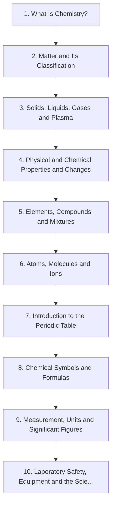

# Level 0 — Foundations

> **Audience:** Absolute beginner — no prior chemistry  
> **Chapters:** 10  
> **Estimated study time:** ≈ 32 h  
> **Difficulty:** ★☆☆☆☆ – ★★☆☆☆

The vocabulary and mental models that every later chapter assumes: what chemistry studies, how matter is classified, how it changes state, how atoms and molecules are written down, how measurements are made, and how to work safely.

Nothing here assumes you have studied chemistry before. The only prerequisites are arithmetic, an ability to read a graph, and curiosity. Take your time: every habit formed at this level — units, significant figures, safety, the difference between a mixture and a compound — will be assumed by every chapter that follows.

---

## Chapters

| # | Chapter | Difficulty | Hours | Prerequisites |
|---|---|---|---|---|
| 1 | [What Is Chemistry?](01-what-is-chemistry.md) | ★☆☆☆☆ | 3 | None |
| 2 | [Matter and Its Classification](02-matter-and-its-classification.md) | ★☆☆☆☆ | 3 | Ch. 1 |
| 3 | [Solids, Liquids, Gases and Plasma](03-states-of-matter.md) | ★☆☆☆☆ | 3 | Ch. 2 |
| 4 | [Physical and Chemical Properties and Changes](04-physical-and-chemical-properties-and-changes.md) | ★☆☆☆☆ | 3 | Ch. 2–3 |
| 5 | [Elements, Compounds and Mixtures](05-elements-compounds-and-mixtures.md) | ★☆☆☆☆ | 3 | Ch. 2, 4 |
| 6 | [Atoms, Molecules and Ions](06-atoms-molecules-and-ions.md) | ★☆☆☆☆ | 3 | Ch. 5 |
| 7 | [Introduction to the Periodic Table](07-introduction-to-the-periodic-table.md) | ★★☆☆☆ | 3 | Ch. 6 |
| 8 | [Chemical Symbols and Formulas](08-chemical-symbols-and-formulas.md) | ★★☆☆☆ | 3 | Ch. 6–7 |
| 9 | [Measurement, Units and Significant Figures](09-measurement-units-and-significant-figures.md) | ★★☆☆☆ | 4 | Ch. 1–8 |
| 10 | [Laboratory Safety, Equipment and the Scientific Method](10-laboratory-safety-equipment-and-methods.md) | ★★☆☆☆ | 4 | Ch. 1–9 |

---

## Knowledge map

The chain is the *recommended* order. Chapters that share prerequisites can be
read out of order; the table above tells you what each one actually needs.

---

## Study routine for this level

1. Read the chapter once without taking notes, to see the shape of the argument.
2. Re-read with the chapter's learning objectives in front of you and answer them in writing.
3. Reproduce every Mermaid diagram from memory, then check it.
4. Do the exercises **before** opening the solutions file.
5. Record every mistake in a log; re-test yourself on those specific items a week later.

---

## Practice

- Exercise set: [`exercises/level-0-exercises.md`](exercises/level-0-exercises.md)
- Worked solutions: [`solutions/level-0-solutions.md`](solutions/level-0-solutions.md)

---

## Navigation

- Level index: [CURRICULUM.md](../CURRICULUM.md)
- Study methods: [00-learning-guide](../00-learning-guide/learning-path.md)
- Terminology: [GLOSSARY.md](../GLOSSARY.md)
- Sources: [REFERENCES.md](../REFERENCES.md)
