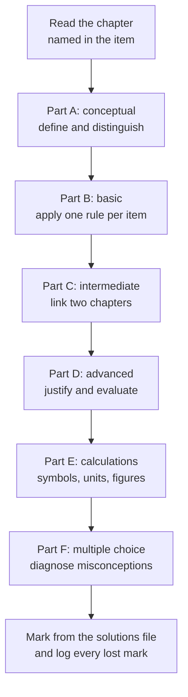

# Level 0 — Exercise Set: Foundations

> **Level:** 0 — Foundations
> **Estimated time:** 150 minutes
> **Covers:** [Chapter 1](../01-what-is-chemistry.md), [Chapter 2](../02-matter-and-its-classification.md), [Chapter 3](../03-states-of-matter.md), [Chapter 4](../04-physical-and-chemical-properties-and-changes.md), [Chapter 5](../05-elements-compounds-and-mixtures.md), [Chapter 6](../06-atoms-molecules-and-ions.md), [Chapter 7](../07-introduction-to-the-periodic-table.md), [Chapter 8](../08-chemical-symbols-and-formulas.md), [Chapter 9](../09-measurement-units-and-significant-figures.md), [Chapter 10](../10-laboratory-safety-equipment-and-methods.md)

This bank tests only material taught in Level 0. It is deliberately qualitative and
arithmetic: no stoichiometry beyond $n = m/M$, no electron configurations and no
nomenclature beyond the formulas in Chapter 8. Attempt every item in writing before
opening the solutions.

**Working rules.** Show the relationship in symbols before substituting numbers.
Carry units through every line. Quote a final answer to the number of significant
figures justified by the data. Where an item asks you to explain, write two to five
sentences and use the correct technical vocabulary.

The relations used in Part E are
$$
\rho = \frac{m}{V}, \qquad n = \frac{m}{M}, \qquad q = mc\Delta T,
\qquad q = n\Delta H_{\text{phase}}, \qquad c_1V_1 = c_2V_2
$$

---

## Part A — Conceptual questions (10 items, 2 marks each)

1. **[Ch. 1]** Define chemistry in one sentence. Then distinguish a chemical change
   from a physical change, giving one example of each and stating the evidence that
   supports your classification.

2. **[Ch. 2]** State the operational test that distinguishes a pure substance from a
   mixture, and apply it to salt water and to pure water.

3. **[Ch. 3]** Using thermal energy and intermolecular attraction, explain why a solid
   has a definite shape while a gas fills its container.

4. **[Ch. 4]** Distinguish an intensive property from an extensive property. Classify
   density and mass, and explain why density can identify a substance while mass
   cannot.

5. **[Ch. 5]** Distinguish an element, a compound and a mixture, giving one example of
   each and one structural reason for the distinction.

6. **[Ch. 6]** Explain why a neutral atom has no net charge while an ion does. State
   the numbers of protons and electrons in $\ce{Cl}$ and in $\ce{Cl-}$.

7. **[Ch. 7]** Explain why the modern periodic table is ordered by atomic number rather
   than by relative atomic mass, using the argon–potassium pair as your example.

8. **[Ch. 8]** Explain the difference between a subscript and a coefficient in a
   chemical formula, using $\ce{H2O2}$ and $\ce{2H2O}$ as your examples.

9. **[Ch. 9]** Distinguish accuracy from precision. State which one is affected by a
   systematic error and explain why averaging repeated measurements cannot remove that
   error.

10. **[Ch. 10]** Distinguish a hazard from a risk. Name the first two levels of the
    hierarchy of control and give one laboratory example of each.

---

## Part B — Basic problems (12 items, 3 marks each)

11. **[Ch. 2]** Classify each sample as an element, a compound, a homogeneous mixture
    or a heterogeneous mixture: (a) air; (b) carbon dioxide; (c) brass; (d) diamond;
    (e) milk; (f) granite.

12. **[Ch. 4]** Classify each change as physical or chemical: (a) ice melting;
    (b) iron rusting; (c) sodium chloride dissolving in water; (d) methane burning in
    air; (e) ethanol evaporating from a spill; (f) limestone heated in a kiln.

13. **[Ch. 3]** Name each phase change and state whether it is endothermic or
    exothermic: (a) solid → gas; (b) gas → liquid; (c) liquid → solid; (d) solid →
    liquid.

14. **[Ch. 4]** Classify each property as intensive or extensive: (a) mass;
    (b) density; (c) melting point; (d) volume; (e) colour; (f) heat capacity.

15. **[Ch. 6]** For $\ce{^{32}_{16}S^2-}$ and $\ce{^{27}_{13}Al^3+}$, give the number
    of protons, neutrons and electrons.

16. **[Ch. 6]** Give the molecular formula, the empirical formula and the number of
    atoms in one molecule for (a) hydrogen peroxide, (b) glucose, (c) ethene.

17. **[Ch. 7]** Give the period and the group of (a) sodium, (b) chlorine, (c) calcium,
    (d) neon.

18. **[Ch. 7]** Write the chemical symbol for (a) iron, (b) copper, (c) lead,
    (d) silver, (e) tungsten, (f) potassium. For any three, give the Latin name from
    which the symbol derives.

19. **[Ch. 8]** Count the atoms of each element in (a) $\ce{Al2(SO4)3}$ and
    (b) $\ce{3Ca3(PO4)2}$.

20. **[Ch. 9]** State the number of significant figures in each measurement:
    (a) $0.00450\ \text{g}$; (b) $1200\ \text{m}$ (two significant figures intended);
    (c) $2.500\ \text{g}$; (d) $1.20 \times 10^{3}\ \text{cm}^{3}$;
    (e) $100.0\ ^{\circ}\text{C}$.

21. **[Ch. 9]** Convert (a) $72.0\ \text{km h}^{-1}$ to $\text{m s}^{-1}$ and
    (b) $3.50\ \text{kg}$ to mg. Give each answer to three significant figures.

22. **[Ch. 10]** Name the item of equipment you would use to (a) measure
    $25.0\ \text{cm}^{3}$ of solution accurately, (b) measure approximately
    $50\ \text{cm}^{3}$ of water, and (c) prepare $250.0\ \text{cm}^{3}$ of a standard
    solution. State one limitation of personal protective equipment.

---

## Part C — Intermediate problems (12 items, 4 marks each)

23. **[Ch. 2]** Three particle diagrams are described. Box A contains only pairs of
    identical circles. Box B contains circles of two colours joined in a $2:1$ ratio.
    Box C contains joined pairs of two colours together with single circles of one
    colour. Classify each box as an element, a compound or a mixture, and justify each
    classification.

24. **[Ch. 4]** A zinc granule is added to dilute hydrochloric acid. The metal
    disappears, a colourless gas evolves and the flask becomes warm. Explain why the
    change is chemical, and state two observations that would distinguish it from the
    zinc merely dissolving.

25. **[Ch. 5]** Describe how to separate a mixture of sand, iron filings and sodium
    chloride. State the order of the steps and explain why the order matters.

26. **[Ch. 5]** Explain why seawater is classified as a mixture while pure water is
    classified as a compound. Refer to composition, separation and properties.

27. **[Ch. 3]** A heating curve for a pure crystalline solid shows a horizontal
    plateau at the melting point even though heat is supplied continuously. Explain why
    the temperature does not rise during the plateau.

28. **[Ch. 6]** Deduce the charge on the ion formed by each of Mg, O, Al and Cl. Hence
    write the formula of the compound formed between aluminium and oxygen, and show
    that the charges balance.

29. **[Ch. 7]** Compare the first ionisation energies of (a) Na and Mg and (b) Na and
    K. Explain each comparison in terms of nuclear charge, shielding and the principal
    quantum number of the electron removed.

30. **[Ch. 8]** Write the chemical formula for (a) calcium hydroxide, (b) aluminium
    sulfate, (c) ammonium nitrate and (d) magnesium chloride.

31. **[Ch. 9]** Carry out the conversions, keeping the stated number of significant
    figures: (a) $0.250\ \text{dm}^{3}$ to $\text{cm}^{3}$; (b)
    $1.20\ \text{g cm}^{-3}$ to $\text{kg m}^{-3}$; (c) $298\ \text{K}$ to
    $^{\circ}\text{C}$.

32. **[Ch. 10]** A procedure heats $50\ \text{cm}^{3}$ of concentrated hydrochloric
    acid on an open bench. A risk assessment scores likelihood $L = 3$ and severity
    $S = 4$. Calculate the risk score and state two controls, one engineering and one
    administrative, in the order of the hierarchy of control.

33. **[Ch. 1]** Describe the burning of magnesium at the macroscopic, submicroscopic
    and symbolic levels.

34. **[Ch. 6]** Explain why $\ce{^{35}Cl}$ and $\ce{^{37}Cl}$ have nearly identical
    chemical properties but different relative atomic masses.

---

## Part D — Advanced problems (8 items, 6 marks each)

35. **[Ch. 2, Ch. 5]** Two compounds of carbon and oxygen are analysed. Compound X
    contains $1.000\ \text{g}$ of carbon combined with $1.333\ \text{g}$ of oxygen.
    Compound Y contains $1.000\ \text{g}$ of carbon combined with $2.667\ \text{g}$ of
    oxygen. (a) Calculate the amount of each element in both samples. (b) Identify X
    and Y. (c) Show that the data illustrate the law of multiple proportions, and
    state the law.

36. **[Ch. 4]** A white solid dissolves in water with a fall in temperature, and the
    resulting solution conducts electricity. When the water is evaporated, the white
    solid is recovered unchanged. (a) Classify the change and justify your
    classification. (b) Explain why radioactivity is not a chemical change, although
    it also changes a substance.

37. **[Ch. 3]** Steam at $100\ ^{\circ}\text{C}$ causes a more severe burn than liquid
    water at $100\ ^{\circ}\text{C}$. Calculate the energy released when
    $18.015\ \text{g}$ of steam at $100\ ^{\circ}\text{C}$ condenses and then cools to
    $37\ ^{\circ}\text{C}$. Use $\Delta H_{\text{vap}} = 40.7\ \text{kJ mol}^{-1}$ and
    $c_{\text{water}} = 4.18\ \text{J g}^{-1}\ \text{K}^{-1}$. Hence state what
    fraction of the energy comes from condensation.

38. **[Ch. 7]** Using the period lengths $2, 8, 8, 18, 18, 32, 32$, locate the
    elements with $Z = 20$, $26$, $35$ and $47$. For each, give the period, the group
    and whether it is a metal, a nonmetal or a metalloid.

39. **[Ch. 8]** A compound contains $40.00\%$ carbon, $6.72\%$ hydrogen and $53.28\%$
    oxygen by mass. Its relative molecular mass is $180.16$. Determine its empirical
    formula and its molecular formula.

40. **[Ch. 9]** A student measures the density of a metal three times and obtains
    $8.72$, $8.75$ and $8.71\ \text{g cm}^{-3}$. The accepted value is
    $8.96\ \text{g cm}^{-3}$. Calculate the mean, the sample standard deviation and the
    percentage error. Comment on the accuracy and the precision of the measurements.

41. **[Ch. 10]** Design an investigation of how the temperature of the water affects
    the time taken for a fixed mass of sugar to dissolve. State the independent
    variable, the dependent variable and three controlled variables, and draw the data
    table you would use.

42. **[Ch. 5]** A student claims: "Brass is a compound because all brass samples look
    the same and have the same properties." Evaluate this claim using composition,
    separation and particle-level evidence.

---

## Part E — Calculation problems (8 items, 5 marks each)

43. **[Ch. 2]** A metal sample of volume $10.0\ \text{cm}^{3}$ has a mass of
    $89.5\ \text{g}$. Calculate its density in $\text{g cm}^{-3}$ and in
    $\text{kg m}^{-3}$.

44. **[Ch. 2]** A solution is made by dissolving $12.5\ \text{g}$ of sodium chloride
    in $87.5\ \text{g}$ of water. Calculate the mass percentage of sodium chloride.
    Hence calculate the mass of sodium chloride in $250.0\ \text{g}$ of the same
    solution.

45. **[Ch. 3]** Calculate the energy needed to heat $250.0\ \text{g}$ of water from
    $18.0\ ^{\circ}\text{C}$ to $98.0\ ^{\circ}\text{C}$. Use
    $c = 4.18\ \text{J g}^{-1}\ \text{K}^{-1}$.

46. **[Ch. 3]** Calculate the energy needed to melt $36.0\ \text{g}$ of ice at
    $0\ ^{\circ}\text{C}$. Use $\Delta H_{\text{fus}} = 6.01\ \text{kJ mol}^{-1}$ and
    $M(\ce{H2O}) = 18.015\ \text{g mol}^{-1}$.

47. **[Ch. 9]** Three concordant burette readings are $19.80$, $19.90$ and
    $19.85\ \text{cm}^{3}$. Calculate the mean and the sample standard deviation, and
    report the result in the form $\bar{x} \pm s$.

48. **[Ch. 9]** A student measures the density of copper as
    $8.75\ \text{g cm}^{-3}$. The accepted value is $8.96\ \text{g cm}^{-3}$.
    Calculate the percentage error.

49. **[Ch. 10]** Calculate the volume of $2.00\ \text{mol dm}^{-3}$ hydrochloric acid
    needed to prepare $500.0\ \text{cm}^{3}$ of $0.200\ \text{mol dm}^{-3}$
    hydrochloric acid. State the dilution factor and the safe order of mixing.

50. **[Ch. 8]** Calculate the relative formula mass of $\ce{Ca3(PO4)2}$ and the
    percentage by mass of calcium in it. Use $A_r(\ce{Ca}) = 40.078$,
    $A_r(\ce{P}) = 30.974$ and $A_r(\ce{O}) = 15.999$.

---

## Part F — Multiple-choice self-check (5 items, 2 marks each)

51. **[Ch. 2]** Which sample is a homogeneous mixture?
    - A. granite
    - B. brass
    - C. carbon dioxide
    - D. muddy water

52. **[Ch. 6]** An ion of $\ce{^{37}_{17}Cl^-}$ contains:
    - A. 17 protons, 20 neutrons, 17 electrons
    - B. 17 protons, 20 neutrons, 18 electrons
    - C. 17 protons, 37 neutrons, 18 electrons
    - D. 20 protons, 17 neutrons, 18 electrons

53. **[Ch. 7]** Which element is in group 2 and period 4?
    - A. calcium
    - B. potassium
    - C. magnesium
    - D. scandium

54. **[Ch. 9]** Which measurement has three significant figures?
    - A. $0.0450\ \text{g}$
    - B. $4500\ \text{g}$
    - C. $4.500\ \text{g}$
    - D. $0.045\ \text{g}$

55. **[Ch. 10]** Which option is first in the hierarchy of control?
    - A. personal protective equipment
    - B. engineering controls
    - C. elimination
    - D. administrative controls

---

## Marks

| Items | Part | Marks per item | Total |
|---|---|---|---|
| 1–10 | A — Conceptual | 2 | 20 |
| 11–22 | B — Basic problems | 3 | 36 |
| 23–34 | C — Intermediate problems | 4 | 48 |
| 35–42 | D — Advanced problems | 6 | 48 |
| 43–50 | E — Calculation problems | 5 | 40 |
| 51–55 | F — Multiple choice | 2 | 10 |
| **1–55** | **Whole paper** | — | **202** |

**Total marks:** 202

Full worked solutions: [`../solutions/level-0-solutions.md`](../solutions/level-0-solutions.md)
