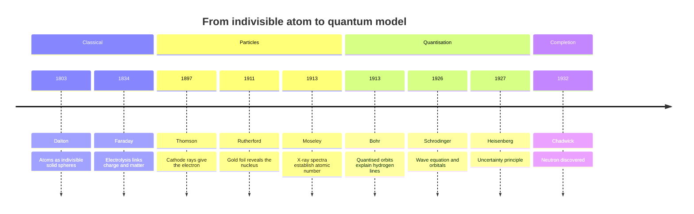
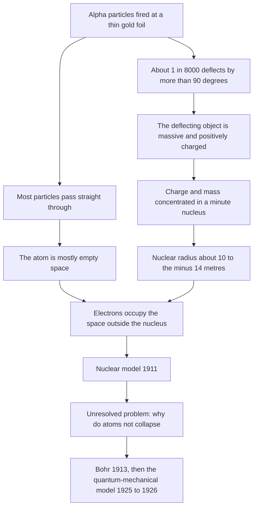
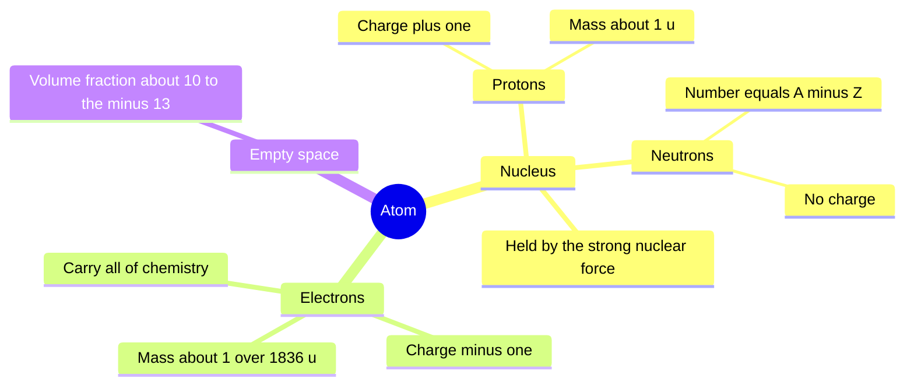

# Chapter 1 — Atomic Structure

> **Level:** Beginner (Level 1 — Elementary Chemistry)
> **Estimated study time:** 5 hours (reading) + 2 hours (exercises)
> **Prerequisites:** [Level 0 — Foundations](../01-foundations/README.md) in full
> **Related chapters:** [Isotopes and Atomic Mass](02-isotopes-and-atomic-mass.md), [Electron Shells, Orbitals and Configurations](03-electron-shells-and-electron-configurations.md), [Periodic Table Organization and Periodic Trends](04-periodic-table-organization-and-periodic-trends.md)
> **Difficulty:** ★★☆☆☆ (2/5)

---

## 1. Learning Objectives

After working through this chapter you will be able to:

- Outline the development of atomic models from Dalton to the quantum-mechanical
  model, naming the evidence that forced each revision.
- Describe the proton, neutron and electron in terms of relative charge, relative
  mass and position in the atom.
- Interpret nuclide notation $^{A}_{Z}\mathrm{X}$ and derive proton, neutron and
  electron counts for neutral atoms, cations and anions.
- Justify the statement that the atom is mostly empty space using order-of-magnitude
  estimates of atomic and nuclear dimensions.
- State the definition of the unified atomic mass unit and explain the carbon-12
  standard.
- Define *isotope* and explain why isotopes of an element are chemically almost
  identical.
- Describe the shell model qualitatively and explain what a shell represents in the
  quantum-mechanical picture.

---

## 2. Introduction

Every chemical reaction — a match burning, iron rusting, a leaf splitting water in
sunlight — is a rearrangement of electrons around nuclei that never touch. To
explain why substances behave as they do, you need a working picture of the atom:
how small it is, what it contains, and how those contents are arranged.

The word *atom* comes from the Greek ἄτομος (*atomos*), "uncuttable". For
twenty-four centuries that was the whole theory. The word survived; the
indivisibility did not. Between 1897 and 1932 physics dismantled the atom into
three subatomic particles, and between 1911 and 1926 it replaced the comfortable
picture of a miniature solar system with a probability cloud described by a wave
function — a model that predicts laboratory measurements to more decimal places
than any other theory in chemistry.

This chapter builds the map that every later chapter assumes. Chapter
[2](02-isotopes-and-atomic-mass.md) uses the nucleus to explain isotopes and atomic
mass. Chapter [3](03-electron-shells-and-electron-configurations.md) turns the
qualitative shell picture into orbitals and configurations. Chapter
[4](04-periodic-table-organization-and-periodic-trends.md) shows that the periodic
table is a graphic summary of that structure, and Chapter
[5](05-chemical-bonding.md) treats bonding as atoms seeking a lower-energy electron
arrangement.

The only prerequisites are the Level 0 vocabulary of element, compound, mixture and
formula, plus enough arithmetic for powers of ten and simple ratios. No previous
atomic theory is assumed — but you should be willing to hold two pictures at once,
because this chapter teaches a *model* and then states precisely where the model
fails.

---

## 3. Fundamental Concepts

### 3.1 What a model is, and why models get replaced

A **model** in science is a simplified representation that reproduces the available
observations and predicts new ones. A model does not claim that nature *is* the
picture; it claims that nature *behaves as if* the picture were true within a stated
range. The history of atomic theory is the clearest example in science of models
being replaced not because they were absurd but because they were outgrown: each
explained its own evidence and failed on evidence it had never seen.

So when you read that "the Bohr model is wrong", the accurate statement is narrower
— it gives correct energies for one-electron systems and fails for everything else.
When you read that "electrons orbit the nucleus", the accurate statement is that
electrons occupy **orbitals**, regions of space with a probability of containing an
electron; orbit language is a bookkeeping convenience, not a description of a path.

### 3.2 The three subatomic particles

| Particle | Symbol | Relative charge | Relative mass (u) | Absolute mass / kg | Location |
|---|---|---|---|---|---|
| Proton | $\mathrm{p}$ | $+1$ | $1.007\,276$ | $1.672\,622\times10^{-27}$ | Nucleus |
| Neutron | $\mathrm{n}$ | $0$ | $1.008\,665$ | $1.674\,927\times10^{-27}$ | Nucleus |
| Electron | $\mathrm{e^-}$ | $-1$ | $5.4858\times10^{-4}$ | $9.109\,384\times10^{-31}$ | Outside the nucleus |

Two features matter. First, proton and neutron masses are nearly identical (the
neutron is $0.14\,\%$ heavier), while the electron is about $1836$ times lighter
than either. Second, the charge magnitudes are exactly equal: $+1.602\,176\,634
\times10^{-19}$ C for the proton and the same magnitude, negative, for the electron.
That equality is why a neutral atom has equal numbers of protons and electrons, and
why ionic charges are always whole-number multiples of the elementary charge $e$.

The neutron is neutral but not elementary: it is a composite of two down quarks and
one up quark, and it decays outside a nucleus with a half-life near 10 minutes. For
chemistry only its mass and its contribution to the strong force matter.

### 3.3 The nucleus

Almost all of the atom's mass and *all* of its positive charge sit in the
**nucleus**, a bound cluster of protons and neutrons of radius order $10^{-15}$ m.
It is held together by the **strong nuclear force**, which is far stronger than
electrostatic repulsion but acts only over femtometre distances — hence the sharp
upper limit on nuclear size. Nucleons are not packed like marbles; the nucleus
behaves as a droplet of quantum fluid with a diffuse surface whose radius follows

$$
R \approx r_0 A^{1/3}, \qquad r_0 \approx 1.2\ \text{fm}.
$$

The cube-root dependence signals constant density: volume scales with $A$, so radius
scales with $A^{1/3}$. Nuclear density is about $2.3\times10^{17}\ \text{kg m}^{-3}$,
some $10^{14}$ times that of water.

### 3.4 Atomic number, mass number and nuclide notation

- The **atomic number** $Z$ is the proton count and defines the element: $Z = 26$ is
  iron and nothing else.
- The **mass number** $A$ is the nucleon count, $A = Z + N$, where $N$ is the
  neutron number.
- A **nuclide** is a nucleus of specified $Z$ and $N$, written $^{A}_{Z}\mathrm{X}$.

Thus $^{56}_{26}\mathrm{Fe}$ has $Z = 26$, $A = 56$ and $N = 30$. Note what $A$ is
*not*: it is a whole-number count, whereas the **relative atomic mass** $A_r$ is a
measured, usually non-integer, mass on the carbon-12 scale. For iron $A = 56$ but
$A_r = 55.845$; Chapter [2](02-isotopes-and-atomic-mass.md) explains the difference.

### 3.5 Neutral atoms and ions

A neutral atom has $Z$ electrons. Losing electrons gives a **cation**; gaining them
gives an **anion**. The charge is the proton count minus the electron count.

| Species | $Z$ | $A$ | Protons | Neutrons | Electrons | Charge |
|---|---|---|---|---|---|---|
| $^{56}_{26}\mathrm{Fe}$ | 26 | 56 | 26 | 30 | 26 | $0$ |
| $^{56}_{26}\mathrm{Fe}^{3+}$ | 26 | 56 | 26 | 30 | 23 | $+3$ |
| $^{79}_{35}\mathrm{Br}$ | 35 | 79 | 35 | 44 | 35 | $0$ |
| $^{79}_{35}\mathrm{Br}^{-}$ | 35 | 79 | 35 | 44 | 36 | $-1$ |
| $^{24}_{12}\mathrm{Mg}^{2+}$ | 12 | 24 | 12 | 12 | 10 | $+2$ |

Ionisation changes the electron count only. The nucleus is untouched by ordinary
chemistry, which is why an element's identity survives every reaction it undergoes.

### 3.6 The carbon-12 scale and the unified atomic mass unit

Atomic masses are far too small to use in kilograms conveniently, so chemistry uses
a relative scale. By international agreement one atom of carbon-12 has a mass of
exactly 12 unified atomic mass units:

$$
1\ \mathrm{u} = \frac{1}{12}m(^{12}\mathrm{C}) = 1.660\,539\times10^{-27}\ \text{kg}.
$$

The **unified atomic mass unit** (symbol u, also called the dalton, Da) is one
twelfth of the mass of a carbon-12 atom. The choice is conventional but convenient:
it puts the proton and neutron masses both close to 1 u, so $A$ is approximately the
mass in u. The **relative atomic mass** $A_r$ of an element is the abundance-weighted
mean mass of its atoms on this scale and is therefore dimensionless.

### 3.7 Isotopes: a first look

**Isotopes** are atoms of the same element (same $Z$) with different neutron numbers
and therefore different $A$. Carbon exists as $^{12}_{6}\mathrm{C}$,
$^{13}_{6}\mathrm{C}$ and $^{14}_{6}\mathrm{C}$; all three have six protons and the
same electron arrangement, so they behave identically in ordinary chemical
reactions. They differ in mass, and that difference is detectable in density,
diffusion rates, vibrational frequencies and — for hydrogen — even in bond
strength. Chapter [2](02-isotopes-and-atomic-mass.md) treats isotopes, their
stability and their applications in full.

### 3.8 Electron shells: the qualitative picture

Electrons occupy **shells** — energy levels labelled by the principal quantum
number $n = 1, 2, 3, \dots$ The $n = 1$ shell lies closest to the nucleus and is
lowest in energy. Each shell holds at most $2n^{2}$ electrons:

| Shell | $n$ | Maximum electrons $2n^{2}$ | First period in which it fills |
|---|---|---|---|
| K | 1 | 2 | 1 |
| L | 2 | 8 | 2 |
| M | 3 | 18 | 3 |
| N | 4 | 32 | 4 |

The shell model is a bookkeeping device. It correctly predicts the period lengths
of the periodic table (2, 8, 8, 18, 18, 32, 32) and the table's block structure, but
it does not explain *why* the capacities are what they are. Chapter
[3](03-electron-shells-and-electron-configurations.md) replaces shells with
subshells and orbitals and derives the capacities from the Pauli exclusion
principle.

---

## 4. Detailed Scientific Explanation

### 4.1 Dalton: the first quantitative atomic theory (1803–1808)

John Dalton built his theory on measurements that were already awkward for older
ideas: the **law of conservation of mass** (Lavoisier) required that matter be
rearranged rather than created or destroyed; the **law of definite proportions**
(Proust) required a fixed mass ratio in a given compound. Dalton added the **law of
multiple proportions**: when two elements form more than one compound, the masses
of one element combining with a fixed mass of the other stand in small whole-number
ratios.

His postulates were that matter consists of indivisible atoms; that atoms of one
element are identical in mass and properties; that atoms of different elements
differ; that compounds form by union in fixed small whole-number ratios; and that
atoms are neither created nor destroyed. Postulates two and three are false in
detail — isotopes defeat the first, nuclear reactions the second — but the theory's
predictive success was decisive. It turned chemistry from a collection of recipes
into a quantitative science with a countable substrate.

### 4.2 Thomson and the electron (1897)

Faraday had shown in the 1830s that current decomposes solutions, hinting that
electricity and matter are connected. The decisive experiment came in 1897, when
J. J. Thomson studied **cathode rays** — the discharge in an evacuated tube across
which a high voltage is applied. He showed that the rays are deflected by electric
and magnetic fields, that the deflection direction implies negative charge, and
that the deflection depends only on the charge-to-mass ratio $e/m$, which came out
near $1.76\times10^{11}\ \text{C kg}^{-1}$ — about 1800 times the value for the
hydrogen ion. Either the charge was enormous or the mass was tiny.

Millikan's oil-drop experiment (1909) settled it by measuring
$e = 1.602\times10^{-19}$ C, from which $m_e = 9.11\times10^{-31}$ kg followed.
Thomson's conclusion — that cathode rays are a universal constituent of matter —
made the atom divisible. His **plum-pudding model** (1904) pictured a sphere of
diffuse positive charge with electrons embedded like raisins in a pudding. It
accounted for neutrality and for electron emission from metals, and it was entirely
reasonable for its time.

### 4.3 The Geiger–Marsden experiment and the nuclear model (1909–1911)

Rutherford, Geiger and Marsden tested the model directly. They fired a collimated
beam of **alpha particles** — helium nuclei, $\ce{^{4}_{2}He^{2+}}$ — at gold foil
about 400 nm thick (roughly 1000 atoms) and counted scattered particles on a zinc
sulfide screen.

| Prediction of the Thomson model | Observation |
|---|---|
| The diffuse positive charge cannot exert a large force, so particles pass through with small deflections | Nearly all particles passed through with little or no deflection |
| Deflections should be small and statistical | About 1 in 8000 was deflected by more than $90^\circ$; some came almost straight back |

Rutherford inferred that charge and nearly all the mass must be concentrated in a
minute volume: the **nucleus**. A close encounter with such a concentration
produces the Coulomb force needed to reverse a fast alpha particle,

$$
F = \frac{1}{4\pi\varepsilon_0}\frac{q_1 q_2}{r^{2}}.
$$

For an alpha particle ($+2e$) at $r \approx 10^{-14}$ m from a gold nucleus
($+79e$), $F$ is of order $10^{-1}$ N on a particle of mass $6.6\times10^{-27}$ kg —
an acceleration of order $10^{25}\ \text{m s}^{-2}$. No diffuse cloud could do that.

The model's numbers cohere. With $r_0 = 1.2$ fm, gold ($A = 197$) has
$R \approx 7.0$ fm, while its atomic radius is about 144 pm. The atom is therefore
$\sim\!2\times10^{4}$ times wider than its nucleus, so the nucleus occupies about
$(2\times10^{4})^{-3} \approx 10^{-13}$ of the atomic volume. The atom is, to an
excellent approximation, empty.

### 4.4 Bohr: quantised energy levels (1913)

The nuclear model created an immediate crisis. Classical electrodynamics says an
accelerating charge radiates; an orbiting electron accelerates continuously, so it
should spiral into the nucleus within about $10^{-11}$ s and emit a continuous
spectrum on the way. Atoms are stable and their spectra consist of sharp lines.

Bohr postulated that only certain circular orbits are allowed, with quantised angular
momentum $L = n\hbar$; that an electron in an allowed orbit does not radiate; and
that radiation is emitted or absorbed only on transitions, with
$h\nu = E_2 - E_1$. For hydrogen this gives

$$
E_n = -\frac{13.6\ \text{eV}}{n^{2}} = -\frac{m_e e^{4}}{8\varepsilon_0^{2}h^{2}}\cdot\frac{1}{n^{2}},
$$

which reproduces the Lyman, Balmer and Paschen series to within experimental error,
and yields the correct first-orbit radius $a_0 = 52.9$ pm. The model fails for
helium and every heavier atom, cannot explain fine structure or the Zeeman effect,
and retains definite trajectories. It is best understood as a transitional model:
correct energies for one-electron systems, wrong mechanics.

### 4.5 The quantum-mechanical model (1924–1926)

Three ideas completed the revolution. **Wave–particle duality:** de Broglie (1924)
proposed that any particle has wavelength $\lambda = h/p$; an electron accelerated
through 100 V has $\lambda \approx 123$ pm, comparable to atomic dimensions, and
electron diffraction from crystals was observed in 1927. A wave cannot follow a
trajectory. **Uncertainty:** Heisenberg (1927) showed that
$\Delta x\,\Delta p_x \ge \hbar/2$, so confinement to atomic dimensions imposes an
irreducible momentum spread. **The wave equation:** Schrödinger (1926) wrote a
differential equation whose solutions $\psi$ — **wave functions** — describe
allowed states, with $|\psi|^{2}$ giving the probability density of finding the
electron at a point.

Solving that equation for hydrogen yields three quantum numbers ($n$, $\ell$,
$m_\ell$) plus spin, and hence the shell, subshell and orbital structure developed
in Chapter [3](03-electron-shells-and-electron-configurations.md). An **orbital** is
a one-electron wave function, or equivalently a region in which the probability of
finding the electron is high (by convention 90 %). Shells are sets of orbitals with
the same $n$; the capacity $2n^{2}$ follows from the number of orbitals available,
not from any mechanical ring.

### 4.6 Completing the picture: the neutron (1932)

By 1930 beryllium bombarded with alpha particles was known to emit a penetrating,
uncharged radiation. Chadwick (1932) showed it consisted of neutral particles with
mass close to the proton's and named them neutrons. The neutron explained why the
mass of a light nucleus is roughly twice its charge and how nuclei with $Z > 20$
survive proton–proton repulsion. It completed the particle inventory used
throughout this curriculum.

### 4.7 Where the simple model still serves, and where it misleads

The "solar system" picture — dense nucleus, circling electrons — is used constantly
in chemistry, legitimately, whenever you count electrons, assign oxidation states or
explain trends. It misleads in four ways. **Trajectories:** electrons do not move in
paths; orbitals are standing-wave probability distributions. **Size:** atoms have no
sharp boundary, and "atomic radius" is an operational definition taken from how
closely atoms approach, so definitions differ by tens of percent. **Appearance:**
electrons are not coloured spheres, and nuclei are not billiard balls. **Energy:** the
Bohr formula is exact only for hydrogen-like ions ($\ce{He+}$, $\ce{Li^{2+}}$, ...);
in multi-electron atoms electron–electron repulsion shifts every level.

### 4.8 Orders of magnitude: how empty is an atom?

| Quantity | Typical value | Comment |
|---|---|---|
| Atomic radius | $30$–$300$ pm | Smallest H, about 25 pm; largest Cs, about 265 pm |
| Nuclear radius | $1$–$8$ fm | Scales as $A^{1/3}$ |
| Ratio $r_{\text{atom}}/r_{\text{nucleus}}$ | $\sim\!10^{4}$–$10^{5}$ | |
| Volume fraction occupied by the nucleus | $\sim\!10^{-13}$ | |
| Mass fraction in the nucleus | $> 99.97\,\%$ | Electrons contribute $\sim\!0.03\,\%$ even in hydrogen |
| Nuclear density | $2.3\times10^{17}\ \text{kg m}^{-3}$ | A teaspoon would mass about $10^{12}$ kg |

If the nucleus were drawn as a pea 1 cm across, the atom would be about 1 km wide —
with all the mass still in the pea.

---

## 5. Visual Diagrams

**Figure 1.1 — Timeline of atomic models, 1803–1932.** Each entry was forced by a
measurement the previous model could not accommodate: cathode rays demanded a
subatomic charged particle; alpha-particle backscattering demanded a concentrated
nucleus; atomic line spectra demanded quantised energy levels; electron diffraction
and the uncertainty principle demanded the abandonment of trajectories. Reading the
timeline left to right is reading the logic of physical evidence.

**Figure 1.2 — From the Geiger–Marsden data to the nuclear model.** The two
branches from the first node must be explained *together*. A model that accounted
only for the undeflected majority would be worthless, and one that predicted only
backscattering would be falsified by the majority. It is the *ratio* of the two
outcomes that fixes the geometry, and that ratio forces the nucleus to be both tiny
and dense.

**Figure 1.3 — Composition map of the atom.** The map separates two roles that are
easy to confuse. The nucleus carries essentially all the mass and all of the
positive charge but takes no direct part in chemical change; the electrons carry
almost none of the mass but all of the chemistry, because they are the particles
exchanged or shared when bonds form.

---

## 6. Mathematical Formulas

### 6.1 Nucleon bookkeeping

$$
A = Z + N, \qquad n_{\mathrm{e^-}} = Z - q
$$

| Symbol | Meaning | SI unit |
|---|---|---|
| $A$ | Mass number (nucleon count) | dimensionless |
| $Z$ | Atomic number (proton count) | dimensionless |
| $N$ | Neutron number | dimensionless |

### 6.2 Nuclear size and density

$$
R = r_0 A^{1/3}, \qquad
\rho = \frac{A\,m_u}{\tfrac{4}{3}\pi R^{3}} \approx 2.3\times10^{17}\ \text{kg m}^{-3}
$$

| Symbol | Meaning | SI unit |
|---|---|---|
| $R$ | Nuclear radius | m |
| $r_0$ | Empirical constant, $1.2\times10^{-15}$ | m |
| $\rho$ | Nuclear density | kg m⁻³ |
| $m_u$ | Atomic mass constant, $1.6605\times10^{-27}$ | kg |

The model assumes a spherical nucleus of uniform density and holds to about
$\pm 10\,\%$ for $A > 10$. Because $A$ cancels in the density expression, all nuclei
share essentially the same density — the physical content of the $A^{1/3}$ law.

### 6.3 Mass defect and binding energy

$$
\Delta m = Zm_p + Nm_n - m_{\text{nucleus}}, \qquad E_b = \Delta m\,c^{2}
$$

| Symbol | Meaning | SI unit |
|---|---|---|
| $\Delta m$ | Mass defect | kg (or u) |
| $m_p, m_n$ | Proton, neutron mass | kg (or u) |
| $m_{\text{nucleus}}$ | Measured nuclear mass | kg (or u) |
| $E_b$ | Binding energy | J (or MeV) |
| $c$ | Speed of light, $2.998\times10^{8}$ | m s⁻¹ |

A bound nucleus always has less mass than its separated nucleons; the difference is
the energy needed to take it apart, with $1\ \mathrm{u} = 931.5\ \text{MeV}/c^{2}$.

### 6.4 Coulomb's law

$$
F = \frac{1}{4\pi\varepsilon_0}\frac{q_1 q_2}{r^{2}}
$$

$F$ is in newtons, $q_1$ and $q_2$ in coulombs, $r$ in metres and
$\varepsilon_0 = 8.854\times10^{-12}\ \text{F m}^{-1}$. Because $F \propto 1/r^{2}$,
halving the distance quadruples the force, so only particles passing within
$\sim\!10^{-14}$ m of a nucleus are reversed; the rarity of backscattering is
therefore a direct measurement of nuclear size.

---

## 7. Chemical Equations

Chemistry does not change nuclei, so the equations here describe electron gain and
loss, together with the nuclear notation used above.

Ionisation of sodium (endothermic; first ionisation energy $+496\ \text{kJ mol}^{-1}$):

$$
\ce{Na(g) -> Na+(g) + e-}
$$

Electron capture by chlorine (exothermic; electron affinity $-349\ \text{kJ mol}^{-1}$):

$$
\ce{Cl(g) + e- -> Cl-(g)}
$$

Two successive ionisations are needed to make a magnesium cation, which is why the
second ionisation energy of magnesium ($+1451\ \text{kJ mol}^{-1}$) is much larger
than the first:

$$
\ce{Mg(g) -> Mg^{2+}(g) + 2e-}
$$

The alpha particle used as a projectile is a bare helium nucleus:

$$
\ce{^{4}_{2}He^{2+}}
$$

Elastic scattering from gold changes direction but not identity:

$$
\ce{^{4}_{2}He^{2+} + ^{197}_{79}Au -> ^{4}_{2}He^{2+} + ^{197}_{79}Au}
$$

Every equation balances in two independent senses: total charge is the same on both
sides, and nucleon number is conserved in nuclear equations. Chemical equations
additionally conserve atoms of each element.

---

## 8. Worked Examples

### Worked Example 8.1 — Reading nuclide notation for ions

**Problem.** For (a) $^{56}_{26}\mathrm{Fe}^{3+}$, (b) $^{79}_{35}\mathrm{Br}^{-}$
and (c) $^{31}_{15}\mathrm{P}$, state $Z$, $A$, and the numbers of protons,
neutrons and electrons.

**Strategy.** Read $Z$ from the subscript and $A$ from the superscript. Protons equal
$Z$; neutrons equal $A - Z$; electrons equal $Z - q$, because a positive charge means
electrons have been lost.

**Solution.** (a) Protons 26, neutrons $56 - 26 = 30$, electrons $26 - 3 = 23$.
(b) Protons 35, neutrons $79 - 35 = 44$, electrons $35 + 1 = 36$.
(c) Protons 15, neutrons $31 - 15 = 16$, electrons 15.

**Check.** For each species, protons minus electrons must equal the stated charge,
and protons plus neutrons must equal $A$; both relations hold. The anion has more
electrons than protons and the cation fewer, consistent with the signs.

### Worked Example 8.2 — Nuclear density and the emptiness of the atom

**Problem.** Estimate the density of the $^{56}\mathrm{Fe}$ nucleus and compare it
with the density of iron metal, $7.87\times10^{3}\ \text{kg m}^{-3}$.

**Strategy.** Use $R = r_0 A^{1/3}$ with $r_0 = 1.2\times10^{-15}$ m, treat the
nucleus as a sphere, and take its mass as $56\ \mathrm{u}$.

**Solution.**

$$
R = 1.2\times10^{-15}\times56^{1/3} = 4.6\times10^{-15}\ \text{m}
$$

$$
V = \tfrac{4}{3}\pi R^{3} = 4.1\times10^{-43}\ \text{m}^{3}, \qquad
m = 56\times1.6605\times10^{-27} = 9.30\times10^{-26}\ \text{kg}
$$

$$
\rho = \frac{9.30\times10^{-26}}{4.1\times10^{-43}} = 2.3\times10^{17}\ \text{kg m}^{-3}
$$

The ratio to bulk iron is $2.3\times10^{17}/7.87\times10^{3} \approx 2.9\times10^{13}$.

**Check.** Repeating for gold ($A = 197$) gives $R = 7.0$ fm,
$V = 1.4\times10^{-42}\ \text{m}^{3}$, $m = 3.27\times10^{-25}$ kg and again
$\rho = 2.3\times10^{17}\ \text{kg m}^{-3}$, confirming the constant-density
prediction. A density $10^{13}$ times that of ordinary matter is precisely what
"mostly empty" means numerically.

### Worked Example 8.3 — Mass defect and binding energy of carbon-12

**Problem.** Using $m_p = 1.007\,276$ u, $m_n = 1.008\,665$ u and
$m_e = 5.4858\times10^{-4}$ u, calculate the mass defect of a $^{12}\mathrm{C}$ atom
and convert it to binding energy per nucleon.

**Strategy.** Sum the masses of 6 protons, 6 neutrons and 6 electrons, subtract
12 u exactly, then convert with $1\ \mathrm{u} = 931.5\ \text{MeV}/c^{2}$.

**Solution.**

$$
m_{\text{parts}} = 6(1.007\,276) + 6(1.008\,665) + 6(5.4858\times10^{-4})
= 12.098\,937\ \text{u}
$$

$$
\Delta m = 12.098\,937 - 12.000\,000 = 0.098\,937\ \text{u}
$$

$$
E = 0.098\,937\times931.5 = 92.16\ \text{MeV}, \qquad
\frac{E}{A} = \frac{92.16}{12} = 7.68\ \text{MeV per nucleon}
$$

**Check.** The accepted binding energy of carbon-12 is $7.68$ MeV per nucleon.
Nuclear binding energies per nucleon run from about 1.1 MeV (deuterium) to 8.8 MeV
(iron-56), so 7.68 MeV is exactly where a mid-mass nucleus should sit.

### Worked Example 8.4 — Putting the size ratio into human terms

**Problem.** A hydrogen atom has radius about $2.5\times10^{-11}$ m and its proton
about $8.4\times10^{-16}$ m. (a) Compute the ratio. (b) If the proton were drawn 2 cm
across, how wide would the atom be? (c) What fraction of the atomic volume would the
nucleus occupy?

**Strategy.** Length ratios scale linearly; volume ratios scale as the cube.

**Solution.** (a) $(2.5\times10^{-11})/(8.4\times10^{-16}) = 3.0\times10^{4}$.
(b) $2\ \text{cm}\times3.0\times10^{4} = 600\ \text{m}$.
(c) $(3.0\times10^{4})^{-3} = 3.7\times10^{-14}$, about $4\times10^{-12}$ per cent.

**Check.** A 600 m sphere with a 2 cm nucleus — a stadium with a marble at its centre.
The volume fraction matches the $10^{-13}$ order of Section 4.8, and hydrogen, the
lightest atom, is the least empty on this measure.

---

## 9. Real-World Applications

**Nuclear medicine.** Every technetium-99m generator, PET scan and radioiodine
treatment depends on the nuclear model: a radioactive nucleus emits gamma photons of
characteristic energy that can be detected outside the body. The chemistry of the
tracer decides where it goes; the nuclear physics decides whether it can be seen.

**Radiometric dating.** Carbon-14, uranium-238 and potassium-40 decay at rates
independent of temperature, pressure or chemical environment, so the parent-to-daughter
ratio gives an age. Archaeology, geology and palaeoclimatology all rest on this.

---

## 10. Common Mistakes

| Mistake | Why it happens | Correct approach |
|---|---|---|
| Treating $A$ as a mass in grams or u | The notation looks like a mass | $A$ is a nucleon *count*; the mass in u is close to but not equal to it, and $A_r$ is a weighted mean over isotopes |
| Giving $^{56}_{26}\mathrm{Fe}^{3+}$ 29 electrons | The charge is added instead of subtracted | Electrons $= Z - q$, so a $+3$ ion has three fewer than the neutral atom |
| Calling an isotope "a different element" | Isotopes carry different mass numbers | Same $Z$ means same element; only the neutron count differs |
| Saying the nucleus is "a few percent" of the atom | Textbook diagrams draw nuclei far too large | The radius ratio is $10^{4}$–$10^{5}$; the volume fraction is $\sim\!10^{-13}$ |
| Believing electrons orbit like planets | The Bohr picture is taught first and remembered longest | Orbitals are probability distributions; trajectories are undefined |
| Assuming nuclei contain electrons | "Nuclear" suggests all the atom's parts | Nuclei contain protons and neutrons only; beta decay creates an electron as it happens |
| Confusing $A_r$ with $A$ | Both are quoted for the same element | $A_r(\mathrm{Cl}) = 35.45$; $A(^{35}\mathrm{Cl}) = 35$ and $A(^{37}\mathrm{Cl}) = 37$ |

---

## 11. Chapter Summary

- Atomic theory advanced through Dalton, Thomson, Rutherford, Bohr and the
  quantum-mechanical model; each step was forced by evidence the previous model could
  not explain.
- The atom contains protons ($+1$, $1.0073$ u), neutrons ($0$, $1.0087$ u) and
  electrons ($-1$, $5.486\times10^{-4}$ u). $Z$ defines the element, $A = Z + N$, and
  for ions electrons $= Z - q$.
- The Geiger–Marsden result — roughly 1 in 8000 alpha particles backscattered —
  requires a nucleus of radius $\sim\!10^{-15}$ m holding essentially all the mass,
  so the atom is more than 99.99 % empty by volume.
- Masses are measured on the carbon-12 scale, where $^{12}\mathrm{C}$ is exactly 12 u
  and $1\ \mathrm{u} = 1.6605\times10^{-27}$ kg.
- Isotopes are atoms of one element with different neutron numbers; they are
  chemically almost identical and are quantified in Chapter
  [2](02-isotopes-and-atomic-mass.md).

---

## 12. Exercises

### 12.1 Conceptual questions

1. State two observations the Thomson model explained and two it could not.
2. Why must the nucleus be both *small* and *massive*? Address each adjective.
3. Why is the Bohr model called transitional rather than wrong?

### 12.2 Basic problems

4. Give $Z$, $A$ and the proton, neutron and electron counts for
   $^{40}_{20}\mathrm{Ca}^{2+}$ and $^{32}_{16}\mathrm{S}^{2-}$.
5. Write nuclide notation for the species with 29 protons, 35 neutrons and 27
   electrons.
6. How many electrons and how many neutrons are in $^{27}_{13}\mathrm{Al}^{3+}$?

### 12.3 Intermediate problems

7. A neutral atom has 16 neutrons and 15 electrons. Identify the element and write
   its nuclide symbol.
8. For $^{197}\mathrm{Au}$ ($R = 7.0$ fm, atomic radius 144 pm), calculate the ratio
   of volumes and express the nuclear volume as a percentage of the atomic volume.
9. Explain why the mass of a $^{4}\mathrm{He}$ nucleus is less than the sum of the
   masses of two protons and two neutrons.

### 12.4 Advanced problems

10. An alpha particle of kinetic energy 5.0 MeV is fired directly at a gold nucleus.
    Estimate the distance of closest approach from Coulomb repulsion alone, and
    comment on whether the alpha particle touches the nucleus.
11. Moseley's X-ray data established $Z$, not $A$, as the ordering principle of the
    periodic table. Explain what breaks if elements are ordered by atomic mass.

### 12.5 Calculation problems

12. (a) Calculate the mass defect of $^{4}\mathrm{He}$ given
    $m(^{4}\mathrm{He}) = 4.002\,603$ u (nuclear mass), $m_p = 1.007\,276$ u and
    $m_n = 1.008\,665$ u. (b) Convert it to binding energy in MeV and in MeV per
    nucleon.

### Answers

1. Explained: neutrality and electron emission. Not explained: sharp line spectra
   and alpha-particle backscattering.
2. Small, because only a rare close encounter gives a large deflection; massive,
   because a light target would be knocked forward rather than reversed.
3. Correct energies for one-electron systems and correct quantisation, but the
   underlying mechanics of definite orbits is superseded.
4. Ca$^{2+}$: $Z = 20$, $A = 40$, 20 p, 20 n, 18 e. S$^{2-}$: $Z = 16$, $A = 32$,
   16 p, 16 n, 18 e.
5. $^{64}_{29}\mathrm{Cu}^{2+}$.
6. 10 electrons; 14 neutrons.
7. Phosphorus: $Z = 15$, $A = 31$, so $^{31}_{15}\mathrm{P}$.
8. $(144\ \text{pm}/7.0\ \text{fm})^{3} = (2.06\times10^{4})^{3} = 8.7\times10^{12}$;
   the nucleus occupies $1.2\times10^{-11}$ % of the atomic volume.
9. The assembled nucleus lies at lower energy; the difference appears as a mass
   defect through $E = mc^{2}$.
10. $r = (1/4\pi\varepsilon_0)(2Ze^{2})/E_k$ with $Z = 79$ and
    $E_k = 8.0\times10^{-13}$ J gives $r \approx 4.5\times10^{-14}$ m — about six
    nuclear radii, so the alpha particle never touches the nucleus.
11. Mass ordering puts Ar before K and Te before I, placing elements of different
    character in the wrong groups; $Z$ ordering removes these inversions.
12. (a) $2(1.007\,276) + 2(1.008\,665) - 4.002\,603 = 0.029\,279$ u.
    (b) $0.029\,279\times931.5 = 27.3$ MeV, i.e. $6.82$ MeV per nucleon.

---

## 13. Further Reading

- OpenStax. *Chemistry 2e*, Chapter 2, "Atoms, Molecules, and Ions".
  <https://openstax.org/details/books/chemistry-2e>
- Atkins, P. and Jones, L. *Chemical Principles: The Quest for Insight*, 7th ed.,
  W. H. Freeman, 2016; and Housecroft, C. E. and Sharpe, A. G. *Inorganic Chemistry*,
  5th ed., Pearson, 2018, Chapter 1.
- IUPAC. *Compendium of Chemical Terminology* ("Gold Book"), 2nd ed. (the
  "corrected" version). <https://goldbook.iupac.org/>
- NIST. *CODATA Internationally Recommended Values of the Fundamental Physical
  Constants*. <https://physics.nist.gov/cuu/Constants/>

See [CURRICULUM.md](../CURRICULUM.md) and [REFERENCES.md](../REFERENCES.md).
