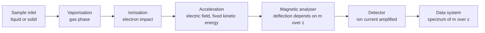
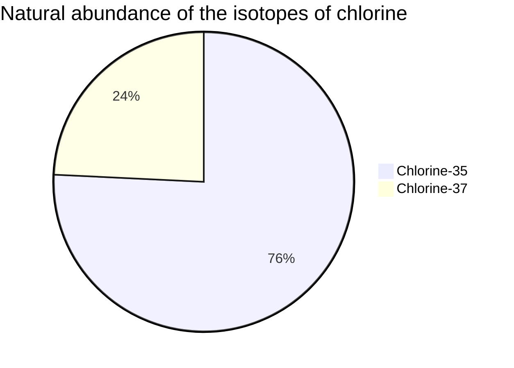
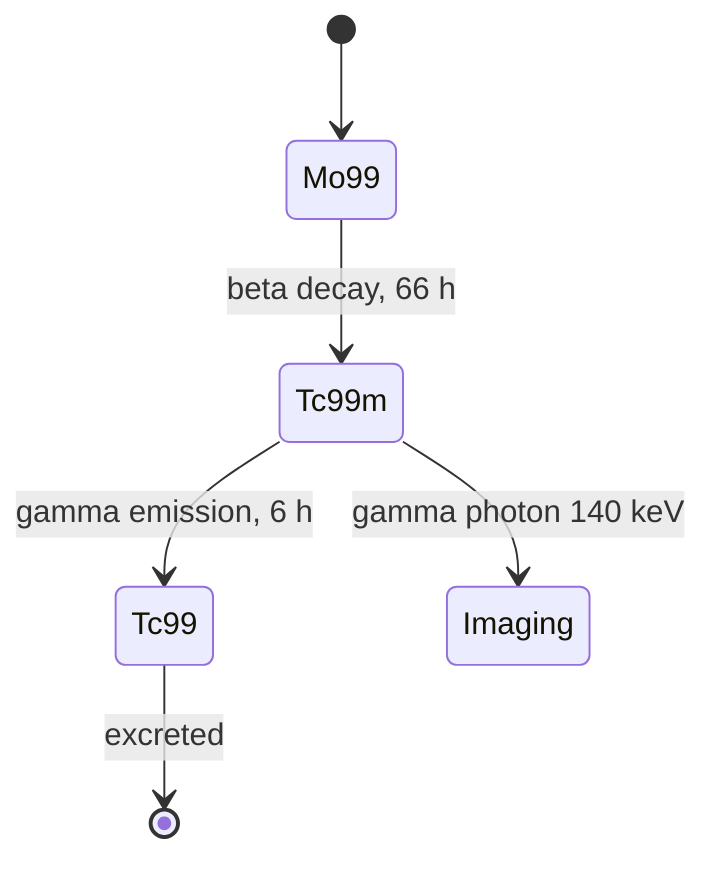
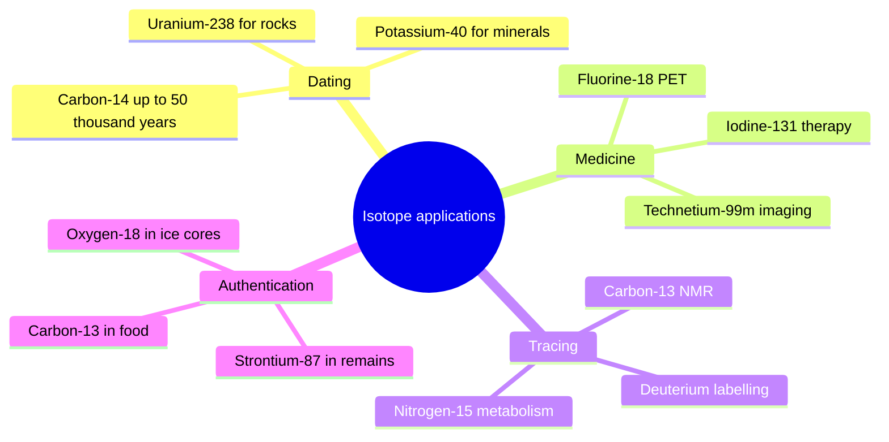

# Chapter 2 — Isotopes and Atomic Mass

> **Level:** Beginner (Level 1 — Elementary Chemistry)
> **Estimated study time:** 4 hours (reading) + 2 hours (exercises)
> **Prerequisites:** [Atomic Structure](01-atomic-structure.md)
> **Related chapters:** [Electron Shells, Orbitals and Configurations](03-electron-shells-and-electron-configurations.md), [Periodic Table Organization and Periodic Trends](04-periodic-table-organization-and-periodic-trends.md)
> **Difficulty:** ★★☆☆☆ (2/5)

---

## 1. Learning Objectives

After working through this chapter you will be able to:

- Define *isotope*, *nuclide* and *relative isotopic mass*, and write nuclide
  notation for any isotope.
- Distinguish stable from radioactive isotopes and describe the main decay modes in
  outline.
- Explain why relative atomic masses are almost never whole numbers.
- Calculate relative atomic mass from isotopic abundances, and invert the calculation
  to obtain an abundance from a measured atomic mass.
- Interpret a simple mass spectrum, identifying the molecular ion and isotope peaks.
- Describe the stages of mass spectrometry and the quantity actually measured
  ($m/z$).
- Distinguish relative atomic mass from relative isotopic mass and molar mass.
- Give three applications of isotopes and explain the scientific principle behind
  each.

---

## 2. Introduction

In 1913 J. J. Thomson placed neon in a discharge tube and deflected the resulting
ions with magnetic and electric fields. Instead of one beam he found two, at masses
20 and 22. Neon, an element, was not a single substance. Frederick Soddy had already
proposed in 1913 that chemically identical atoms could differ in mass, coining the
word *isotope* — from the Greek ἴσος τόπος, "same place" — because such atoms occupy
the same place in the periodic table.

The discovery resolved a scandal. Since Dalton, chemists had assumed that all atoms
of an element are identical in mass. Yet the relative atomic mass of chlorine had
been measured as 35.45 since the nineteenth century: an element whose mass sits
awkwardly between the integers 35 and 37. Isotopes explain that number exactly. They
also explain why the periodic table can be ordered by atomic number rather than by
mass, and they underpin whole technologies — radiometric dating, nuclear medicine,
isotope labelling and mass spectrometry.

This chapter takes the nucleus from Chapter [1](01-atomic-structure.md) and asks what
follows from the fact that nuclei of the same element can differ. The arithmetic is
simple weighted averaging, but the consequences are not: the same logic that gives
chlorine its 35.45 gives a mass spectrometer its power to identify molecules, and
gives a bone fragment its date.

You need only the nuclide notation and the carbon-12 scale from Chapter
[1](01-atomic-structure.md), plus confidence with percentages and powers of ten.

---

## 3. Fundamental Concepts

### 3.1 Isotopes and nuclides

**Isotopes** are atoms of the same element — the same atomic number $Z$ — with
different numbers of neutrons, and therefore different mass numbers $A$. A **nuclide**
is a single nuclear species specified by both $Z$ and $N$; the terms overlap, but
"nuclide" is the more precise word because it can be applied to a particular nucleus
without reference to a sample.

| Isotope | $Z$ | $N$ | $A$ | Natural abundance / % |
|---|---|---|---|---|
| $^{1}_{1}\mathrm{H}$ | 1 | 0 | 1 | 99.9885 |
| $^{2}_{1}\mathrm{H}$ (deuterium) | 1 | 1 | 2 | 0.0115 |
| $^{3}_{1}\mathrm{H}$ (tritium) | 1 | 2 | 3 | trace, radioactive |
| $^{12}_{6}\mathrm{C}$ | 6 | 6 | 12 | 98.93 |
| $^{13}_{6}\mathrm{C}$ | 6 | 7 | 13 | 1.07 |
| $^{14}_{6}\mathrm{C}$ | 6 | 8 | 14 | trace, radioactive |
| $^{35}_{17}\mathrm{Cl}$ | 17 | 18 | 35 | 75.76 |
| $^{37}_{17}\mathrm{Cl}$ | 17 | 20 | 37 | 24.24 |

Because chemistry is controlled by electrons, and all isotopes of an element have the
same electron arrangement, isotopes are chemically almost interchangeable. "Almost"
is doing real work in that sentence: heavier isotopes move more slowly at a given
temperature and vibrate at lower frequencies, so bonds to $^{2}\mathrm{H}$ are
slightly stronger than bonds to $^{1}\mathrm{H}$ — the **kinetic isotope effect**.
For carbon, oxygen and nitrogen the effect is small enough that most laboratory work
can ignore it; for hydrogen it can change reaction rates by a factor of several, and
it is exploited deliberately in mechanistic studies.

### 3.2 Stable and radioactive isotopes

A **stable** nuclide does not decay detectably. About 250 nuclides are stable, and
roughly 35 more are *primordial radionuclides* with half-lives comparable to or
longer than the age of the Earth ($1.4\times10^{10}$ years) — $^{238}\mathrm{U}$,
$^{232}\mathrm{Th}$, $^{40}\mathrm{K}$ and others. Everything else (about 3000
nuclides) is radioactive.

Radioactivity is a nuclear property, not a chemical one. A nucleus decays when the
arrangement of its protons and neutrons lies above the lowest available energy state;
the decay products are more tightly bound. The rate is unaffected by temperature,
pressure, chemical bonding or physical state — a fact that makes radioactive decay
an excellent clock.

| Nuclide | Half-life | Decay mode | Typical use |
|---|---|---|---|
| $^{14}\mathrm{C}$ | 5730 a | $\beta^{-}$ | Radiocarbon dating |
| $^{40}\mathrm{K}$ | $1.25\times10^{9}$ a | $\beta^{-}$ and electron capture | Geological dating |
| $^{238}\mathrm{U}$ | $4.47\times10^{9}$ a | $\alpha$ | Dating of rocks and meteorites |
| $^{99\mathrm{m}}\mathrm{Tc}$ | 6.01 h | $\gamma$ | Single-photon imaging |
| $^{131}\mathrm{I}$ | 8.02 d | $\beta^{-}$ and $\gamma$ | Thyroid therapy |
| $^{18}\mathrm{F}$ | 109.7 min | $\beta^{+}$ | PET scanning |

### 3.3 Why relative atomic masses are not integers

Three separate effects produce a non-integer relative atomic mass.

1. **Isotopic mixing.** Most elements are mixtures. The tabulated value is the
   abundance-weighted mean of the isotopic masses.
2. **The mass defect.** Even a pure isotope has a non-integer mass, because binding
   energy removes mass. $^{35}\mathrm{Cl}$ has a relative isotopic mass of
   $34.968\,85$, not 35; the shortfall of $0.031$ u is the binding energy of that
   nucleus expressed in mass units (compare Worked Example 8.3 in Chapter
   [1](01-atomic-structure.md)).
3. **The carbon-12 anchor.** By definition $^{12}\mathrm{C}$ is exactly 12, and every
   other nuclide is referred to it. Because the proton and neutron are each slightly
   heavier than 1 u ($1.0073$ and $1.0087$ u), a nuclide with $A$ nucleons would have
   a mass slightly *above* $A$ before binding is subtracted; after binding it lies
   slightly below.

The net result is that a relative atomic mass is a measured quantity quoted to
several decimal places, not a count.

### 3.4 Four quantities that must not be confused

| Quantity | Symbol | Definition | Example for chlorine |
|---|---|---|---|
| Relative isotopic mass | — | Mass of one atom of a specific isotope relative to $1/12$ of a $^{12}\mathrm{C}$ atom | $^{35}\mathrm{Cl}$: 34.9689 |
| Relative atomic mass | $A_r$ | Abundance-weighted mean of the relative isotopic masses of an element | Cl: 35.45 |
| Mass number | $A$ | Count of nucleons in one nuclide | $^{35}\mathrm{Cl}$: 35 |
| Molar mass | $M$ | Mass of one mole of the substance | $\mathrm{Cl}$: 35.45 g mol⁻¹ |

The numerical coincidence between $A_r$ and the molar mass in g mol⁻¹ is not an
accident: the mole is defined so that one mole of $^{12}\mathrm{C}$ atoms has a mass
of exactly 12 g. It follows that $A_r$ of an element, expressed in grams, is the mass
of one mole of its atoms: $M = A_r\ \text{g mol}^{-1}$.

---

## 4. Detailed Scientific Explanation

### 4.1 Nuclear stability and the neutron-to-proton ratio

The nucleus is a competition between two forces: the strong nuclear force, which
attracts all nucleons but acts only over about 1–2 fm, and electrostatic repulsion,
which acts between every pair of protons at any distance. Adding neutrons adds
attraction without adding repulsion, so heavy nuclei need proportionally more
neutrons.

- Light nuclei are stable at $N/Z \approx 1$.
- Heavy nuclei are stable at $N/Z \approx 1.5$; $^{238}\mathrm{U}$ has
  $N/Z = 146/92 = 1.59$.
- Nuclides far from the **belt of stability** are radioactive and decay towards it.

Certain nucleon counts are unusually stable — the **magic numbers** 2, 8, 20, 28,
50, 82 and 126 — analogous to the noble-gas electron counts. $^{4}\mathrm{He}$
($Z = N = 2$) and $^{208}\mathrm{Pb}$ ($Z = 82$, $N = 126$) are doubly magic and
conspicuously stable. The shell model of the nucleus explains these numbers, and it
is a useful reminder that shell structure is a general quantum phenomenon, not a
peculiarity of electrons.

### 4.2 Decay modes

**Alpha decay** ejects a helium nucleus, reducing $A$ by 4 and $Z$ by 2:

$$
\ce{^{238}_{92}U -> ^{234}_{90}Th + ^{4}_{2}He}
$$

**Beta-minus decay** converts a neutron into a proton, emitting an electron and an
antineutrino; $A$ is unchanged and $Z$ increases by one:

$$
\ce{^{14}_{6}C -> ^{14}_{7}N + ^{0}_{-1}e + \bar{\nu}_{e}}
$$

**Beta-plus decay** converts a proton into a neutron, emitting a positron; $Z$
decreases by one. It requires surplus energy, so it occurs only in neutron-poor
nuclei, and the positron annihilates almost immediately with an electron to give two
511 keV photons — the basis of PET imaging:

$$
\ce{^{18}_{9}F -> ^{18}_{8}O + ^{0}_{+1}e + \nu_{e}}
$$

**Electron capture** achieves the same nuclear change as beta-plus decay by absorbing
an inner-shell electron; the resulting inner-shell vacancy produces characteristic
X-rays.

**Gamma emission** releases excess energy from an excited nucleus without changing
$Z$ or $A$. The metastable state is marked with an "m":

$$
\ce{^{99m}_{43}Tc -> ^{99}_{43}Tc + \gamma}
$$

Each mode conserves two quantities: total charge, and total nucleon number. Checking
those two balances is the fastest way to catch an error in a nuclear equation.

### 4.3 Half-life and the decay law

The **half-life** $t_{1/2}$ is the time for half the nuclei in a sample to decay. It
is constant for a given nuclide, which is what makes decay a clock:

$$
N = N_0\left(\frac{1}{2}\right)^{t/t_{1/2}} = N_0 e^{-\lambda t},
\qquad \lambda = \frac{\ln 2}{t_{1/2}}.
$$

Decay is random at the level of individual nuclei but statistically exact for large
numbers, so a sample of $10^{20}$ nuclei follows the exponential law to high
precision. After 10 half-lives, $1/1024 \approx 0.1\,\%$ remains; after 30, less
than one part in $10^{9}$ — which is why ancient radiocarbon samples become
impossible to date.

### 4.4 Mass spectrometry

A **mass spectrometer** measures the mass-to-charge ratio of ions. A typical
magnetic-sector instrument performs five operations in sequence under high vacuum:

1. **Vaporisation** — the sample is volatilised (or desorbed) into the gas phase.
2. **Ionisation** — electron impact knocks out an electron:
   $\ce{M + e- -> M^{+\bullet} + 2e-}$. Softer methods (electrospray, MALDI) are used
   for fragile molecules.
3. **Acceleration** — an electric field gives all ions the same kinetic energy,
   $\tfrac{1}{2}mv^{2} = qV$.
4. **Deflection** — a magnetic field bends the beam; the radius follows
   $r = mv/(qB)$, so light ions bend more than heavy ones.
5. **Detection** — ions are counted, producing a spectrum of intensity against $m/z$.

Because $m/z$ is what is measured, a doubly charged ion appears at half its mass. This
is a common source of confusion when reading spectra of large molecules.

### 4.5 Reading a mass spectrum

For an element, the spectrum is a set of peaks whose heights give the isotopic
abundances directly; the weighted mean gives $A_r$. For a compound, the highest-mass
significant peak is usually the **molecular ion** $M^{+\bullet}$, whose $m/z$ is the
relative molecular mass. Fragmentation produces lower-mass peaks that reveal
structure.

Two features are worth memorising because they identify elements unambiguously:

- **Chlorine** gives $M$ and $M+2$ in a $3:1$ ratio, from $^{35}\mathrm{Cl}$ and
  $^{37}\mathrm{Cl}$ in their natural 75.8 : 24.2 proportion.
- **Bromine** gives $M$ and $M+2$ in a $1:1$ ratio, from $^{79}\mathrm{Br}$ and
  $^{81}\mathrm{Br}$.

A one-mass-unit satellite peak, $M+1$, is almost always due to $^{13}\mathrm{C}$ at
its natural 1.07 % abundance. For a molecule with $n$ carbon atoms, the $M+1$ peak is
about $n \times 1.1\,\%$ of the $M$ peak — a quick way to count carbons.

### 4.6 Applications

**Radiocarbon dating.** Cosmic rays generate $^{14}\mathrm{C}$ in the upper
atmosphere; living organisms exchange carbon with the biosphere and so maintain a
constant $^{14}\mathrm{C}/^{12}\mathrm{C}$ ratio. When the organism dies, exchange
stops and $^{14}\mathrm{C}$ decays with $t_{1/2} = 5730$ years. Measuring the
remaining ratio gives the time since death, reliably up to about 50 000 years and
with calibration curves correcting for past variations in cosmic-ray flux.

**Medical isotopes.** $^{99\mathrm{m}}\mathrm{Tc}$ emits a 140.5 keV gamma photon —
energetic enough to leave the body, gentle enough to be imaged — and its 6 h
half-life is long enough for a scan but short enough to clear quickly. It is
obtained from a $^{99}\mathrm{Mo}$ generator in hospital pharmacies, because
$^{99}\mathrm{Mo}$'s 66 h half-life allows transport.

**Stable-isotope labelling.** Replacing $^{1}\mathrm{H}$ with $^{2}\mathrm{H}$,
$^{12}\mathrm{C}$ with $^{13}\mathrm{C}$ or $^{14}\mathrm{N}$ with $^{15}\mathrm{N}$
creates a detectable mass tag without changing the chemistry. The tag is used to
follow metabolic pathways by NMR or mass spectrometry, to measure protein turnover,
and to establish reaction mechanisms through kinetic isotope effects.

**Forensics, food authenticity and palaeoclimate.** Isotope ratios act as
fingerprints: the $^{13}\mathrm{C}/^{12}\mathrm{C}$ ratio distinguishes C3 from C4
plants and hence sugar sources; $^{18}\mathrm{O}/^{16}\mathrm{O}$ in ice cores records
past temperature; $^{87}\mathrm{Sr}/^{86}\mathrm{Sr}$ links human remains to
geological regions.

---

## 5. Visual Diagrams

**Figure 2.1 — The five stages of a magnetic-sector mass spectrometer.** Every stage
exists to convert a chemical question into a measurable current. Vaporisation ensures
the sample can be manipulated as single particles; ionisation makes it responsive to
fields; acceleration sets a known kinetic energy so that the magnetic deflection
depends only on $m/z$; the analyser converts that dependence into a spatial
separation; and the detector converts arrival position into abundance. Understanding
the sequence makes the resulting spectrum interpretable rather than mysterious.

**Figure 2.2 — Isotopic composition of chlorine.** The pie shows why the relative
atomic mass of chlorine is 35.45 rather than 35 or 37. Both isotopes are present in
easily measurable amounts, and the lighter one dominates by roughly three to one. It
is the weighted mean of these two contributions, not either peak, that appears in the
periodic table.

**Figure 2.3 — The technetium-99m generator and its use in imaging.** The diagram
separates two timescales that make the system practical. Molybdenum-99 has a 66 h
half-life, long enough for a generator to be shipped to a hospital; its daughter
technetium-99m has a 6 h half-life, short enough that the patient receives a small
dose that clears quickly, yet long enough for a scan to be completed. The gamma
branch is what the detector sees, while the ground-state branch is the waste product.

**Figure 2.4 — Where isotope measurements earn their keep.** The four branches
correspond to four different uses of the same physical fact: isotopic ratios are
stable signatures unless a process fractionates them in a known way. Dating exploits
radioactive decay; medicine exploits emitted radiation; tracing exploits a mass
difference that is invisible chemically; authentication exploits natural fractionation
patterns.

---

## 6. Mathematical Formulas

### 6.1 Relative atomic mass from isotopic abundances

$$
A_r = \sum_i f_i\,A_{r,i}, \qquad \sum_i f_i = 1
$$

| Symbol | Meaning | SI unit |
|---|---|---|
| $A_r$ | Relative atomic mass of the element | dimensionless |
| $f_i$ | Mole fraction (abundance) of isotope $i$ | dimensionless |
| $A_{r,i}$ | Relative isotopic mass of isotope $i$ | dimensionless |

If abundances are given in per cent, divide each by 100 before summing. The result is
a weighted arithmetic mean, so it must lie between the lightest and heaviest isotopic
masses.

### 6.2 Two-isotope inversion

For two isotopes of abundances $x$ and $1-x$:

$$
A_r = xA_1 + (1-x)A_2 \quad\Longrightarrow\quad x = \frac{A_r - A_2}{A_1 - A_2}
$$

This rearrangement lets you recover an abundance from a measured atomic mass, or
recover an isotopic mass if both abundances and $A_r$ are known.

### 6.3 Amount, mass and molar mass

$$
n = \frac{m}{M}, \qquad M = A_r\ \text{g mol}^{-1}
$$

| Symbol | Meaning | SI unit |
|---|---|---|
| $n$ | Amount of substance | mol |
| $m$ | Mass | g (or kg) |
| $M$ | Molar mass | g mol⁻¹ (or kg mol⁻¹) |
| $N_A$ | Avogadro constant, $6.022\,140\,76\times10^{23}$ | mol⁻¹ |

The molar mass of an element is numerically equal to its relative atomic mass but
carries units. This equality is exact only because of the definition of the mole.

### 6.4 Radioactive decay

$$
N = N_0\left(\frac{1}{2}\right)^{t/t_{1/2}} = N_0 e^{-\lambda t},
\qquad \lambda = \frac{\ln 2}{t_{1/2}}, \qquad A = \lambda N
$$

| Symbol | Meaning | SI unit |
|---|---|---|
| $N$ | Number of nuclei remaining at time $t$ | dimensionless (count) |
| $N_0$ | Initial number of nuclei | dimensionless (count) |
| $t_{1/2}$ | Half-life | s |
| $\lambda$ | Decay constant | s⁻¹ |
| $A$ | Activity (decays per second) | Bq = s⁻¹ |

Assumptions: the sample is large enough for the statistical law to hold, and no
parent nuclide is being replenished. Activity follows the same exponential law as
$N$, so either quantity may be used interchangeably.

### 6.5 Mass-to-charge ratio in a sector instrument

$$
\frac{m}{z} = \frac{B^{2}r^{2}}{2V}
$$

| Symbol | Meaning | SI unit |
|---|---|---|
| $m$ | Ion mass | kg |
| $z$ | Charge number of the ion | dimensionless |
| $B$ | Magnetic flux density | T |
| $r$ | Radius of the circular path | m |
| $V$ | Accelerating voltage | V |

The relation shows the two ways to scan a spectrum: hold $B$ and vary $V$ (voltage
scan), or hold $V$ and vary $B$ (magnetic scan). It also shows why the charge state
matters: an ion of charge $2+$ appears at half its mass-to-charge value.

---

## 7. Chemical Equations

The ionisation step of electron-impact mass spectrometry:

$$
\ce{M(g) + e- -> M^{+\bullet}(g) + 2e-}
$$

Complete combustion of an organic sample, used to convert carbon to $\ce{CO2}$ before
isotope-ratio analysis:

$$
\ce{C_nH_{2n+2}(l) + \frac{3n+1}{2}O2(g) -> nCO2(g) + (n+1)H2O(l)}
$$

Formation of radiocarbon in the upper atmosphere, followed by oxidation to carbon
dioxide:

$$
\ce{^{14}_{7}N + ^{1}_{1}H -> ^{14}_{6}C + ^{1}_{1}H}
$$

$$
\ce{^{14}_{6}C + O2 -> ^{14}CO2}
$$

Decay of the two most familiar dating nuclides:

$$
\ce{^{14}_{6}C -> ^{14}_{7}N + ^{0}_{-1}e + \bar{\nu}_{e}}
$$

$$
\ce{^{238}_{92}U -> ^{234}_{90}Th + ^{4}_{2}He}
$$

The generator reaction that produces technetium-99m in hospital pharmacies:

$$
\ce{^{99}_{42}Mo -> ^{99m}_{43}Tc + ^{0}_{-1}e + \bar{\nu}_{e}}
$$

In every case the nucleon total and the charge total are separately conserved. Check
both before accepting a nuclear equation: in the molybdenum example, $A$ is 99 on
both sides and the charge is $+42$ on the left and $43 - 1 = +42$ on the right.

---

## 8. Worked Examples

### Worked Example 8.1 — Relative atomic mass of chlorine

**Problem.** Chlorine consists of $^{35}\mathrm{Cl}$ (relative isotopic mass
34.9689, abundance 75.76 %) and $^{37}\mathrm{Cl}$ (36.9659, 24.24 %). Calculate
$A_r(\mathrm{Cl})$ to four significant figures.

**Strategy.** Convert each percentage to a fraction and form the weighted mean.

**Solution.**

$$
A_r = 0.7576(34.9689) + 0.2424(36.9659)
$$

$$
= 26.492 + 8.961 = 35.453
$$

**Check.** The answer must lie between 34.9689 and 36.9659, and closer to 34.9689
because that isotope is more abundant — both hold. The accepted value is 35.45, and
the two abundances sum to exactly 100.00 %, so no renormalisation is needed.

### Worked Example 8.2 — Relative atomic mass of copper and the inversion

**Problem.** Copper consists of $^{63}\mathrm{Cu}$ (62.9296 u) and $^{65}\mathrm{Cu}$
(64.9278 u). (a) Given natural abundances of 69.15 % and 30.85 %, calculate $A_r$.
(b) A sample of copper from a meteorite has $A_r = 63.20$. Calculate its
$^{63}\mathrm{Cu}$ abundance.

**Strategy.** (a) Weighted mean. (b) Rearrange the two-isotope expression:
$x = (A_r - A_2)/(A_1 - A_2)$ with $A_1 = 62.9296$ and $A_2 = 64.9278$.

**Solution.** (a)

$$
A_r = 0.6915(62.9296) + 0.3085(64.9278) = 43.516 + 20.030 = 63.546
$$

(b)

$$
x = \frac{63.20 - 64.9278}{62.9296 - 64.9278} = \frac{-1.7278}{-1.9982} = 0.8647
$$

So the meteoritic sample is 86.5 % $^{63}\mathrm{Cu}$ and 13.5 % $^{65}\mathrm{Cu}$.

**Check.** In (a) the result lies between the two isotopic masses and nearer the more
abundant one. The accepted value is 63.55. In (b), a higher $A_r$ than the terrestrial
63.55 would mean *less* $^{63}\mathrm{Cu}$; the sample's 63.20 is lower, so its
$^{63}\mathrm{Cu}$ fraction must be higher than 69.15 % — and 86.5 % is indeed higher.
The direction of the change is consistent.

### Worked Example 8.3 — A three-isotope element: magnesium

**Problem.** Magnesium has three stable isotopes: $^{24}\mathrm{Mg}$ (23.9850 u,
78.99 %), $^{25}\mathrm{Mg}$ (24.9858 u, 10.00 %) and $^{26}\mathrm{Mg}$ (25.9826 u,
11.01 %). Calculate $A_r(\mathrm{Mg})$.

**Strategy.** Extend the weighted mean to three terms; the fractions must sum to
1.0000 before use.

**Solution.**

$$
A_r = 0.7899(23.9850) + 0.1000(24.9858) + 0.1101(25.9826)
$$

$$
= 18.946 + 2.499 + 2.861 = 24.306
$$

**Check.** The abundances sum to 0.7899 + 0.1000 + 0.1101 = 1.0000. The result lies
between 23.9850 and 25.9826 and close to the dominant isotope; the accepted value is
24.305. A useful control is that the answer must be dominated by the first term, which
is roughly 18.9 of the 24.3 total.

### Worked Example 8.4 — Reading a mass spectrum and dating with half-lives

**Problem.** (a) A mass spectrum of an organic compound shows a molecular ion at
$m/z = 78$ and an $M+1$ peak that is 6.6 % of the $M$ peak. Estimate the number of
carbon atoms. (b) A bone fragment contains 35.0 % of the $^{14}\mathrm{C}$ activity of
a living organism. Calculate its age, taking $t_{1/2} = 5730$ years.

**Strategy.** (a) Each carbon contributes about 1.1 % to $M+1$. (b) Use
$N/N_0 = (1/2)^{t/t_{1/2}}$ and solve for $t$ by taking logarithms.

**Solution.** (a) $6.6/1.1 = 6.0$, so the molecule contains about six carbon atoms.
(b)

$$
0.350 = \left(\tfrac{1}{2}\right)^{t/5730}
\quad\Longrightarrow\quad
t = 5730 \times \frac{\ln(1/0.350)}{\ln 2} = 5730 \times 1.515 = 8680\ \text{years}
$$

**Check.** (a) A six-carbon compound with $M_r = 78$ is consistent with benzene
($\mathrm{C_6H_6}$, $M_r = 78$), so the estimate is chemically sensible. (b) 35.0 %
remaining lies between one and two half-lives, so the age must lie between 5730 and
11 460 years; 8680 years sits correctly inside that window.

---

## 9. Real-World Applications

**Nuclear fuel.** Natural uranium is 0.72 % $^{235}\mathrm{U}$; most power reactors
need 3–5 %. Because the isotopes are chemically identical, enrichment must exploit
mass, either by gaseous diffusion through porous barriers or — now almost universally
— by gas centrifugation of $\ce{UF6}$. A difference of three mass units in 238 is only
1.3 %, so a single stage achieves almost nothing; cascades of thousands of stages are
required. This is the clearest industrial demonstration that isotopic mass differences
are real but expensive to exploit.

**Medical imaging.** $^{18}\mathrm{F}$-labelled fluorodeoxyglucose accumulates in
tissues with high glucose demand, including many tumours. The 110 min half-life is a
compromise: long enough to synthesise the tracer and transport it, short enough to
limit dose. Positron emission and the resulting pair of 511 keV photons allow
coincidence detection, which localises the decay to a few millimetres.

**Dating and environmental science.** $^{14}\mathrm{C}$ dating of wood, charcoal,
bone and parchment; $^{40}\mathrm{K}$–$^{40}\mathrm{Ar}$ dating of volcanic rock;
$^{18}\mathrm{O}$ records in ice cores that trace Pleistocene temperature. Each
depends on a ratio measurement, not on a total activity, because ratio measurements
are insensitive to sample size.

---

## 10. Common Mistakes

| Mistake | Why it happens | Correct approach |
|---|---|---|
| Writing $A_r(\mathrm{Cl}) = 35.5$ from $(35+37)/2$ | Averaging the mass numbers looks natural | Weight by abundance: $0.7576\times34.9689 + 0.2424\times36.9659 = 35.45$ |
| Forgetting to convert per cent to a fraction | The numbers are quoted as percentages | Divide each abundance by 100; check that the fractions sum to 1 |
| Believing isotopes have different chemistry | They have different masses | Chemistry is controlled by electrons, which are identical; only kinetic isotope effects and spectroscopic differences distinguish them |
| Treating $M+1$ as a second isotope of the whole molecule | It is small and close to $M$ | $M+1$ usually comes from natural $^{13}\mathrm{C}$; its size (about 1.1 % per carbon) counts carbons |
| Reading the highest peak as the molecular ion | Fragmentation can dominate | The molecular ion is the highest-mass significant peak, not the tallest one |
| Using the mass number as the molar mass of an element | Mass numbers are integers | $M$ is numerically equal to $A_r$, not to $A$: $\mathrm{Cl}$ is 35.45 g mol⁻¹ |
| Assuming a decay rate can be changed by heating or bonding | Chemical intuition suggests it should matter | Nuclear decay is unaffected by temperature, pressure or bonding; it is a nuclear, not an electronic, process |
| Reporting a radiocarbon date without calibration | The raw half-life arithmetic seems sufficient | Atmospheric $^{14}\mathrm{C}$ has varied; radiocarbon ages must be calibrated against tree-ring and coral records |

---

## 11. Chapter Summary

- Isotopes are atoms of one element with different neutron numbers; a nuclide is
  specified by $Z$ and $N$ and written $^{A}_{Z}\mathrm{X}$.
- About 250 nuclides are stable; all others are radioactive and decay by alpha, beta,
  positron, electron-capture or gamma processes, conserving nucleon number and charge.
- Relative atomic mass is the abundance-weighted mean of relative isotopic masses, so
  it is usually non-integer. Even a pure isotope has a non-integer mass because of the
  mass defect.
- $A_r = \sum f_i A_{r,i}$; for two isotopes the expression can be inverted to recover
  an abundance.
- A mass spectrometer vaporises, ionises, accelerates, deflects and detects ions,
  measuring $m/z$. Molecular ions give relative molecular mass; $M+1$ and $M+2$ peaks
  reveal carbon count and halogens.
- Half-life is constant for a nuclide, so decay provides a clock:
  $N = N_0(1/2)^{t/t_{1/2}}$.
- $A_r$ (dimensionless), relative isotopic mass (dimensionless, per isotope) and molar
  mass (g mol⁻¹) are different quantities that are numerically linked by the definition
  of the mole.
- Applications run from radiocarbon dating and PET imaging to isotope labelling.

---

## 12. Exercises

### 12.1 Conceptual questions

1. Explain why two isotopes of an element have almost identical chemical properties
   but measurably different densities in the solid state.
2. Why is the relative atomic mass of an element always between the lightest and
   heaviest isotopic masses?
3. Why does a mass spectrometer record $m/z$ rather than mass alone, and what
   practical consequence does this have for a doubly charged ion?

### 12.2 Basic problems

4. Write the nuclide notation for the isotope with 17 protons and 20 neutrons.
5. How many protons, neutrons and electrons are in $^{131}_{53}\mathrm{I}^{-}$?
6. Calculate the relative atomic mass of boron, given $^{10}\mathrm{B}$ (10.0129 u,
   19.9 %) and $^{11}\mathrm{B}$ (11.0093 u, 80.1 %).

### 12.3 Intermediate problems

7. Silver consists of $^{107}\mathrm{Ag}$ (106.9051 u) and $^{109}\mathrm{Ag}$
   (108.9048 u) and has $A_r = 107.868$. Calculate the abundance of each isotope.
8. A compound shows a molecular ion at $m/z = 94$ with an $M+2$ peak of equal height.
   Identify the halogen present and suggest a molecular formula.
9. Explain why $^{14}\mathrm{C}$ dating cannot be used on a sample older than about
   50 000 years.

### 12.4 Advanced problems

10. A sample of uranium is found to contain 0.720 % $^{235}\mathrm{U}$ and 99.275 %
    $^{238}\mathrm{U}$. Calculate $A_r(\mathrm{U})$ using 235.0439 u and 238.0508 u,
    and comment on why the result is so close to 238.
11. In a mass spectrum of $\ce{CH3Cl}$, predict the $M : M+2$ ratio and explain why
    the $M+1$ peak is small but not zero.

### 12.5 Calculation problems

12. A wooden artefact has a $^{14}\mathrm{C}$ activity of 1.85 Bq per gram of carbon,
    while living wood has 13.6 Bq per gram. Calculate the age of the artefact
    ($t_{1/2} = 5730$ years) and state one assumption the calculation makes.

### Answers

1. Electrons determine chemistry and are identical across isotopes; neutrons change
   nuclear mass, so a heavier isotope gives a denser solid and slightly slower
   diffusion.
2. A weighted mean of a set of numbers always lies between the smallest and largest.
3. The instrument separates ions by $m/z$; a $2+$ ion appears at half its mass, so the
   charge state must be known before assigning a mass.
4. $^{37}_{17}\mathrm{Cl}$.
5. 53 protons, 78 neutrons, 54 electrons.
6. $0.199(10.0129) + 0.801(11.0093) = 1.993 + 8.818 = 10.81$.
7. $x(106.9051) + (1-x)(108.9048) = 107.868$ gives $x = 0.5186$, so 51.9 % $^{107}\mathrm{Ag}$
   and 48.1 % $^{109}\mathrm{Ag}$.
8. A 1:1 $M$/$M+2$ pattern indicates one bromine atom; $\ce{CH3Br}$ has
   $M_r = 12 + 3 + 79 = 94$, matching the molecular ion.
9. After ten half-lives only about 0.1 % remains, comparable to background and to
   contamination; the counting uncertainty becomes larger than the signal.
10. $0.00720(235.0439) + 0.99275(238.0508) = 1.692 + 236.325 = 238.017$; the mean is
    dominated by the 99.3 % abundance of $^{238}\mathrm{U}$.
11. $M : M+2 = 3 : 1$; $M+1$ is about 1.1 % of $M$ from $^{13}\mathrm{C}$, plus a tiny
    contribution from $^{2}\mathrm{H}$ and $^{37}\mathrm{Cl}$.
12. $t = 5730 \times \ln(13.6/1.85)/\ln 2 = 5730 \times 2.878 = 16\,500$ years.
    Assumption: the initial $^{14}\mathrm{C}$ activity matched modern living wood and no
    contamination or exchange has occurred.

---

## 13. Further Reading

- OpenStax. *Chemistry 2e*, Chapter 2, "Atoms, Molecules, and Ions".
  <https://openstax.org/details/books/chemistry-2e>
- Atkins, P. and Jones, L. *Chemical Principles: The Quest for Insight*, 7th ed.,
  W. H. Freeman, 2016.
- Housecroft, C. E. and Sharpe, A. G. *Inorganic Chemistry*, 5th ed., Pearson, 2018.
- IUPAC Commission on Isotopic Abundances and Atomic Weights (CIAAW), standard atomic
  weights. <https://ciaaw.org/atomic-weights.htm>
- IUPAC. *Compendium of Chemical Terminology* ("Gold Book"), 2nd ed. (the
  "corrected" version). <https://goldbook.iupac.org/>

See [CURRICULUM.md](../CURRICULUM.md) and [REFERENCES.md](../REFERENCES.md).
