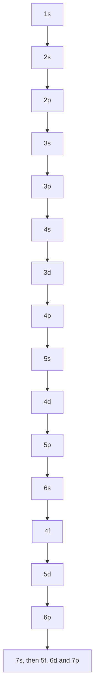
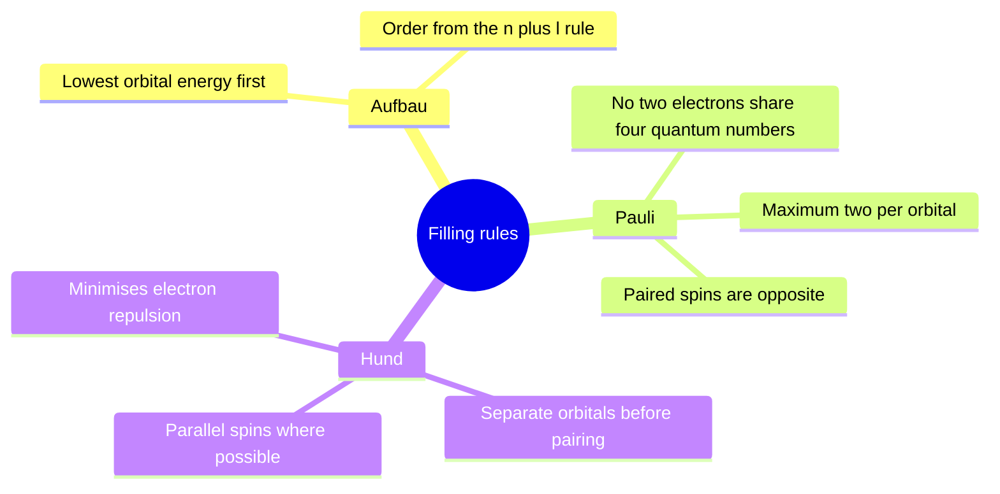
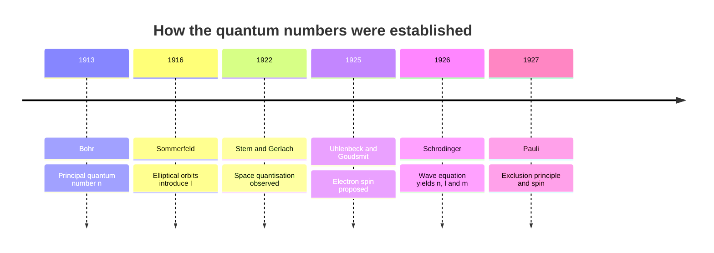
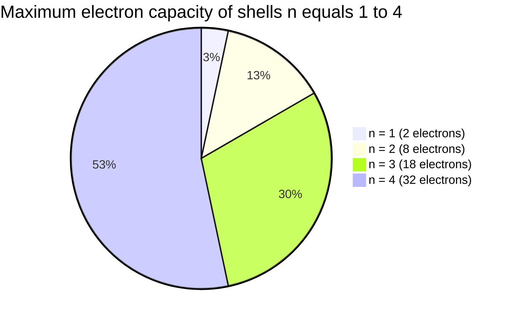

# Chapter 3 — Electron Shells, Orbitals and Configurations

> **Level:** Beginner (Level 1 — Elementary Chemistry)
> **Estimated study time:** 6 hours (reading) + 3 hours (exercises)
> **Prerequisites:** [Atomic Structure](01-atomic-structure.md), [Isotopes and Atomic Mass](02-isotopes-and-atomic-mass.md)
> **Related chapters:** [Periodic Table Organization and Periodic Trends](04-periodic-table-organization-and-periodic-trends.md), [Chemical Bonding: Ionic, Covalent and Metallic](05-chemical-bonding.md)
> **Difficulty:** ★★★☆☆ (3/5)

---

## 1. Learning Objectives

After working through this chapter you will be able to:

- Explain the relationship between shells, subshells and orbitals, and state the
  capacity of each in terms of quantum numbers.
- Assign the four quantum numbers ($n$, $\ell$, $m_\ell$, $m_s$) to an electron and
  state the limits on each.
- Apply the Aufbau principle, the Pauli exclusion principle and Hund's rule to build
  the electron configuration of any atom up to $Z = 36$.
- Write configurations in full $1s^{2}2s^{2}\dots$ form and as a noble-gas shorthand.
- Use the $(n+\ell)$ rule to justify the order $4s < 3d < 4p$, and explain the
  exceptions at chromium and copper honestly.
- Derive the electron configuration of common ions from that of the parent atom.
- Deduce an element's period, group and block from its configuration, and its
  configuration from its position.
- Relate valence configuration to first ionisation energy and to chemical reactivity.

---

## 2. Introduction

The periodic table is not a decorative arrangement. It is a graph of electron
configuration, drawn by chemists who did not yet know what an electron configuration
was. Mendeleev in 1869 sorted the elements by mass and noticed that chemical
properties repeated every eight or eighteen places; the reason for that repetition
was not understood until the quantum mechanics of 1925–1926 supplied it. Rows of the
table correspond to the filling of shells, columns to the number of valence electrons,
and blocks to the subshell being filled.

That is why this chapter is the hinge of the whole of elementary chemistry. Once you
can write a configuration, the shape of the periodic table, the trends in atomic
radius and ionisation energy (Chapter
[4](04-periodic-table-organization-and-periodic-trends.md)), the number of bonds an
atom forms and the geometry of molecules (Chapter [5](05-chemical-bonding.md)) all
become consequences of one idea rather than lists to memorise.

Two warnings before we start. First, the "orbit" picture from Chapter
[1](01-atomic-structure.md) must now be retired: an electron in an atom has no
trajectory, only an orbital — a standing-wave probability distribution. Second, the
filling rules you are about to learn are *heuristics*. They work for the great
majority of elements and fail in specific, explainable places. Learning where they
fail, and why, is part of understanding them.

---

## 3. Fundamental Concepts

### 3.1 Shells, subshells and orbitals

A **shell** is the set of orbitals sharing a principal quantum number $n$. Within a
shell, orbitals are grouped into **subshells** distinguished by the azimuthal quantum
number $\ell$. Each subshell contains one or more **orbitals**, and each orbital holds
at most two electrons.

| Subshell type | $\ell$ | Number of orbitals $2\ell+1$ | Maximum electrons | First available in shell |
|---|---|---|---|---|
| s | 0 | 1 | 2 | $n = 1$ |
| p | 1 | 3 | 6 | $n = 2$ |
| d | 2 | 5 | 10 | $n = 3$ |
| f | 3 | 7 | 14 | $n = 4$ |

Shell $n$ contains the subshells $\ell = 0$ to $n-1$, so shell 1 has only 1s, shell 2
has 2s and 2p, shell 3 has 3s, 3p and 3d, and shell 4 has 4s, 4p, 4d and 4f. Summing
the capacities gives the familiar $2n^{2}$ rule:

$$
n = 1:\ 2, \quad n = 2:\ 8, \quad n = 3:\ 18, \quad n = 4:\ 32.
$$

A **g subshell** ($\ell = 4$) would hold 18 electrons, but no ground-state atom needs
one; the periodic table would have to extend far beyond element 118 before it
appeared.

### 3.2 The four quantum numbers

Each electron in an atom is described by four numbers. The first three come from the
wave function; the fourth is intrinsic.

| Quantum number | Symbol | Allowed values | What it specifies |
|---|---|---|---|
| Principal | $n$ | $1, 2, 3, \dots$ | Shell; size and energy |
| Azimuthal | $\ell$ | $0$ to $n-1$ | Subshell; orbital shape |
| Magnetic | $m_\ell$ | $-\ell$ to $+\ell$ | Orientation of the orbital |
| Spin | $m_s$ | $+\tfrac{1}{2}$ or $-\tfrac{1}{2}$ | Intrinsic angular momentum |

The Pauli exclusion principle states that no two electrons in an atom may share all
four quantum numbers. Since a given orbital fixes $n$, $\ell$ and $m_\ell$, it can
hold only two electrons, with opposite spins. This single sentence is the origin of
the entire structure of the periodic table.

### 3.3 What orbitals look like

An **s orbital** is spherical. A **p orbital** is dumbbell-shaped, with two lobes and
a nodal plane through the nucleus; the three p orbitals are conventionally labelled
$p_x$, $p_y$ and $p_z$. **d orbitals** are more varied: four have four lobes in
cloverleaf arrangements and one ($d_{z^2}$) has two lobes plus a torus. **f orbitals**
are more complex still.

Two cautions. The shapes in textbooks are surfaces of constant probability enclosing
about 90 % of the electron density; the electron is not confined inside them. And the
phase of the wave function in each lobe matters for bonding, even though it has no
classical analogue. Within a subshell, orbitals are **degenerate** — equal in energy —
in the absence of an external field; different subshells are not.

### 3.4 The three filling rules

**Aufbau principle.** Electrons occupy the lowest-energy available orbital first.
"Aufbau" is German for "building up".

**Pauli exclusion principle.** No two electrons in the same atom share all four
quantum numbers; equivalently, an orbital holds at most two electrons, paired with
opposite spins.

**Hund's rule.** Within a set of degenerate orbitals, electrons occupy separate
orbitals with parallel spins before any pairing occurs. The reason is electron–electron
repulsion: two electrons in the same orbital repel each other more strongly than two
electrons in different orbitals of the same subshell. Hund's rule is thus a
consequence of minimising repulsion, and the resulting state has maximum total spin
(multiplicity), as required by quantum mechanics.

### 3.5 Orbital box diagrams

An **orbital box diagram** (also called an arrow-in-box diagram) draws one box per
orbital and one arrow per electron. It contains strictly more information than a
configuration written in superscript notation, because it shows how electrons are
distributed among degenerate orbitals. For nitrogen (Z = 7):

```text
2p   [↑ ] [↑ ] [↑ ]
2s   [↑↓]
1s   [↑↓]
```

The three 2p electrons occupy three separate orbitals with parallel spins, in
accordance with Hund's rule. The configuration $1s^{2}2s^{2}2p^{3}$ alone would not
reveal this.

---

## 4. Detailed Scientific Explanation

### 4.1 Energy ordering and the $(n+\ell)$ rule

In hydrogen the energy depends only on $n$, so all subshells of a shell are degenerate.
In a multi-electron atom, inner electrons shield the outer ones, and the extent of that
shielding depends on $\ell$ as well as $n$: orbitals with lower $\ell$ penetrate closer
to the nucleus, feel a larger effective nuclear charge and are stabilised.

The resulting order is summarised by the **Madelung rule**, or $(n+\ell)$ rule:

1. Orbitals fill in order of increasing $n+\ell$.
2. When two orbitals have the same $n+\ell$, the one with lower $n$ fills first.

| Subshell | $n$ | $\ell$ | $n+\ell$ | Order |
|---|---|---|---|---|
| 1s | 1 | 0 | 1 | 1 |
| 2s | 2 | 0 | 2 | 2 |
| 2p | 2 | 1 | 3 | 3 |
| 3s | 3 | 0 | 3 | 4 |
| 3p | 3 | 1 | 4 | 5 |
| 4s | 4 | 0 | 4 | 6 |
| 3d | 3 | 2 | 5 | 7 |
| 4p | 4 | 1 | 5 | 8 |
| 5s | 5 | 0 | 5 | 9 |

This is why **4s fills before 3d**: $4 + 0 = 4$ against $3 + 2 = 5$. It is also why
**3d fills before 4p**: both have $n+\ell = 5$, but 3d has the lower $n$. The rule
generates the sequence

$$
1s < 2s < 2p < 3s < 3p < 4s < 3d < 4p < 5s < 4d < 5p < 6s < 4f < 5d < 6p < 7s < 5f < 6d < 7p.
$$

The $(n+\ell)$ rule is empirical. It predicts the configuration of the ground state
for most elements but not all, and it says nothing about why the order is what it is.
The physical origin is the balance between penetration and shielding, which must be
computed by solving the Schrödinger equation numerically. Treat the rule as a
memory aid with known exceptions, not as a law of nature.

### 4.2 Why 4s before 3d — and why the order can invert

At first sight it is strange that a 4s orbital, nominally in a higher shell, is
occupied before 3d. The reason is penetration: the 4s radial distribution has small
inner lobes that reach close to the nucleus, so a 4s electron experiences a
higher effective nuclear charge than a 3d electron of the same atom. For neutral
atoms of the first transition series, 4s therefore lies below 3d.

The ordering is not absolute, and this matters:

- **In cations** the 4s orbital is destabilised relative to 3d, because the reduced
  electron count weakens screening. This is why $\ce{Fe^2+}$ is
  $[\ce{Ar}]\,3d^{6}$ and not $[\ce{Ar}]\,3d^{4}4s^{2}$.
- The energy gap between 3d and 4s is small — of order 1 eV — so the two
  configurations are close in energy and can be inverted by a modest perturbation.
- The idea that "4s is always lower than 3d" is a statement about filling order in
  neutral atoms, not about orbital energies in every species.

Textbooks often say that transition-metal ions lose 4s electrons first "because 4s is
outside 3d". That is the right answer for the wrong reason. The 4s electrons are lost
first because, in the ion, they are higher in energy; the "outside" intuition belongs
to the Bohr shell picture, which does not apply at this level of detail.

### 4.3 Writing configurations

A configuration lists subshells in order of filling, with electron counts as
superscripts. Three equivalent renderings are used:

| Style | Sodium (Z = 11) | Comment |
|---|---|---|
| Full | $1s^{2}2s^{2}2p^{6}3s^{1}$ | Unambiguous, verbose |
| Noble-gas shorthand | $[\ce{Ne}]\,3s^{1}$ | Compact; $[\ce{Ne}]$ stands for $1s^{2}2s^{2}2p^{6}$ |
| Orbital box | see below | Shows spin arrangement |

The shorthand must use the *previous* noble gas, and the bracket notation means
"replace these electrons with the closed-shell configuration of neon". When writing
transition metals, keep the $3d$ and $4s$ entries in numerical order ($3d$ before
$4s$) even though $4s$ filled first — a convention that makes comparisons easier.

### 4.4 The anomalies at chromium and copper

Two first-row transition metals break the simple filling pattern:

$$
\ce{Cr}:\ [\ce{Ar}]\,3d^{5}4s^{1} \qquad \text{instead of } [\ce{Ar}]\,3d^{4}4s^{2}
$$

$$
\ce{Cu}:\ [\ce{Ar}]\,3d^{10}4s^{1} \qquad \text{instead of } [\ce{Ar}]\,3d^{9}4s^{2}
$$

The usual explanation invokes the special stability of half-filled and filled
subshells: $3d^{5}$ and $3d^{10}$ are spherically symmetric and, in the simple
exchange-energy argument, lower in energy. That argument captures part of the truth
but should be presented honestly as a *rationalisation*, not a derivation:

- The energy difference between $3d^{4}4s^{2}$ and $3d^{5}4s^{1}$ is only about
  0.1–0.2 eV, comparable to the accuracy of the approximations used to compute it.
- Exchange energy does favour parallel spins, and a $d^{5}$ configuration maximises
  them, but a quantitative account requires a full Hartree–Fock or
  configuration-interaction calculation.
- The "half-filled shell stability" rule does not predict reliably which elements are
  anomalous. Niobium ($4d^{4}5s^{1}$), molybdenum ($4d^{5}5s^{1}$), ruthenium
  ($4d^{7}5s^{1}$), rhodium ($4d^{8}5s^{1}$), palladium ($4d^{10}5s^{0}$), silver
  ($4d^{10}5s^{1}$), platinum ($5d^{9}6s^{1}$) and gold ($5d^{10}6s^{1}$) are all
  exceptions of different kinds. Empirical configuration tables are the honest
  reference.

For main-group elements, ions are formed by adding or removing electrons from the
highest-$n$ subshell:

- $\ce{Na+}$: $1s^{2}2s^{2}2p^{6}$ = $[\ce{Ne}]$
- $\ce{Cl-}$: $1s^{2}2s^{2}2p^{6}3s^{2}3p^{6}$ = $[\ce{Ar}]$
- $\ce{O^{2-}}$: $[\ce{Ne}]$
- $\ce{Mg^{2+}}$: $[\ce{Ne}]$

For transition metals, remove the $ns$ electrons before the $(n-1)d$ electrons:

- $\ce{Fe}$: $[\ce{Ar}]\,3d^{6}4s^{2}$
- $\ce{Fe^{2+}}$: $[\ce{Ar}]\,3d^{6}$
- $\ce{Fe^{3+}}$: $[\ce{Ar}]\,3d^{5}$
- $\ce{Cu}$: $[\ce{Ar}]\,3d^{10}4s^{1}$; $\ce{Cu^{2+}}$: $[\ce{Ar}]\,3d^{9}$

The pattern is clear: cations of the first transition series retain their $3d$
electrons and lose $4s$ electrons, and only after the $4s$ electrons are gone do
further ionisations remove $3d$ electrons. Note that $\ce{Fe^{3+}}$ is $3d^{5}$ — a
half-filled subshell — which is one reason the $+3$ state is common for iron.

### 4.6 Configuration, period, group and block

The position of an element follows directly from its configuration:

| Block | Outer configuration | Group determination |
|---|---|---|
| s | $ns^{1-2}$ | Group 1 ($ns^{1}$) or 2 ($ns^{2}$) |
| p | $ns^{2}np^{1-6}$ | Group $12 +$ (number of $np$ electrons) + 2 for He |
| d | $(n-1)d^{1-10}ns^{1-2}$ | Group $2 +$ (number of $d$ electrons) + $s$ electrons |
| f | $(n-2)f^{1-14}(n-1)d^{0-1}ns^{2}$ | Lanthanides and actinides |

The **period** is the highest occupied $n$ (for d-block elements, the period is
$n$ of the $ns$ orbital). For example, bromine is $[\ce{Ar}]\,3d^{10}4s^{2}4p^{5}$:
the highest $n$ is 4, so period 4; there are seven electrons beyond the argon core,
so group 17.

### 4.7 Valence electrons and ionisation energy

**Valence electrons** are those in the outermost shell — for main-group elements, the
$ns$ and $np$ electrons. They are the electrons involved in bonding, and their number
determines the group and the common oxidation states.

The link to ionisation energy is direct. The **first ionisation energy** is the
energy needed to remove one mole of electrons from one mole of gaseous atoms:

$$
\ce{X(g) -> X+(g) + e-} \qquad \Delta H = \text{IE}_1.
$$

An electron in a filled or half-filled subshell is harder to remove than one that
would leave such a subshell intact — this is the origin of the small dips at groups
13 and 16 discussed in Chapter
[4](04-periodic-table-organization-and-periodic-trends.md). More generally, ionisation
energy increases as the electron is held more tightly: that is, as $n$ decreases and
as the effective nuclear charge increases.

### 4.8 Evidence: photoelectron spectroscopy

Configurations are measured, not merely assumed. **Photoelectron spectroscopy**
irradiates a gas-phase sample with photons of known energy and measures the kinetic
energy of the ejected electrons, giving binding energies from
$E_{\text{binding}} = h\nu - E_{\text{kinetic}}$. Argon shows peaks for 2p, 2s and 1s
in the expected 6 : 2 : 2 intensity ratio, and their energies match calculated orbital
energies.


## 5. Visual Diagrams



**Figure 3.1 — The Aufbau filling sequence.** Each subshell fills only after the one
above it is full or nearly full. The two places where the sequence goes backwards in
$n$ — $4s$ before $3d$, and $6s$ before $4f$ — are exactly where the $(n+\ell)$ rule
overrides the naive shell order.



**Figure 3.2 — The three rules and what each one controls.** Aufbau decides *which*
subshell fills next; Pauli decides *how many* electrons an orbital can hold; Hund
decides *how* they distribute among degenerate orbitals. The rules are independent, so
a configuration can violate each one for a different reason — and invoking Hund's rule
to explain a capacity is a category error, since capacity is a Pauli matter.



**Figure 3.3 — Development of the quantum-number description.** Each number was
introduced to explain a specific observation before its meaning was clear: $n$ from the
hydrogen spectrum, $\ell$ from fine structure, $m_\ell$ from Stern–Gerlach, and spin
from the anomalous Zeeman effect. The tidy list in Section 3.2 is the end product of a
decade of spectroscopy, not an a priori design.



**Figure 3.4 — Shell capacities grow as $2n^{2}$.** The areas explain the period
lengths 2, 8, 8, 18, 18, 32 and 32. The third shell *could* hold 18 electrons, yet the
fourth period uses only eight of them before 4p begins, because 4s and 3d are close in
energy: filling order, not raw capacity, shapes the table.

---

## 6. Mathematical Formulas

### 6.1 Capacity of shells and subshells

$$
N_{\text{shell}} = 2n^{2}, \qquad N_{\text{subshell}} = 2(2\ell+1)
$$

| Symbol | Meaning | SI unit |
|---|---|---|
| $N_{\text{shell}}$ | Maximum electrons in shell $n$ | dimensionless |
| $N_{\text{subshell}}$ | Maximum electrons in a subshell of given $\ell$ | dimensionless |
| $n$ | Principal quantum number | dimensionless |
| $\ell$ | Azimuthal quantum number | dimensionless |

The shell formula is the sum of the subshell formula over $\ell = 0$ to $n-1$, and the
identity $\sum_{\ell=0}^{n-1}(2\ell+1) = n^{2}$ is what makes the factor of two.

### 6.2 Energy of a hydrogenic orbital

$$
E_n = -\frac{13.6\,Z^{2}}{n^{2}}\ \text{eV} = -R_H\frac{Z^{2}}{n^{2}},
\qquad R_H = 13.6\ \text{eV}
$$

| Symbol | Meaning | SI unit |
|---|---|---|
| $E_n$ | Energy of the orbital | eV (or J) |
| $Z$ | Nuclear charge (1 for hydrogen) | dimensionless |
| $n$ | Principal quantum number | dimensionless |
| $R_H$ | Rydberg energy, $2.18\times10^{-18}$ | J |

Valid only for one-electron systems ($\ce{H}$, $\ce{He+}$, $\ce{Li^{2+}}$, ...). For
multi-electron atoms the formula fails because it omits electron–electron repulsion
and shielding; the correct treatment requires the self-consistent field method.

### 6.3 Photon energy and the Rydberg equation

$$
E = h\nu = \frac{hc}{\lambda}, \qquad
\frac{1}{\lambda} = R\left(\frac{1}{n_1^{2}} - \frac{1}{n_2^{2}}\right)
$$

| Symbol | Meaning | SI unit |
|---|---|---|
| $E$ | Photon energy | J |
| $h$ | Planck constant, $6.626\times10^{-34}$ | J s |
| $\nu,\ \lambda$ | Frequency, wavelength | Hz, m |
| $R$ | Rydberg constant, $1.097\times10^{7}$ | m⁻¹ |
| $n_1, n_2$ | Lower and upper levels, $n_2 > n_1$ | dimensionless |

The Rydberg equation is the quantitative content of the Bohr model and remains exact
for hydrogen; it is the reason line spectra can be used to identify elements.

---

## 7. Chemical Equations

First ionisation of the period-3 elements, showing the group 13 dip. Sodium loses a
single 3s electron:

$$
\ce{Na(g) -> Na+(g) + e-} \qquad \text{IE}_1 = +496\ \text{kJ mol}^{-1}
$$

Magnesium loses a paired 3s electron from a filled subshell, which costs more:

$$
\ce{Mg(g) -> Mg+(g) + e-} \qquad \text{IE}_1 = +738\ \text{kJ mol}^{-1}
$$

Aluminium loses a 3p electron that is higher in energy and shielded by the 3s pair, so
its first ionisation energy is *lower* than magnesium's:

$$
\ce{Al(g) -> Al+(g) + e-} \qquad \text{IE}_1 = +578\ \text{kJ mol}^{-1}
$$

Second ionisation of sodium requires breaking into the neon core and is far more
expensive:

$$
\ce{Na+(g) -> Na^{2+}(g) + e-} \qquad \text{IE}_2 = +4562\ \text{kJ mol}^{-1}
$$

Successive ionisation of iron shows the same pattern, with the 4s electrons removed
before the 3d electrons:

$$
\ce{Fe(g) -> Fe^{2+}(g) + 2e-} \qquad \ce{Fe^{2+}(g) -> Fe^{3+}(g) + e-}
$$

Electron capture by chlorine fills the 3p subshell and is strongly exothermic:

$$
\ce{Cl(g) + e- -> Cl-(g)} \qquad \Delta H = -349\ \text{kJ mol}^{-1}
$$

The large ratio $\text{IE}_2(\ce{Na})/\text{IE}_1(\ce{Na}) \approx 9.2$ is direct
evidence for a shell structure: the second electron comes from a complete inner shell.

---

## 8. Worked Examples

### Worked Example 8.1 — Sodium, a main-group atom

**Problem.** Write the full and shorthand configurations of sodium ($Z = 11$) and
draw its orbital box diagram.

**Strategy.** Fill in Aufbau order: 1s (2), 2s (2), 2p (6), 3s (1). Then replace the
neon core.

**Solution.**

$$
1s^{2}\,2s^{2}\,2p^{6}\,3s^{1} \quad\equiv\quad [\ce{Ne}]\,3s^{1}
$$

```text
3s   [↑ ]
2p   [↑↓][↑↓][↑↓]
2s   [↑↓]
1s   [↑↓]
```

**Check.** The superscripts sum to 11, matching $Z$. The highest occupied shell is
$n = 3$, so sodium is in period 3; there is one electron beyond the neon core, so it
is in group 1. Both conclusions match the periodic table.

### Worked Example 8.2 — Chlorine and the chloride ion

**Problem.** Write configurations for $\ce{Cl}$ ($Z = 17$) and $\ce{Cl-}$, with a box
diagram for the neutral atom, and identify the subshell that changes.

**Strategy.** Fill to 17 electrons, then add one for the anion.

**Solution.**

$$
\ce{Cl}:\ 1s^{2}\,2s^{2}\,2p^{6}\,3s^{2}\,3p^{5} = [\ce{Ne}]\,3s^{2}\,3p^{5}
$$

```text
3p   [↑↓][↑↓][↑ ]
3s   [↑↓]
2p   [↑↓][↑↓][↑↓]
2s   [↑↓]
1s   [↑↓]
```

$$
\ce{Cl-}:\ 1s^{2}\,2s^{2}\,2p^{6}\,3s^{2}\,3p^{6} = [\ce{Ar}]
$$

The added electron completes the 3p subshell, converting chlorine's configuration into
that of argon.

**Check.** $\ce{Cl}$ has 17 electrons and 7 valence electrons (3s²3p⁵), placing it in
group 17 and period 3. The anion has 18 electrons, is isoelectronic with argon, and
therefore has a closed-shell configuration — which is why the chloride ion is
unreactive and why chlorine's electron affinity is strongly exothermic.

### Worked Example 8.3 — Iron and its cations

**Problem.** Write the configuration of iron ($Z = 26$) and of $\ce{Fe^{2+}}$ and
$\ce{Fe^{3+}}$, and explain which electrons are removed first.

**Strategy.** Fill 4s before 3d for the neutral atom; then remove electrons from the
highest-energy subshell, which in the cation is 4s.

**Solution.**

$$
\ce{Fe}:\ [\ce{Ar}]\,3d^{6}4s^{2}
$$

```text
4s   [↑↓]
3d   [↑↓][↑ ][↑ ][↑ ][↑ ]
```

$$
\ce{Fe^{2+}}:\ [\ce{Ar}]\,3d^{6} \qquad \ce{Fe^{3+}}:\ [\ce{Ar}]\,3d^{5}
$$

**Check.** The electron counts are 26, 24 and 23 respectively. $\ce{Fe^{3+}}$ has a
half-filled 3d subshell, which is a comparatively stable arrangement and helps explain
why the $+3$ oxidation state is common for iron. Removing a third electron from
$\ce{Fe^{2+}}$ costs less than removing a fourth would, because the fourth would come
from the filled 3d⁵ core.

### Worked Example 8.4 — The chromium and copper anomalies

**Problem.** Write configurations for chromium ($Z = 24$) and copper ($Z = 29$), draw
their 4s/3d box diagrams, and compare each with the prediction of the Aufbau rule.

**Strategy.** Apply Aufbau first, then compare with the observed configurations.

**Solution.** Aufbau predicts $[\ce{Ar}]\,3d^{4}4s^{2}$ for Cr and
$[\ce{Ar}]\,3d^{9}4s^{2}$ for Cu. The observed configurations are

$$
\ce{Cr}:\ [\ce{Ar}]\,3d^{5}4s^{1}, \qquad \ce{Cu}:\ [\ce{Ar}]\,3d^{10}4s^{1}
$$

```text
Cr   4s [↑ ]   3d [↑ ][↑ ][↑ ][↑ ][↑ ]
Cu   4s [↑ ]   3d [↑↓][↑↓][↑↓][↑↓][↑↓]
```

**Check.** Both configurations have a single 4s electron, consistent with the
close spacing of 4s and 3d. The explanation in terms of half-filled and filled
subshell stability accounts for the direction of both anomalies, but it is a
rationalisation rather than a derivation, and it does not predict which other elements
misbehave — see Section 4.4.

---

## 9. Real-World Applications

**Flame colours and fireworks.** Exciting valence electrons with heat and detecting the
photons emitted on relaxation is the oldest use of electronic structure. Sodium's
589 nm doublet, potassium's lilac, copper's blue-green and strontium's crimson all arise
from specific transitions, and the same principle underlies atomic absorption
spectroscopy, which detects trace metals at parts-per-billion levels.

**Semiconductors and LEDs.** In a solid, discrete orbitals broaden into bands. The gap
between valence and conduction bands — a descendant of atomic orbital energies —
decides whether a material is a conductor, semiconductor or insulator, and its size sets
the colour of an LED. Transistors are engineered by controlling those levels with
dopants.

---

## 10. Common Mistakes

| Mistake | Why it happens | Correct approach |
|---|---|---|
| Putting 8 electrons in 3d | Recalling $2n^{2} = 18$ for shell 3 and misapplying it to a subshell | A d subshell holds 10 electrons in five orbitals; $2n^{2}$ applies to the whole shell |
| Filling 3d before 4s | The table lists the d block after the s block | Filling order is 4s then 3d; $4+0 = 4 < 3+2 = 5$ |
| Writing $\ce{Fe^{2+}}$ as $[\ce{Ar}]\,3d^{4}4s^{2}$ | Removing electrons from the highest $n$ shell | Remove 4s electrons first: $[\ce{Ar}]\,3d^{6}$ |
| Pairing electrons before filling all degenerate orbitals | Ignoring Hund's rule | Occupy each 2p (or 3d) orbital singly with parallel spins first |
| Claiming half-filled shells explain every anomaly | The Cr/Cu explanation is memorable | It is a rationalisation; many anomalies (Pd, Nb, Pt) do not fit it, so consult tables |
| Thinking $2n^{2}$ means the nth shell always holds that many in the ground state | The capacity and the occupancy differ | Period 4 fills 4s before 3d, so only eight 3d electrons at most are added in that period |

---

## 11. Chapter Summary

- Shells are divided into subshells (s, p, d, f) containing 1, 3, 5 and 7 orbitals
  respectively, each holding two electrons: capacities 2, 6, 10 and 14.
- Four quantum numbers ($n$, $\ell$, $m_\ell$, $m_s$) specify an electron; Pauli's
  principle gives the capacity $2n^{2}$. Aufbau, Pauli and Hund together generate
  ground-state configurations.
- The $(n+\ell)$ rule gives the filling order $1s\,2s\,2p\,3s\,3p\,4s\,3d\,4p\dots$;
  equal $n+\ell$ is broken by lower $n$.
- Chromium and copper are genuine exceptions — $3d^{5}4s^{1}$ and $3d^{10}4s^{1}$ —
  explained qualitatively by exchange energy but properly established only by
  calculation.
- Ions of the first transition series lose 4s electrons before 3d electrons, and
  configuration fixes period, group and block — hence the shape of the periodic table.

---

## 12. Exercises

### 12.1 Conceptual questions

1. Explain why an orbital can hold no more than two electrons.
2. Why is the 4s orbital occupied before 3d in potassium and calcium, even though 4s
   is nominally further from the nucleus?
3. State Hund's rule and explain it in terms of electron repulsion.

### 12.2 Basic problems

4. Write full configurations for (a) Mg ($Z = 12$), (b) P ($Z = 15$) and (c) K
   ($Z = 19$).
5. Give the noble-gas shorthand configurations for (a) Ca, (b) Br and (c) $\ce{Zn}$.
6. How many unpaired electrons does a nitrogen atom have in its ground state?

### 12.3 Intermediate problems

7. Write configurations and orbital box diagrams for $\ce{O}$ and $\ce{O^{2-}}$.
8. Identify the element with configuration $[\ce{Ar}]\,3d^{5}4s^{2}$ and state its
   period, group and block.
9. Give the configuration of $\ce{Cu+}$ and explain why it is diamagnetic while
   $\ce{Cu^{2+}}$ is paramagnetic.

### 12.4 Advanced problems

10. Explain why the first ionisation energy of aluminium (578 kJ mol⁻¹) is lower than
    that of magnesium (738 kJ mol⁻¹), even though $Z$ is larger for aluminium.
11. Niobium has the configuration $[\ce{Kr}]\,4d^{4}5s^{1}$ rather than
    $[\ce{Kr}]\,4d^{3}5s^{2}$. Discuss whether the "half-filled shell" argument
    accounts for this.

### 12.5 Calculation problems

12. (a) Calculate the energy in eV and in kJ mol⁻¹ of the $n = 2$ level of hydrogen.
    (b) Hence find the wavelength of the photon emitted in the $n = 2 \to 1$ transition.

### Answers

1. Pauli: the spatial quantum numbers fix the orbital, so only $m_s$ can differ.
2. The 4s wave function penetrates the argon core, samples a higher effective nuclear
   charge and so lies below 3d in these atoms.
3. Electrons occupy separate degenerate orbitals with parallel spins before pairing,
   because same-orbital occupancy maximises repulsion.
4. (a) $1s^{2}2s^{2}2p^{6}3s^{2}$; (b) $1s^{2}2s^{2}2p^{6}3s^{2}3p^{3}$;
   (c) $1s^{2}2s^{2}2p^{6}3s^{2}3p^{6}4s^{1}$.
5. (a) $[\ce{Ar}]\,4s^{2}$; (b) $[\ce{Ar}]\,3d^{10}4s^{2}4p^{5}$;
   (c) $[\ce{Ar}]\,3d^{10}4s^{2}$.
6. Three, one in each 2p orbital.
7. $\ce{O}$: $[\ce{He}]\,2s^{2}2p^{4}$ with two unpaired 2p electrons;
   $\ce{O^{2-}}$: $[\ce{Ne}]$, all electrons paired.
8. Manganese; period 4, group 7, d block.
9. $\ce{Cu+}$: $[\ce{Ar}]\,3d^{10}$ — all electrons paired, diamagnetic.
   $\ce{Cu^{2+}}$: $[\ce{Ar}]\,3d^{9}$ — one unpaired electron, paramagnetic.
10. Aluminium's outer electron is in 3p, higher in energy and shielded by the filled 3s
    pair, so it is removed more easily than magnesium's 3s electron.
11. Niobium is $4d^{4}5s^{1}$, not the $4d^{5}5s^{1}$ a half-filled argument favours, so
    the argument fails here; the small energy gap means the outcome must be computed.
12. (a) $E_2 = -13.6/4 = -3.40$ eV $= -328$ kJ mol⁻¹.
    (b) $\Delta E = 10.2$ eV $\Rightarrow \lambda = hc/\Delta E \approx 122$ nm,
    in the ultraviolet (Lyman series).

---

## 13. Further Reading

- OpenStax. *Chemistry 2e*, Chapter 6, "Electronic Structure and Periodic Properties of
  Elements". <https://openstax.org/details/books/chemistry-2e>
- Atkins, P. and Jones, L. *Chemical Principles: The Quest for Insight*, 7th ed.,
  W. H. Freeman, 2016.
- Housecroft, C. E. and Sharpe, A. G. *Inorganic Chemistry*, 5th ed., Pearson, 2018,
  Chapter 1.
- IUPAC. *Compendium of Chemical Terminology* ("Gold Book"), 2nd ed. (the
  "corrected" version). <https://goldbook.iupac.org/>

See [CURRICULUM.md](../CURRICULUM.md) and [REFERENCES.md](../REFERENCES.md).
