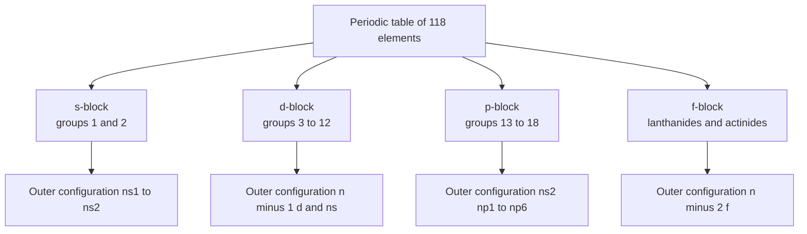
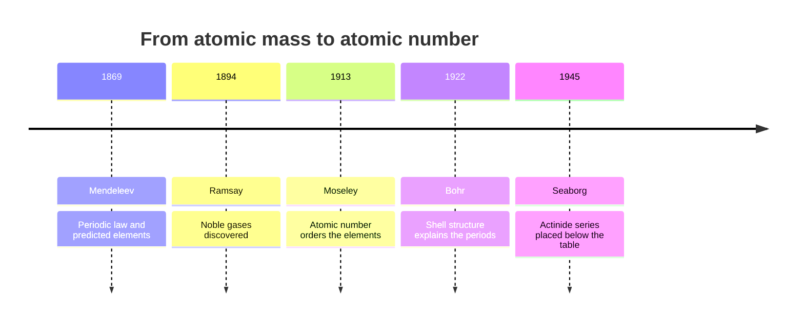
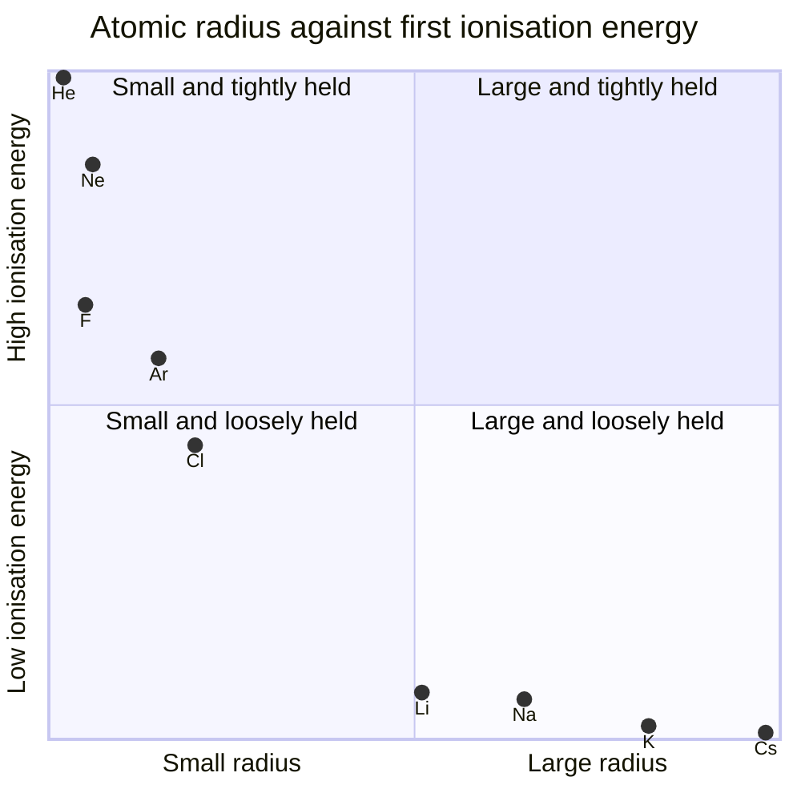

# Chapter 4 — Periodic Table Organization and Periodic Trends

> **Level:** Beginner (Level 1 — Elementary Chemistry)
> **Estimated study time:** 6 hours (reading) + 3 hours (exercises)
> **Prerequisites:** [Atomic Structure](01-atomic-structure.md), [Electron Shells, Orbitals and Configurations](03-electron-shells-and-electron-configurations.md)
> **Related chapters:** [Isotopes and Atomic Mass](02-isotopes-and-atomic-mass.md), [Chemical Bonding: Ionic, Covalent and Metallic](05-chemical-bonding.md)
> **Difficulty:** ★★★☆☆ (3/5)

---

## 1. Learning Objectives

After working through this chapter you will be able to:

- Describe the modern periodic table in terms of periods, groups, blocks and the
  position of the f-block.
- Explain why the table has its characteristic shape, using electron configuration.
- Classify elements as metals, nonmetals, metalloids, noble gases and transition
  metals, and locate the dividing line.
- Describe and explain the trends in atomic radius, ionic radius, first ionisation
  energy, electron affinity, electronegativity and metallic character across a period
  and down a group.
- Explain the small dips in first ionisation energy at groups 13 and 16.
- Use effective nuclear charge and shielding to account for periodic trends.
- Write balanced equations for the reactions of alkali metals and halogens that
  demonstrate group trends.
- Predict the relative size, ionisation energy and electronegativity of unfamiliar
  elements from their position.

---

## 2. Introduction

In 1869 Dmitri Mendeleev arranged the 63 known elements in order of atomic mass and
found that chemical properties repeated periodically. He had the courage to leave
gaps for elements not yet discovered and to predict their properties; when gallium,
scandium and germanium appeared with almost exactly the predicted densities and
valences, the table became the organising principle of chemistry.

Mendeleev did not know why the pattern existed, and his table contained anomalies:
tellurium (127.6) had to precede iodine (126.9), and argon (39.9) potassium (39.1). In
1913 Henry Moseley showed that the X-ray frequency of an element depends on a whole
number increasing by exactly one from element to element. That number is $Z$, and
ordering by $Z$ removes every inversion. Since Chapter
[3](03-electron-shells-and-electron-configurations.md) showed that $Z$ determines
electron configuration, the table is equally a graph of configuration.

This chapter reads the table as that graph and extracts its trends. Size, ionisation
energy, electron affinity and electronegativity all vary smoothly with position, and
all are explained by two competing factors — the pull of the nucleus and the screening
of that pull by inner electrons.

---

## 3. Fundamental Concepts

### 3.1 Periods, groups and blocks

The modern table has **7 periods** (rows) and **18 groups** (columns). A period
contains the elements whose atoms have the same highest occupied shell:

| Period | Elements | Length | Subshells filled |
|---|---|---|---|
| 1 | H–He | 2 | 1s |
| 2 | Li–Ne | 8 | 2s, 2p |
| 3 | Na–Ar | 8 | 3s, 3p |
| 4 | K–Kr | 18 | 4s, 3d, 4p |
| 5 | Rb–Xe | 18 | 5s, 4d, 5p |
| 6 | Cs–Rn | 32 | 6s, 4f, 5d, 6p |
| 7 | Fr–Og | 32 | 7s, 5f, 6d, 7p |

Group numbers 1–18 are the IUPAC convention. Older European and American systems
(IA, IIA, IIIB, …) are still in use and cause endless confusion; this curriculum uses
1–18 throughout.

A **block** is a set of groups in which a particular subshell is being filled:

- **s-block:** groups 1 and 2, plus helium ($1s^{2}$). Outer configuration
  $ns^{1-2}$.
- **p-block:** groups 13–18. Outer configuration $ns^{2}np^{1-6}$.
- **d-block:** groups 3–12. Configuration $(n-1)d^{1-10}ns^{1-2}$.
- **f-block:** the lanthanides (Ce–Lu, filling 4f) and actinides (Th–Lr, filling
  5f), usually printed below the main table to keep it narrow.

The lanthanides and actinides fit between groups 2 and 3 of periods 6 and 7. Printing
them as a separate block is a typographic convention, not a chemical statement: in a
true long-form table they sit between barium and hafnium, and between radium and
rutherfordium.

### 3.2 From configuration to table shape

The shape of the table follows from the filling order with no further assumptions:

- Period 1 holds two elements because 1s holds two electrons.
- Periods 2 and 3 hold eight because 2s and 2p (3s and 3p) hold eight.
- Period 4 holds eighteen because 4s, 3d and 4p together hold eighteen.
- Periods 6 and 7 hold thirty-two because 6s, 4f, 5d and 6p together hold 32.

Columns correspond to valence electron count: $ns^{1}$ for group 1, $ns^{2}np^{5}$ for
group 17, filled shells for group 18. Since chemical behaviour is largely decided by
valence electrons, elements of a group behave similarly — Mendeleev's periodic law,
now explained.

### 3.3 Categories of element

| Category | Position | Characteristic |
|---|---|---|
| Metals | Left and centre; about 75 % of elements | Lustrous, malleable, ductile, good conductors, form cations |
| Nonmetals | Upper right, plus H | Dull, brittle, poor conductors, form anions or share electrons |
| Metalloids | B, Si, Ge, As, Sb, Te (and often Po, At) | Intermediate; semiconducting |
| Noble gases | Group 18 | Full valence shell; monatomic; very unreactive |
| Transition metals | d-block, groups 3–12 | Variable oxidation states, coloured compounds, catalytic activity |
| Inner transition metals | f-block | Lanthanides and actinides; similar radii within each series |

The metal–nonmetal boundary runs diagonally from boron to astatine. Elements adjacent
to the line are metalloids, whose properties depend strongly on conditions — silicon
is a semiconductor, and tin exists as a metallic and a nonmetallic allotrope.

Note the formal IUPAC definition of a **transition metal**: an element whose atom has
an incomplete d subshell, or which can form cations with an incomplete d subshell.
Zinc, cadmium and mercury have $d^{10}$ configurations in the atom and in their common
$+2$ ions, so they are d-block elements but not, strictly, transition metals.

### 3.4 Group trends: the alkali metals

The alkali metals (group 1) become **more reactive down the group**. The evidence is
straightforward:

$$
\ce{4Li(s) + O2(g) -> 2Li2O(s)}
$$

$$
\ce{2Na(s) + O2(g) -> Na2O2(s)}
$$

$$
\ce{K(s) + O2(g) -> KO2(s)}
$$

Lithium gives the normal oxide, sodium the peroxide and potassium the superoxide: the
heavier metals are more willing to transfer electron density to oxygen, so oxygen is
reduced further. With water the trend is dramatic:

$$
\ce{2Li(s) + 2H2O(l) -> 2LiOH(aq) + H2(g)}
$$

$$
\ce{2Na(s) + 2H2O(l) -> 2NaOH(aq) + H2(g)}
$$

$$
\ce{2K(s) + 2H2O(l) -> 2KOH(aq) + H2(g)}
$$

Lithium floats and fizzes steadily; sodium melts into a ball and races across the
surface; potassium ignites the hydrogen it produces; rubidium and caesium explode.
The explanation is the decrease in first ionisation energy down the group: the valence
electron is further from the nucleus and shielded by more filled shells, so it is
removed more easily, and the metal is a stronger reducing agent.

### 3.5 Group trends: the halogens

The halogens (group 17) become **less reactive down the group**, the opposite pattern.
Fluorine and chlorine react vigorously with hydrogen; bromine needs heat and a
catalyst; iodine reacts only partially and reversibly:

$$
\ce{H2(g) + F2(g) -> 2HF(g)} \qquad \text{explosive even in the dark}
$$

$$
\ce{H2(g) + Cl2(g) -> 2HCl(g)} \qquad \text{light or a catalyst}
$$

$$
\ce{H2(g) + Br2(g) -> 2HBr(g)} \qquad \text{heat and a platinum catalyst}
$$

$$
\ce{H2(g) + I2(g) <=> 2HI(g)} \qquad \Delta H^\circ = +53\ \text{kJ mol}^{-1}
$$

The same order appears in displacement reactions, in which a halogen higher in the
group oxidises the halide of a lower one:

$$
\ce{Cl2(aq) + 2KBr(aq) -> 2KCl(aq) + Br2(aq)}
$$

$$
\ce{Cl2(aq) + 2NaI(aq) -> 2NaCl(aq) + I2(aq)}
$$

$$
\ce{Br2(aq) + 2KI(aq) -> 2KBr(aq) + I2(aq)}
$$

Iodine cannot displace bromide or chloride, so the order of oxidising power is
$\ce{F2} > \ce{Cl2} > \ce{Br2} > \ce{I2}$. Two effects combine: the electron affinity
of the halogen atom is largest for chlorine but the dominant factor is the weakness of
the X–X bond, which falls sharply from $\ce{F2}$ (155 kJ mol⁻¹) to $\ce{I2}$
(151 kJ mol⁻¹) via $\ce{Cl2}$ (242) and $\ce{Br2}$ (193) — the small, lone-pair-rich
fluorine atom suffers severe repulsion in its own molecule. Bond strength, not
electron affinity alone, controls reactivity down this group.

---

## 4. Detailed Scientific Explanation

### 4.1 The two competing factors: nuclear charge and shielding

Every periodic trend is a tug-of-war between two quantities.

The **effective nuclear charge** $Z_{\text{eff}}$ is the net positive charge an outer
electron actually experiences, after inner electrons have screened part of the nuclear
charge:

$$
Z_{\text{eff}} = Z - S,
$$

where $S$ is the **shielding constant**. Electrons in the same shell shield each other
poorly (about 0.35 of a unit each in Slater's approximation), electrons one shell in
shield about 0.85, and electrons two or more shells in shield almost completely
(1.00). The physical picture: an electron close to the nucleus sees the full charge,
whereas one far away sees a charge partly cancelled by the electron cloud between it
and the nucleus.

Two rules follow, and they generate every trend in this chapter:

- **Across a period**, $Z$ increases by one per element while electrons are added to
  the same shell, so shielding increases only slightly. $Z_{\text{eff}}$ therefore
  rises, and the nucleus pulls the electron cloud in more tightly.
- **Down a group**, $Z$ increases but a whole new shell is added each time, so $S$
  rises almost as fast as $Z$. $Z_{\text{eff}}$ stays roughly constant while the
  valence shell moves further out, so the atom grows and the valence electron is held
  less tightly.

### 4.2 Atomic radius

An atom has no sharp boundary, so a radius must be defined operationally. The
**covalent radius** is half the distance between two bonded identical nuclei, the
**metallic radius** half the distance between neighbours in a metal, and the **van der
Waals radius** half the closest approach of non-bonded atoms — always the largest.

- **Across a period** the radius decreases, because $Z_{\text{eff}}$ rises while the
  shell number stays the same. Period 2: Li 152 pm → F 71 pm.
- **Down a group** the radius increases, because each element adds a shell.
- The **lanthanide contraction** makes period-6 elements after the f-block unexpectedly
  small, because 4f electrons shield poorly: hafnium (159 pm) almost matches zirconium
  (160 pm) despite being a period heavier. The analogous **d-block contraction** makes
  gallium (122 pm) smaller than aluminium (143 pm).

### 4.3 Ionic radius

Ions are not the same size as their parent atoms.

- **Cations are smaller than their parent atoms.** Removing electrons reduces
  electron–electron repulsion and often empties the outermost shell entirely. Sodium
  is 186 pm; $\ce{Na+}$ is 102 pm.
- **Anions are larger than their parent atoms.** Adding electrons increases repulsion
  and the extra electron is held only loosely. Chlorine is 99 pm; $\ce{Cl-}$ is 181 pm.
- **Across a period, cation radii decrease** ($\ce{Na+}$ 102 > $\ce{Mg^{2+}}$ 72 >
  $\ce{Al^{3+}}$ 53.5 pm) because charge and $Z_{\text{eff}}$ both rise.
- **Down a group, ion radii increase** for the same reason atomic radii do.
- For an **isoelectronic series** — ions with the same electron count — the radius
  decreases as nuclear charge increases:

$$
\ce{N^{3-}} > \ce{O^{2-}} > \ce{F^-} > \ce{Na+} > \ce{Mg^{2+}} > \ce{Al^{3+}}
$$

all with 10 electrons. The nuclear charge runs 7, 8, 9, 11, 12, 13, so the electron
cloud is pulled in progressively harder.

### 4.4 First ionisation energy

The **first ionisation energy** $\text{IE}_1$ is the minimum energy required to remove
one mole of electrons from one mole of gaseous atoms:

$$
\ce{X(g) -> X+(g) + e-} \qquad \Delta H = \text{IE}_1 > 0.
$$

Gaseous is essential: in a solid, energy would also be needed to atomise the sample,
and the measurement would no longer refer to a single process.

Trends:

- **Across a period** $\text{IE}_1$ generally increases, because $Z_{\text{eff}}$ rises
  and the electron is held more tightly. Period 3: Na 496 → Ar 1521 kJ mol⁻¹.
- **Down a group** $\text{IE}_1$ decreases, because the valence electron is in a higher
  shell, further from the nucleus and better shielded. Group 1: Li 520 → Cs 376
  kJ mol⁻¹.

There are two characteristic **dips** within a period:

| Period 2 | $\text{IE}_1$ / kJ mol⁻¹ | Period 3 | $\text{IE}_1$ / kJ mol⁻¹ |
|---|---|---|---|
| Li | 520 | Na | 496 |
| Be | 899 | Mg | 738 |
| B | 801 | Al | 578 |
| C | 1086 | Si | 786 |
| N | 1402 | P | 1012 |
| O | 1314 | S | 1000 |
| F | 1681 | Cl | 1251 |
| Ne | 2081 | Ar | 1521 |

**The group 13 dip (Be → B, Mg → Al).** The electron removed from boron or aluminium is
a p electron, which lies higher in energy than the s electrons of the same shell and is
shielded by the filled $ns^{2}$ pair. Removing it is therefore easier than removing a
paired s electron from the group 2 element, despite the larger $Z$.

**The group 16 dip (N → O, P → S).** Nitrogen is $2s^{2}2p^{3}$: three unpaired p
electrons, a half-filled subshell with favourable exchange energy. Oxygen is
$2s^{2}2p^{4}$: one p orbital contains a pair. Removing one of that pair relieves
electron–electron repulsion and leaves the stable $p^{3}$ arrangement, so oxygen's
ionisation energy is *lower* than nitrogen's. The same reasoning applies to sulfur
versus phosphorus.

### 4.5 Successive ionisation energies

**Successive ionisation energies** are the energies for removing the second, third and
later electrons from the same atom. They always increase, because each removal leaves a
more positively charged ion that holds the remaining electrons more tightly. The jumps
reveal the shell structure:

| Removal | Mg / kJ mol⁻¹ | Na / kJ mol⁻¹ |
|---|---|---|
| 1st | 738 | 496 |
| 2nd | 1451 | 4562 |
| 3rd | 7733 | 6912 |
| 4th | 10 540 | 9543 |

For magnesium the enormous jump is between the second and third removals: two electrons
are valence (3s) and the third comes from the neon core. For sodium the jump is between
the first and second: sodium has exactly one valence electron. The ratio
$\text{IE}_{n+1}/\text{IE}_n$ therefore identifies the group, and this is how
successive ionisation data are used to establish valence electron counts
experimentally.

### 4.6 Electron affinity

The **first electron affinity** is the enthalpy change when one mole of gaseous atoms
each gain one electron:

$$
\ce{X(g) + e- -> X-(g)} \qquad \Delta H = \text{EA}_1.
$$

For most nonmetals $\text{EA}_1$ is negative (energy released). Values for the halogens
are F −328, Cl −349, Br −325 and I −295 kJ mol⁻¹. Note that chlorine's is *more*
negative than fluorine's, breaking the group trend: fluorine is so small that the
incoming electron experiences strong repulsion from the existing electron density, and
the $F$–$F$ bond energy is anomalously low. Electron affinity is the least regular of
the periodic properties, and exceptions (Be, N, Ne, Mg, Ar all have near-zero or
positive values) are common.

Trends, where they hold: electron affinity becomes more negative across a period (the
incoming electron feels a larger $Z_{\text{eff}}$) and less negative down a group (the
incoming electron is further from the nucleus).

### 4.7 Electronegativity

**Electronegativity** is the tendency of an atom in a molecule to attract shared
electrons to itself. It is not a property of an isolated atom and has no single
definition; the **Pauling scale** is the most widely used, with fluorine fixed at 3.98.

| Element | F | O | Cl | N | Br | C | S | H | P | Si | Al | Mg | Na |
|---|---|---|---|---|---|---|---|---|---|---|---|---|---|
| $\chi$ | 3.98 | 3.44 | 3.16 | 3.04 | 2.96 | 2.55 | 2.58 | 2.20 | 2.19 | 1.90 | 1.61 | 1.31 | 0.93 |

Trends: electronegativity **increases across a period** (smaller atoms hold shared
electrons more tightly) and **decreases down a group** (larger atoms hold them less
tightly). The most electronegative element is fluorine; the least are the caesium and
francium end of group 1. Noble gases are usually assigned no value because they form
so few compounds.

Electronegativity differences are used to classify bonding: a difference below about
0.4 is treated as nonpolar covalent, 0.4–1.7 as polar covalent, and above 1.7 as
largely ionic. Chapter [5](05-chemical-bonding.md) develops this continuum and its
limitations.

### 4.8 Metallic character

**Metallic character** is the tendency to lose electrons and form cations. It
decreases across a period (as $\text{IE}_1$ rises) and increases down a group (as
$\text{IE}_1$ falls). The most metallic elements are at the bottom left; the most
nonmetallic at the top right.

This is why the metal–nonmetal boundary is diagonal rather than vertical: moving right
increases nonmetallic character, moving down increases metallic character, and the two
effects cancel along a diagonal. It is also why the same element can show both faces
under different conditions — tin's grey allotrope is a semiconductor and its white
allotrope is a metal.

---

## 5. Visual Diagrams

**Figure 4.1 — The four blocks and the subshell each one fills.** Each block is defined
by which subshell receives the differentiating electron, so reading the diagram
downwards converts a picture of the table into a statement about configurations, and
back again. Note that helium, placed in group 18, belongs to the s-block by
configuration — a reminder that the table encodes chemistry, not only electron
bookkeeping.

**Figure 4.2 — How the table acquired its modern justification.** The timeline
separates the empirical period — Mendeleev's predictions, which worked without any
theory of the atom — from the explanatory period of Moseley, Bohr and Seaborg.
Mendeleev's table was a successful empirical generalisation; twentieth-century physics
turned it into a consequence of quantum mechanics.

**Figure 4.3 — An island map of the main-group elements.** Each point plots normalised
atomic radius against normalised first ionisation energy. Two islands appear: the noble
gases and halogens in the small-and-tightly-held quadrant, the alkali metals in the
large-and-loosely-held one. The opposite quadrants are chemically empty for good
reasons, since a large atom with a very tightly bound valence electron would require a
high nuclear charge screened by almost nothing.

---

## 6. Mathematical Formulas

### 6.1 Effective nuclear charge

$$
Z_{\text{eff}} = Z - S
$$

| Symbol | Meaning | SI unit |
|---|---|---|
| $Z_{\text{eff}}$ | Effective nuclear charge | dimensionless |
| $Z$ | Nuclear charge (atomic number) | dimensionless |
| $S$ | Shielding constant | dimensionless |

Slater's approximate rules assign 0.35 per electron in the same shell, 0.85 per electron
in the $n-1$ shell and 1.00 per electron further in. The rules are crude but reproduce
the trends correctly.

### 6.2 Coulombic attraction and orbital energy

$$
E \approx -\frac{Z_{\text{eff}}\,e^{2}}{4\pi\varepsilon_0 r}, \qquad
F = \frac{Z_{\text{eff}}\,e^{2}}{4\pi\varepsilon_0 r^{2}}
$$

| Symbol | Meaning | SI unit |
|---|---|---|
| $E$ | Potential energy of the electron | J |
| $F$ | Attractive force | N |
| $e$ | Elementary charge, $1.602\times10^{-19}$ | C |
| $r$ | Radius of the shell | m |
| $\varepsilon_0$ | Vacuum permittivity, $8.854\times10^{-12}$ | F m⁻¹ |

### 6.3 Ionisation energy and the successive ratio

$$
\text{IE}_n:\ \ce{X^{(n-1)+}(g) -> X^{n+}(g) + e-}, \qquad
R_n = \frac{\text{IE}_{n+1}}{\text{IE}_{n}}
$$

| Symbol | Meaning | SI unit |
|---|---|---|
| $\text{IE}_n$ | $n$th ionisation energy | kJ mol⁻¹ |
| $R_n$ | Ratio of successive ionisation energies | dimensionless |

A ratio of 5 or more signals that the next electron comes from a new, inner shell. For
magnesium $R_2 = 7733/1451 = 5.3$; for sodium $R_1 = 4562/496 = 9.2$.

---

## 7. Chemical Equations

Alkali metals with water, showing increasing vigour down the group:

$$
\ce{2Li(s) + 2H2O(l) -> 2LiOH(aq) + H2(g)}
$$

$$
\ce{2Na(s) + 2H2O(l) -> 2NaOH(aq) + H2(g)}
$$

$$
\ce{2K(s) + 2H2O(l) -> 2KOH(aq) + H2(g)}
$$

Halogen displacement, showing decreasing oxidising power down the group:

$$
\ce{Cl2(aq) + 2KBr(aq) -> 2KCl(aq) + Br2(aq)}
$$

Oxides at the two ends of period 3, showing the change from basic to acidic character:

$$
\ce{Na2O(s) + H2O(l) -> 2NaOH(aq)} \qquad \text{basic}
$$

$$
\ce{SO3(g) + H2O(l) -> H2SO4(aq)} \qquad \text{acidic}
$$

The first produces hydroxide ions and the second produces protons. The crossover from
basic to acidic oxides near the metalloid boundary is one of the clearest chemical
consequences of the trends in this chapter.

---

## 8. Worked Examples

### Worked Example 8.1 — Ranking first ionisation energies

**Problem.** Arrange Na, Mg, Al and Si in order of increasing first ionisation energy
(the values are 496, 738, 578 and 786 kJ mol⁻¹) and explain the order.

**Strategy.** Apply the across-period trend first, then correct for the group 13 dip
caused by the 3p electron.

**Solution.** By nuclear charge the expected order is Na < Mg < Al < Si. The observed
order is

$$
\ce{Na} < \ce{Al} < \ce{Mg} < \ce{Si} \qquad (496 < 578 < 738 < 786).
$$

Aluminium's outer electron is $3p^{1}$, which lies above the filled $3s^{2}$ pair and is
shielded by it, so it is removed more easily than magnesium's $3s^{2}$ electron despite
the larger $Z$.

**Check.** Sodium is lowest because it loses one 3s electron to give a closed-shell ion,
and silicon is highest because it has the largest $Z_{\text{eff}}$ of the four. Only the
Mg/Al pair is inverted, exactly as the subshell argument requires.

### Worked Example 8.2 — Ranking an isoelectronic series

**Problem.** Arrange $\ce{N^{3-}}$, $\ce{O^{2-}}$, $\ce{F^-}$, $\ce{Na+}$,
$\ce{Mg^{2+}}$ and $\ce{Al^{3+}}$ in order of decreasing ionic radius.

**Strategy.** All six have the neon configuration, so the radius depends only on how
strongly the nucleus pulls that ten-electron cloud.

**Solution.** Nuclear charges are 7, 8, 9, 11, 12 and 13, so more protons means a
smaller ion:

$$
\ce{N^{3-}} > \ce{O^{2-}} > \ce{F^-} > \ce{Na+} > \ce{Mg^{2+}} > \ce{Al^{3+}}
$$

with radii roughly 146, 140, 133, 102, 72 and 53.5 pm.

**Check.** The order runs opposite to $Z$, as the shielding argument predicts, and the
large gap between $\ce{F^-}$ (133 pm) and $\ce{Na+}$ (102 pm) reflects the change from
nine protons holding ten electrons to eleven protons doing the same job.

### Worked Example 8.3 — Calculating effective nuclear charge

**Problem.** Use Slater's rules to estimate $Z_{\text{eff}}$ for the valence electron of
(a) sodium ($1s^{2}2s^{2}2p^{6}3s^{1}$) and (b) chlorine
($1s^{2}2s^{2}2p^{6}3s^{2}3p^{5}$), and comment.

**Strategy.** Same shell 0.35, $n-1$ shell 0.85, inner shells 1.00, excluding the
electron itself.

**Solution.**

(a) $S = 8(0.85) + 2(1.00) = 8.80$, so $Z_{\text{eff}} = 11 - 8.80 = 2.20$.

(b) $S = 6(0.35) + 8(0.85) + 2(1.00) = 10.90$, so $Z_{\text{eff}} = 17 - 10.90 = 6.10$.

**Check.** Across period 3 the effective nuclear charge almost trebles while the valence
shell stays at $n = 3$, which is precisely why the atoms contract and ionisation
energies rise. The absolute values are approximate — Slater's rules are fitted to a
limited data set — so use them for trends, not precision.

---

## 9. Real-World Applications

**Alloys and structural metals.** Aluminium's low density and its tenacious oxide layer
follow from its position just right of the metal–nonmetal boundary: metallic enough to
conduct and deform, reactive enough to passivate. Alloying exploits the radius trend —
adding a smaller atom distorts the lattice and hardens it, which is why steel,
duralumin and superalloys are designed by controlled size mismatch.

**Batteries and catalysis.** Lithium's low ionisation energy and small ionic radius make
it the anode of choice in rechargeable cells; platinum's unfilled d-band makes it the
standard hydrogenation and exhaust catalyst. Both are periodic-table arguments rather
than accidents.

**Semiconductors and lighting.** Silicon and germanium sit on the metalloid line, where
the gap between filled and empty bands is small enough to engineer by doping. Sodium
vapour lamps use the 3s → 3p transition, and phosphor colours follow the same logic.

---

## 10. Common Mistakes

| Mistake | Why it happens | Correct approach |
|---|---|---|
| Saying atomic radius increases across a period | Down-group behaviour is more familiar | Across a period $Z_{\text{eff}}$ rises while $n$ is constant, so radius *decreases* |
| Claiming ionisation energy rises monotonically across a period | The general trend is memorable | Two dips occur: group 13 (p electron) and group 16 (pairing in p) |
| Expecting $\ce{Na+}$ to be larger than Na | A positive ion sounds intuitively "bigger" | Cations are smaller: $186 \to 102$ pm |
| Using the same radius definition for every comparison | Values are quoted without their definition | Covalent, metallic and van der Waals radii differ by tens of percent |
| Treating zinc as a transition metal | It sits in the d-block | $\ce{Zn^{2+}}$ is $3d^{10}$, so it is d-block but not a transition metal by the IUPAC definition |
| Expecting fluorine to have the most negative electron affinity | Fluorine is the most electronegative element | Chlorine's is more negative: −349 against −328 kJ mol⁻¹ |

---

## 11. Chapter Summary

- The table has 7 periods and 18 groups; its shape follows directly from the filling of
  subshells, giving period lengths 2, 8, 8, 18, 18, 32, 32.
- The s-, p-, d- and f-blocks correspond to the subshell receiving the differentiating
  electron; the f-block is printed separately for reasons of layout, not chemistry.
- Across a period: radius and metallic character decrease; ionisation energy, electron
  affinity and electronegativity increase; down a group the reverse holds, because
  $Z_{\text{eff}}$ rises across a period at constant $n$ but $n$ rises down a group.
- The ionisation-energy dips at groups 13 and 16 are caused by $np^{1}$ occupancy and by
  $np^{4}$ pairing respectively.
- Isoelectronic ions shrink as nuclear charge rises; cations are smaller than their
  parent atoms and anions larger. Alkali metals become more reactive down the group,
  halogens less reactive, because X–X bond strength falls faster than electron affinity.
- Successive ionisation energies identify valence electron counts and therefore groups.

---

## 12. Exercises

### 12.1 Conceptual questions

1. Explain why the periodic table has 18 columns in period 4 but only 8 in period 3.
2. Why does electronegativity decrease down a group?
3. Explain the group 16 dip in first ionisation energy.

### 12.2 Basic problems

4. Give the period, group and block of (a) Sr, (b) Se, (c) Fe.
5. Which is larger: $\ce{K+}$ or $\ce{Cl-}$? Justify your answer.
6. Arrange Mg, Sr, Ca and Be in order of increasing atomic radius.

### 12.3 Intermediate problems

7. Arrange $\ce{S^{2-}}$, $\ce{Cl^-}$, $\ce{K+}$ and $\ce{Ca^{2+}}$ in order of
   decreasing radius.
8. Explain why gallium (122 pm) is smaller than aluminium (143 pm), which reverses the
   usual group trend.
9. Predict which of $\ce{F}$ and $\ce{Cl}$ has the more negative first electron
   affinity, and explain the anomaly.

### 12.4 Advanced problems

10. An element has successive ionisation energies of 800, 2427, 3660, 25 000 and
    32 800 kJ mol⁻¹. Identify its group and explain the reasoning.
11. The first ionisation energies of Al, Ga, In and Tl are 578, 579, 558 and
    589 kJ mol⁻¹. Explain why the trend down group 13 is nearly flat instead of falling
    steeply.

### 12.5 Calculation problems

12. Estimate $Z_{\text{eff}}$ for the 3s electron of magnesium using Slater's rules, and
    compare it with the value for sodium calculated in Worked Example 8.3.

### Answers

1. Period 4 fills 4s, 3d and 4p (eighteen electrons); period 3 fills only 3s and 3p.
2. The valence electron is in a higher shell, is better shielded and is further from the
   nucleus, so the atom attracts shared electrons less strongly.
3. Removing one electron from $np^{4}$ relieves pairing repulsion and gives the
   exchange-stabilised $np^{3}$ configuration.
4. (a) Period 5, group 2, s-block; (b) period 4, group 16, p-block; (c) period 4, group
   8, d-block.
5. $\ce{Cl-}$ (181 pm) is larger than $\ce{K+}$ (138 pm): both are isoelectronic with
   argon, but potassium has the larger nuclear charge.
6. Be < Mg < Ca < Sr.
7. $\ce{S^{2-}} > \ce{Cl^-} > \ce{K+} > \ce{Ca^{2+}}$ (all argon-type, $Z$ increasing).
8. The intervening 3d electrons shield poorly, so $Z_{\text{eff}}$ at gallium is
   unexpectedly high — the d-block contraction.
9. Chlorine: fluorine's small size causes strong repulsion of the incoming electron,
   and the F–F bond is anomalously weak.
10. The jump by a factor of seven after the third ionisation gives three valence
    electrons, hence group 13.
11. The d-block and lanthanide contractions raise $Z_{\text{eff}}$ enough to offset the
    rising $n$, so the valence electron is not progressively easier to remove.
12. $S = 1(0.35) + 8(0.85) + 2(1.00) = 9.15$, so
    $Z_{\text{eff}} = 12 - 9.15 = 2.85$, up from 2.20 for sodium.

---

## 13. Further Reading

- OpenStax. *Chemistry 2e*, Chapter 6, "Electronic Structure and Periodic Properties of
  Elements", and Chapter 3, "Composition of Substances and Solutions".
  <https://openstax.org/details/books/chemistry-2e>
- Housecroft, C. E. and Sharpe, A. G. *Inorganic Chemistry*, 5th ed., Pearson, 2018.
- Atkins, P. and Jones, L. *Chemical Principles: The Quest for Insight*, 7th ed.,
  W. H. Freeman, 2016.
- IUPAC. *Compendium of Chemical Terminology* ("Gold Book"), 2nd ed. (the
  "corrected" version). <https://goldbook.iupac.org/>

See [CURRICULUM.md](../CURRICULUM.md) and [REFERENCES.md](../REFERENCES.md).
