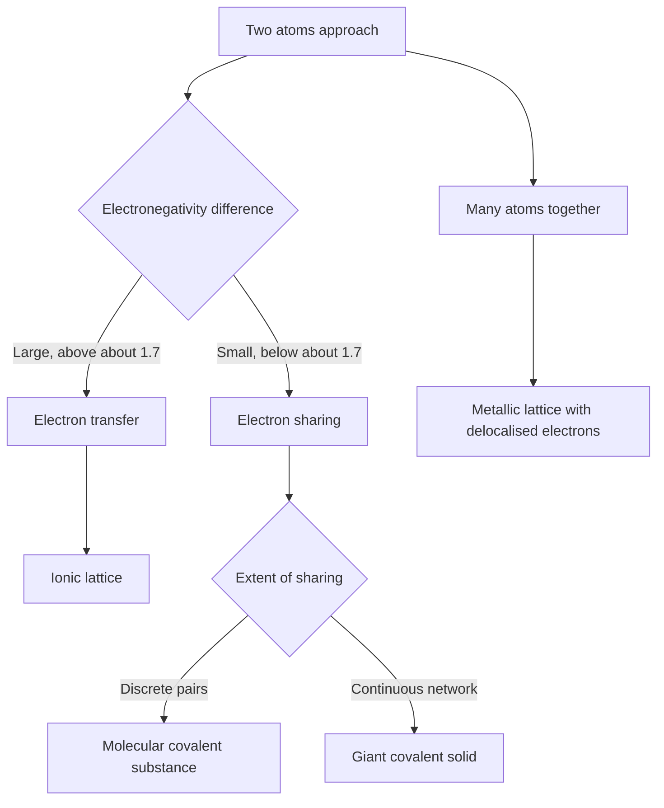
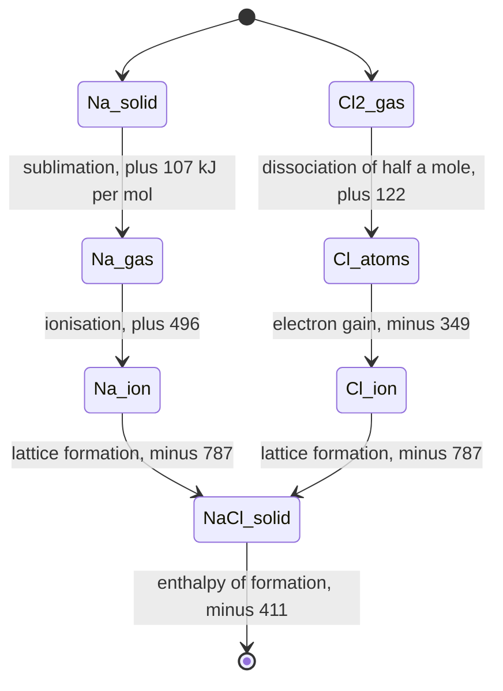
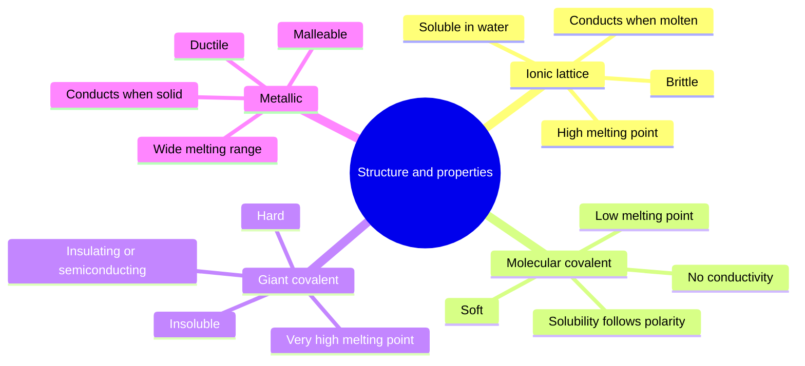

# Chapter 5 — Chemical Bonding: Ionic, Covalent and Metallic

> **Level:** Beginner (Level 1 — Elementary Chemistry)
> **Estimated study time:** 7 hours (reading) + 3 hours (exercises)
> **Prerequisites:** [Electron Shells, Orbitals and Configurations](03-electron-shells-and-electron-configurations.md), [Periodic Table Organization and Periodic Trends](04-periodic-table-organization-and-periodic-trends.md)
> **Related chapters:** [Atomic Structure](01-atomic-structure.md), [Isotopes and Atomic Mass](02-isotopes-and-atomic-mass.md)
> **Difficulty:** ★★★☆☆ (3/5)

---

## 1. Learning Objectives

After working through this chapter you will be able to:

- Explain why atoms bond, using the potential-energy curve and the position of its
  minimum.
- State the octet rule and identify at least four classes of exception to it.
- Use electronegativity differences to place a bond on the ionic–covalent continuum,
  and state the limitations of that classification.
- Describe ionic bonding as electron transfer plus lattice formation, and account for
  the melting point, conductivity, solubility and brittleness of ionic solids.
- Draw dot-and-cross diagrams for $\ce{NaCl}$, $\ce{MgO}$, $\ce{CaCl2}$,
  $\ce{H2}$, $\ce{Cl2}$, $\ce{H2O}$, $\ce{CH4}$, $\ce{NH3}$ and $\ce{CO2}$.
- Explain dative (coordinate) bonding using $\ce{NH4+}$ and $\ce{H3O+}$.
- Describe metallic bonding with the sea-of-electrons model and state what the model
  cannot explain.
- Relate the structures of diamond, graphite, graphene and silica to their properties.
- Compare the three bonding models in one table and predict properties from structure.

---

## 2. Introduction

No isolated atom is the lowest-energy arrangement of its electrons. Sodium metal reacts
with chlorine gas because the product, sodium chloride, sits about 411 kJ mol⁻¹ lower in
energy per mole of formula units, and the tendency of systems to minimise free energy
does the rest. Bonding is therefore not a mysterious attraction between atoms but an
energy minimisation: matter rearranges its electrons until the total energy cannot fall
further at the temperature concerned.

Three limiting descriptions cover almost everything in elementary chemistry. In
**ionic bonding** electrons are transferred, and the resulting ions are held together by
electrostatic attraction. In **covalent bonding** electrons are shared between nuclei.
In **metallic bonding** electrons are shared collectively by a lattice of cations. Real
substances sit on a continuum between these extremes, and the boundaries are matters of
degree rather than kind.

This chapter supplies the vocabulary that the rest of chemistry uses. Chapter
[6](06-lewis-structures-and-chemical-formulas.md) develops Lewis structures and molecular
shapes; Chapter [7](07-chemical-nomenclature.md) uses bonding to explain naming; Chapter
[8](08-chemical-reactions-and-balancing-equations.md) uses it to explain reaction types.
Materials science, biochemistry and catalysis all begin with the questions asked here:
which atoms share electrons, how strongly, and in what geometry.

Prerequisites: electron configuration (Chapter
[3](03-electron-shells-and-electron-configurations.md)) and periodic trends, especially
electronegativity and ionisation energy (Chapter
[4](04-periodic-table-organization-and-periodic-trends.md)).

---

## 3. Fundamental Concepts

### 3.1 Why atoms bond

Bring two hydrogen atoms together and the total energy changes with separation. At long
range the interaction is weakly attractive; as the atoms approach, the energy falls,
because each nucleus attracts the other's electron density. At very short range it rises
steeply, because nucleus–nucleus and electron–electron repulsion dominate. Between the
two lies a **minimum**: the separation there is the **bond length**, and the depth of the
well is the **bond enthalpy**.

$$
E(r) \approx -\frac{A}{r^{6}} + \frac{B}{r^{12}}
$$

The Lennard-Jones form is a model for van der Waals complexes rather than for covalent
bonds, but it captures the essential shape: every stabilising interaction has a repulsive
core, and a bond is the compromise between them. For $\ce{H2}$ the minimum lies at 74 pm
and 436 kJ mol⁻¹ below the separated atoms.

### 3.2 The octet rule and its limits

The **octet rule** states that atoms tend to gain, lose or share electrons until
surrounded by eight valence electrons, corresponding to the noble-gas configuration
$ns^{2}np^{6}$. It rationalises a great deal: $\ce{NaCl}$, $\ce{H2O}$, $\ce{CH4}$ and
$\ce{N2}$ all obey it.

It is a **heuristic, not a law**, and the exceptions matter:

| Species | Valence electrons on the central atom | Why it is an exception |
|---|---|---|
| $\ce{BF3}$ | 6 | Electron-deficient; boron has only three valence orbitals |
| $\ce{PCl5}$ | 10 | More bonds than a strict octet allows |
| $\ce{SF6}$ | 12 | Six bonding pairs around sulfur |
| $\ce{NO}$ | 11, odd | Odd-electron molecule; pairing cannot be complete |
| $\ce{H2}$ | 4 | Duet rule: hydrogen is complete with two electrons |

"Expanded octets" deserve an honest caveat. For third-period elements the extra bonds are
increasingly described as polar and partly ionic rather than as true promotion into d
orbitals, because the 3d orbitals lie too high in energy to contribute much. Treat
"expansion" as a bookkeeping device for counting electron pairs, not as a claim about
d-orbital involvement.

### 3.3 Electronegativity difference and the bonding continuum

**Electronegativity** $\chi$ measures how strongly an atom attracts shared electrons
(Chapter [4](04-periodic-table-organization-and-periodic-trends.md)). The difference
between two bonded atoms predicts where the bond lies on the continuum:

| $\Delta\chi$ | Character | Example |
|---|---|---|
| 0 | Nonpolar covalent | $\ce{Cl2}$ (3.16 for both atoms) |
| 0.0–0.4 | Essentially nonpolar | $\ce{C-H}$ (2.55 − 2.20 = 0.35) |
| 0.4–1.7 | Polar covalent | $\ce{H-Cl}$ (3.16 − 2.20 = 0.96) |
| > 1.7 | Largely ionic | $\ce{NaCl}$ (3.16 − 0.93 = 2.23) |

The thresholds are conventions, not discontinuities. Hydrogen fluoride has
$\Delta\chi = 1.78$, yet it is a molecular gas at room temperature: it forms hydrogen
bonds rather than an ionic lattice. The classification predicts bonding *character*, and
whether a substance is actually ionic depends on the lattice energy it can achieve, which
in turn depends on charge and size.

### 3.4 The three models at a glance

| Feature | Ionic | Covalent, molecular | Metallic |
|---|---|---|---|
| Electron arrangement | Transferred | Shared in pairs | Delocalised over the lattice |
| Particles in the solid | Cations and anions | Discrete molecules | Cations in an electron sea |
| Melting point | High | Low to moderate | Wide range |
| Electrical conductivity | Only molten or dissolved | None when pure | Good, in the solid |
| Solubility | Usually in polar solvents | According to polarity | Generally insoluble |
| Mechanical behaviour | Hard and brittle | Soft, often waxy | Malleable and ductile |

---

## 4. Detailed Scientific Explanation

### 4.1 Ionic bonding

Ionic bonding occurs when the electronegativity difference is large enough that
transferring an electron is energetically favourable. Sodium's first ionisation energy is
$+496$ kJ mol⁻¹ and chlorine's electron affinity is $-349$ kJ mol⁻¹, so the transfer alone
costs $+147$ kJ mol⁻¹ — which is why isolated ion pairs are not stable. The **lattice
enthalpy**, the energy released when gaseous ions assemble into a crystal, more than
compensates: for $\ce{NaCl}$ it is about $-787$ kJ mol⁻¹.

**Lattice enthalpy** is the enthalpy change when one mole of a solid ionic compound forms
from its gaseous ions:

$$
\ce{Na+(g) + Cl-(g) -> NaCl(s)} \qquad \Delta H_{\text{latt}} = -787\ \text{kJ mol}^{-1}
$$

Its magnitude grows with the product of the ionic charges and falls with the sum of the
ionic radii, as Coulomb's law requires. That single relation explains a great deal:

- $\ce{MgO}$ ($2+$ and $2-$, small ions) has $\Delta H_{\text{latt}} \approx -3795$
  kJ mol⁻¹ and melts at 2852 °C.
- $\ce{NaCl}$ ($1+$ and $1-$) has $-787$ kJ mol⁻¹ and melts at 801 °C.

**Born–Haber cycles** apply Hess's law to the formation of an ionic solid. For
$\ce{NaCl}$ the five steps are: sublimation of sodium ($+107$), ionisation of sodium
($+496$), dissociation of half a mole of chlorine molecules ($+122$), electron capture by
chlorine ($-349$) and lattice formation ($-787$). Summing:

$$
\Delta H_f^\circ = 107 + 496 + 122 - 349 - 787 = -411\ \text{kJ mol}^{-1}
$$

which matches the measured enthalpy of formation. The cycle is the standard route to
lattice enthalpies, which cannot be measured directly.

**Properties of ionic solids.** Each ion is surrounded by ions of opposite charge in a
regular lattice (six-coordinate in $\ce{NaCl}$), and there are no free electrons. Hence:

- **High melting points**, because many strong electrostatic interactions must be broken.
- **Poor conductivity as solids but good when molten or dissolved**, because the ions
  become mobile.
- **Brittleness**: a shear brings like charges adjacent, and the resulting repulsion
  splits the crystal.
- **Solubility in polar solvents** such as water, where ion–dipole interactions replace
  part of the lattice energy.

### 4.2 Covalent bonding

A **covalent bond** is a pair of electrons shared between two nuclei. The shared pair
occupies a molecular orbital spanning both atoms, and the electron density between the
nuclei screens them from each other and lowers the energy.

**Bond order** is the number of shared pairs — single, double or triple. As bond order
rises, bond length falls and bond enthalpy rises:

| Bond | Order | Length / pm | Enthalpy / kJ mol⁻¹ |
|---|---|---|---|
| $\ce{C-C}$ | 1 | 154 | 348 |
| $\ce{C=C}$ | 2 | 134 | 614 |
| $\ce{C#C}$ | 3 | 120 | 839 |
| $\ce{N#N}$ | 3 | 110 | 945 |
| $\ce{H-H}$ | 1 | 74 | 436 |

The trend is not linear: the second and third shared pairs add less stabilisation than
the first, which is why bond enthalpies cluster rather than scale with order.

**Dot-and-cross diagrams** use dots for electrons from one atom and crosses for electrons
from the other, so that the origin of every shared pair stays visible.

```text
Convention: dot = electron supplied by the first atom
            cross = electron supplied by the second atom

NaCl, electron transfer

   Na .            :Cl:          Na+        [:Cl:]-
   2,8,1           2,8,7         2,8         2,8,8
   the single 3s electron of sodium becomes the eighth 3p electron of chlorine

H2, one shared pair

   H .   x H        ->        H : H          written  H-H

Cl2, one shared pair and three lone pairs on each atom

   :Cl. x .Cl:      ->        :Cl : Cl:      written  Cl-Cl
```

The remaining diagrams are summarised below; each shared pair becomes a dash.

| Molecule | Shared pairs | Lone pairs | Structural formula |
|---|---|---|---|
| $\ce{H2}$ | 1 | 0 | $\ce{H-H}$ |
| $\ce{Cl2}$ | 1 | 3 per Cl | $\ce{Cl-Cl}$ |
| $\ce{H2O}$ | 2 | 2 on O | bent $\ce{H-O-H}$ |
| $\ce{CH4}$ | 4 | 0 | tetrahedral $\ce{CH4}$ |
| $\ce{NH3}$ | 3 | 1 on N | pyramidal $\ce{NH3}$ |
| $\ce{CO2}$ | 4 in two double bonds | 2 per O | linear $\ce{O=C=O}$ |

For the ionic cases, $\ce{MgO}$ requires the transfer of two electrons from magnesium to
oxygen, giving $\ce{Mg^{2+}}$ and $\ce{O^{2-}}$, both isoelectronic with neon; $\ce{CaCl2}$
requires one electron from calcium to each of two chlorine atoms.

**Giant covalent structures** extend covalent bonding through a whole crystal:

- **Diamond**: each carbon is tetrahedral and bonded to four others in a rigid
  three-dimensional network. Every bond must be broken to melt it, hence 3550 °C, extreme
  hardness and no conductivity, since all electrons are localised in σ bonds.
- **Graphite**: each carbon is bonded to three others in a sheet, with the fourth electron
  delocalised in a π system. Sheets lie 335 pm apart and are held only by dispersion
  forces, so graphite is soft and lubricating; the delocalised electrons make it a
  conductor along the sheets but not across them.
- **Graphene**: a single graphite sheet — the strongest material measured per unit mass,
  transparent and an excellent conductor, properties that follow from its two-dimensional
  π system.
- **Silica** ($\ce{SiO2}$): a three-dimensional network of $\ce{SiO4}$ tetrahedra sharing
  corners. Strong Si–O bonds give a melting point of 1710 °C, hardness and insulation, and
  it is the structural basis of quartz, glass and most rocks.

### 4.3 Dative (coordinate) bonds

In a **dative bond**, also called a coordinate bond, both electrons of the shared pair
come from the same atom. Once formed it is indistinguishable from an ordinary covalent
bond: the label records only where the electrons came from.

$$
\ce{NH3(g) + H+(g) -> NH4+(g)}
$$

$$
\ce{H2O(l) + H+(aq) -> H3O+(aq)}
$$

$$
\ce{BF3(g) + NH3(g) -> H3N-BF3(s)}
$$

In the ammonium ion nitrogen contributes the lone pair that binds the proton, and the four
N–H bonds are then identical with angles of 109.5°. In the hydronium ion oxygen's lone
pair binds the proton, giving a pyramidal ion with an angle near 107°. The boron
trifluoride–ammonia adduct shows the same idea between two neutral molecules: boron is
electron-deficient with six valence electrons, and nitrogen has a lone pair to donate.

### 4.4 Polar covalent bonds and dipoles

When bonded atoms differ in electronegativity, the shared pair is displaced towards the
more electronegative atom, creating a **bond dipole** with partial charges:

$$
\ce{H^{\delta+}-Cl^{\delta-}}
$$

The strength of a dipole is its **dipole moment** $\mu = qd$, measured in debye (D) or
coulomb metres. Molecular polarity depends on both the bond dipoles and the geometry:

- $\ce{CO2}$ has two polar C=O bonds pointing in opposite directions, so the vectors
  cancel and $\mu = 0$.
- $\ce{H2O}$ has two polar O–H bonds at about 104.5°, so the vectors add and
  $\mu = 1.85$ D.
- $\ce{CCl4}$ has four polar C–Cl bonds arranged tetrahedrally; they cancel, so the
  molecule is nonpolar.

This distinction — polar bonds but a nonpolar molecule — is the most commonly mistaken
point in elementary bonding, and it is a matter of vector addition rather than of
electronegativity.

### 4.5 Metallic bonding

In a metal the valence electrons are not localised to individual bonds. The
**sea-of-electrons model**, also called the free-electron or electron-gas model, describes
the solid as a lattice of cations immersed in a delocalised electron gas; attraction
between the cations and the gas holds the structure together.

The model explains the characteristic properties economically:

- **Electrical conductivity**: electrons move freely under an applied field.
- **Thermal conductivity**: free electrons carry kinetic energy rapidly through the
  lattice.
- **Malleability and ductility**: layers of cations slide past one another without
  breaking directional bonds, because metallic bonding is non-directional.
- **Lustre**: free electrons absorb and re-emit light across the visible range.
- **Range of melting points**: from mercury at −39 °C to tungsten at 3422 °C, depending on
  how many electrons are delocalised and how closely the cations pack.

Its limitations must be stated as clearly as its successes:

- It implies that every solid with delocalised electrons behaves alike, so it cannot
  explain why magnesium conducts while silicon, with four valence electrons, is a
  semiconductor. **Band theory** is needed: filled and empty bands separated by a gap give
  an insulator or semiconductor, while overlapping bands give a metal.
- It does not explain why copper and gold are coloured; that requires band structure and,
  for gold, relativistic effects.
- It gives no quantitative account of melting points or of magnetism.
- It treats the electron gas as non-interacting, which fails for transition metals where
  d-electron correlation matters.

### 4.6 How structure determines properties

The same composition can give wildly different properties depending on structure. Carbon
is the canonical demonstration: diamond, graphite, graphene, fullerenes and amorphous
carbon are all pure carbon, ranging from the hardest known insulator to a soft lubricant
to a transparent conductor.

| Substance | Structure | Melting point / °C | Conductivity | Hardness |
|---|---|---|---|---|
| $\ce{NaCl}$ | Ionic lattice | 801 | Molten or dissolved only | Brittle |
| $\ce{MgO}$ | Ionic lattice | 2852 | Molten only | Brittle, very hard |
| Diamond | Giant covalent, 3D | ~3550 | None | Hardest, 10 |
| Graphite | Giant covalent, layered | sublimes ~3650 | Good in-plane | Soft, 1–2 |
| $\ce{SiO2}$ | Giant covalent, 3D | 1710 | None | Hard |
| Iron | Metallic | 1538 | Good | Malleable |

---

## 5. Visual Diagrams



**Figure 5.1 — A decision map for the three bonding models.** The diagram shows the
classification as a series of questions rather than as three separate boxes. The first
branch is quantitative (electronegativity difference), the second is structural (discrete
molecules versus networks), and the metallic branch bypasses both because it involves
many atoms rather than a pair. Real substances can sit on more than one branch at once,
which is why the thresholds are drawn with the word "about".



**Figure 5.2 — The Born–Haber cycle for sodium chloride.** The cycle is Hess's law
applied to ionic solids: the enthalpy of formation is the same whichever route is taken.
The two branches build the gaseous ions separately — one by sublimation and ionisation,
the other by bond dissociation and electron capture — before lattice formation brings them
together. Because the lattice step is the only one that cannot be measured directly, the
cycle is the standard way of obtaining it: subtract the measurable steps from the measured
enthalpy of formation.



**Figure 5.3 — Structure determines properties.** Each branch records what follows from
how the particles are held together. None of these properties belongs to an *element*;
each belongs to an *arrangement*. Carbon appears in several branches depending on
allotrope, and the change of branch changes every entry in the list.

---

## 6. Mathematical Formulas

### 6.1 Lattice enthalpy and Coulomb attraction

$$
E_{\text{latt}} \propto -\frac{z_+ z_-}{r_+ + r_-},
\qquad
E_{\text{latt}} \approx -\frac{N_A M z_+ z_- e^{2}}{4\pi\varepsilon_0 r_0}
\left(1 - \frac{1}{n}\right)
$$

| Symbol | Meaning | SI unit |
|---|---|---|
| $E_{\text{latt}}$ | Lattice enthalpy | kJ mol⁻¹ |
| $z_+, z_-$ | Ionic charges | dimensionless |
| $r_+, r_-$ | Ionic radii | m |
| $r_0$ | Interionic distance | m |
| $M$ | Madelung constant | dimensionless |
| $n$ | Born exponent, typically 5–12 | dimensionless |

The first expression is the proportionality that predicts trends; the second is the
Born–Landé equation, which gives absolute values. Because charge appears as a product,
doubling both charges quadruples the lattice enthalpy — the reason $\ce{MgO}$ is so much
more refractory than $\ce{NaCl}$.

### 6.2 Dipole moment

$$
\mu = q\,d
$$

| Symbol | Meaning | SI unit |
|---|---|---|
| $\mu$ | Dipole moment | C m (1 D = $3.336\times10^{-30}$ C m) |
| $q$ | Magnitude of the separated charge | C |
| $d$ | Separation of the charges | m |

For a molecule, the total dipole moment is the vector sum of the bond dipoles. Symmetry
can make the sum zero even when every bond is strongly polar.

## 7. Chemical Equations

Formation of ionic solids from their elements:

$$
\ce{2Na(s) + Cl2(g) -> 2NaCl(s)} \qquad \Delta H_f^\circ = -822\ \text{kJ mol}^{-1}
$$

$$
\ce{Mg(s) + \tfrac{1}{2}O2(g) -> MgO(s)} \qquad \Delta H_f^\circ = -602\ \text{kJ mol}^{-1}
$$

$$
\ce{Ca(s) + Cl2(g) -> CaCl2(s)} \qquad \Delta H_f^\circ = -796\ \text{kJ mol}^{-1}
$$

Formation of covalent compounds:

$$
\ce{1/2H2(g) + 1/2Cl2(g) -> HCl(g)} \qquad \Delta H_f^\circ = -92\ \text{kJ mol}^{-1}
$$

$$
\ce{1/2N2(g) + 3/2H2(g) -> NH3(g)} \qquad \Delta H_f^\circ = -46\ \text{kJ mol}^{-1}
$$

Dative bond formation:

$$
\ce{NH3(g) + H+(g) -> NH4+(g)}
$$

$$
\ce{H2O(l) + H+(aq) -> H3O+(aq)}
$$

Both values are quoted per mole of product, hence the fractional coefficients. Always
check whether a formation enthalpy refers to one mole of product or to the reaction as
written.

---

## 8. Worked Examples

### Worked Example 8.1 — Lattice enthalpy from a Born–Haber cycle

**Problem.** The standard enthalpy of formation of $\ce{NaCl}$ is
$-411$ kJ mol⁻¹. Given the enthalpy of sublimation of sodium ($+107$), the first
ionisation energy of sodium ($+496$), the dissociation enthalpy of chlorine
($+122$ for half a mole of $\ce{Cl2}$) and the electron affinity of chlorine ($-349$),
calculate the lattice enthalpy.

**Strategy.** Apply Hess's law in the form
$\Delta H_f = \Delta H_{\text{sub}} + \text{IE} + \tfrac{1}{2}D + \text{EA} +
\Delta H_{\text{latt}}$ and solve for the lattice term.

**Solution.**

$$
-411 = 107 + 496 + 122 - 349 + \Delta H_{\text{latt}}
$$

$$
\Delta H_{\text{latt}} = -411 - 376 = -787\ \text{kJ mol}^{-1}
$$

**Check.** The lattice enthalpy is large and negative, as it must be for a stable ionic
solid, and its magnitude exceeds the sum of the endothermic steps — otherwise $\ce{NaCl}$
would not form. The accepted value is about $-787$ kJ mol⁻¹, so the cycle closes.

### Worked Example 8.2 — Classifying bonds from electronegativity

**Problem.** Classify the bonding in $\ce{NaCl}$, $\ce{MgO}$, $\ce{HCl}$, $\ce{CH4}$ and
$\ce{Cl2}$ using Pauling electronegativities, and comment on each answer.

**Strategy.** Compute $\Delta\chi$ from the values in Chapter
[4](04-periodic-table-organization-and-periodic-trends.md) and compare with the thresholds
0.4 and 1.7.

**Solution.**

| Compound | $\Delta\chi$ | Classification | Comment |
|---|---|---|---|
| $\ce{NaCl}$ | $3.16 - 0.93 = 2.23$ | Ionic | Lattice solid, high melting point |
| $\ce{MgO}$ | $3.44 - 1.31 = 2.13$ | Ionic | Doubly charged ions, very high melting point |
| $\ce{HCl}$ | $3.16 - 2.20 = 0.96$ | Polar covalent | Molecular gas, polar bonds |
| $\ce{CH4}$ | $2.55 - 2.20 = 0.35$ | Essentially nonpolar | Symmetric, no net dipole |
| $\ce{Cl2}$ | $3.16 - 3.16 = 0$ | Nonpolar covalent | Identical atoms |

**Check.** The two ionic assignments are consistent with the physical properties: both are
lattice solids with melting points above 800 °C. $\ce{HCl}$ is a gas, which no ionic
substance would be at room temperature, confirming that a $\Delta\chi$ of 0.96 belongs on
the covalent side despite the large difference.

### Worked Example 8.3 — Mean C–H bond enthalpy from formation data

**Problem.** Given $\Delta H_f^\circ(\ce{CH4}) = -75$ kJ mol⁻¹, the enthalpy of
atomisation of carbon $+715$ kJ mol⁻¹ and $D(\ce{H2}) = +436$ kJ mol⁻¹, calculate the
mean C–H bond enthalpy in methane.

**Strategy.** Construct the cycle from $\ce{CH4}$ back to atoms: reverse the formation,
then atomise carbon and dissociate two moles of hydrogen.

**Solution.**

$$
\ce{CH4(g) -> C(s) + 2H2(g)} \qquad +75
$$

$$
\ce{C(s) -> C(g)} \qquad +715
$$

$$
\ce{2H2(g) -> 4H(g)} \qquad 2 \times 436 = +872
$$

Total to gaseous atoms: $75 + 715 + 872 = 1662$ kJ mol⁻¹. Four C–H bonds share this:

$$
E(\ce{C-H}) = \frac{1662}{4} = 415.5\ \text{kJ mol}^{-1} \approx 416\ \text{kJ mol}^{-1}
$$

**Check.** The tabulated mean C–H bond enthalpy is about 415 kJ mol⁻¹, so the result is
right to within rounding. Sanity check the magnitude: C–H bonds are strong but not
exceptional, lying between H–H (436) and C–C (348), which is consistent with carbon's
position in the periodic table.

### Worked Example 8.4 — Why magnesium oxide is refractory

**Problem.** Estimate the ratio of the lattice enthalpies of $\ce{MgO}$ and $\ce{NaCl}$
from the Coulomb proportionality, using ionic radii of 72 pm and 140 pm for
$\ce{Mg^{2+}}$ and $\ce{O^{2-}}$, and 102 pm and 181 pm for $\ce{Na+}$ and $\ce{Cl^-}$.
Compare with the measured values of 3795 and 787 kJ mol⁻¹.

**Strategy.** Use $E_{\text{latt}} \propto z_+z_-/(r_+ + r_-)$, so the ratio is
$(z_+z_-)_{\ce{MgO}}/(z_+z_-)_{\ce{NaCl}}$ multiplied by the inverse ratio of distances.

**Solution.**

$$
\frac{E(\ce{MgO})}{E(\ce{NaCl})} =
\frac{4/(72 + 140)}{1/(102 + 181)} = \frac{4}{212} \times 283 = 5.34
$$

Measured ratio: $3795/787 = 4.82$.

**Check.** The estimate is within about 10 % of the measured ratio, which is remarkable
for a two-term model; the residual difference comes from the Madelung constants and Born
exponents, which differ between the rock-salt and rock-salt-type structures. The
conclusion is robust: doubling both charges multiplies the lattice enthalpy by roughly
four, and the smaller ions add a further factor, so $\ce{MgO}$ melts some 2000 °C higher
than $\ce{NaCl}$.

---

## 9. Real-World Applications

**Construction and ceramics.** Portland cement, concrete, glass and ceramic tiles are
ionic and network-covalent materials chosen for the very properties that make them
awkward: high melting points, hardness and brittleness. Understanding lattice enthalpy
explains why adding a smaller ion (as in aluminous cements) raises strength and why
thermal shock cracks ceramics — the lattice expands unevenly.

**Metals in engineering.** The non-directional nature of metallic bonding is why copper
can be drawn into wire and steel can be rolled, forged and welded. Alloy design,
work-hardening and the difference between cast iron and spring steel are all arguments
about how easily planes of cations slide past one another.

**Carbon materials.** Diamond abrasives, graphite electrodes and lubricants, carbon fibre
composites and graphene electronics exploit different arrangements of identical atoms.
The contrast between a transparent insulator and an opaque conductor made of the same
element is the clearest practical demonstration that structure, not composition, sets
properties.

---

## 10. Common Mistakes

| Mistake | Why it happens | Correct approach |
|---|---|---|
| Saying ionic compounds conduct when solid | "Ions carry current" is remembered without the rest | Ions are fixed in the lattice; conduction requires melting or dissolution |
| Treating $\ce{CO2}$ as a polar molecule | Both bonds are polar, so polarity is assumed | The linear geometry cancels the bond dipoles; $\mu = 0$ |
| Thinking a dative bond is a different kind of bond | It has a separate name | It is an ordinary covalent bond whose electron pair came from one atom |
| Assuming all covalent substances are molecular | Diamond and silica are counterexamples | Covalent bonding can produce giant networks with very high melting points |
| Explaining metal conductivity by "free electrons" alone | The sea model is taught first | Band theory is needed to explain why silicon is a semiconductor |
| Claiming the octet rule is obeyed universally | It works for most organic molecules | $\ce{BF3}$, $\ce{PCl5}$, $\ce{SF6}$ and $\ce{NO}$ are standard exceptions |

---

## 11. Chapter Summary

- Atoms bond because the total energy has a minimum at a finite separation; the depth of
  that minimum is the bond enthalpy and its position is the bond length.
- The octet rule rationalises most main-group bonding but is a heuristic, with
  electron-deficient, odd-electron and expanded-octet exceptions.
- Electronegativity difference places a bond on a continuum: nonpolar covalent (0–0.4),
  polar covalent (0.4–1.7) and largely ionic (above 1.7).
- Ionic bonding is electron transfer plus lattice formation; lattice enthalpy scales with
  $z_+z_-/(r_+ + r_-)$ and is obtained from Born–Haber cycles.
- Covalent bonds share electron pairs; bond order controls length and strength, dative
  bonds are ordinary covalent bonds with one donor, and molecular polarity is the vector
  sum of bond dipoles — so symmetric molecules with polar bonds can be nonpolar.
- Metallic bonding is non-directional and delocalised, which explains conductivity,
  malleability and lustre, but not semiconductor behaviour.
- Giant covalent structures (diamond, graphite, graphene, silica) show that structure,
  not composition, determines melting point, hardness and conductivity.

---

## 12. Exercises

### 12.1 Conceptual questions

1. Explain why the potential energy of two atoms has a minimum rather than falling
   continuously as they approach.
2. Why is the octet rule described as a heuristic rather than a law?
3. Explain why ionic solids are brittle but metals are malleable.

### 12.2 Basic problems

4. Classify the bonding in $\ce{KF}$, $\ce{Br2}$, $\ce{SO2}$ and $\ce{Fe}$.
5. State the number of shared and lone pairs in $\ce{H2O}$, $\ce{NH3}$ and $\ce{CO2}$.
6. Write the equation for the formation of the ammonium ion and identify the dative bond.

### 12.3 Intermediate problems

7. Explain why $\ce{MgO}$ has a much higher melting point than $\ce{NaCl}$.
8. $\ce{BF3}$ is a gas while $\ce{AlF3}$ is a solid with a high melting point. Suggest
   an explanation.
9. Explain why graphite conducts electricity while diamond does not, although both are
   pure carbon.

### 12.4 Advanced problems

10. Use a Born–Haber cycle to explain why $\ce{CaCl2}$ forms rather than $\ce{CaCl}$,
    given that the second ionisation energy of calcium is large and positive.
11. Diamond is an insulator but a good conductor of heat. Explain both facts in terms of
    its structure.

### 12.5 Calculation problems

12. Given $\Delta H_f^\circ(\ce{H2O(g)}) = -242$ kJ mol⁻¹, $D(\ce{H2}) = 436$ and
    $D(\ce{O2}) = 498$ kJ mol⁻¹, calculate the mean O–H bond enthalpy in water.

### Answers

1. At short range nucleus–nucleus and electron–electron repulsion rise steeply and
   outweigh attraction, producing a minimum.
2. It has many exceptions — electron-deficient, odd-electron and hypervalent species.
3. Shear in an ionic lattice brings like charges together and the crystal splits; in a
   metal the delocalised bonding is non-directional, so planes slide.
4. $\ce{KF}$ ionic; $\ce{Br2}$ nonpolar covalent; $\ce{SO2}$ polar covalent; $\ce{Fe}$
   metallic.
5. $\ce{H2O}$: 2 shared, 2 lone on O. $\ce{NH3}$: 3 shared, 1 lone on N. $\ce{CO2}$:
   4 shared in two double bonds, 2 lone on each O.
6. $\ce{NH3 + H+ -> NH4+}$; nitrogen donates its lone pair.
7. Doubly charged, smaller ions give a lattice enthalpy of about −3795 against
   −787 kJ mol⁻¹.
8. Boron is small and forms discrete trigonal molecules; aluminium is larger and prefers
   a six-coordinate ionic-type lattice.
9. Graphite has delocalised π electrons within each sheet; diamond's electrons are all
   localised in σ bonds.
10. The lattice enthalpy gain from a $2+$ ion outweighs the second ionisation energy;
    $\ce{CaCl}$ would leave a low charge density and a much smaller lattice enthalpy.
11. No free electrons, so no electrical conduction; the rigid lattice transmits lattice
    vibrations efficiently, so heat conducts well.
12. $\ce{H2O}$ has two O–H bonds: $242 + 436 + 249 = 927$; $E(\ce{O-H}) = 464$
    kJ mol⁻¹.

---

## 13. Further Reading

- OpenStax. *Chemistry 2e*, Chapter 7, "Chemical Bonding and Molecular Geometry".
  <https://openstax.org/details/books/chemistry-2e>
- Housecroft, C. E. and Sharpe, A. G. *Inorganic Chemistry*, 5th ed., Pearson, 2018.
- Atkins, P. and Jones, L. *Chemical Principles: The Quest for Insight*, 7th ed.,
  W. H. Freeman, 2016.
- IUPAC. *Compendium of Chemical Terminology* ("Gold Book"), 2nd ed. (the
  "corrected" version). <https://goldbook.iupac.org/>

See [CURRICULUM.md](../CURRICULUM.md) and [REFERENCES.md](../REFERENCES.md).
