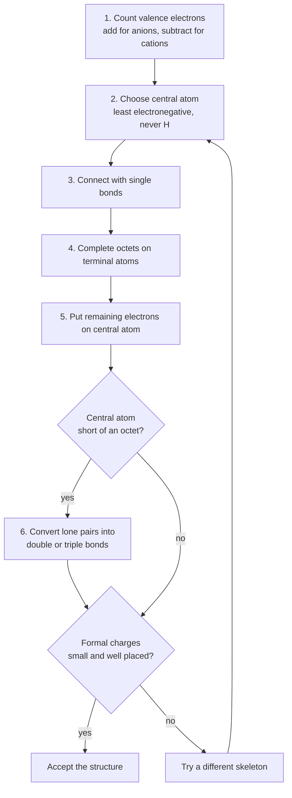
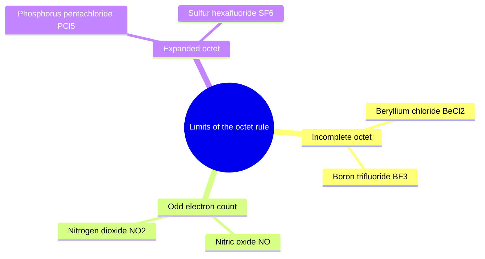
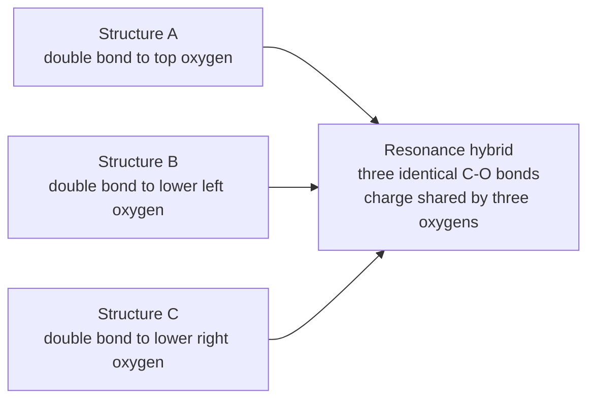
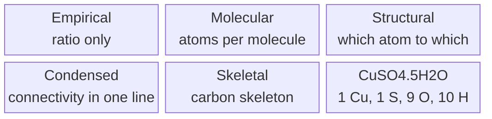

# Chapter 06 — Lewis Structures and Chemical Formulas

> **Level:** Elementary (Level 1)
> **Estimated study time:** 5 hours (reading) + 2 hours (exercises)
> **Prerequisites:** [Chapter 5 — Chemical Bonding: Ionic, Covalent and Metallic](05-chemical-bonding.md); [Level 0, Chapter 8 — Chemical Symbols and Formulas](../01-foundations/08-chemical-symbols-and-formulas.md)
> **Related chapters:** [Chapter 7 — Chemical Nomenclature](07-chemical-nomenclature.md) · [Chapter 8 — Chemical Reactions, Balancing and Conservation of Mass](08-chemical-reactions-and-balancing-equations.md) · [Level 2 index](../03-intermediate-chemistry/README.md)
> **Difficulty:** ★★★☆☆

---

## 1. Learning Objectives

After working through this chapter you will be able to:

- Write the Lewis dot symbol of any main-group element from its group number.
- State the octet rule and identify the four classes of exception to it.
- Draw a Lewis structure for a small molecule or polyatomic ion using a fixed seven-step procedure.
- Calculate the formal charge on every atom in a Lewis structure and use it to choose between candidate skeletons.
- Explain what a resonance structure is and why the resonance hybrid, not any single structure, describes the real species.
- Distinguish empirical, molecular, structural, condensed and skeletal formulas and convert between them.
- Determine an empirical formula from percentage composition and a molecular formula from an empirical formula plus a molar mass.
- Count the atoms represented by a formula with brackets, subscripts outside brackets and a hydrate dot, and recognize when a formula is ambiguous without structural information.

---

## 2. Introduction

A chemical formula is the most compressed sentence in science. The three characters
$\ce{H2O}$ carry the identity of two elements, the exact ratio in which they combine,
and — once you know how to read them — a picture of two O–H bonds at about $104.5^\circ$.
The purpose of this chapter is to teach you to write that sentence and to unpack it.

The tool that does the unpacking is the **Lewis structure**: a diagram in which valence
electrons are drawn as dots and bonding pairs as lines. Introduced by Gilbert N. Lewis
in 1916, it predates quantum mechanics and survives because it encodes, in a form you
can draw in ten seconds, the two facts that control nearly all of main-group chemistry:
atoms share electrons to fill their valence shell, and the pattern of that sharing
determines reactivity.

Everything later in the curriculum leans on this chapter. Nomenclature (Chapter 7) requires
you to know that $\ce{FeCl3}$ contains $\ce{Fe^3+}$ and not $\ce{Fe^2+}$. Balancing equations
(Chapter 8) requires correct formulas — a wrong subscript cannot be repaired by any
coefficient. Acid–base chemistry (Chapter 9) is, at bottom, the story of a lone pair
accepting a proton. Molecular shape and polarity in Level 2 are read directly off the Lewis
structure you will draw here.

The chapter therefore has two halves. The first is *electronic*: valence electrons, the
octet rule, formal charge and resonance. The second is *notational*: empirical and molecular
formulas, structural and condensed formulas, brackets and hydrates. Fluency in both
directions is the literacy the rest of chemistry assumes.

---

## 3. Fundamental Concepts

### 3.1 Valence electrons and the Lewis dot symbol

The **valence electrons** of an atom are those in its outermost shell — the electrons
with the highest principal quantum number $n$. They are the only electrons that take
part in ordinary bond formation, because core electrons are too tightly bound and too
deeply buried to be shared.

For main-group elements the count follows at once from the periodic table position:
group 1 gives 1 valence electron, group 2 gives 2, and groups 13–18 give the group number
minus 10, so carbon (group 14) has 4, nitrogen (group 15) has 5, oxygen (group 16) has 6
and fluorine (group 17) has 7. Helium is the exception, with only 2. The rule works
because the $s$ and $p$ blocks fill in strict order across a period, so the group number
*is* the valence count. Transition metals are a separate case treated in Level 3.

A **Lewis dot symbol** shows the element symbol surrounded by dots, one per valence
electron, arranged on the four sides of the symbol. Electrons are placed singly on each
side before any side receives a second dot. This convention mirrors Hund's rule: the
first four electrons occupy different sides (different orbitals, in the quantum picture)
before pairing begins.

| Element | Group | Valence electrons | Lewis dot symbol (schematic) |
|---|---|---|---|
| C | 14 | 4 | four single dots, one per side |
| N | 15 | 5 | one paired side, three single dots |
| O | 16 | 6 | two paired sides, two single dots |
| F | 17 | 7 | three paired sides, one single dot |

The dot symbol is not decoration. It predicts the number of bonds an atom normally
forms: carbon, with four unpaired electrons, forms four bonds; nitrogen, with three,
forms three and keeps a lone pair; oxygen forms two and keeps two lone pairs.

### 3.2 The octet rule

The **octet rule** states that atoms tend to gain, lose or share electrons until they
are surrounded by eight valence electrons, corresponding to the $ns^2np^6$ configuration
of the nearest noble gas. Hydrogen and helium obey a **duet rule** instead: their
valence shell is the $n = 1$ shell, which holds only two electrons.

The rule is a rule of thumb, not a law. It works well for carbon, nitrogen, oxygen and
the halogens; it fails systematically for the four families of species examined in §4.2.
Its power is predictive: from the octet rule alone you can deduce that chlorine forms one
bond, oxygen two, nitrogen three and carbon four, which is the skeleton of all organic
chemistry.

### 3.3 Bonding pairs, lone pairs and the structure diagram

In a Lewis structure a **bonding pair** is shared between two atoms and drawn as a line (a
double bond is two lines, a triple bond three); a **lone pair** belongs to a single atom and
is drawn as two dots; a **terminal atom** is bonded to one other atom, a **central atom** to
two or more. Valence electrons are conserved exactly: every electron counted in step 1 must
appear in the final diagram, in a bond or in a lone pair, which is the single most useful
check on a Lewis structure.

### 3.4 A systematic method for drawing Lewis structures

The procedure below works for the great majority of Level 1 species. Later steps may
send you back to earlier ones — that is normal, not failure.

1. **Count the total number of valence electrons.** Add the valence electrons of every
   atom. For a polyatomic anion, add one electron per unit of negative charge; for a
   cation, subtract one per unit of positive charge.
2. **Choose the central atom.** Use the least electronegative atom that is not hydrogen.
   Hydrogen is always terminal because it can form only one bond. In oxoacids the
   hydrogen is attached to oxygen, so the central atom is the element other than H and O.
3. **Connect the atoms with single bonds.** Draw one line from the central atom to each
   terminal atom and subtract two electrons per line from the total.
4. **Complete the octets of the terminal atoms.** Give each terminal atom enough lone
   pairs to reach eight electrons (two for hydrogen), subtracting them from the total.
5. **Place any remaining electrons on the central atom.** A period 2 central atom cannot
   exceed eight; if electrons remain after it is full, the count in step 1 is wrong or a
   multiple bond is required.
6. **Form multiple bonds if the central atom is short of an octet.** Convert one lone
   pair on a neighbouring terminal atom into a second (or third) bond; each conversion
   raises that bond order by one.
7. **Check formal charges.** Compute the formal charge of every atom (§3.5). If the
   charges are large or badly placed, try a different skeleton and repeat.

### 3.5 Formal charge

The **formal charge** $FC$ of an atom in a Lewis structure is the charge it would carry
if all bonding electrons were shared equally between the two bonded atoms:

$$
FC = V - \left( N_{\text{lone}} + \tfrac{1}{2} N_{\text{bond}} \right)
$$

where $V$ is the number of valence electrons in the free atom, $N_{\text{lone}}$ is the
number of non-bonding electrons on that atom, and $N_{\text{bond}}$ is the number of
electrons in bonds to that atom. An equivalent and faster form counts bonds rather than
bonding electrons:

$$
FC = V - N_{\text{lone}} - N_{\text{bonds}}
$$

Formal charge is an accounting device, not a measured charge. It answers the question
"if this atom owned exactly half of every shared pair, what would its charge be?" The
sum of all formal charges must equal the net charge on the species — a check that
catches most errors.

### 3.6 Resonance

Some molecules cannot be described by a single Lewis structure. The carbonate ion
$\ce{CO3^2-}$ has three equivalent C–O bonds in reality, but any one Lewis structure
must show one double bond and two single bonds. The three structures that differ only in
the placement of the double bond are **resonance structures**, and the true species is a
**resonance hybrid** — a weighted average of them, not a rapid oscillation between them.

The double-headed arrow $\leftrightarrow$ is read "resonance with", never "reacts to
give". Resonance structures are not in equilibrium; they are alternative descriptions of
one and the same electron distribution. The hybrid has bond orders intermediate between
single and double, and the extra electron density is **delocalized** over the atoms that
share it.

### 3.7 Empirical, molecular and structural formulas

| Name | What it states | Example |
|---|---|---|
| **Empirical formula** | simplest whole-number ratio of atoms | $\ce{CH2O}$ |
| **Molecular formula** | actual number of atoms in one molecule | $\ce{C6H12O6}$ |
| **Structural formula** | which atom is bonded to which, and by what bond order | $\ce{H-O-C(=O)-OH}$ drawn out |
| **Condensed formula** | atoms grouped to show connectivity in one line | $\ce{CH3CH2OH}$ |
| **Skeletal formula** | carbon skeleton as lines; C and H on carbon omitted | a zig-zag line |

Glucose has all five: empirical $\ce{CH2O}$, molecular $\ce{C6H12O6}$, condensed
$\ce{CH2OH(CHOH)4CHO}$, and a skeletal ring. All five describe the same compound at
different levels of detail.

### 3.8 Brackets and hydrates

A subscript outside a bracket multiplies everything inside it:
$\ce{Ca(OH)2}$ contains one Ca, two O and two H. A dot in a formula indicates a
**hydrate** — water molecules held in the crystal lattice in a fixed stoichiometric
ratio. In $\ce{CuSO4.5H2O}$ the dot is not multiplication; it separates two compounds
that cocrystallize:

$$
\ce{CuSO4.5H2O} \equiv \ce{CuSO4} \cdot 5\,\ce{H2O}
$$

The formula contains 1 Cu, 1 S, 9 O and 10 H: the five water molecules contribute five of
the nine oxygens. The water is called **water of crystallization**; it is released on
heating and the crystal usually changes colour (white anhydrous copper(II) sulfate turns
blue when water is added back).

---

## 4. Detailed Scientific Explanation

### 4.1 Why eight electrons?

The octet corresponds to a filled $ns^2np^6$ subshell. For period 2 elements the $2s$
and $2p$ orbitals together hold eight electrons, and a filled shell is unusually stable:
the next electron would have to enter the higher-energy $3s$ orbital. The octet rule is
therefore a statement about the energetics of the $n = 2$ shell, not a mysterious
preference for the number eight. It is a bookkeeping shortcut for the underlying quantum
mechanics, and it fails whenever the energy gap to the next shell is small (heavy
elements) or whenever completing the octet costs more energy than it returns (boron and
beryllium compounds).

### 4.2 The limits of the octet rule

**Incomplete octets.** Beryllium chloride in the gas phase is a linear molecule
$\ce{Cl-Be-Cl}$ with only four electrons around beryllium. Boron trifluoride
$\ce{BF3}$ is trigonal planar with six electrons around boron. Both are stable, and both
are strong **Lewis acids** — electron-pair acceptors — precisely because they have a
vacant site; the reaction with ammonia that completes boron's octet is given in §7. Note
that solid $\ce{BeCl2}$ is not molecular at all: it forms a polymeric chain with bridging
chlorides, so beryllium reaches four bonds in the solid. The "incomplete octet" is a
property of the gas-phase molecule, not of beryllium in every environment.

**Odd-electron species.** A molecule with an odd total number of valence electrons
cannot pair every electron. Nitric oxide $\ce{NO}$ has $5 + 6 = 11$ valence electrons:
ten form five pairs and one is unpaired. Nitrogen dioxide $\ce{NO2}$ has
$5 + 2 \times 6 = 17$ valence electrons and likewise carries an unpaired electron, which
sits on nitrogen. Both are **radicals** and both are paramagnetic (attracted into a
magnetic field). $\ce{NO2}$ dimerizes reversibly to $\ce{N2O4}$, in which every atom
does obey the octet:

$$
\ce{2NO2(g) <=> N2O4(g)}
$$

**Expanded octets.** Elements of period 3 and below can be surrounded by more than eight
electrons. Phosphorus pentachloride has ten electrons around phosphorus (five bonds) and
sulfur hexafluoride has twelve (six bonds). The traditional explanation invokes vacant
$3d$ orbitals, but modern computational chemistry shows that $d$ participation is small;
the better description is that the larger central atom can accommodate more bonding
pairs, and that the bonding has substantial ionic character. For Level 1 purposes,
"period 3 and below may expand the octet; period 2 may not" is the working rule.

**Electron-deficient clusters.** Diborane $\ce{B2H6}$ has only twelve valence electrons for
eight atoms and is held together by three-centre two-electron bonds; such species lie
outside the Lewis model and are treated by molecular orbital theory in Level 3.

### 4.3 Choosing among candidate structures with formal charge

When more than one skeleton is possible, rank the candidates in this order. First, prefer
the smallest formal charges: a structure with 0 on every atom beats one with $+1$ and $-1$.
Second, if charges cannot be avoided, put the negative formal charge on the more
electronegative atom and the positive charge on the less electronegative one. Third, reject
structures with like charges on adjacent atoms. Fourth, prefer a structure that satisfies
all octets — but never at the cost of large formal charges.

Formal charge is not the same as oxidation state. In $\ce{CH4}$ every atom has formal
charge zero, while carbon has oxidation state $-4$ because all bonding electrons are
assigned to the more electronegative atom. Oxidation states are developed in Level 2.

### 4.4 Resonance and delocalization

Resonance arises whenever a molecule has two or more equivalent places to put a multiple
bond. The carbonate ion is the standard example: three C–O bonds of equal length
($129\ \text{pm}$), intermediate between a C–O single bond ($\approx 143\ \text{pm}$) and a
C=O double bond ($\approx 122\ \text{pm}$).

The same analysis applies to the nitrate ion $\ce{NO3^-}$, ozone $\ce{O3}$, and benzene
$\ce{C6H6}$. Benzene is the most important case in organic chemistry: its two Kekulé
structures differ only in the alternation of double bonds around a six-membered ring. The
hybrid has all six C–C bonds equal at $139\ \text{pm}$, between the single-bond value
($154\ \text{pm}$) and the double-bond value ($134\ \text{pm}$), and it is this
delocalization that makes benzene $150\ \text{kJ mol}^{-1}$ more stable than a
hypothetical cyclohexatriene.

Resonance stabilizes a species. The more equivalent structures a species has, and the
more evenly the charge is spread, the lower its energy. This is why carboxylic acids lose
a proton so readily: the carboxylate anion has two equivalent resonance structures,
whereas the neutral acid does not.

### 4.5 From percentage composition to formula

Combustion analysis gives the mass of each element in a sample. The route to a formula is
always the same: convert masses to moles by dividing by molar mass, divide every mole
value by the smallest one, and if the results are not whole numbers multiply them all by
the smallest integer that clears the fractions (often 2 or 3). The result is the empirical
formula. To obtain the molecular formula, divide the measured molar mass by the empirical
formula mass; the quotient is the multiplier $n$, and a quotient far from an integer means
that the molar mass or the analysis is wrong.

### 4.6 Reading structural and condensed formulas

A **structural formula** shows every bond explicitly and is unambiguous. A **condensed
formula** writes groups in sequence, with the understanding that each carbon is bonded to
enough hydrogens to make four bonds, and that groups written in parentheses hang off the
preceding atom. Thus $\ce{CH3CH2OH}$ is ethanol, while $\ce{CH3OCH3}$ is dimethyl ether:
same molecular formula $\ce{C2H6O}$, different connectivity, different boiling points
($78\ ^\circ\text{C}$ versus $-24\ ^\circ\text{C}$).

A **skeletal formula** omits every carbon and every hydrogen attached to carbon, drawing
only the skeleton as line segments. Each vertex and line end is a carbon carrying enough
hydrogens to reach four bonds. It is the standard notation of organic chemistry (Level 4),
introduced here only so that you can read it.

### 4.7 Counting atoms in complicated formulas

Three conventions do all the work:

- a **subscript** applies to the symbol immediately before it;
- a **bracket** groups atoms, and a subscript after the bracket multiplies the whole
  group;
- a **dot** separates components of a hydrate and does not multiply anything.

| Formula | Cu | S | O | H | N | Other |
|---|---|---|---|---|---|---|
| $\ce{CuSO4}$ | 1 | 1 | 4 | 0 | 0 | — |
| $\ce{CuSO4.5H2O}$ | 1 | 1 | 9 | 10 | 0 | — |
| $\ce{Ca(OH)2}$ | 0 | 0 | 2 | 2 | 0 | Ca 1 |
| $\ce{(NH4)2SO4}$ | 0 | 1 | 4 | 8 | 2 | — |
| $\ce{K3[Fe(CN)6]}$ | 0 | 0 | 0 | 0 | 6 | K 3, Fe 1, C 6 |
| $\ce{MgSO4.7H2O}$ | 0 | 1 | 11 | 14 | 0 | Mg 1 |

The last-but-one entry illustrates square brackets used for a complex ion: everything
inside the bracket is one unit, and the subscript outside applies to the whole unit.

---

## 5. Visual Diagrams

The method of §3.4 is a decision procedure whose loops matter: a central atom short of an
octet sends you to step 6, and poor formal charges send you back to step 2.

**Figure 6.1 — The Lewis structure algorithm.** The two decision points are where
students lose marks: a central atom with fewer than eight electrons is repaired by
converting a terminal lone pair into a multiple bond, while a structure with large or
badly placed formal charges is repaired by changing which atom sits in the centre. The
loop back to step 2 is the reason the method is iterative rather than linear.

The octet rule has a small, well-defined set of failures. Grouping them by cause is more
useful than memorizing a list of formulas, because the group tells you what to expect.

**Figure 6.2 — The four families of exception.** Beryllium and boron compounds stop short of
eight electrons because completing the octet would cost more energy than it returns;
odd-electron species cannot pair every electron; period 3 elements and below can
accommodate more than four bonding pairs; and electron-deficient clusters such as diborane
lie outside the Lewis model entirely.

Resonance is best understood as equivalent drawings converging on one object.

**Figure 6.3 — Resonance in the carbonate ion.** None of the three drawings is the ion; the
hybrid is the real species, and only the hybrid is consistent with the observed symmetry of
the ion in solution and in crystals. A resonance arrow asserts that the drawings differ only
in the placement of electrons, never in the placement of atoms.

The formula types form a ladder of increasing information.

**Figure 6.4 — Reading formulas at increasing levels of detail.** The first two rungs are about
*composition*, the last three about *connectivity*. The hydrate example shows why composition
alone is not enough: the same atoms could be arranged in many ways, and only a structural
formula settles the question.

---

## 6. Mathematical Formulas

Formal charge, empirical-formula conversion and formula mass are the only calculations
this chapter needs.

$$
FC = V - N_{\text{lone}} - N_{\text{bonds}}
$$

$$
n = \frac{M_{\text{molecular}}}{M_{\text{empirical}}}
$$

$$
M(\ce{CuSO4.5H2O}) = M(\ce{Cu}) + M(\ce{S}) + 9M(\ce{O}) + 10M(\ce{H})
$$

| Symbol | Meaning | SI unit |
|---|---|---|
| $FC$ | formal charge on one atom | dimensionless (elementary charge, $e$) |
| $V$ | valence electrons in the free atom | dimensionless |
| $N_{\text{lone}}$ | non-bonding electrons on the atom | dimensionless |
| $N_{\text{bonds}}$ | number of bonds to the atom | dimensionless |
| $n$ | multiplier relating empirical and molecular formulas | dimensionless integer |
| $M_{\text{molecular}}$ | molar mass of the compound | g mol⁻¹ |
| $M_{\text{empirical}}$ | molar mass of the empirical formula unit | g mol⁻¹ |
| $M$ | molar mass of a formula unit | g mol⁻¹ |

**Assumptions and range of validity.** The formal-charge formula assumes a purely covalent,
equally shared bond and becomes misleading for bonds of very different electronegativity,
which is why oxidation states exist as a separate scheme. The empirical-formula relation
assumes an analysis accurate to about 1 % and a molar mass accurate to about 5 %; otherwise
rounding to an integer $n$ is unsafe.

---

## 7. Chemical Equations

The reaction that turns a hydrate into its anhydrous salt is how water of
crystallization is measured:

$$
\ce{CuSO4.5H2O(s) ->[\Delta] CuSO4(s) + 5H2O(g)}
$$

The blue pentahydrate loses its five water molecules on gentle heating and becomes the
white anhydrous salt. The mass loss divided by the molar mass of water gives the number of
water molecules per formula unit — a direct experimental route to the dot in the formula.

Boron trifluoride shows the opposite situation, a six-electron centre that completes its
octet by accepting a pair:

$$
\ce{BF3(g) + NH3(g) -> F3B<-NH3(s)}
$$

Nitrogen donates its lone pair into boron's vacant $p$ orbital. The arrow $\ce{<-}$ marks
a **coordinate bond**, in which both electrons come from one atom; once formed it is
indistinguishable from any other single bond.

---

## 8. Worked Examples

### Worked Example 8.1 — Lewis structure of the carbonate ion

**Problem.** Draw the Lewis structure of $\ce{CO3^2-}$, including all resonance forms,
and state the formal charge on each atom.

**Strategy.** Apply the method of §3.4. Carbon is less electronegative than oxygen, so
carbon is central.

**Solution.** *Step 1.* Valence electrons: carbon contributes 4, each oxygen 6, and the
$2-$ charge adds 2, giving $4 + 3(6) + 2 = 24$.

*Step 2.* Central atom: C.

*Step 3.* Three C–O single bonds use $3 \times 2 = 6$ electrons, leaving 18.

*Step 4.* Each terminal oxygen needs three lone pairs to reach eight electrons:
$3 \times 6 = 18$ electrons, leaving zero.

*Step 5.* Nothing remains for the central atom.

*Step 6.* Carbon has only three bonds, that is six electrons. Convert one lone pair on one
oxygen into a second bond. Carbon now has four bonds; the oxygen that donated has two
bonds and two lone pairs; the other two oxygens keep three lone pairs each. All 24
electrons are used.

*Step 7.* Formal charges, using $FC = V - N_{\text{lone}} - N_{\text{bonds}}$: carbon
$4 - 0 - 4 = 0$; double-bonded oxygen $6 - 4 - 2 = 0$; each single-bonded oxygen
$6 - 6 - 1 = -1$. The sum $0 + 0 - 1 - 1 = -2$ matches the charge of the ion.

There are three equivalent structures, differing only in which oxygen carries the double
bond. The hybrid has three equivalent C–O bonds of order $1\tfrac{1}{3}$.

**Check.** Count electrons directly from the drawing: the C=O double bond contributes
4 electrons, the two C–O single bonds contribute 2 each, the double-bonded oxygen has two
lone pairs (4 electrons) and each single-bonded oxygen has three lone pairs (6 each).
The total is $4 + 2 + 2 + 4 + 6 + 6 = 24$, exactly the number counted in step 1. Every
atom also has eight electrons around it, and the formal charges sum to $-2$.

### Worked Example 8.2 — Formal charge decides the skeleton of N₂O

**Problem.** Dinitrogen monoxide has the molecular formula $\ce{N2O}$ and 16 valence
electrons. Two connectivities are conceivable: $\ce{N-N-O}$ and $\ce{N-O-N}$. Use formal
charge to decide which is preferred.

**Strategy.** Draw the best Lewis structure for each skeleton, then compare formal
charges using the criteria of §4.3.

**Solution.**

*Skeleton N–N–O.* With 16 electrons, the octet-complete arrangement is
$\ce{:N#N-O:}$ with a triple bond between the nitrogens, a single bond to oxygen, one
lone pair on the terminal nitrogen and three lone pairs on oxygen. Formal charges:

- terminal N: $5 - 2 - 3 = 0$;
- central N: $5 - 0 - 4 = +1$;
- O: $6 - 6 - 1 = -1$.

*Skeleton N–O–N.* The only octet-complete arrangement is $\ce{N=O=N}$: a double bond on
each side, two lone pairs on each terminal nitrogen and none on oxygen. Formal charges
are $-1$ on each nitrogen and $+2$ on oxygen, summing to zero.

The comparison is decisive. The $\ce{N-N-O}$ skeleton gives charges of $0$, $+1$ and
$-1$, with the negative charge on oxygen, the more electronegative atom. The alternative
places a $+2$ formal charge on oxygen, which is energetically unacceptable.

**Check.** The sum of formal charges in the accepted structure is $0 + 1 - 1 = 0$, matching
the neutral molecule, and all 16 electrons are accounted for: triple bond (6) + single
bond (2) + one lone pair (2) + three lone pairs (6) $= 16$.

### Worked Example 8.3 — Empirical and molecular formula from combustion data

**Problem.** A pure compound contains only carbon, hydrogen and oxygen. Combustion of a
$1.000\ \text{g}$ sample gives $1.467\ \text{g}$ of $\ce{CO2}$ and $0.600\ \text{g}$ of
$\ce{H2O}$. A separate experiment gives a molar mass of $180.16\ \text{g mol}^{-1}$.
Determine the empirical and molecular formulas.

**Strategy.** Convert the masses of $\ce{CO2}$ and $\ce{H2O}$ to moles of C and H, obtain
the mass of oxygen by difference, then follow §4.5.

**Solution.**

Moles of carbon:

$$
n(\ce{C}) = \frac{1.467\ \text{g}}{44.01\ \text{g mol}^{-1}} = 0.03333\ \text{mol}
$$

Mass of carbon: $0.03333 \times 12.011 = 0.4003\ \text{g}$.

Moles of hydrogen: each mole of water contains two moles of H,

$$
n(\ce{H}) = 2 \times \frac{0.600\ \text{g}}{18.015\ \text{g mol}^{-1}} = 0.0666\ \text{mol}
$$

Mass of hydrogen: $0.0666 \times 1.008 = 0.0671\ \text{g}$.

Mass of oxygen by difference: $1.000 - 0.4003 - 0.0671 = 0.5326\ \text{g}$, so
$n(\ce{O}) = 0.5326/15.999 = 0.03329\ \text{mol}$.

Divide by the smallest ($0.03329$): C $= 1.001$, H $= 2.001$, O $= 1.000$. The empirical
formula is $\ce{CH2O}$, with empirical formula mass
$12.011 + 2(1.008) + 15.999 = 30.026\ \text{g mol}^{-1}$, so
$n = 180.16/30.026 = 6.00$. The molecular formula is $\ce{C6H12O6}$ — glucose.

**Check.** The masses add to $0.400 + 0.067 + 0.533 = 1.000\ \text{g}$, as required by
conservation of mass, and $n$ is an integer to two significant figures. A non-integer $n$
would indicate an error in the analysis.

### Worked Example 8.4 — Atoms and water content of a hydrate

**Problem.** For $\ce{CuSO4.5H2O}$, determine (a) the number of atoms of each element in
one formula unit, (b) the formula mass, and (c) the mass percentage of water.

**Strategy.** Expand the brackets and the dot, then sum atomic masses.

**Solution.**

(a) One Cu, one S; oxygen $= 4$ (from sulfate) $+ 5$ (from water) $= 9$; hydrogen
$= 5 \times 2 = 10$.

(b) Using $A_r(\ce{Cu}) = 63.55$, $A_r(\ce{S}) = 32.06$, $A_r(\ce{O}) = 16.00$ and
$A_r(\ce{H}) = 1.008$,
$M = 63.55 + 32.06 + 9(16.00) + 10(1.008) = 249.69\ \text{g mol}^{-1}$.

(c) The water contributes $5 \times 18.015 = 90.08\ \text{g mol}^{-1}$, so
$\%\ \ce{H2O} = (90.08/249.69) \times 100 = 36.08\ \%$.

**Check.** The elemental percentages are Cu $25.45\ \%$, S $12.84\ \%$, O $57.67\ \%$ and
H $4.04\ \%$; these sum to $100.00\ \%$. Heating $249.69\ \text{g}$ of the hydrate should
therefore leave $159.61\ \text{g}$ of anhydrous $\ce{CuSO4}$, a mass loss of $36.1\ \%$,
which is exactly what a thermogravimetric experiment measures.

---

## 9. Real-World Applications

**Fertilizers and the Haber process.** The lone pair on nitrogen in $\ce{NH3}$ is the site
of protonation and of coordination to metal centres. It explains both why ammonia is a
Brønsted base and why it binds to the iron catalyst in the Haber–Bosch synthesis — the
reaction that supports roughly half the world's food supply.

**Carbon dioxide and carbonated drinks.** $\ce{CO2}$ is linear, $\ce{O=C=O}$, with no
lone pair on carbon. It is non-polar overall but has polar bonds, which is why it
dissolves in water far better than oxygen does and why it is the gas that escapes from a
carbonated drink.

**Ozone and radical chemistry.** Ozone $\ce{O3}$ is a resonance hybrid of two structures
and a powerful oxidant. Nitric oxide $\ce{NO}$, an odd-electron species, is a biological
signalling molecule and a key intermediate in photochemical smog and acid deposition
(Chapter 9).

**Hydrates in construction and in the laboratory.** Gypsum is
$\ce{CaSO4.2H2O}$; heating it to about $150\ ^\circ\text{C}$ gives plaster of Paris,
$\ce{CaSO4.0.5H2O}$, which sets hard when water is added back. The same principle —
reversible loss and uptake of water of crystallization — underlies the use of anhydrous
copper(II) sulfate and cobalt(II) chloride papers as tests for water.

**Hydrates in pharmacy.** Many pharmaceutical solids are hydrates or hemihydrates. The
hydrate state changes molar mass, solubility and stability, so a regulatory filing specifies
it precisely: the formula with a dot is a legal as well as a chemical statement.

---

## 10. Common Mistakes

| Mistake | Why it happens | Correct approach |
|---|---|---|
| Counting core electrons as valence electrons | "Valence" is confused with "all electrons" | Use the group number for main-group elements; only $n$ outermost electrons count |
| Exceeding eight electrons on a period 2 atom | The rule for period 3 is applied to carbon, nitrogen or oxygen | Period 2 atoms never exceed eight; only period 3 and below can expand |
| Changing a subscript to balance a structure | Balancing an equation and drawing a structure are confused | A subscript defines the compound; only coefficients may be changed in an equation |
| Forgetting to add electrons for an anion | The charge is read as a label rather than as electrons | Add one electron per negative charge, subtract one per positive charge, before drawing |
| Reporting formal charge as a real charge | The word "charge" invites the interpretation | Formal charge is a bookkeeping device; only the net charge is physical |
| Drawing resonance structures with atoms in different places | Resonance is confused with isomerism | Resonance structures differ only in electron placement; the skeleton is identical |
| Treating the hydrate dot as multiplication | $\ce{CuSO4.5H2O}$ is misread as $\ce{CuSO4}$ times something | The dot joins two compounds in a fixed ratio: 1 Cu, 1 S, 9 O, 10 H |
| Ignoring a subscript outside a bracket | $\ce{Ca(OH)2}$ is read as one O and one H | Multiply every atom inside the bracket by the subscript outside |
| Using the empirical formula as the molecular formula | The two are conflated when $n = 1$ is assumed | Only a molar mass measurement fixes $n$ |

---

## 11. Chapter Summary

- Valence electrons are the outermost-shell electrons; the group number gives the count for
  main-group elements, and the Lewis dot symbol displays them.
- The octet rule predicts bond numbers for period 2 elements but fails for incomplete octets
  ($\ce{BeCl2}$, $\ce{BF3}$), odd-electron species ($\ce{NO}$, $\ce{NO2}$), expanded octets
  ($\ce{PCl5}$, $\ce{SF6}$) and electron-deficient clusters ($\ce{B2H6}$).
- A Lewis structure is built by counting electrons, choosing a skeleton, distributing
  electrons and forming multiple bonds where the central atom is short.
- Formal charge, $FC = V - N_{\text{lone}} - N_{\text{bonds}}$, identifies the best of several
  candidate structures; the sum of formal charges equals the net charge.
- Resonance structures differ only in electron placement; the observable species is the
  hybrid, with delocalized electrons and intermediate bond orders.
- Empirical, molecular, structural, condensed and skeletal formulas answer different
  questions; brackets multiply groups, and a dot separates the components of a hydrate.
- Correct formulas are a precondition for everything that follows: names, equations,
  stoichiometry and structure.

---

## 12. Exercises

### 12.1 Conceptual questions

**1.** Explain why the Lewis dot symbol of nitrogen has one paired side and three single dots, and what this predicts about the number of bonds nitrogen forms.
**2.** Why can sulfur form six bonds in $\ce{SF6}$ while oxygen cannot form an analogous $\ce{OF6}$?

### 12.2 Basic problems

**3.** Draw the Lewis structure of (a) $\ce{H2S}$, (b) $\ce{CCl4}$, (c) $\ce{PH3}$.

**4.** Draw the Lewis structure of (a) $\ce{NH4+}$, (b) $\ce{OH-}$, (c) $\ce{H3O+}$.

**5.** How many atoms of each element are in (a) $\ce{Al2(SO4)3}$, (b) $\ce{(NH4)3PO4}$, (c) $\ce{Fe(NO3)3.9H2O}$?

### 12.3 Intermediate problems

**6.** Draw all resonance structures of the nitrate ion $\ce{NO3-}$ and give the formal charge on each atom in one of them.
**7.** Ozone $\ce{O3}$ has 18 valence electrons. Draw its Lewis structure, assign formal charges, and explain why the central oxygen carries a positive formal charge.
**8.** For each pair, decide which formula is the empirical formula and which is the molecular formula: (a) $\ce{C2H4}$ and $\ce{CH2}$; (b) $\ce{N2O4}$ and $\ce{NO2}$; (c) $\ce{H2O2}$ and $\ce{HO}$.

### 12.4 Advanced problems

**9.** The thiocyanate ion $\ce{SCN-}$ has 16 valence electrons. Draw the two possible linear skeletons, compute formal charges, and state which is preferred and why.
**10.** Explain why the two Kekulé structures of benzene are resonance structures rather than isomers, and state one experimental observation that supports delocalization.

### 12.5 Calculation problems

**11.** A compound contains $40.00\ \%$ carbon, $6.71\ \%$ hydrogen and $53.29\ \%$ oxygen by mass and has a molar mass of $180.16\ \text{g mol}^{-1}$. Determine its empirical and molecular formulas.
**12.** Calculate the formula mass of $\ce{MgSO4.7H2O}$ and the mass percentage of water it contains. Use $A_r(\ce{Mg}) = 24.31$, $A_r(\ce{S}) = 32.06$, $A_r(\ce{O}) = 16.00$, $A_r(\ce{H}) = 1.008$.

### 12.6 Answers

1. Nitrogen has five valence electrons: four occupy separate sides, and the fifth pairs with one of them, leaving three unpaired electrons and therefore three bonds (as in $\ce{NH3}$).
2. Sulfur is in period 3 and can accommodate more than four bonding pairs around a larger central atom; oxygen is in period 2 and its valence shell holds only eight electrons.
3. (a) $\ce{H-S-H}$ with two lone pairs on S; (b) carbon central, four C–Cl bonds, no lone pair on C; (c) $\ce{PH3}$ pyramidal with one lone pair on P.
4. (a) four N–H bonds, no lone pair on N; (b) O with one H and three lone pairs; (c) three O–H bonds and one lone pair on O.
5. (a) Al 2, S 3, O 12; (b) N 3, H 12, P 1, O 4; (c) Fe 1, N 3, O 18, H 18.
6. Three equivalent structures, each with one N=O and two N–O bonds. In one of them N has $FC = +1$, the double-bonded O has $0$ and each single-bonded O has $-1$; the sum is $-1$.
7. Central O double-bonded to one terminal O and single-bonded to the other, with one lone pair on the central atom: $FC(\text{central}) = 6 - 2 - 3 = +1$, $FC(\text{single-bonded terminal}) = 6 - 6 - 1 = -1$, $FC(\text{double-bonded terminal}) = 6 - 4 - 2 = 0$.
8. (a) $\ce{CH2}$ empirical, $\ce{C2H4}$ molecular; (b) $\ce{NO2}$ empirical, $\ce{N2O4}$ molecular; (c) $\ce{HO}$ empirical, $\ce{H2O2}$ molecular.
9. $\ce{S=C=N}$ gives $FC = 0, 0, -1$; $\ce{S-C#N}$ gives $FC = -1, 0, 0$. Both sum to $-1$, but the first places the negative charge on nitrogen, the more electronegative atom, and is preferred.
10. The two structures differ only in the placement of the three double bonds around the same six-carbon ring; no atom moves. The observation that all six C–C bonds are equal at $139\ \text{pm}$, and that benzene is unusually stable on hydrogenation, supports delocalization.
11. Moles per $100\ \text{g}$: C $3.331$, H $6.657$, O $3.331$; ratio $\ce{CH2O}$; $n = 180.16/30.026 = 6$; molecular formula $\ce{C6H12O6}$.
12. $M = 24.31 + 32.06 + 11(16.00) + 14(1.008) = 246.48\ \text{g mol}^{-1}$; water is $7 \times 18.015 = 126.11\ \text{g mol}^{-1}$, so $51.16\ \%$.

---

## 13. Further Reading

- OpenStax. *Chemistry 2e*. Rice University. Chapters 7 and 8.
  <https://openstax.org/details/books/chemistry-2e>
- Zumdahl, S. S.; DeCoste, D. J. *Chemical Principles*, 8th ed. Cengage. Chapters 8 and 9.
- Brown, T. L. et al. *Chemistry: The Central Science*, 14th ed. Pearson. Chapters 8 and 9.
- Pauling, L. *The Nature of the Chemical Bond*, 3rd ed. Cornell University Press, 1960.
  Chapters 1–3.
- IUPAC. *Compendium of Chemical Terminology* ("Gold Book"), 2nd ed. (the "corrected"
  version), entries "Lewis structure", "formal charge" and "resonance".
  <https://goldbook.iupac.org/>
- IUPAC. *Nomenclature of Inorganic Chemistry: IUPAC Recommendations 2005* (the "Red
  Book"). Royal Society of Chemistry, 2005. Chapter 2 (formulas).
- See [REFERENCES.md](../REFERENCES.md) for the full source list used in this repository.

---

**Navigation:** [Level 1 index](README.md) · [Chapter 7 — Chemical Nomenclature](07-chemical-nomenclature.md) · [Curriculum map](../CURRICULUM.md)
