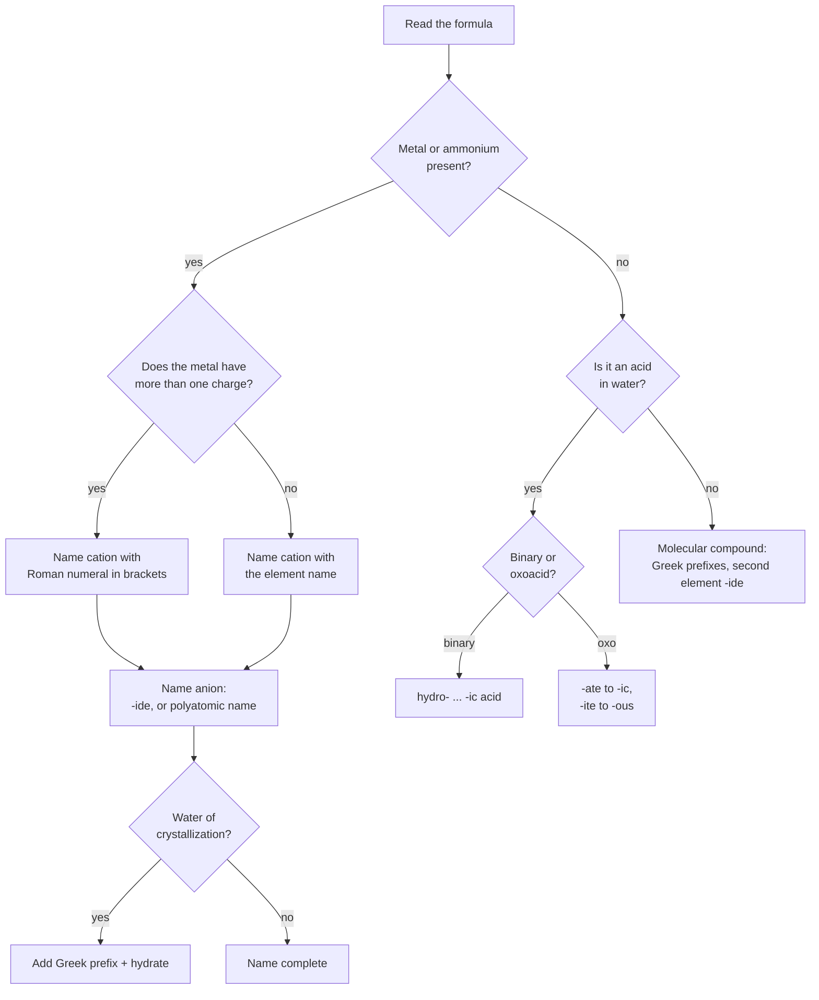
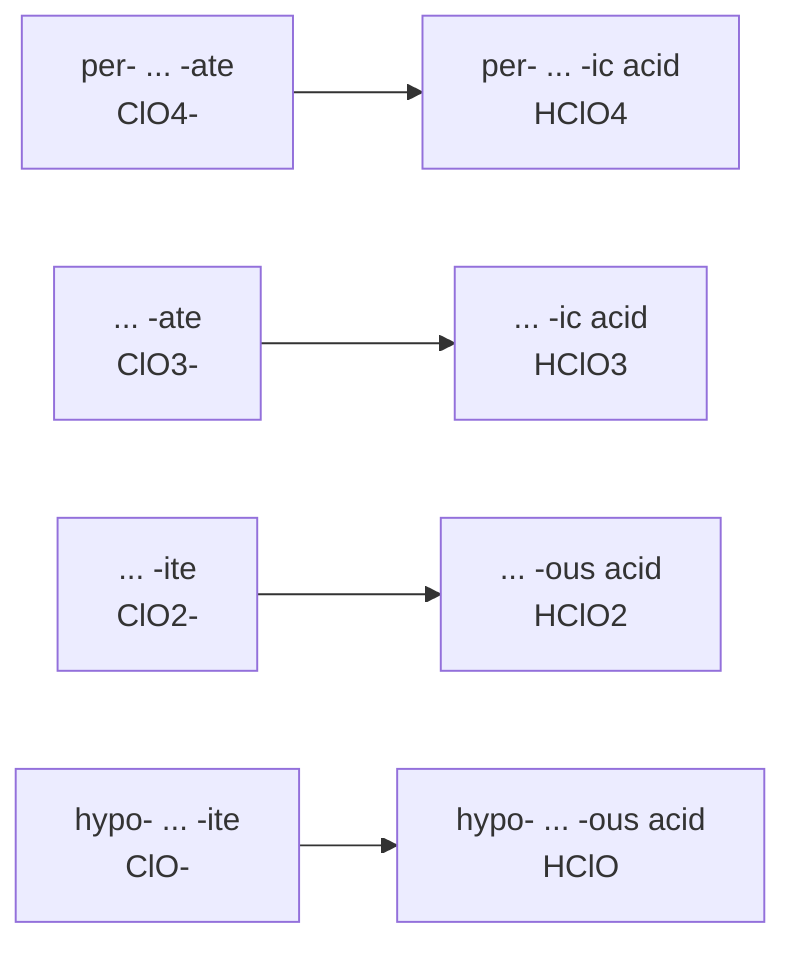
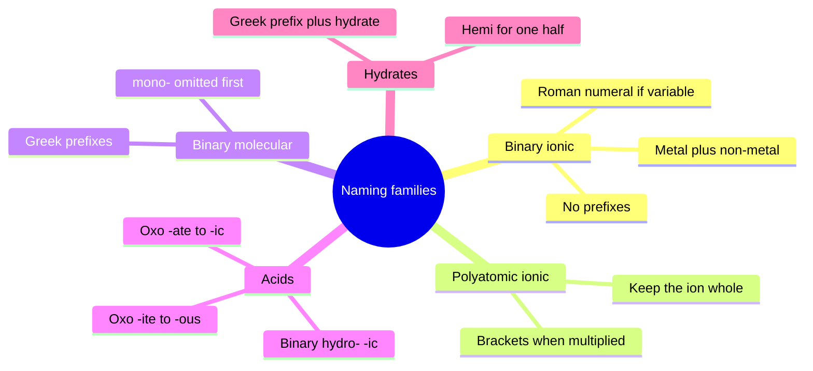
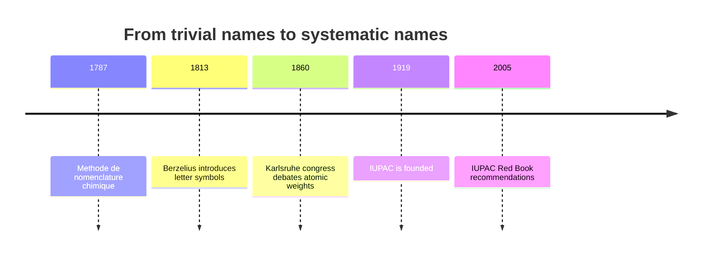

# Chapter 07 — Chemical Nomenclature

> **Level:** Elementary (Level 1)
> **Estimated study time:** 5 hours (reading) + 2 hours (exercises)
> **Prerequisites:** [Chapter 5 — Chemical Bonding](05-chemical-bonding.md) and [Chapter 6 — Lewis Structures and Chemical Formulas](06-lewis-structures-and-chemical-formulas.md)
> **Related chapters:** [Chapter 8 — Chemical Reactions, Balancing and Conservation of Mass](08-chemical-reactions-and-balancing-equations.md) · [Chapter 9 — Introduction to Acids and Bases](09-introduction-to-acids-and-bases.md) · [Level 2 index](../03-intermediate-chemistry/README.md)
> **Difficulty:** ★★☆☆☆

---

## 1. Learning Objectives

After working through this chapter you will be able to:

- Explain why a systematic naming system is necessary and what a name must encode.
- Name and write the formula of any binary ionic compound, including those formed by metals with variable charge.
- Use Roman numerals correctly and distinguish them from the older -ous/-ic convention.
- Recognize and use the common polyatomic ions, including their charges and formulae.
- Name binary molecular compounds with Greek prefixes, applying the mono- rule correctly.
- Name binary and oxoacids and write their formulae from the name.
- Name acid salts, hydrates and compounds containing both.
- Apply a decision procedure that classifies an unknown formula before naming it.
- Decide when a retained trivial name is acceptable and when it must be avoided.

---

## 2. Introduction

Chemistry has more than 180 million registered substances and adds new ones at a rate of
roughly one every few seconds. A naming system that merely labelled them would be
useless; what is required is a system in which the *name contains the structure*. That is
what IUPAC nomenclature is: a grammar, not a dictionary. From a well-formed name you can
write the formula; from the formula you can write the name; and neither operation
requires you to have seen the compound before.

The need is old and practical. In the eighteenth century the same substance could be called
*oil of vitriol*, *spirit of vitriol* or *sulfuric acid*, and a compound's identity could not
be recovered from its label. The *Méthode de nomenclature chimique* of 1787, written by
Lavoisier with Guyton de Morveau, Berthollet and Fourcroy, was the first systematic attempt
to fix names to composition. Berzelius supplied the letter symbols in 1813, and IUPAC —
founded in 1919 — has issued the authoritative recommendations ever since.

This chapter is deliberately mechanical. Naming is a skill, like using a slide rule: it
is learned by doing a hundred examples until the rules become automatic. The rules
themselves are few. What makes them feel numerous is that they are conditional — the
correct name of $\ce{FeCl2}$ depends on knowing that iron can also be iron(III), and the
correct name of $\ce{N2O}$ depends on knowing that it is molecular rather than ionic. The
first task, therefore, is to classify the compound; only then does the naming rule apply.

A word on spelling. This book uses IUPAC spellings, which are *sulfur*, *sulfate*,
*sulfide* and *sulfuric*, not the older British *sulphur* family; *aluminium*, not
*aluminum*; and *caesium* for Cs. The IUPAC spellings are the ones that appear in
databases and in the primary literature, and mixing the two conventions is a common
source of failed literature searches.

---

## 3. Fundamental Concepts

### 3.1 What a chemical name must specify

A systematic name answers three questions, in this order: what kind of compound it is
(ionic, molecular, acid, salt or hydrate); what the constituents are (which elements and
polyatomic ions, and how many of each); and what the charge state is (the oxidation state
of a variable-charge metal, or the atom count in a molecular compound). Sodium chloride
answers all three. Iron chloride does not: it fails the third, because iron can be
$\ce{Fe^2+}$ or $\ce{Fe^3+}$.

### 3.2 IUPAC conventions

The conventions that matter at this level are these:

- **Cations are named first, anions second**, in both name and formula: $\ce{NaCl}$ is
  sodium chloride, never chloride sodium.
- **The cation keeps the element name**; a monatomic anion takes the ending **-ide**.
- **Oxidation state is given as a Roman numeral in parentheses** immediately after the metal
  name, with no space: iron(III) chloride.
- **Prefixes for atom counts belong to molecular compounds only**, never to ionic ones.
- **Formulae carry no spaces**; the charge is implied by the subscripts, never written.
- **Brackets** enclose a multiplied polyatomic ion: $\ce{Ca(OH)2}$, not $\ce{CaOH2}$.
- **The oxidation state is that of the atom, not of the ion**: in $\ce{Fe2(SO4)3}$ the
  Roman numeral refers to iron only.

### 3.3 Binary ionic compounds

A **binary ionic compound** contains a metal cation and a non-metal anion. The name is
built as

$$
\text{metal} + \text{non-metal stem} + \text{-ide}
$$

and the formula is built by the **crossover rule**: the magnitude of each ion's charge
becomes the subscript of the other ion, and the result is reduced to the simplest ratio.

| Formula | Cations and anions | Name |
|---|---|---|
| $\ce{NaCl}$ | $\ce{Na+}$, $\ce{Cl-}$ | sodium chloride |
| $\ce{MgO}$ | $\ce{Mg^2+}$, $\ce{O^2-}$ | magnesium oxide |
| $\ce{Al2O3}$ | $\ce{Al^3+}$, $\ce{O^2-}$ | aluminium oxide |
| $\ce{Ca3N2}$ | $\ce{Ca^2+}$, $\ce{N^3-}$ | calcium nitride |
| $\ce{K2S}$ | $\ce{K+}$, $\ce{S^2-}$ | potassium sulfide |
| $\ce{Li3P}$ | $\ce{Li+}$, $\ce{P^3-}$ | lithium phosphide |

Note that $\ce{MgO}$ is not $\ce{Mg2O2}$: the crossover gives $\ce{Mg2O2}$, which is reduced.
A formula is always written in the lowest whole-number ratio, because an ionic solid is a
lattice rather than a molecule.

### 3.4 Metals with variable charge

Many transition metals and some post-transition metals form more than one cation. The
oxidation state must then be stated with a Roman numeral.

| Ion | Name | Example compound | Name of compound |
|---|---|---|---|
| $\ce{Fe^2+}$ | iron(II) | $\ce{FeCl2}$ | iron(II) chloride |
| $\ce{Fe^3+}$ | iron(III) | $\ce{FeCl3}$ | iron(III) chloride |
| $\ce{Cu+}$ | copper(I) | $\ce{Cu2O}$ | copper(I) oxide |
| $\ce{Cu^2+}$ | copper(II) | $\ce{CuO}$ | copper(II) oxide |
| $\ce{Pb^2+}$ | lead(II) | $\ce{PbO}$ | lead(II) oxide |
| $\ce{Pb^4+}$ | lead(IV) | $\ce{PbO2}$ | lead(IV) oxide |
| $\ce{Sn^2+}$ | tin(II) | $\ce{SnCl2}$ | tin(II) chloride |
| $\ce{Sn^4+}$ | tin(IV) | $\ce{SnCl4}$ | tin(IV) chloride |
| $\ce{Cr^3+}$ | chromium(III) | $\ce{Cr2O3}$ | chromium(III) oxide |
| $\ce{Mn^2+}$ | manganese(II) | $\ce{MnO}$ | manganese(II) oxide |

The Roman numeral is *derived from the formula*, not memorized. In $\ce{Fe2O3}$, three
oxide ions contribute $-6$ in total, so the two iron ions must contribute $+6$ between
them and each is $\ce{Fe^3+}$.

An older convention used the endings **-ous** for the lower charge and **-ic** for the
higher: ferrous/ferric, cuprous/cupric, stannous/stannic, plumbous/plumbic. It survives
in such names as *ferrous sulfate* on a fertilizer bag. It is ambiguous when a metal has
more than two states and it is not acceptable IUPAC nomenclature for new work; use the
Roman-numeral form.

Metals of groups 1 and 2, aluminium, zinc and silver have only one common cation, so no
Roman numeral is used: sodium chloride, not sodium(I) chloride, and silver chloride, not
silver(I) chloride. Strict IUPAC usage permits silver(I) because a rare $+2$ state exists,
but the unnumbered name is universally understood.

### 3.5 Polyatomic ions

A **polyatomic ion** is a covalently bonded group of atoms carrying a net charge. The
group behaves as a single unit in naming and in formula writing: it is never split, and
when multiplied it is enclosed in brackets.

| Ion | Name | Ion | Name |
|---|---|---|---|
| $\ce{NH4+}$ | ammonium | $\ce{NO3-}$ | nitrate |
| $\ce{OH-}$ | hydroxide | $\ce{NO2-}$ | nitrite |
| $\ce{CN-}$ | cyanide | $\ce{SO4^2-}$ | sulfate |
| $\ce{HCO3-}$ | hydrogencarbonate | $\ce{SO3^2-}$ | sulfite |
| $\ce{HSO4-}$ | hydrogensulfate | $\ce{CO3^2-}$ | carbonate |
| $\ce{CH3COO-}$ | acetate | $\ce{PO4^3-}$ | phosphate |
| $\ce{ClO-}$ | hypochlorite | $\ce{ClO2-}$ | chlorite |
| $\ce{ClO3-}$ | chlorate | $\ce{ClO4-}$ | perchlorate |
| $\ce{MnO4-}$ | permanganate | $\ce{Cr2O7^2-}$ | dichromate |
| $\ce{CrO4^2-}$ | chromate | $\ce{O2^2-}$ | peroxide |

Two patterns make the table manageable. The **chlorine series** runs
hypochlorite, chlorite, chlorate, perchlorate as the oxygen count rises from one to four.
The **nitrogen and sulfur series** differ by one oxygen: nitrate/nitrite and
sulfate/sulfite, with the *-ate* ion having one more oxygen than the *-ite* ion. Charges
must be memorized; they cannot be deduced from the formula alone.

### 3.6 Binary molecular compounds

A **molecular compound** contains discrete molecules and is named with Greek prefixes
that state the number of each kind of atom.

| Number | Prefix | Number | Prefix |
|---|---|---|---|
| 1 | mono- | 6 | hexa- |
| 2 | di- | 7 | hepta- |
| 3 | tri- | 8 | octa- |
| 4 | tetra- | 9 | nona- |
| 5 | penta- | 10 | deca- |

The rules are:

1. The less electronegative element is named first, using its element name.
2. The second element takes the **-ide** ending and always carries a prefix.
3. **Mono- is omitted for the first element** but retained for the second:
   $\ce{CO}$ is carbon monoxide, $\ce{CO2}$ is carbon dioxide.
4. The *a* of a Greek prefix is dropped before a vowel: $\ce{N2O4}$ is dinitrogen
   tetroxide, not tetraoxide; $\ce{P4O10}$ is tetraphosphorus decaoxide.

| Formula | Name | Formula | Name |
|---|---|---|---|
| $\ce{CO}$ | carbon monoxide | $\ce{CO2}$ | carbon dioxide |
| $\ce{SO2}$ | sulfur dioxide | $\ce{SO3}$ | sulfur trioxide |
| $\ce{NO}$ | nitrogen monoxide | $\ce{NO2}$ | nitrogen dioxide |
| $\ce{N2O}$ | dinitrogen monoxide | $\ce{N2O4}$ | dinitrogen tetroxide |
| $\ce{PCl3}$ | phosphorus trichloride | $\ce{PCl5}$ | phosphorus pentachloride |
| $\ce{SF6}$ | sulfur hexafluoride | $\ce{CCl4}$ | carbon tetrachloride |

The mono- rule exists for brevity, not for logic. $\ce{CO}$ and $\ce{CO2}$ are so
familiar that "monocarbon monoxide" would be absurd; the systematic name is nonetheless
well defined, and the prefix rule is applied consistently to the second element.

### 3.7 Acids

An **acid** is a substance that donates a proton (Chapter 9). Nomenclature distinguishes
two families.

**Binary acids** — hydrogen plus a non-metal, dissolved in water — are named
**hydro-** + non-metal stem + **-ic acid**:

$$
\ce{HCl(aq)}:\ \text{hydrochloric acid} \qquad \ce{H2S(aq)}:\ \text{hydrosulfuric acid}
$$

The state symbol matters. $\ce{HCl(g)}$ is **hydrogen chloride**, a molecular gas;
$\ce{HCl(aq)}$ is **hydrochloric acid**, the aqueous solution. The same distinction
applies to $\ce{HBr}$, $\ce{HI}$ and $\ce{HF}$.

**Oxoacids** contain hydrogen, oxygen and a central element. The name is tied to that of the
oxoanion: **-ate becomes -ic**, **-ite becomes -ous**, and *per-* and *hypo-* carry across.

| Oxoanion | Oxoacid | Acid name |
|---|---|---|
| $\ce{ClO4-}$ perchlorate | $\ce{HClO4}$ | perchloric acid |
| $\ce{ClO3-}$ chlorate | $\ce{HClO3}$ | chloric acid |
| $\ce{ClO2-}$ chlorite | $\ce{HClO2}$ | chlorous acid |
| $\ce{ClO-}$ hypochlorite | $\ce{HClO}$ | hypochlorous acid |
| $\ce{NO3-}$ nitrate | $\ce{HNO3}$ | nitric acid |
| $\ce{NO2-}$ nitrite | $\ce{HNO2}$ | nitrous acid |
| $\ce{SO4^2-}$ sulfate | $\ce{H2SO4}$ | sulfuric acid |
| $\ce{SO3^2-}$ sulfite | $\ce{H2SO3}$ | sulfurous acid |
| $\ce{CO3^2-}$ carbonate | $\ce{H2CO3}$ | carbonic acid |
| $\ce{PO4^3-}$ phosphate | $\ce{H3PO4}$ | phosphoric acid |

### 3.8 Acid salts and hydrates

An **acid salt** is formed when a polyatomic anion retains some of its acidic hydrogens.
The retained hydrogens are named with the prefix **hydrogen** (or **dihydrogen** for two):

| Formula | Name |
|---|---|
| $\ce{NaHCO3}$ | sodium hydrogencarbonate |
| $\ce{NaHSO4}$ | sodium hydrogensulfate |
| $\ce{KH2PO4}$ | potassium dihydrogenphosphate |
| $\ce{K2HPO4}$ | dipotassium hydrogenphosphate |
| $\ce{Ca(HCO3)2}$ | calcium hydrogencarbonate |

A **hydrate** contains water of crystallization in a fixed ratio. The number of water
molecules is a Greek prefix on the word *hydrate*, with **hemi-** for one half:

| Formula | Name |
|---|---|
| $\ce{CuSO4.5H2O}$ | copper(II) sulfate pentahydrate |
| $\ce{MgSO4.7H2O}$ | magnesium sulfate heptahydrate |
| $\ce{Na2CO3.10H2O}$ | sodium carbonate decahydrate |
| $\ce{CaSO4.2H2O}$ | calcium sulfate dihydrate |
| $\ce{CaSO4.0.5H2O}$ | calcium sulfate hemihydrate |

The prefix order is fixed: the ionic part of the name comes first, then the hydrate
prefix. "Pentahydrate copper(II) sulfate" is wrong, and so is "copper sulfate(V)".

---

## 4. Detailed Scientific Explanation

### 4.1 Why the classification step cannot be skipped

The same two symbols can form an ionic solid or a molecular gas, and the naming rules
diverge completely. $\ce{NO}$ is nitrogen monoxide (molecular, prefix rule);
$\ce{NaCl}$ is sodium chloride (ionic, no prefixes). Applying the molecular rule to
$\ce{NaCl}$ produces "sodium monochloride", which is not a name anyone uses; applying the
ionic rule to $\ce{NO}$ produces "nitrogen(II) oxide", which is wrong because nitrogen
and oxygen share electrons rather than transferring them.

The practical test is composition: **metal (or ammonium) plus non-metal means ionic**;
**two or more non-metals means molecular**. There are borderline cases — $\ce{AlCl3}$ is
ionic in the solid but molecular in the gas phase, and $\ce{BeCl2}$ behaves as a covalent
polymer — but for naming purposes the metal/non-metal boundary is the convention.

### 4.2 Deriving oxidation states from formulae

The Roman numeral is never guessed but computed from charge balance. For $\ce{Fe2O3}$:
each O is $-2$, so $3(-2) = -6$; the two Fe must supply $+6$, and each is $+3$. For
$\ce{Cu2O}$: $1(-2) = -2$, so the two Cu supply $+2$ and each is $+1$. For $\ce{PbO2}$:
$2(-2) = -4$, so Pb is $+4$.

The method also works for polyatomic ions. In $\ce{MnO4-}$, four oxygens give $-8$ and the
ion carries $-1$, so manganese is $+7$. In $\ce{Cr2O7^2-}$, seven oxygens give $-14$ and
the ion is $-2$, so the two chromium atoms supply $+12$ and each is $+6$. This is the same
calculation that underlies redox bookkeeping in Level 2.

### 4.3 The logic of the -ate/-ite and -ic/-ous pairs

The suffix system encodes oxygen count, not oxidation state directly. For a given central
element, the *-ate* ion has one more oxygen than the *-ite* ion; *per-* adds one more than
*-ate*, and *hypo-* removes one from *-ite*. The corresponding acids follow: *-ic* for
*-ate*, *-ous* for *-ite*.

This is why $\ce{H2SO4}$ is sulfuric acid and $\ce{H2SO3}$ is sulfurous acid, and why
$\ce{HClO4}$ is perchloric while $\ce{HClO}$ is hypochlorous. The pattern holds across
chlorine, bromine, iodine, nitrogen, sulfur, phosphorus and carbon.

### 4.4 Where systematic names and trivial names coexist

IUPAC maintains a list of **retained names** — trivial names that are so entrenched that
replacing them would create more confusion than it removes. The most important are:

| Trivial name | Formula | Systematic alternative | Status |
|---|---|---|---|
| water | $\ce{H2O}$ | oxidane | retained, universal |
| ammonia | $\ce{NH3}$ | azane | retained, universal |
| methane | $\ce{CH4}$ | methane | retained as the parent of organic nomenclature |
| acetic acid | $\ce{CH3COOH}$ | ethanoic acid | both accepted; ethanoic preferred in IUPAC organic nomenclature |
| benzene | $\ce{C6H6}$ | benzene | retained |

The rule for a student is straightforward: **use the systematic name in written work
unless the trivial name is on the retained list, and always give the formula as well when
there is any risk of ambiguity.** Nobody misunderstands "water"; "lime" could mean
$\ce{CaO}$, $\ce{Ca(OH)2}$ or $\ce{CaCO3}$ depending on the century, and should not be
used without a formula.

### 4.5 Naming compounds that combine several rules

Real laboratory compounds often require every rule at once. $\ce{Fe(NO3)3.9H2O}$ is
iron(III) nitrate nonahydrate: a variable-charge metal (the numeral follows from the three
nitrates needed to balance $\ce{Fe^3+}$), a polyatomic anion kept whole, and a hydrate with
nine waters. The order is always cation, anion, hydrate prefix.

---

## 5. Visual Diagrams

Naming begins with classification. If you learn one thing from this chapter, learn the
order of the questions in this decision tree.

**Figure 7.1 — The nomenclature decision tree.** The first question separates ionic from
molecular compounds, and everything else follows from it. The acid branch is entered only
for a substance dissolved in water: the same formula is named as a molecular compound when
it is a pure gas. The hydrate question comes last because water of crystallization is an
addition to a name that is already complete.

The acid suffixes are not arbitrary; they are locked to the anion suffixes by a fixed
mapping that runs in both directions.

**Figure 7.2 — The oxoacid suffix ladder.** Left to right converts an anion name into an
acid name; right to left reverses it. Oxygen count increases upwards, and the prefix crosses
the arrow unchanged. Once this ladder is learned, the chlorine, bromine, iodine, nitrogen
and sulfur families all follow.

The five naming families are easier to hold in mind as a map than as a list of rules.

**Figure 7.3 — The five families of inorganic names.** Each branch has its own rule set,
chosen by the classification step of Figure 7.1. Prefixes appear in two branches only:
they count atoms in molecular compounds and water molecules in hydrates, nowhere else.

The system has a history, and knowing it explains why some names look irregular.

**Figure 7.4 — The standardization of chemical names.** Before 1787 a compound could carry
several unrelated names, and composition could not be recovered from a label. The 1860
Karlsruhe congress mattered because a formula is meaningless without agreed atomic weights.
The dates mark conventions, not discoveries.

---

## 6. Mathematical Formulas

Nomenclature needs only charge balance: for a neutral compound, $\sum_i z_i n_i = 0$, where
$z_i$ is the charge of ion $i$ and $n_i$ its number in the formula. For a polyatomic ion the
same relation gives the charge of the central atom.

| Symbol | Meaning | SI unit |
|---|---|---|
| $z_i$ | charge number of ion $i$ (in units of $e$) | dimensionless |
| $n_i$ | number of ions of type $i$ in the formula unit | dimensionless |
| $Z_{\text{central}}$ | oxidation state of the central atom | dimensionless |
| $M$ | molar mass of the named compound | g mol⁻¹ |

The crossover rule is the same equation solved for $n_i$: if the cation charge is $+a$
and the anion charge is $-b$, the smallest whole-number solution is $n_{\text{cation}} = b$
and $n_{\text{anion}} = a$, reduced by their common factor. Thus $\ce{Al^3+}$ with
$\ce{O^2-}$ gives $\ce{Al2O3}$, and $\ce{Ca^2+}$ with $\ce{Cl-}$ gives $\ce{CaCl2}$.

---

## 7. Chemical Equations

Acid names are not arbitrary labels: they record the oxide from which the acid is derived
in water. The anhydride reactions make the connection explicit.

$$
\ce{SO3(g) + H2O(l) -> H2SO4(aq)}
$$

$$
\ce{CO2(g) + H2O(l) <=> H2CO3(aq)}
$$

$$
\ce{P4O10(s) + 6H2O(l) -> 4H3PO4(aq)}
$$

Sulfur trioxide is the anhydride of sulfuric acid, carbon dioxide of carbonic acid, and
tetraphosphorus decaoxide of phosphoric acid. The "-ic" acid is the one derived from the
higher oxide; the "-ous" acid comes from the lower oxide, as in

$$
\ce{SO2(g) + H2O(l) <=> H2SO3(aq)}
$$

A binary acid is formed by dissolving the molecular hydride:

$$
\ce{HCl(g) + H2O(l) -> H3O+(aq) + Cl-(aq)}
$$

The equation shows why the name changes with the state: $\ce{HCl(g)}$ is hydrogen
chloride, a molecule; in water it is fully ionized and the solution is hydrochloric acid.

---

## 8. Worked Examples

### Worked Example 8.1 — Naming oxides of a variable-charge metal

**Problem.** Name $\ce{Fe2O3}$ and $\ce{FeO}$.

**Strategy.** Confirm that the compound is ionic (metal plus non-metal), derive the iron
oxidation state from charge balance, then apply the Roman numeral.

**Solution.** In $\ce{Fe2O3}$ each oxygen is $-2$, so the three oxygens contribute $-6$.
The two iron atoms must contribute $+6$ in total, so each is $+3$:
**iron(III) oxide**.

In $\ce{FeO}$ the single oxygen contributes $-2$, so the single iron is $+2$:
**iron(II) oxide**.

**Check.** Reverse the names: iron(III) oxide gives $\ce{Fe^3+}$ and $\ce{O^2-}$, whose
crossover is $\ce{Fe2O3}$; iron(II) oxide gives $\ce{Fe^2+}$ and $\ce{O^2-}$, whose
crossover is $\ce{FeO}$. Both reverse correctly, and the charges sum to zero in each case.

### Worked Example 8.2 — Writing formulae from names with Roman numerals

**Problem.** Write the formulae of (a) lead(IV) oxide, (b) copper(I) sulfide,
(c) chromium(III) chloride.

**Strategy.** Translate the Roman numeral into the cation charge, identify the anion charge,
and apply the crossover rule.

**Solution.**

(a) $\ce{Pb^4+}$ with $\ce{O^2-}$: crossover gives $\ce{Pb2O4}$, reduced to
$\ce{PbO2}$.

(b) $\ce{Cu+}$ with $\ce{S^2-}$: crossover gives $\ce{Cu2S}$.

(c) $\ce{Cr^3+}$ with $\ce{Cl-}$: crossover gives $\ce{CrCl3}$.

**Check.** (a) $+4 + 2(-2) = 0$; (b) $2(+1) + (-2) = 0$; (c) $+3 + 3(-1) = 0$. Each formula
is neutral, and each is in its lowest whole-number ratio.

### Worked Example 8.3 — Naming molecular compounds

**Problem.** Name (a) $\ce{N2O4}$, (b) $\ce{PCl3}$, (c) $\ce{SF6}$, (d) $\ce{CO}$.

**Strategy.** Confirm that both elements are non-metals, then apply Greek prefixes with
mono- omitted for the first element.

**Solution.**

(a) Two nitrogen atoms, four oxygen atoms: **dinitrogen tetroxide** (the *a* of tetra- is
dropped before the vowel of *oxide*).

(b) One phosphorus, three chlorine: **phosphorus trichloride**.

(c) One sulfur, six fluorine: **sulfur hexafluoride**.

(d) One carbon, one oxygen: **carbon monoxide**. Mono- is omitted for carbon but retained
for oxygen, because "carbon oxide" would be ambiguous among $\ce{CO}$, $\ce{CO2}$ and
$\ce{C3O2}$.

**Check.** Reverse each name: dinitrogen tetroxide gives $\ce{N2O4}$, phosphorus
trichloride gives $\ce{PCl3}$, sulfur hexafluoride gives $\ce{SF6}$, carbon monoxide gives
$\ce{CO}$. All four match the starting formulae.

### Worked Example 8.4 — Naming oxoacids and their anions

**Problem.** Name (a) $\ce{H2SO3}$, (b) $\ce{HClO}$, (c) $\ce{H3PO4}$; write the formula
of (d) nitrous acid and (e) perchloric acid.

**Strategy.** Identify the oxoanion, then apply *-ate* to *-ic* and *-ite* to *-ous*,
carrying any per- or hypo- prefix unchanged.

**Solution.**

(a) The anion is $\ce{SO3^2-}$, sulfite, so the acid is **sulfurous acid**.

(b) The anion is $\ce{ClO-}$, hypochlorite, so the acid is **hypochlorous acid**.

(c) The anion is $\ce{PO4^3-}$, phosphate, so the acid is **phosphoric acid**.

(d) Nitrous acid corresponds to the *-ite* anion nitrite, $\ce{NO2-}$, so the formula is
$\ce{HNO2}$.

(e) Perchloric acid corresponds to perchlorate, $\ce{ClO4-}$, so the formula is
$\ce{HClO4}$.

**Check.** Each acid has as many hydrogens as are needed to neutralize the anion charge:
$\ce{H2SO3}$ balances $\ce{SO3^2-}$, $\ce{HClO}$ balances $\ce{ClO-}$, $\ce{H3PO4}$
balances $\ce{PO4^3-}$, $\ce{HNO2}$ balances $\ce{NO2-}$ and $\ce{HClO4}$ balances
$\ce{ClO4-}$.

### Worked Example 8.5 — A compound using every rule

**Problem.** Name $\ce{Fe(NO3)3.9H2O}$.

**Strategy.** Work through the decision tree: ionic, variable-charge metal, polyatomic
anion, hydrate.

**Solution.** The cation is iron. Three nitrate ions are needed to balance the charge, so
each nitrate is $-1$ and the iron must be $+3$; the cation is iron(III). The anion is
nitrate, $\ce{NO3-}$, kept whole. Nine water molecules give the prefix *nona-*. The name
is **iron(III) nitrate nonahydrate**.

**Check.** Reconstruct the formula: $\ce{Fe^3+}$ and three $\ce{NO3-}$ give
$\ce{Fe(NO3)3}$, neutral overall, and *nona-* restores the nine waters. The name and the
formula are mutually recoverable, which is the test of a correct systematic name.

### Worked Example 8.6 — Acid salts and hydrates in one name

**Problem.** Write the formula of (a) calcium dihydrogenphosphate and (b) sodium
hydrogencarbonate; name (c) $\ce{CuSO4.5H2O}$.

**Strategy.** Treat the hydrogen prefix as part of the anion, then balance charge; for the
hydrate, name the ionic part first.

**Solution.**

(a) The anion is $\ce{H2PO4-}$, dihydrogenphosphate; calcium is $\ce{Ca^2+}$, so two
anions are needed: $\ce{Ca(H2PO4)2}$.

(b) The anion is $\ce{HCO3-}$; sodium is $\ce{Na+}$, so one of each: $\ce{NaHCO3}$.

(c) The ionic part is copper(II) sulfate and there are five waters: **copper(II) sulfate
pentahydrate**.

**Check.** (a) $+2 + 2(-1) = 0$; (b) $+1 + (-1) = 0$; (c) the formula contains 1 Cu, 1 S,
9 O and 10 H, consistent with five waters.

### Worked Example 8.7 — Formula mass from a name

**Problem.** Calculate the molar mass of copper(II) sulfate pentahydrate.

**Strategy.** Convert the name to a formula, then sum atomic masses.

**Solution.** Copper(II) sulfate pentahydrate is $\ce{CuSO4.5H2O}$, so
$M = 63.55 + 32.06 + 9(16.00) + 10(1.008) = 249.69\ \text{g mol}^{-1}$.

**Check.** The anhydrous salt accounts for $159.61\ \text{g mol}^{-1}$ and the five waters for
$90.08\ \text{g mol}^{-1}$; their sum is $249.69\ \text{g mol}^{-1}$, and the water fraction is
$36.1\ \%$, matching the known mass loss on heating.

---

## 9. Real-World Applications

**Medicine.** Prescription labels use systematic names precisely because they are
unambiguous. *Ferrous sulfate* and *ferric ammonium citrate* are legacy names still in the
pharmacopoeia, yet the iron content differs by a factor of about 1.5 between the two
oxidation states. Lithium carbonate and magnesium sulfate heptahydrate (Epsom salts) are
further examples of names whose systematic form encodes the dose-relevant composition.

**Agriculture.** Fertilizer grades are quoted as N–P–K percentages of nitrogen,
phosphorus(V) oxide and potassium oxide. The names behind them — ammonium nitrate,
diammonium hydrogenphosphate, potassium sulfate — fix both the nutrient content and the
accompanying ions, which matters for soils sensitive to chloride.

**Materials and construction.** Gypsum is calcium sulfate dihydrate; heating it gives
calcium sulfate hemihydrate, plaster of Paris, which rehydrates and sets. The two names
differ by half a water molecule per formula unit, and that half molecule is the point.

**Environmental regulation and safety.** Pollutant inventories list sulfur dioxide and
nitrogen dioxide, not "sulfur oxide" or "NOx", because the name fixes the oxidation state
and hence the atmospheric chemistry (Chapter 9). Sodium chlorite and sodium chlorate are
both industrial chemicals, and confusing them is dangerous: the chlorate is a strong
oxidizer. Systematic nomenclature is a safety control, not a pedantic exercise.

---

## 10. Common Mistakes

| Mistake | Why it happens | Correct approach |
|---|---|---|
| Writing "iron chloride" | The Roman numeral is omitted for a metal with two common states | Derive the charge from the formula and write iron(II) or iron(III) |
| Using Greek prefixes for ionic compounds | The molecular rule is applied to a salt | "Sodium dichloride" is wrong; write sodium chloride |
| Omitting mono- on the second element | The exception is remembered backwards | Mono- is omitted only for the *first* element: carbon monoxide |
| Naming $\ce{H2SO4}$ as "hydrogen sulfate" | The salt name is used for the acid | The acid is sulfuric acid; hydrogensulfate is the $\ce{HSO4-}$ ion |
| Writing $\ce{CaOH2}$ | Brackets are omitted around a multiplied polyatomic ion | Write $\ce{Ca(OH)2}$ |
| Confusing -ide and -ate endings | Both are common anion endings | Chloride is $\ce{Cl-}$; chlorate is $\ce{ClO3-}$; the endings are not interchangeable |
| Using -ous/-ic for a metal with three states | The older convention is remembered from labels | Use Roman numerals, which extend to any oxidation state |
| Giving the hydrate prefix in the wrong position | Word order is treated as free | Ionic name first, then the hydrate prefix: copper(II) sulfate pentahydrate |
| Assuming a subscript applies to one atom only | $\ce{Al2(SO4)3}$ is misread | The subscript outside the bracket multiplies the whole ion |

---

## 11. Chapter Summary

- A systematic name encodes composition and charge state and must be reversible into a
  formula.
- Ionic compounds are named cation first, anion second, with no prefixes; the crossover rule
  converts charges into subscripts.
- Metals with more than one common cation take a Roman numeral derived from charge balance;
  the -ous/-ic convention is legacy.
- Polyatomic ions are named as units and bracketed when multiplied.
- Molecular compounds use Greek prefixes, with mono- omitted for the first element only.
- Binary acids are hydro-…-ic acids; oxoacids follow their anion: -ate becomes -ic and -ite
  becomes -ous, with per- and hypo- carried across.
- Acid salts carry hydrogen or dihydrogen in the anion name; hydrates carry a Greek prefix
  before *hydrate*.
- The state symbol decides the name: $\ce{HCl(g)}$ is hydrogen chloride, $\ce{HCl(aq)}$ is
  hydrochloric acid.
- Water, ammonia and methane are retained trivial names; most others should be replaced.

---

## 12. Exercises

### 12.1 Conceptual questions

**1.** Why does $\ce{NaCl}$ take no prefixes while $\ce{NCl3}$ takes three? Answer in terms of the bonding model.

**2.** Explain why $\ce{HCl}$ has two different names depending on its state symbol.

### 12.2 Basic problems

**3.** Name (a) $\ce{K2O}$, (b) $\ce{MgBr2}$, (c) $\ce{Al2S3}$, (d) $\ce{Li3N}$.

**4.** Write the formula of (a) calcium chloride, (b) potassium oxide, (c) aluminium fluoride, (d) magnesium nitride.

**5.** Name (a) $\ce{NO2}$, (b) $\ce{SO3}$, (c) $\ce{PCl5}$, (d) $\ce{N2O}$.

### 12.3 Intermediate problems

**6.** Name (a) $\ce{Cu2O}$, (b) $\ce{CuO}$, (c) $\ce{PbO2}$, (d) $\ce{SnCl4}$.

**7.** Write the formula of (a) iron(III) sulfide, (b) lead(II) nitrate, (c) ammonium sulfate, (d) calcium dihydrogenphosphate.

**8.** Name (a) $\ce{HNO2}$, (b) $\ce{HClO4}$, (c) $\ce{H2SO4}$, (d) $\ce{H3PO4}$.

### 12.4 Advanced problems

**9.** Name $\ce{Al2(SO4)3.18H2O}$ and $\ce{FeSO4.7H2O}$, and explain why the aluminium name needs no Roman numeral while an iron compound normally does.

**10.** A compound has the formula $\ce{KMnO4}$. Determine the oxidation state of manganese and explain why the name contains no Roman numeral despite manganese having several oxidation states.

### 12.5 Calculation problems

**11.** Calculate the molar mass of $\ce{CaSO4.2H2O}$ and the mass percentage of water it contains. Use $A_r(\ce{Ca}) = 40.08$, $A_r(\ce{S}) = 32.06$, $A_r(\ce{O}) = 16.00$, $A_r(\ce{H}) = 1.008$.

**12.** A hydrate of magnesium sulfate has a molar mass of $246.48\ \text{g mol}^{-1}$. Determine the number of water molecules per formula unit and hence the full systematic name.

### 12.6 Answers

1. $\ce{NaCl}$ is ionic and its ions have fixed charges, so the formula is fixed by charge balance; $\ce{NCl3}$ is molecular, so the number of chlorine atoms must be stated explicitly.
2. $\ce{HCl(g)}$ is a molecular gas called hydrogen chloride; in water it ionizes completely and the solution is hydrochloric acid.
3. (a) potassium oxide; (b) magnesium bromide; (c) aluminium sulfide; (d) lithium nitride.
4. (a) $\ce{CaCl2}$; (b) $\ce{K2O}$; (c) $\ce{AlF3}$; (d) $\ce{Mg3N2}$.
5. (a) nitrogen dioxide; (b) sulfur trioxide; (c) phosphorus pentachloride; (d) dinitrogen monoxide.
6. (a) copper(I) oxide; (b) copper(II) oxide; (c) lead(IV) oxide; (d) tin(IV) chloride.
7. (a) $\ce{Fe2S3}$; (b) $\ce{Pb(NO3)2}$; (c) $\ce{(NH4)2SO4}$; (d) $\ce{Ca(H2PO4)2}$.
8. (a) nitrous acid; (b) perchloric acid; (c) sulfuric acid; (d) phosphoric acid.
9. $\ce{Al2(SO4)3.18H2O}$ is aluminium sulfate octadecahydrate and $\ce{FeSO4.7H2O}$ is iron(II) sulfate heptahydrate; iron needs the numeral because it has two common cations, whereas aluminium has only $\ce{Al^3+}$.
10. Each oxide is $-2$, four give $-8$, and the ion is $-1$, so Mn is $+7$. The permanganate ion is a named polyatomic ion, and its name already specifies the composition, so no Roman numeral is used.
11. $M = 40.08 + 32.06 + 6(16.00) + 4(1.008) = 172.17\ \text{g mol}^{-1}$; water is $2 \times 18.015 = 36.03\ \text{g mol}^{-1}$, so $20.93\ \%$.
12. Anhydrous $\ce{MgSO4}$ is $120.37\ \text{g mol}^{-1}$; the difference is $126.11\ \text{g mol}^{-1}$, which is $7 \times 18.015$, so the compound is $\ce{MgSO4.7H2O}$, magnesium sulfate heptahydrate.

---

## 13. Further Reading

- IUPAC. *Nomenclature of Inorganic Chemistry: IUPAC Recommendations 2005* (the "Red
  Book"). Royal Society of Chemistry, 2005. Chapters 2–5.
- IUPAC. *Compendium of Chemical Terminology* ("Gold Book"), 2nd ed. (the "corrected"
  version). <https://goldbook.iupac.org/>
- OpenStax. *Chemistry 2e*. Rice University. Chapter 4 (formulae and nomenclature).
  <https://openstax.org/details/books/chemistry-2e>
- Zumdahl, S. S.; DeCoste, D. J. *Chemical Principles*, 8th ed. Cengage. Chapter 2.
- Brown, T. L. et al. *Chemistry: The Central Science*, 14th ed. Pearson. Chapter 2.
- See [REFERENCES.md](../REFERENCES.md) for the full source list used in this repository.

---

**Navigation:** [Level 1 index](README.md) · [Chapter 6 — Lewis Structures and Chemical Formulas](06-lewis-structures-and-chemical-formulas.md) · [Chapter 8 — Chemical Reactions](08-chemical-reactions-and-balancing-equations.md) · [Curriculum map](../CURRICULUM.md)
