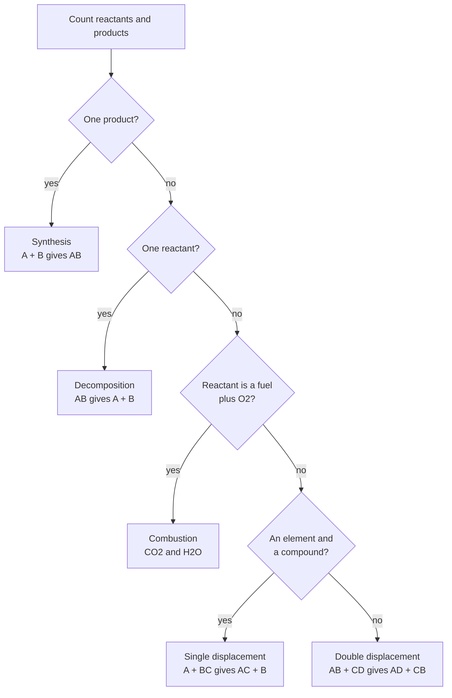
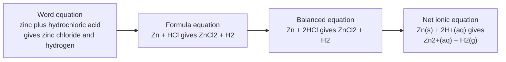
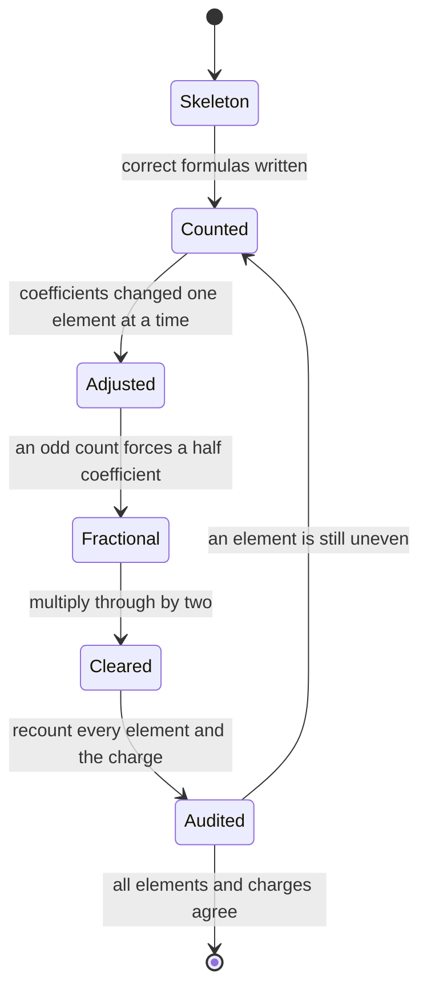
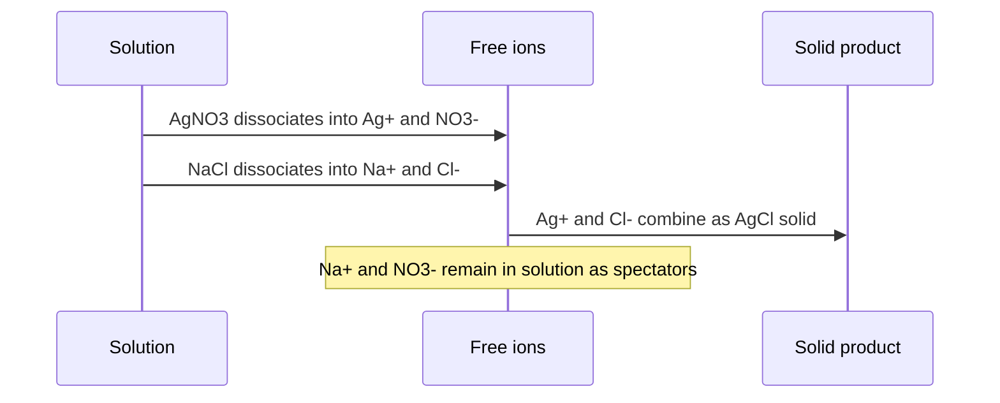

# Chapter 08 — Chemical Reactions, Balancing and Conservation of Mass

> **Level:** Elementary (Level 1)
> **Estimated study time:** 6 hours (reading) + 3 hours (exercises)
> **Prerequisites:** [Chapter 5 — Chemical Bonding](05-chemical-bonding.md) · [Chapter 6 — Lewis Structures and Chemical Formulas](06-lewis-structures-and-chemical-formulas.md) · [Chapter 7 — Chemical Nomenclature](07-chemical-nomenclature.md)
> **Related chapters:** [Chapter 9 — Introduction to Acids and Bases](09-introduction-to-acids-and-bases.md) · [Level 2, Chapter 2 — Stoichiometry](../03-intermediate-chemistry/README.md)
> **Difficulty:** ★★★☆☆

---

## 1. Learning Objectives

After working through this chapter you will be able to:

- Read a chemical equation as a complete symbolic sentence, including state symbols and conditions.
- State the law of conservation of mass and explain the evidence on which it rests.
- Balance any equation for a simple inorganic or combustion reaction by a systematic inspection method.
- Explain why coefficients may be changed but subscripts may not.
- Classify a reaction as synthesis, decomposition, single displacement, double displacement or combustion.
- Predict the products of a precipitation reaction from solubility rules.
- Convert a molecular equation into a complete ionic equation and then into a net ionic equation.
- Identify spectator ions and explain why they are omitted from the net ionic equation.
- Convert a word equation into a balanced symbol equation and check it by an atom count.

---

## 2. Introduction

A chemical equation is a sentence with a subject, a verb and a predicate. The reactants
are the subject, the arrow is the verb — *yields*, *gives*, *is converted into* — and the
products are the predicate. Everything else, including the state symbols and the
conditions written over the arrow, is punctuation that tells the reader how the sentence
is to be read.

The sentence has one non-negotiable grammatical rule: **atoms are conserved**. You may
rearrange them, ionize them, dissolve them or lock them into a crystal, but you may not
create or destroy one. This is the law of conservation of mass, and it is the reason a
chemical equation is balanced. Antoine Lavoisier established it experimentally in the
1770s by heating substances in sealed vessels and weighing the whole vessel before and
after; the total mass never changed, provided nothing escaped.

Balancing looks like arithmetic and is really bookkeeping. The difficulty students have
is not mathematical but procedural: they try to balance every element at once, lose track
of what they have already fixed, and change a subscript to make the count work. The method
in this chapter is deliberately serial — one element at a time, in a fixed order, with a
final audit — because a serial procedure cannot get lost.

The chapter then turns from *how much* to *what kind*. Five reaction types cover most of
what happens in a school laboratory and in much of industry: synthesis, decomposition,
single displacement, double displacement and combustion. The classification is a
convenience, not a law of nature — many reactions fit two categories, and some fit none —
but it is a powerful predictor, because knowing the type tells you the shape of the
products before you have done any chemistry.

Finally, the chapter introduces the ionic equation. In aqueous solution most ions are
spectators: they are present before and after the reaction and take no part in it. Writing
the **net ionic equation** strips them out and leaves the actual chemical event. This is
the form in which chemistry is usually reasoned about, and it is the form that transfers
directly to the quantitative work of Level 2.

---

## 3. Fundamental Concepts

### 3.1 Anatomy of a chemical equation

$$
\ce{2H2(g) + O2(g) -> 2H2O(l)}
$$

Read this as: two moles of hydrogen molecules react with one mole of oxygen molecules,
initiated by a spark, to give two moles of water. The elements of the notation are:

- **Reactants** on the left, separated by $+$ signs.
- **Products** on the right.
- An **arrow** pointing from reactants to products. A double arrow
  $\ce{<=>}$ denotes a reversible reaction, one that does not go to completion.
- **State symbols** in parentheses after each formula: (s) solid, (l) liquid, (g) gas,
  (aq) aqueous solution.
- **Conditions** written above or below the arrow: $\Delta$ for heating, a formula for a
  catalyst, *hv* for light, a pressure or temperature.
- **Coefficients** in front of formulas, which count formula units.
- **Subscripts** inside formulas, which define the substance.

### 3.2 State symbols and conditions

State symbols are not decoration. $\ce{H2O(l)}$ and $\ce{H2O(g)}$ are the same compound in
different states, and the enthalpy change of a reaction depends on which is meant. In
ionic equations the distinction between (aq) and (s) does real work: a precipitate is
formed precisely when an ion that was (aq) becomes (s).

| Symbol | Meaning | Example |
|---|---|---|
| (s) | solid | $\ce{AgCl(s)}$ |
| (l) | liquid | $\ce{H2O(l)}$, $\ce{Br2(l)}$ |
| (g) | gas | $\ce{CO2(g)}$ |
| (aq) | dissolved in water | $\ce{NaCl(aq)}$ |
| $\Delta$ | heat applied | $\ce{CaCO3(s) ->[\Delta] CaO(s) + CO2(g)}$ |
| catalyst formula | catalyst present | $\ce{2H2O2(aq) ->[MnO2] 2H2O(l) + O2(g)}$ |
| $\ce{<=>}$ | reversible | $\ce{N2(g) + 3H2(g) <=> 2NH3(g)}$ |

### 3.3 The law of conservation of mass

The **law of conservation of mass** states that the total mass of the substances taking
part in a chemical reaction is unchanged: the mass of the products equals the mass of the
reactants, provided nothing is added or lost.

The law is a consequence of the atomic picture. A chemical reaction rearranges atoms; it
does not transmute elements. Since the number of atoms of each element is unchanged, and
since each atom has a fixed mass, the total mass is unchanged. The only exception is a
nuclear reaction, where a small fraction of the mass is converted into energy according to
$E = mc^2$; those changes are far outside the energy range of chemical reactions.

In practice the law is verified by carrying out the reaction in a closed system. If a gas
escapes, the mass appears to fall; if a gas from the air is absorbed, it appears to rise.
Both are errors of the experiment, not violations of the law.

### 3.4 Balancing by inspection: a systematic method

**Balancing** is the process of choosing coefficients so that the number of atoms of each
element is the same on both sides.

1. **Write the correct formulae.** A wrong formula cannot be rescued by any coefficient.
2. **Count each element** on both sides. A table is the safest format.
3. **Balance elements that appear in only one compound on each side first** — usually the
   metals, then the non-metals other than hydrogen and oxygen.
4. **Treat unchanged polyatomic ions as single units.** If $\ce{SO4}$ appears on both sides,
   count it as one item rather than as one S and four O.
5. **Leave hydrogen and oxygen until last.** They appear in the most places, so they are
   easiest to fix at the end.
6. **Clear any fractions** by multiplying the whole equation by the denominator.
7. **Audit.** Recount every element. For an ionic equation, also check that the total charge
   balances.

### 3.5 The five basic reaction types

**Synthesis** (combination): two or more substances form one product.

$$
\ce{2Na(s) + Cl2(g) -> 2NaCl(s)} \qquad \ce{CaO(s) + H2O(l) -> Ca(OH)2(s)}
$$

**Decomposition**: one substance breaks into two or more products. Most decompositions
require heat, light or a catalyst.

$$
\ce{CaCO3(s) ->[\Delta] CaO(s) + CO2(g)} \qquad \ce{2H2O2(aq) ->[MnO2] 2H2O(l) + O2(g)}
$$

**Single displacement** (single replacement): one element displaces another from a
compound. The general form is $\ce{A + BC -> AC + B}$, and it occurs only if A is more
reactive than B.

$$
\ce{Zn(s) + 2HCl(aq) -> ZnCl2(aq) + H2(g)} \qquad \ce{Fe(s) + CuSO4(aq) -> FeSO4(aq) + Cu(s)}
$$

**Double displacement** (double replacement, metathesis): two compounds exchange partners.
The general form is $\ce{AB + CD -> AD + CB}$. In aqueous solution the reaction is driven
by the formation of a precipitate, a gas or a weak electrolyte such as water.

$$
\ce{AgNO3(aq) + NaCl(aq) -> AgCl(s) + NaNO3(aq)} \qquad \ce{HCl(aq) + NaOH(aq) -> NaCl(aq) + H2O(l)}
$$

**Combustion**: a substance reacts rapidly with oxygen, releasing heat and (usually) light.
Complete combustion of a hydrocarbon gives carbon dioxide and water.

$$
\ce{CH4(g) + 2O2(g) -> CO2(g) + 2H2O(l)} \qquad \ce{C3H8(g) + 5O2(g) -> 3CO2(g) + 4H2O(l)}
$$

### 3.6 Molecular, complete ionic and net ionic equations

A **molecular equation** shows every substance as its formula, whether or not it is
ionized. For a reaction in solution this hides what actually happens, because soluble
ionic compounds are present as separated ions.

A **complete ionic equation** writes every strong electrolyte as its separated ions and
leaves solids, liquids, gases and weak electrolytes as formulae.

A **net ionic equation** cancels the ions that appear unchanged on both sides. These are
the **spectator ions**, and they do not participate in the reaction.

For the precipitation of silver chloride:

$$
\ce{AgNO3(aq) + NaCl(aq) -> AgCl(s) + NaNO3(aq)}
$$

$$
\ce{Ag+(aq) + NO3-(aq) + Na+(aq) + Cl-(aq) -> AgCl(s) + Na+(aq) + NO3-(aq)}
$$

$$
\ce{Ag+(aq) + Cl-(aq) -> AgCl(s)}
$$

The net ionic equation is the chemistry. Everything else is dilution.

### 3.7 The diatomic elements

Seven elements exist as diatomic molecules under ordinary conditions:
$\ce{H2}$, $\ce{N2}$, $\ce{O2}$, $\ce{F2}$, $\ce{Cl2}$, $\ce{Br2}$ and $\ce{I2}$. A
common mnemonic is **HOFBrINCl**, read as "hoff-brinkel". Two more form polyatomic
molecules: phosphorus as $\ce{P4}$ and sulfur as $\ce{S8}$.

Writing $\ce{O}$ instead of $\ce{O2}$, or $\ce{Cl}$ instead of $\ce{Cl2}$, is the most
common cause of an equation that will not balance. Check the element's standard state
before you start.

| Element | Formula | State at 25 °C |
|---|---|---|
| hydrogen | $\ce{H2}$ | gas |
| nitrogen | $\ce{N2}$ | gas |
| oxygen | $\ce{O2}$ | gas |
| fluorine | $\ce{F2}$ | gas |
| chlorine | $\ce{Cl2}$ | gas |
| bromine | $\ce{Br2}$ | liquid |
| iodine | $\ce{I2}$ | solid |
| phosphorus | $\ce{P4}$ | solid |
| sulfur | $\ce{S8}$ | solid |

---

## 4. Detailed Scientific Explanation

### 4.1 What Lavoisier actually showed

Lavoisier's contribution was methodological as much as experimental. In the 1770s he heated
tin and lead in sealed glass vessels and weighed the vessel before and after. The total mass
was unchanged, but when he opened the vessel air rushed in: part of the atmosphere had
combined with the metal. He then showed the reverse — that heating mercury(II) oxide, the
red *calx* of mercury, released a gas that supported combustion and made a candle burn more
brightly. He named that gas *oxygène*, and in the *Traité élémentaire de chimie* of 1789 he
set out conservation of mass as a fundamental principle.

The significance is that mass became a *bookkeeping* quantity that could test a theory.
Before Lavoisier, combustion was explained by phlogiston, a substance supposedly released
by burning, and the mass gain of metals on calcination was an awkward anomaly. Once gases
were weighed, phlogiston became unnecessary.

### 4.2 Why coefficients change but subscripts do not

A subscript is part of the identity of a substance. $\ce{H2O}$ is water; $\ce{H2O2}$ is
hydrogen peroxide, a different compound with different properties. Changing a subscript to
balance an equation therefore changes the chemistry rather than describing it.

A coefficient multiplies the whole formula unit and does not alter identity. Writing
$\ce{2H2O}$ says "two water molecules", which is legitimate; writing $\ce{H4O2}$ is not a
way of saying the same thing, because the substance $\ce{H4O2}$ is not water (and in fact
is not a stable compound).

The rule is often summarized as: **you may change the number in front, never the number
below.**

### 4.3 The five types as a predictive scheme

The classification earns its place because each type predicts a product:

| Type | General form | Predicted products |
|---|---|---|
| Synthesis | $\ce{A + B -> AB}$ | one compound |
| Decomposition | $\ce{AB -> A + B}$ | elements or simpler compounds |
| Single displacement | $\ce{A + BC -> AC + B}$ | a new compound plus a displaced element |
| Double displacement | $\ce{AB + CD -> AD + CB}$ | two new compounds, one often a precipitate, gas or water |
| Combustion | $\ce{C_xH_y + O2 -> CO2 + H2O}$ | carbon dioxide and water |

The scheme has limits. Chlorine with hot concentrated alkali,
$\ce{Cl2(g) + 2NaOH(aq) -> NaCl(aq) + NaClO(aq) + H2O(l)}$, is a disproportionation that
fits none of the five types cleanly, while the combustion of magnesium,
$\ce{2Mg(s) + O2(g) -> 2MgO(s)}$, is simultaneously a synthesis and a combustion.
Classification is a starting point, not a verdict.

### 4.4 Solubility rules and the prediction of precipitates

Double displacement reactions in solution produce a precipitate only when one of the
possible products is insoluble. The rules below cover the common cases.

| Rule | Consequence |
|---|---|
| All group 1 salts and all ammonium salts are soluble | $\ce{Na+}$, $\ce{K+}$, $\ce{NH4+}$ salts stay in solution |
| All nitrates and acetates are soluble | $\ce{NO3-}$ and $\ce{CH3COO-}$ salts stay in solution |
| Most chlorides are soluble; $\ce{AgCl}$ and $\ce{PbCl2}$ are insoluble | $\ce{Ag+}$ and $\ce{Pb^2+}$ give precipitates with $\ce{Cl-}$ |
| Most sulfates are soluble; $\ce{BaSO4}$ and $\ce{PbSO4}$ are insoluble, $\ce{CaSO4}$ slightly | $\ce{Ba^2+}$ is the standard test for sulfate |
| Carbonates, phosphates and sulfides are insoluble except with group 1 or ammonium | mixing two solutions often precipitates these |
| Hydroxides are insoluble except with group 1 and barium; $\ce{Ca(OH)2}$ is slightly soluble | metal hydroxides precipitate from alkali |

### 4.5 Spectator ions and why they are dropped

An ion is a **spectator** if it appears with the same formula and the same charge on both
sides of a complete ionic equation. Because nothing happens to it, it can be cancelled.

Cancelling is not just a convenience. The net ionic equation is the statement that is
true of *every* pair of soluble salts that supplies those ions. The reaction of
$\ce{AgNO3}$ with $\ce{NaCl}$, with $\ce{KCl}$, with $\ce{CaCl2}$ or with $\ce{HCl}$ all
give the same net ionic equation, $\ce{Ag+(aq) + Cl-(aq) -> AgCl(s)}$, because the
identity of the spectator cation is irrelevant. A net ionic equation is therefore more
general than a molecular equation.

### 4.6 Why fractions are not acceptable in a final answer

A coefficient of $1/2$ is a legitimate intermediate. It is even useful when an equation is
written per mole of a particular reactant, as in thermochemistry, where
$\ce{C4H10 + 13/2 O2 -> 4CO2 + 5H2O}$ is read per mole of butane.

For a stoichiometric equation, however, coefficients must be whole numbers, because they
count formula units and there is no such thing as half a molecule in an equation that is
meant to describe actual reacting amounts. The convention is to multiply through by the
smallest integer that clears every fraction, which for the butane equation gives

$$
\ce{2C4H10(g) + 13O2(g) -> 8CO2(g) + 10H2O(l)}
$$

### 4.7 Checking an equation

A balanced equation passes four tests:

1. **Atom count** — every element has the same number of atoms on both sides.
2. **Charge** — for an ionic equation, the total charge is the same on both sides.
3. **Lowest terms** — the coefficients have no common factor.
4. **Chemical sense** — the products are the ones the chemistry actually gives, not merely
   a set of formulae that balances.

The fourth test is the one an atom count cannot perform. $\ce{H2 + O2 -> H2O2}$ balances
with coefficients 1, 1, 1, but it is not the combustion of hydrogen.

---

## 5. Visual Diagrams

The five types can be recognized from the *shape* of the equation before any chemistry is
attempted. The decision tree asks about the number of reactants and products first.

**Figure 8.1 — Classifying a reaction from its equation shape.** The order of the questions
matters: a combustion is also a synthesis in the sense that the products are oxides, so
combustion must be tested before the single/double displacement question. Reactions that
fit more than one box are common; choose the description that captures the driving force.

An equation is built in layers, and each layer discards information the next reader does
not need.

**Figure 8.2 — The four levels of a reaction description.** The word equation fixes the
chemistry, the formula equation the substances, the balanced equation the amounts and the net
ionic equation the species that actually change. Each step is a translation, and an error at
any level propagates to all later ones.

Balancing is iterative, and the loop back to the atom count is the part students skip.

**Figure 8.3 — The balancing cycle.** The loop from *audited* back to *counted* is where most
of the time is spent, and that is normal. *Fractional* is a legitimate intermediate that must
always be left before the equation is reported.

In solution, the reaction is a story about ions, and only two of them do anything.

**Figure 8.4 — Precipitation of silver chloride at the ion level.** The sequence makes the
point that the molecular equation conceals: four ions are present, two of them combine, and
two are unchanged. The note marks the spectator pair whose cancellation produces the net
ionic equation.

---

## 6. Mathematical Formulas

Conservation of mass is an equality between sums of masses:

$$
\sum m_{\text{reactants}} = \sum m_{\text{products}}
$$

Balancing is an equality between atom counts for every element $X$:

$$
\sum_i \nu_i^{\text{reactant}} a_{iX} = \sum_j \nu_j^{\text{product}} a_{jX}
$$

where $\nu$ are the coefficients and $a_{iX}$ the number of atoms of $X$ in species $i$.

| Symbol | Meaning | SI unit |
|---|---|---|
| $m$ | mass of a substance | kg (g used in the laboratory) |
| $\nu_i$ | stoichiometric coefficient of species $i$ | dimensionless |
| $a_{iX}$ | number of atoms of element $X$ in species $i$ | dimensionless |
| $M$ | molar mass | g mol⁻¹ |
| $n$ | amount of substance | mol |

For an ionic equation the charge condition is the same equation with charge replacing atom
count:

$$
\sum_i \nu_i z_i = 0 \quad \text{for a complete equation}
$$

**Assumptions.** The mass relation assumes a closed system and non-relativistic energies,
which holds for all chemical reactions. The atom-count relation assumes the formulae are
correct; it tests bookkeeping, not chemistry.

---

## 7. Chemical Equations

The five types, with phases and conditions. The Haber synthesis runs over iron at about $450\ ^\circ\text{C}$ and $200\ \text{atm}$; limestone decomposes near $900\ ^\circ\text{C}$.

**Synthesis**

$$
\ce{2Na(s) + Cl2(g) -> 2NaCl(s)} \qquad \ce{N2(g) + 3H2(g) ->[Fe] 2NH3(g)}
$$

**Decomposition**

$$
\ce{CaCO3(s) ->[\Delta] CaO(s) + CO2(g)} \qquad \ce{2KClO3(s) ->[MnO2] 2KCl(s) + 3O2(g)}
$$

**Single displacement**

$$
\ce{Fe(s) + CuSO4(aq) -> FeSO4(aq) + Cu(s)} \qquad \ce{Cl2(g) + 2KBr(aq) -> 2KCl(aq) + Br2(aq)}
$$

**Double displacement**

$$
\ce{BaCl2(aq) + Na2SO4(aq) -> BaSO4(s) + 2NaCl(aq)} \qquad \ce{2HCl(aq) + Na2CO3(aq) -> 2NaCl(aq) + H2O(l) + CO2(g)}
$$

**Combustion**

$$
\ce{C8H18(l) + 25/2 O2(g) -> 8CO2(g) + 9H2O(g)}
$$

$$
\ce{2C8H18(l) + 25O2(g) -> 16CO2(g) + 18H2O(g)}
$$

The first octane equation is written per mole of fuel and uses a fractional coefficient;
the second is the stoichiometric form and is the one to report.

---

## 8. Worked Examples

### Worked Example 8.1 — Balancing the combustion of butane

**Problem.** Balance $\ce{C4H10(g) + O2(g) -> CO2(g) + H2O(l)}$.

**Strategy.** Balance carbon, then hydrogen, then oxygen, allowing a fraction if necessary
and clearing it at the end.

**Solution.** Carbon: four C on the left require four $\ce{CO2}$:

$$
\ce{C4H10 + O2 -> 4CO2 + H2O}
$$

Hydrogen: ten H on the left require five $\ce{H2O}$:

$$
\ce{C4H10 + O2 -> 4CO2 + 5H2O}
$$

Oxygen: the right side has $4 \times 2 + 5 \times 1 = 13$ oxygen atoms, so the left needs
$13/2$ molecules of $\ce{O2}$:

$$
\ce{C4H10 + 13/2 O2 -> 4CO2 + 5H2O}
$$

Multiply through by two to clear the fraction:

$$
\ce{2C4H10(g) + 13O2(g) -> 8CO2(g) + 10H2O(l)}
$$

**Check.** Left: C 8, H 20, O 26. Right: C $8 \times 1 = 8$, H $10 \times 2 = 20$,
O $8 \times 2 + 10 \times 1 = 26$. All three elements agree, and the coefficients 2, 13,
8, 10 have no common factor.

### Worked Example 8.2 — Balancing a synthesis with an odd oxygen count

**Problem.** Balance $\ce{Al(s) + Fe2O3(s) -> Al2O3(s) + Fe(s)}$, the thermite reaction.

**Strategy.** Balance the metals first, then oxygen, then iron.

**Solution.** Aluminium appears in $\ce{Al}$ and $\ce{Al2O3}$, so it is fixed by the
aluminium oxide: two Al on the right require two on the left.

$$
\ce{2Al + Fe2O3 -> Al2O3 + Fe}
$$

Oxygen is already balanced: three on each side. Iron: two on the left require two on the
right.

$$
\ce{2Al(s) + Fe2O3(s) -> Al2O3(s) + 2Fe(s)}
$$

**Check.** Left: Al 2, Fe 2, O 3. Right: Al 2, Fe 2, O 3. The coefficients are 2, 1, 1, 2
and have no common factor. The reaction is highly exothermic and is used to weld railway
track, which is consistent with a synthesis of a very stable oxide.

### Worked Example 8.3 — Net ionic equation for a precipitation

**Problem.** Write the molecular, complete ionic and net ionic equations for the reaction
of aqueous barium chloride with aqueous sodium sulfate.

**Strategy.** Write the molecular equation from the double displacement pattern, use the
solubility rules to identify the precipitate, then cancel the spectators.

**Solution.** The exchange of partners gives $\ce{BaSO4}$ and $\ce{NaCl}$. Barium sulfate
is insoluble; sodium chloride is soluble.

$$
\ce{BaCl2(aq) + Na2SO4(aq) -> BaSO4(s) + 2NaCl(aq)}
$$

Complete ionic, with every soluble strong electrolyte split into ions:

$$
\ce{Ba^2+(aq) + 2Cl-(aq) + 2Na+(aq) + SO4^2-(aq) -> BaSO4(s) + 2Na+(aq) + 2Cl-(aq)}
$$

Cancel the spectator ions $\ce{Na+}$ and $\ce{Cl-}$:

$$
\ce{Ba^2+(aq) + SO4^2-(aq) -> BaSO4(s)}
$$

**Check.** Charges: left $+2 + (-2) = 0$; right $0$, since $\ce{BaSO4}$ is neutral. Atoms:
Ba 1, S 1, O 4 on both sides. The net ionic equation is the standard test for sulfate.

### Worked Example 8.4 — Acid with a carbonate, and a mass check

**Problem.** Marble chips of calcium carbonate react with hydrochloric acid. Write the
balanced equation with states, the net ionic equation, and verify conservation of mass
numerically for $10.0\ \text{g}$ of $\ce{CaCO3}$ reacting completely.

**Strategy.** Acid plus carbonate gives salt, water and carbon dioxide. Then check masses
using molar masses.

**Solution.** The molecular equation is

$$
\ce{CaCO3(s) + 2HCl(aq) -> CaCl2(aq) + H2O(l) + CO2(g)}
$$

The complete ionic equation splits the strong acid and the soluble salt:

$$
\ce{CaCO3(s) + 2H+(aq) + 2Cl-(aq) -> Ca^2+(aq) + 2Cl-(aq) + H2O(l) + CO2(g)}
$$

Cancelling chloride gives the net ionic equation:

$$
\ce{CaCO3(s) + 2H+(aq) -> Ca^2+(aq) + H2O(l) + CO2(g)}
$$

For the mass check, $M(\ce{CaCO3}) = 100.09\ \text{g mol}^{-1}$, so
$n = 10.0/100.09 = 0.0999\ \text{mol}$. The products are $0.0999\ \text{mol}$ of
$\ce{CaCl2}$ ($110.98\ \text{g mol}^{-1}$), $0.0999\ \text{mol}$ of $\ce{H2O}$
($18.015\ \text{g mol}^{-1}$) and $0.0999\ \text{mol}$ of $\ce{CO2}$
($44.01\ \text{g mol}^{-1}$). Their masses are $11.09\ \text{g}$, $1.80\ \text{g}$ and
$4.40\ \text{g}$, totalling $17.29\ \text{g}$.

The reactants are $10.0\ \text{g}$ of $\ce{CaCO3}$ plus the $\ce{HCl}$: $0.1998\ \text{mol}$
of $\ce{HCl}$ at $36.46\ \text{g mol}^{-1}$, which is $7.29\ \text{g}$. The reactant total
is $17.29\ \text{g}$.

**Check.** The two totals agree to three significant figures, as the law of conservation of
mass requires. Note that the carbon dioxide escapes as a gas, so an open flask would lose
$4.40\ \text{g}$ and appear to violate the law; a closed system would not.

---

## 9. Real-World Applications

**Combustion and energy.** The balanced combustion equation of octane is the basis of every
calculation of fuel energy and carbon dioxide emission. One litre of petrol (about
$0.74\ \text{kg}$ of octane) produces about $2.3\ \text{kg}$ of $\ce{CO2}$; the number
follows directly from the coefficients $2 : 16$ in the balanced equation and the molar
masses.

**Metallurgy.** The thermite reaction of Worked Example 8.2 reaches about $2500\ ^\circ\text{C}$
and is used to weld rails in the field. The same displacement principle underlies the blast
furnace, $\ce{Fe2O3(s) + 3CO(g) -> 2Fe(l) + 3CO2(g)}$.

**Water treatment and analytical chemistry.** Precipitation of $\ce{AgCl}$, $\ce{BaSO4}$ and
$\ce{CaCO3}$ is used both to remove ions from water and to measure them gravimetrically.
The net ionic equations are short because the spectator ions are irrelevant to the
chemistry.

**Physiology.** The buffering of blood depends on the reversible chain
$\ce{CO2(aq) + H2O(l) <=> H2CO3(aq) <=> H+(aq) + HCO3-(aq)}$, written with double arrows
precisely because none of the steps goes to completion.

**Materials and construction.** The setting of cement and mortar is a sequence of
decomposition and hydration reactions, beginning with the decomposition of limestone and
continuing with the hydration of calcium silicates. Each step must be balanced before the
heat release and water demand of the mix can be calculated.

---

## 10. Common Mistakes

| Mistake | Why it happens | Correct approach |
|---|---|---|
| Writing $\ce{O}$ or $\ce{Cl}$ for the element | The atomic symbol is confused with the molecular formula | Use $\ce{O2}$, $\ce{Cl2}$, $\ce{H2}$, $\ce{N2}$; check the standard state |
| Changing a subscript to balance | Balancing feels like an algebra problem in which any number may change | Change coefficients only; a subscript changes the substance |
| Leaving a fractional coefficient | A half is accepted because it "works" | Multiply through to clear all fractions unless the equation is explicitly per mole |
| Balancing oxygen first | Oxygen appears in most formulae and looks central | Balance metals, then other non-metals, then hydrogen, then oxygen |
| Omitting state symbols | They seem decorative | (s), (l), (g) and (aq) carry real information, especially in ionic equations |
| Reversing the arrow | The direction of the reaction is guessed | The arrow points from reactants to products; $\ce{<=>}$ marks reversibility |
| Including spectator ions in the net ionic equation | Cancelling feels like losing information | Cancel ions that are unchanged on both sides |
| Splitting a weak acid or a precipitate into ions | All formulae are treated as ionic in solution | Only strong electrolytes are written as ions; weak acids and solids stay as formulae |
| Forgetting to balance charge in ionic equations | Only atoms are checked | Check total charge as well as atom count |
| Reporting an equation that balances but is chemically wrong | The atom count passes | Check the products against known chemistry, not just the arithmetic |

---

## 11. Chapter Summary

- A chemical equation is a symbolic sentence: reactants, arrow, products, with state
  symbols and conditions carrying essential information.
- Mass is conserved in every chemical reaction because atoms are rearranged, not created or
  destroyed; Lavoisier established this experimentally with sealed vessels.
- Balancing is a serial procedure: correct formulae, count, balance one element at a time,
  clear fractions, audit.
- Coefficients may be changed; subscripts define substances and may not.
- The five basic types — synthesis, decomposition, single displacement, double displacement
  and combustion — predict the shape of the products, with acknowledged exceptions.
- Solubility rules decide whether a double displacement produces a precipitate.
- Complete ionic equations split strong electrolytes; net ionic equations cancel spectator
  ions and state the actual chemical change.
- Seven elements are diatomic and two more are polyatomic; using the wrong molecular
  formula is the commonest cause of an equation that will not balance.
- A balanced equation passes four tests: atoms, charge, lowest terms and chemical sense.

---

## 12. Exercises

### 12.1 Conceptual questions

**1.** Explain why the mass of an open flask containing reacting marble chips appears to fall, and why this is not a violation of the law of conservation of mass.
**2.** Why may a coefficient be changed but never a subscript? Illustrate with $\ce{H2O}$.

### 12.2 Basic problems

**3.** Balance (a) $\ce{Mg + O2 -> MgO}$, (b) $\ce{Na + H2O -> NaOH + H2}$, (c) $\ce{KClO3 -> KCl + O2}$.
**4.** Balance (a) $\ce{Fe + HCl -> FeCl2 + H2}$, (b) $\ce{Al + HCl -> AlCl3 + H2}$, (c) $\ce{Ca(OH)2 + H3PO4 -> Ca3(PO4)2 + H2O}$.
**5.** Classify each reaction: (a) $\ce{2H2O2 -> 2H2O + O2}$, (b) $\ce{Zn + CuSO4 -> ZnSO4 + Cu}$, (c) $\ce{SO3 + H2O -> H2SO4}$, (d) $\ce{CH3OH + O2 -> CO2 + H2O}$.

### 12.3 Intermediate problems

**6.** Write the complete and net ionic equations for $\ce{Pb(NO3)2(aq) + 2KI(aq) -> PbI2(s) + 2KNO3(aq)}$.
**7.** Predict whether a precipitate forms when aqueous solutions of $\ce{NaCl}$ and $\ce{KNO3}$ are mixed, and justify your answer with the solubility rules.
**8.** Write the balanced equation for the complete combustion of ethanol, $\ce{C2H5OH(l)}$, and state the conditions.

### 12.4 Advanced problems

**9.** Balance $\ce{NH3 + O2 -> NO + H2O}$ (the Ostwald process step) and explain why the coefficients must be even.
**10.** Convert the word equation "solid copper(II) oxide reacts with dilute sulfuric acid to give copper(II) sulfate solution and water" into a balanced equation with states, then write the net ionic equation and identify the spectator ion.

### 12.5 Calculation problems

**11.** Verify conservation of mass for the complete combustion of $1.00\ \text{mol}$ of methane: calculate the mass of oxygen consumed and of carbon dioxide and water produced. Use $M(\ce{CH4}) = 16.04$, $M(\ce{O2}) = 32.00$, $M(\ce{CO2}) = 44.01$, $M(\ce{H2O}) = 18.015\ \text{g mol}^{-1}$.
**12.** A $2.00\ \text{g}$ sample of impure calcium carbonate reacts completely with excess hydrochloric acid and releases $0.400\ \text{g}$ of carbon dioxide. Calculate the mass of pure $\ce{CaCO3}$ that reacted and the percentage purity of the sample.

### 12.6 Answers

1. Carbon dioxide escapes as a gas, so mass leaves the flask; in a closed system the mass would be unchanged.
2. A subscript is part of the substance's identity: $\ce{H2O}$ is water, whereas changing it gives $\ce{H2O2}$, hydrogen peroxide, a different compound. A coefficient only counts formula units.
3. (a) $\ce{2Mg + O2 -> 2MgO}$; (b) $\ce{2Na + 2H2O -> 2NaOH + H2}$; (c) $\ce{2KClO3 -> 2KCl + 3O2}$.
4. (a) $\ce{Fe + 2HCl -> FeCl2 + H2}$; (b) $\ce{2Al + 6HCl -> 2AlCl3 + 3H2}$; (c) $\ce{3Ca(OH)2 + 2H3PO4 -> Ca3(PO4)2 + 6H2O}$.
5. (a) decomposition; (b) single displacement; (c) synthesis; (d) combustion.
6. Complete: $\ce{Pb^2+ + 2NO3- + 2K+ + 2I- -> PbI2(s) + 2K+ + 2NO3-}$; net: $\ce{Pb^2+(aq) + 2I-(aq) -> PbI2(s)}$.
7. No precipitate: all possible products, $\ce{KCl}$ and $\ce{NaNO3}$, are soluble, so every ion remains in solution.
8. $\ce{C2H5OH(l) + 3O2(g) -> 2CO2(g) + 3H2O(l)}$, ignited with a spark or flame.
9. $\ce{4NH3 + 5O2 -> 4NO + 6H2O}$. Balancing oxygen gives $5/2$ per two $\ce{NH3}$, and multiplying through by two clears the fraction, so all coefficients are even.
10. $\ce{CuO(s) + H2SO4(aq) -> CuSO4(aq) + H2O(l)}$; net $\ce{CuO(s) + 2H+(aq) -> Cu^2+(aq) + H2O(l)}$; the spectator ion is $\ce{SO4^2-}$.
11. Reactants: $16.04 + 2(32.00) = 80.04\ \text{g}$. Products: $44.01 + 2(18.015) = 80.04\ \text{g}$. Mass is conserved.
12. $n(\ce{CO2}) = 0.400/44.01 = 9.09 \times 10^{-3}\ \text{mol}$, so $n(\ce{CaCO3})$ is the same and its mass is $9.09 \times 10^{-3} \times 100.09 = 0.910\ \text{g}$; purity $= 45.5\ \%$.

---

## 13. Further Reading

- Lavoisier, A.-L. *Traité élémentaire de chimie*. Paris, 1789. (English translations are
  widely available; conservation of mass is stated in the opening discourse.)
- OpenStax. *Chemistry 2e*. Rice University. Chapter 4 (chemical equations and
  stoichiometry). <https://openstax.org/details/books/chemistry-2e>
- Zumdahl, S. S.; DeCoste, D. J. *Chemical Principles*, 8th ed. Cengage. Chapters 3 and 4.
- Brown, T. L. et al. *Chemistry: The Central Science*, 14th ed. Pearson. Chapter 3.
- IUPAC. *Compendium of Chemical Terminology* ("Gold Book"), 2nd ed. (the "corrected"
  version), entry "stoichiometric equation". <https://goldbook.iupac.org/>
- See [REFERENCES.md](../REFERENCES.md) for the full source list used in this repository.

---

**Navigation:** [Level 1 index](README.md) · [Chapter 7 — Chemical Nomenclature](07-chemical-nomenclature.md) · [Chapter 9 — Introduction to Acids and Bases](09-introduction-to-acids-and-bases.md) · [Curriculum map](../CURRICULUM.md)
