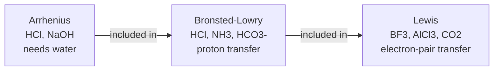
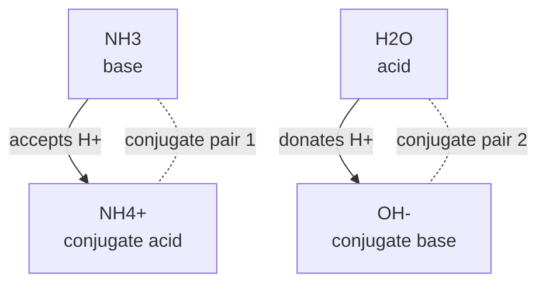
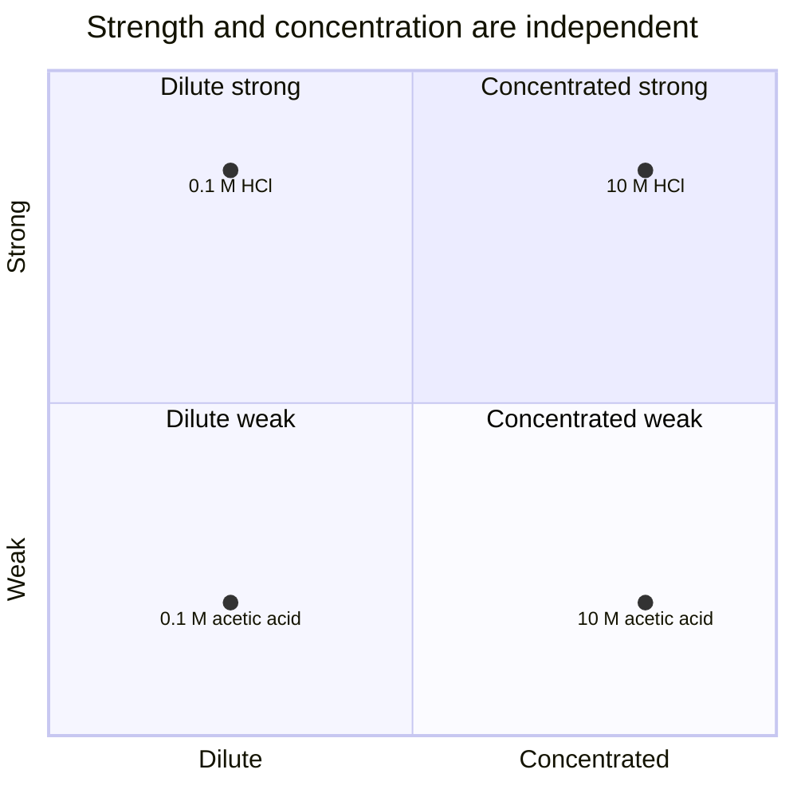
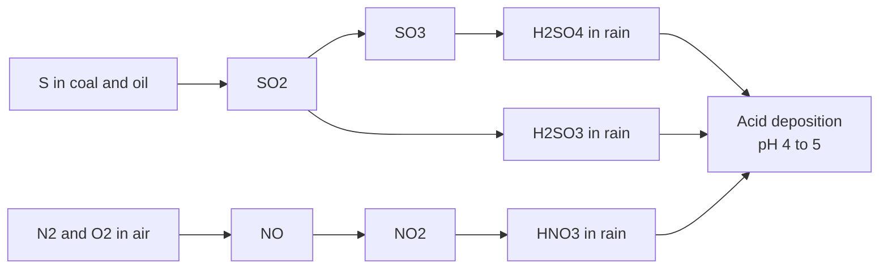

# Chapter 09 — Introduction to Acids and Bases

> **Level:** Elementary (Level 1)
> **Estimated study time:** 5 hours (reading) + 2 hours (exercises)
> **Prerequisites:** [Chapter 7 — Chemical Nomenclature](07-chemical-nomenclature.md) · [Chapter 8 — Chemical Reactions, Balancing and Conservation of Mass](08-chemical-reactions-and-balancing-equations.md)
> **Related chapters:** [Level 2, Chapter 11 — Acid–Base Chemistry, pH and pOH](../03-intermediate-chemistry/README.md) · [Level 1 index](README.md)
> **Difficulty:** ★★★☆☆

---

## 1. Learning Objectives

After working through this chapter you will be able to:

- Describe the observable properties of acids and bases and explain why observation alone cannot define them.
- State the Arrhenius, Brønsted–Lowry and Lewis definitions and explain how each extends the previous one.
- Identify the conjugate acid–base pairs in a proton-transfer reaction.
- Recognize amphiprotic species and explain what makes them amphiprotic.
- Distinguish a strong acid from a concentrated one, and a weak acid from a dilute one.
- Write balanced equations for neutralization, for acids with metals and for acids with carbonates.
- Interpret the pH scale qualitatively and place common substances on it.
- Select a suitable indicator for a given titration from its colour range.
- Explain the chemistry of acid deposition and one of its environmental consequences.

---

## 2. Introduction

Acids and bases are the most familiar chemistry there is. Vinegar, lemon juice, coffee,
soap, bleach and drain cleaner are either acidic or basic, and the difference is routinely
detected in the kitchen by taste, smell and feel. That familiarity is exactly why the
chemistry needs care: the household categories are crude, and several of them are dangerous
to test.

The scientific story begins with Robert Boyle in the seventeenth century, who characterized
acids by their power to dissolve substances, to change the colour of plant dyes and to lose
those properties when combined with alkalis. It continues through Lavoisier, who wrongly
supposed that all acids contain oxygen — the name *oxygen* means "acid former" — and through
Humphry Davy, who showed in 1810 that hydrogen chloride contains no oxygen at all yet is a
strong acid.

The modern treatment is a sequence of definitions, each broader than the last. Arrhenius, in
the 1880s, defined an acid as a source of hydrogen ions in water and a base as a source of
hydroxide ions. Brønsted and Lowry, independently in 1923, redefined the pair in terms of
proton transfer, which brought ammonia and carbonate into the fold. Lewis, in the same year,
generalized further to electron-pair donation and acceptance, which brought boron
trifluoride and aluminium chloride into the same framework.

This chapter is deliberately qualitative: it establishes what acids and bases *are*, what
they do, and how they are detected. The quantitative treatment — $K_a$, $K_w$, pH
calculations, buffers and titration curves — belongs to Level 2.

---

## 3. Fundamental Concepts

### 3.1 Observable properties — and the limits of observation

Acids and bases were named for their behaviour, and the behaviour is real:

| Property | Acids | Bases |
|---|---|---|
| Action on litmus | red | blue |
| Action on methyl orange | red or orange | yellow |
| Action on phenolphthalein | colourless | pink to magenta |
| Action on metals | hydrogen gas evolved (reactive metals only) | no reaction with metals |
| Action on carbonates | carbon dioxide evolved | no reaction |
| Feel | — | slippery or soapy (dilute solutions) |
| Taste | sour (historical description only) | bitter (historical description only) |

**Safety.** The taste and feel entries are historical descriptions, not tests. Many acids and
bases are corrosive, and some — hydrofluoric acid, concentrated alkalis, phenol — are
dangerous on brief contact. **Never taste, smell or touch a chemical in a laboratory.** Use an
indicator, a pH meter or a conductivity probe. The descriptions explain the words *acid* (from
Latin *acidus*, sour) and *alkali* (from Arabic *al-qily*), not procedures.

Observation also fails as a definition: pure water conducts weakly yet is neutral, sodium
chloride solution conducts but is neutral, and Borax solution feels slippery without
containing hydroxide. A definition must be structural, not sensory.

### 3.2 The Arrhenius definition

An **Arrhenius acid** increases the concentration of hydrogen ions, $\ce{H+}$, when
dissolved in water; an **Arrhenius base** increases the concentration of hydroxide ions,
$\ce{OH-}$.

$$
\ce{HCl(g) -> H+(aq) + Cl-(aq)} \qquad \ce{NaOH(s) -> Na+(aq) + OH-(aq)}
$$

The definition works for the common laboratory acids and for group 1 and 2 hydroxides, but
its limits are clear. It requires water: hydrogen chloride in benzene is an acid by every
chemical test yet produces no $\ce{H+}$, because benzene does not solvate the ion. It cannot
accommodate ammonia, which is a base yet contains no hydroxide. And the bare proton does not
exist in water; it is always attached to a water molecule as $\ce{H3O+}$, the **hydronium
ion**, so $\ce{H+(aq)}$ is only a shorthand.

### 3.3 The Brønsted–Lowry definition

A **Brønsted–Lowry acid** is a proton donor; a **Brønsted–Lowry base** is a proton
acceptor. The definition requires only that a proton be transferred, so it applies in any
solvent and to species containing neither oxygen nor hydroxide.

$$
\ce{NH3(aq) + H2O(l) <=> NH4+(aq) + OH-(aq)}
$$

Water donates a proton and ammonia accepts it: ammonia is a base without containing
hydroxide, and water is acting as an acid. The double arrow is used because ammonia is a
weak base — in $0.1\ \text{mol dm}^{-3}$ solution only about one molecule in a hundred is
protonated at equilibrium.

### 3.4 The Lewis definition

A **Lewis acid** is an electron-pair acceptor; a **Lewis base** is an electron-pair donor.
Every Brønsted acid is a Lewis acid, because the proton it donates is itself an electron-pair
acceptor, and every Brønsted base is a Lewis base, because the proton is accepted into a
lone pair.

The Lewis definition reaches cases that involve no proton at all:

$$
\ce{BF3(g) + NH3(g) -> F3B<-NH3(s)} \qquad \ce{AlCl3(s) + Cl-(aq) -> AlCl4-(aq)}
$$

$$
\ce{CO2(aq) + OH-(aq) -> HCO3-(aq)}
$$

Boron trifluoride, aluminium chloride and carbon dioxide are Lewis acids; the last reaction
is the first step by which carbon dioxide dissolves in alkali.

### 3.5 Conjugate acid–base pairs

In a proton-transfer reaction, the species left behind when an acid donates a proton is its
**conjugate base**; the species formed when a base accepts a proton is its **conjugate
acid**. Together they form a **conjugate pair**, differing by exactly one $\ce{H+}$.

$$
\ce{HCl(aq) + H2O(l) -> H3O+(aq) + Cl-(aq)}
$$

| Acid | Conjugate base | Base | Conjugate acid |
|---|---|---|---|
| $\ce{HCl}$ | $\ce{Cl-}$ | $\ce{H2O}$ | $\ce{H3O+}$ |
| $\ce{NH4+}$ | $\ce{NH3}$ | $\ce{H2O}$ | $\ce{H3O+}$ |
| $\ce{CH3COOH}$ | $\ce{CH3COO-}$ | $\ce{H2O}$ | $\ce{H3O+}$ |
| $\ce{HCO3-}$ | $\ce{CO3^2-}$ | $\ce{OH-}$ | $\ce{H2O}$ |
| $\ce{H2SO4}$ | $\ce{HSO4-}$ | $\ce{H2O}$ | $\ce{H3O+}$ |

The stronger the acid, the weaker its conjugate base: $\ce{Cl-}$ is a negligible base because
$\ce{HCl}$ is strong, whereas acetate is a significant base because acetic acid is weak. This
inverse relationship is the key to buffer chemistry in Level 2.

### 3.6 Amphiprotic species

An **amphiprotic** species can both donate and accept a proton. Water is the standard
example, and the reaction is called **autoionization**:

$$
\ce{H2O + H2O <=> H3O+ + OH-}
$$

The equilibrium lies far to the left: at $25\ ^\circ\text{C}$ each ion is present at
$1.0 \times 10^{-7}\ \text{mol dm}^{-3}$. Other amphiprotic species include $\ce{HCO3-}$,
$\ce{HSO4-}$ and $\ce{H2PO4-}$; each can lose a proton to become its conjugate base or gain
one to become its conjugate acid, as in
$\ce{HCO3- + H+ <=> H2CO3}$ and $\ce{HCO3- <=> H+ + CO3^2-}$. Amphiprotic behaviour is
what makes the carbonate and phosphate systems so effective at stabilizing pH in blood and
in cells.

### 3.7 Strong and weak acids and bases

A **strong acid** ionizes completely in water; a **weak acid** ionizes only partially, and
an equilibrium is established. The distinction is a property of the substance, not of the
solution.

| Strong acids | Strong bases |
|---|---|
| $\ce{HCl}$ hydrochloric | $\ce{LiOH}$ lithium hydroxide |
| $\ce{HBr}$ hydrobromic | $\ce{NaOH}$ sodium hydroxide |
| $\ce{HI}$ hydroiodic | $\ce{KOH}$ potassium hydroxide |
| $\ce{HNO3}$ nitric | $\ce{Ca(OH)2}$ calcium hydroxide |
| $\ce{HClO4}$ perchloric | $\ce{Sr(OH)2}$ strontium hydroxide |
| $\ce{H2SO4}$ sulfuric (first proton) | $\ce{Ba(OH)2}$ barium hydroxide |
| $\ce{HClO3}$ chloric | — |

Everything else is weak, including hydrofluoric acid — dangerous precisely because it is
weak and therefore penetrates tissue before dissociating — and all the organic acids. Even
sulfuric acid is strong only in its first ionization:

$$
\ce{H2SO4(aq) -> H3O+(aq) + HSO4-(aq)} \qquad \ce{HSO4-(aq) + H2O(l) <=> H3O+(aq) + SO4^2-(aq)}
$$

### 3.8 Neutralization

**Neutralization** is the reaction of an acid with a base to give a salt and, usually,
water:

$$
\ce{HCl(aq) + NaOH(aq) -> NaCl(aq) + H2O(l)}
$$

The net ionic equation is the same for every strong acid and every strong base:

$$
\ce{H+(aq) + OH-(aq) -> H2O(l)}
$$

With a weak base such as ammonia no water is formed, only a salt:
$\ce{HCl(aq) + NH3(aq) -> NH4Cl(aq)}$; and with excess acid an **acid salt** may result:
$\ce{H2SO4(aq) + NaOH(aq) -> NaHSO4(aq) + H2O(l)}$. Neutralization does not necessarily give
a neutral solution: the salt of a weak acid and a strong base hydrolyses to an alkaline
solution, the salt of a strong acid and a weak base to an acidic one, and only a strong
acid with a strong base gives pH 7 at the equivalence point.

### 3.9 Acids with metals and with carbonates

**Acids with reactive metals.** An acid reacts with a metal that lies above hydrogen in the
reactivity series, giving a salt and hydrogen:

$$
\ce{Mg(s) + 2HCl(aq) -> MgCl2(aq) + H2(g)} \qquad \ce{Zn(s) + H2SO4(aq) -> ZnSO4(aq) + H2(g)}
$$

Copper, silver and gold lie below hydrogen and do not react with dilute hydrochloric or
sulfuric acid. Nitric acid is a special case: it is a strong oxidizer, and with copper it
gives nitrogen dioxide rather than hydrogen,
$\ce{Cu(s) + 4HNO3(aq) -> Cu(NO3)2(aq) + 2NO2(g) + 2H2O(l)}$.

**Acids with carbonates and hydrogencarbonates.** These give a salt, water and carbon
dioxide, and the effervescence is the standard test for a carbonate:

$$
\ce{Na2CO3(aq) + 2HCl(aq) -> 2NaCl(aq) + H2O(l) + CO2(g)} \qquad \ce{CaCO3(s) + 2HCl(aq) -> CaCl2(aq) + H2O(l) + CO2(g)}
$$

The net ionic equations are $\ce{CO3^2-(aq) + 2H+(aq) -> H2O(l) + CO2(g)}$ and
$\ce{HCO3-(aq) + H+(aq) -> H2O(l) + CO2(g)}$.

### 3.10 The pH scale, qualitatively

The **pH** of a solution is a logarithmic measure of its hydrogen ion activity:

$$
\text{pH} = -\log_{10} a_{\ce{H+}} \approx -\log_{10}[\ce{H3O+}]
$$

The approximation — activity replaced by concentration — is adequate for the dilute
solutions met at this level; quantitative use of the equation is Level 2. What matters now is
the shape of the scale. pH 7 is neutral at $25\ ^\circ\text{C}$ because
$[\ce{H3O+}] = [\ce{OH-}]$; below 7 is acidic and above 7 is basic. Each unit is a
**tenfold** change in hydrogen ion concentration, so pH 4 is ten times more acidic than pH 5
and a hundred times more than pH 6. The range 0–14 is conventional rather than fundamental:
concentrated strong acids have negative pH and concentrated alkali can exceed 14. Neutrality
also shifts with temperature — at $100\ ^\circ\text{C}$ neutral pH is about 6.14, because
autoionization becomes more favourable.

### 3.11 Indicators

An **indicator** is a weak acid whose conjugate base has a different colour; the change
occurs over about two pH units, centred on the indicator's $pK_a$.

| Indicator | Colour in acid | Colour in base | Transition range |
|---|---|---|---|
| litmus | red | blue | 4.5–8.3 |
| methyl orange | red | yellow | 3.1–4.4 |
| bromothymol blue | yellow | blue | 6.0–7.6 |
| methyl red | red | yellow | 4.4–6.2 |
| phenolphthalein | colourless | pink to magenta | 8.2–10.0 |

**Universal indicator** is a mixture of dyes showing a continuous sequence: red at pH 1–3,
orange at 4–5, yellow at 6, green at 7, blue-green at 8, blue at 9–10 and violet at 11–14.
It estimates pH to about one unit; a pH meter is needed for real measurement.

---

## 4. Detailed Scientific Explanation

### 4.1 How the definitions extend one another

The three definitions form a nested sequence, not a set of rivals (Figure 9.1). An Arrhenius
acid must contain hydrogen and be placed in water; a Brønsted acid must contain hydrogen but
needs no particular solvent; a Lewis acid need contain no hydrogen at all. Boron trifluoride
proves the Lewis category is strictly larger.

### 4.2 Why HF is weak and HCl is strong

Across the hydrogen halides the bond strength falls from HF to HI, and the acidity
increases in the same direction. The relevant comparison is between the energy required to
break the H–X bond and the energy released when the resulting anion is solvated. For HF the
H–F bond is very strong ($\approx 570\ \text{kJ mol}^{-1}$) and the small fluoride ion is
strongly solvated, but bond breaking dominates and the acid is weak. For HCl, HBr and HI the
bond is progressively weaker and the larger halide ions are well solvated, so ionization is
complete.

This corrects the naive rule that the more electronegative atom makes the stronger acid.
Polarity helps, but bond strength and anion stability matter more, which is why HF is the
weakest hydrohalic acid rather than the strongest.

### 4.3 Concentration is not strength

The two words are used interchangeably in everyday speech and mean entirely different things:
**strength** is the extent of ionization, a property of the acid; **concentration** is the
amount per unit volume, a property of the solution. A dilute strong acid can therefore be
less acidic than a concentrated weak one — hydrochloric acid at
$0.001\ \text{mol dm}^{-3}$ has pH 3, while acetic acid at $10\ \text{mol dm}^{-3}$ has a pH
of about 2.

| Solution | Strength | Concentration | Approximate pH |
|---|---|---|---|
| $\ce{HCl}$ | strong | $1.0\ \text{mol dm}^{-3}$ | 0 |
| $\ce{HCl}$ | strong | $0.001\ \text{mol dm}^{-3}$ | 3 |
| $\ce{CH3COOH}$ | weak | $1.0\ \text{mol dm}^{-3}$ | 2.4 |
| $\ce{CH3COOH}$ | weak | $0.001\ \text{mol dm}^{-3}$ | 3.9 |
| $\ce{NaOH}$ | strong | $1.0\ \text{mol dm}^{-3}$ | 14 |
| $\ce{NH3}$ | weak | $1.0\ \text{mol dm}^{-3}$ | 11.6 |

Two consequences follow. Conductivity and reaction rate track the *concentration of ions*,
not the concentration of acid: $0.1\ \text{mol dm}^{-3}$ hydrochloric acid conducts far
better and reacts far faster with magnesium than $0.1\ \text{mol dm}^{-3}$ acetic acid. And
"weak" does not mean "safe" — hydrofluoric acid is weak and extremely hazardous.

### 4.4 Acid deposition

**Acid deposition** is the transfer of acidic compounds from atmosphere to ground, as wet
deposition (rain, snow, fog) or dry deposition (gas and particles). Unpolluted rain is already
slightly acidic, at about pH 5.6, because it dissolves carbon dioxide:

$$
\ce{CO2(g) + H2O(l) <=> H2CO3(aq) <=> H+(aq) + HCO3-(aq)}
$$

The anthropogenic contribution comes from sulfur and nitrogen oxides. Burning
sulfur-containing coal and oil releases sulfur dioxide, and high-temperature combustion
fixes atmospheric nitrogen as nitric oxide:

$$
\ce{S(s) + O2(g) -> SO2(g)} \qquad \ce{N2(g) + O2(g) -> 2NO(g)}
$$

Both are oxidized further in the atmosphere and then dissolve to give acids:

$$
\ce{2SO2(g) + O2(g) -> 2SO3(g)} \qquad \ce{2NO(g) + O2(g) -> 2NO2(g)}
$$

$$
\ce{SO3(g) + H2O(l) -> H2SO4(aq)} \qquad \ce{SO2(g) + H2O(l) <=> H2SO3(aq)}
$$

$$
\ce{3NO2(g) + H2O(l) -> 2HNO3(aq) + NO(g)}
$$

Rain in polluted regions typically reaches pH 4.0–4.5, and individual events below pH 3 have
been recorded. Two mechanisms do the damage: direct toxicity of the increased hydrogen ion
concentration to fish eggs and invertebrates, and mobilization of aluminium from soil
minerals, which is toxic to fish gills and fine roots. Limestone is attacked directly:

$$
\ce{CaCO3(s) + H2SO4(aq) -> CaSO4(s) + H2O(l) + CO2(g)}
$$

The calcium sulfate is sparingly soluble and forms a crust that spalls off, carrying the
stone surface with it. Flue-gas desulfurization uses the same neutralization deliberately:

$$
\ce{CaCO3(s) + SO2(g) + 0.5O2(g) -> CaSO4(s) + CO2(g)}
$$

---

## 5. Visual Diagrams

The three definitions are nested, and the nesting is best seen as a set diagram.

**Figure 9.1 — The three definitions as nested sets.** Every Arrhenius acid is a Brønsted
acid and every Brønsted acid is a Lewis acid, but not the reverse; boron trifluoride contains
no hydrogen at all.

A proton transfer is a two-way transaction; drawing both directions makes the pairs visible.

**Figure 9.2 — Conjugate pairs in the ammonia–water reaction.** Solid arrows show the proton
transfer; dotted lines join each acid to the base it becomes. Every proton-transfer reaction
contains two such pairs, one on each side of the equation.

Strength and concentration are independent axes.

**Figure 9.3 — Strength against concentration.** Moving right increases concentration without
changing the degree of ionization; moving up increases strength without changing the amount of
acid. Treating "weak" as a synonym for "dilute" becomes visibly impossible.

Acid deposition is a chain of reactions, and each link is a separate chemical step.

**Figure 9.4 — The chemistry of acid deposition.** Two pollutant streams are oxidized in the
atmosphere and then dissolve to give strong and weak acids. The combustion, oxidation and
dissolution steps are separated because each is controlled differently: fuel choice,
combustion temperature and emission control.

---

## 6. Mathematical Formulas

The definitions used here are logarithmic; the quantitative work is deferred to Level 2.
What is given is the notation, not a calculation routine.

$$
\text{pH} = -\log_{10} a_{\ce{H+}} \approx -\log_{10}[\ce{H3O+}]
$$

$$
K_w = [\ce{H3O+}][\ce{OH-}] = 1.0 \times 10^{-14}\ \text{at } 298\ \text{K} \qquad \text{pH} + \text{pOH} = 14.00
$$

| Symbol | Meaning | SI unit |
|---|---|---|
| $\text{pH}$ | negative decadic logarithm of hydrogen ion activity | dimensionless |
| $a_{\ce{H+}}$ | activity of the hydrogen ion | dimensionless |
| $[\ce{H3O+}]$ | amount concentration of hydronium ion | mol dm⁻³ (≡ mol L⁻¹) |
| $K_w$ | ion-product constant of water | dimensionless (strictly) or mol² dm⁻⁶ |
| $T$ | thermodynamic temperature | K |

**Assumptions.** Replacing activity by concentration is valid below about
$0.1\ \text{mol dm}^{-3}$, where the activity coefficient is close to one. The value
$K_w = 1.0 \times 10^{-14}$ applies at $25\ ^\circ\text{C}$; at $100\ ^\circ\text{C}$ it is
about $5 \times 10^{-13}$, which is why neutral pH is not 7 at that temperature.

---

## 7. Chemical Equations

**Neutralization**, which is one reaction regardless of the acid and base chosen:

$$
\ce{HCl(aq) + NaOH(aq) -> NaCl(aq) + H2O(l)} \qquad \ce{H2SO4(aq) + 2NaOH(aq) -> Na2SO4(aq) + 2H2O(l)}
$$

**Acid with a reactive metal**, giving a salt and hydrogen:

$$
\ce{Mg(s) + 2HCl(aq) -> MgCl2(aq) + H2(g)} \qquad \ce{2Al(s) + 6HCl(aq) -> 2AlCl3(aq) + 3H2(g)}
$$

**Acid with a carbonate**, giving a salt, water and carbon dioxide:

$$
\ce{Na2CO3(aq) + 2HCl(aq) -> 2NaCl(aq) + H2O(l) + CO2(g)}
$$

**Acid with a metal oxide.** Basic oxides behave as bases without containing hydroxide:

$$
\ce{CuO(s) + 2HCl(aq) -> CuCl2(aq) + H2O(l)}
$$

Each equation is balanced by inspection and conserves mass and charge. The net ionic form of
the metal oxide reaction, $\ce{CuO(s) + 2H+(aq) -> Cu^2+(aq) + H2O(l)}$, shows that the oxide,
not the chloride, is the base.

---

## 8. Worked Examples

### Worked Example 8.1 — Identifying conjugate pairs

**Problem.** For the reaction $\ce{HCO3-(aq) + H2O(l) <=> H2CO3(aq) + OH-(aq)}$, identify
both conjugate pairs and state which species is the acid and which is the base on each
side.

**Strategy.** A conjugate pair differs by exactly one proton. Look for the species that
gains an $\ce{H+}$ and the species that loses one.

**Solution.** On the left, $\ce{HCO3-}$ gains a proton to become $\ce{H2CO3}$; on the
right, $\ce{H2O}$ loses a proton to become $\ce{OH-}$. Therefore:

- $\ce{HCO3-}$ is the base and $\ce{H2CO3}$ is its conjugate acid;
- $\ce{H2O}$ is the acid and $\ce{OH-}$ is its conjugate base.

The reaction shows hydrogencarbonate acting as a base. In the reverse direction it acts as
an acid, which is what makes it amphiprotic.

**Check.** Atoms balance: left C 1, H 3, O 4; right C 1, H 3, O 4. Charge balances:
left $-1$, right $-1$. Each pair differs by one $\ce{H+}$ and by one unit of charge, as a
conjugate pair must.

### Worked Example 8.2 — Classifying a species under all three definitions

**Problem.** Classify (a) $\ce{NH3}$, (b) $\ce{BF3}$ and (c) $\ce{HSO4-}$ as acid, base or
both, under each definition where applicable.

**Strategy.** Test each definition in turn: does it produce $\ce{H+}$ or $\ce{OH-}$ in water;
does it donate or accept a proton; does it accept or donate an electron pair?

**Solution.** (a) $\ce{NH3}$ produces $\ce{OH-}$ in water by accepting a proton, so it is
both an Arrhenius and a Brønsted base; it also donates its lone pair, so it is a Lewis base.
(b) $\ce{BF3}$ contains no hydrogen and produces neither $\ce{H+}$ nor $\ce{OH-}$, so it is
neither an Arrhenius nor a Brønsted acid; it accepts an electron pair, so it is a Lewis acid.
(c) $\ce{HSO4-}$ donates a proton to give $\ce{SO4^2-}$ and accepts one to give $\ce{H2SO4}$,
so it is amphiprotic and also a Lewis base through its oxygen lone pairs.

**Check.** Each classification is supported by a written reaction, not a label. The Arrhenius
definition fails first (no hydrogen, no water), then the Brønsted definition (no proton), and
only the Lewis definition survives.

### Worked Example 8.3 — Balancing neutralization equations

**Problem.** Write balanced equations for (a) phosphoric acid with potassium hydroxide and
(b) sulfuric acid with calcium hydroxide, and give the net ionic equation.

**Strategy.** Neutralization requires one $\ce{OH-}$ per acidic hydrogen.

**Solution.** (a) Phosphoric acid has three acidic hydrogens, so three hydroxides are needed;
(b) sulfuric acid has two acidic hydrogens and calcium hydroxide supplies two hydroxides, so
the ratio is one to one:

$$
\ce{H3PO4(aq) + 3KOH(aq) -> K3PO4(aq) + 3H2O(l)} \qquad \ce{H2SO4(aq) + Ca(OH)2(aq) -> CaSO4(aq) + 2H2O(l)}
$$

The net ionic equation is the same in both cases, because both acids and bases are strong
electrolytes: $\ce{H+(aq) + OH-(aq) -> H2O(l)}$.

**Check.** (a) K 3, P 1, O 7, H 6 on each side; (b) Ca 1, S 1, O 6, H 4 on each side.
Charge is zero on both sides in both equations.

### Worked Example 8.4 — Choosing an indicator

**Problem.** A titration is carried out between (a) hydrochloric acid and sodium hydroxide,
(b) acetic acid and sodium hydroxide, (c) hydrochloric acid and ammonia. Which indicator
should be used in each case?

**Strategy.** The indicator must change colour at the equivalence pH that the salt sets.

**Solution.** (a) Strong acid with strong base gives a neutral salt, so the equivalence point
is at pH 7.
Either phenolphthalein (8.2–10.0) or methyl orange (3.1–4.4) is acceptable, because the
titration curve is nearly vertical across the whole range 4–10.

(b) The salt of a weak acid and a strong base hydrolyses to an alkaline solution, so the
equivalence point is above pH 7, typically 8–9. Phenolphthalein is correct; methyl orange
would change colour before the endpoint.

(c) The salt of a strong acid and a weak base hydrolyses to an acidic solution, so the
equivalence point is below pH 7, typically 5–6. Methyl orange is correct; phenolphthalein
would change only after a large excess of base had been added.

**Check.** In each case the indicator range brackets the equivalence pH. Rule of thumb: weak
acid with strong base, choose phenolphthalein; weak base with strong acid, choose methyl
orange.

### Worked Example 8.5 — Comparing acidity across the pH scale

**Problem.** Two rain samples have pH 5.6 and pH 4.2. By what factor do their hydrogen ion
concentrations differ?

**Strategy.** Each pH unit is a factor of ten, so the difference in pH units is the exponent.

**Solution.** The difference is $5.6 - 4.2 = 1.4$ pH units, so
$[\ce{H3O+}]_{4.2}/[\ce{H3O+}]_{5.6} = 10^{1.4} \approx 25$: the pH 4.2 sample is about 25
times more acidic.

**Check.** The factor lies between 10 and 100, as it must for a difference of 1.4 units. A
common error is to report "1.4 times", which treats a logarithmic scale as linear.

---

## 9. Real-World Applications

**Gastric acid and antacids.** The stomach maintains pH 1.5–3.5 to denature proteins and
activate pepsin. Antacids are weak bases — calcium carbonate, magnesium hydroxide, aluminium
hydroxide — that neutralize excess acid, as in
$\ce{CaCO3(s) + 2HCl(aq) -> CaCl2(aq) + H2O(l) + CO2(g)}$. The carbon dioxide is why
carbonate antacids can cause bloating; hydroxide antacids avoid it.

**Soil and agriculture.** Most crops grow best between pH 5.5 and 7.5. Acidification by rain,
by ammonium-based fertilizers and by crop removal is corrected by **liming** with calcium
carbonate or calcium hydroxide, which is neutralization on a field scale:
$\ce{Ca(OH)2(s) + 2H+(aq) -> Ca^2+(aq) + 2H2O(l)}$.

**Food and drink.** Acidity preserves food by lowering the pH below the range in which most
bacteria grow; lactic acid fermentation of milk and acetic acid fermentation of ethanol are
both acidification processes. Citrus sours with citric acid, yoghurt with lactic acid.

**Blood buffering.** The carbonic acid–hydrogencarbonate system keeps blood at pH 7.35–7.45
through the chain $\ce{CO2(aq) + H2O(l) <=> H2CO3(aq) <=> H+(aq) + HCO3-(aq)}$. Because both
$\ce{CO2}$ and $\ce{HCO3-}$ are under physiological control, the buffer can be adjusted by
breathing rate as well as by the kidney; hyperventilation loses $\ce{CO2}$ and raises blood
pH, producing respiratory alkalosis.

**Industry and materials.** Sulfuric acid, the most produced industrial chemical, is made by
the contact process and used above all to dissolve phosphate rock for fertilizer. Acid attack
on limestone and concrete is geological weathering, accelerated a hundredfold.

---

## 10. Common Mistakes

| Mistake | Why it happens | Correct approach |
|---|---|---|
| Treating "strong" and "concentrated" as synonyms | Everyday language uses them interchangeably | Strength is the degree of ionization; concentration is amount per volume |
| Assuming all acids contain oxygen | The name *oxygen* means acid former | Hydrogen chloride and hydrogen sulfide contain no oxygen |
| Writing $\ce{H+}$ as a bare proton in water | The shorthand is taken literally | Write $\ce{H3O+}$ when the species matters; $\ce{H+(aq)}$ is acceptable shorthand |
| Calling ammonia an Arrhenius base | It produces $\ce{OH-}$ indirectly | Ammonia is a Brønsted and Lewis base; it contains no hydroxide |
| Believing neutralization always gives pH 7 | Strong acid plus strong base is the only neutral case | Salts of weak acids or bases hydrolyse; only strong–strong gives pH 7 |
| Forgetting that the second proton of $\ce{H2SO4}$ is weak | Sulfuric acid is remembered as "strong" | The first ionization is complete, the second is partial |
| Using the wrong indicator | Indicator choice is treated as arbitrary | Match the indicator range to the equivalence pH determined by the salt |
| Treating pH as linear | The logarithmic definition is forgotten | One pH unit is a tenfold change in $[\ce{H3O+}]$; "weak" does not mean "safe" |
| Testing acids by taste | Historical descriptions are mistaken for procedures | Use an indicator or a pH meter; never taste a chemical |

---

## 11. Chapter Summary

- Acids and bases are defined structurally, not by taste or feel; safety is never negotiable.
- The Arrhenius definition requires water and produces $\ce{H+}$ or $\ce{OH-}$; the
  Brønsted–Lowry definition generalizes to proton transfer; the Lewis definition generalizes
  further to electron-pair transfer.
- A conjugate pair differs by one proton; every proton-transfer reaction contains two such
  pairs, one on each side.
- Amphiprotic species such as $\ce{H2O}$, $\ce{HCO3-}$ and $\ce{H2PO4-}$ can both donate and
  accept a proton.
- Strong acids ionize completely and weak acids do not; strength and concentration are
  independent properties.
- Neutralization gives a salt and usually water; the pH at the equivalence point depends on
  the salt formed, not on the word "neutralization".
- Acids react with reactive metals to give hydrogen and with carbonates to give carbon
  dioxide; pH is logarithmic, one unit being a factor of ten.
- Indicators change colour over a two-unit range and must be matched to the equivalence pH;
  acid deposition is buffered in the environment by carbonate minerals.

---

## 12. Exercises

### 12.1 Conceptual questions

**1.** Explain why ammonia is a Brønsted base but not an Arrhenius base.
**2.** Why does the pH of pure water fall when it is heated, even though it remains neutral?

### 12.2 Basic problems

**3.** Write the conjugate base of (a) $\ce{HNO3}$, (b) $\ce{NH4+}$, (c) $\ce{H2PO4-}$.
**4.** Classify each as strong or weak: (a) $\ce{HClO4}$, (b) $\ce{CH3COOH}$, (c) $\ce{KOH}$, (d) $\ce{HF}$.
**5.** Complete and balance: (a) $\ce{Mg + HCl ->}$, (b) $\ce{Na2CO3 + HNO3 ->}$, (c) $\ce{Ca(OH)2 + H3PO4 ->}$.

### 12.3 Intermediate problems

**6.** Identify the two conjugate pairs in $\ce{CH3COOH(aq) + NH3(aq) <=> CH3COO-(aq) + NH4+(aq)}$.
**7.** Write the net ionic equation for the reaction of $\ce{CaCO3(s)}$ with nitric acid, and explain why the nitrate ion does not appear.
**8.** A solution has pH 3. A second has pH 6. How many times greater is the hydrogen ion concentration of the first?

### 12.4 Advanced problems

**9.** Explain, using bond strengths and ion solvation, why HI is a stronger acid than HF.
**10.** A $0.10\ \text{mol dm}^{-3}$ solution of a weak acid has a lower conductivity than a $0.10\ \text{mol dm}^{-3}$ solution of a strong acid. Explain both the conductivity difference and the difference in the rate of reaction with magnesium ribbon.

### 12.5 Calculation problems

**11.** A sample of rain has pH 4.5. Calculate its hydrogen ion concentration and state how many times more acidic it is than unpolluted rain at pH 5.6.
**12.** $25.0\ \text{cm}^3$ of $0.100\ \text{mol dm}^{-3}$ $\ce{NaOH}$ neutralizes $20.0\ \text{cm}^3$ of hydrochloric acid. Calculate the concentration of the acid.

### 12.6 Answers

1. Ammonia accepts a proton from water and so produces $\ce{OH-}$ indirectly; it contains no hydroxide and produces none by dissociation, so it is not an Arrhenius base.
2. Autoionization is endothermic, so $K_w$ increases with temperature; both $[\ce{H3O+}]$ and $[\ce{OH-}]$ rise equally, so the water stays neutral while its pH falls below 7.
3. (a) $\ce{NO3-}$; (b) $\ce{NH3}$; (c) $\ce{HPO4^2-}$.
4. (a) strong; (b) weak; (c) strong; (d) weak.
5. (a) $\ce{Mg + 2HCl -> MgCl2 + H2}$; (b) $\ce{Na2CO3 + 2HNO3 -> 2NaNO3 + H2O + CO2}$; (c) $\ce{3Ca(OH)2 + 2H3PO4 -> Ca3(PO4)2 + 6H2O}$.
6. $\ce{CH3COOH}$/$\ce{CH3COO-}$ and $\ce{NH4+}$/$\ce{NH3}$.
7. $\ce{CaCO3(s) + 2H+(aq) -> Ca^2+(aq) + H2O(l) + CO2(g)}$; nitrate is a spectator ion, unchanged on both sides, and is cancelled.
8. A thousand times: $10^{6-3} = 10^3$.
9. The H–I bond is much weaker than the H–F bond, and the larger iodide ion is well solvated; the energy released by ionization therefore exceeds the bond energy for HI but not for HF.
10. The weak acid is only partly ionized, so it provides fewer charge carriers and a lower conductivity, and fewer $\ce{H+}$ collisions per second with the magnesium surface, so the reaction is slower.
11. $[\ce{H3O+}] = 10^{-4.5} = 3.2 \times 10^{-5}\ \text{mol dm}^{-3}$; the ratio to pH 5.6 is $10^{1.1} \approx 13$, so about 13 times more acidic.
12. $n(\ce{NaOH}) = 0.0250 \times 0.100 = 2.50 \times 10^{-3}\ \text{mol}$, so $n(\ce{HCl})$ is the same; $c = 2.50 \times 10^{-3}/0.0200 = 0.125\ \text{mol dm}^{-3}$.

---

## 13. Further Reading

- Arrhenius, S. "Über die Dissociation der in Wasser gelösten Stoffe." *Zeitschrift für
  physikalische Chemie*, 1887.
- Brønsted, J. N. "Einige Bemerkungen über den Begriff der Säuren und Basen." *Recueil des
  Travaux Chimiques des Pays-Bas*, 1923.
- Lewis, G. N. *Valence and the Structure of Atoms and Molecules*. Chemical Catalog
  Company, 1923.
- OpenStax. *Chemistry 2e*. Rice University. Chapters 14 and 15.
  <https://openstax.org/details/books/chemistry-2e>
- Zumdahl, S. S.; DeCoste, D. J. *Chemical Principles*, 8th ed. Cengage. Chapter 6.
- Brown, T. L. et al. *Chemistry: The Central Science*, 14th ed. Pearson. Chapter 16.
- IUPAC. *Compendium of Chemical Terminology* ("Gold Book"), 2nd ed. (the "corrected"
  version), entries "acid", "base", "pH" and "amphiprotic".
  <https://goldbook.iupac.org/>
- See [REFERENCES.md](../REFERENCES.md) for the full source list used in this repository.

---

**Navigation:** [Level 1 index](README.md) · [Chapter 8 — Chemical Reactions](08-chemical-reactions-and-balancing-equations.md) · [Curriculum map](../CURRICULUM.md)
