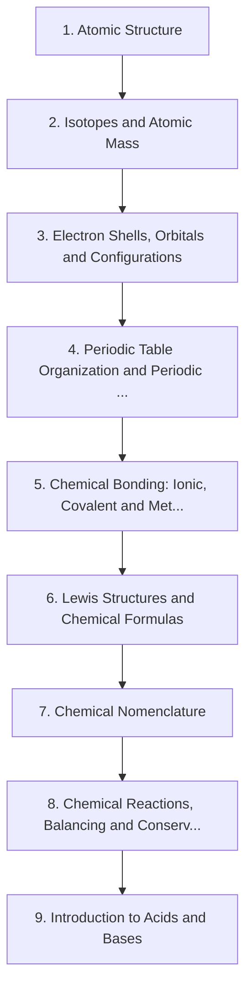

# Level 1 — Elementary Chemistry

> **Audience:** GCSE / early high-school chemistry  
> **Chapters:** 9  
> **Estimated study time:** ≈ 49 h  
> **Difficulty:** ★★☆☆☆ – ★★★☆☆

The structure of the atom, the logic of the periodic table, the three primary bonding models, Lewis structures, nomenclature and the balanced chemical equation.

Level 1 replaces the informal picture of matter built in Level 0 with a quantitative atomic model. You will meet the periodic table as a *consequence* of electron configuration rather than as a poster to memorise, and you will learn to read and write the language of chemistry: formulas, names and balanced equations.

---

## Chapters

| # | Chapter | Difficulty | Hours | Prerequisites |
|---|---|---|---|---|
| 1 | [Atomic Structure](01-atomic-structure.md) | ★★☆☆☆ | 5 | Level 0 in full |
| 2 | [Isotopes and Atomic Mass](02-isotopes-and-atomic-mass.md) | ★★☆☆☆ | 4 | Ch. 1 |
| 3 | [Electron Shells, Orbitals and Configurations](03-electron-shells-and-electron-configurations.md) | ★★★☆☆ | 6 | Ch. 1–2 |
| 4 | [Periodic Table Organization and Periodic Trends](04-periodic-table-organization-and-periodic-trends.md) | ★★★☆☆ | 6 | Ch. 1–3 |
| 5 | [Chemical Bonding: Ionic, Covalent and Metallic](05-chemical-bonding.md) | ★★★☆☆ | 7 | Ch. 3–4 |
| 6 | [Lewis Structures and Chemical Formulas](06-lewis-structures-and-chemical-formulas.md) | ★★★☆☆ | 5 | Ch. 5 |
| 7 | [Chemical Nomenclature](07-chemical-nomenclature.md) | ★★☆☆☆ | 5 | Ch. 5–6 |
| 8 | [Chemical Reactions, Balancing and Conservation of Mass](08-chemical-reactions-and-balancing-equations.md) | ★★★☆☆ | 6 | Ch. 5–7 |
| 9 | [Introduction to Acids and Bases](09-introduction-to-acids-and-bases.md) | ★★★☆☆ | 5 | Ch. 7–8 |

---

## Knowledge map

The chain is the *recommended* order. Chapters that share prerequisites can be
read out of order; the table above tells you what each one actually needs.

---

## Study routine for this level

1. Read the chapter once without taking notes, to see the shape of the argument.
2. Re-read with the chapter's learning objectives in front of you and answer them in writing.
3. Reproduce every Mermaid diagram from memory, then check it.
4. Do the exercises **before** opening the solutions file.
5. Record every mistake in a log; re-test yourself on those specific items a week later.

---

## Practice

- Exercise set: [`exercises/level-1-exercises.md`](exercises/level-1-exercises.md)
- Worked solutions: [`solutions/level-1-solutions.md`](solutions/level-1-solutions.md)

---

## Navigation

- Level index: [CURRICULUM.md](../CURRICULUM.md)
- Study methods: [00-learning-guide](../00-learning-guide/learning-path.md)
- Terminology: [GLOSSARY.md](../GLOSSARY.md)
- Sources: [REFERENCES.md](../REFERENCES.md)
