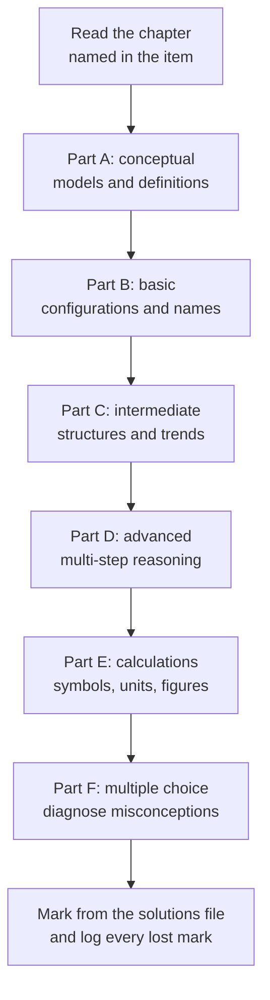

# Level 1 — Exercise Set: Elementary Chemistry

> **Level:** 1 — Elementary Chemistry
> **Estimated time:** 180 minutes
> **Covers:** [Chapter 1](../01-atomic-structure.md), [Chapter 2](../02-isotopes-and-atomic-mass.md), [Chapter 3](../03-electron-shells-and-electron-configurations.md), [Chapter 4](../04-periodic-table-organization-and-periodic-trends.md), [Chapter 5](../05-chemical-bonding.md), [Chapter 6](../06-lewis-structures-and-chemical-formulas.md), [Chapter 7](../07-chemical-nomenclature.md), [Chapter 8](../08-chemical-reactions-and-balancing-equations.md), [Chapter 9](../09-introduction-to-acids-and-bases.md)

This bank assumes Level 0 in full and adds the three new skills of Level 1: writing
electron configurations, writing systematic names and formulas, and balancing
equations. Calculations are limited to those taught in Chapters 1–6 and 8–9. Attempt
every item in writing before opening the solutions.

**Working rules.** Write the balanced equation before any stoichiometric work. Show
the relationship in symbols before substituting numbers. Carry units through every
line. Quote a final answer to the number of significant figures justified by the data.
Where an item asks you to explain, write two to five sentences and use the correct
technical vocabulary.

The relations used in this bank are
$$
A = Z + N, \qquad A_r = \sum_i f_i A_{r,i}, \qquad
FC = V - N_{\text{lone}} - N_{\text{bonds}}, \qquad \sum_i z_i n_i = 0
$$

---

## Part A — Conceptual questions (10 items, 2 marks each)

1. **[Ch. 1]** How did the results of the Rutherford α-scattering experiment refute the
   plum-pudding model of the atom?

2. **[Ch. 1]** Distinguish the mass number $A$ from the relative atomic mass $A_r$.

3. **[Ch. 2]** Explain why the relative atomic mass of chlorine is $35.45$ rather than
   either $35$ or $37$.

4. **[Ch. 2]** Explain why isotopes of the same element have almost identical chemical
   properties.

5. **[Ch. 3]** State the Aufbau principle, Hund's rule and the Pauli exclusion
   principle.

6. **[Ch. 4]** Explain the general increase in first ionisation energy across period 3
   and the dips at aluminium and at sulfur.

7. **[Ch. 5]** Distinguish ionic, covalent and metallic bonding in terms of the
   behaviour of electrons. For each model, state one physical property that follows
   from it.

8. **[Ch. 6]** Explain why the sum of the formal charges in a Lewis structure must
   equal the net charge on the species.

9. **[Ch. 7]** Why is "iron chloride" not an acceptable systematic name for
   $\ce{FeCl3}$?

10. **[Ch. 9]** Distinguish a Brønsted–Lowry acid from a Lewis acid, and give one
    example of a Lewis acid that is not a Brønsted acid.

---

## Part B — Basic problems (12 items, 3 marks each)

11. **[Ch. 1]** For each species, give the number of protons, neutrons and electrons:
    $\ce{^{23}_{11}Na^+}$, $\ce{^{35}_{17}Cl^-}$ and $\ce{^{40}_{20}Ca^2+}$.

12. **[Ch. 2]** Calculate the relative atomic mass of bromine from its isotopes
    $\ce{^{79}Br}$ (relative isotopic mass $78.918$, abundance $50.69\%$) and
    $\ce{^{81}Br}$ (relative isotopic mass $80.916$, abundance $49.31\%$).

13. **[Ch. 3]** Write the full electron configuration and the noble-gas shorthand for
    (a) magnesium and (b) sulfur.

14. **[Ch. 3]** Write the electron configurations of $\ce{Mn^2+}$ and $\ce{Mn^3+}$.
    State which electrons are removed first when a transition metal forms a cation,
    and why.

15. **[Ch. 4]** Arrange Li, Na, K and Rb in order of increasing first ionisation
    energy, and explain the trend in terms of shell number and shielding.

16. **[Ch. 5]** Use electronegativity differences to classify each bond as essentially
    nonpolar, polar covalent or largely ionic: (a) $\ce{K-Cl}$; (b) $\ce{H-F}$;
    (c) $\ce{F-F}$; (d) $\ce{C-H}$. Use $\chi(\ce{K}) = 0.82$,
    $\chi(\ce{H}) = 2.20$, $\chi(\ce{C}) = 2.55$, $\chi(\ce{F}) = 3.98$ and
    $\chi(\ce{Cl}) = 3.16$.

17. **[Ch. 6]** Draw the Lewis structure of (a) $\ce{H2O}$ and (b) $\ce{CO2}$. For
    each, state the number of lone pairs on the central atom and the bond order.

18. **[Ch. 7]** Name each compound: (a) $\ce{FeCl2}$; (b) $\ce{Cr2O3}$;
    (c) $\ce{N2O4}$; (d) $\ce{KClO3}$.

19. **[Ch. 7]** Write the formula for (a) potassium dihydrogenphosphate, (b) sodium
    hydrogensulfate and (c) calcium sulfate hemihydrate.

20. **[Ch. 8]** Balance each equation:
    (a) $\ce{C3H8 + O2 -> CO2 + H2O}$;
    (b) $\ce{Cu + AgNO3 -> Cu(NO3)2 + Ag}$;
    (c) $\ce{Ca(OH)2 + H3PO4 -> Ca3(PO4)2 + H2O}$.

21. **[Ch. 9]** In the equilibrium
    $\ce{NH3(aq) + H2O(l) <=> NH4+(aq) + OH-(aq)}$, identify the two conjugate
    acid–base pairs and state which reactant is the acid.

22. **[Ch. 8]** For the reaction of aqueous lead(II) nitrate with aqueous potassium
    iodide, write the molecular equation, the complete ionic equation and the net
    ionic equation.

---

## Part C — Intermediate problems (12 items, 4 marks each)

23. **[Ch. 1]** In an α-scattering experiment, the atomic radius is approximately
    $1.0 \times 10^{-10}\ \text{m}$ and the nuclear radius approximately
    $1.0 \times 10^{-14}\ \text{m}$. Calculate the ratio of the atomic volume to the
    nuclear volume, and comment on the result.

24. **[Ch. 2]** Boron has two stable isotopes, $\ce{^{10}B}$ (relative isotopic mass
    $10.013$) and $\ce{^{11}B}$ (relative isotopic mass $11.009$). The relative atomic
    mass of boron is $10.81$. Calculate the percentage abundance of each isotope.

25. **[Ch. 3]** Write the electron configurations of copper and zinc, explain why
    copper is anomalous while zinc is not, and give the configuration of $\ce{Cu+}$.

26. **[Ch. 3]** Use the $(n+\ell)$ rule to place $3d$, $4s$, $4p$, $5s$ and $4d$ in
    order of filling. Hence identify the element with configuration
    $[\ce{Ar}]\,3d^{5}4s^{1}$.

27. **[Ch. 4]** Arrange the isoelectronic species $\ce{S^2-}$, $\ce{Cl^-}$, $\ce{K+}$
    and $\ce{Ca^2+}$ in order of decreasing ionic radius, and justify the order.

28. **[Ch. 5]** Explain why magnesium oxide has a much higher melting point than
    potassium bromide. Use the proportionality
    $E_{\text{latt}} \propto z_+ z_- / (r_+ + r_-)$ with
    $r(\ce{Mg^2+}) = 72\ \text{pm}$, $r(\ce{O^2-}) = 140\ \text{pm}$,
    $r(\ce{K+}) = 138\ \text{pm}$ and $r(\ce{Br-}) = 196\ \text{pm}$, and estimate
    the ratio of the two lattice enthalpies.

29. **[Ch. 5]** The bond length in $\ce{HF}$ is $91.7\ \text{pm}$ and its dipole moment
    is $1.83\ \text{D}$. Calculate the magnitude of the separated charge in coulombs
    and as a fraction of the elementary charge. Hence estimate the percentage ionic
    character of the bond. Use $1\ \text{D} = 3.336 \times 10^{-30}\ \text{C m}$.

30. **[Ch. 6]** Draw a Lewis structure for $\ce{NO3-}$ containing one double bond.
    Calculate the formal charge on each atom, and explain why three equivalent
    structures are needed to describe the ion.

31. **[Ch. 6]** A hydrocarbon contains $92.26\%$ carbon and $7.74\%$ hydrogen by mass
    and has relative molecular mass $78.11$. Determine its empirical formula and its
    molecular formula.

32. **[Ch. 7]** Name each compound: (a) $\ce{Fe2(SO4)3}$; (b) $\ce{Cu(NO3)2}$;
    (c) $\ce{H2SO3}$; (d) $\ce{P4O10}$.

33. **[Ch. 8]** Balance
    $\ce{FeS2(s) + O2(g) -> Fe2O3(s) + SO2(g)}$, the first step in the industrial
    production of sulfuric acid. Show your working element by element.

34. **[Ch. 9]** Two solutions have pH $2.7$ and $5.2$. Calculate the factor by which
    their hydronium ion concentrations differ, and state which solution is more acidic.

---

## Part D — Advanced problems (8 items, 7 marks each)

35. **[Ch. 1]** The radius of a nucleus is given by $R = r_0 A^{1/3}$ with
    $r_0 = 1.2 \times 10^{-15}\ \text{m}$. For $\ce{^{27}Al}$, calculate the nuclear
    radius, the nuclear volume, the nuclear mass and the nuclear density. Comment on
    the result.

36. **[Ch. 2]** Carbon-14 has a half-life of $5730$ years. A bone sample contains
    $25.0\%$ of the carbon-14 activity of a living sample. Calculate its age. Calculate
    the age of a second sample that retains $12.5\%$ of the activity. State one
    assumption of the method.

37. **[Ch. 3]** Use the Rydberg equation to calculate the wavelength of the photon
    emitted in the transition $n = 3 \rightarrow n = 2$ of hydrogen. Hence calculate
    the photon energy and identify the region of the electromagnetic spectrum.
    Use $R = 1.097 \times 10^{7}\ \text{m}^{-1}$, $h = 6.626 \times 10^{-34}\ \text{J s}$
    and $c = 2.998 \times 10^{8}\ \text{m s}^{-1}$.

38. **[Ch. 4]** The successive ionisation energies of magnesium are $738$, $1451$,
    $7733$, $10543$, $13630$, $17995$, $21703$, $25666$, $31653$, $35469$, $169988$
    and $189368\ \text{kJ mol}^{-1}$. Calculate the ratios $\text{IE}_2/\text{IE}_1$,
    $\text{IE}_3/\text{IE}_2$ and $\text{IE}_{11}/\text{IE}_{10}$. Deduce the group,
    the period and the electron configuration of the element.

39. **[Ch. 5]** Use a Born–Haber cycle to calculate the lattice enthalpy of potassium
    chloride from the following data:
    $\Delta H_{\text{f}}^\circ(\ce{KCl}) = -436.5$,
    $\Delta H_{\text{sub}}(\ce{K}) = +89$, $\text{IE}_1(\ce{K}) = +419$,
    $\tfrac{1}{2}D(\ce{Cl2}) = +122$ and $\Delta H_{\text{eg}}(\ce{Cl}) = -349$, all in
    $\text{kJ mol}^{-1}$. Draw the cycle and state why the lattice term is negative.

40. **[Ch. 5, Ch. 6]** Two Lewis structures can be drawn for $\ce{SO2}$: one with a single
    and a double bond, and one with two double bonds. Calculate the formal charge on
    sulfur in each, and explain which structure is preferred. Comment on the status of
    the expanded octet.

41. **[Ch. 9]** Hydrochloric acid of concentration $0.100\ \text{mol dm}^{-3}$ has
    pH $1.00$. Ethanoic acid of the same concentration has pH $2.87$. Calculate the
    factor by which their hydronium ion concentrations differ, and the percentage of
    ethanoic acid molecules that are ionised. Explain the difference in terms of strong
    and weak acids.

42. **[Ch. 8]** Magnesium burns in oxygen:
    $\ce{2Mg(s) + O2(g) -> 2MgO(s)}$. $12.0\ \text{g}$ of magnesium is mixed with
    $8.00\ \text{g}$ of oxygen. Determine the limiting reagent, the mass of magnesium
    oxide formed and the mass of the excess reagent remaining. Use
    $A_r(\ce{Mg}) = 24.305$ and $A_r(\ce{O}) = 15.999$.

---

## Part E — Calculation problems (8 items, 5 marks each)

43. **[Ch. 2]** Calculate the relative atomic mass of silicon from its isotopes:
    $\ce{^{28}Si}$ ($27.977$, $92.23\%$), $\ce{^{29}Si}$ ($28.976$, $4.67\%$) and
    $\ce{^{30}Si}$ ($29.974$, $3.10\%$).

44. **[Ch. 2]** Calculate the amount of substance in $2.50\ \text{g}$ of copper and the
    number of copper atoms it contains. Use $A_r(\ce{Cu}) = 63.546$ and
    $N_\text{A} = 6.022 \times 10^{23}\ \text{mol}^{-1}$.

45. **[Ch. 3]** A photon of wavelength $486\ \text{nm}$ is emitted by a hydrogen atom.
    Calculate its energy in joules and the energy per mole of such photons, in
    $\text{kJ mol}^{-1}$. Use $h = 6.626 \times 10^{-34}\ \text{J s}$ and
    $c = 2.998 \times 10^{8}\ \text{m s}^{-1}$.

46. **[Ch. 4]** Use Slater's rules to calculate the effective nuclear charge experienced
    by a $3p$ electron in sulfur. Use $0.35$ per electron in the same shell, $0.85$
    per electron in the $n = 2$ shell and $1.00$ per electron in the $n = 1$ shell.

47. **[Ch. 6]** Calculate the molar mass of $\ce{MgSO4.7H2O}$ and the percentage by
    mass of water of crystallisation in it. Use $A_r(\ce{Mg}) = 24.305$,
    $A_r(\ce{S}) = 32.06$, $A_r(\ce{O}) = 15.999$ and $A_r(\ce{H}) = 1.008$.

48. **[Ch. 8]** Hydrogen burns in oxygen:
    $\ce{2H2(g) + O2(g) -> 2H2O(l)}$. $4.00\ \text{g}$ of hydrogen reacts completely
    with excess oxygen. Calculate the mass of water formed and the mass of oxygen
    consumed. Hence verify conservation of mass.

49. **[Ch. 8]** When $25.0\ \text{g}$ of calcium carbonate is heated strongly, it
    decomposes into calcium oxide and carbon dioxide. Write the balanced equation and
    calculate the mass of calcium oxide formed and the mass of carbon dioxide released.
    Use $A_r(\ce{Ca}) = 40.078$, $A_r(\ce{C}) = 12.011$ and
    $A_r(\ce{O}) = 15.999$.

50. **[Ch. 1]** A sample of ethanol has a mass of $250.0\ \text{g}$ and a density of
    $0.789\ \text{g cm}^{-3}$. Calculate its volume in $\text{cm}^{3}$ and in
    $\text{dm}^{3}$.

---

## Part F — Multiple-choice self-check (5 items, 2 marks each)

51. **[Ch. 1]** Which observation is direct evidence for a small, dense, positively charged
    nucleus?
    - A. cathode rays are deflected by an electric field
    - B. most α particles pass through a metal foil undeflected, but a few are
      deflected through large angles
    - C. hydrogen emits a line spectrum
    - D. electrons are diffracted by a crystal

52. **[Ch. 3]** Which is the ground-state electron configuration of chromium?
    - A. $[\ce{Ar}]\,3d^{4}4s^{2}$
    - B. $[\ce{Ar}]\,3d^{5}4s^{1}$
    - C. $[\ce{Ar}]\,3d^{6}$
    - D. $[\ce{Ar}]\,3d^{3}4s^{2}4p^{1}$

53. **[Ch. 4]** Which period 3 element has the largest atomic radius?
    - A. sodium
    - B. magnesium
    - C. aluminium
    - D. silicon

54. **[Ch. 7]** What is the systematic name of $\ce{Fe2(SO4)3}$?
    - A. iron sulfate
    - B. iron(II) sulfate
    - C. iron(III) sulfate
    - D. diiron trisulfate

55. **[Ch. 9]** A solution of pH $3$ is how many times more acidic than a solution of pH $5$?
    - A. $2$
    - B. $20$
    - C. $100$
    - D. $1000$

---

## Marks

| Items | Part | Marks per item | Total |
|---|---|---|---|
| 1–10 | A — Conceptual | 2 | 20 |
| 11–22 | B — Basic problems | 3 | 36 |
| 23–34 | C — Intermediate problems | 4 | 48 |
| 35–42 | D — Advanced problems | 7 | 56 |
| 43–50 | E — Calculation problems | 5 | 40 |
| 51–55 | F — Multiple choice | 2 | 10 |
| **1–55** | **Whole paper** | — | **210** |

**Total marks:** 210

Full worked solutions: [`../solutions/level-1-solutions.md`](../solutions/level-1-solutions.md)
