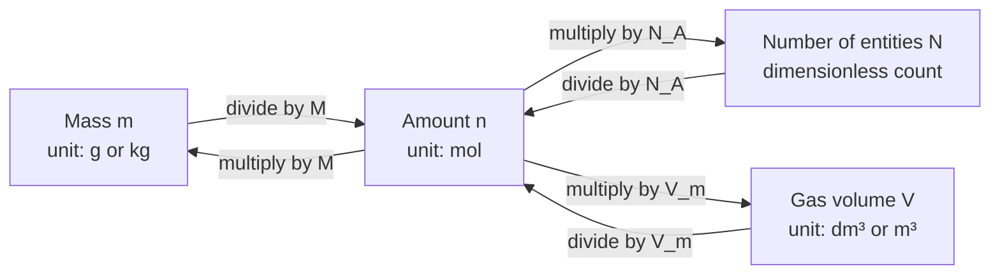
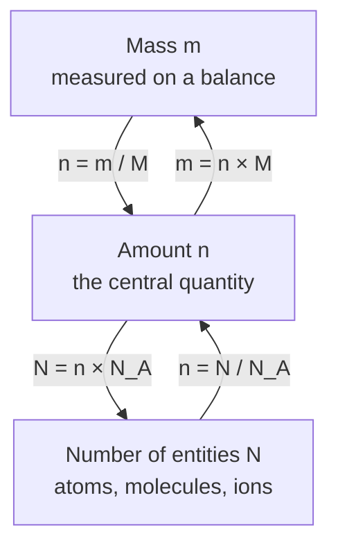
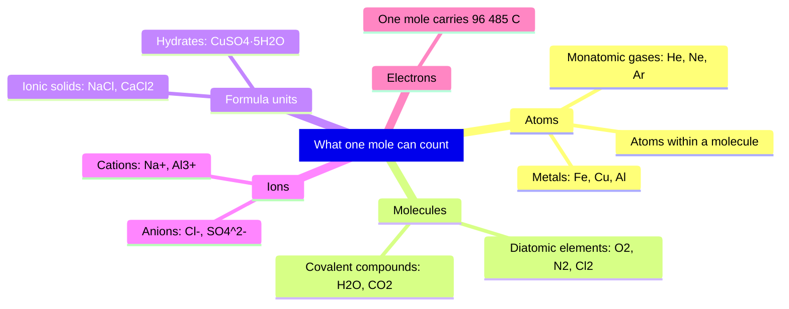
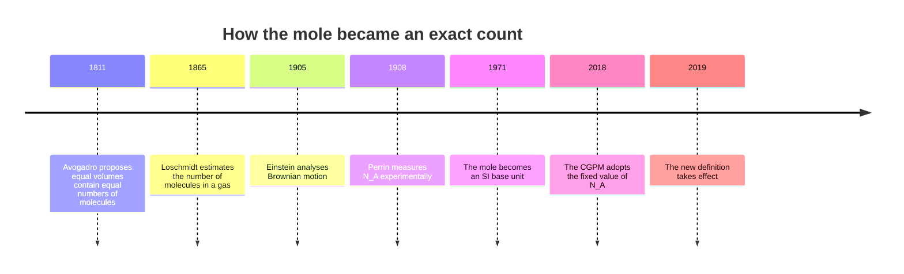

# Chapter 1 — The Mole Concept and Avogadro's Constant

> **Level:** Intermediate (Level 2 — Intermediate Chemistry)
> **Estimated study time:** 6 hours (4 h reading + 2 h exercises)
> **Prerequisites:** [Level 1 — Elementary Chemistry](../02-elementary-chemistry/README.md) in full
> **Related chapters:** [Stoichiometry, Limiting Reactants and Percentage Yield](02-stoichiometry-and-limiting-reactants.md), [Solutions, Concentration and Dilution](03-solutions-concentration-and-dilution.md), [Gas Laws and the Ideal Gas Equation](04-gas-laws-and-the-ideal-gas-equation.md)
> **Difficulty:** ★★★☆☆ (3/5)

---

## 1. Learning Objectives

After working through this chapter you will be able to:

- Explain why chemistry needs a counting unit that is neither a mass nor a volume.
- State the 2019 definition of the mole, including the exact value and unit of the
  Avogadro constant.
- Distinguish the Avogadro constant from the Avogadro number.
- Compute molar masses from standard atomic weights, including hydrates.
- Convert fluently among mass, amount of substance and number of entities.
- Convert between amount and gas volume at STP and at SATP.
- Identify the entity being counted in a problem and convert entity counts
  correctly.

---

## 2. Introduction

A drop of water of mass $0.0500\ \text{g}$ contains about $1.7\times10^{21}$
molecules. Counting them at one per second would take $5\times10^{13}$ years,
some four thousand times the age of the universe. A chemist does not count them.
She weighs the drop.

That substitution — mass in place of number — is the central trick of quantitative
chemistry, and the mole is the exchange rate that makes it legal. Reactions occur
between particles in fixed whole-number ratios, but balances report grams. Without
a reliable conversion the balanced equation would describe an invisible world with
no route from the visible one.

The concept looks trivial once familiar: a mole is a fixed number of particles,
like a dozen. The difficulty is the arithmetic built on it. Every later chapter
here — stoichiometry, solutions, gases, thermochemistry, equilibrium, pH, redox —
assumes these conversions.

What this chapter assumes: the Level 1 vocabulary of atoms, molecules, ions,
formulas and balanced equations; relative atomic mass and the unified atomic mass
unit; and arithmetic with powers of ten, ratios and significant figures. Nothing
about moles is assumed.

---

## 3. Fundamental Concepts

### 3.1 The counting problem

Chemists count particles because particles, not grams, determine chemical
behaviour. For a given substance, mass is proportional to particle number:

$$
m \propto N
$$

The constant of proportionality is the mass of one particle, of order
$10^{-26}\ \text{kg}$. Such numbers are unusable directly, so chemists count in
batches, as a stationer counts paper in reams of 500 sheets.

Every counting unit is a fixed multiple: a pair is 2, a dozen is 12, a ream is
500. The mole is the chemist's counting unit, sized so that a molar mass in grams
per mole equals the relative molecular mass numerically. That choice makes the
unit useful rather than merely large.

### 3.2 The mole and its definition

The **mole** (symbol $\text{mol}$) is the SI unit of amount of substance. The
current definition, adopted in 2018 and effective from 20 May 2019, is:

> One mole contains exactly $6.022\,140\,76\times10^{23}$ elementary entities.
> This number is the fixed numerical value of the Avogadro constant, $N_{\text{A}}$,
> when expressed in the unit $\text{mol}^{-1}$, and is called the Avogadro number.

The **elementary entities** must be specified: atoms, molecules, ions, formula
units, electrons or other discrete objects; a **formula unit** is the simplest
whole-number ratio of ions in an ionic compound. A mole of hydrogen atoms and a
mole of hydrogen molecules are different amounts of substance.

The definition is not a measurement: it fixes $N_{\text{A}}$ by decree, as the
metre is fixed by the speed of light. Only the practical realization can improve.

### 3.3 The Avogadro constant and the Avogadro number

The **Avogadro constant** is the number of entities per mole:

$$
N_{\text{A}} = 6.022\,140\,76\times10^{23}\ \text{mol}^{-1} \quad \text{(exact)}
$$

The **Avogadro number** is the same quantity stripped of its unit. The distinction
is not pedantry: writing $N_{\text{A}} = 6.022\times10^{23}$ without a unit makes
the constant dimensionless, and $n = N/N_{\text{A}}$ then appears to give a pure
number. Always attach $\text{mol}^{-1}$.

The constant commemorates Amedeo Avogadro, whose 1811 hypothesis — equal volumes
of gases at the same temperature and pressure contain equal numbers of molecules —
implied that volumes could compare particle counts. Loschmidt estimated the number
in 1865; Perrin refined it through Brownian motion.

### 3.4 Amount of substance as an SI base quantity

**Amount of substance**, symbol $n$, is one of the seven SI base quantities. Its
unit is the mole. It is not a mass, not a volume and not a pure count: it is a
count expressed in units of $N_{\text{A}}$ entities. Mass $m$ (kg), amount $n$
(mol) and number $N$ (dimensionless) are three distinct descriptions of a sample.
Two conversions link them: $n = m/M$, which is substance-specific because $M$
depends on composition, and $n = N/N_{\text{A}}$, which is universal.

### 3.5 Molar mass

The **molar mass** $M$ is mass per unit amount:

$$
M = \frac{m}{n} \qquad [M] = \text{kg mol}^{-1}
$$

Laboratory practice quotes $M$ in $\text{g mol}^{-1}$, numerically identical
because $1\ \text{kg mol}^{-1} = 1000\ \text{g mol}^{-1}$. For an element, the
molar mass in grams per mole is numerically equal to the relative atomic mass
$A_{\text{r}}$, the weighted mean of isotopic masses on the carbon-12 scale. For a
compound, sum over the formula:

$$
M(\text{A}_a\text{B}_b) = aM(\text{A}) + bM(\text{B})
$$

For sulfuric acid,

$$
M(\ce{H2SO4}) = 2(1.008) + 32.06 + 4(15.999) = 98.072\ \text{g mol}^{-1}
$$

### 3.6 The three-way bridge

Every quantitative problem uses the conversion network in Figure 1.1. Mass,
amount and number of entities form the core; gas volume attaches as a fourth node
when the substance is a gas at known temperature and pressure.

**Figure 1.1 — The three-way bridge, with gas volume as a fourth node.** Every
conversion passes through amount of substance. The arrows carry no numbers because
the constants depend on the substance ($M$) or on the conditions ($V_{\text{m}}$);
only $N_{\text{A}}$ is universal. The path from mass to particles requires two
steps, while the path from amount to either endpoint requires one.

### 3.7 Molar volume of a gas

The **molar volume** $V_{\text{m}}$ is the volume occupied by one mole of gas at
specified temperature and pressure:

$$
V_{\text{m}} = \frac{V}{n}
$$

For an ideal gas, $V_{\text{m}} = RT/p$. At IUPAC STP ($273.15\ \text{K}$,
$100\ \text{kPa}$),

$$
V_{\text{m}} = \frac{8.314 \times 273.15}{100\,000}
= 0.022\,71\ \text{m}^{3}\ \text{mol}^{-1}
= 22.71\ \text{dm}^{3}\ \text{mol}^{-1}
$$

At SATP ($298.15\ \text{K}$, $100\ \text{kPa}$) the value is
$24.79\ \text{dm}^{3}\ \text{mol}^{-1}$. The older standard of
$101.325\ \text{kPa}$ and $273.15\ \text{K}$ gives
$22.41\ \text{dm}^{3}\ \text{mol}^{-1}$.

Three cautions apply. Molar volume applies only to gases: a mole of liquid water
occupies about $18\ \text{cm}^{3}$. The value depends on both temperature and
pressure, so a molar volume without conditions is meaningless. And $22.71$ is the
ideal-gas value; real gases deviate slightly, negligibly at STP.

### 3.8 What is being counted

The mole counts entities, and the identity of the entity changes the answer:

| Sample | Entities in 1 mol | Atoms in 1 mol | Ions in 1 mol |
|---|---|---|---|
| Helium, $\ce{He}$ | $N_{\text{A}}$ atoms | $N_{\text{A}}$ | 0 |
| Oxygen, $\ce{O2}$ | $N_{\text{A}}$ molecules | $2N_{\text{A}}$ | 0 |
| Sodium chloride, $\ce{NaCl}$ | $N_{\text{A}}$ formula units | $2N_{\text{A}}$ | $2N_{\text{A}}$ |
| Aluminium sulfate, $\ce{Al2(SO4)3}$ | $N_{\text{A}}$ formula units | $17N_{\text{A}}$ | $5N_{\text{A}}$ |

Each $\ce{Al2(SO4)3}$ formula unit contains two $\ce{Al^3+}$ ions, three
$\ce{SO4^2-}$ ions, two aluminium atoms, three sulfur atoms and twelve oxygen
atoms. One mole of formula units therefore contains two moles of $\ce{Al^3+}$,
three moles of sulfate, seventeen moles of atoms and twelve moles of oxygen atoms.
The question decides which count is relevant. The same logic applies to electrons:
one mole carries the **Faraday constant**
$F = N_{\text{A}}e = 9.648\,533\times10^{4}\ \text{C mol}^{-1}$.

### 3.9 The 2019 redefinition

Before 2019 the mole was the amount of substance containing as many entities as
there are atoms in $0.012\ \text{kg}$ of carbon-12. That tied the unit to a
measured mass and hence to the international prototype kilogram. The revision
inverted the logic: $N_{\text{A}}$ is fixed exactly, and the mole is defined by
that fixed number. The kilogram was simultaneously redefined by fixing the Planck
constant $h$, so the SI rests on fixed constants rather than artefacts.

---

## 4. Detailed Scientific Explanation

### 4.1 Where atomic weights come from

The **relative atomic mass** $A_{\text{r}}$ is the ratio of the average mass of an
element's atoms to $\tfrac{1}{12}$ of the mass of a carbon-12 atom; being a ratio
of masses it is dimensionless. The **standard atomic weight** is the same quantity
for the naturally occurring element, averaged over isotopic abundances.

Chlorine illustrates the averaging. Its stable isotopes are $^{35}\text{Cl}$
(abundance $75.76\,\%$, mass $34.9689\ \text{u}$) and $^{37}\text{Cl}$
($24.24\,\%$, $36.9659\ \text{u}$):

$$
A_{\text{r}}(\ce{Cl}) = 0.7576(34.9689) + 0.2424(36.9659) = 35.45
$$

The tabulated $35.45$ is the mass of the average atom, not of any actual chlorine
atom. For several elements natural abundance varies with source, so IUPAC quotes
an interval; a conventional single value is used for ordinary work.

### 4.2 Computing a molar mass

1. Write the formula and list every element.
2. Multiply each atomic weight by its subscript, treating a subscript outside a
   bracket as multiplying everything inside.
3. Add the contributions.
4. Attach $\text{g mol}^{-1}$ and check that the magnitude is sensible.

For a hydrate, add the water of crystallization explicitly. In
$\ce{CuSO4.5H2O}$ the dot is a multiplication sign, not a decimal point:

$$
M = 63.546 + 32.06 + 4(15.999) + 5(18.015)
= 159.60 + 90.08 = 249.68\ \text{g mol}^{-1}
$$

### 4.3 Why the mole was redefined

The old definition tied the mole to carbon-12, which made it awkward for entities
that are not atoms; it depended on the kilogram artefact, whose copies drift by
tens of micrograms per century; and it entangled the uncertainties in atomic
weights and in $N_{\text{A}}$.

The new definition removes all three problems: it is entity-independent,
artefact-independent and decoupled from the kilogram. The price is that the molar
mass constant $M_{\text{u}} = N_{\text{A}}m(^{12}\text{C})/12$ is no longer
exactly $1\ \text{g mol}^{-1}$. CODATA 2018 gives
$M_{\text{u}} = 0.999\,999\,999\,65(30)\ \text{g mol}^{-1}$, a relative deviation
of about $3\times10^{-10}$. Consequently the molar mass of carbon-12 is
$11.999\,999\,996\ \text{g mol}^{-1}$ rather than exactly $12$ — far below the
precision of any chemical measurement.

### 4.4 Exact and measured numbers

$N_{\text{A}}$ is exact and never limits significant figures. Atomic weights are
measured to four to seven significant figures, so a computed molar mass inherits
the weakest one. Quote molar masses to two decimal places for teaching; use
$18.02\ \text{g mol}^{-1}$ for water at four significant figures rather than
$18.015$. If a problem gives $18.0\ \text{g}$, the answer carries three
significant figures, not nine.

### 4.5 Molar volume and the ideal-gas law

Molar volume is a consequence of $pV = nRT$, not an independent constant. Setting
$n = 1\ \text{mol}$,

$$
V_{\text{m}} = \frac{RT}{p}
$$

The equation shows why the value depends on the standard chosen. Raising the
pressure to $101.325\ \text{kPa}$ lowers it to $22.41\ \text{dm}^{3}\ \text{mol}^{-1}$;
raising the temperature to $298.15\ \text{K}$ raises it to
$24.79\ \text{dm}^{3}\ \text{mol}^{-1}$. The ideal-gas law is itself a
simplification: it neglects intermolecular forces and molecular volume. At STP the
error for common gases is typically below $0.5\,\%$; the assumption fails at high
pressure, low temperature and for associating gases such as ammonia or hydrogen
fluoride. Chapter [4](04-gas-laws-and-the-ideal-gas-equation.md) treats this in
detail.

### 4.6 Labelled simplifications

- **Natural isotopic abundance.** Molar masses assume a natural isotope
  distribution; an enriched sample has a different molar mass.
- **Purity.** Calculations assume a pure substance; real samples need a purity
  correction before conversion.
- **Discrete entities.** Ions are solvated and molecules associate, so the
  boundary of an "entity" is fixed by convention (the formula unit), not by
  nature.

None of these affects the validity of the mole as a unit; they affect the
interpretation of $M$ and the accuracy of a result.

---

## 5. Visual Diagrams

### 5.1 The conversion triangle

**Figure 1.2 — The conversion triangle in compact form.** The direct mass-to-
particle conversion is the composition of the two paths through $n$ and should not
be memorized separately. The vertical arrangement makes the hierarchy explicit:
mass and particle count are observable endpoints, while amount is the bookkeeping
quantity that carries chemical meaning.

### 5.2 The hierarchy of entities

**Figure 1.3 — The hierarchy of entities counted by the mole.** One unit serves
five kinds of object, and the object must always be named. A mole of sodium
chloride is a mole of formula units, not a mole of "salt molecules", because ionic
solids contain no discrete molecules. A mole of aluminium sulfate contains five
moles of ions, not one. Reading a problem correctly begins with locating the
entity the question counts.

### 5.3 The 2019 revision in context

**Figure 1.4 — From Avogadro's hypothesis to the fixed constant.** The sequence
shows a change in status rather than in value: for most of its history $N_{\text{A}}$
was measured with an uncertainty, and since 2019 it has been exact. The 1971 entry
settled the mole's dimensional status as an SI base unit; the 2018–2019 entries
settled its numerical status. The numerical value barely changed — what changed
was the logic of the definition.

---

## 6. Mathematical Formulas

### 6.1 Amount from number of entities

$$
n = \frac{N}{N_{\text{A}}}
$$

| Symbol | Meaning | SI unit |
|---|---|---|
| $n$ | Amount of substance | mol |
| $N$ | Number of specified entities | dimensionless |
| $N_{\text{A}}$ | Avogadro constant | mol⁻¹ |

Assumption: the entities are discrete and identical. The equation is exact.

### 6.2 Amount from mass

$$
n = \frac{m}{M}
$$

| Symbol | Meaning | SI unit |
|---|---|---|
| $n$ | Amount of substance | mol |
| $m$ | Mass of the sample | kg (laboratory: g) |
| $M$ | Molar mass | kg mol⁻¹ (laboratory: g mol⁻¹) |

Assumption: the sample is pure and has the composition given by its formula. If
$m$ is in grams, $M$ must be in grams per mole.

### 6.3 Molar mass of a compound

$$
M(\text{A}_a\text{B}_b\text{C}_c) = aM(\text{A}) + bM(\text{B}) + cM(\text{C})
$$

The coefficients are the formula subscripts. For a hydrate, the water of
crystallization is a separate term with its own coefficient.

### 6.4 Amount from gas volume

$$
n = \frac{V}{V_{\text{m}}}, \qquad V_{\text{m}} = \frac{RT}{p}
$$

| Symbol | Meaning | SI unit |
|---|---|---|
| $V$ | Volume of gas | m³ (laboratory: dm³) |
| $V_{\text{m}}$ | Molar volume at stated conditions | m³ mol⁻¹ |
| $R$ | Molar gas constant, $8.314$ | J mol⁻¹ K⁻¹ |
| $T$ | Thermodynamic temperature | K |
| $p$ | Pressure | Pa |

Assumptions: ideal gas, with temperature and pressure stated. Valid to about
$0.5\,\%$ for common gases at STP; poor near condensation or at high pressure.

### 6.5 Constants

| Constant | Symbol | Value | Unit | Status |
|---|---|---|---|---|
| Avogadro constant | $N_{\text{A}}$ | $6.022\,140\,76\times10^{23}$ | mol⁻¹ | Exact |
| Molar gas constant | $R$ | $8.314\,462\,618$ | J mol⁻¹ K⁻¹ | Exact |
| Elementary charge | $e$ | $1.602\,176\,634\times10^{-19}$ | C | Exact |
| Faraday constant | $F$ | $96\,485.33$ | C mol⁻¹ | Exact |
| Molar volume at STP | $V_{\text{m}}$ | $22.71$ | dm³ mol⁻¹ | Derived |
| Molar volume at SATP | $V_{\text{m}}$ | $24.79$ | dm³ mol⁻¹ | Derived |

---

## 7. Chemical Equations

A balanced equation reads at three levels: individual particles, amounts in
moles, and measurable masses. The mole connects the second reading to the third.

Formation of water:

$$
\ce{2H2(g) + O2(g) -> 2H2O(l)}
$$

Two molecules of hydrogen react with one molecule of oxygen to form two molecules
of water; two moles react with one mole to form two moles; $4.032\ \text{g}$ react
with $31.998\ \text{g}$ to form $36.030\ \text{g}$. The mass balance is exact.

Complete combustion of methane:

$$
\ce{CH4(g) + 2O2(g) -> CO2(g) + 2H2O(l)}
$$

One mole of methane requires two moles of oxygen and produces one mole of carbon
dioxide and two moles of water. At STP the carbon dioxide occupies
$22.71\ \text{dm}^{3}$; the water is liquid, so its volume is not given by a molar
volume of gas.

Thermal decomposition of calcium carbonate:

$$
\ce{CaCO3(s) -> CaO(s) + CO2(g)}
$$

One mole of solid yields one mole of solid calcium oxide and one mole of carbon
dioxide gas, the reaction used in Worked Example 8.4.

Dissolution of sodium chloride:

$$
\ce{NaCl(s) -> Na+(aq) + Cl-(aq)}
$$

One mole of formula units gives one mole of sodium ions and one mole of chloride
ions. There are no NaCl molecules in solution; the formula unit is a bookkeeping
device for the lattice.

---

## 8. Worked Examples

### Worked Example 8.1 — From mass to molecules and atoms

**Problem.** A water sample has a mass of $18.0\ \text{g}$. Calculate (a) the
amount in moles, (b) the number of water molecules, and (c) the number of hydrogen
atoms.

**Strategy.** Convert mass to amount with the molar mass, then amount to number
with $N_{\text{A}}$. For (c), use the formula: two hydrogen atoms per molecule.

**Solution.** The molar mass is

$$
M(\ce{H2O}) = 2(1.008) + 15.999 = 18.015\ \text{g mol}^{-1}
$$

(a)

$$
n = \frac{18.0\ \text{g}}{18.015\ \text{g mol}^{-1}} = 0.999\ \text{mol}
$$

(b)

$$
N = 0.999\ \text{mol} \times 6.022\times10^{23}\ \text{mol}^{-1}
= 6.02\times10^{23}
$$

(c)

$$
N(\ce{H}) = 2 \times 6.017\times10^{23} = 1.20\times10^{24}
$$

**Check.** The sample is almost one mole, so the molecule count should be almost
$N_{\text{A}}$; it is, and the hydrogen count is twice it. Back-converting,
$0.999 \times 18.015 = 18.0\ \text{g}$ returns the starting mass.

### Worked Example 8.2 — Reverse calculation: molecules to mass

**Problem.** A flask contains $1.50\times10^{22}$ molecules of carbon dioxide.
What mass of carbon dioxide does it contain?

**Strategy.** Divide the number of molecules by $N_{\text{A}}$ to obtain amount,
then multiply by the molar mass. This is Worked Example 8.1 in reverse.

**Solution.**

$$
n = \frac{1.50\times10^{22}}{6.022\times10^{23}\ \text{mol}^{-1}}
= 2.49\times10^{-2}\ \text{mol}
$$

$$
M(\ce{CO2}) = 12.011 + 2(15.999) = 44.009\ \text{g mol}^{-1}
$$

$$
m = 2.49\times10^{-2}\ \text{mol} \times 44.009\ \text{g mol}^{-1} = 1.10\ \text{g}
$$

**Check.** The count is about one fortieth of a mole, so the mass should be about
one fortieth of $44\ \text{g}$, namely $1.1\ \text{g}$; the units also cancel
correctly.

### Worked Example 8.3 — Molar mass of a hydrate

**Problem.** Calculate the molar mass of copper(II) sulfate pentahydrate,
$\ce{CuSO4.5H2O}$, and the mass percentage of water it contains.

**Strategy.** Treat the formula as one $\ce{CuSO4}$ unit plus five $\ce{H2O}$
units, compute each contribution, add, then divide the water contribution by the
total.

**Solution.**

$$
M(\ce{CuSO4}) = 63.546 + 32.06 + 4(15.999) = 159.60\ \text{g mol}^{-1}
$$

$$
5M(\ce{H2O}) = 5(18.015) = 90.075\ \text{g mol}^{-1}
$$

$$
M(\ce{CuSO4.5H2O}) = 159.60 + 90.08 = 249.68\ \text{g mol}^{-1}
$$

$$
w(\ce{H2O}) = \frac{90.075}{249.68} \times 100\,\% = 36.1\,\%
$$

**Check.** The hydrate is roughly one-third water by mass, plausible for five
small water molecules on a heavy copper sulfate unit. A $25.0\ \text{g}$ sample
should lose $9.02\ \text{g}$ on dehydration, leaving $16.0\ \text{g}$ of salt.

### Worked Example 8.4 — Mass to gas volume at STP

**Problem.** $5.00\ \text{g}$ of calcium carbonate is heated until it decomposes
completely. Calculate the volume of carbon dioxide at STP ($100\ \text{kPa}$,
$273.15\ \text{K}$) and at SATP ($100\ \text{kPa}$, $298.15\ \text{K}$).

**Strategy.** Convert mass to amount, apply the $1:1$ mole ratio, then convert
amount to volume with the appropriate molar volume.

**Solution.** The molar mass is

$$
M(\ce{CaCO3}) = 40.078 + 12.011 + 3(15.999) = 100.086\ \text{g mol}^{-1}
$$

$$
n(\ce{CaCO3}) = \frac{5.00}{100.086} = 4.996\times10^{-2}\ \text{mol}
= n(\ce{CO2})
$$

At STP,

$$
V = 4.996\times10^{-2} \times 22.71 = 1.13\ \text{dm}^{3}
$$

At SATP,

$$
V = 4.996\times10^{-2} \times 24.79 = 1.24\ \text{dm}^{3}
$$

**Check.** One mole occupies about $22.7\ \text{dm}^{3}$ at STP, so $0.05\ \text{mol}$
should occupy about $1.1\ \text{dm}^{3}$. The SATP volume is larger by
$298.15/273.15 = 1.0915$, and $1.13 \times 1.0915 = 1.23$, consistent with $1.24$
within rounding.

---

## 9. Real-World Applications

**Industrial chemistry.** Plants buy in tonnes but design reactors around molar
ratios. Ammonia synthesis must feed nitrogen and hydrogen in a $1:3$ mole ratio,
a mass ratio of $28.014:6.048$, roughly $4.6:1$. Converting contract masses to
molar flow rates is the first step of any material balance.

**Biology and medicine.** Blood glucose, serum cholesterol and creatinine are
reported in millimoles per litre in many countries. Osmotic balance, which decides
whether a cell swells or shrinks, depends on the number of dissolved particles per
unit volume, not their mass.

---

## 10. Common Mistakes

| Mistake | Why it happens | Correct approach |
|---|---|---|
| Treating the mole as a mass | Everyday language uses "a mole of gas" loosely | The mole is an amount; its mass equals $M$ grams |
| Omitting the unit on $N_{\text{A}}$ | The value is written as a pure count | Write $6.022\times10^{23}\ \text{mol}^{-1}$ |
| Using the atomic molar mass for a molecular element | Subscripts are easy to overlook | For $\ce{O2}$ use $32.00\ \text{g mol}^{-1}$, not $16.00$ |
| Counting molecules when atoms are asked | The entity is not identified explicitly | Decide what is counted, then multiply by atoms per entity |
| Using $22.4\ \text{dm}^{3}\ \text{mol}^{-1}$ at $100\ \text{kPa}$ | The old $101.325\ \text{kPa}$ standard is still common | Use $22.71$ at $100\ \text{kPa}$, $273.15\ \text{K}$; $24.79$ at SATP |
| Applying a molar volume to a liquid or solid | $n = V/V_{\text{m}}$ is memorized without conditions | Molar volume applies only to gases |
| Rounding $N_{\text{A}}$ too early | Shorthand $6.02\times10^{23}$ is used throughout | Keep $6.022\times10^{23}$ and round only the answer |
| Mixing grams and kilograms | $M$ is usually in $\text{g mol}^{-1}$, $m$ may be in kg | Convert so the mass units cancel |
| Assuming one mole of an ionic compound contains one mole of ions | Formula unit mistaken for a particle count | $\ce{Al2(SO4)3}$ gives five moles of ions per formula unit |
| Reporting more significant figures than the data support | $N_{\text{A}}$ is exact and invites over-precision | The measured mass sets the precision |

---

## 11. Chapter Summary

- The mole is the SI unit of amount of substance and contains exactly
  $6.022\,140\,76\times10^{23}$ specified elementary entities.
- $N_{\text{A}} = 6.022\,140\,76\times10^{23}\ \text{mol}^{-1}$ is exact; the
  Avogadro number is the same value without a unit.
- Molar mass $M = m/n$ is numerically equal to the relative molecular mass in
  grams per mole and is computed by summing atomic weights over the formula.
- The three-way bridge converts mass to amount, amount to entities, and amount to
  gas volume; every path passes through amount.
- Molar volume is $22.71\ \text{dm}^{3}\ \text{mol}^{-1}$ at STP and $24.79$ at
  SATP; $22.41$ refers to $101.325\ \text{kPa}$.
- The entity counted — atom, molecule, formula unit, ion or electron — must always
  be named.
- Since 2019 the mole is defined by the exact $N_{\text{A}}$, so the molar mass
  constant departs from $1\ \text{g mol}^{-1}$ by about $3\times10^{-10}$, which is
  invisible in practice.

---

## 12. Exercises

### 12.1 Conceptual questions

1. Explain why chemists count particles by weighing rather than counting them
   individually. Refer to the magnitude of $N_{\text{A}}$ and to the role of a
   balanced equation.
2. Distinguish the Avogadro constant from the Avogadro number, stating the unit of
   each, and explain why the distinction matters in $n = N/N_{\text{A}}$.

### 12.2 Basic problems

3. Calculate the molar mass of (a) $\ce{KNO3}$, (b) $\ce{Ca(OH)2}$,
   (c) $\ce{(NH4)2SO4}$, (d) $\ce{Fe2(SO4)3}$.
4. Convert (a) $25.0\ \text{g}$ of water to moles, (b) $0.250\ \text{mol}$ of
   sodium chloride to grams, (c) $1.20\times10^{24}$ molecules of carbon dioxide
   to moles.
5. How many atoms are in $1.00\ \text{mol}$ of (a) $\ce{He}$, (b) $\ce{O2}$,
   (c) $\ce{CH4}$?

### 12.3 Intermediate problems

6. A sample contains $0.250\ \text{mol}$ of $\ce{Al2(SO4)3}$. Calculate (a) the
   formula units, (b) the total number of ions, and (c) the number of oxygen atoms.
7. Which contains more atoms: $1.00\ \text{g}$ of $\ce{H2}$ or $1.00\ \text{g}$ of
   $\ce{He}$? Justify with a calculation.
8. $2.50\ \text{g}$ of magnesium reacts completely with excess hydrochloric acid
   according to $\ce{Mg(s) + 2HCl(aq) -> MgCl2(aq) + H2(g)}$. Calculate the volume
   of hydrogen at STP and at SATP.

### 12.4 Advanced problems

9. A $5.00\ \text{g}$ sample of $\ce{MgSO4.$x$H2O}$ loses $2.56\ \text{g}$ on strong
   heating. Determine $x$ and identify the hydrate.
10. Explain why the 2019 redefinition means that the molar mass of carbon-12 is no
    longer exactly $12\ \text{g mol}^{-1}$, and why this has no practical
    consequence for a laboratory analysis.

### 12.5 Calculation problems

11. A $0.500\ \text{g}$ sample of an unknown gas occupies $250\ \text{cm}^{3}$ at
    $100\ \text{kPa}$ and $273.15\ \text{K}$. Estimate its molar mass and suggest a
    plausible identity. State one additional measurement that would distinguish
    between your suggestions.
12. (a) How many water molecules are in a $50.0\ \text{mg}$ droplet? (b) What mass
    of carbon dioxide contains $1.00\times10^{22}$ molecules?

### 12.6 Answers

1. Direct counting is impossible: $N_{\text{A}}$ is of order $10^{23}$ and a
   particle cannot be weighed individually. A balance measures mass, a balanced
   equation fixes the particle ratio, and the mole converts mass into the count
   the equation needs.
2. The constant is $6.022\,140\,76\times10^{23}\ \text{mol}^{-1}$ with unit
   $\text{mol}^{-1}$; the number is the same value with no unit. Dividing a count
   by a constant in $\text{mol}^{-1}$ gives moles; dividing by a pure number would
   give a pure number.
3. (a) $101.10$; (b) $74.09$; (c) $132.13$; (d) $399.86\ \text{g mol}^{-1}$.
4. (a) $1.39\ \text{mol}$; (b) $14.6\ \text{g}$; (c) $1.99\ \text{mol}$.
5. (a) $6.022\times10^{23}$; (b) $1.204\times10^{24}$;
   (c) $3.011\times10^{24}$ atoms.
6. (a) $1.51\times10^{23}$ formula units; (b) $7.53\times10^{23}$ ions;
   (c) $1.81\times10^{24}$ oxygen atoms.
7. Hydrogen: $0.496\ \text{mol}$ of $\ce{H2}$, hence $0.992\ \text{mol}$ of atoms.
   Helium: $0.250\ \text{mol}$ of atoms. Hydrogen has about four times as many.
8. $n(\ce{Mg}) = 0.1029\ \text{mol}$, so $n(\ce{H2}) = 0.1029\ \text{mol}$;
   $V = 2.34\ \text{dm}^{3}$ at STP and $2.55\ \text{dm}^{3}$ at SATP.
9. Residue $2.44\ \text{g}$ is $0.0203\ \text{mol}$ $\ce{MgSO4}$; water lost is
   $0.142\ \text{mol}$. Ratio $7.0$, so $x = 7$: $\ce{MgSO4.7H2O}$.
10. $N_{\text{A}}$ is fixed while $m(^{12}\text{C})$ is measured, so
    $M(^{12}\text{C}) = 11.999\,999\,996\ \text{g mol}^{-1}$. The deviation is
    $3\times10^{-10}$, far below balance precision.
11. $n = 0.0110\ \text{mol}$, $M = 45.4\ \text{g mol}^{-1}$. Carbon dioxide
    ($44.01$) and nitrogen dioxide ($46.01$) are plausible; density, infrared
    spectrum or reactivity would distinguish them.
12. (a) $0.0500\ \text{g}$ is $2.78\times10^{-3}\ \text{mol}$, so
    $1.67\times10^{21}$ molecules. (b) $0.0166\ \text{mol}$, so $0.731\ \text{g}$.

> Worked solutions for this level are maintained in the `solutions/` directory of
> the level.

---

## 13. Further Reading

- OpenStax. *Chemistry 2e*, Chapter 3, "Composition of Substances and Solutions".
  <https://openstax.org/details/books/chemistry-2e>
- Atkins, P. and Jones, L. *Chemical Principles: The Quest for Insight*, 7th ed.,
  W. H. Freeman, 2016 — stoichiometry and the mole in the opening focus.
- IUPAC. *Compendium of Chemical Terminology* ("Gold Book"), 2nd ed. (corrected
  version), entries "amount of substance", "mole" and "Avogadro constant".
  <https://goldbook.iupac.org/>
- BIPM. *The International System of Units (SI Brochure)*, 9th ed., 2019.
  <https://www.bipm.org/en/publications/si-brochure>
- NIST. *CODATA Internationally Recommended Values of the Fundamental Physical
  Constants*. <https://physics.nist.gov/cuu/Constants/>
- IUPAC Commission on Isotopic Abundances and Atomic Weights. "Atomic weights of
  the elements". <https://ciaaw.org/atomic-weights.htm>

Repository cross-references: [CURRICULUM.md](../CURRICULUM.md) for the position of
this chapter in the programme, and [REFERENCES.md](../REFERENCES.md) for the full
source list and data policy.
