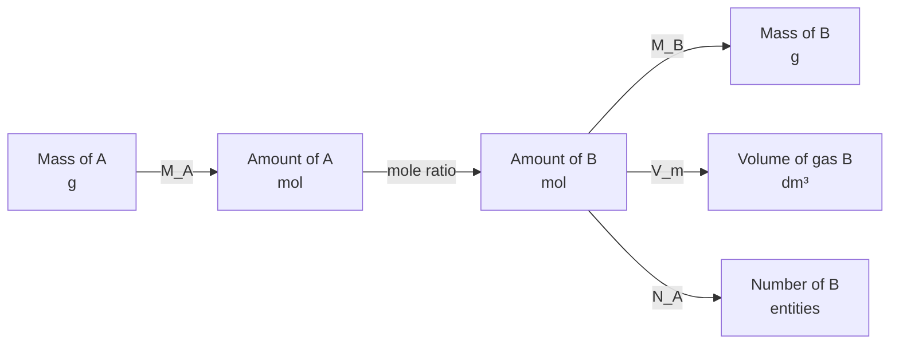
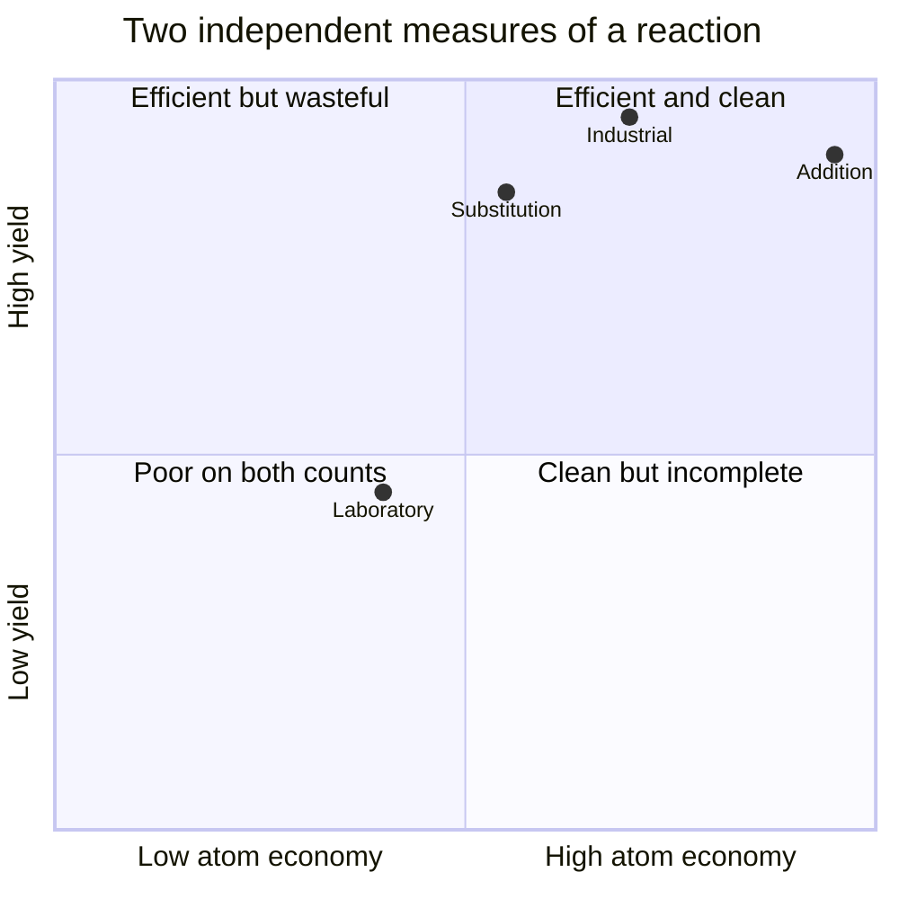
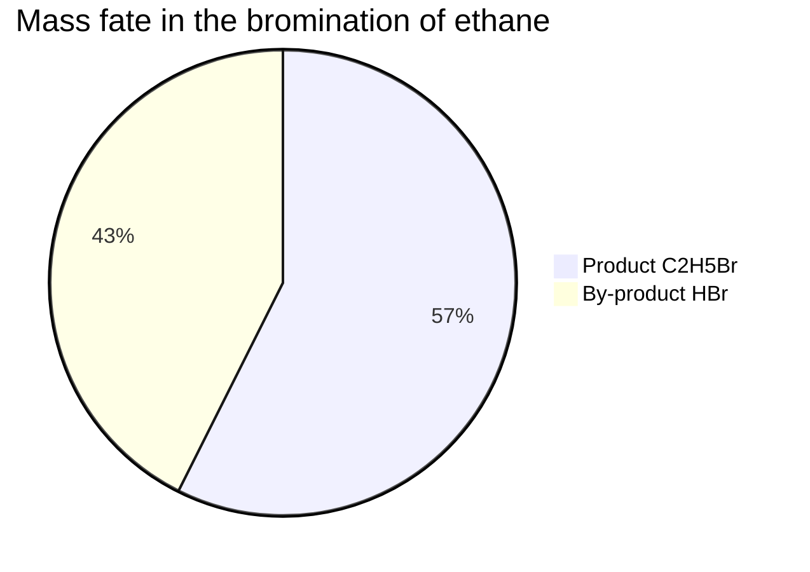

# Chapter 2 — Stoichiometry, Limiting Reactants and Percentage Yield

> **Level:** Intermediate (Level 2 — Intermediate Chemistry)
> **Estimated study time:** 8 hours (5 h reading + 3 h exercises)
> **Prerequisites:** [The Mole Concept and Avogadro's Constant](01-the-mole-concept.md)
> **Related chapters:** [Solutions, Concentration and Dilution](03-solutions-concentration-and-dilution.md), [Gas Laws and the Ideal Gas Equation](04-gas-laws-and-the-ideal-gas-equation.md), [Thermochemistry and Enthalpy](08-thermochemistry-and-enthalpy.md)
> **Difficulty:** ★★★☆☆ (3/5)

---

## 1. Learning Objectives

After working through this chapter you will be able to:

- Read a balanced equation as a molar recipe and distinguish coefficients from
  subscripts.
- Solve mass–mass, mass–volume, solution-volume and particle-count problems.
- Identify the limiting reactant by comparing mole ratios, not masses.
- Calculate the amount of excess reactant remaining after reaction.
- Distinguish theoretical yield, actual yield and percentage yield.
- Calculate atom economy and explain why it differs from percentage yield.

---

## 2. Introduction

A balanced equation is a recipe: it states which ingredients react, in what
proportion, and what products form. Unlike a cooking recipe it is exact, because
the coefficients are whole numbers fixed by conservation of atoms.

The metaphor exposes the central difficulty. A cook who doubles a recipe doubles
every ingredient; a chemist given $48.0\ \text{g}$ of oxygen and
$16.0\ \text{g}$ of methane cannot simply scale the equation, because the two are
not present in the ratio it demands. One runs out first: the **limiting reactant**
sets the maximum yield, and the other is left over.

Industry cares about this arithmetic for obvious reasons. An ammonia plant that
feeds its reactor in the wrong ratio wastes hydrogen, and hydrogen is made from
natural gas. A pharmaceutical plant that achieves $60\,\%$ yield instead of
$90\,\%$ pays for the missing $30\,\%$ in raw materials, solvent, energy and
disposal. Stoichiometry is not an academic exercise; it is the accounting system
of chemical manufacturing.

This chapter assumes the mole conversions of Chapter [1](01-the-mole-concept.md)
and the balancing skills of Level 1, and adds three ideas: the mole ratio, the
limiting-reactant comparison, and the distinction between expected and actual
product.

---

## 3. Fundamental Concepts

### 3.1 The equation as a molar recipe

Consider the combustion of methane:

$$
\ce{CH4(g) + 2O2(g) -> CO2(g) + 2H2O(l)}
$$

The coefficients $1$, $2$, $1$ and $2$ are **stoichiometric coefficients**: the
simplest whole-number ratio in which the substances react and form. The subscripts
inside a formula — the $4$ in $\ce{CH4}$ — state composition and are not part of
the recipe. Confusing the two is the commonest error in the topic.

The equation can be read in three equivalent ways. At the particle level, one
molecule of methane reacts with two molecules of oxygen. At the molar level, one
mole reacts with two moles. At the mass level, $16.043\ \text{g}$ reacts with
$63.998\ \text{g}$ to give $44.009\ \text{g}$ and $36.030\ \text{g}$. Only the
molar reading is directly useful for calculation, because the coefficients apply
to amounts, not to masses.

### 3.2 The stoichiometric roadmap

Every stoichiometry problem follows the same route: convert the given quantity to
moles, apply the mole ratio, then convert to the required quantity. Figure 2.1 in
Section 5.1 draws this roadmap. The middle step is the only one that carries
chemical information; the outer steps are the mole conversions of Chapter 1. The
route must pass through moles twice because coefficients count particles, not
masses.

### 3.3 Mole ratios

For the general reaction

$$
a\,\text{A} + b\,\text{B} \rightarrow c\,\text{C} + d\,\text{D}
$$

the **mole ratio** of B to A is $b/a$. It is a conversion factor with units of
$\text{mol B per mol A}$, and it is used as a fraction arranged so that the unit
of A cancels:

$$
n(\text{B}) = n(\text{A}) \times \frac{b}{a}
$$

The ratio can be taken between any two species in the equation, reactant or
product. It cannot be taken between a species in one equation and a species in
another unless the equations are linked by a common intermediate.

### 3.4 Limiting and excess reactants

When reactants are not supplied in the stoichiometric ratio, one is consumed
completely and the other remains. The **limiting reactant** is the one that is
used up first; it determines the maximum amount of product. The **excess
reactant** is the one left over.

The identification is made in moles, never in grams. For the reaction above, the
available amount of each reactant is divided by its coefficient:

$$
q(\text{A}) = \frac{n(\text{A})_{\text{available}}}{a}, \qquad
q(\text{B}) = \frac{n(\text{B})_{\text{available}}}{b}
$$

The smaller quotient identifies the limiting reactant. This is equivalent to
calculating the product obtainable from each reactant and choosing the smaller
answer; both are shown in Section 4.1.

### 3.5 Theoretical, actual and percentage yield

The **theoretical yield** is the amount of product predicted by stoichiometry
when the limiting reactant is completely consumed. The **actual yield** is the
amount isolated from the experiment. The **percentage yield** is

$$
\text{percentage yield} = \frac{\text{actual yield}}{\text{theoretical yield}}
\times 100\,\%
$$

Yields are normally below $100\,\%$ because product is lost in transfers and
filtration, side reactions consume material, the reaction may not reach
completion, and purification discards impure fractions.

### 3.6 Atom economy

**Atom economy** measures how much of the mass of the reactants ends up in the
desired product:

$$
\text{atom economy} = \frac{\nu_{\text{desired}}M_{\text{desired}}}
{\sum_i \nu_i M_i} \times 100\,\%
$$

using the stoichiometric coefficients of the balanced equation. It is a property
of the reaction as written and is independent of how well the experiment is
performed. A reaction can have $100\,\%$ atom economy and a poor yield, or a high
yield and $30\,\%$ atom economy.

### 3.7 Percentage purity

Real starting materials contain impurities. The **percentage purity** is the mass
fraction of the declared substance in the sample:

$$
\text{percentage purity} = \frac{m_{\text{pure}}}{m_{\text{sample}}}
\times 100\,\%
$$

Purity must be established independently — by titration, gravimetry or
spectroscopy — before a stoichiometric calculation can use the sample mass. A
calculation that treats an impure sample as pure produces a theoretical yield
that is too high and a percentage yield that is too low.

### 3.8 What a yield above 100 % means

A yield greater than $100\,\%$ is physically impossible and always indicates a
problem with the product: it may be wet, contaminated with a co-precipitated
impurity, incompletely dried, or weighed with residual solvent. It can also arise
from an incorrectly balanced equation or from assuming a purity the sample does
not have. The correct response is analytical, not arithmetic: purify and reweigh,
or determine the impurity content.

---

## 4. Detailed Scientific Explanation

### 4.1 Three methods for finding the limiting reactant

**Method 1: quotient comparison.** Divide each reactant amount by its coefficient
and choose the smallest quotient; this is fastest and least error-prone.

**Method 2: product comparison.** Calculate the product obtainable from each
reactant and choose the smaller amount; this gives the theoretical yield directly.

**Method 3: requirement comparison.** Calculate how much of one reactant would
consume all of the other; this is useful when excess remaining is asked for.

All three must agree; disagreement points to an unbalanced equation or a wrong
molar mass.

### 4.2 Excess remaining

Once the limiting reactant is known, the amount of each reactant consumed follows
from the mole ratio. The excess remaining is the initial amount minus the amount
consumed:

$$
n(\text{excess})_{\text{remaining}} = n(\text{excess})_{\text{initial}}
- n(\text{excess})_{\text{consumed}}
$$

The mass remaining is then $nM$. The remaining excess is not recovered unless
the process includes a recycle step; in a single-pass reactor it is waste.

### 4.3 Where yield is lost

Yield losses fall into four categories, each demanding a different remedy.
**Mechanical loss** is product adhering to glassware or filters, minimized by
careful transfer. **Incomplete reaction** reflects insufficient time or an
equilibrium limit, addressed by longer reaction, excess reagent or product
removal. **Side reactions** consume material through competing pathways,
addressed by changing conditions. **Purification loss** discards impure fractions
along with pure product, addressed by optimizing the purification.

### 4.4 Atom economy is not yield

Yield asks how much of the *expected* product was obtained. Atom economy asks how
much of the *reactant mass* is incorporated into the product by design. The two
are independent.

Compare two routes to bromoethane. Addition of hydrogen bromide to ethene has
$100\,\%$ atom economy, because every atom of both reactants appears in the
product:

$$
\ce{C2H4(g) + HBr(g) -> C2H5Br(l)}
$$

Substitution of bromine into ethane has an atom economy of $57.4\,\%$, because
hydrogen bromide is a by-product:

$$
\ce{C2H6(g) + Br2(l) -> C2H5Br(l) + HBr(g)}
$$

The calculation is

$$
\frac{M(\ce{C2H5Br})}{M(\ce{C2H6}) + M(\ce{Br2})} \times 100\,\%
= \frac{108.97}{30.07 + 159.81} \times 100\,\% = 57.4\,\%
$$

The addition route is intrinsically cleaner but may still have a poor yield if it
is slow or the product is hard to isolate: atom economy chooses the reaction,
yield judges the process.

### 4.5 Assumptions and simplifications

Every stoichiometric calculation assumes a balanced and complete equation, a
reaction that goes to completion, complete consumption of the limiting reactant,
and a pure, dry sample. Each is a simplification: real reactions may be
equilibrium-limited, a little limiting reactant remains, and wet samples change
the effective amount. State these assumptions when the answer matters.

---

## 5. Visual Diagrams

### 5.1 The stoichiometric roadmap

**Figure 2.1 — The stoichiometric roadmap.** The central mole-ratio step is
unchanged regardless of target, which is why one diagram serves mass, gas-volume
and particle-count problems; the three outgoing arrows differ only in the final
constant.

### 5.2 Yield and atom economy together

**Figure 2.2 — Yield and atom economy are independent axes.** Addition reactions
cluster towards high atom economy because no atoms are wasted by design;
substitution reactions sit lower because a by-product is unavoidable. Moving right
requires changing the chemistry; moving up requires improving the execution.

### 5.3 Where the reactant mass goes

**Figure 2.3 — Atom economy as a mass partition.** Of the total reactant mass,
$57.4\,\%$ is incorporated into bromoethane and $42.6\,\%$ leaves as hydrogen
bromide. The desired sector is the numerator and the whole circle the sum of
reactant masses; $100\,\%$ atom economy would be a single sector.

---

## 6. Mathematical Formulas

### 6.1 Mole ratio

$$
n(\text{B}) = n(\text{A}) \times \frac{\nu(\text{B})}{\nu(\text{A})}
$$

| Symbol | Meaning | SI unit |
|---|---|---|
| $n(\text{A})$, $n(\text{B})$ | Amounts of substances A and B | mol |
| $\nu(\text{A})$, $\nu(\text{B})$ | Stoichiometric coefficients | dimensionless |

Assumption: the equation is balanced and A and B appear in the same reaction.

### 6.2 Limiting-reactant quotient

$$
q_i = \frac{n_i}{\nu_i}
$$

The reactant with the smallest $q_i$ is limiting. The quotient has units of moles
and represents the extent of reaction if reactant $i$ were consumed completely.

### 6.3 Percentage yield

$$
\text{percentage yield} = \frac{n_{\text{actual}}}{n_{\text{theoretical}}}
\times 100\,\% = \frac{m_{\text{actual}}}{m_{\text{theoretical}}} \times 100\,\%
$$

The two forms are equivalent when the same product is weighed, because molar mass
cancels. The theoretical amount is calculated from the limiting reactant.

### 6.4 Atom economy

$$
\text{atom economy} = \frac{\nu_{\text{desired}}M_{\text{desired}}}
{\sum_i \nu_i M_i} \times 100\,\%
$$

| Symbol | Meaning | SI unit |
|---|---|---|
| $\nu_{\text{desired}}$ | Coefficient of the desired product | dimensionless |
| $M_{\text{desired}}$ | Molar mass of the desired product | g mol⁻¹ |
| $\nu_i$, $M_i$ | Coefficients and molar masses of all reactants | dimensionless, g mol⁻¹ |

Assumptions: the equation is balanced; the desired product is identified; only
reactant masses are counted. Solvents, catalysts and work-up reagents are
excluded by convention, which is a limitation of the metric.

### 6.5 Percentage purity

$$
\text{percentage purity} = \frac{m_{\text{pure}}}{m_{\text{sample}}}
\times 100\,\%
$$

Assumption: the impurity is inert and does not consume the reagent. If the
impurity reacts, the calculation must account for it separately.

### 6.6 Excess remaining

$$
n_{\text{remaining}} = n_{\text{initial}} - n_{\text{consumed}}
$$

with $n_{\text{consumed}}$ obtained from the limiting reactant through the mole
ratio.

---

## 7. Chemical Equations

The thermite reaction illustrates a mass–mass calculation with a large
stoichiometric mass ratio:

$$
\ce{Fe2O3(s) + 2Al(s) -> 2Fe(l) + Al2O3(s)}
$$

One mole of iron(III) oxide reacts with two moles of aluminium to give two moles
of iron and one mole of aluminium oxide. The reaction is highly exothermic and
produces molten iron, which is why it is used in rail welding.

The neutralization of sulfuric acid by sodium hydroxide:

$$
\ce{H2SO4(aq) + 2NaOH(aq) -> Na2SO4(aq) + 2H2O(l)}
$$

One mole of acid requires two moles of base. This $1:2$ ratio is the basis of the
titration calculation in Worked Example 8.4; using a $1:1$ ratio is a classic
error because the formula of the acid contains two acidic hydrogens.

The thermal decomposition of calcium carbonate:

$$
\ce{CaCO3(s) -> CaO(s) + CO2(g)}
$$

One mole of calcium carbonate gives one mole of calcium oxide and one mole of
carbon dioxide. The equation is the basis of lime production and of the yield
calculation in Worked Example 8.6.

---

## 8. Worked Examples

### Worked Example 8.1 — Mass–mass calculation

**Problem.** $10.0\ \text{g}$ of iron(III) oxide reacts completely with excess
aluminium. Calculate the mass of iron produced and the minimum mass of aluminium
consumed.

**Strategy.** Convert the mass of $\ce{Fe2O3}$ to amount, apply the $1:2:2$ mole
ratios, then convert to masses.

**Solution.** The molar masses are

$$
M(\ce{Fe2O3}) = 159.687,\quad M(\ce{Fe}) = 55.845,\quad
M(\ce{Al}) = 26.982\ \text{g mol}^{-1}
$$

The amount of iron(III) oxide is

$$
n(\ce{Fe2O3}) = \frac{10.0}{159.687} = 6.262\times10^{-2}\ \text{mol}
$$

From the equation, $n(\ce{Fe}) = n(\ce{Al}) = 2n(\ce{Fe2O3}) = 0.1252\ \text{mol}$, so

$$
m(\ce{Fe}) = 0.1252(55.845) = 6.99\ \text{g}, \qquad
m(\ce{Al}) = 0.1252(26.982) = 3.38\ \text{g}
$$

**Check.** Mass is conserved: $10.0 + 3.38 = 13.38\ \text{g}$ in, and
$6.99\ \text{g}$ of iron plus $0.06262(101.961) = 6.38\ \text{g}$ of aluminium
oxide gives $13.37\ \text{g}$ out.

### Worked Example 8.2 — Limiting reactant

**Problem.** $16.0\ \text{g}$ of methane is mixed with $48.0\ \text{g}$ of oxygen
and ignited. Identify the limiting reactant, calculate the mass of carbon dioxide
formed, and find the mass of the excess reactant remaining.

**Strategy.** Convert both masses to amounts, divide by the coefficients, and
identify the smaller quotient. Then use the limiting amount for the product and
subtract the consumed amount from the excess.

**Solution.** The amounts are

$$
n(\ce{CH4}) = \frac{16.0}{16.043} = 0.997\ \text{mol}, \qquad
n(\ce{O2}) = \frac{48.0}{31.998} = 1.500\ \text{mol}
$$

The quotients are

$$
q(\ce{CH4}) = \frac{0.997}{1} = 0.997, \qquad
q(\ce{O2}) = \frac{1.500}{2} = 0.750
$$

Oxygen has the smaller quotient, so oxygen is limiting and methane is in excess.
The carbon dioxide formed is

$$
n(\ce{CO2}) = \tfrac{1}{2}(1.500) = 0.750\ \text{mol}, \qquad
m(\ce{CO2}) = 0.750(44.009) = 33.0\ \text{g}
$$

The methane consumed is $0.750\ \text{mol}$, so
$n_{\text{remaining}} = 0.247\ \text{mol}$ and $m = 0.247(16.043) = 3.96\ \text{g}$.

**Check.** The products are $33.0\ \text{g}$ of carbon dioxide and
$1.50(18.015) = 27.0\ \text{g}$ of water, $60.0\ \text{g}$ in total. The reacted
mass is $0.750(16.043) + 48.0 = 60.0\ \text{g}$, so mass balances.

### Worked Example 8.3 — Mass–volume calculation

**Problem.** $25.0\ \text{g}$ of calcium carbonate is treated with excess
hydrochloric acid. Calculate the volume of carbon dioxide produced at STP
($100\ \text{kPa}$, $273.15\ \text{K}$).

**Strategy.** Convert mass to amount, use the $1:1$ ratio in the equation, then
apply the molar volume at STP.

**Solution.** The equation is

$$
\ce{CaCO3(s) + 2HCl(aq) -> CaCl2(aq) + CO2(g) + H2O(l)}
$$

The amount of calcium carbonate is

$$
n(\ce{CaCO3}) = \frac{25.0}{100.086} = 0.2498\ \text{mol} = n(\ce{CO2})
$$

At STP, $V = 0.2498(22.71) = 5.67\ \text{dm}^{3}$.

**Check.** One mole of gas occupies $22.71\ \text{dm}^{3}$, so a quarter of a mole
should occupy about $5.7\ \text{dm}^{3}$; the answer is $5.67\ \text{dm}^{3}$.
At SATP the same amount would occupy $0.2498 \times 24.79 = 6.19\ \text{dm}^{3}$,
so the conditions must always be stated. The acid is in excess, so it does not
limit the gas volume.

### Worked Example 8.4 — Solution-volume calculation

**Problem.** $25.0\ \text{cm}^{3}$ of $0.200\ \text{mol dm}^{-3}$ sulfuric acid is
neutralized exactly by sodium hydroxide solution. Calculate (a) the mass of sodium
hydroxide required and (b) the volume of $0.500\ \text{mol dm}^{-3}$ sodium
hydroxide solution needed.

**Strategy.** Calculate the amount of acid from $n = cV$, apply the $1:2$ mole
ratio, convert to mass, then use $V = n/c$ for the required solution volume.

**Solution.** The amount of sulfuric acid is

$$
n(\ce{H2SO4}) = cV = 0.200\ \text{mol dm}^{-3} \times 0.0250\ \text{dm}^{3}
= 5.00\times10^{-3}\ \text{mol}
$$

From $\ce{H2SO4 + 2NaOH -> Na2SO4 + 2H2O}$,

$$
n(\ce{NaOH}) = 2 \times 5.00\times10^{-3} = 1.00\times10^{-2}\ \text{mol}
$$

(a) $m(\ce{NaOH}) = 1.00\times10^{-2}(39.997) = 0.400\ \text{g}$.

(b) For $c = 0.500\ \text{mol dm}^{-3}$,

$$
V = \frac{1.00\times10^{-2}}{0.500} = 2.00\times10^{-2}\ \text{dm}^{3}
= 20.0\ \text{cm}^{3}
$$

**Check.** The acid is diprotic, so the base requirement is twice the acid amount;
the calculation respects that ratio. A $0.500\ \text{mol dm}^{-3}$ solution is
$2.5$ times more concentrated than $0.200\ \text{mol dm}^{-3}$, so the volume
should be $25.0/2.5 = 10.0\ \text{cm}^{3}$ if the ratio were $1:1$; doubling it
for the $1:2$ stoichiometry gives $20.0\ \text{cm}^{3}$, as calculated.

### Worked Example 8.5 — Particle-count calculation

**Problem.** $4.00\ \text{g}$ of hydrogen reacts completely with excess nitrogen.
Calculate the number of ammonia molecules formed and the mass of ammonia.

**Strategy.** Convert the mass of hydrogen to amount, apply the $3:2$ mole ratio,
convert to number with $N_{\text{A}}$, and to mass with the molar mass.

**Solution.** The amount of hydrogen is

$$
n(\ce{H2}) = \frac{4.00}{2.016} = 1.984\ \text{mol}
$$

From $\ce{N2 + 3H2 -> 2NH3}$,

$$
n(\ce{NH3}) = 1.984\left(\frac{2}{3}\right) = 1.323\ \text{mol}
$$

$$
N = 1.323(6.022\times10^{23}) = 7.97\times10^{23}, \qquad
m = 1.323(17.031) = 22.5\ \text{g}
$$

**Check.** Three moles of hydrogen give two moles of ammonia, so the product
amount should be two-thirds of the hydrogen amount; it is. The mass of ammonia
exceeds the mass of hydrogen because nitrogen contributes most of the mass:
$1.323\ \text{mol}$ of $\ce{NH3}$ contains $1.323\ \text{mol}$ of nitrogen,
which is $18.5\ \text{g}$, plus $4.00\ \text{g}$ of hydrogen, giving
$22.5\ \text{g}$ — an exact mass balance.

### Worked Example 8.6 — Percentage yield and atom economy

**Problem.** $50.0\ \text{g}$ of calcium carbonate is heated and $25.2\ \text{g}$ of
calcium oxide is obtained. Calculate (a) the theoretical yield of calcium oxide,
(b) the percentage yield, and (c) the atom economy of the reaction.

**Strategy.** Convert the mass of carbonate to amount, use the $1:1$ ratio for the
theoretical yield, divide actual by theoretical for the yield, and apply the atom
economy definition to the equation.

**Solution.** The amount of calcium carbonate is

$$
n(\ce{CaCO3}) = \frac{50.0}{100.086} = 0.4996\ \text{mol}
$$

(a) The theoretical amount of calcium oxide is $0.4996\ \text{mol}$, so

$$
m_{\text{theoretical}} = 0.4996(56.077) = 28.0\ \text{g}
$$

(b) $\text{percentage yield} = 25.2/28.0 \times 100\,\% = 90.0\,\%$.

(c) The atom economy is

$$
\frac{M(\ce{CaO})}{M(\ce{CaCO3})} \times 100\,\%
= \frac{56.077}{100.086} \times 100\,\% = 56.0\,\%
$$

**Check.** The yield is below $100\,\%$, as a real experiment should be, and the
missing $2.8\ \text{g}$ is consistent with losses during heating and transfer. The
atom economy is independent of the yield: even a perfect experiment would
incorporate only $56.0\,\%$ of the reactant mass into calcium oxide, because
$44.0\,\%$ leaves as carbon dioxide. The two numbers answer different questions
and are not expected to agree.

---

## 9. Real-World Applications

**Ammonia and fertilizers.** The Haber–Bosch process fixes nitrogen on a scale of
more than $100$ million tonnes per year. The $1:3$ nitrogen-to-hydrogen ratio is
maintained by recycling unreacted gas, and the yield per pass is traded against
the energy cost of compression and heating.

**Cement and lime.** Lime kilns decompose calcium carbonate to calcium oxide and
carbon dioxide. The stoichiometry sets both the fuel demand and the carbon dioxide
emission, which is why cement production is a major industrial source of
$\ce{CO2}$.

**Analytical chemistry.** Titrations are stoichiometry in a burette: a known
volume of standard solution reacts with an unknown amount of analyte, and the
mole ratio gives the answer. Gravimetric analysis uses the same logic with a
weighed precipitate.

**Green chemistry.** Atom economy is one of the twelve principles of green
chemistry. Catalytic addition and substitution reactions are preferred over
routes that generate stoichiometric by-products, even when the older route has a
higher yield.

---

## 10. Common Mistakes

| Mistake | Why it happens | Correct approach |
|---|---|---|
| Comparing masses to find the limiting reactant | Masses are what a balance reports | Convert to moles and divide by coefficients |
| Forgetting to balance the equation first | The equation is treated as a formula list | Balance atoms before any mole calculation |
| Assuming the reactant with the smaller mass is limiting | Mass and amount are conflated | Compare amounts, not masses |
| Using a $1:1$ ratio for a diprotic acid | The formula hides the two acidic hydrogens | Read the balanced equation; $\ce{H2SO4}$ needs $2\ce{NaOH}$ |
| Reporting a yield above $100\,\%$ as a good result | The arithmetic is accepted without interpretation | Check for wet, impure or wrongly weighed product |

---

## 11. Chapter Summary

- A balanced equation is a molar recipe; coefficients give mole ratios, subscripts
  give composition.
- Every stoichiometry problem passes through moles: convert in, apply the ratio,
  convert out.
- The limiting reactant is the one with the smallest amount divided by its
  coefficient; it sets the theoretical yield.
- Theoretical yield comes from the limiting reactant; actual yield is measured;
  percentage yield is their ratio.

---

## 12. Exercises

### 12.1 Conceptual questions

1. Explain why the coefficients in a balanced equation cannot be used directly as
   a mass ratio. Illustrate with the combustion of methane.
2. Distinguish theoretical yield, actual yield, percentage yield and atom economy.
   Which of the four can exceed $100\,\%$, and why is that a warning sign?

### 12.2 Basic problems

3. Balance: (a) $\ce{Fe2O3 + CO -> Fe + CO2}$; (b)
   $\ce{C3H8 + O2 -> CO2 + H2O}$; (c) $\ce{Al + HCl -> AlCl3 + H2}$;
   (d) $\ce{Ca3(PO4)2 + H2SO4 -> CaSO4 + H3PO4}$.
4. For $\ce{2C2H6 + 7O2 -> 4CO2 + 6H2O}$, state the mole ratio of oxygen to
   ethane, the ratio of carbon dioxide to ethane, and the amounts of oxygen and
   water required or formed from $0.150\ \text{mol}$ of ethane.
5. $10.0\ \text{g}$ of aluminium reacts completely with excess iron(III) oxide
   according to $\ce{2Al + Fe2O3 -> 2Fe + Al2O3}$. Calculate the mass of iron
   formed.

### 12.3 Intermediate problems

6. $10.0\ \text{g}$ of nitrogen is mixed with $5.00\ \text{g}$ of hydrogen and
   reacted according to $\ce{N2 + 3H2 -> 2NH3}$. Identify the limiting reactant,
   calculate the mass of ammonia formed, and find the mass of the excess reactant
   remaining.
7. $25.0\ \text{g}$ of calcium carbonate is heated and $12.5\ \text{g}$ of calcium
   oxide is obtained. Calculate the percentage yield.
8. $25.0\ \text{cm}^{3}$ of $0.100\ \text{mol dm}^{-3}$ sulfuric acid is
   neutralized by $0.150\ \text{mol dm}^{-3}$ sodium hydroxide. Calculate the
   volume of base required.

### 12.4 Advanced problems

9. Compare the atom economies of the addition of $\ce{HBr}$ to ethene and the
   bromination of ethane. Which route is intrinsically cleaner, and why might a
   manufacturer still choose the other?
10. $5.00\ \text{g}$ of impure calcium carbonate is heated completely and yields
    $2.00\ \text{g}$ of calcium oxide. Assuming the impurity is inert and the
    reaction is complete, calculate the percentage purity of the sample.

### 12.5 Calculation problems

11. $10.0\ \text{g}$ of zinc reacts completely with excess hydrochloric acid
    according to $\ce{Zn + 2HCl -> ZnCl2 + H2}$. Calculate the volume of hydrogen
    at STP.
12. $5.00\ \text{g}$ of magnesium burns completely in excess oxygen. Calculate the
    mass of magnesium oxide formed and the number of formula units produced.

### 12.6 Answers

1. Coefficients count particles, and particles of different substances have
   different masses. In $\ce{CH4 + 2O2 -> CO2 + 2H2O}$ the mole ratio is $1:2$
   but the mass ratio is $16.04:64.00$, so a mass ratio cannot be read directly.
2. Theoretical yield is the prediction, actual yield what is isolated, percentage
   yield their ratio, and atom economy the fraction of reactant mass designed into
   the product. Only percentage yield can exceed $100\,\%$, through contamination.
3. (a) $\ce{Fe2O3 + 3CO -> 2Fe + 3CO2}$; (b)
   $\ce{C3H8 + 5O2 -> 3CO2 + 4H2O}$; (c)
   $\ce{2Al + 6HCl -> 2AlCl3 + 3H2}$; (d)
   $\ce{Ca3(PO4)2 + 3H2SO4 -> 3CaSO4 + 2H3PO4}$.
4. $\ce{O2}:\ce{C2H6} = 7:2$; $\ce{CO2}:\ce{C2H6} = 2:1$; oxygen
   $0.525\ \text{mol}$; water $0.450\ \text{mol}$.
5. $n(\ce{Al}) = 0.3706\ \text{mol}$, so $n(\ce{Fe}) = 0.3706\ \text{mol}$ and
   $m = 20.7\ \text{g}$.
6. Quotients $0.357$ for $\ce{N2}$ and $0.827$ for $\ce{H2}$ make nitrogen
   limiting; ammonia $= 0.714\ \text{mol} = 12.2\ \text{g}$, hydrogen remaining
   $1.41\ \text{mol} = 2.84\ \text{g}$.
7. Theoretical calcium oxide is $0.2498\ \text{mol} = 14.0\ \text{g}$; yield
   $= 12.5/14.0 = 89.3\,\%$.
8. $n(\ce{H2SO4}) = 2.50\times10^{-3}\ \text{mol}$, so
   $n(\ce{NaOH}) = 5.00\times10^{-3}\ \text{mol}$ and
   $V = 5.00\times10^{-3}/0.150 = 3.33\times10^{-2}\ \text{dm}^{3}
   = 33.3\ \text{cm}^{3}$.
9. Addition: $100\,\%$; substitution: $57.4\,\%$. Addition is intrinsically
   cleaner, but the manufacturer may choose substitution if ethene is expensive,
   if the addition reaction is difficult to control, or if the by-product can be
   sold.
10. Pure calcium carbonate equivalent $= 2.00/56.077 \times 100.086
    = 3.57\ \text{g}$, so purity $= 3.57/5.00 = 71.4\,\%$.
11. $n(\ce{Zn}) = 0.153\ \text{mol}$, so $n(\ce{H2}) = 0.153\ \text{mol}$ and
    $V = 3.47\ \text{dm}^{3}$ at STP.
12. $n(\ce{Mg}) = 0.2057\ \text{mol}$, so $m(\ce{MgO}) = 8.29\ \text{g}$ and
    $N = 1.24\times10^{23}$ formula units.

> Worked solutions for this level are maintained in the `solutions/` directory of
> the level.

---

## 13. Further Reading

- OpenStax. *Chemistry 2e*, Chapter 4, "Stoichiometry of Chemical Reactions".
  <https://openstax.org/details/books/chemistry-2e>
- Atkins, P. and Jones, L. *Chemical Principles: The Quest for Insight*, 7th ed.,
  W. H. Freeman, 2016 — reaction stoichiometry and limiting reagents.
- Zumdahl, S. S. and DeCoste, D. J. *Chemical Principles*, 8th ed., Cengage
  Learning, 2017 — chemical accounting and reaction yields.
- IUPAC. *Compendium of Chemical Terminology* ("Gold Book"), 2nd ed. (corrected
  version), entries "stoichiometry", "limiting reactant" and "yield".
  <https://goldbook.iupac.org/>
- Anastas, P. T. and Warner, J. C. *Green Chemistry: Theory and Practice*, Oxford
  University Press, 1998 — the origin of the twelve principles, including atom
  economy.
- NIST. *CODATA Internationally Recommended Values of the Fundamental Physical
  Constants*. <https://physics.nist.gov/cuu/Constants/>

Repository cross-references: [CURRICULUM.md](../CURRICULUM.md) for the position of
this chapter in the programme, and [REFERENCES.md](../REFERENCES.md) for the full
source list and data policy.
