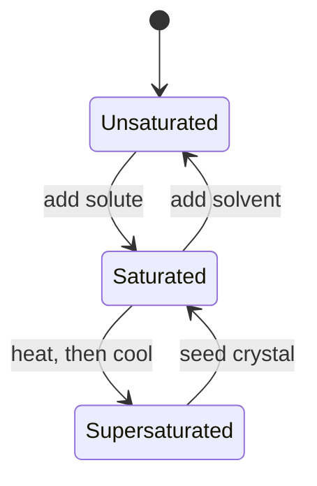
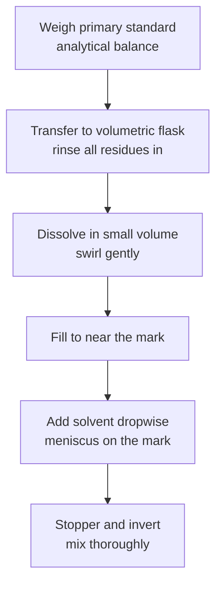
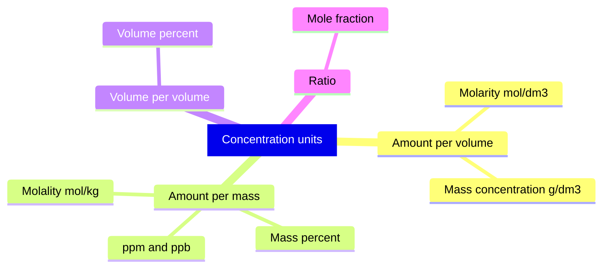

# Chapter 3 — Solutions, Concentration and Dilution

> **Level:** Intermediate (Level 2 — Intermediate Chemistry)
> **Estimated study time:** 6 hours (4 h reading + 2 h exercises)
> **Prerequisites:** [The Mole Concept and Avogadro's Constant](01-the-mole-concept.md), [Stoichiometry, Limiting Reactants and Percentage Yield](02-stoichiometry-and-limiting-reactants.md)
> **Related chapters:** [Gas Laws and the Ideal Gas Equation](04-gas-laws-and-the-ideal-gas-equation.md), [Acid–Base Chemistry, pH and pOH](11-acid-base-chemistry-and-ph.md)
> **Difficulty:** ★★★☆☆ (3/5)

---

## 1. Learning Objectives

After working through this chapter you will be able to:

- Define solute, solvent, solution, saturated, unsaturated, supersaturated and
  solubility, and distinguish them precisely.
- Express concentration in $\text{mol dm}^{-3}$, $\text{g dm}^{-3}$, mass percent,
  volume percent, ppm, ppb and molality.
- Convert between concentration units, using density where required.
- Explain why molarity depends on temperature while molality does not.
- Apply $c_1V_1 = c_2V_2$ to dilution problems and justify the equation.
- Explain colligative properties qualitatively and calculate freezing-point
  depression and boiling-point elevation for simple solutions.
- Distinguish strong, weak and non-electrolytes and relate conductivity to ion
  concentration.

---

## 2. Introduction

Most chemistry happens in solution. The ocean, blood plasma, intracellular fluid,
vinegar, wine and the contents of every reaction flask are solutions. A reaction
between two solids is limited to the area of contact; the same reaction in
solution brings the particles together throughout the mixture and can be
thousands of times faster.

Because the amount of solvent can be varied, "contains salt" says almost nothing;
the useful question is *how much* salt per unit of solution, which is what
concentration measures. Every quantitative analysis depends on knowing at least
one concentration to high precision.

Concentration also governs biology. A $0.9\,\%$ sodium chloride solution is
isotonic with blood; pure water is not, and infusing it would swell and burst red
cells. The arithmetic is therefore a clinical safety issue.

This chapter assumes the mole conversions of Chapter [1](01-the-mole-concept.md)
and the stoichiometric reasoning of Chapter [2](02-stoichiometry-and-limiting-reactants.md).
It introduces the vocabulary of solutions, the several ways of expressing
concentration, the arithmetic of dilution, the practice of preparing a standard
solution, and the colligative properties that depend on how many particles a
solute produces.

---

## 3. Fundamental Concepts

### 3.1 Solution vocabulary

A **solution** is a homogeneous mixture of two or more substances in a single
phase. The **solute** is the substance present in the smaller amount, and the
**solvent** is the substance present in the larger amount. The convention is
operational rather than absolute: in a $50:50$ mixture either component may be
called the solvent. When the solvent is water the solution is **aqueous**, denoted
(aq).

For liquid–liquid systems, a pair that mixes in all proportions is **miscible**;
a pair that forms two layers is **immiscible**. Ethanol and water are miscible;
hexane and water are not.

**Solubility** is the maximum amount of solute that dissolves in a given amount
of solvent at a specified temperature, usually quoted in $\text{g per 100 g}$ of
water or in $\text{mol dm}^{-3}$; it is an equilibrium property. A solution below
the limit is **unsaturated**, one at the limit is **saturated**, and one above it
is **supersaturated** — metastable, and usually crystallized by seeding.

### 3.2 Concentration and its units

**Concentration** is the amount of solute per unit amount of solution or solvent.
The choice of unit depends on the purpose, and several are in routine use.

| Unit | Definition | Typical use |
|---|---|---|
| Molarity $c$ | $n_{\text{solute}}/V_{\text{solution}}$, mol dm⁻³ | Laboratory and stoichiometry |
| Mass concentration $\rho_{\text{B}}$ | $m_{\text{solute}}/V_{\text{solution}}$, g dm⁻³ | Industrial and environmental |
| Mass percent $w$ | $m_{\text{solute}}/m_{\text{solution}} \times 100$ | Commercial acids and alloys |
| Volume percent $\varphi$ | $V_{\text{solute}}/V_{\text{solution}} \times 100$ | Ethanol in beverages |
| ppm | mg solute per kg solution | Trace contaminants |
| ppb | µg solute per kg solution | Ultra-trace contaminants |
| Molality $b$ | $n_{\text{solute}}/m_{\text{solvent}}$, mol kg⁻¹ | Colligative properties |
| Mole fraction $x$ | $n_i/n_{\text{total}}$ | Gas mixtures and thermodynamics |

Molarity is the chemist's default because it connects directly to the mole ratio
of a balanced equation: a volume of solution delivers a known amount of solute,
$n = cV$. Its weakness is that volume changes with temperature, so a molarity
quoted at one temperature differs slightly at another.

### 3.3 Mass percent, volume percent and trace units

**Mass percent** (weight percent, $\%$ w/w) is the mass of solute divided by the
mass of the whole solution. A $37\,\%$ hydrochloric acid solution contains
$37\ \text{g}$ of $\ce{HCl}$ in $100\ \text{g}$ of solution, not in
$100\ \text{g}$ of water. The distinction matters: the same commercial acid is
approximately $12\ \text{mol dm}^{-3}$, a value obtained only after using its
density.

**Volume percent** ($\%$ v/v) is used for liquid mixtures: a $40\,\%$ v/v spirit
contains $40\ \text{cm}^{3}$ of ethanol in $100\ \text{cm}^{3}$ of solution.
Volumes are not strictly additive, so this is a defined convention.

**Parts per million** and **parts per billion** express very small fractions. For
dilute aqueous solutions $1\ \text{ppm} \approx 1\ \text{mg dm}^{-3}$, because
$1\ \text{dm}^{3}$ of water has a mass of about $1\ \text{kg}$; the approximation
fails for dense solvents.

### 3.4 Molality and its distinction from molarity

**Molality** $b$ is the amount of solute per kilogram of *solvent*:

$$
b = \frac{n_{\text{solute}}}{m_{\text{solvent}}}
$$

It is not the same as molarity, which uses the volume of the *solution*. The two
coincide numerically only for very dilute aqueous solutions, where the mass of
solvent is almost the mass of the solution and $1\ \text{kg}$ of water occupies
approximately $1\ \text{dm}^{3}$.

Molality is preferred for colligative properties because it is independent of
temperature. A solution prepared by weighing solvent and solute has a fixed
molality at any temperature; its molarity changes as the solution expands or
contracts.

### 3.5 Dilution and the conservation of solute

**Dilution** is the addition of solvent to a solution, which lowers the
concentration without changing the amount of solute. Because the moles of solute
are conserved,

$$
n_1 = n_2 \quad \Rightarrow \quad c_1V_1 = c_2V_2
$$

where state 1 is before dilution and state 2 after. The equation assumes that
the volumes are additive and that the solute is neither consumed nor lost. Both
are simplifications: mixing ethanol and water contracts slightly, and a volatile
solute can evaporate.

The **dilution factor** is the ratio $V_2/V_1$. A dilution factor of $10$ means
the final concentration is one-tenth of the initial concentration.

### 3.6 Preparing a standard solution

A **standard solution** is one whose concentration is known accurately, usually
prepared from a **primary standard**: a highly pure, stable solid of accurately
known molar mass. Preparation must preserve the amount of solute:

1. Weigh the primary standard accurately on an analytical balance.
2. Transfer it quantitatively to a volumetric flask, rinsing the weighing vessel
   into the flask.
3. Dissolve in a small volume of solvent, then add solvent to near the mark.
4. Add solvent dropwise until the meniscus sits on the mark, stopper and invert
   repeatedly to mix.

The flask is calibrated at a stated temperature, usually $20\ ^\circ\text{C}$.
Using it at a very different temperature introduces a volume error through the
thermal expansion of glass and solvent.

### 3.7 Serial dilutions

A **serial dilution** produces a geometric series of concentrations by diluting a
portion of each solution into the next. Starting from $1.00\ \text{mol dm}^{-3}$
and diluting tenfold at each step gives $0.100$, $0.0100$, $0.00100\ \text{mol dm}^{-3}$
and so on.

The method is efficient and standard for calibration curves, but it multiplies
errors: a $1\,\%$ error per transfer becomes roughly $6\,\%$ by the sixth
solution. It requires calibrated pipettes and mixing at every stage.

### 3.8 Colligative properties

**Colligative properties** depend on the number of dissolved particles, not their
identity. A non-volatile solute lowers the vapour pressure; the boiling point
therefore rises, the freezing point falls as solute interferes with the solvent
lattice, and solvent crosses a semipermeable membrane towards the more
concentrated solution, generating osmotic pressure.

For dilute solutions the changes are proportional to molality:

$$
\Delta T_{\text{b}} = K_{\text{b}}b i, \qquad
\Delta T_{\text{f}} = K_{\text{f}}b i
$$

where $i$ is the **van 't Hoff factor**, the number of particles produced per
formula unit. For glucose $i = 1$; for $\ce{NaCl}$ $i \approx 2$; for
$\ce{CaCl2}$ $i \approx 3$. The factor is approximate because ion pairing reduces
the effective number of particles, especially in concentrated solutions.

### 3.9 Electrolytes and conductivity

An **electrolyte** is a substance that produces ions in solution and therefore
conducts electricity. A **strong electrolyte** dissociates completely (or almost
completely): $\ce{NaCl}$, $\ce{HCl}$, $\ce{NaOH}$. A **weak electrolyte**
dissociates only partially and establishes an equilibrium: acetic acid,
ammonia. A **non-electrolyte** dissolves without producing ions: glucose, urea,
ethanol.

Conductivity depends on ion concentration, charge and mobility. A $\ce{NaCl}$
solution conducts because $\ce{Na+}$ and $\ce{Cl-}$ migrate under an applied
field; glucose does not, because neutral molecules carry no current. Conductivity
is therefore a direct probe of ionic dissociation.

---

## 4. Detailed Scientific Explanation

### 4.1 Dissolution at the particle level

When an ionic solid dissolves, breaking the lattice costs energy (the lattice
enthalpy) and forming ion–dipole interactions with water releases energy (the
hydration enthalpy). Dissolution is favourable when these nearly balance and the
entropy increase is sufficient.

Water orients its partially negative oxygen towards cations and its partially
positive hydrogens towards anions, forming a **hydration shell**; the ions are
mobile and independently solvated, so a $\ce{NaCl}$ solution contains no
$\ce{NaCl}$ units.

This picture is a simplification. Real solutions show ion pairing, especially at
high concentration, and the hydration number is not a fixed integer. The
thermodynamic treatment replaces individual interactions with activities, which
reduce to concentrations only in the limit of infinite dilution.

### 4.2 Saturation, solubility and temperature

Solubility is an equilibrium property. For a solid in contact with its saturated
solution,

$$
\ce{NaCl(s) <=> Na+(aq) + Cl-(aq)}
$$

the equilibrium constant is the solubility product, and the dissolved amount is
fixed at a given temperature. Adding more solid does not change the concentration
of a saturated solution; it simply leaves undissolved solid.

For most ionic solids solubility rises with temperature because dissolution is
endothermic; for a few, such as lithium carbonate, it falls. Gas solubility falls
with temperature and rises with pressure, which is why a warm carbonated drink
goes flat.

A **supersaturated** solution contains more solute than the equilibrium amount.
It is prepared by dissolving at high temperature and cooling carefully. It is
metastable: a seed crystal or a scratch triggers rapid crystallization, releasing
the excess solute and often heat.

### 4.3 Converting between concentration units

The conversions fall into three groups.

**Amount to mass.** $c\ (\text{mol dm}^{-3}) \times M\ (\text{g mol}^{-1})
= \rho_{\text{B}}\ (\text{g dm}^{-3})$.

**Solution to solvent.** Molality needs the mass of solvent; $100\ \text{g}$ of a
$w\,\%$ solution contains $w$ grams of solute and $(100 - w)$ grams of solvent.

**Molarity to mass percent.** Density is required, since molarity is per volume:

$$
w = \frac{cM}{\rho_{\text{solution}}} \times 100\,\%
$$

with $c$ in $\text{mol dm}^{-3}$, $M$ in $\text{g mol}^{-1}$ and $\rho$ in
$\text{g dm}^{-3}$. Confusing $\text{g cm}^{-3}$ with $\text{g dm}^{-3}$ is a
factor-of-1000 error, and it is common.

### 4.4 Colligative properties quantitatively

For a dilute solution, the freezing-point depression and boiling-point elevation
are proportional to the total molality of dissolved particles. The constants
depend only on the solvent: for water,
$K_{\text{f}} = 1.86\ \text{K kg mol}^{-1}$ and
$K_{\text{b}} = 0.512\ \text{K kg mol}^{-1}$.

Osmotic pressure is given by the van 't Hoff equation:

$$
\Pi = i c R T
$$

where $c$ is molarity, $R$ the gas constant and $T$ the thermodynamic temperature.
Osmotic pressure is the colligative property most sensitive to small
concentrations, which is why it is used to determine the molar mass of polymers
and proteins.

These equations are simplifications valid for dilute solutions. At higher
concentrations, solute–solute interactions and ion pairing reduce the effective
particle count, and activities must replace concentrations.

---

## 5. Visual Diagrams

### 5.1 The three saturation states

**Figure 3.1 — The three saturation states.** The diagram is a state machine, not
a sequence: a solution moves between states by adding solute or solvent, changing
temperature or seeding. Supersaturation is a metastable excursion beyond the
equilibrium boundary, which is why a crystal triggers the return.

### 5.2 Preparing a standard solution

**Figure 3.2 — Preparing a standard solution.** Each step preserves the amount of
solute while bringing the volume to a known value: rinsing prevents loss on the
vessel, dropwise addition prevents overshooting the mark, and inversion ensures
homogeneity.

### 5.3 The concentration units

**Figure 3.3 — A taxonomy of concentration units.** The units divide by volume, by
mass or by total amount, which determines their temperature dependence: those
dividing by solution volume change with thermal expansion, those dividing by mass
do not. Mole fraction is the natural unit for gas mixtures.

---

## 6. Mathematical Formulas

### 6.1 Molarity

$$
c = \frac{n}{V}, \qquad n = cV
$$

| Symbol | Meaning | SI unit |
|---|---|---|
| $c$ | Molar concentration | mol dm⁻³ (SI: mol m⁻³) |
| $n$ | Amount of solute | mol |
| $V$ | Volume of solution | dm³ (SI: m³) |

Assumption: the solute is fully dissolved and the volume refers to the solution,
not the solvent. Note that $1\ \text{mol dm}^{-3} = 1000\ \text{mol m}^{-3}$.

### 6.2 Converting molarity to mass percent

$$
w = \frac{cM}{\rho_{\text{solution}}} \times 100\,\%
$$

| Symbol | Meaning | SI unit |
|---|---|---|
| $c$ | Molarity | mol dm⁻³ |
| $M$ | Molar mass of solute | g mol⁻¹ |
| $\rho_{\text{solution}}$ | Density of solution | g dm⁻³ |

Assumption: the density is quoted in $\text{g dm}^{-3}$; if it is given in
$\text{g cm}^{-3}$, multiply by $1000$ first.

### 6.3 Molality and mole fraction

$$
b = \frac{n_{\text{solute}}}{m_{\text{solvent}}}, \qquad
x_i = \frac{n_i}{n_{\text{total}}}
$$

| Symbol | Meaning | SI unit |
|---|---|---|
| $b$ | Molality | mol kg⁻¹ |
| $m_{\text{solvent}}$ | Mass of solvent | kg |
| $x_i$ | Mole fraction of component $i$ | dimensionless |

Molality uses the mass of solvent; molarity uses the volume of solution.

### 6.4 Dilution

$$
c_1V_1 = c_2V_2
$$

Assumptions: the solute is conserved, volumes are additive, and no reaction
occurs. The dilution factor is $V_2/V_1$.

### 6.5 Colligative properties

$$
\Delta T_{\text{f}} = K_{\text{f}}bi, \qquad
\Delta T_{\text{b}} = K_{\text{b}}bi, \qquad
\Pi = icRT
$$

| Symbol | Meaning | SI unit |
|---|---|---|
| $\Delta T_{\text{f}}$, $\Delta T_{\text{b}}$ | Freezing-point depression, boiling-point elevation | K |
| $K_{\text{f}}$, $K_{\text{b}}$ | Cryoscopic and ebullioscopic constants | K kg mol⁻¹ |
| $b$ | Molality of solute | mol kg⁻¹ |
| $i$ | van 't Hoff factor | dimensionless |
| $\Pi$ | Osmotic pressure | Pa |

Assumptions: dilute solution, non-volatile solute, ideal behaviour, complete
dissociation for strong electrolytes. The factor $i$ is an approximation that
fails at high concentration.

---

## 7. Chemical Equations

Dissolution of sodium chloride:

$$
\ce{NaCl(s) -> Na+(aq) + Cl-(aq)}
$$

One mole of formula units gives one mole of each ion, so a
$0.100\ \text{mol dm}^{-3}$ solution contains
$0.100\ \text{mol dm}^{-3}$ of $\ce{Na+}$ and
$0.100\ \text{mol dm}^{-3}$ of $\ce{Cl-}$.

Dissolution of calcium chloride:

$$
\ce{CaCl2(s) -> Ca2+(aq) + 2Cl-(aq)}
$$

One mole gives one mole of calcium ions and two moles of chloride ions, so the
total ion concentration is three times the molarity of the salt. This is why
calcium chloride is an effective de-icing salt and why its solutions have a high
osmotic pressure.

Dissolution of a molecular solid:

$$
\ce{C6H12O6(s) -> C6H12O6(aq)}
$$

Glucose dissolves as intact molecules, so the particle concentration equals the
molarity and $i = 1$.

Ionization of a weak acid:

$$
\ce{CH3COOH(aq) <=> CH3COO-(aq) + H+(aq)}
$$

Acetic acid is only partially ionized, so a $0.100\ \text{mol dm}^{-3}$ solution
contains far fewer than $0.100\ \text{mol dm}^{-3}$ of ions. The double arrow is
essential; a single arrow would imply complete ionization.

---

## 8. Worked Examples

### Worked Example 8.1 — Preparing a standard solution

**Problem.** Describe the preparation of $250.0\ \text{cm}^{3}$ of
$0.100\ \text{mol dm}^{-3}$ sodium chloride solution and calculate the mass of
solid required.

**Strategy.** Use $n = cV$ and $m = nM$, then follow the procedure of Section 3.6.

**Solution.** The volume in cubic decimetres is $0.2500\ \text{dm}^{3}$, so

$$
n(\ce{NaCl}) = 0.100\ \text{mol dm}^{-3} \times 0.2500\ \text{dm}^{3}
= 2.50\times10^{-2}\ \text{mol}
$$

$$
m = 2.50\times10^{-2}\ \text{mol} \times 58.44\ \text{g mol}^{-1} = 1.46\ \text{g}
$$

Weigh $1.46\ \text{g}$ of dried sodium chloride into a weighing boat, transfer it
quantitatively to a $250.0\ \text{cm}^{3}$ volumetric flask with rinsings, dissolve
in about $100\ \text{cm}^{3}$ of distilled water, fill to the mark at eye level,
stopper and invert ten times.

**Check.** $0.100 \times 0.2500 = 0.0250\ \text{mol}$, and
$0.0250 \times 58.44 = 1.46\ \text{g}$. A $1\ \text{mol dm}^{-3}$ solution holds
$58.4\ \text{g dm}^{-3}$, so a tenth of that in a quarter of a litre is
$5.84/4 = 1.46\ \text{g}$.

### Worked Example 8.2 — From mass percent to molarity

**Problem.** Concentrated hydrochloric acid is $37.0\,\%$ $\ce{HCl}$ by mass and
has a density of $1.18\ \text{g cm}^{-3}$. Calculate its molarity.

**Strategy.** Take $1.00\ \text{dm}^{3}$, find its mass from the density, multiply
by the mass fraction, then divide by the molar mass.

**Solution.** The mass of $1.00\ \text{dm}^{3}$ is

$$
m_{\text{solution}} = \rho V = 1.18\ \text{g cm}^{-3} \times 1000\ \text{cm}^{3}
= 1180\ \text{g}
$$

The mass of hydrogen chloride is

$$
m(\ce{HCl}) = 0.370 \times 1180 = 437\ \text{g}
$$

and the amount is

$$
n = \frac{437}{36.458} = 12.0\ \text{mol}
$$

so the molarity is $12.0\ \text{mol dm}^{-3}$.

**Check.** Using $1.18\ \text{g dm}^{-3}$ instead of $1180\ \text{g dm}^{-3}$
would be wrong by a factor of $1000$. The known value for $37\,\%$ acid is about
$12\ \text{mol dm}^{-3}$, and $370/36.5 \approx 10\ \text{mol}$ is the right
order of magnitude.

### Worked Example 8.3 — Dilution and serial dilution

**Problem.** $25.0\ \text{cm}^{3}$ of $2.00\ \text{mol dm}^{-3}$ sodium chloride
solution is diluted to $250.0\ \text{cm}^{3}$. (a) Calculate the new
concentration. (b) A $10.0\ \text{cm}^{3}$ portion of the diluted solution is
then diluted to $100.0\ \text{cm}^{3}$; calculate the final concentration.

**Strategy.** Apply $c_1V_1 = c_2V_2$ at each step.

**Solution.** (a)

$$
c_2 = \frac{c_1V_1}{V_2} = \frac{2.00 \times 25.0}{250.0}
= 0.200\ \text{mol dm}^{-3}
$$

(b)

$$
c_3 = \frac{0.200 \times 10.0}{100.0} = 0.0200\ \text{mol dm}^{-3}
$$

**Check.** Two tenfold dilutions give $2.00/100 = 0.0200\ \text{mol dm}^{-3}$.
The final flask holds $0.0200 \times 0.1000 = 2.00\times10^{-3}\ \text{mol}$,
equal to the amount in $10.0\ \text{cm}^{3}$ of $0.200\ \text{mol dm}^{-3}$.

### Worked Example 8.4 — Molality from a mass percent

**Problem.** $5.00\ \text{g}$ of sodium chloride is dissolved in $95.0\ \text{g}$
of water. Calculate the molality of the solution and compare it with the molarity
that would be obtained if the final volume were $100.0\ \text{cm}^{3}$.

**Strategy.** Molality uses solvent mass in kilograms; molarity uses solution volume.

**Solution.** The amount of sodium chloride is

$$
n = \frac{5.00}{58.44} = 8.556\times10^{-2}\ \text{mol}
$$

The molality is

$$
b = \frac{8.556\times10^{-2}}{0.0950} = 0.901\ \text{mol kg}^{-1}
$$

If the solution volume is $100.0\ \text{cm}^{3} = 0.1000\ \text{dm}^{3}$, the
molarity is

$$
c = \frac{8.556\times10^{-2}}{0.1000} = 0.856\ \text{mol dm}^{-3}
$$

**Check.** The two differ by about $5\,\%$, expected for a fairly concentrated
solution; they coincide only at infinite dilution. Molality is larger because its
denominator, the solvent mass, is smaller than the solution volume in litres.

### Worked Example 8.5 — Freezing-point depression

**Problem.** $500\ \text{g}$ of ethylene glycol, $\ce{C2H6O2}$, is added to
$2.00\ \text{kg}$ of water in a car radiator. Calculate the freezing point of the
mixture, taking $K_{\text{f}} = 1.86\ \text{K kg mol}^{-1}$ and assuming
$i = 1$.

**Strategy.** Convert glycol to moles, divide by the solvent mass, then apply
$\Delta T_{\text{f}} = K_{\text{f}}b$.

**Solution.** The molar mass of ethylene glycol is

$$
M = 2(12.011) + 6(1.008) + 2(15.999) = 62.068\ \text{g mol}^{-1}
$$

so

$$
n = \frac{500}{62.068} = 8.056\ \text{mol}
$$

and

$$
b = \frac{8.056}{2.00} = 4.028\ \text{mol kg}^{-1}
$$

The depression is

$$
\Delta T_{\text{f}} = 1.86 \times 4.028 = 7.49\ \text{K}
$$

so the mixture freezes at $0.00 - 7.49 = -7.49\ ^\circ\text{C}$, reported as
$-7.5\ ^\circ\text{C}$ to three significant figures.

**Check.** The value is physically reasonable: a $25\,\%$ glycol mixture protects
a car to about $-10\ ^\circ\text{C}$, and the mass fraction here is
$500/2500 = 20\,\%$. The calculation also passes the order-of-magnitude test:
$4\ \text{mol kg}^{-1}$ times roughly $2\ \text{K kg mol}^{-1}$ gives about
$8\ \text{K}$ of depression.

---

## 9. Real-World Applications

**Medicine.** Intravenous fluids are specified by concentration and osmolarity:
$0.9\,\%$ saline, $5\,\%$ glucose, Ringer's lactate. An error can cause
haemolysis or dehydration, so hospital solutions are checked under strict
protocols.

**Antifreeze and de-icing.** Freezing-point depression is the design principle
behind ethylene glycol antifreeze and road salt. Calcium chloride is more effective
than sodium chloride per mole because it produces three ions per formula unit.

**Analytical chemistry.** Every titration, spectrophotometric assay and
chromatographic calibration begins with a standard solution. The accuracy of the
whole method is limited by the accuracy of that solution.

---

## 10. Common Mistakes

| Mistake | Why it happens | Correct approach |
|---|---|---|
| Confusing molarity with molality | Both are written with an $m$-like symbol | Molarity uses solution volume; molality uses solvent mass |
| Forgetting density when converting mass percent | The percentage is per mass, molarity per volume | Convert with $w = cM/\rho$, using $\text{g dm}^{-3}$ |
| Adding volumes of solute and solvent as if additive | Volumes are not strictly additive | Use the final solution volume, measured after mixing |
| Assuming $i = 1$ for a salt | The formula is treated as a molecule | Count ions per formula unit; $\ce{NaCl}$ gives $i \approx 2$ |
| Treating a weak acid as fully ionized | The arrow is read as complete | Use the equilibrium and the acid dissociation constant |

---

## 11. Chapter Summary

- Molarity $c = n/V$ is the default laboratory unit because it connects volume to
  amount; it depends on temperature through the solution volume.
- Molality $b = n/m_{\text{solvent}}$ is temperature-independent and is the
  correct unit for colligative properties.
- Dilution conserves solute, giving $c_1V_1 = c_2V_2$; the dilution factor is
  $V_2/V_1$.
- Colligative properties depend on the number of dissolved particles; freezing
  point falls, boiling point rises, vapour pressure falls and osmotic pressure
  develops.

---

## 12. Exercises

### 12.1 Conceptual questions

1. Explain why molarity depends on temperature while molality does not. Which is
   more appropriate for a colligative-property measurement, and why?
2. A label states that a solution is $10\,\%$ by mass. Explain why this is
   insufficient to calculate its molarity without additional information.

### 12.2 Basic problems

3. Calculate the molarity of (a) $5.00\ \text{g}$ of sodium hydroxide dissolved to
   $250.0\ \text{cm}^{3}$; (b) $2.50\ \text{g}$ of potassium nitrate dissolved to
   $500.0\ \text{cm}^{3}$.
4. Calculate the final concentration when (a) $10.0\ \text{cm}^{3}$ of
   $0.500\ \text{mol dm}^{-3}$ solution is diluted to $250.0\ \text{cm}^{3}$;
   (b) $25.0\ \text{cm}^{3}$ of $1.00\ \text{mol dm}^{-3}$ solution is diluted to
   $100.0\ \text{cm}^{3}$.
5. What volume of $0.500\ \text{mol dm}^{-3}$ solution is needed to prepare
   $100.0\ \text{cm}^{3}$ of $0.0500\ \text{mol dm}^{-3}$ solution?

### 12.3 Intermediate problems

6. Concentrated hydrochloric acid is $37.0\,\%$ $\ce{HCl}$ by mass with density
   $1.18\ \text{g cm}^{-3}$. Calculate its molarity and the volume needed to
   prepare $500.0\ \text{cm}^{3}$ of $1.00\ \text{mol dm}^{-3}$ acid.
7. A water sample contains $0.025\ \text{g}$ of calcium ions in $1.00\ \text{dm}^{3}$.
   Express this concentration in ppm and in $\text{mol dm}^{-3}$.
8. $10.0\ \text{g}$ of glucose is dissolved in $90.0\ \text{g}$ of water. Calculate
   the molality. Explain why the molarity cannot be calculated without the density.

### 12.4 Advanced problems

9. Describe how to prepare a series of standards of $1.00\times10^{-2}$,
   $1.00\times10^{-3}$ and $1.00\times10^{-4}\ \text{mol dm}^{-3}$ from a
   $0.100\ \text{mol dm}^{-3}$ stock solution. State two sources of error that
   accumulate in a serial dilution.
10. Explain why $0.9\,\%$ sodium chloride is isotonic with blood while
    $0.9\,\%$ glucose is not; support your answer with a calculation.

### 12.5 Calculation problems

11. $50.0\ \text{g}$ of sodium chloride is dissolved in $1.00\ \text{kg}$ of water.
    Calculate the freezing point of the solution, taking
    $K_{\text{f}} = 1.86\ \text{K kg mol}^{-1}$ and $i = 2$.
12. Calculate the mass of potassium dichromate, $\ce{K2Cr2O7}$, required to
    prepare $250.0\ \text{cm}^{3}$ of $0.0200\ \text{mol dm}^{-3}$ solution.

### 12.6 Answers

1. Molarity divides by solution volume, which expands on heating; molality divides
   by solvent mass, which does not. Colligative properties depend on the amount
   ratio, so molality is preferred.
2. Mass percent gives the mass ratio of solute to solution but not the solution
   density or the solute molar mass, so molarity $c = w\rho/M$ cannot be computed.
3. (a) $0.500\ \text{mol dm}^{-3}$; (b) $0.0494\ \text{mol dm}^{-3}$.
4. (a) $0.0200\ \text{mol dm}^{-3}$; (b) $0.250\ \text{mol dm}^{-3}$.
5. $10.0\ \text{cm}^{3}$.
6. $12.0\ \text{mol dm}^{-3}$; $V = 0.500/12.0 = 41.7\ \text{cm}^{3}$.
7. $25\ \text{ppm}$; $6.2\times10^{-4}\ \text{mol dm}^{-3}$.
8. $10.0/180.156 = 0.0555\ \text{mol}$ in $0.0900\ \text{kg}$, so
   $b = 0.617\ \text{mol kg}^{-1}$. Molarity needs the final solution volume,
   which requires the density.
9. Dilute $10.0\ \text{cm}^{3}$ of stock to $100.0\ \text{cm}^{3}$ for
   $1.00\times10^{-2}$, then repeat with each successive solution. Pipetting and
   dilution errors accumulate multiplicatively.
10. $0.9\,\%$ $\ce{NaCl}$ gives $0.308\ \text{mol dm}^{-3}$ of particles;
    $0.9\,\%$ glucose gives only $0.050\ \text{mol dm}^{-3}$, so it is hypotonic.
11. $n(\ce{NaCl}) = 0.856\ \text{mol}$, $b = 0.856\ \text{mol kg}^{-1}$,
    $\Delta T_{\text{f}} = 2(1.86)(0.856) = 3.18\ \text{K}$, so the solution
    freezes at $-3.2\ ^\circ\text{C}$.
12. $n = 0.00500\ \text{mol}$, $M = 294.19\ \text{g mol}^{-1}$, so
    $m = 1.47\ \text{g}$.

> Worked solutions for this level are maintained in the `solutions/` directory of
> the level.

---

## 13. Further Reading

- OpenStax. *Chemistry 2e*, Chapter 3, "Composition of Substances and Solutions",
  and Chapter 11, "Solutions and Colloids".
  <https://openstax.org/details/books/chemistry-2e>
- Atkins, P. and Jones, L. *Chemical Principles: The Quest for Insight*, 7th ed.,
  W. H. Freeman, 2016 — solutions, concentration and colligative properties.
- IUPAC. *Compendium of Chemical Terminology* ("Gold Book"), 2nd ed. (corrected
  version), entries "concentration", "molality" and "solubility".
  <https://goldbook.iupac.org/>
- IUPAC. *Quantities, Units and Symbols in Physical Chemistry* ("Green Book"),
  3rd ed., Royal Society of Chemistry, 2007 — definitions of concentration
  quantities.
- NIST. *CODATA Internationally Recommended Values of the Fundamental Physical
  Constants*. <https://physics.nist.gov/cuu/Constants/>

Repository cross-references: [CURRICULUM.md](../CURRICULUM.md) for the position of
this chapter in the programme, and [REFERENCES.md](../REFERENCES.md) for the full
source list and data policy.
