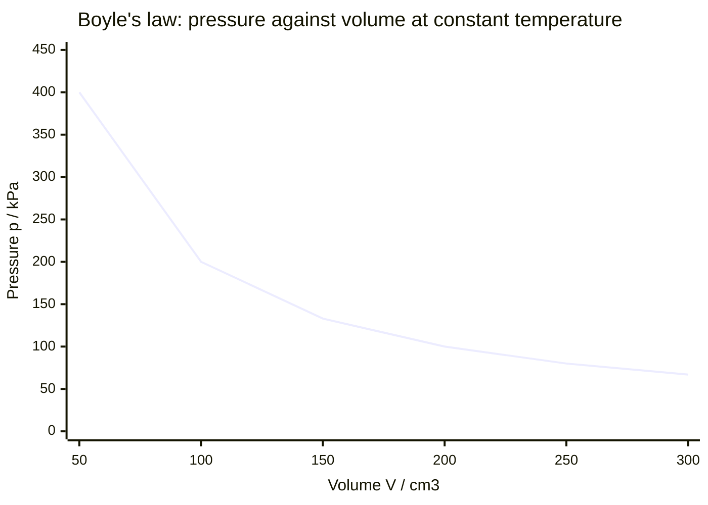
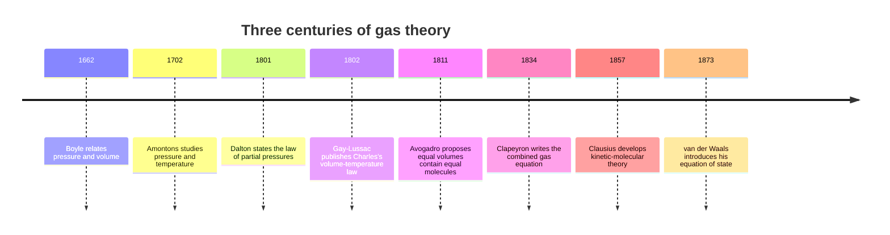

# Chapter 4 — Gas Laws and the Ideal Gas Equation

> **Level:** Intermediate (Level 2 — Intermediate Chemistry)
> **Estimated study time:** 7 hours (5 h reading + 2 h exercises)
> **Prerequisites:** [The Mole Concept and Avogadro's Constant](01-the-mole-concept.md), [Stoichiometry, Limiting Reactants and Percentage Yield](02-stoichiometry-and-limiting-reactants.md), [Solutions, Concentration and Dilution](03-solutions-concentration-and-dilution.md)
> **Related chapters:** [Thermochemistry and Enthalpy](08-thermochemistry-and-enthalpy.md), [Chemical Equilibrium and Le Châtelier's Principle](10-chemical-equilibrium-and-le-chateliers-principle.md)
> **Difficulty:** ★★★☆☆ (3/5)

---

## 1. Learning Objectives

After working through this chapter you will be able to:

- Apply the combined gas law and the ideal gas equation $pV = nRT$ with consistent
  units.
- Calculate molar volume, gas density and molar mass from gas measurements.
- Apply Dalton's law of partial pressures and mole fractions.
- Correct a gas volume for the vapour pressure of water.
- Explain the deviations of real gases from ideality and the meaning of the van der
  Waals constants.
- Apply Graham's law of effusion.

---

## 2. Introduction

Gases are the simplest state of matter to describe quantitatively. A gas fills its
container, exerts pressure on every wall, and is highly compressible. Its
macroscopic behaviour depends on only four variables — pressure, volume,
temperature and amount — and, to a remarkably good approximation, the relation
between them is the same for every gas.

That universality is the content of the **ideal gas equation**, $pV = nRT$, which
describes the air in a lung, the helium in a balloon and the atmosphere of a
planet. Its simplicity has limits: real gases condense, and near condensation their
behaviour departs sharply from the ideal. The van der Waals equation corrects for
the volume of the molecules and the forces between them.

This chapter assumes the mole conversions of Chapter [1](01-the-mole-concept.md),
the stoichiometry of Chapter [2](02-stoichiometry-and-limiting-reactants.md) and
the concentration arithmetic of Chapter [3](03-solutions-concentration-and-dilution.md).
It builds the gas laws from experiment, combines them into a single equation,
applies the equation to chemical problems, and then examines where it breaks down.

---

## 3. Fundamental Concepts

### 3.1 Properties of gases

A gas has no fixed shape and no fixed volume; it expands to fill its container and
mixes freely with other gases. It is compressible because most of its volume is
empty space, and its density is much lower than that of the corresponding liquid
or solid.

The state of a fixed amount of gas is specified by pressure $p$, volume $V$ and
thermodynamic temperature $T$; a fourth variable $n$ is needed when the sample size
can change. These are linked by an **equation of state**, of which the ideal gas
equation is the simplest.

### 3.2 Pressure and its units

**Pressure** is force per unit area:

$$
p = \frac{F}{A}
$$

The SI unit is the pascal, $1\ \text{Pa} = 1\ \text{N m}^{-2}$. Atmospheric
pressure is about $10^{5}\ \text{Pa}$, so laboratory pressures are usually quoted
in kilopascals. The older units remain in use, and conversion is a routine skill.

| Unit | Equivalent in Pa | Equivalent in kPa | Notes |
|---|---|---|---|
| pascal | 1 | $10^{-3}$ | SI unit |
| kilopascal | $10^{3}$ | 1 | Laboratory default |
| bar | $10^{5}$ | 100 | Defined exactly |
| atmosphere | 101 325 | 101.325 | Defined exactly |
| millimetre of mercury | 133.322 | 0.133 322 | Torr is almost identical |
| torr | 133.322 | 0.133 322 | Defined as $101\,325/760$ Pa |

The key relation is $1\ \text{atm} = 101.325\ \text{kPa} = 760\ \text{mmHg} =
1.01325\ \text{bar}$; a gauge reading $740\ \text{mmHg}$ reads $98.7\ \text{kPa}$.

### 3.3 Boyle's law

At constant temperature and fixed amount, the pressure of a gas is inversely
proportional to its volume:

$$
pV = \text{constant} \qquad (T, n\ \text{constant})
$$

A plot of $p$ against $V$ is a hyperbola; a plot of $p$ against $1/V$ is a straight
line through the origin. The product $pV$ is constant along an **isotherm**.

**Figure 4.1 — Boyle's law plotted from $pV = 20\,000\ \text{kPa cm}^{3}$.** The
curve is a rectangular hyperbola: doubling the volume halves the pressure. Real
gases follow it closely at moderate pressure; a plot of $p$ against $1/V$ is often
preferred because departures from the line are easier to see.

### 3.4 Charles's law

At constant pressure and fixed amount, the volume of a gas is directly
proportional to its thermodynamic temperature:

$$
\frac{V}{T} = \text{constant} \qquad (p, n\ \text{constant})
$$

A plot of $V$ against $T$ in kelvin is a straight line through the origin; against
Celsius it extrapolates to zero volume at $-273.15\ ^\circ\text{C}$, which is how
the absolute scale was motivated. The law fails at low temperature because gases
liquefy, so the extrapolation belongs to the ideal model.

### 3.5 Gay-Lussac's law and Amontons's law

At constant volume and fixed amount, the pressure of a gas is directly
proportional to its thermodynamic temperature:

$$
\frac{p}{T} = \text{constant} \qquad (V, n\ \text{constant})
$$

A plot of $p$ against $T$ is a straight line through the origin. The law is
attributed both to Gay-Lussac (1808) and to Amontons, who described the relation a
century earlier.

### 3.6 Avogadro's law

At constant temperature and pressure, the volume of a gas is directly
proportional to the amount of substance:

$$
V \propto n \qquad (T, p\ \text{constant})
$$

Equal volumes of different gases at the same temperature and pressure contain
equal numbers of molecules, which makes molar volume meaningful. A plot of $V$
against $n$ is a straight line through the origin.

### 3.7 The combined gas law

Combining Boyle, Charles and Gay-Lussac for a fixed amount of gas gives

$$
\frac{p_1V_1}{T_1} = \frac{p_2V_2}{T_2}
$$

The combined law is useful when a sample changes pressure, volume and temperature
together. Every temperature must be in kelvin; using Celsius values is the most
common error in the topic.

### 3.8 The ideal gas equation

Adding Avogadro's law to the combined law gives the **ideal gas equation**:

$$
pV = nRT
$$

where $R$ is the **molar gas constant**,
$R = 8.314\ \text{J mol}^{-1}\ \text{K}^{-1}$. The equation is called ideal
because it assumes that the gas particles have negligible volume and exert no
forces on one another except during elastic collisions.

In SI, $p$ is in pascals, $V$ in cubic metres and $R = 8.314\ \text{J mol}^{-1}\ \text{K}^{-1}$.
Kilopascals with cubic decimetres still give joules, so the same $R$ applies;
kilopascals with cubic centimetres give millijoules and a factor-of-$1000$ error.

### 3.9 Molar volume, density and molar mass

One mole of an ideal gas occupies $V_{\text{m}} = RT/p$: at STP
($100\ \text{kPa}$, $273.15\ \text{K}$) this is $22.71\ \text{dm}^{3}\ \text{mol}^{-1}$,
and at SATP ($298.15\ \text{K}$) it is $24.79\ \text{dm}^{3}\ \text{mol}^{-1}$.

With $n = m/M$, the equation gives the density and hence the molar mass:

$$
\rho = \frac{pM}{RT}, \qquad M = \frac{\rho RT}{p}
$$

Here $\rho$ is density (kg m⁻³) and $M$ molar mass (kg mol⁻¹).

### 3.10 Dalton's law of partial pressures

In a mixture of non-reacting ideal gases, the total pressure is the sum of the
**partial pressures** each gas would exert alone:
$p_{\text{total}} = \sum_i p_i$. The **mole fraction** is
$x_i = n_i/n_{\text{total}}$, and for an ideal gas

$$
p_i = x_i p_{\text{total}}
$$

Each gas behaves independently because its molecules do not interact with those of
the others.

### 3.11 Collecting gas over water

When a gas is collected by displacement of water, the collected gas is saturated
with water vapour. The total pressure is the sum of the gas pressure and the
vapour pressure of water at that temperature:

$$
p_{\text{total}} = p_{\text{gas}} + p_{\text{H2O}}(T)
$$

The vapour pressure of water is tabulated; at $20\ ^\circ\text{C}$ it is
$2.34\ \text{kPa}$, at $25\ ^\circ\text{C}$ it is $3.17\ \text{kPa}$. The gas
pressure is obtained by subtraction, and only then is the ideal gas equation
applied.

### 3.12 Kinetic-molecular theory

**Kinetic-molecular theory (KMT)** rests on five postulates: particles are
numerous and in random motion; their volume is negligible compared with the
container; intermolecular forces are negligible except during collisions;
collisions are elastic; and average kinetic energy is proportional to $T$. The
postulates are a model, not a literal description — real molecules have finite
volume and exert forces, but these effects are small at ordinary pressures.

### 3.13 Real gases and the van der Waals equation

The **compressibility factor** $Z = pV_{\text{m}}/RT$ measures departure from
ideality. For an ideal gas $Z = 1$ at all pressures. For a real gas, $Z$ falls
below $1$ at moderate pressure (attractive forces dominate) and rises above $1$ at
high pressure (molecular volume dominates).

The **van der Waals equation** corrects both effects:

$$
\left(p + \frac{an^{2}}{V^{2}}\right)(V - nb) = nRT
$$

Here $a$ measures attraction and $b$ the excluded volume per mole: larger
molecules have larger $b$, more polarizable molecules larger $a$. The equation is
approximate but reproduces condensation qualitatively.

### 3.14 Graham's law of effusion

**Effusion** is the escape of gas through a small hole into a vacuum. Graham's law
states that the rate of effusion is inversely proportional to the square root of
the molar mass:

$$
\frac{r_1}{r_2} = \sqrt{\frac{M_2}{M_1}}
$$

The relation holds at the same temperature and pressure. It follows from KMT:
lighter molecules move faster, with mean speed proportional to $1/\sqrt{M}$. It is a good approximation for small holes and low pressures, but
fails when the hole is comparable to the mean free path.

---

## 4. Detailed Scientific Explanation

### 4.1 Deriving the ideal gas equation

Boyle's law gives $V \propto 1/p$ at constant $T$ and $n$. Charles's law gives
$V \propto T$ at constant $p$ and $n$. Avogadro's law gives $V \propto n$ at
constant $T$ and $p$. Combining the three proportionalities,

$$
V \propto \frac{nT}{p}
$$

and inserting a constant of proportionality gives $V = nRT/p$, or $pV = nRT$. The
derivation is a dimensional argument, not a proof; the equation is validated by
experiment.

### 4.2 Gas density and molar mass determination

The density form of the ideal gas equation is used to identify gases. A known mass
of gas is confined in a bulb of known volume at a measured pressure and
temperature; the density follows, and $M = \rho RT/p$. The method is limited by
the accuracy of the pressure and temperature measurements and by non-ideality.

For a mixture, $M_{\text{avg}} = \sum x_i M_i$; air averages about
$28.96\ \text{g mol}^{-1}$, which is why a helium balloon rises.

### 4.3 Dalton's law and mole fractions

Dalton's law is exact for ideal gases and approximate for real mixtures. The mole
fraction is the natural composition variable for gases because, at fixed $T$ and
$p$, volume fraction equals mole fraction. A mixture of $20\,\%$ oxygen by volume
at atmospheric pressure therefore has an oxygen partial pressure of about
$21\ \text{kPa}$.

The law fails when gases interact strongly, as $\ce{HCl}$ and $\ce{NH3}$ do when
they form solid ammonium chloride.

### 4.4 Kinetic-molecular theory: from postulates to pressure

Consider $N$ molecules of mass $m$ in a box of volume $V$. A molecule of speed
$u_x$ rebounds from a wall, transferring momentum $2mu_x$; summing the impulses
over all molecules gives

$$
pV = \tfrac{1}{3}Nm\langle u^{2}\rangle
$$

Comparing with $pV = nRT$ and $N = nN_{\text{A}}$ gives
$\tfrac{1}{2}m\langle u^{2}\rangle = \tfrac{3}{2}kT$, with
$k = R/N_{\text{A}} = 1.381\times10^{-23}\ \text{J K}^{-1}$. Temperature is thus
the average translational kinetic energy of the particles.

### 4.5 Root-mean-square speed

Solving for the root-mean-square speed gives

$$
u_{\text{rms}} = \sqrt{\frac{3RT}{M}}
$$

At $298\ \text{K}$, nitrogen has $u_{\text{rms}} = 515\ \text{m s}^{-1}$,
comparable to the speed of sound, which propagates through the same motion.

The Maxwell–Boltzmann distribution has a long high-speed tail, so the fraction of
molecules above an activation energy rises steeply with temperature — the link
between gas kinetics and reaction rates.

### 4.6 Deviations from ideality

The ideal model fails when molecular volume and intermolecular forces cease to be
negligible; both failures occur at high pressure, and attraction also matters at
low temperature. For carbon dioxide at $273\ \text{K}$, $Z$ is about $0.995$ at
$1\ \text{bar}$, falls to a minimum near $30\ \text{bar}$, then rises above $1$.
Ammonia deviates far more strongly because of hydrogen bonding, while helium is
nearly ideal over a wide range.

For $\ce{CO2}$, $a = 0.364\ \text{Pa m}^{6}\ \text{mol}^{-2}$ and
$b = 4.27\times10^{-5}\ \text{m}^{3}\ \text{mol}^{-1}$; for $\ce{H2}$,
$a = 0.0247$ and $b = 2.65\times10^{-5}$, the small $a$ reflecting weak forces.

---

## 5. Visual Diagrams

### 5.1 Which gas law applies?

**Figure 4.2 — Selecting the appropriate gas law.** The decision tree asks which
variables change while the others are held fixed. If two or more variables change
simultaneously, use the combined gas law or the ideal gas equation directly rather
than applying the specialized laws in sequence. The tree is a diagnostic aid, not
a substitute for understanding that all four laws are special cases of
$pV = nRT$.

### 5.2 From Boyle to van der Waals

**Figure 4.3 — A timeline of gas theory.** The sequence moves from empirical
correlations to a microscopic model and then to a correction of that model. Boyle's
law preceded a clear concept of temperature, and Avogadro's hypothesis preceded the
measurement of $N_{\text{A}}$ by half a century.

---

## 6. Mathematical Formulas

### 6.1 Combined gas law

$$
\frac{p_1V_1}{T_1} = \frac{p_2V_2}{T_2}
$$

Assumption: fixed amount of gas, ideal behaviour.

### 6.2 Ideal gas equation

$$
pV = nRT
$$

| Symbol | Meaning | SI unit |
|---|---|---|
| $p$ | Pressure | Pa |
| $V$ | Volume | m³ |
| $n$ | Amount of gas | mol |
| $R$ | Molar gas constant | J mol⁻¹ K⁻¹ |
| $T$ | Thermodynamic temperature | K |

Assumptions: negligible molecular volume, negligible intermolecular forces, no
reaction. Valid at low pressure and high temperature; poor near condensation.

### 6.3 Density and molar mass

$$
\rho = \frac{pM}{RT}, \qquad M = \frac{\rho RT}{p}
$$

Here $\rho$ is density (kg m⁻³) and $M$ molar mass (kg mol⁻¹).

### 6.4 Partial pressures

$$
p_{\text{total}} = \sum_i p_i, \qquad
p_i = x_i p_{\text{total}}, \qquad
x_i = \frac{n_i}{n_{\text{total}}}
$$

Assumption: the gases do not react and behave ideally.

### 6.5 Gas collected over water

$$
p_{\text{gas}} = p_{\text{total}} - p_{\text{H2O}}(T)
$$

### 6.6 Kinetic-molecular results

$$
pV = \tfrac{1}{3}Nm\langle u^{2}\rangle, \qquad
u_{\text{rms}} = \sqrt{\frac{3RT}{M}}, \qquad
\tfrac{1}{2}m\langle u^{2}\rangle = \tfrac{3}{2}kT
$$

Here $N$ is the number of molecules, $m$ the molecular mass (kg) and $k$ the
Boltzmann constant.

### 6.7 van der Waals equation

$$
\left(p + \frac{an^{2}}{V^{2}}\right)(V - nb) = nRT
$$

Here $a$ (Pa m⁶ mol⁻²) measures attraction and $b$ (m³ mol⁻¹) the excluded volume.

### 6.8 Graham's law

$$
\frac{r_1}{r_2} = \sqrt{\frac{M_2}{M_1}}
$$

Assumption: effusion through a small hole at low pressure, same temperature and
pressure for both gases.

---

## 7. Chemical Equations

Gases are usually generated by a reaction and collected, so the stoichiometry and
the gas law are used together.

Zinc with hydrochloric acid:

$$
\ce{Zn(s) + 2HCl(aq) -> ZnCl2(aq) + H2(g)}
$$

One mole of zinc produces one mole of hydrogen, whose volume at STP is
$22.71\ \text{dm}^{3}$. The acid must be in excess for the zinc to dissolve
completely.

Calcium carbonate with hydrochloric acid:

$$
\ce{CaCO3(s) + 2HCl(aq) -> CaCl2(aq) + CO2(g) + H2O(l)}
$$

One mole of carbonate produces one mole of carbon dioxide. This is the standard
laboratory preparation of small quantities of $\ce{CO2}$.

Combustion of hydrogen:

$$
\ce{2H2(g) + O2(g) -> 2H2O(l)}
$$

Two volumes of hydrogen react with one volume of oxygen to form liquid water. The
$2:1$ volume ratio at the same temperature and pressure is a direct illustration
of Gay-Lussac's law of combining volumes and of Avogadro's law.

Synthesis of ammonia:

$$
\ce{N2(g) + 3H2(g) -> 2NH3(g)}
$$

One volume of nitrogen reacts with three volumes of hydrogen to give two volumes
of ammonia, all measured at the same temperature and pressure. The volume ratio
equals the mole ratio, which is why gas volumes can be used directly in
stoichiometric calculations for gaseous reactions.

---

## 8. Worked Examples

### Worked Example 8.1 — Boyle's law

**Problem.** A gas occupies $200\ \text{cm}^{3}$ at $100\ \text{kPa}$. It is
compressed at constant temperature until its volume is $150\ \text{cm}^{3}$.
Calculate the final pressure.

**Strategy.** Temperature and amount are fixed, so use $p_1V_1 = p_2V_2$. The
volume units cancel, so cubic centimetres may be used directly.

**Solution.**

$$
p_2 = \frac{p_1V_1}{V_2} = \frac{100 \times 200}{150} = 133\ \text{kPa}
$$

**Check.** $200/150 = 1.33$, so $p = 100(1.33) = 133\ \text{kPa}$; $pV$ is unchanged.

### Worked Example 8.2 — The combined gas law

**Problem.** A gas sample occupies $250\ \text{cm}^{3}$ at $25.0\ ^\circ\text{C}$
and $98.0\ \text{kPa}$. Calculate its volume at STP ($100\ \text{kPa}$,
$273.15\ \text{K}$).

**Strategy.** Both pressure and temperature change, so use the combined law.
Convert the temperature to kelvin and keep the volume unit consistent on both
sides.

**Solution.** $T_1 = 298.15\ \text{K}$ and $T_2 = 273.15\ \text{K}$, so

$$
V_2 = V_1\frac{p_1}{p_2}\frac{T_2}{T_1}
= 250 \times \frac{98.0}{100} \times \frac{273.15}{298.15}
= 224\ \text{cm}^{3}
$$

**Check.** Cooling to $0\ ^\circ\text{C}$ contracts the gas about $8\,\%$ and the
pressure rise $2\,\%$, consistent with $224\ \text{cm}^{3}$.

### Worked Example 8.3 — Molar mass from gas density

**Problem.** A $0.500\ \text{g}$ sample of a gas occupies $250\ \text{cm}^{3}$ at
$100\ \text{kPa}$ and $300\ \text{K}$. Calculate its molar mass and suggest a
possible identity.

**Strategy.** Convert the volume to cubic metres, use $pV = nRT$ to find the
amount, then $M = m/n$.

**Solution.** The volume is $2.50\times10^{-4}\ \text{m}^{3}$, so

$$
n = \frac{pV}{RT} = \frac{100\,000 \times 2.50\times10^{-4}}{8.314 \times 300}
= 1.002\times10^{-2}\ \text{mol}
$$

$$
M = \frac{0.500}{1.002\times10^{-2}} = 49.9\ \text{g mol}^{-1}
$$

**Check.** One mole occupies $24.94\ \text{dm}^{3}$, so $0.250\ \text{dm}^{3}$ holds
$0.0100\ \text{mol}$ and $M \approx 50$, consistent with $\ce{CH3Cl}$ ($50.49$).

### Worked Example 8.4 — Dalton's law of partial pressures

**Problem.** $2.00\ \text{g}$ of helium and $8.00\ \text{g}$ of oxygen are mixed in
a $10.0\ \text{dm}^{3}$ vessel at $300\ \text{K}$. Calculate the total pressure,
the mole fractions and the partial pressure of each gas.

**Strategy.** Convert each mass to amount, sum the amounts, apply $pV = nRT$ to the
mixture, then use $p_i = x_i p_{\text{total}}$.

**Solution.**

$$
n(\ce{He}) = \frac{2.00}{4.0026} = 0.4997\ \text{mol}, \qquad
n(\ce{O2}) = \frac{8.00}{31.998} = 0.2500\ \text{mol}
$$

$$
n_{\text{total}} = 0.7497\ \text{mol}
$$

$$
p_{\text{total}} = \frac{nRT}{V}
= \frac{0.7497 \times 8.314 \times 300}{0.0100}
= 1.87\times10^{5}\ \text{Pa} = 187\ \text{kPa}
$$

The mole fractions are

$$
x(\ce{He}) = \frac{0.4997}{0.7497} = 0.6665, \qquad
x(\ce{O2}) = 0.3335
$$

so

$$
p(\ce{He}) = 0.6665 \times 187 = 125\ \text{kPa}, \qquad
p(\ce{O2}) = 0.3335 \times 187 = 62.4\ \text{kPa}
$$

**Check.** The partial pressures sum to $187\ \text{kPa}$; helium, being lighter,
gives twice the moles for the same mass, so its fraction is about two-thirds.

### Worked Example 8.5 — Gas collected over water

**Problem.** $125\ \text{cm}^{3}$ of gas is collected over water at
$22.0\ ^\circ\text{C}$ and a total pressure of $99.0\ \text{kPa}$. The vapour
pressure of water at $22.0\ ^\circ\text{C}$ is $2.64\ \text{kPa}$. Calculate the
amount of dry gas and, assuming it is carbon dioxide, its mass.

**Strategy.** Subtract the water vapour pressure to obtain the gas pressure,
convert the volume to cubic metres, and apply $pV = nRT$.

**Solution.** The dry gas pressure is

$$
p_{\text{gas}} = 99.0 - 2.64 = 96.36\ \text{kPa}
$$

and $T = 295.15\ \text{K}$, $V = 1.25\times10^{-4}\ \text{m}^{3}$:

$$
n = \frac{96\,360 \times 1.25\times10^{-4}}{8.314 \times 295.15}
= 4.91\times10^{-3}\ \text{mol}
$$

For carbon dioxide,

$$
m = 4.91\times10^{-3} \times 44.009 = 0.216\ \text{g}
$$

**Check.** Ignoring the vapour pressure would make the amount $2.7\,\%$ too high
($99.0/96.36 = 1.027$); the molar volume near $295\ \text{K}$ is about
$24.5\ \text{dm}^{3}$, giving about $5\times10^{-3}\ \text{mol}$.

---

## 9. Real-World Applications

**Respiration and medicine.** Breathing is gas-law physics: the diaphragm expands
the chest, the pressure falls, and air flows in. Blood gases are reported as
partial pressures, and a ventilator controls pressure, volume and oxygen fraction
simultaneously.

**Scuba diving.** Pressure rises by about $1\ \text{atm}$ per $10\ \text{m}$ of
water, so dissolved nitrogen rises with depth and decompression must be gradual.

**Gas storage and transport.** Cylinders, pipelines and liquefied gas terminals are
designed around density and compressibility; at high pressure a real-gas equation
is used.

---

## 10. Common Mistakes

| Mistake | Why it happens | Correct approach |
|---|---|---|
| Using Celsius in a gas-law ratio | Temperature is read from a thermometer in $^\circ\text{C}$ | Convert to kelvin: $T/\text{K} = \theta/^\circ\text{C} + 273.15$ |
| Mixing kPa with cm³ | Both units are common in laboratory work | Convert volume to dm³, or use SI throughout |
| Forgetting the water vapour correction | The gas is assumed to be dry | Subtract $p_{\text{H2O}}(T)$ from the total pressure |
| Assuming the gas with the larger mass has the larger partial pressure | Mass and amount are conflated | Partial pressure depends on mole fraction, not mass |
| Treating $Z = 1$ as exact | The ideal gas law is treated as universal | Real gases deviate; use van der Waals near condensation |
| Applying Graham's law to diffusion through a large opening | Effusion and diffusion are conflated | Graham's law applies to effusion through a small hole |

---

## 11. Chapter Summary

- Boyle's law gives $pV$ constant at fixed $T$; Charles's law gives $V \propto T$;
  Gay-Lussac's law gives $p \propto T$; Avogadro's law gives $V \propto n$.
- The ideal gas equation $pV = nRT$ unifies the laws; $R = 8.314\ \text{J mol}^{-1}\ \text{K}^{-1}$
  and $pV$ must be in joules.
- Molar volume is $22.71\ \text{dm}^{3}\ \text{mol}^{-1}$ at STP and $24.79$ at SATP.
- Kinetic-molecular theory derives $pV = \tfrac{1}{3}Nm\langle u^{2}\rangle$ and
  $u_{\text{rms}} = \sqrt{3RT/M}$ from five postulates.
- Real gases deviate from ideality; the van der Waals equation corrects for
  attractive forces and finite molecular volume.

---

## 12. Exercises

### 12.1 Conceptual questions

1. Explain why the gas laws require thermodynamic temperature rather than Celsius
   temperature. What would go wrong if Celsius values were used in Charles's law?
2. State the five postulates of kinetic-molecular theory and explain which one
   fails first as pressure is increased.

### 12.2 Basic problems

3. Convert (a) $101.3\ \text{kPa}$ to atm, bar and mmHg; (b) $2.50\ \text{atm}$ to
   kPa; (c) $740\ \text{mmHg}$ to kPa.
4. A gas occupies $150\ \text{cm}^{3}$ at $95\ \text{kPa}$. Calculate its volume at
   $190\ \text{kPa}$ at constant temperature.
5. A gas occupies $250\ \text{cm}^{3}$ at $27\ ^\circ\text{C}$. Calculate its volume
   at $127\ ^\circ\text{C}$ at constant pressure.

### 12.3 Intermediate problems

6. $2.00\ \text{g}$ of oxygen is confined in $1.50\ \text{dm}^{3}$ at $300\ \text{K}$.
   Calculate the pressure.
7. $1.00\ \text{g}$ of hydrogen and $1.00\ \text{g}$ of helium are mixed in
   $5.00\ \text{dm}^{3}$ at $298\ \text{K}$. Calculate the total pressure, the mole
   fractions and the partial pressures.
8. $200\ \text{cm}^{3}$ of gas is collected over water at $20\ ^\circ\text{C}$ and
   $98.0\ \text{kPa}$. The vapour pressure of water at $20\ ^\circ\text{C}$ is
   $2.34\ \text{kPa}$. Calculate the amount of dry gas.

### 12.4 Advanced problems

9. Compare the effusion rates of helium and argon at the same temperature and
   pressure. Which effuses faster, and by what factor?
10. Explain why the compressibility factor of carbon dioxide falls below $1$ at
    moderate pressure and rises above $1$ at high pressure. Relate each behaviour
    to a term in the van der Waals equation.

### 12.5 Calculation problems

11. A $0.250\ \text{g}$ sample of a gas occupies $100\ \text{cm}^{3}$ at
    $100\ \text{kPa}$ and $298\ \text{K}$. Calculate its molar mass.
12. Calculate the density of sulfur dioxide at STP and the molar mass of a gas
    whose density at STP is $1.96\ \text{g dm}^{-3}$.

### 12.6 Answers

1. The laws are proportionalities in $T$, and only the kelvin scale has its zero at
   vanishing pressure; Celsius would make $V/T$ diverge near $0\ ^\circ\text{C}$.
2. Random motion; negligible volume; negligible forces; elastic collisions; kinetic
   energy proportional to $T$. At high pressure the finite volume fails first.
3. (a) $1.000\ \text{atm}$, $1.013\ \text{bar}$, $760\ \text{mmHg}$;
   (b) $253\ \text{kPa}$; (c) $98.7\ \text{kPa}$.
4. $p_1V_1 = p_2V_2$, so $V_2 = 95 \times 150/190 = 75\ \text{cm}^{3}$.
5. $V_2 = 250 \times 400.15/300.15 = 333\ \text{cm}^{3}$.
6. $n = 0.0625\ \text{mol}$, so $p = nRT/V = 1.04\times10^{5}\ \text{Pa}
   = 104\ \text{kPa}$.
7. $n_{\text{total}} = 0.746\ \text{mol}$, $p = 370\ \text{kPa}$; partial pressures
   $246$ and $124\ \text{kPa}$.
8. $p_{\text{gas}} = 95.66\ \text{kPa}$; $n = 7.85\times10^{-3}\ \text{mol}$.
9. $\sqrt{39.948/4.0026} = 3.16$, so helium effuses $3.16$ times faster.
10. At moderate pressure attraction lowers $p$, so $Z < 1$; at high pressure $b$
    dominates and $Z > 1$.
11. $n = 4.04\times10^{-3}\ \text{mol}$, so $M = 61.9\ \text{g mol}^{-1}$.
12. $\rho(\ce{SO2}) = 64.07/22.71 = 2.82\ \text{g dm}^{-3}$; $M = 44.5\ \text{g mol}^{-1}$.

> Worked solutions for this level are maintained in the `solutions/` directory of
> the level.

---

## 13. Further Reading

- OpenStax. *Chemistry 2e*, Chapter 9, "Gases".
  <https://openstax.org/details/books/chemistry-2e>
- Atkins, P. and Jones, L. *Chemical Principles: The Quest for Insight*, 7th ed.,
  W. H. Freeman, 2016 — the gas laws and kinetic-molecular theory.
- IUPAC. *Compendium of Chemical Terminology* ("Gold Book"), 2nd ed. (corrected
  version), entries "pressure", "ideal gas" and "partial pressure".
  <https://goldbook.iupac.org/>
- NIST. *CODATA Internationally Recommended Values of the Fundamental Physical
  Constants*. <https://physics.nist.gov/cuu/Constants/>
- BIPM. *The International System of Units (SI Brochure)*, 9th ed., 2019 — the
  definition of the pascal and the kelvin.
  <https://www.bipm.org/en/publications/si-brochure>

Repository cross-references: [CURRICULUM.md](../CURRICULUM.md) for the position of
this chapter in the programme, and [REFERENCES.md](../REFERENCES.md) for the full
source list and data policy.
