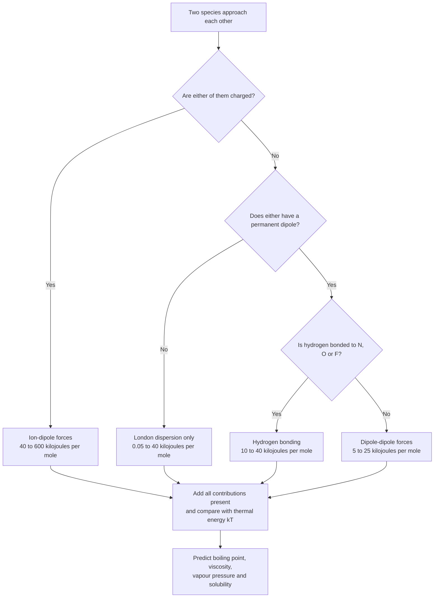
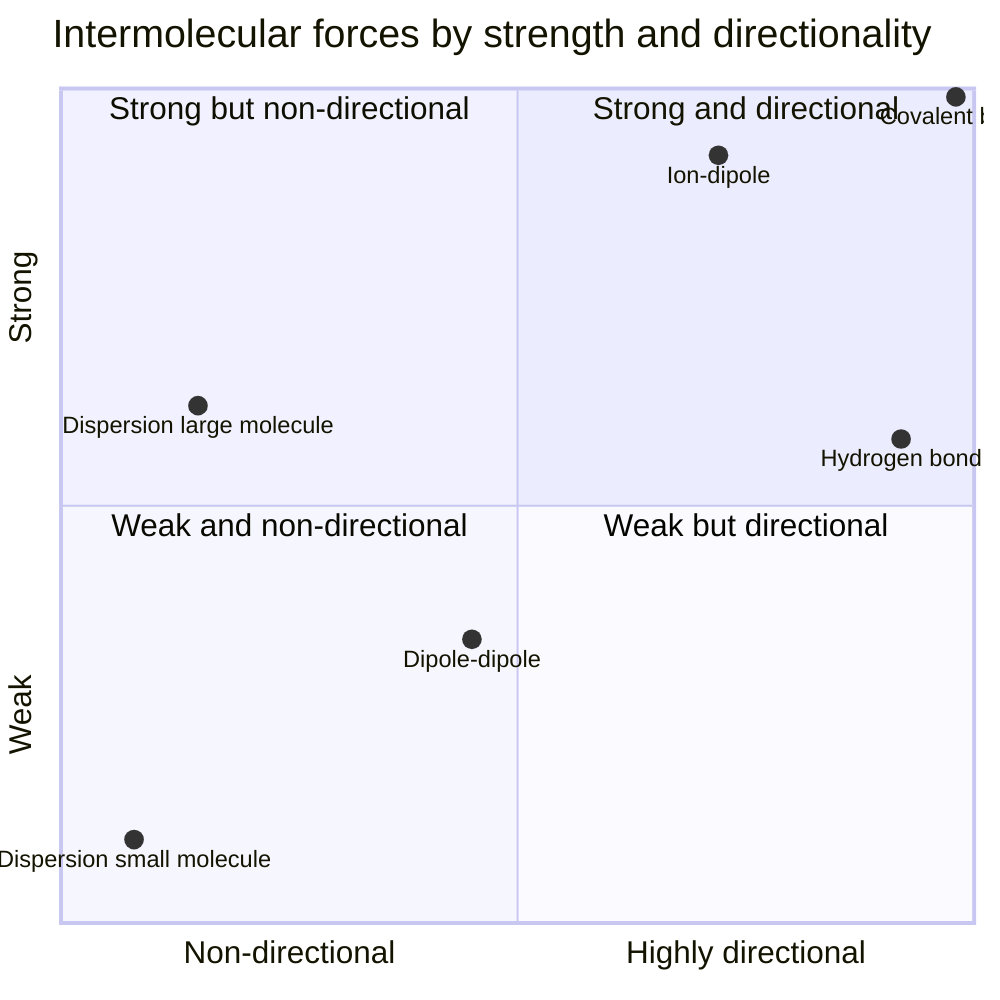
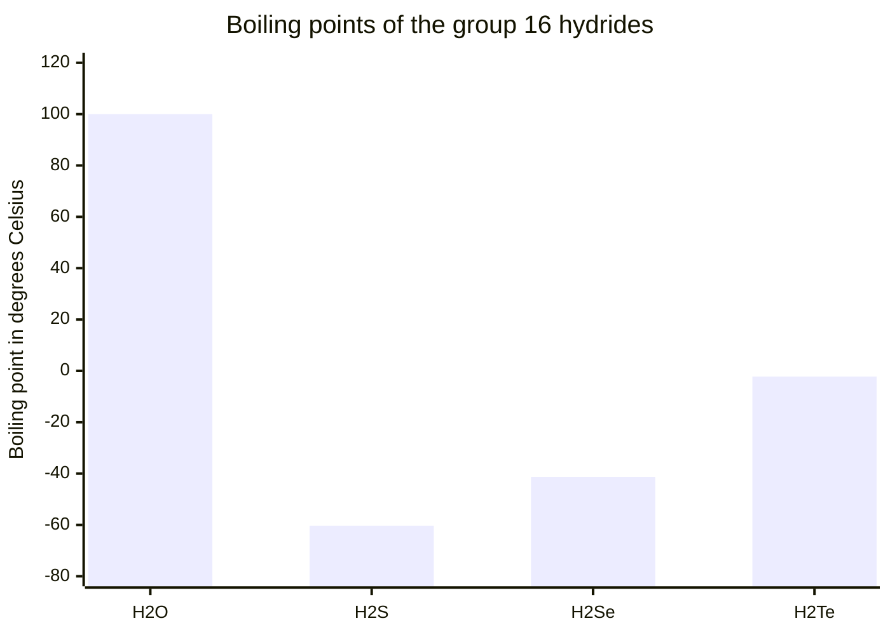

# Chapter 5 — Intermolecular Forces

> **Level:** Intermediate (Level 2)
> **Estimated study time:** 6 hours (4 h reading + 2 h exercises)
> **Prerequisites:** [Chapter 1 — What Is Chemistry?](../01-foundations/01-what-is-chemistry.md); [Chapter 1 — Atomic Structure](../02-elementary-chemistry/01-atomic-structure.md); Level 1 bonding ([Level 1 overview](../02-elementary-chemistry/README.md))
> **Related chapters:** [Molecular Geometry and VSEPR Theory](06-molecular-geometry-and-vsepr-theory.md), [Hybridization and Molecular Polarity](07-hybridization-and-molecular-polarity.md), [Thermochemistry and Enthalpy](08-thermochemistry-and-enthalpy.md), [Reaction Rates](09-reaction-rates.md)
> **Difficulty:** ★★★☆☆ (3/5)

---

## 1. Learning Objectives

After working through this chapter you will be able to:

- Distinguish intramolecular forces (covalent, ionic, metallic bonds) from intermolecular forces (IMFs), and state the energy scale of each.
- Explain London dispersion forces in terms of instantaneous and induced dipoles, and predict how their strength varies with electron count, molecular size and molecular shape.
- Describe dipole–dipole forces, define the hydrogen bond rigorously, and list the structural requirements for one to form.
- Explain ion–dipole forces and use them to account for hydration enthalpies and the behaviour of electrolytes in polar solvents.
- Rank the four families of IMF by typical strength and compare that scale with typical covalent bond enthalpies.
- Use IMFs to predict and rationalize boiling point, viscosity, surface tension, vapour pressure, solubility and chromatographic retention.
- Account for the anomalous boiling points of the group 16 hydrides and for the density anomaly of ice.
- Apply "like dissolves like" as a structural statement about matching dispersion, dipolar and hydrogen-bonding capabilities, and state its limitations.
- Identify where the simple IMF classification breaks down and which more complete descriptions chemists use instead.

---

## 2. Introduction

Every molecular substance can be melted and boiled. That single observation is chemically profound, because melting and boiling do not break molecules apart. When liquid water boils, the $\ce{O-H}$ bonds inside each $\ce{H2O}$ molecule survive intact; what is destroyed is the *attraction between molecules*. The energy required is $40.7\ \text{kJ mol}^{-1}$. Breaking one mole of $\ce{O-H}$ covalent bonds requires $463\ \text{kJ mol}^{-1}$, roughly eleven times more.

That ratio — a factor of about ten between the forces that hold molecules to each other and the forces that hold atoms together — is the central quantitative fact of this chapter. It explains why molecular substances are usually liquids or gases at room temperature while ionic and network covalent substances are solids; why a distillation separates liquids that a chemical reaction would have destroyed; and why proteins denature at $70\ ^\circ\text{C}$ even though peptide bonds are stable to $300\ ^\circ\text{C}$.

The practical reach of intermolecular forces is wider than it first appears. The boiling point of a hydrocarbon fraction determines which tray of a distillation column it leaves from. The viscosity of an engine oil determines whether an engine survives a cold start. The surface tension of water lets a water strider stand on a pond and, more importantly, lets a plant draw water twenty metres up a xylem vessel. The partition coefficient of a drug between water and octan-1-ol determines whether it crosses a cell membrane. The retention factor of a compound on a silica plate determines whether a chromatographic separation succeeds. Every one of those is an intermolecular-force question, and every one can be reasoned about from four structural ideas: molecular size, molecular shape, bond polarity and hydrogen-bonding capability.

The chapter assumes that you can draw a Lewis structure and decide whether a bond is polar. It builds the four families of IMF from electrostatics, quantifies their distance dependence, orders them by strength, and then applies the ordering systematically. It is deliberately honest about the limits of the classification: real molecules experience a sum of all four contributions at once, the boundaries between the families are soft, and for large molecules dispersion routinely outweighs hydrogen bonding. Chapter [6](06-molecular-geometry-and-vsepr-theory.md) supplies the geometry needed to decide whether bond dipoles cancel, and Chapter [7](07-hybridization-and-molecular-polarity.md) turns that geometric reasoning into a full treatment of molecular polarity.

---

## 3. Fundamental Concepts

### 3.1 Intramolecular versus intermolecular

An **intramolecular force** acts *within* a molecule or lattice, holding atoms or ions together. The three primary intramolecular bonding models — covalent, ionic and metallic — were introduced at Level 1. An **intermolecular force** acts *between* complete molecules, or between a molecule and an ion, without transferring or sharing electrons permanently.

| Property | Intramolecular (covalent bond) | Intermolecular |
|---|---|---|
| Typical energy | $150\text{–}1000\ \text{kJ mol}^{-1}$ | $0.05\text{–}40\ \text{kJ mol}^{-1}$ (ion–dipole up to $\sim 600$) |
| What it holds together | Atoms inside a molecule | Molecules to each other |
| Broken during melting? | No (for molecular substances) | Yes |
| Broken during boiling? | No (for molecular substances) | Yes |
| Distance dependence | Short range, with a potential-energy minimum at the bond length | Longer range, falling as $r^{-2}$ to $r^{-6}$ |
| Directionality | Strongly directional (except pure ionic) | Weakly to strongly directional |

A useful operational test: if a process leaves the molecular formula unchanged and only changes the physical state, the forces being overcome are intermolecular. Melting ice, dissolving iodine in hexane, and stretching a rubber band are all intermolecular processes. Burning methane is not.

**Simplification.** The word "intermolecular" is used here for forces between whole molecules. The same physics — Coulomb attraction between charge distributions — also operates *between* the atoms of a single large molecule, where it appears as steric strain, conformational preference and the hydrophobic collapse of a polymer chain. Nothing fundamental separates the two cases; the distinction is one of bookkeeping.

### 3.2 The electrostatic origin of every intermolecular force

There are no new forces in intermolecular chemistry. Every IMF is a manifestation of the Coulomb interaction between charge distributions, modified by quantum mechanics where electrons are concerned. What differs between the families is *what kind of charge distribution* is interacting:

- a **permanent** charge distribution, as in an ion or a polar molecule; or
- a **fluctuating** charge distribution, as in any atom or molecule, polar or not.

Two permanent dipoles give **dipole–dipole** attraction. A permanent dipole and an ion give **ion–dipole** attraction. Two fluctuating dipoles give **London dispersion** attraction. A hydrogen bond is a dipole–dipole interaction so strong and so directional that it is given its own name, with a partial covalent character arising from donor–acceptor orbital overlap.

A **dipole moment** $\boldsymbol{\mu}$ is a vector with magnitude

$$
\mu = Q\,r
$$

where $Q$ is the magnitude of the separated charge and $r$ the separation. The SI unit is the coulomb metre ($\text{C m}$); chemists still quote the **debye** ($\text{D}$), where $1\ \text{D} = 3.335\,64\times10^{-30}\ \text{C m}$. Water has $\mu = 1.85\ \text{D}$, ammonia $1.47\ \text{D}$, carbon dioxide $0\ \text{D}$ and carbon tetrachloride $0\ \text{D}$.

### 3.3 London dispersion forces

Even a nonpolar atom has electrons in motion. At any instant the electron distribution may be lopsided, producing a fleeting **instantaneous dipole**. That dipole polarizes a neighbouring atom, generating an **induced dipole** aligned so that the two attract. The fluctuations are random and uncorrelated in time, but the *correlation* induced by the interaction produces a net attraction.

Fritz London gave the quantum-mechanical treatment in 1930. The orientation-averaged attraction energy between two identical atoms is

$$
U_{\text{disp}} = -\frac{3}{4}\frac{I\,\alpha^{2}}{(4\pi\varepsilon_0)^{2}\,r^{6}}
$$

where $I$ is a mean ionization energy, $\alpha$ is the polarizability, and $r$ is the separation. The two features that matter for prediction are the $r^{-6}$ dependence, which makes dispersion very short-ranged, and the $\alpha^{2}$ dependence, which makes dispersion grow rapidly with the size of the electron cloud.

**Polarizability** $\alpha$ measures how easily an electron distribution is distorted by an applied field; it has SI units of $\text{C m}^{2}\ \text{V}^{-1}$, though chemists usually quote the **polarizability volume** $\alpha' = \alpha/(4\pi\varepsilon_0)$, in $\text{Å}^{3}$ or $\text{m}^{3}$.

| Species | Electrons | $\alpha'/\text{Å}^{3}$ |
|---|---|---|
| $\ce{He}$ | 2 | 0.205 |
| $\ce{Ne}$ | 10 | 0.396 |
| $\ce{Ar}$ | 18 | 1.64 |
| $\ce{Kr}$ | 36 | 2.48 |
| $\ce{Xe}$ | 54 | 4.04 |

The trend is monotonic with electron count, and it drives the whole of group 18 chemistry: helium and neon are gases that refuse to liquefy above $4.2\ \text{K}$ and $27\ \text{K}$ respectively, whereas xenon liquefies at $165\ \text{K}$ and solidifies at $161\ \text{K}$.

### 3.4 Dipole–dipole forces

Two molecules with permanent dipole moments attract one another when they are oriented dipole-to-dipole. Thermal motion opposes alignment, so the orientation-averaged interaction (the Keesom interaction) is

$$
U_{\text{dd}} = -\frac{2}{3}\frac{\mu_1^{2}\mu_2^{2}}{(4\pi\varepsilon_0)^{2}\,k_{\mathrm B}T\,r^{6}}
$$

Note the $1/T$ factor: raising the temperature randomizes the orientations faster than the attraction can re-align them, so the effective attraction weakens. Dipole–dipole forces are typically $5\text{–}25\ \text{kJ mol}^{-1}$ — stronger than dispersion between small molecules, but not dramatically so.

The pair acetaldehyde ($\mu = 2.7\ \text{D}$, b.p. $20.2\ ^\circ\text{C}$) and ethane ($\mu = 0\ \text{D}$, b.p. $-88.6\ ^\circ\text{C}$) illustrates the effect: both have similar mass (44 and 30 $\text{g mol}^{-1}$), but the polar one boils $109\ ^\circ\text{C}$ higher.

**Simplification.** The formula above is a weak-interaction expansion valid for $\mu^{2}/(4\pi\varepsilon_0 r^{3}) \ll k_{\mathrm B}T$. At short range, or where the dipoles are strongly constrained (as in a crystal), orientation is not free and the true potential is more complicated and more strongly attractive.

### 3.5 Hydrogen bonding

A **hydrogen bond** is a directional attraction $\ce{X-H\cdots Y}$ in which a hydrogen atom already covalently bonded to an electronegative atom $\ce{X}$ interacts with a lone pair on a second electronegative atom $\ce{Y}$. The requirements are specific:

1. **A donor.** The $\ce{X}$ atom must be strongly electronegative and small, so that the $\ce{X-H}$ bond is strongly polarized and the hydrogen carries a substantial partial positive charge. In practice $\ce{X} \in \{\ce{N}, \ce{O}, \ce{F}\}$; chlorine is a weak donor, and carbon is weaker still.
2. **An acceptor.** $\ce{Y}$ must carry a lone pair and be electronegative: $\ce{N}$, $\ce{O}$, $\ce{F}$ again, and also $\ce{S}$ in weak cases.
3. **Geometry.** The $\ce{X-H\cdots Y}$ angle prefers to be close to $180^\circ$, and the $\ce{H\cdots Y}$ distance is shorter than the sum of the van der Waals radii — typically $1.5\text{–}2.2\ \text{Å}$ for $\ce{O-H\cdots O}$.

Typical hydrogen-bond enthalpies are $10\text{–}40\ \text{kJ mol}^{-1}$: about ten times a typical dipole–dipole interaction, but still only a tenth of a covalent bond. That intermediate strength is exactly what makes hydrogen bonds biologically useful — strong enough to hold a structure together, weak enough to be broken and remade at body temperature.

| System | $\ce{H\cdots Y}$ distance / Å | Approximate enthalpy / $\text{kJ mol}^{-1}$ |
|---|---|---|
| $\ce{O-H\cdots O}$ in liquid water | 1.8–2.0 | 21 |
| $\ce{O-H\cdots O}$ in ice | 1.75 | 23 |
| $\ce{F-H\cdots F}$ in $\ce{(HF)_n}$ | 1.56 | 29 |
| $\ce{N-H\cdots N}$ in ammonia | 2.2 | 13 |
| $\ce{N-H\cdots O}$ in a protein | 1.9–2.1 | 8–20 |
| $\ce{C-H\cdots O}$ (weak, "non-classical") | 2.4–2.8 | 2–5 |

### 3.6 Ion–dipole forces

A dissolved ion attracts the oppositely charged end of a nearby polar molecule. In water, the result is a **hydration shell**: $\ce{Na+}$ is surrounded by six water molecules with their oxygen atoms pointing inward, and $\ce{Cl-}$ by water molecules with their hydrogen atoms pointing inward.

For a stationary dipole at an angle $\theta$ to the ion–dipole axis,

$$
U_{\text{id}} = -\frac{q\,\mu\cos\theta}{4\pi\varepsilon_0\,r^{2}}
$$

The $r^{-2}$ dependence is much weaker than $r^{-6}$, so ion–dipole forces act over longer distances than any of the neutral–neutral forces. That is why ions dissolve in polar solvents at all: the ion–dipole attraction must compensate the lattice enthalpy.

$$
\ce{NaCl(s) -> Na+(g) + Cl-(g)} \qquad \Delta H^\circ_{\text{latt}} = +787\ \text{kJ mol}^{-1}
$$

$$
\ce{Na+(g) -> Na+(aq)} \qquad \Delta H^\circ_{\text{hyd}} = -406\ \text{kJ mol}^{-1}
$$

$$
\ce{Cl-(g) -> Cl-(aq)} \qquad \Delta H^\circ_{\text{hyd}} = -363\ \text{kJ mol}^{-1}
$$

The sum, $+18\ \text{kJ mol}^{-1}$, has the right sign and order of magnitude: the observed enthalpy of solution of sodium chloride is $+3.9\ \text{kJ mol}^{-1}$, so dissolution is slightly endothermic. The residual difference reflects the fact that tabulated lattice and hydration enthalpies are derived from separate cycles and each carries an uncertainty of a few $\text{kJ mol}^{-1}$.

### 3.7 The strength hierarchy

The familiar ranking, strongest to weakest, is:

1. **Ion–dipole**: $40\text{–}600\ \text{kJ mol}^{-1}$
2. **Hydrogen bond**: $10\text{–}40\ \text{kJ mol}^{-1}$
3. **Dipole–dipole**: $5\text{–}25\ \text{kJ mol}^{-1}$
4. **London dispersion**: $0.05\text{–}40\ \text{kJ mol}^{-1}$

This ranking is a *per-interaction* ordering and must be applied with care. Dispersion is the weakest force per contact, but a large molecule makes very many contacts. Iodine ($\ce{I2}$) is a solid at room temperature and boils at $184\ ^\circ\text{C}$ entirely because of dispersion, while hydrogen chloride ($\mu = 1.08\ \text{D}$) boils at $-85\ ^\circ\text{C}$. The correct statement is that dispersion grows without limit with molecular size and surface area, whereas hydrogen bonding and dipole–dipole interactions saturate at one or two contacts per molecule. For reference, a covalent bond ($150\text{–}1000\ \text{kJ mol}^{-1}$, range $\sim 1\ \text{Å}$) is an order of magnitude stronger than any of them.

### 3.8 Key terms

| Term | Working definition |
|---|---|
| Intermolecular force | Attraction or repulsion between complete molecules or between a molecule and an ion |
| Dipole moment | Vector quantity $\mu = Qr$, measuring charge separation |
| Polarizability | Ease with which an electron cloud is distorted by an external field |
| Instantaneous dipole | A transient, fluctuating charge separation arising from electron motion |
| Induced dipole | A dipole created in a species by the field of a neighbour |
| Hydrogen bond | Directional $\ce{X-H\cdots Y}$ interaction with $\ce{X}, \ce{Y}$ electronegative and $\ce{Y}$ possessing a lone pair |
| Hydration enthalpy | Enthalpy change when one mole of gaseous ions is surrounded by water |
| Vapour pressure | Pressure of a vapour in equilibrium with its liquid at a given temperature |
| Retention factor $R_f$ | Distance travelled by a solute divided by distance travelled by the solvent front |

---

## 4. Detailed Scientific Explanation

### 4.1 Polarisability and the $r^{-6}$ dependence

The $r^{-6}$ dependence of dispersion is the single most important structural fact in this chapter, because it explains why intermolecular forces are so sensitive to shape. Two spheres of the same volume attract more strongly than two highly branched shapes of the same volume, because branching keeps the mass centres further apart on average.

The physical origin is that a dipole field falls off as $r^{-3}$, and the induced dipole it creates is proportional to that field, so the interaction of the induced dipole with the inducing dipole scales as $r^{-3} \times r^{-3} = r^{-6}$. The same exponent appears in the Keesom and Debye (dipole–induced dipole) interactions, which is why all three are collectively called **van der Waals forces**.

The total van der Waals attraction between two molecules is the sum of three terms:

$$
U_{\text{vdW}} = U_{\text{disp}} + U_{\text{dd}} + U_{\text{ind}}
$$

and for all but the most polar small molecules the dispersion term dominates. For water it accounts for roughly $80\,\%$ of the total van der Waals attraction, and for carbon dioxide essentially all of it.

At very short range, every one of these attractive terms is overwhelmed by **Pauli repulsion**, which arises when closed electron shells are forced to overlap. The balance of attraction and repulsion produces the characteristic potential-energy curve with a minimum at the **van der Waals contact distance**. That distance is what "the size of a molecule" means in practice, and the corresponding radii are the van der Waals radii tabulated for each element.

### 4.2 Why dispersion grows with size

Polarizability increases with the number of electrons and with the volume over which they are spread. Two consequences follow immediately and are worth committing to memory.

**Down a group, dispersion increases.** The halogens demonstrate it cleanly.

| Halogen | Molar mass / $\text{g mol}^{-1}$ | Boiling point / $^\circ\text{C}$ | State at $25\ ^\circ\text{C}$ |
|---|---|---|---|
| $\ce{F2}$ | 38.0 | $-188.1$ | Gas |
| $\ce{Cl2}$ | 70.9 | $-34.0$ | Gas |
| $\ce{Br2}$ | 159.8 | $58.8$ | Liquid |
| $\ce{I2}$ | 253.8 | $184.3$ | Solid |

**Along a homologous series, dispersion increases.** Each additional $\ce{CH2}$ unit adds roughly $5\ \text{kJ mol}^{-1}$ to the enthalpy of vaporization, which is enough to raise the boiling point by $20\text{–}30\ ^\circ\text{C}$.

| Alkane | Boiling point / $^\circ\text{C}$ |
|---|---|
| $\ce{CH4}$ | $-161.5$ |
| $\ce{C2H6}$ | $-88.6$ |
| $\ce{C3H8}$ | $-42.1$ |
| $\ce{C4H10}$ | $-0.5$ |
| $\ce{C5H12}$ | $36.1$ |
| $\ce{C6H14}$ | $68.7$ |
| $\ce{C8H18}$ | $125.7$ |

**Shape matters independently of formula.** The three isomers of pentane have identical formulae and identical electron counts, yet their boiling points differ by $27\ ^\circ\text{C}$:

| Isomer | Boiling point / $^\circ\text{C}$ |
|---|---|
| pentane | $36.1$ |
| 2-methylbutane | $27.8$ |
| 2,2-dimethylpropane | $9.5$ |

The branched isomers are more nearly spherical, so their surface area available for contact is smaller and their molecules cannot pack as closely. This is a shape effect, not a mass effect, and it is a favourite examination question precisely because it isolates the variable.

### 4.3 The hydrogen bond: definition and requirements

The hydrogen bond deserves its separate status because it is not merely a strong dipole–dipole interaction. Three features distinguish it:

- **Directionality.** The $\ce{X-H\cdots Y}$ angle prefers $180^\circ$; departures of more than about $30^\circ$ cost significant energy. This is why hydrogen bonds can act as structural elements, specifying the geometry of a crystal or a protein.
- **Short range.** The $\ce{H\cdots Y}$ distance is less than the sum of the van der Waals radii, typically by $0.3\text{–}0.6\ \text{Å}$.
- **Partial covalency.** There is genuine donor–acceptor orbital overlap between the $\ce{X-H}$ $\sigma^{*}$ orbital and a lone pair on $\ce{Y}$. This is why hydrogen-bond energies are an order of magnitude larger than plain dipole–dipole energies, and why the interaction has a preferred geometry rather than merely a preferred orientation.

**Simplification.** The simple "hydrogen bonds need $\ce{N}$, $\ce{O}$ or $\ce{F}$" rule is a teaching heuristic. Weaker hydrogen bonds of the type $\ce{C-H\cdots O}$, $\ce{C-H\cdots \pi}$ and $\ce{S-H\cdots S}$ are well documented and matter in protein structure and crystal engineering. The rule is a good predictor of when a hydrogen bond will be *strong*; it is not a definition of when one exists.

### 4.4 Consequences of hydrogen bonding

#### 4.4.1 The high boiling point of water

Water boils at $100\ ^\circ\text{C}$ at $1\ \text{atm}$. Its heavier homologue hydrogen sulfide boils at $-60\ ^\circ\text{C}$. Extrapolating the trend of the group 16 hydrides, water "should" boil somewhere near $-80\ ^\circ\text{C}$. The $180\ ^\circ\text{C}$ discrepancy is the energy needed to break the hydrogen-bond network.

Each water molecule has two $\ce{O-H}$ donors and two lone pairs, so it can both donate and accept two hydrogen bonds. In liquid water the network is dynamic: a given hydrogen bond lasts of order $1\ \text{ps}$ before breaking and reforming with a different partner. On average each molecule participates in about $3.5$ hydrogen bonds at room temperature, and $4$ in ice.

The thermodynamic consequence is a set of unusually large values:

| Property of water | Value | Comparison |
|---|---|---|
| $\Delta H^\circ_{\text{vap}}$ at $100\ ^\circ\text{C}$ | $40.7\ \text{kJ mol}^{-1}$ | Methane: $8.2\ \text{kJ mol}^{-1}$ |
| $\Delta H^\circ_{\text{fus}}$ at $0\ ^\circ\text{C}$ | $6.01\ \text{kJ mol}^{-1}$ | Benzene: $9.9\ \text{kJ mol}^{-1}$ |
| Specific heat capacity | $4.184\ \text{J g}^{-1}\ \text{K}^{-1}$ | Ethanol: $2.44\ \text{J g}^{-1}\ \text{K}^{-1}$ |
| Surface tension at $20\ ^\circ\text{C}$ | $72.8\ \text{mN m}^{-1}$ | Hexane: $18.4\ \text{mN m}^{-1}$ |
| Vapour pressure at $25\ ^\circ\text{C}$ | $3.17\ \text{kPa}$ | Diethyl ether at $20\ ^\circ\text{C}$: $58.6\ \text{kPa}$ |

The high specific heat capacity is why the oceans moderate climate and why sweating cools a mammal efficiently: evaporating one gram of water removes $2.26\ \text{kJ}$ at body temperature.

#### 4.4.2 Why ice is less dense than liquid water

In ice Ih — ordinary hexagonal ice — every water molecule is tetrahedrally coordinated, donating two hydrogen bonds and accepting two. The tetrahedra link into a hexagonal lattice containing open channels. The structure is *less* efficiently packed than the liquid, so the solid is less dense:

$$
\rho(\text{ice},\ 0\ ^\circ\text{C}) = 0.9168\ \text{g cm}^{-3}, \qquad \rho(\text{water},\ 0\ ^\circ\text{C}) = 0.9998\ \text{g cm}^{-3}
$$

Liquid water retains a substantial fraction of the hydrogen-bond network, and that network collapses progressively as temperature rises, which is why water is most dense at $3.98\ ^\circ\text{C}$ rather than at its freezing point. Above $4\ ^\circ\text{C}$, normal thermal expansion takes over.

The consequences are large. Ice floats, so a lake freezes from the top down and the water beneath stays liquid, which is what allows aquatic life to survive winter at high latitudes. Freezing water expands by about $9\,\%$ in volume and can split rock, crack engine blocks and burst pipes.

#### 4.4.3 DNA base pairing

The two strands of the DNA double helix are held together by hydrogen bonds between complementary bases. Adenine pairs with thymine through two hydrogen bonds ($\ce{N-H\cdots O}$ and $\ce{N-H\cdots N}$); guanine pairs with cytosine through three (two $\ce{N-H\cdots O}$ and one $\ce{N-H\cdots N}$).

The specificity comes from the *pattern* of donors and acceptors, not merely from the number of bonds: adenine presents an amino donor and a ring nitrogen acceptor in positions that only thymine's complementary pattern can satisfy. The additional hydrogen bond in G–C is why GC-rich regions of a genome have higher melting temperatures, and why the GC content of a DNA sample can be estimated from its melting curve.

Each individual hydrogen bond is weak enough ($\sim 2\text{–}10\ \text{kJ mol}^{-1}$ in this context) for the replication machinery to separate the strands at $37\ ^\circ\text{C}$, and the hundreds of bonds along a helix are collectively strong enough to keep the two strands together. This is the design principle: many weak, reversible interactions instead of one strong irreversible one.

#### 4.4.4 Protein secondary structure

The same principle organizes proteins. The **α-helix** is stabilized by a hydrogen bond from the $\ce{N-H}$ of residue $i$ to the $\ce{C=O}$ of residue $i+4$, giving $3.6$ residues per turn and a rise of $1.5\ \text{Å}$ per residue. The **β-sheet** is stabilized by hydrogen bonds between $\ce{N-H}$ and $\ce{C=O}$ groups on adjacent strands, which may be parallel or antiparallel.

Because the hydrogen bonds in an α-helix are *intramolecular*, they do not contribute to the molecule's interaction with solvent in the same way as intermolecular hydrogen bonds do. This is a necessary refinement of the simple picture: a hydrogen bond is a hydrogen bond regardless of whether the two partners belong to the same molecule, but its thermodynamic consequences depend on whether it replaces or adds to solvent contacts.

### 4.5 The anomalous trends in group 16

The group 16 hydrides make the argument cleanly. Moving down the group, molar mass and polarizability increase, so dispersion increases and the boiling point should rise monotonically. It does — except for the first member.

| Hydride | Molar mass | Boiling point / $^\circ\text{C}$ | Dominant IMF |
|---|---|---|---|
| $\ce{H2O}$ | 18.0 | $100.0$ | Hydrogen bonding |
| $\ce{H2S}$ | 34.1 | $-60.3$ | Dipole–dipole + dispersion |
| $\ce{H2Se}$ | 81.0 | $-41.3$ | Dipole–dipole + dispersion |
| $\ce{H2Te}$ | 129.6 | $-2.2$ | Dipole–dipole + dispersion |

From $\ce{H2S}$ to $\ce{H2Te}$ the boiling point rises by $58\ ^\circ\text{C}$ as dispersion grows. Water lies far above the extrapolated line because it alone forms a three-dimensional hydrogen-bond network. Note also that the *dipole moments* decrease down the group ($\ce{H2O}$ $1.85\ \text{D}$, $\ce{H2S}$ $0.97\ \text{D}$, $\ce{H2Se}$ $0.62\ \text{D}$, $\ce{H2Te}$ $0.38\ \text{D}$): the $\ce{X-H}$ bonds become less polar as $\ce{X}$ becomes less electronegative. Dispersion wins.

The same pattern recurs in groups 15 and 17. Ammonia boils at $-33.3\ ^\circ\text{C}$ while phosphine boils at $-87.7\ ^\circ\text{C}$; hydrogen fluoride boils at $19.5\ ^\circ\text{C}$ while hydrogen chloride boils at $-85.1\ ^\circ\text{C}$. In each case the first member's hydrogen bonding breaks the monotonic trend.

### 4.6 Boiling point, viscosity, surface tension and vapour pressure

Four bulk properties are direct readouts of intermolecular attraction, and each probes a slightly different aspect of it.

**Boiling point** measures the energy needed to separate molecules completely and is dominated by the *strongest* interactions present. A single hydrogen-bonding group in an otherwise hydrocarbon molecule raises the boiling point far more than doubling the chain length would. Ethanol ($\ce{C2H5OH}$, b.p. $78.4\ ^\circ\text{C}$) and dimethyl ether ($\ce{CH3OCH3}$, b.p. $-24.8\ ^\circ\text{C}$) are isomers; only ethanol can donate a hydrogen bond.

**Viscosity** measures resistance to flow, that is, the ease with which molecules slide past one another. It depends on the *cohesiveness* of the network rather than on its peak bond strength, and it is extremely sensitive to shape and to the number of hydrogen bonds per molecule. At $20\ ^\circ\text{C}$ the viscosities run from $0.22\ \text{mPa s}$ for diethyl ether and $0.31\ \text{mPa s}$ for hexane (no hydrogen bonds), through $1.00\ \text{mPa s}$ for water and $1.20\ \text{mPa s}$ for ethanol, to $16.1\ \text{mPa s}$ for ethane-1,2-diol and $1410\ \text{mPa s}$ for glycerol, which has three donors and three acceptors per molecule.

**Surface tension** arises because molecules at a liquid surface have fewer neighbours than molecules in the bulk, so they are pulled inward. It measures the *excess* cohesive energy per unit area. Water's value of $72.8\ \text{mN m}^{-1}$ at $20\ ^\circ\text{C}$ is exceptionally high for a liquid of its molar mass, and it is why water beads on a waxed surface, why capillary rise in a narrow tube is large, and why small insects can walk on a pond.

**Vapour pressure** is the pressure exerted by vapour in equilibrium with liquid. It is the *inverse* measure of intermolecular attraction: the stronger the attraction, the fewer molecules escape per unit time and the lower the vapour pressure at a given temperature. A liquid boils when its vapour pressure equals the external pressure, which is why water boils at $70\ ^\circ\text{C}$ on the summit of Everest and at $120\ ^\circ\text{C}$ in a pressure cooker.

### 4.7 Solubility and "like dissolves like"

Dissolution is governed by the Gibbs energy of mixing:

$$
\Delta G_{\text{mix}} = \Delta H_{\text{mix}} - T\,\Delta S_{\text{mix}}
$$

Mixing always increases the number of accessible microstates, so $\Delta S_{\text{mix}} > 0$ for ideal mixing. Whether a substance dissolves therefore depends on the enthalpy term, which is the balance sheet of broken and formed interactions.

When a solute dissolves, solute–solute contacts and solvent–solvent contacts are broken and solute–solvent contacts are formed:

$$
\Delta H_{\text{mix}} \approx \underbrace{\Delta H_{\text{solute-solute}}}_{\text{endothermic}} + \underbrace{\Delta H_{\text{solvent-solvent}}}_{\text{endothermic}} - \underbrace{\Delta H_{\text{solute-solvent}}}_{\text{exothermic}}
$$

If the new solute–solvent interactions are comparable in kind and strength to the ones they replace, $\Delta H_{\text{mix}} \approx 0$ and entropy decides: the substance dissolves. If they are much weaker, $\Delta H_{\text{mix}}$ is large and positive and the substance does not dissolve, or dissolves only sparingly.

This is the structural content of **"like dissolves like"**:

- A nonpolar solute offers only dispersion interactions, so it dissolves well in a nonpolar solvent that also offers only dispersion, and poorly in water, where dissolving it would require breaking hydrogen bonds without forming new ones of comparable strength.
- A polar solute that can both donate and accept hydrogen bonds dissolves well in water, which can match both capabilities.
- A polar solute that can *accept* but not donate (for example, acetone) is fully miscible with water because water donates to the carbonyl oxygen, but it is a poor solvent for a hydrocarbon.

| Solute | Solvent | Solubility at $25\ ^\circ\text{C}$ | Explanation |
|---|---|---|---|
| $\ce{NaCl}$ | water | $359\ \text{g dm}^{-3}$ | Ion–dipole interactions exceed lattice enthalpy |
| $\ce{I2}$ | water | $0.29\ \text{g dm}^{-3}$ | Weak dispersion only; no hydrogen bonding |
| $\ce{I2}$ | hexane | $\sim 20\ \text{g dm}^{-3}$ | Dispersion–dispersion matching |
| Ethanol | water | miscible | Donor and acceptor on both sides |
| Hexane | water | $\sim 0.014\ \text{g dm}^{-3}$ | Cannot pay the cost of breaking water's network |
| Vitamin C | water | $330\ \text{g dm}^{-3}$ | Four hydroxyl groups plus a lactone |

Two refinements are needed. First, a **cosolvent** can bridge the mismatch: ethanol is miscible with both water and many nonpolar compounds, which is why it is used as a solvent in tinctures. Second, specific chemistry can rescue an otherwise insoluble substance: iodine dissolves in aqueous potassium iodide not because of any favourable IMF but because it reacts to form the triiodide ion, $\ce{I2(aq) + I-(aq) -> I3-(aq)}$.

**Simplification.** The enthalpy bookkeeping above is a *quasi-chemical* approximation. For nonpolar solutes in water, the dominant obstacle is not the enthalpy of breaking hydrogen bonds but the entropy cost of creating a cavity in the hydrogen-bond network — the **hydrophobic effect**. A full treatment is given in Chapter 4 of the advanced sequence and in any physical chemistry text.

### 4.8 Chromatographic retention

Chromatography exploits differential partition of solutes between a **mobile phase** and a **stationary phase**. The strength of a solute's interaction with the stationary phase relative to the mobile phase determines how far it travels.

In **thin-layer chromatography (TLC)** on silica, the stationary phase is polar (surface silanols, $\ce{Si-OH}$), and the mobile phase is a less polar organic solvent. A polar solute hydrogen-bonds to the silica and is retained; a nonpolar solute is carried along by the mobile phase. The result is summarized by the **retention factor**:

$$
R_f = \frac{\text{distance travelled by solute}}{\text{distance travelled by solvent front}}, \qquad 0 \le R_f \le 1
$$

A nonpolar compound has $R_f$ close to $1$; a strongly hydrogen-bonding compound has $R_f$ close to $0$. In **reverse-phase** chromatography the phases are swapped — the stationary phase is a nonpolar $\ce{C18}$ hydrocarbon chain and the mobile phase is a water/methanol mixture — so the elution order reverses and nonpolar compounds are retained longest. This is the most widely used mode in pharmaceutical analysis because it is compatible with aqueous samples.

The same reasoning explains **column chromatography** preparative separations, **gas chromatography** (where retention depends on boiling point and on polarity of the stationary phase) and **ion-exchange** chromatography (where the interaction is ion–dipole and Coulombic rather than dispersive).

### 4.9 Where the simple classification breaks down

The four-family scheme is a useful solvent-partitioning model, not a complete theory. Four limitations should be stated explicitly.

1. **The forces are not additive in the simple sense.** A molecule that has a dipole moment also has dispersion forces, and the two are not independent — the same electrons produce both. The classification separates contributions to a perturbation expansion, not physically distinct entities.
2. **Dispersion can dominate.** For molecules above roughly $200\ \text{g mol}^{-1}$, dispersion usually exceeds all other contributions even when hydrogen bonds are present. This is why the boiling points of long-chain alcohols converge towards those of the corresponding alkanes as the chain lengthens.
3. **Hydrogen bonding is a continuum.** The distinction between a strong hydrogen bond and a strong dipole–dipole interaction is one of degree. In some systems (notably $\ce{F-H\cdots F}$) the hydrogen bond is symmetric and the proton is shared equally, so the description as a bond rather than an interaction becomes a matter of convention.
4. **Solvent effects are cooperative.** The properties of liquid water cannot be predicted from pairwise water–water potentials alone; many-body polarization and network cooperativity matter. This is why water remains an active research subject despite a century of study.

The more complete descriptions are the **molecular orbital / perturbation theory** treatment of intermolecular interactions (symmetry-adapted perturbation theory, SAPT), **statistical mechanics** for bulk properties, and **molecular dynamics simulation** with polarizable force fields. Each is beyond the scope of this chapter; the qualitative ordering above survives all of them.

---

## 5. Visual Diagrams

**Figure 5.1 — Decision route from molecular structure to the dominant intermolecular force.** The chart is a diagnostic procedure, not a statement that only one force operates. Every molecule experiences dispersion; the question the chart answers is which contribution dominates a given comparison. Read the branches in order: charge first, then permanent dipole, then hydrogen-bond capability. The final node reminds you that a prediction about a bulk property is only valid once the total interaction is compared with the thermal energy $k_{\mathrm B}T \approx 2.5\ \text{kJ mol}^{-1}$ at $298\ \text{K}$.

**Figure 5.2 — Intermolecular forces positioned by strength and directionality.** Directionality is the property that makes a force useful as a *structural* element, and strength is the property that makes it useful as a *cohesive* element. Hydrogen bonds occupy a distinctive corner: strong enough to specify geometry, weak enough to be reversible at physiological temperature. Covalent bonds are plotted for scale and lie at the extreme corner, which is the graphical version of the factor-of-ten argument in Section 2. Note that a large molecule's dispersion forces can be stronger than a small molecule's hydrogen bonds, which is why the vertical axis alone cannot rank two different substances.

**Figure 5.3 — Boiling points of the group 16 hydrides.** The bar chart isolates the anomaly: the three heavier hydrides rise smoothly as dispersion increases with electron count, while water sits $160\ ^\circ\text{C}$ above the trend. A single hydrogen-bonding capability changes a bulk property by more than a factor-of-two change in molar mass does. The figure is the cleanest single piece of evidence that hydrogen bonding is a distinct interaction rather than an unusually large dipole–dipole term.

---

## 6. Mathematical Formulas

### 6.1 Coulomb and dipole interactions

$$
U_{\text{ion-ion}} = \frac{q_1 q_2}{4\pi\varepsilon_0 r}, \qquad
U_{\text{ion-dipole}} = -\frac{q\,\mu\cos\theta}{4\pi\varepsilon_0\,r^{2}}
$$

$$
U_{\text{dipole-dipole}} = -\frac{2}{3}\frac{\mu_1^{2}\mu_2^{2}}{(4\pi\varepsilon_0)^{2}\,k_{\mathrm B}T\,r^{6}}, \qquad
U_{\text{dispersion}} = -\frac{3}{4}\frac{I\,\alpha_1\alpha_2}{(4\pi\varepsilon_0)^{2}\,r^{6}}
$$

| Symbol | Meaning | SI unit |
|---|---|---|
| $U$ | Potential energy of the interaction | J |
| $q$, $q_1$, $q_2$ | Charges | C |
| $\mu$, $\mu_1$, $\mu_2$ | Dipole moments | C m |
| $\alpha$, $\alpha_1$, $\alpha_2$ | Polarizabilities | C m² V⁻¹ |
| $I$ | Mean ionization energy | J |
| $r$ | Separation between centres | m |
| $\theta$ | Angle between dipole and ion–dipole axis | rad |
| $\varepsilon_0$ | Vacuum permittivity, $8.854\,187\times10^{-12}$ | F m⁻¹ |
| $k_{\mathrm B}$ | Boltzmann constant, $1.380\,649\times10^{-23}$ | J K⁻¹ |
| $T$ | Thermodynamic temperature | K |

**Assumptions.** All four expressions are weak-interaction expansions valid when the interaction energy is small compared with $k_{\mathrm B}T$ and when the charge distributions do not overlap. They treat each species as a point multipole, ignore many-body polarization, and assume an isotropic, homogeneous medium with permittivity $\varepsilon_0$. In a condensed phase the permittivity should be replaced by $\varepsilon = \varepsilon_r\varepsilon_0$, with $\varepsilon_r \approx 78$ for water at $25\ ^\circ\text{C}$ — which is precisely why electrostatic interactions between dissolved ions are much weaker in water than in vacuum.

### 6.2 Vapour pressure and enthalpy of vaporization

The **Clausius–Clapeyron equation** relates vapour pressure to temperature:

$$
\ln\!\left(\frac{p_2}{p_1}\right) = -\frac{\Delta H_{\text{vap}}}{R}\left(\frac{1}{T_2} - \frac{1}{T_1}\right)
$$

| Symbol | Meaning | SI unit |
|---|---|---|
| $p_1$, $p_2$ | Vapour pressures at $T_1$, $T_2$ | Pa |
| $\Delta H_{\text{vap}}$ | Enthalpy of vaporization | J mol⁻¹ |
| $R$ | Gas constant, $8.314\,462$ | J K⁻¹ mol⁻¹ |
| $T_1$, $T_2$ | Thermodynamic temperatures | K |

**Assumptions.** The vapour is ideal, the liquid volume is negligible compared with the vapour volume, and $\Delta H_{\text{vap}}$ is constant over the temperature interval. The last assumption is good over $20\text{–}30\ \text{K}$ and poor over $100\ \text{K}$.

### 6.3 Surface tension and capillary rise

$$
h = \frac{2\gamma\cos\theta}{\rho g r}
$$

| Symbol | Meaning | SI unit |
|---|---|---|
| $\gamma$ | Surface tension | N m⁻¹ (= J m⁻²) |
| $h$ | Capillary rise | m |
| $\theta$ | Contact angle | rad |
| $\rho$ | Liquid density | kg m⁻³ |
| $g$ | Standard acceleration of free fall, $9.81$ | m s⁻² |
| $r$ | Capillary radius | m |

**Assumptions.** The capillary is circular and vertical, the liquid wets the wall ($\theta < 90^\circ$), and the meniscus is hemispherical.

---

## 7. Chemical Equations

Phase changes are the cleanest demonstrations that intermolecular forces, not covalent bonds, are being overcome.

Vaporization of water:

$$
\ce{H2O(l) -> H2O(g)} \qquad \Delta H^\circ_{\text{vap}} = +40.7\ \text{kJ mol}^{-1}\ (373\ \text{K})
$$

Fusion of water:

$$
\ce{H2O(s) -> H2O(l)} \qquad \Delta H^\circ_{\text{fus}} = +6.01\ \text{kJ mol}^{-1}\ (273\ \text{K})
$$

Sublimation of iodine — a solid held together only by dispersion:

$$
\ce{I2(s) -> I2(g)} \qquad \Delta H^\circ_{\text{sub}} = +62.4\ \text{kJ mol}^{-1}\ (298\ \text{K})
$$

Dissolution of sodium chloride, showing the ion–dipole compensation of the lattice enthalpy:

$$
\ce{NaCl(s) ->[H2O] Na+(aq) + Cl-(aq)} \qquad \Delta H^\circ_{\text{soln}} = +3.9\ \text{kJ mol}^{-1}
$$

Hydration of a gaseous magnesium ion, the largest single term in the dissolution of a magnesium salt:

$$
\ce{Mg^2+(g) -> Mg^2+(aq)} \qquad \Delta H^\circ_{\text{hyd}} = -1921\ \text{kJ mol}^{-1}
$$

Dissolution of a molecular solid in a nonpolar solvent — no bonds are broken, only dispersion contacts exchanged:

$$
\ce{I2(s) ->[C6H14] I2(C6H14)}
$$

Formation of the triiodide ion, which is why iodine is far more soluble in aqueous iodide than in pure water:

$$
\ce{I2(aq) + I-(aq) -> I3-(aq)}
$$

Dimerization of hydrogen fluoride by hydrogen bonding, the classic gas-phase demonstration:

$$
\ce{2HF(g) <=> (HF)2(g)} \qquad \Delta H^\circ = -28\ \text{kJ mol}^{-1}
$$

Every equation above conserves atoms and charge. The quoted $\Delta H^\circ$ values are standard enthalpies at the stated temperature, per mole of the substance named first in the equation.

---

## 8. Worked Examples

### Worked Example 8.1 — Ranking boiling points from structure

**Problem.** Arrange the following in order of increasing boiling point, justifying each step: $\ce{Ne}$, $\ce{CH4}$, $\ce{HCl}$, $\ce{H2O}$, $\ce{NaCl}$.

**Strategy.** Classify the substance first (ionic, molecular polar, molecular nonpolar, monatomic), then identify the strongest IMF, then use molecular size only to break ties within a family.

**Solution.**

- $\ce{Ne}$: monatomic, dispersion only, 10 electrons, molar mass $20.2\ \text{g mol}^{-1}$. Boiling point $-246\ ^\circ\text{C}$.
- $\ce{CH4}$: nonpolar molecule, dispersion only, 10 electrons, molar mass $16.0\ \text{g mol}^{-1}$. The electron count is the same as neon's, but the electrons occupy a larger, more polarizable volume and the molecule offers more contact area, so dispersion is stronger and the boiling point is $85\ ^\circ\text{C}$ higher: $-161.5\ ^\circ\text{C}$.
- $\ce{HCl}$: polar molecule ($\mu = 1.08\ \text{D}$), dipole–dipole plus dispersion, 18 electrons. Boiling point $-85.1\ ^\circ\text{C}$.
- $\ce{H2O}$: hydrogen bonding, 10 electrons but a three-dimensional network. Boiling point $100.0\ ^\circ\text{C}$.
- $\ce{NaCl}$: ionic lattice; boiling requires vaporizing ions, effectively $\gg 1000\ ^\circ\text{C}$ (it boils at $1413\ ^\circ\text{C}$).

Increasing order: $\ce{Ne} < \ce{CH4} < \ce{HCl} < \ce{H2O} < \ce{NaCl}$.

**Check.** The two dispersion-only substances have the lowest boiling points, as expected. The polar molecule beats them by $76\ ^\circ\text{C}$, and the hydrogen-bonded molecule beats the polar one by $185\ ^\circ\text{C}$ — consistent with hydrogen bonding being roughly ten times stronger per interaction than dipole–dipole attraction. The ionic solid is in a different regime entirely, because melting and boiling it requires separating charges rather than molecules.

### Worked Example 8.2 — Vaporization energy versus bond energy

**Problem.** Calculate the energy required to vaporize $1.00\ \text{kg}$ of water at $100\ ^\circ\text{C}$ and compare it with the energy required to break every $\ce{O-H}$ bond in the same mass of water vapour.

**Strategy.** Use $n = m/M$ and multiply by the molar enthalpy of vaporization; then multiply by the number of $\ce{O-H}$ bonds per molecule (two) and the $\ce{O-H}$ bond enthalpy.

**Solution.**

$$
n(\ce{H2O}) = \frac{1000\ \text{g}}{18.015\ \text{g mol}^{-1}} = 55.51\ \text{mol}
$$

$$
E_{\text{vap}} = 55.51\ \text{mol} \times 40.7\ \text{kJ mol}^{-1} = 2.26\times10^{3}\ \text{kJ}
$$

For complete bond breaking, two $\ce{O-H}$ bonds per molecule at $463\ \text{kJ mol}^{-1}$:

$$
E_{\text{bonds}} = 55.51\ \text{mol} \times 2 \times 463\ \text{kJ mol}^{-1} = 5.14\times10^{4}\ \text{kJ}
$$

The ratio is

$$
\frac{E_{\text{bonds}}}{E_{\text{vap}}} = \frac{5.14\times10^{4}}{2.26\times10^{3}} = 22.7
$$

**Check.** The result says that vaporizing water costs about $4.4\,\%$ of what completely destroying the molecules would cost, consistent with the factor-of-ten argument in Section 2 once the two bonds per molecule are counted. As an independent check, the specific latent heat of vaporization of water is $2260\ \text{kJ kg}^{-1}$, matching the $2.26\times10^{3}\ \text{kJ}$ computed above.

### Worked Example 8.3 — Enthalpy of vaporization from two vapour pressures

**Problem.** The vapour pressure of ethanol is $5.95\ \text{kPa}$ at $20.0\ ^\circ\text{C}$ and $17.9\ \text{kPa}$ at $40.0\ ^\circ\text{C}$. Estimate $\Delta H^\circ_{\text{vap}}$ and predict the normal boiling point.

**Strategy.** Apply the Clausius–Clapeyron equation to the two data points to obtain $\Delta H^\circ_{\text{vap}}$, then apply it again with $p_2 = 101.325\ \text{kPa}$ to find $T_2$.

**Solution.** With $T_1 = 293.15\ \text{K}$ and $T_2 = 313.15\ \text{K}$:

$$
\ln\!\left(\frac{17.9}{5.95}\right) = \frac{\Delta H_{\text{vap}}}{8.314}\left(\frac{1}{293.15} - \frac{1}{313.15}\right)
$$

$$
1.101 = \frac{\Delta H_{\text{vap}}}{8.314}\left(3.4115\times10^{-3} - 3.1934\times10^{-3}\right)
$$

$$
1.101 = \frac{\Delta H_{\text{vap}}}{8.314} \times 2.181\times10^{-4}
$$

$$
\Delta H_{\text{vap}} = \frac{1.101 \times 8.314}{2.181\times10^{-4}} = 4.20\times10^{4}\ \text{J mol}^{-1} = 42.0\ \text{kJ mol}^{-1}
$$

For the normal boiling point, set $p_2 = 101.325\ \text{kPa}$, $p_1 = 17.9\ \text{kPa}$ at $T_1 = 313.15\ \text{K}$:

$$
\ln\!\left(\frac{101.325}{17.9}\right) = \frac{4.20\times10^{4}}{8.314}\left(\frac{1}{313.15} - \frac{1}{T_2}\right)
$$

$$
1.733 = 5052\left(\frac{1}{313.15} - \frac{1}{T_2}\right)
$$

$$
\frac{1}{T_2} = 3.1934\times10^{-3} - 3.430\times10^{-4} = 2.8504\times10^{-3}\ \text{K}^{-1}
$$

$$
T_2 = 350.8\ \text{K} = 77.6\ ^\circ\text{C}
$$

**Check.** The tabulated $\Delta H^\circ_{\text{vap}}$ of ethanol is $42.3\ \text{kJ mol}^{-1}$ and its boiling point is $78.4\ ^\circ\text{C}$; both are reproduced to within $1\ ^\circ\text{C}$ and $1\,\%$. The agreement is better than the constant-$\Delta H$ assumption strictly justifies, which is a reminder that the approximation is often good enough over a $60\ \text{K}$ range.

### Worked Example 8.4 — Counting hydrogen bonds in ice

**Problem.** Use the enthalpy of sublimation of ice ($+51.1\ \text{kJ mol}^{-1}$ at $0\ ^\circ\text{C}$) and the enthalpy of the $\ce{O-H\cdots O}$ hydrogen bond ($21\ \text{kJ mol}^{-1}$) to estimate how many hydrogen bonds per molecule are broken on sublimation, and comment on the result.

**Strategy.** In the solid, each molecule donates two and accepts two hydrogen bonds. Each bond is shared between two molecules, so the number of bonds *per molecule* is half the number of bond ends.

**Solution.** Each molecule has four hydrogen-bond ends (two donated, two accepted). Each bond uses two ends, so the number of bonds per molecule is

$$
\frac{4}{2} = 2
$$

If every bond were broken on sublimation, the enthalpy would be

$$
\Delta H_{\text{sub}} \approx 2 \times 21\ \text{kJ mol}^{-1} = 42\ \text{kJ mol}^{-1}
$$

The observed value, $51.1\ \text{kJ mol}^{-1}$, is $9\ \text{kJ mol}^{-1}$ larger.

**Check.** The estimate is of the right magnitude, and the shortfall is instructive rather than a failure. Sublimation also has to overcome dispersion forces between non-bonded neighbours and to do work against the atmosphere ($p\Delta V = RT = 2.5\ \text{kJ mol}^{-1}$), which together account for much of the $9\ \text{kJ mol}^{-1}$ difference. The calculation therefore supports the tetrahedral four-coordinate model of ice rather than merely reproducing a number.

---

## 9. Real-World Applications

**Cryogenics, refining and gas handling.** Crude oil is separated by fractional distillation into fractions whose boiling ranges differ because their molecular sizes differ; the whole column design rests on the dispersion-force trend in the alkane series, and branched isomers are isomerized to raise the octane number. The same trend separates nitrogen (b.p. $77\ \text{K}$) from oxygen (b.p. $90\ \text{K}$) by distillation of liquid air, and explains why helium must be cooled to $4.2\ \text{K}$ to liquefy while LNG carriers insulate a cargo of methane at $111\ \text{K}$.

**Pharmaceutical design.** A drug must be sufficiently water-soluble to be transported in plasma and sufficiently lipophilic to cross a lipid membrane. The octanol–water partition coefficient, $\log P$, quantifies that balance, and medicinal chemists tune it by adding or removing hydrogen-bonding groups. Lipinski's "rule of five" — no more than five hydrogen-bond donors and ten acceptors for good oral absorption — is an empirical summary of the same reasoning.

**Membrane permeability.** Small nonpolar molecules ($\ce{O2}$, $\ce{CO2}$, $\ce{N2}$) cross lipid bilayers by simple diffusion down their concentration gradients. Water crosses slowly despite its polarity, through both the bilayer and dedicated aquaporin channels. Ions and polar metabolites cannot cross at all without transporters, because the energy cost of stripping their hydration shell is prohibitive.

**Detergents and coatings.** A surfactant has a polar head group and a nonpolar tail; it stabilizes an oil–water interface by presenting the appropriate chemistry to each phase, which is why soap removes grease and why mayonnaise — an oil-in-water emulsion — is stable. Wetting follows the same logic: a paint whose surface tension exceeds the substrate's surface energy beads rather than spreads, which is why low-energy polypropylene must be corona-treated before printing.

**Biology.** Protein folding, DNA hybridization, antibody–antigen recognition, enzyme–substrate binding and the action of anaesthetics are all intermolecular-force phenomena. The reversibility of hydrogen bonding is what makes them regulable rather than permanent.

**Materials.** The hydrophobic effect drives the self-assembly of lipid bilayers and of block-copolymer nanostructures. Hydrogen bonding in polyamides (nylon, Kevlar) is responsible for their strength and their high melting points; the same bonds make cellulose insoluble in water and give it its tensile properties.

---

## 10. Common Mistakes

| Mistake | Why it happens | Correct approach |
|---|---|---|
| Treating boiling as bond breaking | "The molecules come apart" is read as "the molecule comes apart" | Boiling separates molecules; it does not break covalent bonds in molecular substances |
| Ranking dispersion as always weakest | The per-interaction ordering is learned as an absolute one | Dispersion grows with size; for large molecules it can exceed hydrogen bonding |
| Assuming polar molecules always have high boiling points | Polarity is taught as the main predictor | Molecular size and shape often matter more; compare $R_f$ and $T_b$ data rather than guessing |
| Forgetting that a hydrogen bond needs a donor *and* an acceptor | The $\ce{X-H\cdots Y}$ notation is memorized as $\ce{X-H}$ alone | Check for an $\ce{X-H}$ with $\ce{X} \in \{\ce{N}, \ce{O}, \ce{F}\}$ and a lone pair on $\ce{Y}$ |
| Believing that a $\ce{C-H}$ bond can never donate a hydrogen bond | The simplified rule is taught as a definition | Weak $\ce{C-H\cdots O}$ bonds exist and matter; the rule predicts strength, not existence |
| Explaining "like dissolves like" as a rule about polarity only | The slogan is remembered without its mechanism | Match the *capabilities*: dispersion, dipole, donor, acceptor, ionic charge |
| Treating the hydrophobic effect as an enthalpy effect | The $\Delta H$ term is the more familiar one | For nonpolar solutes in water, the entropy cost of the cavity dominates |

---

## 11. Chapter Summary

- Intermolecular forces act between complete molecules; they are typically $0.05\text{–}40\ \text{kJ mol}^{-1}$, roughly a tenth of a covalent bond.
- All IMFs are electrostatic in origin and differ only in whether the interacting charge distributions are permanent or fluctuating.
- London dispersion arises from correlated instantaneous and induced dipoles and scales as $\alpha^{2}/r^{6}$; it operates in every substance and dominates for large molecules.
- Dipole–dipole forces require permanent dipoles and are orientation-averaged, so they weaken with increasing temperature.
- A hydrogen bond is a directional $\ce{X-H\cdots Y}$ interaction requiring an electronegative donor, an acceptor with a lone pair, and a preferred angle near $180^\circ$; its energy is $10\text{–}40\ \text{kJ mol}^{-1}$.
- Ion–dipole forces are the strongest of the four, scale as $r^{-2}$, and are responsible for hydration shells and for the dissolution of electrolytes in polar solvents.
- The strength order ion–dipole > hydrogen bond > dipole–dipole > dispersion is a per-interaction ordering, not a ranking of substances.
- Boiling point, viscosity, surface tension and vapour pressure are all readouts of intermolecular cohesion, each probing a different aspect of it.
- The group 16 hydrides show a monotonic rise from $\ce{H2S}$ to $\ce{H2Te}$ with water far above the trend, which isolates hydrogen bonding as a distinct interaction.
- Ice is less dense than water because its tetrahedral hydrogen-bond network is an open structure; water reaches maximum density at $3.98\ ^\circ\text{C}$.
- "Like dissolves like" means matching interaction capabilities — dispersion, dipole, donor, acceptor, charge — not merely matching polarity labels.
- Chromatographic retention is a controlled competition between mobile-phase and stationary-phase interactions, summarized by $R_f$ for TLC.

---

## 12. Exercises

### 12.1 Conceptual questions

1. Explain, in terms of the particles involved, why melting ice does not break any $\ce{O-H}$ covalent bonds but boiling liquid water does not either. What *is* broken in each case?
2. A student claims that "hydrogen bonding is just a very strong dipole–dipole interaction". Give two features of the hydrogen bond that this description fails to capture, and explain why they matter for protein structure.
3. Why does the boiling point of water lie $160\ ^\circ\text{C}$ above the trend of the other group 16 hydrides, whereas the boiling points of $\ce{H2S}$, $\ce{H2Se}$ and $\ce{H2Te}$ rise smoothly?
4. Explain why iodine is far more soluble in hexane than in water, referring explicitly to the interactions broken and formed.

### 12.2 Basic problems

5. Identify the strongest intermolecular force present in each of the following: (a) liquid argon; (b) $\ce{CH3Cl}$; (c) $\ce{CH3OH}$; (d) $\ce{NaCl(aq)}$; (e) solid $\ce{CO2}$.
6. Arrange the following in order of increasing boiling point and justify the order: $\ce{Br2}$, $\ce{Cl2}$, $\ce{H2O}$, $\ce{H2S}$, $\ce{CH3CH2OH}$.
7. Which member of each pair has the higher boiling point? (a) pentane and 2,2-dimethylpropane; (b) ethanol and dimethyl ether; (c) $\ce{HF}$ and $\ce{HCl}$; (d) $\ce{CH4}$ and $\ce{C4H10}$.
8. Sketch the hydrogen-bond pattern in a single $\ce{A-T}$ base pair, labelling each donor and each acceptor.

### 12.3 Intermediate problems

9. The boiling points of the noble gases are He $4.2\ \text{K}$, Ne $27.1\ \text{K}$, Ar $87.3\ \text{K}$, Kr $119.9\ \text{K}$, Xe $165.1\ \text{K}$. Plot these against atomic number on a log scale and explain the shape of the graph in terms of polarizability.
10. Ethanol and ethane-1,2-diol (ethylene glycol) both have two carbon atoms. The diol has a boiling point of $197\ ^\circ\text{C}$ compared with $78.4\ ^\circ\text{C}$ for ethanol and a viscosity $13$ times larger. Account for both differences quantitatively in terms of hydrogen-bond donor and acceptor counts.
11. A TLC plate run in hexane gives $R_f = 0.05$ for benzyl alcohol and $R_f = 0.85$ for benzyl chloride. (a) Which compound is more polar? (b) Predict the effect of adding $20\,\%$ ethyl acetate to the mobile phase on both $R_f$ values and on the separation.
12. Explain why $n$-pentane and 2,2-dimethylpropane have the same molecular formula and the same number of electrons but boiling points that differ by $27\ ^\circ\text{C}$. Your answer should refer to surface area and packing.

### 12.4 Advanced problems

13. The enthalpy of hydration of $\ce{Li+}$ is $-519\ \text{kJ mol}^{-1}$ and that of $\ce{Cs+}$ is $-264\ \text{kJ mol}^{-1}$, even though caesium is the larger ion. Explain the trend using the ion–dipole expression, and predict which of the two ions is more strongly hydrated in aqueous solution.
14. For a molecule with both a large hydrocarbon portion and a hydrogen-bonding group, the boiling point does not rise without limit as the chain lengthens — it converges towards that of the corresponding alkane. Explain this observation in terms of the relative magnitudes of dispersion and hydrogen-bond contributions.
15. The hydrophobic effect is often described as "oil molecules being pushed together". Critically assess this description and give the entropy-based account.

### 12.5 Calculation problems

16. Calculate the energy required to convert $250.0\ \text{g}$ of water at $25.0\ ^\circ\text{C}$ into steam at $100.0\ ^\circ\text{C}$. Use $c = 4.184\ \text{J g}^{-1}\ \text{K}^{-1}$ and $\Delta H_{\text{vap}} = 40.7\ \text{kJ mol}^{-1}$.
17. The vapour pressure of water is $2.34\ \text{kPa}$ at $20.0\ ^\circ\text{C}$ and $7.37\ \text{kPa}$ at $40.0\ ^\circ\text{C}$. Use the Clausius–Clapeyron equation to estimate $\Delta H_{\text{vap}}$ and compare with the accepted value of $40.7\ \text{kJ mol}^{-1}$ at $100\ ^\circ\text{C}$.
18. A capillary tube of internal radius $0.200\ \text{mm}$ is dipped into water at $20\ ^\circ\text{C}$ ($\gamma = 72.8\ \text{mN m}^{-1}$, $\theta \approx 0^\circ$, $\rho = 998\ \text{kg m}^{-3}$). Calculate the height to which water rises.

### 12.6 Answers

1. Melting breaks a fraction of the hydrogen bonds that hold the ice lattice together, allowing molecules to move past one another; boiling breaks essentially all remaining intermolecular contacts. Covalent $\ce{O-H}$ bonds remain intact in both, which is why the molecular formula is unchanged.
2. Directionality (the $\ce{X-H\cdots Y}$ angle near $180^\circ$) and partial covalency (donor–acceptor orbital overlap). Directionality is what allows hydrogen bonds to specify the geometry of an α-helix or a β-sheet rather than merely hold molecules together isotropically.
3. Water is the only group 16 hydride with a sufficiently polar $\ce{X-H}$ bond and sufficiently accessible lone pairs to form a three-dimensional hydrogen-bond network; the others rely on dipole–dipole and dispersion forces, which increase with electron count down the group.
4. Hexane offers dispersion-only interactions to iodine, matching iodine's own dispersion-only character; water would have to break hydrogen bonds to accommodate iodine without gaining comparable new interactions. Dissolution in hexane therefore has a much smaller positive $\Delta H_{\text{mix}}$.
5. (a) dispersion; (b) dipole–dipole; (c) hydrogen bonding; (d) ion–dipole; (e) dispersion.
6. $\ce{Cl2} < \ce{Br2} < \ce{H2S} < \ce{CH3CH2OH} < \ce{H2O}$. Dispersion increases with electron count for the halogens; $\ce{H2S}$ has dipole–dipole but no hydrogen bonding; ethanol has one donor and two acceptors; water has a full three-dimensional network.
7. (a) pentane; (b) ethanol; (c) $\ce{HF}$; (d) $\ce{C4H10}$.
8. Adenine donates through its $\ce{N-H}$ to the thymine carbonyl oxygen and accepts at a ring nitrogen from thymine's $\ce{N-H}$: two hydrogen bonds, one $\ce{N-H\cdots O}$ and one $\ce{N-H\cdots N}$.
9. The plot is convex on a log scale: doubling the electron count more than doubles the polarizability, so the boiling point rises faster than linearly. The trend is monotonic because polarizability increases smoothly with electron number across the series; the curvature reflects the $\alpha^{2}$ dependence.
10. Ethanol has one donor and two acceptor sites, giving a chain-like network; ethane-1,2-diol has two donors and four acceptor sites, giving a three-dimensional network with roughly twice the hydrogen-bond density. The extra network raises both the boiling point (by $119\ ^\circ\text{C}$) and the resistance to flow (by a factor of $13$).
11. (a) Benzyl alcohol, which has an $\ce{O-H}$ donor. (b) Both $R_f$ values increase; benzyl alcohol's increases more, because the more polar mobile phase competes more effectively for its hydrogen-bonding group. The separation may improve up to a point and then degrade as both spots approach the solvent front.
12. 2,2-Dimethylpropane is nearly spherical, so its surface area available for dispersion contacts is smaller and its molecules pack less efficiently; $n$-pentane is extended and presents a larger contact area. The boiling-point difference is a pure shape effect.
13. $U_{\text{id}} \propto -\mu/r^{2}$. Hydration enthalpy also depends on the number of water molecules in the first shell (6 for $\ce{Li+}$, 8 for $\ce{Cs+}$) and on the ion–dipole distance, which is much shorter for the small $\ce{Li+}$ ion. The $1/r^{2}$ factor dominates: $\ce{Li+}$ is more strongly hydrated, which is why it has the larger (more negative) hydration enthalpy and the lower molar conductivity in water.
14. As the chain lengthens, the dispersion contribution grows linearly with the number of $\ce{CH2}$ units, and the relative contribution of the single hydrogen-bonding group becomes a smaller fraction of the total. The limit is the alkane's boiling point plus a small constant offset.
15. "Pushed together" implies an attractive force between oil molecules, which is not the mechanism. Water molecules at a hydrophobic surface lose configurational entropy because they must order themselves around a cavity; minimizing the cavity surface maximizes water's entropy, so the effective attraction is entropic and is better described as water excluding the oil than as oil attracting itself.
16. Heating: $q_1 = 250.0 \times 4.184 \times 75.0 = 7.845\times10^{4}\ \text{J} = 78.5\ \text{kJ}$. Vaporizing: $n = 250.0/18.015 = 13.88\ \text{mol}$, $q_2 = 13.88 \times 40.7 = 565\ \text{kJ}$. Total $= 644\ \text{kJ}$.
17. $\ln(7.37/2.34) = 1.147$; $1/T_1 - 1/T_2 = 3.4115\times10^{-3} - 3.1934\times10^{-3} = 2.181\times10^{-4}\ \text{K}^{-1}$; $\Delta H_{\text{vap}} = 1.147 \times 8.314 / 2.181\times10^{-4} = 4.37\times10^{4}\ \text{J mol}^{-1} = 43.7\ \text{kJ mol}^{-1}$. This is $7\,\%$ above the accepted value, the difference arising because $\Delta H_{\text{vap}}$ falls with temperature and because the vapour is treated as ideal.
18. $h = 2\gamma/(\rho g r) = 2(0.0728)/(998 \times 9.81 \times 2.00\times10^{-4}) = 0.0744\ \text{m}$, i.e. about $7.4\ \text{cm}$.

> Worked solutions for this level are maintained in the `solutions/` directory of the level.

---

## 13. Further Reading

- Atkins, P.; de Paula, J.; Keeler, J. *Atkins' Physical Chemistry*, 11th ed., Oxford University Press. Chapters on the properties of gases and on intermolecular forces give the full statistical-mechanical treatment.
- Israelachvili, J. N. *Intermolecular and Surface Forces*, 3rd ed., Academic Press, 2011. The standard reference on the quantitative theory of van der Waals, electrostatic and hydrogen-bonding interactions.
- Jeffrey, G. A. *An Introduction to Hydrogen Bonding*, Oxford University Press, 1997. A systematic account of hydrogen-bond geometry, energetics and structural consequences.
- Pauling, L. *The Nature of the Chemical Bond*, 3rd ed., Cornell University Press, 1960. The historical source of much of the language used here.
- OpenStax, *Chemistry 2e*, Rice University, Chapter 10 ("Liquids and Solids") and Chapter 11 ("Solutions and Colloids"). <https://openstax.org/details/books/chemistry-2e>
- Ball, P. *H2O: A Biography of Water*, Weidenfeld & Nicolson, 1999. An accessible account of water's anomalous properties.
- IUPAC. *Compendium of Chemical Terminology* (the "Gold Book"), 2nd ed. (corrected version). <https://goldbook.iupac.org/>
- NIST. *CODATA Internationally Recommended Values of the Fundamental Physical Constants*. <https://physics.nist.gov/cuu/Constants/>
- [CURRICULUM.md](../CURRICULUM.md) — where this chapter sits in the full programme.
- [REFERENCES.md](../REFERENCES.md) — the repository's verified source list.

> Only sources that can be checked are cited here. No DOI, page number or edition is invented.
