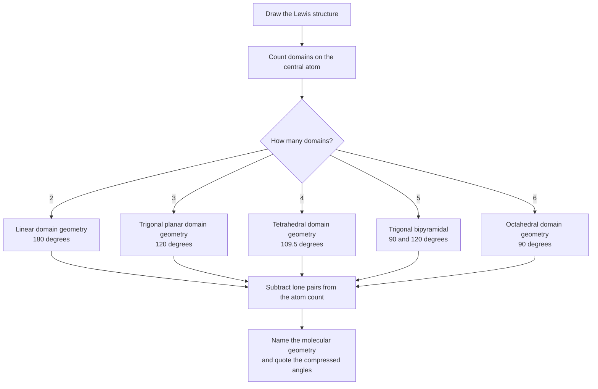
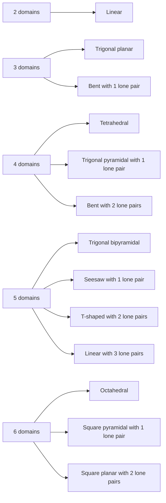
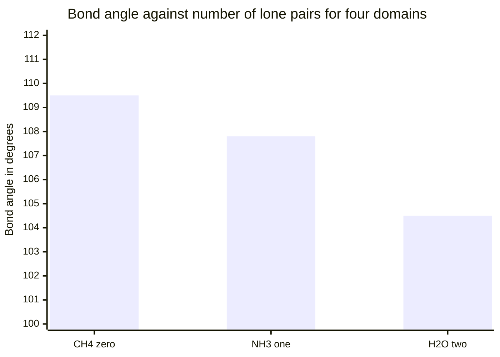
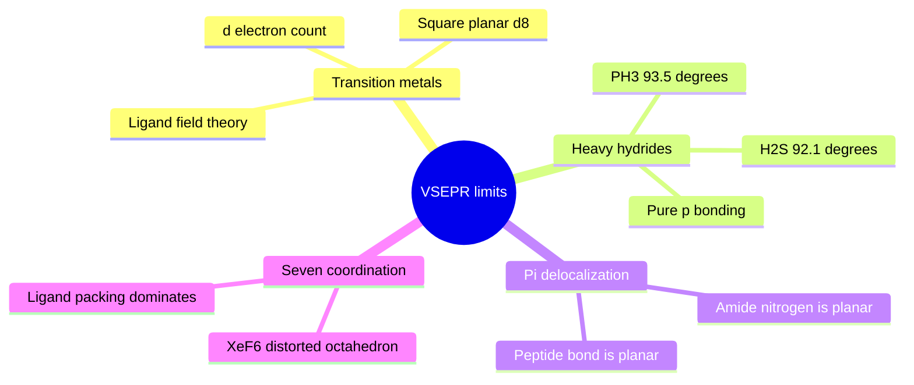

# Chapter 6 — Molecular Geometry and VSEPR Theory

> **Level:** Intermediate (Level 2)
> **Estimated study time:** 6 hours (4 h reading + 2 h exercises)
> **Prerequisites:** [Chapter 1 — Atomic Structure](../02-elementary-chemistry/01-atomic-structure.md); Level 1 bonding ([Level 1 overview](../02-elementary-chemistry/README.md))
> **Related chapters:** [Intermolecular Forces](05-intermolecular-forces.md), [Hybridization and Molecular Polarity](07-hybridization-and-molecular-polarity.md), [Thermochemistry and Enthalpy](08-thermochemistry-and-enthalpy.md)
> **Difficulty:** ★★★☆☆ (3/5)

---

## 1. Learning Objectives

After working through this chapter you will be able to:

- Distinguish **electron-domain geometry** from **molecular geometry** and explain why the two differ whenever a central atom carries lone pairs.
- Count electron domains from a Lewis structure, treating single, double and triple bonds as one domain and each lone pair as one domain.
- Reproduce the complete VSEPR table for two to six domains, including every lone-pair variant.
- Predict the shape of a molecule or ion from its formula and charge, and justify the prediction by domain repulsion.
- Explain the lone-pair compression of bond angles using the repulsion order $\text{LP–LP} > \text{LP–BP} > \text{BP–BP}$, and predict the direction of the effect quantitatively.
- Explain why lone pairs occupy equatorial rather than axial sites in a trigonal bipyramid.
- State where VSEPR fails — transition-metal complexes, heavy main-group hydrides, and systems with strong $\pi$ delocalization — and say what replaces it.
- Use molecular geometry to decide whether bond dipoles cancel, and compute the resultant dipole moment for a symmetric two-dipole case.
- Identify the symmetry elements that make a molecule nonpolar despite containing polar bonds.

---

## 2. Introduction

Lewis structures tell you which atoms are joined and how many electrons are shared. They say nothing about the three-dimensional arrangement of those atoms. Yet almost every property that matters — whether a molecule has a dipole moment, whether it can fit a receptor pocket, whether it is chiral, whether it can pack into a crystal, what its vibrational spectrum looks like — depends on shape rather than on connectivity.

Two molecules with the formula $\ce{C2H6O}$ illustrate the point. Ethanol, $\ce{CH3CH2OH}$, boils at $78.4\ ^\circ\text{C}$ because its hydrogen-bonding group is exposed and the molecule is extended. Dimethyl ether, $\ce{CH3OCH3}$, boils at $-24.8\ ^\circ\text{C}$ because its oxygen is buried between two methyl groups and the molecule offers no hydrogen-bond donor at all. Connectivity differs here, but even with identical connectivity, shape decides polarity: carbon dioxide and water both consist of a central atom bonded to two oxygens, yet one is a linear nonpolar gas at room temperature and the other is a bent polar liquid. The difference is a bond angle.

**VSEPR theory** — Valence Shell Electron Pair Repulsion — is the working model that predicts those angles. Its central claim is simple enough to state in one sentence: *the electron domains around a central atom arrange themselves in space so as to minimize repulsion between them.* From that claim, plus a rule for counting domains, the shapes of thousands of main-group molecules follow.

The model was developed by Ronald Gillespie and Ronald Nyholm in 1957, building on Sidgwick and Powell's 1940 observation that molecular shapes correlate with the number of electron pairs around the central atom. It is a *correlation* model rather than a first-principles one: it does not solve the Schrödinger equation, and it cannot predict bond lengths or precise angles. What it does — reliably and cheaply — is tell you whether a molecule is linear, bent, pyramidal, tetrahedral or octahedral, and roughly what its angles are. For a model that fits on one page, that is remarkable value.

This chapter builds the model from the electron-pair repulsion idea, tabulates every case from two to six domains, works through the standard predictions, and is explicit about where the model breaks down. Chapter [7](07-hybridization-and-molecular-polarity.md) supplies the orbital-level account of *why* the geometries are what they are, and completes the treatment of polarity that begins in Section 4.5 here.

---

## 3. Fundamental Concepts

### 3.1 Electron-domain geometry versus molecular geometry

An **electron domain** is a region of space around a central atom occupied by a pair of electrons, whether that pair is shared (a bonding pair) or not (a lone pair). The **electron-domain geometry** is the arrangement of all the domains. The **molecular geometry** is the arrangement of the *atoms only*.

Lone pairs are invisible in a molecular geometry because there is no nucleus at their centre. That single fact generates most of the shapes in the VSEPR table: a molecule with four domains is tetrahedral in its domain geometry, but if one domain is a lone pair the atoms describe a **trigonal pyramid**, and if two domains are lone pairs the atoms describe a **bent** shape.

| Domains | Lone pairs | Electron-domain geometry | Molecular geometry | Example |
|---|---|---|---|---|
| 2 | 0 | Linear | Linear | $\ce{CO2}$ |
| 3 | 0 | Trigonal planar | Trigonal planar | $\ce{BF3}$ |
| 3 | 1 | Trigonal planar | Bent | $\ce{SO2}$ |
| 4 | 0 | Tetrahedral | Tetrahedral | $\ce{CH4}$ |
| 4 | 1 | Tetrahedral | Trigonal pyramidal | $\ce{NH3}$ |
| 4 | 2 | Tetrahedral | Bent | $\ce{H2O}$ |
| 5 | 0 | Trigonal bipyramidal | Trigonal bipyramidal | $\ce{PCl5}$ |
| 5 | 1 | Trigonal bipyramidal | Seesaw | $\ce{SF4}$ |
| 5 | 2 | Trigonal bipyramidal | T-shaped | $\ce{ClF3}$ |
| 5 | 3 | Trigonal bipyramidal | Linear | $\ce{XeF2}$ |
| 6 | 0 | Octahedral | Octahedral | $\ce{SF6}$ |
| 6 | 1 | Octahedral | Square pyramidal | $\ce{BrF5}$ |
| 6 | 2 | Octahedral | Square planar | $\ce{XeF4}$ |

**Terminology note.** "Bent" is also called "angular" or "V-shaped"; "seesaw" is also called "sawhorse"; "trigonal pyramidal" is sometimes called "pyramidal". The names are not standardized across textbooks, but the geometries are unambiguous once the angles are given.

### 3.2 Counting domains

The counting rules are mechanical and must be applied to a correct Lewis structure:

1. Draw the Lewis structure, including every lone pair on the central atom.
2. Count each **single bond** as one domain.
3. Count each **double or triple bond** as **one** domain, not two or three. The $\sigma$ framework defines the direction; the $\pi$ components are distributed around it.
4. Count each **lone pair** on the central atom as one domain.
5. Do not count lone pairs on terminal atoms; they point away from the central atom and do not constrain its geometry.

A useful bookkeeping shortcut for a main-group species with monovalent ligands works for many simple cases:

$$
N_{\text{domains}} = \frac{1}{2}\left(\text{valence } e^- \text{ on central atom} + \text{number of monovalent ligands} - \text{charge}\right)
$$

For $\ce{NH4+}$: $(5 + 4 - 1)/2 = 4$. For $\ce{H3O+}$: $(6 + 3 - 1)/2 = 4$. For $\ce{NO2-}$: $(5 + 0 - (-1))/2 = 3$, but this counts only $\sigma$ bonds plus lone pairs and fails for oxygen ligands, because oxygen forms a double bond in the preferred resonance structure. The shortcut is convenient but unsafe; the Lewis structure is the authority.

**Worked counting.** Sulfur dioxide, $\ce{SO2}$. The Lewis structure has $\ce{S}$ doubly bonded to each oxygen with one lone pair on sulfur — 16 valence electrons in total, arranged as $\ce{O=S=O}$ with a lone pair on $\ce{S}$. There are two $\sigma$ bonds and one lone pair, so $N = 3$. Three domains adopt a trigonal planar arrangement; the lone pair removes one vertex, leaving a bent molecule. The observed $\ce{O-S-O}$ angle is $119.5^\circ$.

### 3.3 The VSEPR rules

The model is usually stated as four rules:

1. **Domains repel.** Electron pairs, being negatively charged, repel one another. The repulsion is minimized when the domains are as far apart as possible.
2. **Lone pairs occupy more space than bonding pairs.** A lone pair is held by one nucleus rather than two, so it is drawn closer to the central atom and spreads out more. It therefore compresses the angles between the remaining bonding pairs.
3. **Multiple bonds occupy more space than single bonds.** A double bond has two electron pairs in the internuclear region and repels more strongly than a single bond.
4. **Repulsion falls off with angle.** Domains at $90^\circ$ repel more strongly than domains at $120^\circ$, which repel more strongly than domains at $180^\circ$.

These rules generate the ordering

$$
\text{LP–LP} > \text{LP–BP} > \text{BP–BP}
$$

and, within bonding pairs, triple > double > single.

### 3.4 The shape of each domain count

The arrangements that minimize repulsion for $N$ points on a sphere are a classical geometry problem, solved for small $N$ long before VSEPR existed:

- $N = 2$: **linear**, $180^\circ$.
- $N = 3$: **trigonal planar**, $120^\circ$.
- $N = 4$: **tetrahedral**, $109.47^\circ$.
- $N = 5$: **trigonal bipyramidal**, $90^\circ$ and $120^\circ$. This is the first arrangement in which the sites are *not* equivalent: three equatorial sites at $120^\circ$ and two axial sites at $90^\circ$ to each equatorial.
- $N = 6$: **octahedral**, $90^\circ$.

The tetrahedral angle is worth deriving once, because it recurs:

$$
\cos\theta = -\tfrac{1}{3} \quad\Longrightarrow\quad \theta = 109.47^\circ
$$

For $N = 7$ the minimum-energy arrangement is a pentagonal bipyramid, and VSEPR becomes unreliable; see Section 4.4.

### 3.5 Bond angles and lone-pair compression

The ideal angles are those of the domain geometry. Observed angles are smaller whenever lone pairs are present, and the size of the compression follows the repulsion order.

| Molecule | Domains | Lone pairs | Ideal angle | Observed angle | Compression |
|---|---|---|---|---|---|
| $\ce{CH4}$ | 4 | 0 | $109.5^\circ$ | $109.5^\circ$ | — |
| $\ce{NH3}$ | 4 | 1 | $109.5^\circ$ | $107.8^\circ$ | $-1.7^\circ$ |
| $\ce{H2O}$ | 4 | 2 | $109.5^\circ$ | $104.5^\circ$ | $-5.0^\circ$ |
| $\ce{NF3}$ | 4 | 1 | $109.5^\circ$ | $102.2^\circ$ | $-7.3^\circ$ |
| $\ce{SO2}$ | 3 | 1 | $120^\circ$ | $119.5^\circ$ | $-0.5^\circ$ |
| $\ce{ClF3}$ | 5 | 2 | $90^\circ$ | $87.5^\circ$ | $-2.5^\circ$ |
| $\ce{BrF5}$ | 6 | 1 | $90^\circ$ | $84.8^\circ$ | $-5.2^\circ$ |

Two lessons follow. First, each additional lone pair compresses the angle further: one lone pair costs about $2^\circ$, two cost about $5^\circ$. Second, the compression also depends on the ligand: $\ce{NF3}$ is compressed far more than $\ce{NH3}$ because fluorine is more electronegative than hydrogen, so the bonding electron pair is drawn away from nitrogen, reducing BP–BP repulsion and allowing the lone pair to squeeze harder. That effect is Bent's rule, developed in Chapter [7](07-hybridization-and-molecular-polarity.md).

### 3.6 Key terms

| Term | Working definition |
|---|---|
| Electron domain | A bonding pair or lone pair occupying a region around a central atom |
| Electron-domain geometry | Arrangement of all domains, bonding and non-bonding |
| Molecular geometry | Arrangement of the atomic nuclei only |
| Steric number | The number of electron domains, $N$ |
| Lone-pair compression | Reduction of bond angles caused by the greater space requirement of lone pairs |
| Equatorial site | One of the three sites in the trigonal-bipyramidal plane |
| Axial site | One of the two sites perpendicular to the trigonal-bipyramidal plane |
| Dipole moment | Vector sum of all bond dipoles and lone-pair moments in a molecule |

---

## 4. Detailed Scientific Explanation

### 4.1 Why VSEPR works

The physical basis is the same electrostatic repulsion that operates in every electron–electron interaction, reinforced by the **Pauli exclusion principle**. When two electron pairs with parallel spins are forced into the same region of space, the wavefunction must antisymmetrize, which costs energy. The result is an effective repulsion that is strongly distance-dependent but only weakly dependent on the identity of the atoms involved. Because it is nearly universal, the *arrangement* of domains is nearly universal too.

This is why the same shapes recur across the periodic table: $\ce{CH4}$, $\ce{NH4+}$, $\ce{SO4^2-}$, $\ce{ClO4-}$ and $\ce{XeO4}$ are all tetrahedral despite having central atoms from groups 14, 15, 16, 17 and 18.

**Simplification.** Real VSEPR repulsion is not a pairwise classical force. It is a consequence of the Pauli principle acting on a many-electron wavefunction, and quantitative versions require either molecular orbital theory or a ligand close-packing analysis. The classical "balloon" picture — tying four balloons together produces a tetrahedron — is a good intuition pump and a bad theory: it predicts shapes correctly but explains nothing about why one arrangement is lower in energy.

### 4.2 Lone pairs, multiple bonds and the repulsion order

Lone pairs are more repulsive than bonding pairs for a simple reason: a bonding pair is confined between two nuclei, whereas a lone pair is confined by only one nucleus and can spread into a larger volume. That larger volume requires more angular space.

Multiple bonds are more repulsive than single bonds for a similar reason: a double bond concentrates four electrons in the internuclear region rather than two.

The combined ordering

$$
\text{LP–LP} > \text{LP–BP} > \text{BP–BP} \qquad\text{and}\qquad \text{triple} > \text{double} > \text{single}
$$

explains a series of otherwise puzzling observations:

- In $\ce{SO2}$, the $\ce{O-S-O}$ angle is $119.5^\circ$, close to the $120^\circ$ of a trigonal planar arrangement. The two double bonds are more repulsive than single bonds would be, but the lone pair is more repulsive still, and the two effects nearly cancel.
- In $\ce{Cl2O}$, the $\ce{Cl-O-Cl}$ angle is $110.9^\circ$, whereas in $\ce{H2O}$ it is $104.5^\circ$. The $\ce{Cl-O}$ bonds are longer and the chlorine atoms are much larger than hydrogen atoms, so the bonding pairs sit further apart and repel less, allowing the angle to open.
- In $\ce{F2O}$, the angle is $103.1^\circ$, slightly less than in water, because fluorine withdraws electron density from oxygen and allows the lone pairs to dominate.

### 4.3 The trigonal bipyramid: inequivalent sites

The five-domain case is the first in which the sites are not equivalent, and it produces the most interesting shapes in the table. A lone pair in a trigonal bipyramid can occupy an **equatorial** site (two neighbours at $90^\circ$) or an **axial** site (three neighbours at $90^\circ$). Repulsion at $90^\circ$ is much stronger than at $120^\circ$, so the lone pair always goes equatorial.

| Species | Domains | Lone pairs | Lone-pair sites | Shape | Angle data |
|---|---|---|---|---|---|
| $\ce{PCl5}$ | 5 | 0 | — | Trigonal bipyramidal | $90^\circ$, $120^\circ$ |
| $\ce{SF4}$ | 5 | 1 | 1 equatorial | Seesaw | $101.6^\circ$ (eq–ax), $173.1^\circ$ (ax–ax) |
| $\ce{ClF3}$ | 5 | 2 | 2 equatorial | T-shaped | $87.5^\circ$ |
| $\ce{XeF2}$ | 5 | 3 | 3 equatorial | Linear | $180^\circ$ |

The bond lengths confirm the assignment: in $\ce{SF4}$ the axial $\ce{S-F}$ bonds are $164.6\ \text{pm}$ and the equatorial ones $154.5\ \text{pm}$, because the equatorial bonds are compressed by the lone pair and by each other.

The octahedral case has six equivalent sites, so a lone pair can go anywhere; a second lone pair then goes *trans* to the first, giving the square planar shape of $\ce{XeF4}$.

### 4.4 Where VSEPR fails

VSEPR is a main-group correlation model, and it fails in four identifiable ways.

**1. Transition-metal complexes.** VSEPR has no rule for counting $d$ electrons as domains, and the geometries of coordination compounds are determined by ligand-field effects. $\ce{[PtCl4]^2-}$ and $\ce{[Ni(CN)4]^2-}$ are square planar ($d^8$), not tetrahedral; $\ce{[Cu(NH3)4]^2+}$ is square planar ($d^9$); $\ce{[Ti(H2O)6]^3+}$ is octahedral ($d^1$); and $\ce{[Fe(CN)6]^4-}$ is octahedral ($d^6$) while $\ce{[FeCl4]-}$ is tetrahedral ($d^5$). VSEPR would predict tetrahedral for all four-coordinate cases. Ligand-field theory and, ultimately, molecular orbital theory are required.

**2. Heavy main-group hydrides.** VSEPR predicts about $107^\circ$ for $\ce{PH3}$ and $104.5^\circ$ for $\ce{H2S}$. The observed values are $93.5^\circ$ and $92.1^\circ$; for $\ce{AsH3}$ the angle is $91.8^\circ$, for $\ce{SbH3}$ $91.7^\circ$, for $\ce{H2Se}$ $91.0^\circ$ and for $\ce{H2Te}$ $89.5^\circ$. As the central atom becomes larger and less electronegative, the bonding pairs are almost pure $p$ orbitals and the angle approaches $90^\circ$. VSEPR has no mechanism for this because it treats all bonding pairs as equivalent.

**3. Strong $\pi$ systems and delocalization.** Formamide, $\ce{HCONH2}$, is planar at nitrogen ($\ce{H-N-H}$ $= 118.5^\circ$), not pyramidal as VSEPR predicts for a nitrogen with three $\sigma$ bonds and one lone pair. The lone pair is delocalized into the carbonyl $\pi$ system, which is an effect outside the model's vocabulary. The same reasoning makes the peptide bond planar, which is the structural basis of protein secondary structure.

**4. Seven-coordinate and larger systems.** $\ce{IF7}$ is a pentagonal bipyramid as VSEPR predicts, but $\ce{XeF6}$ is a distorted octahedron with a stereochemically active lone pair rather than the pentagonal bipyramid that a naive domain count would give. Beyond six domains, the model is unreliable and the shapes are determined by ligand packing and by the balance of steric and electronic effects.

**A note on what "fails" means.** For the vast majority of main-group compounds of period 2 and 3 elements, VSEPR is right about the gross shape and within a few degrees on angles. It is not a theory to be discarded; it is a fast, reliable first pass whose exceptions are themselves chemically informative.

### 4.5 From geometry to dipole moment

A bond is polar when the two atoms differ in electronegativity, but a molecule is polar only when the *vector sum* of its bond dipoles is non-zero. Geometry decides the sum.

$$
\boldsymbol{\mu}_{\text{total}} = \sum_i \boldsymbol{\mu}_i
$$

| Molecule | Geometry | Bond dipoles | Resultant $\mu$ / D |
|---|---|---|---|
| $\ce{CO2}$ | Linear | Two equal, opposed | $0$ |
| $\ce{H2O}$ | Bent | Two equal, $104.5^\circ$ apart | $1.85$ |
| $\ce{SO3}$ | Trigonal planar | Three equal, $120^\circ$ apart | $0$ |
| $\ce{SO2}$ | Bent | Two equal, $119.5^\circ$ apart | $1.63$ |
| $\ce{CCl4}$ | Tetrahedral | Four equal, $109.5^\circ$ apart | $0$ |
| $\ce{CHCl3}$ | Tetrahedral | Three $\ce{C-Cl}$ plus one $\ce{C-H}$ | $1.04$ |
| $\ce{NH3}$ | Trigonal pyramidal | Three $\ce{N-H}$ | $1.47$ |
| $\ce{BF3}$ | Trigonal planar | Three equal, $120^\circ$ apart | $0$ |
| $\ce{SF6}$ | Octahedral | Six equal, mutually opposed | $0$ |

For two equal dipoles of magnitude $\mu_b$ separated by an angle $\theta$:

$$
\mu_{\text{resultant}} = 2\mu_b\cos\!\left(\frac{\theta}{2}\right)
$$

The formula makes the geometry dependence explicit: at $\theta = 180^\circ$ the result is zero, and at $\theta = 0^\circ$ it is $2\mu_b$. Water, with $\theta = 104.5^\circ$, gives $2\mu_b \times 0.612$.

**Simplification.** The vector-sum model treats each bond dipole as a fixed vector. In reality the dipole moment of a molecule includes a contribution from the lone pairs and from the polarization of the whole electron distribution, and the "bond dipole" is itself not transferable between molecules. The model gets the *symmetry* argument exactly right and the magnitudes approximately.

---

## 5. Visual Diagrams

**Figure 6.1 — The VSEPR procedure from formula to shape.** The diagram separates the two decisions that students most often conflate: first find the *domain* geometry from the domain count, then find the *molecular* geometry by removing the vertices occupied by lone pairs. The second decision is the one that turns a tetrahedron into a pyramid or a bent shape. Note that the angle quoted at the last node is not the ideal angle but the observed one, which is always smaller when lone pairs are present.

**Figure 6.2 — The complete shape map for two to six electron domains.** Each row is one domain count, and each arrow is one lone-pair removal. The pattern is systematic: for four, five and six domains the sequence of shapes as lone pairs are added runs from the parent polyhedron through progressively more truncated versions down to a linear or planar remnant. Learning the map as three sequences rather than as thirteen separate facts reduces the memory load and makes the table reproducible from first principles.

**Figure 6.3 — Lone-pair compression in the four-domain series.** The ideal tetrahedral angle is $109.5^\circ$; one lone pair costs $1.7^\circ$ and two cost $5.0^\circ$. The second lone pair costs three times as much as the first, which is the quantitative signature of the $\text{LP–LP} > \text{LP–BP}$ ordering: once two lone pairs are present they repel each other strongly as well as compressing the bonds. The chart is deliberately plotted on a truncated axis — the differences are small in absolute terms but entirely systematic.

**Figure 6.4 — The four families of exception to VSEPR.** The mind map is a diagnostic checklist: if a prediction looks wrong, one of these four mechanisms is usually responsible. Each branch names both the observation and the theory that replaces VSEPR for that case, which is the productive way to handle an exception — not "VSEPR is wrong" but "VSEPR is out of its domain here, and this is what applies instead".

---

## 6. Mathematical Formulas

### 6.1 Counting domains and ideal angles

$$
N_{\text{domains}} = \underbrace{n_{\sigma}}_{\text{sigma bonds}} + \underbrace{n_{\text{lp}}}_{\text{lone pairs}}
$$

$$
\cos\theta_{\text{tet}} = -\frac{1}{3} \quad\Longrightarrow\quad \theta_{\text{tet}} = 109.47^\circ
$$

| Symbol | Meaning | SI unit |
|---|---|---|
| $N_{\text{domains}}$ | Steric number | dimensionless |
| $n_{\sigma}$ | Number of $\sigma$ bonds to the central atom | dimensionless |
| $n_{\text{lp}}$ | Number of lone pairs on the central atom | dimensionless |
| $\theta_{\text{tet}}$ | Tetrahedral bond angle | rad (quoted in degrees) |

**Assumptions.** Both expressions assume a single central atom, a main-group element, and a Lewis structure in which every domain is localized. They do not apply when a lone pair is delocalized into a $\pi$ system, and they say nothing about the *direction* of the distortion, which requires the repulsion ordering.

### 6.2 Dipole moment as a vector sum

$$
\boldsymbol{\mu} = \sum_i q_i \mathbf{r}_i
\qquad\Longrightarrow\qquad
\mu_{\text{resultant}} = 2\mu_b\cos\!\left(\frac{\theta}{2}\right)\ \text{(two equal dipoles)}
$$

| Symbol | Meaning | SI unit |
|---|---|---|
| $\boldsymbol{\mu}$ | Molecular dipole moment (vector) | C m |
| $q_i$ | Partial charge at site $i$ | C |
| $\mathbf{r}_i$ | Position vector of site $i$ from the origin | m |
| $\mu_b$ | Magnitude of one bond dipole | C m |
| $\theta$ | Angle between the two bond dipoles | rad |

**Assumptions.** The bond dipoles are treated as fixed vectors located on the bonds, and the lone-pair contribution is either neglected or absorbed into an effective bond dipole. The unit of convenience is the debye, $1\ \text{D} = 3.335\,64\times10^{-30}\ \text{C m}$.

### 6.3 The dipole moment from partial charges

$$
\mu = Q\,d
$$

| Symbol | Meaning | SI unit |
|---|---|---|
| $\mu$ | Dipole moment of a two-charge system | C m |
| $Q$ | Magnitude of each separated charge | C |
| $d$ | Separation of the charges | m |

**Assumptions.** The system is modelled as two point charges. For a real bond, $Q$ is an *effective* charge obtained by fitting the observed dipole moment, not the formal charge.

---

## 7. Chemical Equations

Geometry is a property of a molecule, not of a reaction, so the equations in this section record how the species discussed are actually made. Conditions are those used in preparative chemistry.

Boron trifluoride from borax or from the oxide:

$$
\ce{B2O3(s) + 6HF(g) -> 2BF3(g) + 3H2O(l)}
$$

Sulfur tetrafluoride from the elements, with a controlled stoichiometry that avoids $\ce{SF6}$:

$$
\ce{S8(s) + 8Cl2(g) -> 4S2Cl2(l)}
$$

$$
\ce{3SCl2(l) + 4NaF(s) -> SF4(g) + S2Cl2(l) + 4NaCl(s)}
$$

Phosphorus pentachloride by chlorination of the trichloride:

$$
\ce{PCl3(l) + Cl2(g) -> PCl5(s)}
$$

Xenon difluoride and xenon tetrafluoride, the classic demonstrations that a noble gas can be a central atom:

$$
\ce{Xe(g) + F2(g) -> XeF2(s)} \qquad (400\ ^\circ\text{C},\ 1\ \text{bar})
$$

$$
\ce{Xe(g) + 2F2(g) -> XeF4(s)} \qquad (400\ ^\circ\text{C},\ 6\ \text{bar})
$$

Sulfur hexafluoride, an octahedral molecule used as an electrical insulator:

$$
\ce{S8(s) + 24F2(g) -> 8SF6(g)}
$$

Chlorine trifluoride, a T-shaped interhalogen:

$$
\ce{Cl2(g) + 3F2(g) -> 2ClF3(g)}
$$

Each equation is balanced in atoms and charge, and each product is a species whose geometry is discussed above. The geometry itself is not obtained from the equation: it is measured by electron diffraction in the gas phase, by microwave spectroscopy for small molecules, or by X-ray crystallography for solids, and only then compared with the VSEPR prediction.

---

## 8. Worked Examples

### Worked Example 8.1 — Two and three domains with no lone pairs

**Problem.** Predict the electron-domain geometry, molecular geometry and bond angles of (a) $\ce{BeCl2}$ and (b) $\ce{BF3}$.

**Strategy.** Draw the Lewis structure, count domains on the central atom, and apply the minimum-repulsion arrangement.

**Solution.** (a) Beryllium contributes 2 valence electrons and each chlorine 1 to the $\sigma$ framework: $2 + 2 = 4$ electrons, giving two $\ce{Be-Cl}$ bonds and no lone pair on beryllium. Two domains adopt a linear arrangement, so both the domain geometry and the molecular geometry are linear with $\ce{Cl-Be-Cl} = 180^\circ$. The molecule has no dipole moment.

(b) Boron contributes 3 valence electrons and each fluorine 1: $3 + 3 = 6$ electrons, giving three $\ce{B-F}$ bonds and no lone pair on boron. Three domains adopt a trigonal planar arrangement, so both geometries are trigonal planar with $\ce{F-B-F} = 120^\circ$. Boron has an incomplete octet, which is why $\ce{BF3}$ is a Lewis acid.

**Check.** Both predictions agree with the measured gas-phase structures ($\ce{BeCl2}$ linear, $\ce{BF3}$ exactly trigonal planar by electron diffraction). The consistency check is that neither molecule has a lone pair on the central atom, so the domain and molecular geometries must be identical — a useful general test.

### Worked Example 8.2 — Three domains with one lone pair

**Problem.** Predict the geometry and bond angle of $\ce{SO2}$ and explain why the angle is so close to $120^\circ$ rather than substantially compressed.

**Strategy.** Draw the Lewis structure, count domains, then apply the repulsion order with attention to the double bonds.

**Solution.** Sulfur contributes 6 valence electrons and each oxygen 6, giving 18 electrons in total; the observed species is a bent molecule with a lone pair on sulfur. The preferred Lewis structure is $\ce{O=S=O}$ with one lone pair on $\ce{S}$, using $2 \times 2$ (double bonds) $+ 4$ (lone pair) $= 8$ electrons around sulfur and two lone pairs on each oxygen.

Counting domains: two $\sigma$ bonds (one to each oxygen) plus one lone pair gives $N = 3$. The domain geometry is trigonal planar. Removing one vertex for the lone pair gives a **bent** molecular geometry. The ideal angle is $120^\circ$; the observed $\ce{O-S-O}$ angle is $119.5^\circ$.

The compression is unusually small because the two $\ce{S=O}$ double bonds are more repulsive than single bonds would be, which offsets the expansion demanded by the lone pair. The two effects nearly cancel.

**Check.** The molecule is polar ($\mu = 1.63\ \text{D}$), which is only possible for a bent geometry: a linear $\ce{O=S=O}$ would have zero dipole moment by symmetry. The dipole moment measurement therefore independently confirms the bent shape, which is a stronger check than comparing with a table.

### Worked Example 8.3 — The four-domain series

**Problem.** Predict the geometry and angle of $\ce{CH4}$, $\ce{NH3}$, $\ce{H2O}$ and $\ce{NF3}$, and explain the trend in the angles.

**Strategy.** Count domains in each case, then apply the repulsion order and, for $\ce{NF3}$, the electronegativity of the ligand.

**Solution.** Each central atom has four domains:

| Species | Bonds | Lone pairs | Domain geometry | Molecular geometry | Angle |
|---|---|---|---|---|---|
| $\ce{CH4}$ | 4 | 0 | Tetrahedral | Tetrahedral | $109.5^\circ$ |
| $\ce{NH3}$ | 3 | 1 | Tetrahedral | Trigonal pyramidal | $107.8^\circ$ |
| $\ce{H2O}$ | 2 | 2 | Tetrahedral | Bent | $104.5^\circ$ |
| $\ce{NF3}$ | 3 | 1 | Tetrahedral | Trigonal pyramidal | $102.2^\circ$ |

The angles fall in the order $\ce{CH4} > \ce{NH3} > \ce{H2O}$ because the number of lone pairs increases and $\text{LP–BP} > \text{BP–BP}$. $\ce{NF3}$ has the same lone-pair count as $\ce{NH3}$ but a much smaller angle, because fluorine is more electronegative than hydrogen: the $\ce{N-F}$ bonding pair is pulled towards fluorine, away from nitrogen, so BP–BP repulsion is weaker and the lone pair compresses the angle further.

**Check.** The ordering is consistent with the dipole moments: $\ce{CH4}$ $0\ \text{D}$, $\ce{NH3}$ $1.47\ \text{D}$, $\ce{H2O}$ $1.85\ \text{D}$, and $\ce{NF3}$ only $0.23\ \text{D}$ because the bond dipoles oppose the lone-pair moment. That last value is a useful warning: a large angle compression does not imply a large molecular dipole.

### Worked Example 8.4 — Five domains: the seesaw, T-shape and linear series

**Problem.** Predict the geometry of $\ce{PCl5}$, $\ce{SF4}$, $\ce{ClF3}$ and $\ce{XeF2}$, stating where each lone pair sits.

**Strategy.** Five domains give a trigonal bipyramid. Place each lone pair in an equatorial site, because an equatorial site has only two neighbours at $90^\circ$ whereas an axial site has three.

**Solution.**

| Species | Domains | Lone pairs | Lone-pair sites | Shape | Angle |
|---|---|---|---|---|---|
| $\ce{PCl5}$ | 5 | 0 | — | Trigonal bipyramidal | $90^\circ$, $120^\circ$ |
| $\ce{SF4}$ | 5 | 1 | 1 equatorial | Seesaw | $101.6^\circ$, $173.1^\circ$ |
| $\ce{ClF3}$ | 5 | 2 | 2 equatorial | T-shaped | $87.5^\circ$ |
| $\ce{XeF2}$ | 5 | 3 | 3 equatorial | Linear | $180^\circ$ |

For $\ce{SF4}$ the axial $\ce{S-F}$ bonds bend away from the equatorial lone pair, from $180^\circ$ to $173.1^\circ$, and the equatorial angle closes from $120^\circ$ to $101.6^\circ$. For $\ce{ClF3}$ the two axial fluorines bend towards each other to $87.5^\circ$, away from the two equatorial lone pairs.

**Check.** The bond lengths corroborate the site assignments: in $\ce{SF4}$ the axial bonds ($164.6\ \text{pm}$) are longer than the equatorial ones ($154.5\ \text{pm}$), exactly as expected if the equatorial region is crowded by the lone pair. In $\ce{XeF2}$ the two $\ce{Xe-F}$ bonds are equal at $198\ \text{pm}$ and the molecule is centrosymmetric, consistent with three equatorial lone pairs and two axial bonds.

### Worked Example 8.5 — Six domains: octahedral, square pyramidal, square planar

**Problem.** Predict the geometry of $\ce{SF6}$, $\ce{BrF5}$ and $\ce{XeF4}$.

**Strategy.** Six domains give an octahedron with six equivalent sites. A second lone pair goes *trans* to the first, because that is the position of least repulsion ($180^\circ$ away).

**Solution.** $\ce{SF6}$ has six bonding domains and no lone pair: octahedral, all angles $90^\circ$. $\ce{BrF5}$ has five bonds and one lone pair: the lone pair occupies one vertex and the five remaining fluorines form a **square pyramid**, with the axial $\ce{F-Br-F}$ angle compressed from $90^\circ$ to $84.8^\circ$. $\ce{XeF4}$ has four bonds and two lone pairs: the lone pairs occupy opposite vertices and the four fluorines lie in a plane, giving **square planar** with $\ce{F-Xe-F} = 90^\circ$.

**Check.** $\ce{SF6}$ is nonpolar ($\mu = 0$), consistent with the centrosymmetric octahedron. $\ce{XeF4}$ is also nonpolar, which is only possible if the four $\ce{Xe-F}$ dipoles cancel exactly — a direct experimental confirmation of the square planar assignment rather than a seesaw or tetrahedral alternative. $\ce{BrF5}$ has $\mu = 1.5\ \text{D}$, consistent with a square pyramid, which lacks the inversion centre that would cancel the axial bond dipole.

### Worked Example 8.6 — Calculating a molecular dipole moment from bond dipoles

**Problem.** The $\ce{O-H}$ bond dipole in water is $1.51\ \text{D}$ and the $\ce{H-O-H}$ angle is $104.5^\circ$. Calculate the resultant dipole moment and compare it with the measured value of $1.85\ \text{D}$.

**Strategy.** Use the two-equal-dipole resultant formula, with the angle halved inside the cosine.

**Solution.**

$$
\mu = 2\mu_b\cos\!\left(\frac{\theta}{2}\right)
= 2 \times 1.51\ \text{D} \times \cos(52.25^\circ)
$$

$$
\cos(52.25^\circ) = 0.6122
$$

$$
\mu = 3.02\ \text{D} \times 0.6122 = 1.85\ \text{D}
$$

**Check.** The calculated value agrees with the measured $1.85\ \text{D}$ to three significant figures, and the arithmetic is self-consistent: the maximum possible value (both dipoles parallel) would be $3.02\ \text{D}$, and the result is $61\,\%$ of that, which is exactly $\cos(52.25^\circ)$. The agreement is slightly fortuitous — the lone pairs also contribute to the observed moment — but the symmetry argument, which is the part that matters, is exact.

---

## 9. Real-World Applications

**Drug design.** A receptor pocket is a three-dimensional shape, and a drug must match it. The difference between a potent drug and an inactive analogue is frequently a single bond angle or the orientation of a lone pair. Conformational analysis, molecular docking and pharmacophore modelling all begin from a VSEPR-quality geometry.

**Olfaction and taste.** The shape of a molecule determines whether it fits an olfactory receptor. Carvone has two enantiomers with the same connectivity and the same VSEPR shapes but different three-dimensional arrangements; one smells of spearmint and the other of caraway. Shape at the level of stereochemistry, not just VSEPR, controls biological recognition.

**Greenhouse gases and spectroscopy.** Whether a molecule absorbs infrared radiation depends on whether a vibration changes its dipole moment. $\ce{CO2}$ is linear and has no permanent dipole, yet it absorbs strongly at $2349\ \text{cm}^{-1}$ because the asymmetric stretch creates a transient dipole. $\ce{CH4}$ and $\ce{SF6}$ are both potent greenhouse gases for the same reason, and $\ce{SF6}$ is the most potent greenhouse gas known per kilogram.

**Dielectric gases and insulators.** $\ce{SF6}$ is used in high-voltage switchgear because its octahedral symmetry makes it nonpolar, chemically inert and an excellent dielectric. Its global warming potential is roughly $23\,500$ times that of $\ce{CO2}$ over a hundred-year horizon, which is why its use is now tightly regulated.

**Solvents and refrigerants.** Molecular shape and polarity determine boiling point, viscosity and solvency. The replacement of chlorofluorocarbons by hydrofluorocarbons and then by hydrofluoroolefins is a design problem in molecular geometry and dipole moment as much as in reactivity.

**Materials.** The shape of a monomer determines whether it can pack into a crystalline polymer. Linear polyethylene packs into lamellae and is opaque and strong; branched polyethylene is amorphous and transparent. At the small-molecule level, the same packing arguments govern the polymorphism of pharmaceutical crystals, which can differ in solubility and bioavailability.

**Catalysis.** The active site of an enzyme or a heterogeneous catalyst is a geometric template. Zeolites select products by pore size, and the shape selectivity of ZSM-5 for para-xylene is a direct consequence of the geometry of its channels.

---

## 10. Common Mistakes

| Mistake | Why it happens | Correct approach |
|---|---|---|
| Counting a double bond as two domains | "Two bonds" is read as "two domains" | A double or triple bond is one domain; the $\sigma$ framework sets the direction |
| Counting lone pairs on terminal atoms | All lone pairs look equivalent in a Lewis structure | Only lone pairs on the central atom constrain the geometry |
| Confusing electron-domain and molecular geometry | Both are computed in the same step | State both explicitly: "four domains, tetrahedral; one lone pair, trigonal pyramidal" |
| Assuming the observed angle equals the ideal angle | The ideal angle is the one that is tabulated | Lone pairs always compress the angle; quote the observed value and the direction of compression |
| Placing a lone pair in an axial site of a trigonal bipyramid | Axial and equatorial sites are drawn as equivalent | The lone pair goes equatorial, where there are two $90^\circ$ neighbours rather than three |
| Predicting a polar molecule whenever polar bonds are present | Bond polarity is easier to see than molecular symmetry | Sum the bond dipoles as vectors; symmetric arrangements cancel |
| Applying VSEPR to transition-metal complexes | The rules are taught without their scope | Use ligand-field theory for $d$-block complexes; VSEPR is a main-group model |
| Expecting VSEPR to predict bond lengths | The model predicts angles, and lengths are a separate question | Bond lengths come from covalent radii, bond order and hybridization arguments |
| Treating a lone pair as a "bond to nothing" in the geometry | It is invisible in the molecular geometry | It occupies a domain; the atoms must be counted separately from the domains |

---

## 11. Chapter Summary

- An electron domain is a bonding pair or a lone pair; the electron-domain geometry counts all of them and the molecular geometry counts only the atoms.
- The number of domains is the number of $\sigma$ bonds plus the number of lone pairs on the central atom; a double or triple bond counts as one domain.
- Two to six domains give, respectively, linear, trigonal planar, tetrahedral, trigonal bipyramidal and octahedral domain geometries.
- Lone pairs truncated the parent polyhedron: tetrahedral gives trigonal pyramidal and bent; trigonal bipyramidal gives seesaw, T-shaped and linear; octahedral gives square pyramidal and square planar.
- The repulsion order $\text{LP–LP} > \text{LP–BP} > \text{BP–BP}$ explains why angles shrink as lone pairs are added and why electronegative ligands shrink them further.
- In a trigonal bipyramid the lone pair always occupies an equatorial site, because an equatorial site has two $90^\circ$ neighbours rather than three.
- VSEPR fails for transition-metal complexes, heavy main-group hydrides, strongly delocalized $\pi$ systems and coordination numbers above six; each failure points to the theory that replaces it.
- Molecular geometry determines whether bond dipoles cancel: $\ce{CO2}$ and $\ce{CCl4}$ are nonpolar, while $\ce{H2O}$ and $\ce{CHCl3}$ are polar.
- The dipole moment of a molecule is the vector sum of its bond dipoles, and for two equal dipoles it is $2\mu_b\cos(\theta/2)$.

---

## 12. Exercises

### 12.1 Conceptual questions

1. Explain the difference between electron-domain geometry and molecular geometry, using $\ce{NH3}$ as your example. Why does the distinction not arise for $\ce{BF3}$?
2. Why is a double bond counted as a single electron domain in VSEPR? What feature of the bond determines the direction of the domain?
3. A student says that $\ce{SF4}$ should be tetrahedral because it has four bonds. Identify the error and give the correct shape.
4. Explain why $\ce{CO2}$ has no dipole moment while $\ce{SO2}$ has one, even though both are triatomic molecules with two polar bonds.

### 12.2 Basic problems

5. Predict the molecular geometry and approximate bond angle for: (a) $\ce{CO2}$; (b) $\ce{SO3}$; (c) $\ce{CH4}$; (d) $\ce{NH3}$; (e) $\ce{H2O}$.
6. Predict the molecular geometry of: (a) $\ce{PCl5}$; (b) $\ce{SF6}$; (c) $\ce{XeF4}$; (d) $\ce{BrF5}$; (e) $\ce{ClF3}$.
7. State the number of electron domains and the number of lone pairs on the central atom for: (a) $\ce{NO2-}$; (b) $\ce{H3O+}$; (c) $\ce{SO4^2-}$; (d) $\ce{XeF2}$; (e) $\ce{ICl4-}$.
8. Which of the following are polar? (a) $\ce{CCl4}$; (b) $\ce{CH2Cl2}$; (c) $\ce{BF3}$; (d) $\ce{NH3}$; (e) $\ce{SF6}$.

### 12.3 Intermediate problems

9. $\ce{NF3}$ has a bond angle of $102.2^\circ$ while $\ce{NH3}$ has $107.8^\circ$. Explain the difference using electronegativity and the repulsion order.
10. $\ce{H2O}$ has an angle of $104.5^\circ$ and $\ce{H2S}$ has $92.1^\circ$. Explain why the heavier hydride deviates so far from the tetrahedral value, and why VSEPR does not predict it.
11. Formamide, $\ce{HCONH2}$, is planar at nitrogen. Explain why this is a failure of VSEPR and what feature of the electronic structure is responsible.
12. $\ce{SF4}$ has two different $\ce{S-F}$ bond lengths ($154.5$ and $164.6\ \text{pm}$). Explain why, and relate the difference to the lone-pair site.

### 12.4 Advanced problems

13. Explain why $\ce{[PtCl4]^2-}$ is square planar rather than tetrahedral, and why VSEPR cannot account for it. Name the theory that does.
14. $\ce{XeF6}$ is a distorted octahedron rather than the pentagonal bipyramid that a seven-domain VSEPR count would predict. Discuss what this implies about the limits of the model.
15. Using the vector model, determine the resultant dipole moment of a molecule with three identical bond dipoles of $1.00\ \text{D}$ arranged at $120^\circ$ in a plane. Confirm that the result is consistent with the observed zero dipole moment of $\ce{BF3}$ and $\ce{SO3}$.

### 12.5 Calculation problems

16. The $\ce{N-H}$ bond dipole in ammonia is $1.30\ \text{D}$ and the $\ce{H-N-H}$ angle is $107.8^\circ$. Calculate the resultant of the three bond dipoles if they were coplanar and arranged at $120^\circ$, and comment on why the observed molecular dipole ($1.47\ \text{D}$) is larger.
17. The measured dipole moment of $\ce{HCl}$ is $1.08\ \text{D}$ and the bond length is $127.5\ \text{pm}$. Calculate the effective charge separation $Q$ and express it as a fraction of the elementary charge.
18. For a tetrahedral molecule $\ce{CX3Y}$, the three $\ce{C-X}$ dipoles each have magnitude $1.50\ \text{D}$ and are arranged at $109.5^\circ$ to the $\ce{C-Y}$ axis. Calculate the component of the resultant along the $\ce{C-Y}$ axis.

### 12.6 Answers

1. $\ce{NH3}$ has four domains but only three atoms around nitrogen: the domain geometry is tetrahedral and the molecular geometry is trigonal pyramidal. $\ce{BF3}$ has three domains and three atoms, so the two geometries coincide.
2. The $\sigma$ bond defines the internuclear axis; the $\pi$ components are distributed around it and do not add a separate direction. Counting them separately would double-count the same internuclear axis.
3. The student counted bonds rather than domains. $\ce{SF4}$ has five domains (four bonds plus one lone pair), so its domain geometry is trigonal bipyramidal and its molecular geometry is a seesaw.
4. $\ce{CO2}$ is linear, so its two equal bond dipoles are opposed and cancel exactly. $\ce{SO2}$ is bent, so the same two dipoles add to a non-zero resultant.
5. (a) linear, $180^\circ$; (b) trigonal planar, $120^\circ$; (c) tetrahedral, $109.5^\circ$; (d) trigonal pyramidal, $\approx 107^\circ$; (e) bent, $\approx 104.5^\circ$.
6. (a) trigonal bipyramidal; (b) octahedral; (c) square planar; (d) square pyramidal; (e) T-shaped.
7. (a) 3 domains, 1 lone pair; (b) 4 domains, 1 lone pair; (c) 4 domains, 0 lone pairs; (d) 5 domains, 3 lone pairs; (e) 6 domains, 2 lone pairs.
8. (b) and (d) are polar; (a), (c) and (e) are nonpolar by symmetry.
9. Fluorine is more electronegative than hydrogen, so the $\ce{N-F}$ bonding pairs are displaced towards fluorine and BP–BP repulsion at nitrogen is weaker. The lone pair therefore compresses the angle more.
10. Sulfur is larger and less electronegative than oxygen, and the $\ce{S-H}$ bonds are formed from almost pure $p$ orbitals on sulfur, which favour $90^\circ$. VSEPR treats all bonding pairs as equivalent and has no way to represent this change in orbital character.
11. The nitrogen lone pair is delocalized into the carbonyl $\pi$ system, giving the $\ce{C-N}$ bond partial double-bond character and making the nitrogen $sp^2$-like and planar. VSEPR counts the lone pair as a localized domain and predicts a pyramid.
12. The axial bonds are longer because they lie adjacent to three $90^\circ$ neighbours including the lone pair, whereas the equatorial bonds lie adjacent to two. Greater repulsion lengthens the axial bonds.
13. $\ce{Pt(II)}$ is a $d^8$ ion; the square planar arrangement is favoured by ligand-field stabilization. VSEPR has no way to count $d$ electrons as domains, so it predicts tetrahedral for any four-coordinate species. Ligand-field theory supplies the correct description.
14. Seven domains would give a pentagonal bipyramid, but a lone pair in that arrangement is stereochemically active and distorts the structure. The model's assumption that domains are equivalent points on a sphere breaks down when ligand–ligand repulsion and lone-pair directionality compete.
15. Take the three dipoles at angles $0^\circ$, $120^\circ$ and $240^\circ$. The $x$ components sum to $1 + \cos 120^\circ + \cos 240^\circ = 1 - 0.5 - 0.5 = 0$, and the $y$ components sum to $0 + \sin 120^\circ + \sin 240^\circ = 0.866 - 0.866 = 0$. The resultant is exactly zero, consistent with the zero dipole moments of $\ce{BF3}$ and $\ce{SO3}$.
16. Coplanar at $120^\circ$ the three bond dipoles would cancel exactly, giving zero, which contradicts the observed $1.47\ \text{D}$. The resolution is that the three dipoles are not coplanar but arranged on a cone at $107.8^\circ$ to one another, so their components along the $C_3$ axis add while their perpendicular components cancel.
17. $\mu = 1.08\ \text{D} = 1.08 \times 3.3356\times10^{-30} = 3.60\times10^{-30}\ \text{C m}$. Then $Q = \mu/d = 3.60\times10^{-30}/1.275\times10^{-10} = 2.83\times10^{-20}\ \text{C}$, which is $0.177\,e$. The bond is therefore about $18\,\%$ ionic.
18. Each $\ce{C-X}$ dipole makes an angle of $109.5^\circ$ with the $\ce{C-Y}$ axis, so its component along that axis is $1.50\cos(109.5^\circ) = -0.500\ \text{D}$. The three sum to $-1.50\ \text{D}$ along the axis, so the resultant is $1.50\ \text{D}$ directed towards the three halogens.

> Worked solutions for this level are maintained in the `solutions/` directory of the level.

---

## 13. Further Reading

- Gillespie, R. J.; Nyholm, R. S. "Inorganic stereochemistry." *Quarterly Reviews, Chemical Society*, 1957. The original statement of the VSEPR model.
- Gillespie, R. J.; Hargittai, I. *The VSEPR Model of Molecular Geometry*, Allyn and Bacon, 1991. The book-length treatment, including the exceptions.
- Atkins, P.; de Paula, J.; Keeler, J. *Atkins' Physical Chemistry*, 11th ed., Oxford University Press. The chapter on molecular symmetry and structure gives the group-theoretical account of dipole moments.
- Housecroft, C. E.; Sharpe, A. G. *Inorganic Chemistry*, Pearson. The chapters on bonding in main-group compounds and on coordination chemistry cover both the successes and the failures of VSEPR.
- OpenStax, *Chemistry 2e*, Rice University, Chapter 7 ("Chemical Bonding and Molecular Geometry"). <https://openstax.org/details/books/chemistry-2e>
- IUPAC. *Compendium of Chemical Terminology* (the "Gold Book"), 2nd ed. (corrected version). <https://goldbook.iupac.org/>
- NIST. *CODATA Internationally Recommended Values of the Fundamental Physical Constants*. <https://physics.nist.gov/cuu/Constants/>
- [CURRICULUM.md](../CURRICULUM.md) — where this chapter sits in the full programme.
- [REFERENCES.md](../REFERENCES.md) — the repository's verified source list.

> Only sources that can be checked are cited here. No DOI, page number or edition is invented.
