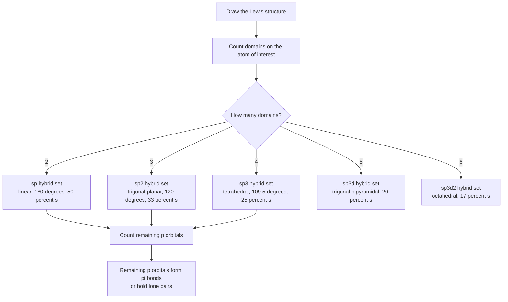
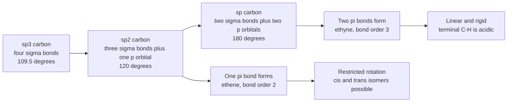
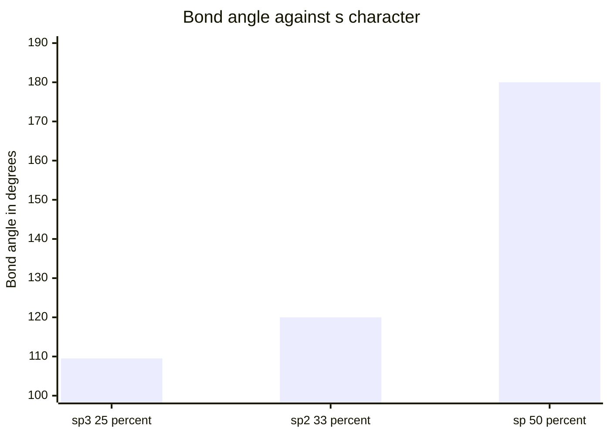
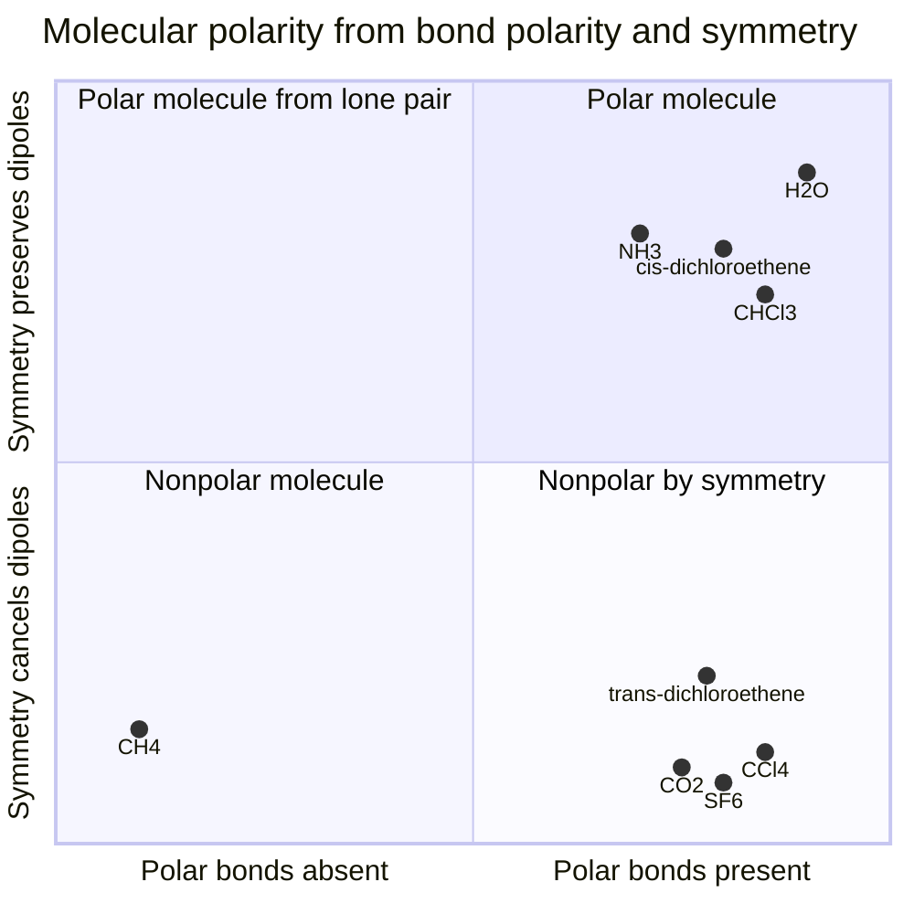

# Chapter 7 — Hybridization and Molecular Polarity

> **Level:** Intermediate (Level 2)
> **Estimated study time:** 7 hours (5 h reading + 2 h exercises)
> **Prerequisites:** [Intermolecular Forces](05-intermolecular-forces.md); [Molecular Geometry and VSEPR Theory](06-molecular-geometry-and-vsepr-theory.md); [Chapter 1 — Atomic Structure](../02-elementary-chemistry/01-atomic-structure.md)
> **Related chapters:** [Intermolecular Forces](05-intermolecular-forces.md), [Molecular Geometry and VSEPR Theory](06-molecular-geometry-and-vsepr-theory.md), [Thermochemistry and Enthalpy](08-thermochemistry-and-enthalpy.md), [Reaction Rates](09-reaction-rates.md)
> **Difficulty:** ★★★★☆ (4/5)

---

## 1. Learning Objectives

After working through this chapter you will be able to:

- Explain why valence bond theory requires hybrid orbitals, and what problem the mixing of $s$ and $p$ orbitals solves.
- Describe the formation of $sp$, $sp^2$ and $sp^3$ hybrid sets, and state the geometry, bond angle and $s$ character of each.
- Describe $sp^3d$ and $sp^3d^2$ sets, and explain why they are now regarded as bookkeeping rather than a literal description of hypervalent molecules.
- Distinguish $\sigma$ from $\pi$ overlap, and explain why free rotation is possible about a $\sigma$ bond but not about a $\pi$ bond.
- Describe the bonding in ethene and ethyne in terms of hybrid orbitals plus unhybridized $p$ orbitals.
- Assign the hybridization of any atom in a Lewis structure from its electron-domain count.
- Relate $s$ character to bond angle, bond length and acidity (Coulson's theorem and Bent's rule).
- Compute the resultant dipole moment of a molecule from its bond dipoles, and identify the symmetry elements that make a molecule nonpolar despite polar bonds.
- Explain how polarity controls solubility, boiling point, chromatographic retention and membrane permeability.
- State the limitations of hybridization and describe the molecular orbital description that supersedes it.

---

## 2. Introduction

VSEPR, developed in Chapter [6](06-molecular-geometry-and-vsepr-theory.md), predicts *that* methane is tetrahedral. It does not explain *why*. The obvious answer from atomic structure — that carbon has one $2s$ and three $2p$ orbitals, and forms four bonds with them — fails immediately. A bond formed from a pure $2s$ orbital would be spherically symmetric, and a bond formed from a pure $2p$ orbital would point along a Cartesian axis. A set of one $s$ and three $p$ orbitals would therefore be expected to give three equivalent bonds at $90^\circ$ to one another plus one bond of different length and energy. Methane has four identical $\ce{C-H}$ bonds at $109.5^\circ$, with identical lengths ($109\ \text{pm}$) and identical strengths ($413\ \text{kJ mol}^{-1}$).

Linus Pauling resolved this in 1931 with the idea of **hybridization**: the atomic orbitals on the central atom mix mathematically before bonding, producing a new set of equivalent **hybrid orbitals** with the directionality required by the observed geometry. The idea is one of the most successful pedagogical constructs in chemistry. It predicts shapes, explains bond angles, rationalizes bond lengths and acidities, and provides the $\sigma$/$\pi$ language in which all of organic chemistry is written.

It is also, strictly speaking, not a physical process. Atomic orbitals do not physically merge; hybridization is a mathematical change of basis, and the resulting localized orbitals are a convenient approximation to a molecular orbital description that is delocalized over the whole molecule. The evidence for this is direct: photoelectron spectroscopy of methane shows *two* ionization energies ($12.7\ \text{eV}$ and $23.0\ \text{eV}$) rather than the single one that four identical localized bonds would give. This chapter therefore develops hybridization fully, uses it confidently, and states precisely where it stops being the best description.

The second half of the chapter applies the geometry to **polarity**. A polar bond is a local property; a polar *molecule* is a global one. Carbon dioxide contains two strongly polar $\ce{C=O}$ bonds and has no dipole moment at all. Chloroform contains three polar $\ce{C-Cl}$ bonds and one nearly nonpolar $\ce{C-H}$ bond, and is strongly polar. The difference is symmetry, and symmetry is the bridge between this chapter and the previous one.

---

## 3. Fundamental Concepts

### 3.1 Why hybrid orbitals are needed

**Valence bond theory** (Heitler and London, 1927; Pauling, 1931) describes a covalent bond as the overlap of a half-filled orbital on one atom with a half-filled orbital on another, with the electron pair occupying the overlap region and the spins paired. The theory accounts for the strength of the $\ce{H2}$ bond and for the directionality of bonding, because overlap is greatest when the orbitals point at each other.

For a central atom with both $s$ and $p$ valence orbitals, however, the theory in its unhybridized form predicts the wrong shapes. Consider beryllium in $\ce{BeCl2}$: the ground-state configuration is $2s^2$, with no unpaired electrons at all, so the simple theory predicts no bonding. Promoting one electron to $2p$ gives $2s^1 2p^1$, which allows two bonds, but one would be an $s$ bond and the other a $p$ bond, at an arbitrary angle and of unequal strength. The observed molecule is linear with two identical bonds.

Hybridization removes both problems at once. Mixing the $2s$ and one $2p$ orbital produces two equivalent $sp$ hybrids pointing at $180^\circ$, each with $50\,\%$ $s$ character. Promotion plus hybridization costs energy, but the two stronger bonds more than repay it.

**Simplification.** The promotion energy is real, and hybridization is not a physical event with a rate or a mechanism. It is a unitary transformation of the basis set: the same total electron density can be described either as four equivalent $sp^3$ hybrids or as one $s$ and three $p$ orbitals, and the choice is made for convenience in describing localized bonds.

### 3.2 The $sp$ hybrid set

One $s$ and one $p$ orbital mix to give two **$sp$ hybrids**:

$$
\psi_{1} = \frac{1}{\sqrt{2}}\left(\psi_{s} + \psi_{p_z}\right), \qquad
\psi_{2} = \frac{1}{\sqrt{2}}\left(\psi_{s} - \psi_{p_z}\right)
$$

The two hybrids are directed at $180^\circ$, giving **linear** geometry. Each has $50\,\%$ $s$ character and one remaining unhybridized $p$ orbital on each axis, available for $\pi$ bonding. Examples: $\ce{BeCl2}$, $\ce{CO2}$, $\ce{HCN}$, and both carbons of ethyne.

### 3.3 The $sp^2$ hybrid set

One $s$ and two $p$ orbitals mix to give three **$sp^2$ hybrids** at $120^\circ$, giving **trigonal planar** geometry. Each hybrid has $33.3\,\%$ $s$ character, and one $p$ orbital remains perpendicular to the plane, available for $\pi$ bonding. Examples: $\ce{BF3}$, $\ce{SO3}$, the carbonate ion, and both carbons of ethene.

### 3.4 The $sp^3$ hybrid set

One $s$ and three $p$ orbitals mix to give four **$sp^3$ hybrids** at $109.47^\circ$, giving **tetrahedral** geometry. Each hybrid has $25\,\%$ $s$ character, and no $p$ orbitals remain for $\pi$ bonding. Examples: $\ce{CH4}$, $\ce{NH3}$, $\ce{H2O}$, $\ce{NH4+}$, diamond.

For $\ce{NH3}$ and $\ce{H2O}$ the hybrid set describes the *domains*, not the bonds: one or two hybrids hold lone pairs. The observed angles ($107.8^\circ$ and $104.5^\circ$) are compressed from $109.5^\circ$ by the greater space requirement of those lone pairs, exactly as VSEPR predicts.

### 3.5 The $sp^3d$ and $sp^3d^2$ sets

Five and six domains are described by mixing one or two $d$ orbitals with the $s$ and $p$ set:

| Hybrid set | Domains | Geometry | Ideal angles | $s$ character | Example |
|---|---|---|---|---|---|
| $sp$ | 2 | Linear | $180^\circ$ | $50.0\,\%$ | $\ce{BeCl2}$, $\ce{CO2}$ |
| $sp^2$ | 3 | Trigonal planar | $120^\circ$ | $33.3\,\%$ | $\ce{BF3}$, $\ce{C2H4}$ |
| $sp^3$ | 4 | Tetrahedral | $109.5^\circ$ | $25.0\,\%$ | $\ce{CH4}$, $\ce{NH3}$ |
| $sp^3d$ | 5 | Trigonal bipyramidal | $90^\circ$, $120^\circ$ | $20.0\,\%$ | $\ce{PCl5}$, $\ce{SF4}$ |
| $sp^3d^2$ | 6 | Octahedral | $90^\circ$ | $16.7\,\%$ | $\ce{SF6}$, $\ce{BrF5}$ |

**A necessary caveat.** The $d$ orbitals on phosphorus and sulfur are high in energy and diffuse; modern computational chemistry shows that they contribute only a few per cent to the bonding in $\ce{SF6}$. The accepted description of a hypervalent molecule such as $\ce{SF6}$ is a set of **three-centre four-electron bonds**, in which a $p$ orbital on sulfur overlaps simultaneously with two fluorine orbitals, with the electron density delocalized over three atoms. The $sp^3d$ and $sp^3d^2$ labels are retained because they generate the correct shapes quickly, not because they describe the orbitals correctly.

### 3.6 $\sigma$ and $\pi$ bonding

A **$\sigma$ bond** is formed by head-on overlap of orbitals along the internuclear axis. The electron density is concentrated on the axis and is cylindrically symmetric about it. A $\sigma$ bond can be formed by $s$–$s$, $s$–$p$, $p$–$p$, or hybrid–hybrid overlap.

A **$\pi$ bond** is formed by side-on overlap of two parallel $p$ orbitals. The electron density lies above and below the internuclear axis, with a node in the plane containing the nuclei. Only unhybridized $p$ (or $d$) orbitals can form $\pi$ bonds.

| Feature | $\sigma$ bond | $\pi$ bond |
|---|---|---|
| Overlap type | Head-on, along the axis | Side-on, parallel $p$ orbitals |
| Electron density | On the internuclear axis | Above and below the axis |
| Rotation about the bond | Free | Restricted (rotation breaks overlap) |
| Typical strength | $250\text{–}400\ \text{kJ mol}^{-1}$ | $200\text{–}300\ \text{kJ mol}^{-1}$ |
| Formed by | Hybrids, $s$, $p$ | Unhybridized $p$ only |
| Present in a double bond | One | One |
| Present in a triple bond | One | Two |

The restricted rotation about a $\pi$ bond is the reason *cis* and *trans* isomers of alkenes exist as separable compounds, and the reason a peptide bond is planar.

### 3.7 Assigning hybridization from a Lewis structure

The rule is mechanical and follows directly from the domain count of Chapter [6](06-molecular-geometry-and-vsepr-theory.md):

1. Count electron domains on the atom (bonding pairs plus lone pairs).
2. Two domains give $sp$; three give $sp^2$; four give $sp^3$; five give $sp^3d$; six give $sp^3d^2$.
3. A double bond uses one $\sigma$ hybrid plus one unhybridized $p$; a triple bond uses one $\sigma$ hybrid plus two unhybridized $p$ orbitals.

**Worked illustration.** In ethene, $\ce{H2C=CH2}$, each carbon has three domains (two $\ce{C-H}$ bonds and one $\ce{C=C}$ bond), so each carbon is $sp^2$. Each carbon uses one $p$ orbital for the $\pi$ bond. In ethyne, $\ce{HC#CH}$, each carbon has two domains (one $\ce{C-H}$, one $\ce{C#C}$), so each is $sp$ and uses two $p$ orbitals for two $\pi$ bonds.

### 3.8 Key terms

| Term | Working definition |
|---|---|
| Hybrid orbital | A linear combination of atomic orbitals on one atom, directed along a bond |
| $s$ character | Fraction of the hybrid's electron density contributed by the $s$ orbital |
| $\sigma$ bond | Bond with cylindrically symmetric electron density about the internuclear axis |
| $\pi$ bond | Bond with electron density above and below the internuclear axis, formed from parallel $p$ orbitals |
| Bond order | Number of electron pairs shared between two atoms |
| Dipole moment | Vector sum of all bond and lone-pair dipoles in a molecule |
| Bent's rule | Atomic $s$ character concentrates in orbitals directed towards electropositive substituents |
| Delocalization | Spreading of electron density over three or more atoms |

---

## 4. Detailed Scientific Explanation

### 4.1 What hybridization actually does

Hybrid orbitals are constructed as normalized linear combinations of atomic orbitals on the same atom. The mathematics guarantees two things: the hybrids are **orthonormal** (they do not overlap with one another), and they are **directed** so as to maximize overlap with the orbitals of the bonding partners.

For an $sp^3$ set built from $s$, $p_x$, $p_y$, $p_z$, the four combinations can be written with coefficients $\pm 1$ on each $p$ orbital, giving four vectors pointing to the corners of a tetrahedron. For an $sp^2$ set, one $p$ orbital is left out and the three hybrids lie in the plane defined by the other two $p$ orbitals.

The directionality is what earns the model its place. A hybrid with $25\,\%$ $s$ character has a large lobe pointing outward and a small back lobe, and the overlap integral with a hydrogen $1s$ orbital is maximal when the large lobe points directly at the hydrogen. The same calculation for an unhybridized $p$ orbital gives a smaller maximum overlap at the same distance.

**The crucial point.** Hybridization does not change the total electron density of the atom; it merely re-expresses it. The physical origin of the directional preference lies in the nuclear framework and the electron–electron repulsion of the molecule as a whole, and hybridization is a compact way of encoding the answer.

### 4.2 $s$ character and its consequences

The fraction of $s$ character in a hybrid controls three observable properties.

**Bond angle.** For two equivalent hybrids on the same atom, the angle between them is fixed by their $s$ character through Coulson's theorem:

$$
\cos\theta = -\frac{s}{1-s}
$$

where $s$ is the $s$ character of each hybrid expressed as a fraction. The results are the familiar values: $s = 0.50$ gives $180^\circ$, $s = 0.333$ gives $120^\circ$, and $s = 0.25$ gives $109.47^\circ$. A hybrid with more $s$ character points further from its partners, because $s$ orbitals are spherical and "want" to be at the centre of the distribution while $p$ orbitals are directional.

**Bond length.** More $s$ character concentrates the orbital closer to the nucleus, so bonds formed from hybrids of higher $s$ character are shorter:

| Bond | Hybridization | Length / pm |
|---|---|---|
| $\ce{C-C}$ | $sp^3$–$sp^3$ | $154$ |
| $\ce{C=C}$ | $sp^2$–$sp^2$ | $134$ |
| $\ce{C#C}$ | $sp$–$sp$ | $120$ |
| $\ce{C-H}$ | $sp^3$ | $109$ |
| $\ce{C-H}$ | $sp^2$ | $108$ |
| $\ce{C-H}$ | $sp$ | $106$ |

**Acidity.** The conjugate base of a hydrocarbon is stabilized when the lone pair occupies an orbital with more $s$ character, because $s$ orbitals lie closer to the nucleus and are lower in energy. This is why the acidity increases dramatically with $s$ character:

| Hydrocarbon | Hybridization of the deprotonated carbon | $\mathrm{p}K_a$ |
|---|---|---|
| Ethane, $\ce{C2H6}$ | $sp^3$ | $\approx 50$ |
| Ethene, $\ce{C2H4}$ | $sp^2$ | $\approx 44$ |
| Ethyne, $\ce{C2H2}$ | $sp$ | $\approx 25$ |
| Hydrogen cyanide, $\ce{HCN}$ | $sp$ | $9.2$ |

Ethyne is a weak acid by any normal standard, but it is $10^{25}$ times stronger than ethane. That enormous ratio is a direct consequence of $s$ character, and it is why acetylide reagents can be prepared with sodium amide and used to extend carbon chains.

### 4.3 Hybridization and multiple bonds

**Ethene, $\ce{C2H4}$.** Each carbon is $sp^2$. The $\sigma$ framework consists of one $\ce{C-C}$ bond and four $\ce{C-H}$ bonds, all formed from $sp^2$ hybrids, and it is planar with $\ce{H-C-H} = 117.4^\circ$ and $\ce{H-C=C} = 121.3^\circ$. The remaining $2p$ orbital on each carbon is perpendicular to the plane and overlaps side-on with its partner to form one $\pi$ bond. The $\ce{C=C}$ bond is therefore one $\sigma$ plus one $\pi$, with a total bond order of 2 and a length of $133.9\ \text{pm}$.

**Ethyne, $\ce{C#C}$.** Each carbon is $sp$. The $\sigma$ framework is linear, with one $\ce{C-C}$ bond and two $\ce{C-H}$ bonds. Each carbon retains two $p$ orbitals, which form two orthogonal $\pi$ bonds. The triple bond is one $\sigma$ plus two $\pi$, with a bond order of 3 and a length of $120.3\ \text{pm}$.

| Molecule | Hybridization | $\sigma$ bonds | $\pi$ bonds | Bond order | $\ce{C-C}$ length / pm |
|---|---|---|---|---|---|
| Ethane, $\ce{C2H6}$ | $sp^3$ | 7 | 0 | 1 | $154$ |
| Ethene, $\ce{C2H4}$ | $sp^2$ | 5 | 1 | 2 | $134$ |
| Ethyne, $\ce{C2H2}$ | $sp$ | 3 | 2 | 3 | $120$ |

The pattern generalizes: a double bond is always one $\sigma$ and one $\pi$; a triple bond is always one $\sigma$ and two $\pi$. The $\sigma$ framework determines the geometry, and the $\pi$ bonds determine the planarity and the rotational barrier.

### 4.4 Orbital overlap diagrams and what they show

An **orbital overlap diagram** draws the hybrid orbitals on the central atom and the atomic orbitals of the ligands, then shows the region of constructive overlap. Three features are worth reading from such a diagram:

- **Direction.** The hybrid lobes point at the ligand nuclei, which is why the geometry is what it is.
- **Extent of overlap.** A larger overlap integral gives a stronger bond. This is why $sp$–$sp$ bonds are shorter and stronger than $sp^3$–$sp^3$ bonds.
- **The $\pi$ region.** The unhybridized $p$ orbitals must be parallel, which is only possible if the $\sigma$ framework is planar.

**Simplification.** Overlap diagrams are two-dimensional cartoons of three-dimensional objects, and they systematically overstate the localization of electron density. A more faithful picture is obtained from a molecular orbital calculation, which produces a set of delocalized orbitals with well-defined energies and symmetries.

### 4.5 Dipole moment as a vector sum

A molecule is polar if and only if its **resultant dipole moment** is non-zero:

$$
\boldsymbol{\mu}_{\text{total}} = \sum_i \boldsymbol{\mu}_i
$$

Polar bonds are necessary but not sufficient. The symmetry of the arrangement decides whether the sum vanishes.

| Molecule | Geometry | Bond dipoles | $\mu$ / D | Polar? |
|---|---|---|---|---|
| $\ce{CO2}$ | Linear, $180^\circ$ | Two equal, opposed | $0$ | No |
| $\ce{H2O}$ | Bent, $104.5^\circ$ | Two equal, $104.5^\circ$ apart | $1.85$ | Yes |
| $\ce{CCl4}$ | Tetrahedral | Four equal, symmetric | $0$ | No |
| $\ce{CHCl3}$ | Tetrahedral | Three $\ce{C-Cl}$, one $\ce{C-H}$ | $1.04$ | Yes |
| $\ce{CH2Cl2}$ | Tetrahedral | Two $\ce{C-Cl}$, two $\ce{C-H}$ | $1.60$ | Yes |
| $\ce{CH3Cl}$ | Tetrahedral | One $\ce{C-Cl}$, three $\ce{C-H}$ | $1.87$ | Yes |
| $\ce{BF3}$ | Trigonal planar | Three equal, $120^\circ$ apart | $0$ | No |
| $\ce{NH3}$ | Trigonal pyramidal | Three $\ce{N-H}$ plus lone pair | $1.47$ | Yes |
| $\ce{NF3}$ | Trigonal pyramidal | Three $\ce{N-F}$ plus lone pair | $0.23$ | Yes, weakly |
| $\ce{SF6}$ | Octahedral | Six equal, centrosymmetric | $0$ | No |
| $\ce{cis-CHCl=CHCl}$ | Planar, dipoles on same side | Two equal, same direction | $\approx 1.9$ | Yes |
| $\ce{trans-CHCl=CHCl}$ | Planar, dipoles opposed | Two equal, opposite | $0$ | No |

Two general rules follow, and they are worth stating as rules rather than as facts:

- If a molecule has a centre of inversion, its dipole moment is zero. $\ce{CO2}$, $\ce{CCl4}$, $\ce{SF6}$ and *trans*-1,2-dichloroethene all have one.
- If the arrangement is not centrosymmetric and polar bonds do not cancel by a mirror plane or rotation axis, the molecule is polar. $\ce{H2O}$, $\ce{NH3}$ and $\ce{CHCl3}$ all lack a centre of inversion.

**The chloroform series** is instructive. Replacing $\ce{C-Cl}$ by $\ce{C-H}$ one at a time gives $\mu = 0$, $1.04$, $1.60$ and $1.87\ \text{D}$ for $\ce{CCl4}$, $\ce{CHCl3}$, $\ce{CH2Cl2}$ and $\ce{CH3Cl}$. The dipole grows steadily as symmetry is broken, and it exceeds $1.87\ \text{D}$ only in $\ce{CH3F}$ ($1.85\ \text{D}$) and similar species where the bond dipole itself changes.

### 4.6 Consequences of polarity

**Solubility.** Chapter [5](05-intermolecular-forces.md) established that dissolution requires the new solute–solvent interactions to replace the old ones. A polar solute dissolves in a polar solvent because both can offer dipole–dipole and hydrogen-bonding interactions; a nonpolar solute dissolves in a nonpolar solvent for the same reason in the dispersion sense. Polarity is the property that determines which category a molecule belongs to.

**Boiling point.** For molecules of similar mass, the more polar one usually has the higher boiling point, because dipole–dipole attraction adds to dispersion. The effect is modest — a few $\text{kJ mol}^{-1}$ — and is easily outweighed by molecular size, as the acetaldehyde/ethane comparison in Chapter [5](05-intermolecular-forces.md) shows.

**Chromatography.** Silica is polar and retains polar solutes; a $\ce{C18}$ reverse-phase column is nonpolar and retains nonpolar solutes. The polarity of the solute, relative to the two phases, decides the retention factor. A practical consequence: adding a polar co-solvent such as ethyl acetate to a hexane mobile phase raises the $R_f$ of every polar compound, and the ratio is adjusted until the separation is optimal.

**Membrane permeability.** A lipid bilayer is a nonpolar environment about $4\ \text{nm}$ thick. A charged or highly polar molecule cannot cross it, because the energy cost of transferring a charge into a low-permittivity medium is large. Small nonpolar molecules ($\ce{O2}$, $\ce{CO2}$, $\ce{N2}$) cross freely, water crosses slowly through aquaporins, and ions and sugars require transporters. The **octan-1-ol/water partition coefficient** $\log P$ is the standard measure of the balance: a value between roughly $1$ and $4$ is associated with good oral absorption, while values below $0$ indicate a molecule too polar to permeate and values above $5$ indicate one too lipophilic to dissolve in plasma.

**Solvent selection.** "Like dissolves like" in practice means matching the Hansen or Kamlet–Taft parameters of solvent and solute. A polar aprotic solvent such as dimethylformamide dissolves salts and activates anions, whereas a polar protic solvent such as water hydrogen-bonds to anions and suppresses their nucleophilicity.

### 4.7 Limitations of hybridization and the molecular orbital view

Hybridization is a model with four identifiable weaknesses.

**1. It predicts equivalent bonds where the spectroscopy shows otherwise.** Photoelectron spectroscopy of methane shows a band at $12.7\ \text{eV}$ (triply degenerate) and another at $23.0\ \text{eV}$ (non-degenerate). Four identical $sp^3$ $\ce{C-H}$ bonds would give a single ionization energy. The two bands are exactly what molecular orbital theory predicts for a set of delocalized orbitals with $a_1$ and $t_2$ symmetry.

**2. It cannot describe delocalization.** Benzene has all six $\ce{C-C}$ bonds equal at $139.7\ \text{pm}$, between the single ($154\ \text{pm}$) and double ($134\ \text{pm}$) values. Hybridization assigns each carbon $sp^2$ and draws alternating single and double bonds; the molecular orbital description gives six delocalized $\pi$ orbitals spread over the ring. The latter is correct.

**3. It cannot describe excited states or photochemistry.** The excited state of ethene involves a rotation about the $\ce{C=C}$ bond that hybridization has no language for; the molecular orbital picture describes it as a $\pi \to \pi^{*}$ excitation followed by relaxation through a conical intersection.

**4. It is not needed for the shapes.** VSEPR predicts the same geometries from a domain count, and molecular orbital theory predicts them from symmetry and energy. Hybridization is a third route that agrees with both in the cases where it applies and adds a vocabulary — $\sigma$, $\pi$, $s$ character — that the others lack.

The **molecular orbital** description combines atomic orbitals across the whole molecule to give bonding, non-bonding and antibonding orbitals ordered by energy. It explains the photoelectron spectrum, the paramagnetism of $\ce{O2}$, the colour of transition-metal complexes and the delocalization of benzene. It is developed properly in the advanced sequence; for this chapter it is enough to know that it is the more complete description, and that hybridization is a localized approximation to it.

**Why keep hybridization?** Because it is fast, predictive, and matches the way chemists think about reactions. When an organic chemist says "this carbon is $sp^2$", the statement carries information about geometry, bond length, acidity, reactivity towards nucleophiles and the availability of a $\pi$ system — all from one word.

---

## 5. Visual Diagrams

**Figure 7.1 — Assigning hybridization and counting $\pi$ bonds from a Lewis structure.** The first decision uses only the domain count from Chapter [6](06-molecular-geometry-and-vsepr-theory.md); the second decision uses the number of $p$ orbitals left over. For $sp^3$ sets there are none left, so no $\pi$ bonding is possible at that atom. This is why saturated carbon cannot form a double bond without rehybridizing, and why the conversion of an alkene to an alkane is accompanied by a change in geometry at both carbons.

**Figure 7.2 — The relationship between hybridization, $\sigma$ framework and $\pi$ bonding.** Reading left to right, the $s$ character increases, the bond angle opens, the $\sigma$ framework loses a bond, and the carbon gains $p$ orbitals that can form $\pi$ bonds. The two consequences at the bottom are the ones that matter most in organic chemistry: the $\pi$ bond prevents rotation, and the $sp$ carbon's high $s$ character stabilizes a lone pair enough to make a terminal alkyne acidic.

**Figure 7.3 — Bond angle rises steeply with $s$ character.** The relationship is not linear: the increase from $25\,\%$ to $33\,\%$ $s$ character opens the angle by only $10.5^\circ$, whereas the increase from $33\,\%$ to $50\,\%$ opens it by $60^\circ$. The curve described by $\cos\theta = -s/(1-s)$ diverges as $s \to 1$, which is why an orbital with substantial $s$ character produces a nearly linear arrangement. The bars are plotted on a truncated axis so that the $sp^3$ and $sp^2$ difference is visible.

**Figure 7.4 — Polarity mapped onto bond polarity and symmetry.** The horizontal axis asks whether the molecule contains polar bonds; the vertical axis asks whether the arrangement allows their dipoles to survive the vector sum. Substances in the lower-right quadrant — $\ce{CO2}$, $\ce{CCl4}$, $\ce{SF6}$, *trans*-1,2-dichloroethene — are the ones that surprise students, because they contain strongly polar bonds and yet have zero dipole moment. The vertical axis, not the horizontal one, decides the answer for those cases.

---

## 6. Mathematical Formulas

### 6.1 $s$ character and bond angle

$$
\cos\theta = -\frac{s}{1-s}
\qquad\Longleftrightarrow\qquad
s = \frac{-\cos\theta}{1-\cos\theta}
$$

| Symbol | Meaning | SI unit |
|---|---|---|
| $\theta$ | Angle between two equivalent hybrids | rad (quoted in degrees) |
| $s$ | Fraction of $s$ character in each hybrid | dimensionless |

**Assumptions.** The two hybrids are *equivalent* and belong to the same atom. Coulson's theorem in its general form relates the hybridization parameters of two different hybrids, $1 + \lambda_i\lambda_j\cos\theta_{ij} = 0$, and the symmetric case above follows from setting $\lambda_i = \lambda_j$. When the hybrids are inequivalent — as in water, where the lone pairs have more $s$ character than the $\ce{O-H}$ bonds — the formula gives an average and must be interpreted with care.

### 6.2 Dipole moment of a molecule

$$
\boldsymbol{\mu}_{\text{total}} = \sum_i \boldsymbol{\mu}_i
\qquad\Longrightarrow\qquad
\mu = 2\mu_b\cos\!\left(\frac{\theta}{2}\right)\ \text{(two equal dipoles)}
$$

| Symbol | Meaning | SI unit |
|---|---|---|
| $\boldsymbol{\mu}_{\text{total}}$ | Molecular dipole moment | C m |
| $\boldsymbol{\mu}_i$ | Dipole moment of bond or lone pair $i$ | C m |
| $\mu_b$ | Magnitude of one bond dipole | C m |
| $\theta$ | Angle between two equal bond dipoles | rad |

**Assumptions.** Bond dipoles are fixed vectors along the bonds; lone-pair contributions are either neglected or folded into effective bond dipoles. The debye is the conventional unit: $1\ \text{D} = 3.335\,64\times10^{-30}\ \text{C m}$.

### 6.3 Bond order

$$
\text{Bond order} = \frac{\text{bonding electrons} - \text{antibonding electrons}}{2}
$$

| Symbol | Meaning | SI unit |
|---|---|---|
| Bonding electrons | Electrons in bonding molecular orbitals | dimensionless |
| Antibonding electrons | Electrons in antibonding molecular orbitals | dimensionless |

**Assumptions.** The formula applies to a diatomic molecule treated in molecular orbital theory. For a Lewis-structure calculation, bond order is simply the number of shared electron pairs, which gives the same answer for the localized cases in this chapter.

---

## 7. Chemical Equations

Hybridization changes are the hidden content of most organic reactions, so the equations below are chosen to show a change of hybridization at a specified atom.

Hydrogenation of ethene converts two $sp^2$ carbons into two $sp^3$ carbons:

$$
\ce{C2H4(g) + H2(g) ->[Ni] C2H6(g)} \qquad \Delta H^\circ = -137\ \text{kJ mol}^{-1}
$$

Partial hydrogenation of ethyne stops at ethene, because the $sp$ carbon is more reactive towards addition:

$$
\ce{C2H2(g) + H2(g) ->[Lindlar] C2H4(g)} \qquad \Delta H^\circ = -175\ \text{kJ mol}^{-1}
$$

Complete hydrogenation converts an $sp$ carbon directly to $sp^3$:

$$
\ce{C2H2(g) + 2H2(g) ->[Ni] C2H6(g)} \qquad \Delta H^\circ = -312\ \text{kJ mol}^{-1}
$$

Deprotonation of ethyne exploits the acidity conferred by $50\,\%$ $s$ character:

$$
\ce{HC#CH(g) + NaNH2(s) -> HC#C^-Na+(s) + NH3(l)}
$$

Formation of a Lewis acid–base adduct converts boron from $sp^2$ to $sp^3$:

$$
\ce{BF3(g) + NH3(g) -> F3B-NH3(s)}
$$

The same conversion happens when boron trifluoride accepts a fluoride ion:

$$
\ce{BF3(g) + F-(aq) -> BF4-(aq)}
$$

Combustion of ethene is the fully oxidized end point, where every carbon becomes $sp^2$ in $\ce{CO2}$:

$$
\ce{C2H4(g) + 3O2(g) -> 2CO2(g) + 2H2O(l)} \qquad \Delta H^\circ = -1411\ \text{kJ mol}^{-1}
$$

Each equation is balanced in atoms and charge. The hybridization changes are not shown in the formula — $\ce{C2H4}$ and $\ce{C2H6}$ differ by one $\ce{H2}$ in the equation but by a complete reorganization of the $\sigma$ framework in the molecule, which is why the geometry, the bond length and the reactivity all change at the same time.

---

## 8. Worked Examples

### Worked Example 8.1 — Assigning hybridization across a series

**Problem.** Assign the hybridization, geometry and approximate bond angle of the central atom in: (a) $\ce{CH4}$; (b) $\ce{C2H4}$ (each carbon); (c) $\ce{C2H2}$ (each carbon); (d) $\ce{HCN}$ (the carbon); (e) the nitrogen in $\ce{NH4+}$.

**Strategy.** Count only the $\sigma$ bonds and the lone pairs on the atom in question. A multiple bond contributes one domain, and the extra $\pi$ components consume unhybridized $p$ orbitals.

**Solution.**

| Species | Atom | Domains | Hybridization | Geometry at that atom | Angle |
|---|---|---|---|---|---|
| $\ce{CH4}$ | $\ce{C}$ | 4 | $sp^3$ | Tetrahedral | $109.5^\circ$ |
| $\ce{C2H4}$ | $\ce{C}$ | 3 | $sp^2$ | Trigonal planar | $120^\circ$ |
| $\ce{C2H2}$ | $\ce{C}$ | 2 | $sp$ | Linear | $180^\circ$ |
| $\ce{HCN}$ | $\ce{C}$ | 2 | $sp$ | Linear | $180^\circ$ |
| $\ce{NH4+}$ | $\ce{N}$ | 4 | $sp^3$ | Tetrahedral | $109.5^\circ$ |

In $\ce{HCN}$ the carbon has one $\sigma$ bond to hydrogen and one to nitrogen; the triple bond supplies one $\sigma$ and two $\pi$ components, so the carbon is $sp$ and retains two $p$ orbitals, both used for $\pi$ bonding.

**Check.** The predicted bond lengths follow the $s$-character trend: $\ce{C-H}$ is $109\ \text{pm}$ in methane, $108\ \text{pm}$ in ethene and $106\ \text{pm}$ in ethyne and $\ce{HCN}$. The consistency across four independent molecules is strong evidence that the domain count is being applied correctly.

### Worked Example 8.2 — Counting $\sigma$ and $\pi$ bonds in ethene

**Problem.** For ethene, $\ce{H2C=CH2}$: (a) state the hybridization of each carbon; (b) count the $\sigma$ and $\pi$ bonds; (c) state the $\ce{H-C-H}$ and $\ce{H-C=C}$ angles; (d) explain why the molecule is planar.

**Strategy.** Build the $\sigma$ framework first, then assign the remaining $p$ orbitals to $\pi$ bonding.

**Solution.** (a) Each carbon has three domains (two $\ce{C-H}$ and one $\ce{C=C}$), so each is $sp^2$.

(b) The $\sigma$ framework contains four $\ce{C-H}$ bonds and one $\ce{C-C}$ bond, so five $\sigma$ bonds. The remaining $2p$ orbital on each carbon overlaps side-on to give one $\pi$ bond. Total: five $\sigma$, one $\pi$.

(c) The ideal $sp^2$ angle is $120^\circ$. The observed values are $\ce{H-C-H} = 117.4^\circ$ and $\ce{H-C=C} = 121.3^\circ$, because the $\ce{C=C}$ double bond occupies more angular space than a $\ce{C-H}$ single bond and compresses the $\ce{H-C-H}$ angle.

(d) The two $p$ orbitals must be parallel for side-on overlap, which forces the six nuclei into a single plane. Any twist would reduce the overlap and raise the energy.

**Check.** The $\ce{C=C}$ length is $133.9\ \text{pm}$, shorter than the $\ce{C-C}$ single bond ($154\ \text{pm}$) but longer than the $\ce{C#C}$ triple bond ($120\ \text{pm}$), consistent with a bond order of 2. The rotational barrier of about $270\ \text{kJ mol}^{-1}$ is far too high to be overcome at room temperature, which is why *cis* and *trans* isomers are isolable.

### Worked Example 8.3 — $s$ character from an observed bond angle

**Problem.** The $\ce{H-N-H}$ angle in ammonia is $107.8^\circ$. Use Coulson's theorem to estimate the $s$ character of each $\ce{N-H}$ hybrid, and hence the $s$ character of the lone pair.

**Strategy.** Rearrange $\cos\theta = -s/(1-s)$ to give $s$ in terms of the cosine, then use the normalization condition that the four hybrids together contain one full $s$ orbital.

**Solution.**

$$
\cos(107.8^\circ) = -0.3057
$$

$$
s = \frac{-\cos\theta}{1-\cos\theta} = \frac{0.3057}{1 + 0.3057} = \frac{0.3057}{1.3057} = 0.234
$$

So each $\ce{N-H}$ hybrid has $23.4\,\%$ $s$ character. The four hybrids together must account for one $s$ orbital, so the lone pair carries

$$
s_{\text{lp}} = 1 - 3(0.234) = 1 - 0.702 = 0.298
$$

**Check.** The lone pair has $29.8\,\%$ $s$ character while each bond has $23.4\,\%$ — more $s$ character in the lone pair than in the bonds, which is exactly what Bent's rule predicts for a lone pair on a nitrogen bearing electropositive substituents. The weighted mean, $(3 \times 0.234 + 0.298)/4 = 0.250$, recovers the $25\,\%$ of a pure $sp^3$ set, as it must.

### Worked Example 8.4 — The chloroform series and the vector sum

**Problem.** The dipole moments of $\ce{CCl4}$, $\ce{CHCl3}$, $\ce{CH2Cl2}$ and $\ce{CH3Cl}$ are $0$, $1.04$, $1.60$ and $1.87\ \text{D}$. Explain the trend in terms of symmetry, and estimate the $\ce{C-Cl}$ bond dipole from the $\ce{CH3Cl}$ value assuming a tetrahedral $\ce{H-C-Cl}$ angle.

**Strategy.** Treat each molecule as a tetrahedral arrangement of bond dipoles and add them as vectors. For $\ce{CH3Cl}$, the three $\ce{C-H}$ dipoles sum to a vector along the $C_3$ axis, which opposes the $\ce{C-Cl}$ dipole.

**Solution.** In $\ce{CCl4}$ the four $\ce{C-Cl}$ dipoles are equivalent and arranged tetrahedrally, so their vector sum is exactly zero. Replacing one chlorine by hydrogen leaves three $\ce{C-Cl}$ dipoles whose sum is a vector along the remaining $\ce{C-H}$ axis, giving $1.04\ \text{D}$. Replacing a second chlorine gives $1.60\ \text{D}$ and a third gives $1.87\ \text{D}$, because each substitution adds a $\ce{C-Cl}$ dipole with a positive component along the molecular axis.

For $\ce{CH3Cl}$, the three $\ce{C-H}$ bond dipoles each make an angle of $109.5^\circ$ with the $\ce{C-Cl}$ axis and each has magnitude about $0.3\ \text{D}$:

$$
\mu_{\ce{CH}} = 3 \times 0.3 \times \cos(70.5^\circ) = 0.3\ \text{D}
$$

The observed $1.87\ \text{D}$ is the difference between the $\ce{C-Cl}$ dipole and this opposing component, so

$$
\mu_{\ce{CCl}} \approx 1.87 + 0.3 = 2.17\ \text{D}
$$

**Check.** The estimated $\ce{C-Cl}$ bond dipole of about $2.2\ \text{D}$ is larger than the molecular dipole of $\ce{CH3Cl}$, which is what the opposing $\ce{C-H}$ dipoles require. The value is also of the right magnitude for a carbon–chlorine bond ($1.5\text{–}2.2\ \text{D}$ depending on the environment), so the vector model is behaving sensibly rather than producing a nonsensical number.

### Worked Example 8.5 — Predicting polarity and solubility from structure

**Problem.** Predict whether each of the following is polar and whether it will dissolve preferentially in water or in hexane: (a) $\ce{CH3OH}$; (b) $\ce{CCl4}$; (c) $\ce{CH3CHO}$; (d) $\ce{CO2}$.

**Strategy.** Assign geometry, sum the bond dipoles, then check for hydrogen-bond donors and acceptors.

**Solution.**

| Species | Geometry | $\mu$ | Polar? | H-bond donor? | Preferred solvent |
|---|---|---|---|---|---|
| $\ce{CH3OH}$ | Tetrahedral at C, bent at O | $1.70\ \text{D}$ | Yes | Yes ($\ce{O-H}$) | Water |
| $\ce{CCl4}$ | Tetrahedral | $0$ | No | No | Hexane |
| $\ce{CH3CHO}$ | Trigonal planar at C | $2.7\ \text{D}$ | Yes | No (acceptor only) | Water |
| $\ce{CO2}$ | Linear | $0$ | No | No | Neither well; hexane slightly |

Methanol is fully miscible with water because it both donates and accepts hydrogen bonds. Carbon tetrachloride is essentially insoluble in water ($0.08\ \text{g dm}^{-3}$) and miscible with hexane. Acetaldehyde is highly soluble in water because its carbonyl oxygen accepts hydrogen bonds from water, even though it cannot donate. Carbon dioxide has no dipole moment and no hydrogen-bonding capability, so it is only sparingly soluble in water ($1.45\ \text{g dm}^{-3}$ at $25\ ^\circ\text{C}$ and $1\ \text{atm}$), where it reacts to a small extent to form carbonic acid.

**Check.** The predictions match the standard solubility data. The acetaldehyde case is the one that catches students: a molecule does not need to be a hydrogen-bond *donor* to be water-soluble, only to offer an interaction that water can match. The general rule is to match capabilities, not merely to check for an $\ce{O-H}$ group.

---

## 9. Real-World Applications

**Drug design and the rule of five.** Lipinski's rules summarize the properties associated with oral absorption: no more than five hydrogen-bond donors, no more than ten acceptors, molecular mass below $500\ \text{Da}$, and $\log P$ below $5$. Every one of those quantities is a polarity measure, and every one can be estimated from a structure diagram before a compound is synthesized.

**Membrane permeability and pharmacokinetics.** A drug must cross the gut wall, survive first-pass metabolism and reach its target. The $\log P$ optimum for oral absorption is roughly $1$ to $4$; below that the compound is too polar to cross membranes, above it, it partitions into fat and is cleared slowly. Prodrugs are designed by masking a polar group with an ester that is hydrolysed inside the body, changing the polarity at the right moment.

**Chromatography in the pharmaceutical industry.** Reverse-phase HPLC with a $\ce{C18}$ stationary phase separates compounds largely by polarity, and the acetonitrile/water gradient is adjusted to bring each analyte into the optimal retention window. Chiral stationary phases add a second dimension by exploiting the three-dimensional shape of the analyte.

**Solvents and green chemistry.** Choosing a solvent is a polarity-matching exercise constrained by toxicity, flammability and environmental persistence. The replacement of chlorinated solvents by water, alcohols or supercritical carbon dioxide is a polarity and phase-behaviour problem as much as an environmental one.

**Dyes, pigments and textiles.** A dye must be soluble enough in water to enter a fibre and then bind to it. Direct dyes hydrogen-bond to cellulose; vat dyes are reduced to a soluble form, absorbed, and then oxidized inside the fibre to an insoluble pigment. The whole process is controlled by the polarity of the dye at each stage.

**Liquid crystals and displays.** The rod-like molecules of a nematic liquid crystal align because their dipole moments and polarizabilities interact with an applied electric field. The response time and viewing angle of a display depend on the magnitude and direction of those dipoles.

**Agrochemicals and environmental fate.** Pesticide persistence and mobility in soil depend on $\log P$ and on the acid–base behaviour of the molecule, because these determine whether it binds to soil organic matter or leaches into groundwater.

---

## 10. Common Mistakes

| Mistake | Why it happens | Correct approach |
|---|---|---|
| Assigning hybridization from the number of bonds rather than domains | Bonds are easier to count than domains | Count $\sigma$ bonds plus lone pairs; a double bond is one domain |
| Believing that hybridization is a physical process | The language of "mixing orbitals" suggests motion | It is a change of basis; the total electron density is unchanged |
| Assuming a molecule with polar bonds must be polar | Bond polarity is a local property | Sum the bond dipoles; a centre of inversion or a symmetric arrangement cancels them |
| Using the ideal angle as the observed angle | Ideal angles are the memorable ones | Lone pairs compress the angle; quote the observed value when you know it |
| Treating $sp^3d$ and $sp^3d^2$ as literal $d$-orbital participation | They are the standard textbook labels | Treat them as bookkeeping; the accepted description of hypervalency uses three-centre four-electron bonds |
| Thinking that $\pi$ bonds are weaker than $\sigma$ bonds in every sense | $\pi$ bond energies are lower | $\pi$ overlap is less efficient but a double bond is still stronger than a single bond; the two are not directly comparable |
| Forgetting the lone-pair contribution to a dipole moment | Bond dipoles are the visible vectors | Lone pairs carry a dipole contribution; $\ce{NH3}$ and $\ce{H2O}$ both depend on it |
| Applying Bent's rule in the wrong direction | The rule is easy to state backwards | $s$ character concentrates towards the more electropositive substituent, not the more electronegative one |
| Assuming that hybridization predicts photochemistry | The model is a ground-state, localized description | Use molecular orbital theory for excited states and delocalized systems |

---

## 11. Chapter Summary

- Valence bond theory requires hybrid orbitals because unhybridized $s$ and $p$ orbitals cannot reproduce the observed geometries or the equivalence of the bonds.
- $sp$, $sp^2$ and $sp^3$ sets give linear, trigonal planar and tetrahedral geometries with $50\,\%$, $33.3\,\%$ and $25\,\%$ $s$ character respectively.
- $sp^3d$ and $sp^3d^2$ labels give the correct shapes for five and six domains, but hypervalency is better described by three-centre four-electron bonding.
- A $\sigma$ bond is formed by head-on overlap and permits free rotation; a $\pi$ bond is formed by side-on overlap of parallel $p$ orbitals and restricts rotation.
- A double bond is one $\sigma$ plus one $\pi$; a triple bond is one $\sigma$ plus two $\pi$.
- Hybridization can be assigned from the electron-domain count: two, three, four, five and six domains correspond to $sp$, $sp^2$, $sp^3$, $sp^3d$ and $sp^3d^2$.
- Coulson's theorem, $\cos\theta = -s/(1-s)$, connects $s$ character to bond angle, and $s$ character correlates with shorter bonds and higher acidity.
- Bent's rule: $s$ character concentrates in orbitals directed towards electropositive substituents, which is why $\ce{NF3}$ has a smaller angle than $\ce{NH3}$.
- Molecular polarity is the vector sum of bond and lone-pair dipoles; symmetry can cancel it completely, as in $\ce{CO2}$, $\ce{CCl4}$ and $\ce{SF6}$.
- Polarity controls solubility, boiling point, chromatographic retention and membrane permeability, and is quantified in drug design by $\log P$.
- Hybridization is a localized approximation; molecular orbital theory is the more complete description and is required for delocalized and excited-state problems.

---

## 12. Exercises

### 12.1 Conceptual questions

1. Explain why valence bond theory without hybridization cannot account for the structure of methane. What specific observation would the unhybridized model predict, and what is observed?
2. Distinguish a $\sigma$ bond from a $\pi$ bond in terms of orbital overlap, electron density and rotational freedom.
3. Why does ethyne have a much lower $\mathrm{p}K_a$ than ethane? Your answer should refer to $s$ character and to the stability of the conjugate base.
4. Carbon dioxide and water both contain polar bonds, yet only water has a dipole moment. Explain the difference using symmetry and geometry.

### 12.2 Basic problems

5. Assign the hybridization of each carbon atom in: (a) $\ce{CH3CH3}$; (b) $\ce{CH2=CH2}$; (c) $\ce{CH3C#CH}$; (d) benzene, $\ce{C6H6}$.
6. Count the $\sigma$ and $\pi$ bonds in: (a) $\ce{C2H6}$; (b) $\ce{C2H4}$; (c) $\ce{C2H2}$; (d) $\ce{HCN}$; (e) $\ce{CO2}$.
7. State the approximate bond angle at each carbon in $\ce{CH3C#CH}$ and explain why the values differ.
8. Which of the following are polar? (a) $\ce{CH4}$; (b) $\ce{CH3Cl}$; (c) $\ce{BF3}$; (d) $\ce{NH3}$; (e) $\ce{CO2}$; (f) $\ce{SO2}$.

### 12.3 Intermediate problems

9. The $\ce{C-C}$ bond lengths in ethane, ethene and ethyne are $154$, $134$ and $120\ \text{pm}$. Explain the trend in terms of $s$ character and $\pi$ bonding.
10. The $\ce{H-C-H}$ angle in ethene is $117.4^\circ$ rather than $120^\circ$. Explain the deviation using the VSEPR repulsion order.
11. Explain why $\ce{NH3}$ has a dipole moment of $1.47\ \text{D}$ while $\ce{NF3}$ has only $0.23\ \text{D}$, even though the $\ce{N-F}$ bond dipoles are larger than the $\ce{N-H}$ bond dipoles.
12. Use Bent's rule to explain why the $\ce{H-N-H}$ angle in $\ce{NH3}$ is larger than the $\ce{F-N-F}$ angle in $\ce{NF3}$.

### 12.4 Advanced problems

13. The photoelectron spectrum of methane shows two bands, at $12.7\ \text{eV}$ and $23.0\ \text{eV}$, rather than the single band that four equivalent $sp^3$ bonds would produce. Explain what this implies about the localized-orbital description and what the molecular orbital description predicts.
14. Benzene has six equal $\ce{C-C}$ bonds of length $139.7\ \text{pm}$. Explain why neither the $sp^2$ localized picture nor a single Kekulé structure reproduces this, and state which model does.
15. A drug molecule has $\log P = -1.5$. Predict its likely behaviour with respect to membrane permeability and plasma protein binding, and suggest one structural modification that would raise its $\log P$.

### 12.5 Calculation problems

16. The $\ce{H-O-H}$ angle in water is $104.5^\circ$. Use Coulson's theorem to estimate the $s$ character of each $\ce{O-H}$ hybrid, and comment on why the result is lower than the $25\,\%$ of a pure $sp^3$ set.
17. The $\ce{Cl-C-Cl}$ angle in $\ce{CH2Cl2}$ is $112^\circ$ and the molecular dipole moment is $1.60\ \text{D}$. Estimate the $\ce{C-Cl}$ bond dipole, stating any assumptions.
18. A tetrahedral carbon bears one $\ce{C-F}$ bond ($\mu_b = 1.41\ \text{D}$) and three $\ce{C-H}$ bonds ($\mu_b = 0.30\ \text{D}$). Calculate the molecular dipole moment along the $C_3$ axis.

### 12.6 Answers

1. The unhybridized model predicts three equivalent $p$ bonds at $90^\circ$ plus one $s$ bond of different length and strength. Methane has four identical bonds at $109.5^\circ$ with identical lengths and strengths.
2. $\sigma$: head-on overlap, electron density on the internuclear axis, free rotation. $\pi$: side-on overlap of parallel $p$ orbitals, density above and below the axis, rotation restricted because it would break the overlap.
3. The $sp$ hybrid has $50\,\%$ $s$ character, so the lone pair in the conjugate base occupies an orbital closer to the nucleus and lower in energy. The conjugate base is stabilized, and $\mathrm{p}K_a$ falls from about $50$ to about $25$.
4. $\ce{CO2}$ is linear, so the two equal $\ce{C=O}$ dipoles are opposed and cancel. $\ce{H2O}$ is bent, so the two $\ce{O-H}$ dipoles add to $1.85\ \text{D}$.
5. (a) both $sp^3$; (b) both $sp^2$; (c) the methyl carbon is $sp^3$ and the alkyne carbons are $sp$; (d) all six carbons are $sp^2$.
6. (a) 7 $\sigma$, 0 $\pi$; (b) 5 $\sigma$, 1 $\pi$; (c) 3 $\sigma$, 2 $\pi$; (d) 2 $\sigma$, 2 $\pi$; (e) 2 $\sigma$, 2 $\pi$.
7. The methyl carbon is $sp^3$ ($109.5^\circ$); the two alkyne carbons are $sp$ ($180^\circ$). The difference reflects the number of domains: four at the methyl carbon, two at each alkyne carbon.
8. (b), (d) and (f) are polar; (a), (c) and (e) are nonpolar by symmetry.
9. Increasing $s$ character contracts the hybrid towards the nucleus, shortening the $\sigma$ bond; increasing bond order adds $\pi$ overlap, which also shortens the bond. Both effects act in the same direction.
10. The $\ce{C=C}$ double bond occupies more angular space than a $\ce{C-H}$ single bond, so it compresses the $\ce{H-C-H}$ angle below the ideal $120^\circ$ while opening the $\ce{H-C=C}$ angle to $121.3^\circ$.
11. In $\ce{NF3}$ the $\ce{N-F}$ bond dipoles point away from nitrogen and oppose the lone-pair moment, so the vector sum is small. In $\ce{NH3}$ the $\ce{N-H}$ dipoles point towards nitrogen and reinforce the lone-pair moment.
12. Fluorine is more electronegative than hydrogen, so the $\ce{N-F}$ bonding hybrids acquire more $p$ character and the lone pair acquires more $s$ character. More $s$ character in the lone pair means a larger angle requirement and stronger compression of the bond angle.
13. The two bands show that the four $\ce{C-H}$ bonds are not equivalent in energy, contradicting a localized $sp^3$ description. Molecular orbital theory predicts a non-degenerate $a_1$ orbital and a triply degenerate $t_2$ set, which matches the two observed ionization energies.
14. The localized $sp^2$ picture draws alternating single and double bonds, which would give alternating lengths; a single Kekulé structure has the same defect. Only a delocalized $\pi$ model, in which all six $p$ orbitals contribute equally, reproduces the equal bond lengths.
15. A $\log P$ of $-1.5$ indicates a molecule too polar to cross lipid bilayers readily; absorption will be poor and renal clearance rapid. Esterifying a carboxylic acid or adding a methyl or chloro substituent would raise $\log P$ into the optimal range.
16. $\cos(104.5^\circ) = -0.2504$, so $s = 0.2504/1.2504 = 0.200$, i.e. $20\,\%$. The result is below $25\,\%$ because the lone pairs carry more $s$ character than the bonds, so the two $\ce{O-H}$ hybrids are left with less than the $sp^3$ average.
17. Assuming the two $\ce{C-Cl}$ dipoles dominate and the $\ce{C-H}$ contributions partially oppose them, $\mu \approx 2\mu_{\ce{CCl}}\cos(56^\circ) = 1.12\mu_{\ce{CCl}}$, giving $\mu_{\ce{CCl}} \approx 1.43\ \text{D}$. The estimate neglects the $\ce{C-H}$ dipoles and the angle distortion, so it is a lower bound.
18. Each $\ce{C-H}$ dipole contributes $0.30\cos(109.5^\circ) = -0.100\ \text{D}$ along the $\ce{C-F}$ axis, giving $-0.300\ \text{D}$ for three. The $\ce{C-F}$ dipole contributes $+1.41\ \text{D}$, so the resultant is $1.11\ \text{D}$ directed towards fluorine.

> Worked solutions for this level are maintained in the `solutions/` directory of the level.

---

## 13. Further Reading

- Pauling, L. "The nature of the chemical bond. Application of results obtained from the quantum mechanics and from a theory of paramagnetic susceptibility to the structure of molecules." *Journal of the American Chemical Society*, 1931. The original hybridization paper.
- Pauling, L. *The Nature of the Chemical Bond*, 3rd ed., Cornell University Press, 1960. The book that established the vocabulary of $s$ character, $\sigma$ and $\pi\) bonding.
- Coulson, C. A. *Valence*, Oxford University Press, 1961. Contains the derivation of the bond-angle/$s$-character relation.
- Bent, H. A. "An appraisal of valence-bond structures and hybridization in compounds of the first-row elements." *Chemical Reviews*, 1961. The source of Bent's rule.
- Albright, T. A.; Burdett, J. K.; Whangbo, M.-H. *Orbital Interactions in Chemistry*, 2nd ed., Wiley, 2013. The molecular orbital account that supersedes the localized picture.
- Atkins, P.; de Paula, J.; Keeler, J. *Atkins' Physical Chemistry*, 11th ed., Oxford University Press. Molecular symmetry, dipole moments and photoelectron spectroscopy.
- OpenStax, *Chemistry 2e*, Rice University, Chapter 8 ("Advanced Theories of Covalent Bonding"). <https://openstax.org/details/books/chemistry-2e>
- IUPAC. *Compendium of Chemical Terminology* (the "Gold Book"), 2nd ed. (corrected version). <https://goldbook.iupac.org/>
- [CURRICULUM.md](../CURRICULUM.md) — where this chapter sits in the full programme.
- [REFERENCES.md](../REFERENCES.md) — the repository's verified source list.

> Only sources that can be checked are cited here. No DOI, page number or edition is invented.
