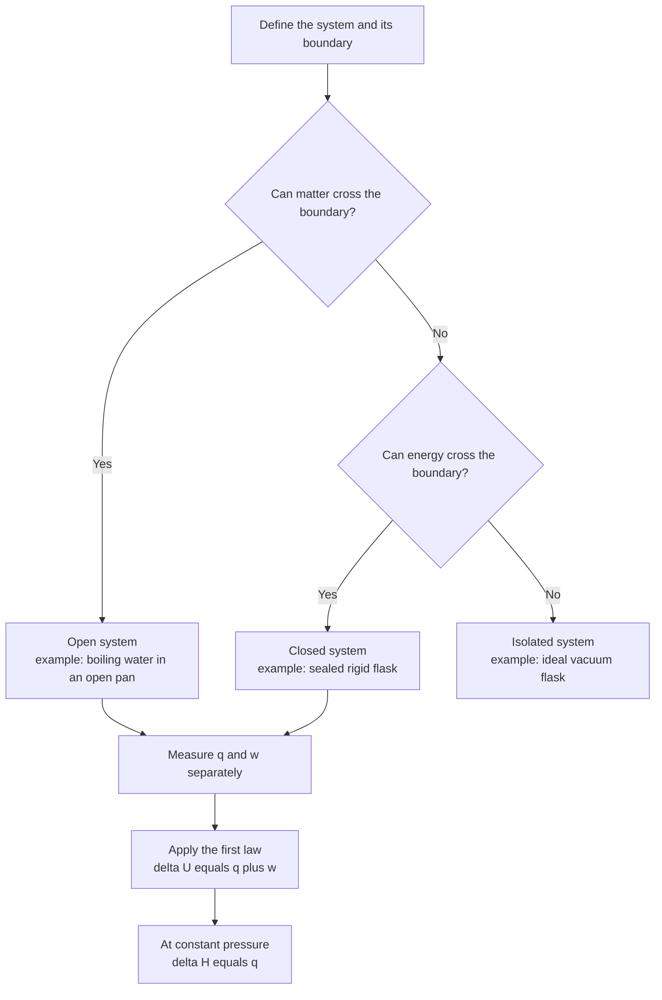
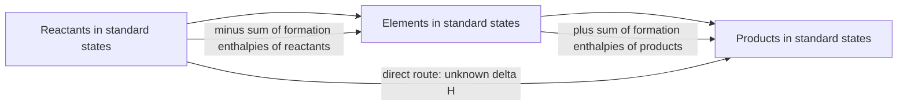
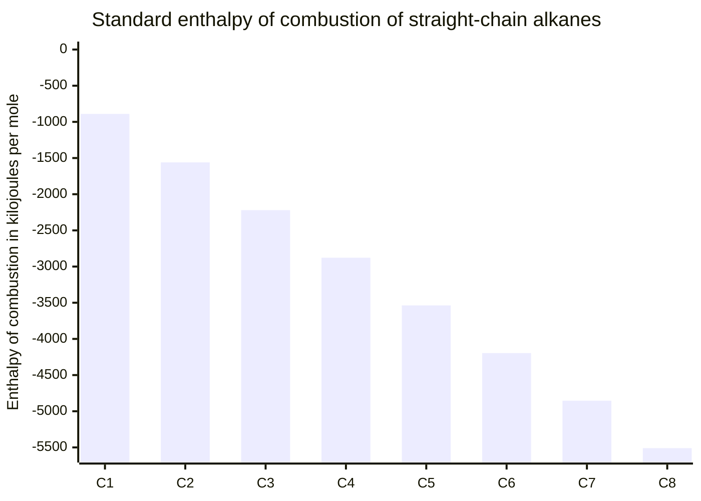
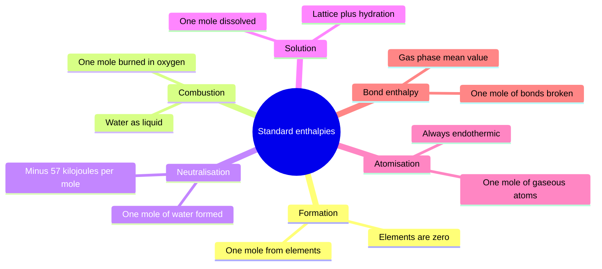
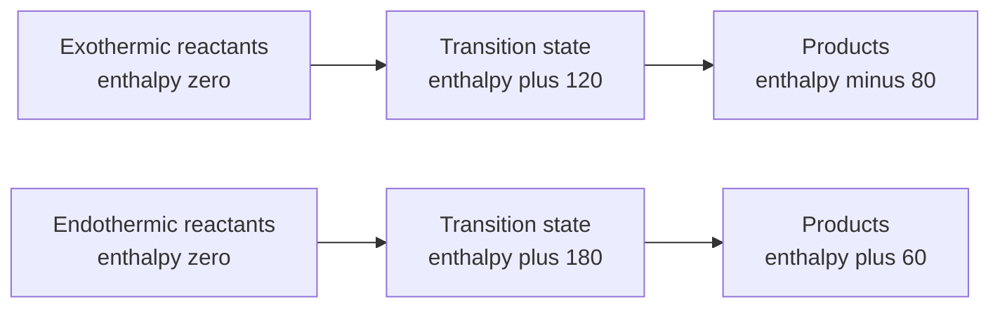

# Chapter 8 — Thermochemistry and Enthalpy

> **Level:** Intermediate (Level 2)
> **Estimated study time:** 8 hours (5 h reading + 3 h exercises)
> **Prerequisites:** [Chapter 1 — What Is Chemistry?](../01-foundations/01-what-is-chemistry.md); [Chapter 1 — Atomic Structure](../02-elementary-chemistry/01-atomic-structure.md); [Intermolecular Forces](05-intermolecular-forces.md)
> **Related chapters:** [Intermolecular Forces](05-intermolecular-forces.md), [Hybridization and Molecular Polarity](07-hybridization-and-molecular-polarity.md), [Reaction Rates](09-reaction-rates.md)
> **Difficulty:** ★★★★☆ (4/5)

---

## 1. Learning Objectives

After working through this chapter you will be able to:

- Define a thermodynamic system and classify it as open, closed or isolated, giving an example of each.
- Distinguish state functions from path functions and explain why the distinction matters for energy accounting.
- State the first law of thermodynamics in the IUPAC sign convention, $\Delta U = q + w$, and apply it to expansion and compression work.
- Define enthalpy, show that $\Delta H = q_p$ under constant pressure, and explain why chemists use enthalpy rather than internal energy.
- Interpret energy-level and reaction-coordinate diagrams, identifying exothermic and endothermic directions and the activation energy.
- Perform coffee-cup and bomb calorimetry calculations with $q = mc\Delta T$, including the correction from $\Delta U$ to $\Delta H$ for reactions that change the number of gas moles.
- Define and use standard enthalpies of formation, combustion, neutralisation, solution, atomisation and bond enthalpy, with correct standard-state conventions.
- Apply Hess's law using cycles and algebraic combination of equations.
- Calculate reaction enthalpies from tabulated formation enthalpies and from bond enthalpies, and explain why the bond-enthalpy route is approximate.
- State the assumptions behind each calculation and estimate the error introduced when an assumption fails.

---

## 2. Introduction

Every chemical reaction either releases energy or absorbs it. The combustion of methane releases $890\ \text{kJ}$ per mole; the decomposition of calcium carbonate absorbs $178\ \text{kJ}$ per mole; the dissolution of ammonium nitrate absorbs $25.7\ \text{kJ}$ per mole, which is why an instant cold pack works. These numbers are not incidental. They determine whether a process can be made to run at all, how much fuel a rocket needs, whether a fertilizer will burn a crop, and how much energy a cell can extract from a molecule of glucose.

Thermochemistry is the branch of thermodynamics that deals with these energy changes. Its central abstraction is the **system** — the part of the universe under study — separated from its **surroundings** by a boundary. Energy crosses that boundary as **heat** or as **work**, and the first law says that the total is conserved. Everything else in the chapter is bookkeeping built on that conservation law.

The bookkeeping has one significant complication: most chemical reactions are carried out at constant pressure (in an open beaker, under the atmosphere) rather than at constant volume. The heat measured at constant pressure is not the same as the change in internal energy, because the system does work on the atmosphere as it expands. Chemists therefore define a new state function, **enthalpy** $H = U + pV$, whose change at constant pressure is exactly the heat exchanged. That is why nearly every tabulated thermochemical quantity is an enthalpy change.

The chapter also develops the practical craft of the subject. You will learn to run a calorimetry experiment and to correct for the heat capacity of the apparatus, to combine tabulated enthalpies using Hess's law, and to estimate a reaction enthalpy from bond enthalpies when no formation data are available. You will also learn where each method is approximate, because a calculation whose assumptions are unstated is not a calculation but a guess.

Chapter [9](09-reaction-rates.md) takes up the complementary question: thermochemistry says whether a reaction releases energy and how much, but it says nothing about how fast it goes. A mixture of hydrogen and oxygen is thermodynamically unstable at room temperature and will sit unchanged for years. That gap between thermodynamics and kinetics is the subject of the next chapter.

---

## 3. Fundamental Concepts

### 3.1 System and surroundings

The **system** is the specified part of the universe being studied: the reactants in a flask, the gas in a cylinder, the contents of a calorimeter. The **surroundings** are everything else. The **boundary** separates them and determines what can cross it.

| System type | Matter crosses boundary? | Energy crosses boundary? | Example |
|---|---|---|---|
| Open | Yes | Yes | Water boiling in an open pan |
| Closed | No | Yes | Water boiling in a sealed, rigid flask |
| Isolated | No | No | Contents of a perfect vacuum flask |

A **closed** system is the standard model for a chemical reaction: no atoms enter or leave, but heat can. An isolated system is an idealization; no real flask is perfectly insulating, and the best laboratory vacuum flasks lose of order $1\,\%$ of their heat per hour.

The **universe** is the system plus its surroundings, and it is by definition isolated.

### 3.2 State functions and path functions

A **state function** depends only on the current state of the system, not on how that state was reached. Internal energy $U$, enthalpy $H$, temperature $T$, pressure $p$, volume $V$, entropy $S$ and Gibbs energy $G$ are state functions. Their changes are written $\Delta U$, $\Delta H$ and so on, and they obey

$$
\Delta U = U_{\text{final}} - U_{\text{initial}}
$$

regardless of the route.

A **path function** depends on the route taken. **Heat** $q$ and **work** $w$ are path functions: the same overall change of state can be achieved with different amounts of heat and work, provided the sum $q + w$ is the same.

| Quantity | Type | Symbol | SI unit |
|---|---|---|---|
| Internal energy | State function | $U$ | J |
| Enthalpy | State function | $H$ | J |
| Entropy | State function | $S$ | J K⁻¹ |
| Heat | Path function | $q$ | J |
| Work | Path function | $w$ | J |

The practical consequence is that $\Delta H$ can be evaluated by any convenient route, which is exactly what Hess's law exploits. Heat and work cannot be treated that way.

### 3.3 Internal energy, heat and work

The **internal energy** $U$ is the sum of all kinetic and potential energies of the particles in the system. It has no absolute value — only differences are measurable — and it is conventionally set to zero at some reference state.

The **first law of thermodynamics** states that the change in internal energy equals the heat added to the system plus the work done on the system:

$$
\Delta U = q + w
$$

This is the **IUPAC sign convention**, and it is the one used throughout this repository:

- $q > 0$: heat flows **into** the system (endothermic from the system's point of view).
- $q < 0$: heat flows **out** of the system.
- $w > 0$: work is done **on** the system (compression).
- $w < 0$: work is done **by** the system (expansion).

For expansion against a constant external pressure,

$$
w = -p_{\text{ext}}\,\Delta V
$$

so a gas that expands ($\Delta V > 0$) does negative work, meaning it loses energy to the surroundings.

**A warning about conventions.** Some older textbooks, and much of the engineering literature, write $\Delta U = q - w$ with $w$ defined as work done *by* the system. The physics is identical; the sign of the $w$ term is opposite. Always check which convention a source uses before substituting numbers.

### 3.4 Enthalpy

Most reactions are run at constant pressure. Under those conditions the work term is $w = -p\Delta V$, so

$$
\Delta U = q_p - p\Delta V
$$

Rearranging,

$$
q_p = \Delta U + p\Delta V
$$

Define the **enthalpy**:

$$
H = U + pV
$$

Since $U$, $p$ and $V$ are all state functions, $H$ is a state function. At constant pressure,

$$
\Delta H = \Delta U + p\Delta V = q_p
$$

**The heat exchanged at constant pressure is the enthalpy change.** That single result is why enthalpy, rather than internal energy, is the working quantity of thermochemistry.

### 3.5 Exothermic and endothermic

A reaction is **exothermic** if $\Delta H < 0$: the system loses enthalpy to the surroundings, which warm up. It is **endothermic** if $\Delta H > 0$: the system gains enthalpy from the surroundings, which cool.

| Process | $\Delta H$ / $\text{kJ mol}^{-1}$ | Classification |
|---|---|---|
| $\ce{CH4(g) + 2O2(g) -> CO2(g) + 2H2O(l)}$ | $-890.3$ | Exothermic |
| $\ce{N2(g) + 3H2(g) -> 2NH3(g)}$ | $-92.4$ | Exothermic |
| $\ce{CaCO3(s) -> CaO(s) + CO2(g)}$ | $+178.3$ | Endothermic |
| $\ce{NH4NO3(s) ->[H2O] NH4+(aq) + NO3-(aq)}$ | $+25.7$ | Endothermic |

Exothermic reactions are not automatically spontaneous, and endothermic reactions are not automatically non-spontaneous. The dissolution of ammonium nitrate is endothermic and spontaneous; the combustion of methane is exothermic and spontaneous; the melting of ice above $0\ ^\circ\text{C}$ is endothermic and spontaneous. Spontaneity depends on the Gibbs energy, $\Delta G = \Delta H - T\Delta S$, which is treated in the advanced sequence. Enthalpy alone is not enough.

### 3.6 Standard states and standard enthalpy changes

A **standard state** is a precisely defined reference condition:

- For a gas: the pure gas at a pressure of $1\ \text{bar}$ ($10^{5}\ \text{Pa}$), behaving ideally.
- For a pure liquid or solid: the pure substance at $1\ \text{bar}$.
- For a solute: a concentration of $1\ \text{mol dm}^{-3}$ at $1\ \text{bar}$, with the behaviour of infinite dilution.
- For an element: the most stable allotrope at $1\ \text{bar}$ and the specified temperature; for carbon this is graphite, for sulfur it is rhombic sulfur, for phosphorus it is white phosphorus, and for oxygen it is $\ce{O2(g)}$.

A **standard enthalpy change** $\Delta H^\circ$ is the enthalpy change for a process in which reactants and products are in their standard states. The superscript $\circ$ denotes the standard state, not a fixed temperature; most tabulated values refer to $298.15\ \text{K}$, and the temperature must always be quoted.

The standard pressure was $1\ \text{atm}$ ($101\,325\ \text{Pa}$) until IUPAC changed it to exactly $1\ \text{bar}$ ($100\,000\ \text{Pa}$) in 1982. The difference is $1.3\,\%$ and is negligible for condensed phases, but it matters when a gas is involved.

### 3.7 Key terms

| Term | Working definition |
|---|---|
| System | The part of the universe under study |
| State function | Property depending only on the current state, not on the path |
| Internal energy | Total kinetic and potential energy of the particles in a system |
| Enthalpy | $H = U + pV$; heat exchanged at constant pressure |
| Standard state | 1 bar, pure substance, specified temperature |
| Standard enthalpy of formation | Enthalpy change when one mole of a compound forms from its elements in their standard states |
| Hess's law | The enthalpy change of a reaction is independent of the route taken |
| Calorimetry | Experimental measurement of heat exchanged |

---

## 4. Detailed Scientific Explanation

### 4.1 The first law in practice

The first law is a statement of energy conservation, but its practical content comes from the fact that $q$ and $w$ are separately measurable while $\Delta U$ is not. A gas expanding into a vacuum does no work ($p_{\text{ext}} = 0$), so if it is thermally insulated, $q = 0$ and $w = 0$, and $\Delta U = 0$. A gas expanding against a piston does work, so if it is insulated its temperature falls.

**Worked thought experiment.** One mole of an ideal gas expands isothermally and reversibly from $1.00\ \text{dm}^{3}$ to $2.00\ \text{dm}^{3}$ at $298\ \text{K}$. For an isothermal change of an ideal gas $\Delta U = 0$, so $q = -w$, and the reversible work is

$$
w_{\text{rev}} = -nRT\ln\!\left(\frac{V_2}{V_1}\right) = -1 \times 8.314 \times 298 \times \ln 2 = -1.72\ \text{kJ}
$$

so $q = +1.72\ \text{kJ}$. The gas absorbs $1.72\ \text{kJ}$ of heat and converts all of it into work. The sign convention is doing real work here: negative work means the gas did work on the surroundings, and the positive heat means it absorbed exactly that much energy to compensate.

### 4.2 Enthalpy at constant pressure

The relation $\Delta H = \Delta U + \Delta(pV)$ is exact. For a reaction involving gases, $pV = nRT$, so at constant temperature

$$
\Delta H = \Delta U + \Delta n_{\text{g}}RT
$$

where $\Delta n_{\text{g}}$ is the change in the number of moles of gas,

$$
\Delta n_{\text{g}} = \sum n_{\text{gas, products}} - \sum n_{\text{gas, reactants}}
$$

The correction is small — a few $\text{kJ mol}^{-1}$ — but it is not negligible when an answer is required to three significant figures, and it is essential when comparing a bomb-calorimetry result (constant volume, gives $\Delta U$) with a tabulated $\Delta H$.

### 4.3 Heat capacity and calorimetry

The **heat capacity** $C$ of a body is the heat required to raise its temperature by one kelvin:

$$
C = \frac{q}{\Delta T}
$$

The **specific heat capacity** $c$ is the heat capacity per unit mass, and the **molar heat capacity** $C_m$ is the heat capacity per mole:

$$
q = mc\Delta T \qquad\text{or}\qquad q = nC_m\Delta T
$$

| Substance | $c$ / $\text{J g}^{-1}\ \text{K}^{-1}$ | $C_m$ / $\text{J mol}^{-1}\ \text{K}^{-1}$ |
|---|---|---|
| Water (liquid) | $4.184$ | $75.3$ |
| Ethanol | $2.44$ | $112$ |
| Aluminium | $0.897$ | $24.2$ |
| Iron | $0.449$ | $25.1$ |

The near-constancy of $C_m$ for solid metals at room temperature — all close to $25\ \text{J mol}^{-1}\ \text{K}^{-1}$ — is the **Dulong–Petit law**, and it is a useful sanity check on a measurement.

**Coffee-cup calorimetry.** A polystyrene cup with a lid is an adequate constant-pressure calorimeter for reactions in solution. The heat evolved or absorbed is calculated from the temperature change of the solution, which is usually assumed to have the specific heat capacity of water:

$$
q_{\text{reaction}} = -q_{\text{solution}} = -m_{\text{solution}}\,c\,\Delta T
$$

The negative sign appears because the heat gained by the solution is lost by the reaction.

**Bomb calorimetry.** A **bomb calorimeter** is a heavy steel vessel filled with oxygen, immersed in a known mass of water, in which the sample is ignited electrically. The reaction occurs at constant **volume**, so the measured heat is $\Delta U$, not $\Delta H$. The heat capacity of the whole apparatus, $C_{\text{cal}}$, is determined by burning a standard substance (usually benzoic acid) and must be measured for each instrument:

$$
q_{\text{released}} = -C_{\text{cal}}\,\Delta T
$$

and then $\Delta H = \Delta U + \Delta n_{\text{g}}RT$.

### 4.4 The standard enthalpy changes

Six standard enthalpies are used repeatedly, and each has a precise definition that must be respected.

**Standard enthalpy of formation**, $\Delta H^\circ_{\text{f}}$: the enthalpy change when **one mole** of a compound is formed from its elements in their standard states. By definition, $\Delta H^\circ_{\text{f}}$ of an element in its standard state is zero. Values are usually negative for stable compounds, because forming bonds releases energy.

| Compound | $\Delta H^\circ_{\text{f}}$ / $\text{kJ mol}^{-1}$ |
|---|---|
| $\ce{H2O(l)}$ | $-285.8$ |
| $\ce{H2O(g)}$ | $-241.8$ |
| $\ce{CO2(g)}$ | $-393.5$ |
| $\ce{CH4(g)}$ | $-74.8$ |
| $\ce{C2H6(g)}$ | $-84.7$ |
| $\ce{C2H4(g)}$ | $+52.3$ |
| $\ce{C2H5OH(l)}$ | $-277.7$ |
| $\ce{NH3(g)}$ | $-46.1$ |
| $\ce{NaCl(s)}$ | $-411.2$ |
| $\ce{CaCO3(s)}$ | $-1206.9$ |
| $\ce{CaO(s)}$ | $-635.1$ |
| $\ce{CuO(s)}$ | $-157.3$ |

**Standard enthalpy of combustion**, $\Delta H^\circ_{\text{c}}$: the enthalpy change when **one mole** of a substance burns completely in oxygen, with all reactants and products in their standard states. Water is liquid as a product, and carbon goes to $\ce{CO2(g)}$; nitrogen goes to $\ce{N2(g)}$, sulfur to $\ce{SO2(g)}$, and the halogens to their hydrogen halides in aqueous solution.

**Standard enthalpy of neutralisation**: the enthalpy change when one mole of water is formed by the reaction of an acid with a base in dilute aqueous solution. For a strong acid and a strong base it is essentially constant:

$$
\ce{H+(aq) + OH-(aq) -> H2O(l)} \qquad \Delta H^\circ = -57.1\ \text{kJ mol}^{-1}
$$

The constancy is evidence that strong acids and bases are fully ionized, so the only reaction occurring is the combination of hydrogen and hydroxide ions.

**Standard enthalpy of solution**: the enthalpy change when one mole of a substance dissolves in a large excess of solvent. It is the sum of the lattice enthalpy (endothermic, breaking the crystal) and the hydration enthalpy (exothermic, forming ion–dipole interactions).

**Standard enthalpy of atomisation**, $\Delta H^\circ_{\text{at}}$: the enthalpy change when one mole of gaseous atoms is formed from the element in its standard state. It is always endothermic, because bonds are broken.

Typical values are $+218\ \text{kJ mol}^{-1}$ for $\ce{H2(g) -> 2H(g)}$, $+107$ for $\ce{Na(s) -> Na(g)}$, $+122$ for $\ce{Cl2(g) -> 2Cl(g)}$ and $+717$ for $\ce{C(graphite) -> C(g)}$.

**Bond enthalpy**: the mean enthalpy required to break one mole of a particular bond in the gas phase. For a diatomic molecule it equals the atomisation enthalpy; for a polyatomic molecule it is an average over many compounds. Values are always positive (breaking bonds costs energy).

| Bond | Mean bond enthalpy / $\text{kJ mol}^{-1}$ |
|---|---|
| $\ce{H-H}$ | $436$ |
| $\ce{Cl-Cl}$ | $242$ |
| $\ce{H-Cl}$ | $431$ |
| $\ce{C-H}$ | $413$ |
| $\ce{C-C}$ | $348$ |
| $\ce{C=C}$ | $614$ |
| $\ce{C#C}$ | $839$ |
| $\ce{O-H}$ | $463$ |
| $\ce{O=O}$ | $498$ |
| $\ce{N#N}$ | $941$ |

### 4.5 Hess's law

**Hess's law** states that the enthalpy change of a reaction is independent of the route by which the reaction occurs, provided the initial and final states are the same. It is a direct consequence of enthalpy being a state function.

The law is used in three ways.

**Algebraic combination.** If a reaction can be written as the sum of two or more others, its $\Delta H$ is the sum of their $\Delta H$ values. When an equation is reversed, its $\Delta H$ changes sign; when it is multiplied, its $\Delta H$ is multiplied by the same factor.

**Formation route.** Any reaction can be decomposed into (i) decomposition of the reactants into elements and (ii) formation of the products from those elements. This gives the most useful formula in the chapter:

$$
\Delta H^\circ_{\text{rxn}} = \sum \nu\,\Delta H^\circ_{\text{f}}(\text{products}) - \sum \nu\,\Delta H^\circ_{\text{f}}(\text{reactants})
$$

where $\nu$ are the stoichiometric coefficients from the balanced equation. The formula is exact, provided the tabulated values are at the same temperature and the species are in the states specified.

**Bond-enthalpy route.** For a gas-phase reaction, the enthalpy change can be estimated as bonds broken minus bonds formed:

$$
\Delta H \approx \sum \text{BE(bonds broken)} - \sum \text{BE(bonds formed)}
$$

This is approximate because bond enthalpies are averages over many different molecular environments.

### 4.6 Why bond enthalpies are approximate

A $\ce{C-H}$ bond enthalpy of $413\ \text{kJ mol}^{-1}$ is a mean over methane, ethane, propane, benzene, and hundreds of other compounds. The actual strength of a particular $\ce{C-H}$ bond depends on what else is attached to the carbon, because the other substituents change the electron distribution and the hybridization.

Two consequences follow:

- **Bond enthalpies cannot reproduce $\Delta H^\circ_{\text{f}}$ exactly.** Methane's formation enthalpy can be calculated from bond enthalpies as $4(413) - 2(498) = 1652 - 996 = +656\ \text{kJ mol}^{-1}$ for atomizing, then reassembling — the arithmetic is only approximately consistent with the tabulated $-74.8$.
- **The error is systematic, not random.** Bond-enthalpy estimates for reactions involving strained rings, conjugated systems or highly polar bonds can be wrong by $20\text{–}50\ \text{kJ mol}^{-1}$.

The method remains valuable because it is the only one available when formation data are missing, and because the error is usually small enough to answer a qualitative question such as "is this reaction exothermic?".

### 4.7 Reaction-coordinate diagrams

A **reaction-coordinate diagram** plots enthalpy against the extent of reaction. It shows:

- the **enthalpy of reaction** $\Delta H$, the difference between the product and reactant levels;
- the **activation energy** $E_a$, the height of the barrier between reactants and products;
- the **transition state**, the highest point on the path, which is not an isolable species.

For an exothermic reaction the products lie below the reactants and $E_a$ is measured from the reactant level. For an endothermic reaction the products lie above the reactants, and the reverse reaction has the smaller barrier. The barrier height is a kinetic quantity and is discussed in Chapter [9](09-reaction-rates.md); the level difference is a thermodynamic one. Confusing the two is one of the commonest errors in the subject.

---

## 5. Visual Diagrams

**Figure 8.1 — Classifying a system and applying the first law.** The two questions at the top determine which variables may change, and therefore which measurements are possible. In an open system both mass and energy flow, so a full accounting needs a flow calorimeter; in a closed system the mass is fixed and $q$ and $w$ are the only energy channels. The final node records the special case that makes enthalpy the working quantity of chemistry: at constant pressure the heat measured is the enthalpy change directly.

**Figure 8.2 — The formation route that underlies Hess's law.** The direct route from reactants to products is the reaction of interest. The indirect route passes through the elements, which by definition have zero enthalpy of formation. Because enthalpy is a state function, the direct route equals the sum of the two indirect legs, which gives $\Delta H^\circ_{\text{rxn}} = \sum\nu\Delta H^\circ_{\text{f}}(\text{products}) - \sum\nu\Delta H^\circ_{\text{f}}(\text{reactants})$. The same triangle is used for Born–Haber cycles, with lattice enthalpy, ionization energy and electron affinity replacing the formation terms.

**Figure 8.3 — Enthalpy of combustion increases linearly with chain length.** Each additional $\ce{CH2}$ group contributes about $-650\ \text{kJ mol}^{-1}$, which is the net enthalpy of burning one carbon and two hydrogens to $\ce{CO2}$ and $\ce{H2O}$. The linearity is a good example of a group-contribution principle: the enthalpy of a large molecule can be estimated by summing the contributions of its fragments, and the deviation from linearity is small for unstrained, non-conjugated hydrocarbons.

**Figure 8.4 — The six standard enthalpy changes and their defining conditions.** Each branch differs from the others in the *quantity of substance* specified and in the *states* of the species involved, and both are part of the definition. A calculation that mixes, for example, a formation enthalpy of $\ce{H2O(g)}$ with an equation in which water is liquid will be wrong by $44\ \text{kJ mol}^{-1}$, which is the enthalpy of vaporization. Reading the definition before substituting a number is not pedantry; it is the main defence against sign and state errors.

**Figure 8.5 — Reaction-coordinate diagrams for an exothermic and an endothermic reaction.** The vertical axis is enthalpy and the horizontal axis is the extent of reaction, so the height of each node is its enthalpy. In the upper chain the products lie $80\ \text{kJ mol}^{-1}$ below the reactants, so $\Delta H = -80\ \text{kJ mol}^{-1}$ and the forward barrier is $120\ \text{kJ mol}^{-1}$. In the lower chain the products lie $60\ \text{kJ mol}^{-1}$ above the reactants, so $\Delta H = +60\ \text{kJ mol}^{-1}$ and the *reverse* barrier is only $120\ \text{kJ mol}^{-1}$ — which is why an endothermic reaction is easier to drive backwards.

---

## 6. Mathematical Formulas

### 6.1 First law and enthalpy

$$
\Delta U = q + w, \qquad w = -p_{\text{ext}}\Delta V
$$

$$
H = U + pV, \qquad \Delta H = \Delta U + \Delta n_{\text{g}}RT
$$

| Symbol | Meaning | SI unit |
|---|---|---|
| $\Delta U$ | Change in internal energy | J |
| $q$ | Heat transferred to the system | J |
| $w$ | Work done on the system | J |
| $p_{\text{ext}}$ | External pressure | Pa |
| $\Delta V$ | Change in volume | m³ |
| $\Delta n_{\text{g}}$ | Change in moles of gas | dimensionless |
| $R$ | Gas constant, $8.314\,462$ | J K⁻¹ mol⁻¹ |
| $T$ | Thermodynamic temperature | K |

**Assumptions.** The gas is ideal, so $pV = nRT$; the pressure is constant; and no non-expansion work (electrical, mechanical) is done. The relation $\Delta H = \Delta U + \Delta n_{\text{g}}RT$ is exact for ideal gases and a very good approximation for real gases near ambient conditions.

### 6.2 Calorimetry

$$
q = mc\Delta T \qquad\text{or}\qquad q = nC_m\Delta T \qquad\text{or}\qquad q = C_{\text{cal}}\Delta T
$$

| Symbol | Meaning | SI unit |
|---|---|---|
| $q$ | Heat exchanged | J |
| $m$ | Mass | kg |
| $c$ | Specific heat capacity | J kg⁻¹ K⁻¹ |
| $C_{\text{cal}}$ | Heat capacity of the calorimeter | J K⁻¹ |
| $\Delta T$ | Temperature change | K |

**Assumptions.** No heat is lost to the surroundings; the calorimeter and its contents reach thermal equilibrium; the heat capacity of the calorimeter is constant over the temperature range; and the solution has the same specific heat capacity as pure water (a $1\text{–}2\,\%$ approximation for dilute solutions).

### 6.3 Hess's law and formation enthalpies

$$
\Delta H^\circ_{\text{rxn}} = \sum_{\text{products}} \nu\,\Delta H^\circ_{\text{f}} - \sum_{\text{reactants}} \nu\,\Delta H^\circ_{\text{f}}
$$

$$
\Delta H \approx \sum \text{BE(broken)} - \sum \text{BE(formed)}
$$

$$
\Delta H(T_2) = \Delta H(T_1) + \Delta C_p\,(T_2 - T_1)
$$

| Symbol | Meaning | SI unit |
|---|---|---|
| $\Delta H^\circ_{\text{rxn}}$ | Standard enthalpy of reaction | J mol⁻¹ |
| $\nu$ | Stoichiometric coefficient | dimensionless |
| $\Delta H^\circ_{\text{f}}$ | Standard enthalpy of formation | J mol⁻¹ |
| $\Delta C_p$ | Difference in heat capacity at constant pressure | J K⁻¹ mol⁻¹ |

**Assumptions.** All species are in their standard states at the same temperature; formation enthalpies are available for every species; bond enthalpies are transferable averages. The first two are exact within the data, the third introduces an error of typically $5\text{–}15\,\%$. The third formula is Kirchhoff's law, valid when $\Delta C_p$ is constant over the interval.

---

## 7. Chemical Equations

Combustion of methane, the standard example of an exothermic reaction:

$$
\ce{CH4(g) + 2O2(g) -> CO2(g) + 2H2O(l)} \qquad \Delta H^\circ = -890.3\ \text{kJ mol}^{-1}
$$

Complete combustion of ethanol, used as a fuel and as a calorimetry standard:

$$
\ce{C2H5OH(l) + 3O2(g) -> 2CO2(g) + 3H2O(l)} \qquad \Delta H^\circ = -1366.8\ \text{kJ mol}^{-1}
$$

Formation of water from its elements, the definition of a formation enthalpy:

$$
\ce{H2(g) + \frac{1}{2}O2(g) -> H2O(l)} \qquad \Delta H^\circ_{\text{f}} = -285.8\ \text{kJ mol}^{-1}
$$

Neutralisation of a strong acid by a strong base, written as the net ionic equation:

$$
\ce{H+(aq) + OH-(aq) -> H2O(l)} \qquad \Delta H^\circ = -57.1\ \text{kJ mol}^{-1}
$$

Dissolution of ammonium nitrate, the reaction behind the instant cold pack:

$$
\ce{NH4NO3(s) ->[H2O] NH4+(aq) + NO3-(aq)} \qquad \Delta H^\circ = +25.7\ \text{kJ mol}^{-1}
$$

Each equation is balanced in atoms, each carries its phase labels, and each enthalpy is quoted per mole of the first-named reactant with the specified product states. Changing water from liquid to gas in the methane equation would change the answer by $2 \times 44.0 = 88.0\ \text{kJ mol}^{-1}$, which is why phase labels are part of the data rather than decoration.

---

## 8. Worked Examples

### Worked Example 8.1 — Coffee-cup calorimetry of an endothermic dissolution

**Problem.** $4.00\ \text{g}$ of ammonium nitrate is dissolved in $50.0\ \text{g}$ of water in a polystyrene cup. The temperature falls from $22.0\ ^\circ\text{C}$ to $16.3\ ^\circ\text{C}$. Calculate the enthalpy of solution per mole of $\ce{NH4NO3}$.

**Strategy.** Assume the solution has the specific heat capacity of water and that its mass is the sum of the solute and solvent masses. The heat gained by the solution is lost by the dissolution, so $q_{\text{reaction}} = -q_{\text{solution}}$.

**Solution.**

$$
m_{\text{solution}} = 50.0\ \text{g} + 4.00\ \text{g} = 54.0\ \text{g}
$$

$$
\Delta T = 16.3 - 22.0 = -5.7\ \text{K}
$$

$$
q_{\text{solution}} = mc\Delta T = 54.0\ \text{g} \times 4.184\ \text{J g}^{-1}\ \text{K}^{-1} \times (-5.7\ \text{K})
$$

$$
q_{\text{solution}} = -1.29\times10^{3}\ \text{J} = -1.29\ \text{kJ}
$$

$$
q_{\text{reaction}} = +1.29\ \text{kJ}
$$

The amount of ammonium nitrate is

$$
n = \frac{4.00\ \text{g}}{80.04\ \text{g mol}^{-1}} = 0.0500\ \text{mol}
$$

$$
\Delta H_{\text{soln}} = \frac{+1.29\ \text{kJ}}{0.0500\ \text{mol}} = +25.8\ \text{kJ mol}^{-1}
$$

**Check.** The tabulated value is $+25.7\ \text{kJ mol}^{-1}$, so the result is correct to three significant figures. The sign is positive, consistent with the observed temperature *fall*: an endothermic process removes heat from the solution. A useful sanity check on the magnitude: $25.8\ \text{kJ mol}^{-1}$ is about half the enthalpy of vaporization of water, which is the right order for breaking an ionic lattice and replacing it with ion–dipole interactions.

### Worked Example 8.2 — Bomb calorimetry and the $\Delta U$ to $\Delta H$ correction

**Problem.** $0.5000\ \text{g}$ of benzoic acid, $\ce{C7H6O2}$, is burned in a bomb calorimeter with a total heat capacity of $5.62\ \text{kJ K}^{-1}$. The temperature rises by $2.35\ \text{K}$. Calculate $\Delta U$ and $\Delta H$ per mole of benzoic acid.

**Strategy.** The heat released is $C_{\text{cal}}\Delta T$; the reaction occurs at constant volume, so this gives $\Delta U$ directly. Then apply $\Delta H = \Delta U + \Delta n_{\text{g}}RT$ using the balanced combustion equation.

**Solution.**

$$
q_{\text{released}} = C_{\text{cal}}\Delta T = 5.62\ \text{kJ K}^{-1} \times 2.35\ \text{K} = 13.2\ \text{kJ}
$$

Per gram: $13.2/0.5000 = 26.4\ \text{kJ g}^{-1}$. Per mole:

$$
\Delta U = -26.4\ \text{kJ g}^{-1} \times 122.12\ \text{g mol}^{-1} = -3.22\times10^{3}\ \text{kJ mol}^{-1}
$$

The combustion equation is

$$
\ce{C7H6O2(s) + \frac{15}{2}O2(g) -> 7CO2(g) + 3H2O(l)}
$$

so $\Delta n_{\text{g}} = 7 - 7.5 = -0.5$. Then

$$
\Delta n_{\text{g}}RT = -0.5 \times 8.314\ \text{J K}^{-1}\ \text{mol}^{-1} \times 298\ \text{K} = -1.24\times10^{3}\ \text{J mol}^{-1} = -1.24\ \text{kJ mol}^{-1}
$$

$$
\Delta H = \Delta U + \Delta n_{\text{g}}RT = -3220 - 1.24 = -3.22\times10^{3}\ \text{kJ mol}^{-1}
$$

**Check.** The tabulated standard enthalpy of combustion of benzoic acid is $-3226.7\ \text{kJ mol}^{-1}$, and the calculation gives $-3221\ \text{kJ mol}^{-1}$ to four significant figures. The small remaining difference is the difference between the calorimeter's actual conditions and true standard states, plus the assumption that $\Delta H$ is constant between $298\ \text{K}$ and the slightly higher final temperature. The correction term is only $-1.24\ \text{kJ mol}^{-1}$, about $0.04\,\%$ — small, but larger than the precision of the measurement, so it cannot be ignored.

### Worked Example 8.3 — Hess's law by algebraic combination

**Problem.** Use the following data to calculate the standard enthalpy of formation of copper(II) oxide:

$$
\ce{CuO(s) + H2(g) -> Cu(s) + H2O(l)} \qquad \Delta H^\circ = -129\ \text{kJ mol}^{-1}
$$

$$
\ce{H2(g) + \frac{1}{2}O2(g) -> H2O(l)} \qquad \Delta H^\circ = -286\ \text{kJ mol}^{-1}
$$

**Strategy.** Reverse the first equation to put $\ce{CuO}$ on the right, then add the second equation so that $\ce{H2}$, $\ce{O2}$ and $\ce{H2O}$ cancel.

**Solution.** Reversing the first equation changes the sign of its enthalpy:

$$
\ce{Cu(s) + H2O(l) -> CuO(s) + H2(g)} \qquad \Delta H^\circ = +129\ \text{kJ mol}^{-1}
$$

Adding the second equation:

$$
\ce{H2(g) + \frac{1}{2}O2(g) -> H2O(l)} \qquad \Delta H^\circ = -286\ \text{kJ mol}^{-1}
$$

Summing, $\ce{H2O(l)}$ and $\ce{H2(g)}$ appear on both sides and cancel:

$$
\ce{Cu(s) + \frac{1}{2}O2(g) -> CuO(s)} \qquad \Delta H^\circ = 129 - 286 = -157\ \text{kJ mol}^{-1}
$$

**Check.** The tabulated $\Delta H^\circ_{\text{f}}$ of $\ce{CuO(s)}$ is $-157.3\ \text{kJ mol}^{-1}$, and the result matches to three significant figures. An independent check is the formation-enthalpy formula: $-157.3 = [-157.3 + (-285.8)] - [-285.8]$, which is trivially consistent — confirming that the arithmetic has not double-counted either equation.

### Worked Example 8.4 — Reaction enthalpy from formation enthalpies

**Problem.** Calculate the standard enthalpy of combustion of ethanol from tabulated formation enthalpies: $\Delta H^\circ_{\text{f}}(\ce{C2H5OH(l)}) = -277.7$, $\Delta H^\circ_{\text{f}}(\ce{CO2(g)}) = -393.5$ and $\Delta H^\circ_{\text{f}}(\ce{H2O(l)}) = -285.8\ \text{kJ mol}^{-1}$.

**Strategy.** Write the balanced combustion equation, then apply $\Delta H^\circ_{\text{rxn}} = \sum\nu\Delta H^\circ_{\text{f}}(\text{products}) - \sum\nu\Delta H^\circ_{\text{f}}(\text{reactants})$. Oxygen is an element in its standard state, so its formation enthalpy is zero.

**Solution.**

$$
\ce{C2H5OH(l) + 3O2(g) -> 2CO2(g) + 3H2O(l)}
$$

$$
\Delta H^\circ_{\text{rxn}} = \left[2(-393.5) + 3(-285.8)\right] - \left[(-277.7) + 3(0)\right]
$$

$$
= \left[-787.0 - 857.4\right] + 277.7
$$

$$
= -1644.4 + 277.7 = -1366.7\ \text{kJ mol}^{-1}
$$

**Check.** The tabulated value is $-1366.8\ \text{kJ mol}^{-1}$, so the agreement is to five significant figures. A second check is dimensional: the answer is per mole of ethanol, and the coefficients used (2 and 3) are the moles of each product formed from one mole of ethanol, which is exactly the definition required. A common error is to forget the coefficient 3 on water, which would give $-1080.6\ \text{kJ mol}^{-1}$ — a $21\,\%$ error that a rough order-of-magnitude estimate would not catch.

### Worked Example 8.5 — Bond-enthalpy calculation and its error

**Problem.** Estimate the enthalpy of hydrogenation of ethene using mean bond enthalpies, and compare with the value obtained from formation enthalpies ($\Delta H^\circ_{\text{f}}(\ce{C2H4}) = +52.3$ and $\Delta H^\circ_{\text{f}}(\ce{C2H6}) = -84.7\ \text{kJ mol}^{-1}$).

**Strategy.** Count the bonds broken and formed in $\ce{C2H4 + H2 -> C2H6}$, then apply $\Delta H \approx \sum\text{BE(broken)} - \sum\text{BE(formed)}$.

**Solution.** Bonds broken: one $\ce{C=C}$ ($614$) and one $\ce{H-H}$ ($436$). Bonds formed: one $\ce{C-C}$ ($348$) and two $\ce{C-H}$ ($413$ each).

$$
\Delta H \approx (614 + 436) - (348 + 2 \times 413)
$$

$$
= 1050 - (348 + 826) = 1050 - 1174 = -124\ \text{kJ mol}^{-1}
$$

From formation enthalpies:

$$
\Delta H = -84.7 - 52.3 = -137.0\ \text{kJ mol}^{-1}
$$

**Check.** The bond-enthalpy estimate is $13\ \text{kJ mol}^{-1}$ less exothermic than the thermochemical value, an error of about $9\,\%$. That is typical: mean bond enthalpies are averaged over many compounds, and the $\ce{C=C}$ value of $614\ \text{kJ mol}^{-1}$ is not the actual $\pi$ bond strength in ethene. Both values are negative and of similar magnitude, so the qualitative prediction — that hydrogenation is exothermic — is reliable even when the quantitative value is not.

---

## 9. Real-World Applications

**Energy supply and combustion.** The energy content of a fuel is its enthalpy of combustion. Natural gas ($\ce{CH4}$) delivers $50\ \text{MJ kg}^{-1}$, petrol about $44\ \text{MJ kg}^{-1}$, hydrogen $120\ \text{MJ kg}^{-1}$ — the last figure is why hydrogen is attractive as a fuel and why its storage is difficult. Power-station efficiency is the ratio of electrical output to the enthalpy released, and combined-cycle gas turbines reach about $60\,\%$.

**Food and nutrition.** The energy content of food is measured by bomb calorimetry and expressed in kilocalories or kilojoules. Carbohydrate and protein provide about $17\ \text{kJ g}^{-1}$, fat about $37\ \text{kJ g}^{-1}$, and ethanol $29\ \text{kJ g}^{-1}$. The Atwater factors that convert these gross values into metabolizable energy are themselves thermochemical corrections for incomplete digestion.

**Materials and metallurgy.** The extraction of a metal from its oxide is a thermochemical competition: a reducing agent must form a more stable oxide than the metal does. The Ellingham diagram plots $\Delta G^\circ$ of oxide formation against temperature, and the temperatures at which lines cross are those at which one metal can reduce another's oxide. The industrial blast furnace is a Hess's-law calculation operating at $1500\ ^\circ\text{C}$, and the endothermic calcination of limestone ($+178\ \text{kJ mol}^{-1}$) is a significant source of industrial $\ce{CO2}$.

**Cold packs and self-heating cans.** Instant cold packs use the endothermic dissolution of ammonium nitrate or urea; self-heating food cans use the exothermic hydration of calcium oxide or the oxidation of iron powder. Both are direct applications of the sign of $\Delta H_{\text{soln}}$.

**Battery and fuel-cell design.** The maximum electrical work available from a cell is the Gibbs energy change, not the enthalpy change, but the enthalpy sets the upper bound and the difference appears as heat. Lithium-ion cells are engineered partly to manage the heat released by parasitic reactions.

---

## 10. Common Mistakes

| Mistake | Why it happens | Correct approach |
|---|---|---|
| Reversing the sign convention for work | Older textbooks use $\Delta U = q - w$ | Use the IUPAC convention $\Delta U = q + w$ and state it explicitly |
| Omitting phase labels | Formulas are written without them by habit | Phase determines the enthalpy; $\ce{H2O(l)}$ and $\ce{H2O(g)}$ differ by $44\ \text{kJ mol}^{-1}$ |
| Using $\Delta H$ where $\Delta U$ was measured | Bomb calorimetry is constant volume | Apply $\Delta H = \Delta U + \Delta n_{\text{g}}RT$ |
| Treating the activation energy as $\Delta H$ | Both are vertical distances on a profile | $E_a$ is a kinetic barrier; $\Delta H$ is the reactant–product difference |
| Forgetting that elements have zero formation enthalpy | Every substance seems to need a value | $\Delta H^\circ_{\text{f}}$ of an element in its standard state is zero by definition |
| Adding enthalpies without scaling by stoichiometry | The coefficients look cosmetic | Multiply every $\Delta H$ by the coefficient in the balanced equation |

---

## 11. Chapter Summary

- A system exchanges matter and energy with its surroundings; it is open, closed or isolated according to which can cross the boundary.
- State functions depend only on the current state; heat and work are path functions whose sum is fixed by the first law.
- The first law in IUPAC form is $\Delta U = q + w$, with work done on the system positive and $w = -p_{\text{ext}}\Delta V$; enthalpy is $H = U + pV$, so at constant pressure $\Delta H = q_p$.
- Exothermic reactions have $\Delta H < 0$; endothermic reactions have $\Delta H > 0$; neither sign alone determines spontaneity.
- Calorimetry uses $q = mc\Delta T$ for constant-pressure work and $q = C_{\text{cal}}\Delta T$ for a bomb, followed by the $\Delta U \to \Delta H$ correction.
- Standard enthalpies of formation, combustion, neutralisation, solution, atomisation and bond enthalpy each have a precise definition that must be respected.
- Hess's law follows from enthalpy being a state function and gives $\Delta H^\circ_{\text{rxn}} = \sum\nu\Delta H^\circ_{\text{f}}(\text{products}) - \sum\nu\Delta H^\circ_{\text{f}}(\text{reactants})$.
- Bond-enthalpy estimates are approximate because bond enthalpies are averages, with typical errors of $5\text{–}15\,\%$.
- Reaction-coordinate diagrams separate the thermodynamic quantity $\Delta H$ from the kinetic quantity $E_a$.

---

## 12. Exercises

### 12.1 Conceptual questions

1. Distinguish a state function from a path function, and explain why Hess's law would fail if enthalpy were a path function.
2. Explain why $\Delta H$ rather than $\Delta U$ is tabulated for most reactions, and describe a situation in which $\Delta U$ would be the more natural quantity.
3. A student says that an exothermic reaction must be spontaneous. Give a counterexample and explain what additional thermodynamic quantity is required.
4. Why is the enthalpy of neutralisation of a strong acid by a strong base nearly constant at $-57.1\ \text{kJ mol}^{-1}$, whereas the neutralisation of a weak acid varies?

### 12.2 Basic problems

5. Classify each system as open, closed or isolated: (a) a sealed ampoule of reacting gas; (b) a beaker of water evaporating on a bench; (c) the contents of a perfect vacuum flask; (d) a plant photosynthesizing in a sealed glass chamber.
6. State the sign of $\Delta H$ for: (a) freezing water; (b) burning propane; (c) dissolving ammonium nitrate; (d) condensing steam; (e) decomposing calcium carbonate.
7. Calculate the heat required to raise the temperature of $250\ \text{g}$ of water from $20.0\ ^\circ\text{C}$ to $80.0\ ^\circ\text{C}$.
8. Write the formation equation for each of: (a) $\ce{NH3(g)}$; (b) $\ce{CaCO3(s)}$; (c) $\ce{C2H5OH(l)}$.

### 12.3 Intermediate problems

9. $1.00\ \text{g}$ of octane, $\ce{C8H18}$, is burned in a bomb calorimeter of heat capacity $9.20\ \text{kJ K}^{-1}$, and the temperature rises by $5.14\ \text{K}$. Calculate $\Delta U$ and $\Delta H$ per mole of octane.
10. Use Hess's law to calculate the enthalpy of the reaction $\ce{C(s) + \frac{1}{2}O2(g) -> CO(g)}$ from $\ce{C(s) + O2(g) -> CO2(g)}$ ($-393.5$) and $\ce{CO(g) + \frac{1}{2}O2(g) -> CO2(g)}$ ($-283.0\ \text{kJ mol}^{-1}$).
11. Calculate the enthalpy of combustion of methane from formation enthalpies and compare it with the value obtained from mean bond enthalpies. Account for the difference.
12. The lattice enthalpy of $\ce{KBr}$ is $-682\ \text{kJ mol}^{-1}$, the atomisation enthalpy of potassium is $+89$, the atomisation enthalpy of bromine is $+112$, the ionization energy of potassium is $+419$ and the electron affinity of bromine is $-325\ \text{kJ mol}^{-1}$. Calculate $\Delta H^\circ_{\text{f}}(\ce{KBr(s)})$.

### 12.4 Advanced problems

13. Explain why the bond-enthalpy route fails badly for the combustion of benzene, and state which additional thermochemical concept is needed.
14. A reaction has $\Delta H = -50\ \text{kJ mol}^{-1}$ and $\Delta S = -100\ \text{J K}^{-1}\ \text{mol}^{-1}$. Determine the temperature above which the reaction becomes non-spontaneous, and comment on the physical meaning of the sign of $\Delta S$.
15. Discuss why bomb-calorimetry results for reactions involving gases must be corrected before comparison with tabulated $\Delta H^\circ$ values, and estimate the size of the correction for the combustion of one mole of propane.

### 12.5 Calculation problems

16. $50.0\ \text{cm}^{3}$ of $1.00\ \text{mol dm}^{-3}$ hydrochloric acid is mixed with $50.0\ \text{cm}^{3}$ of $1.00\ \text{mol dm}^{-3}$ sodium hydroxide. The temperature rises from $21.0\ ^\circ\text{C}$ to $27.8\ ^\circ\text{C}$. Calculate the enthalpy of neutralisation, stating your assumptions.
17. Using $\Delta H^\circ_{\text{f}}(\ce{CO2}) = -393.5$, $\Delta H^\circ_{\text{f}}(\ce{H2O(l)}) = -285.8$ and $\Delta H^\circ_{\text{f}}(\ce{C3H8}) = -103.8\ \text{kJ mol}^{-1}$, calculate the enthalpy of combustion of propane and the mass of propane required to raise $5.00\ \text{kg}$ of water from $15.0\ ^\circ\text{C}$ to $100.0\ ^\circ\text{C}$, assuming $70\,\%$ efficiency.
18. Use mean bond enthalpies to estimate the enthalpy of the reaction $\ce{N2(g) + 3H2(g) -> 2NH3(g)}$ and compare with the accepted value of $-92.4\ \text{kJ mol}^{-1}$.

### 12.6 Answers

1. A state function depends only on the current state; a path function depends on the route. If enthalpy were a path function, different routes between the same initial and final states would give different $\Delta H$, and Hess's law would not hold.
2. Most reactions occur in open vessels at constant atmospheric pressure, where the measured heat is $\Delta H$. $\Delta U$ is more natural in a sealed rigid vessel, as in bomb calorimetry or in a reaction at constant volume.
3. The dissolution of ammonium nitrate is endothermic and spontaneous. Spontaneity requires the Gibbs energy change, $\Delta G = \Delta H - T\Delta S$, to be negative; a large positive entropy change can outweigh a positive $\Delta H$.
4. Strong acids and bases are fully ionized, so the only reaction is $\ce{H+ + OH- -> H2O}$ in every case. A weak acid is only partly ionized, so the measured enthalpy includes the endothermic enthalpy of ionization, and the value varies with the acid.
5. (a) closed; (b) open; (c) isolated (idealized); (d) closed (energy crosses as light, but matter does not).
6. (a) negative; (b) negative; (c) positive; (d) negative; (e) positive.
7. $q = 250 \times 4.184 \times 60.0 = 6.28\times10^{4}\ \text{J} = 62.8\ \text{kJ}$.
8. (a) $\ce{\frac{1}{2}N2(g) + \frac{3}{2}H2(g) -> NH3(g)}$; (b) $\ce{Ca(s) + C(s) + \frac{3}{2}O2(g) -> CaCO3(s)}$; (c) $\ce{2C(s) + 3H2(g) + \frac{1}{2}O2(g) -> C2H5OH(l)}$.
9. $q = 9.20 \times 5.14 = 47.3\ \text{kJ}$ for $1.00\ \text{g}$; per mole $\Delta U = -47.3 \times 114.23 = -5.40\times10^{3}\ \text{kJ mol}^{-1}$. With $\Delta n_{\text{g}} = 8 - 12.5 = -4.5$, $\Delta n_{\text{g}}RT = -11.2\ \text{kJ mol}^{-1}$, so $\Delta H \approx -5.41\times10^{3}\ \text{kJ mol}^{-1}$.
10. Reverse the second equation ($+283.0$) and add: $\Delta H = -393.5 + 283.0 = -110.5\ \text{kJ mol}^{-1}$.
11. From formation: $[-393.5 + 2(-285.8)] - (-74.8) = -890.3\ \text{kJ mol}^{-1}$. From bond enthalpies: $(2 \times 498 + 4 \times 413) - (2 \times 799 + 4 \times 463) = (996 + 1652) - (1598 + 1852) = 2648 - 3450 = -802\ \text{kJ mol}^{-1}$. The difference of about $88\ \text{kJ mol}^{-1}$ arises because the $\ce{C=O}$ bond enthalpy of $799$ refers to carbon dioxide and the $\ce{O-H}$ value is an average over many compounds; bond enthalpies are not consistent with formation data by construction.
12. $\Delta H^\circ_{\text{f}} = 89 + 112 + 419 - 325 - 682 = -387\ \text{kJ mol}^{-1}$.
13. Benzene is aromatic, so its actual enthalpy is lower than a localized Kekulé structure would predict by the resonance energy (about $150\ \text{kJ mol}^{-1}$). Bond enthalpies contain no information about aromatic stabilization, so the estimate is badly in error. The missing concept is resonance or delocalization energy.
14. $\Delta G = 0$ at $T = \Delta H/\Delta S = -50\,000/(-100) = 500\ \text{K}$. Above $500\ \text{K}$ the $-T\Delta S$ term dominates and $\Delta G$ becomes positive. The negative $\Delta S$ means the system becomes more ordered, which is unfavourable at high temperature.
15. The bomb measures $\Delta U$ at constant volume. For propane, $\ce{C3H8 + 5O2 -> 3CO2 + 4H2O}$, $\Delta n_{\text{g}} = 3 - 5 = -2$, so $\Delta n_{\text{g}}RT = -4.96\ \text{kJ mol}^{-1}$ at $298\ \text{K}$; $\Delta H$ is more negative than $\Delta U$ by about $5\ \text{kJ mol}^{-1}$.
16. $n = 0.0500\ \text{mol}$ of each; $m = 100.0\ \text{g}$; $\Delta T = 6.8\ \text{K}$; $q = 100.0 \times 4.18 \times 6.8 = 2.84\times10^{3}\ \text{J}$. $\Delta H = -2.84/0.0500 = -56.8\ \text{kJ mol}^{-1}$, assuming no heat loss, a solution heat capacity equal to that of water, and complete reaction.
17. $\Delta H^\circ_{\text{c}} = [3(-393.5) + 4(-285.8)] - (-103.8) = (-1180.5 - 1143.2) + 103.8 = -2220\ \text{kJ mol}^{-1}$. Required heat: $5.00 \times 4.184 \times 85.0 = 1.78\times10^{3}\ \text{kJ}$. At $70\,\%$ efficiency the fuel must supply $2.54\times10^{3}\ \text{kJ}$, so $n = 2.54\times10^{3}/2220 = 1.14\ \text{mol}$ and $m = 1.14 \times 44.10 = 50.4\ \text{g}$.
18. Bonds broken: $\ce{N#N}$ ($941$) plus three $\ce{H-H}$ ($3 \times 436 = 1308$), total $2249$. Bonds formed: six $\ce{N-H}$ ($6 \times 391 = 2346$). $\Delta H = 2249 - 2346 = -97\ \text{kJ mol}^{-1}$, within $5\,\%$ of the accepted $-92.4$.

> Worked solutions for this level are maintained in the `solutions/` directory of the level.

---

## 13. Further Reading

- Atkins, P.; de Paula, J.; Keeler, J. *Atkins' Physical Chemistry*, 11th ed., Oxford University Press. Chapters 2 and 3 give the rigorous treatment of the first law, enthalpy and thermochemistry.
- Atkins, P.; Jones, L. *Chemical Principles: The Quest for Insight*, 7th ed., W. H. Freeman. A more accessible development with extensive worked examples.
- Chase, M. W. *NIST-JANAF Thermochemical Tables*, 4th ed., American Institute of Physics, 1998. The standard compilation of formation enthalpies and heat capacities.
- IUPAC. *Quantities, Units and Symbols in Physical Chemistry* (the "Green Book"), 3rd ed., Royal Society of Chemistry, 2007. The authority on the sign convention and on standard-state definitions.
- OpenStax, *Chemistry 2e*, Rice University, Chapter 5 ("Thermochemistry"). <https://openstax.org/details/books/chemistry-2e>
- NIST. *CODATA Internationally Recommended Values of the Fundamental Physical Constants*. <https://physics.nist.gov/cuu/Constants/>
- IUPAC. *Compendium of Chemical Terminology* (the "Gold Book"), 2nd ed. (corrected version). <https://goldbook.iupac.org/>
- [CURRICULUM.md](../CURRICULUM.md) — where this chapter sits in the full programme.
- [REFERENCES.md](../REFERENCES.md) — the repository's verified source list.

> Only sources that can be checked are cited here. No DOI, page number or edition is invented.
