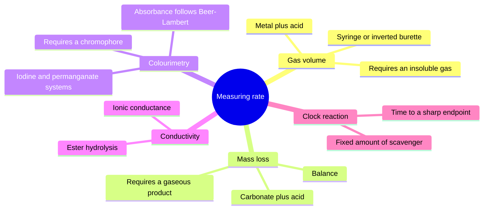
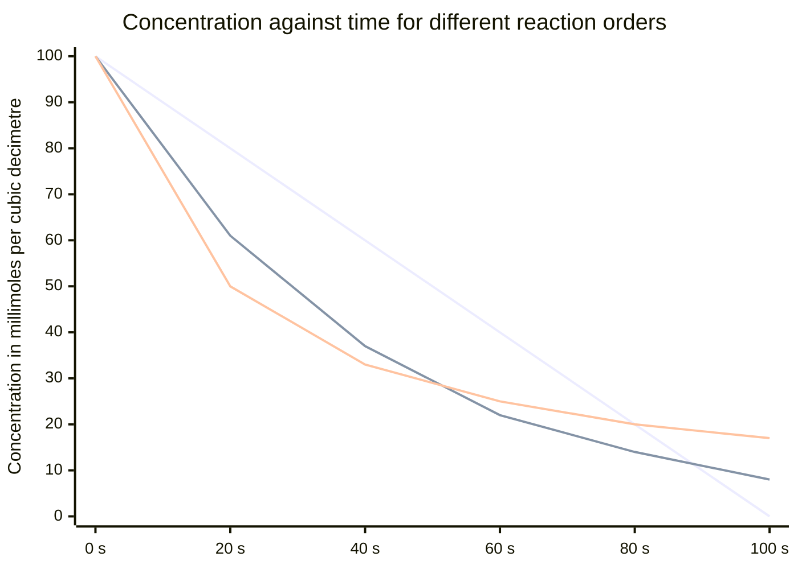
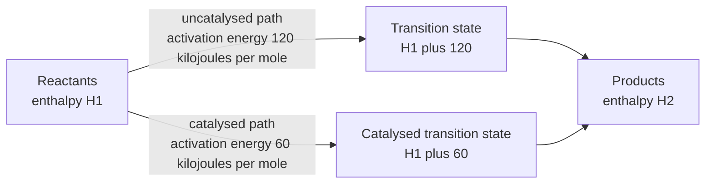

# Chapter 9 — Reaction Rates

> **Level:** Intermediate (Level 2)
> **Estimated study time:** 6 hours (4 h reading + 2 h exercises)
> **Prerequisites:** [Thermochemistry and Enthalpy](08-thermochemistry-and-enthalpy.md); Level 2 solution chemistry ([Level 2 overview](README.md)); [Chapter 1 — What Is Chemistry?](../01-foundations/01-what-is-chemistry.md)
> **Related chapters:** [Thermochemistry and Enthalpy](08-thermochemistry-and-enthalpy.md), [Intermolecular Forces](05-intermolecular-forces.md), [Hybridization and Molecular Polarity](07-hybridization-and-molecular-polarity.md)
> **Difficulty:** ★★★☆☆ (3/5)

---

## 1. Learning Objectives

After working through this chapter you will be able to:

- Define reaction rate as the change in concentration per unit time, and write a rate expression with the correct stoichiometric divisor for any species in a balanced equation.
- Distinguish average rate from instantaneous rate, and read both from a concentration–time graph.
- Explain collision theory in terms of orientation, activation energy and effective collisions, and state what fraction of collisions is effective.
- Draw and interpret a Maxwell–Boltzmann distribution, and use it to explain why a small temperature rise produces a large increase in rate.
- Explain mechanistically how concentration, pressure, surface area, temperature and a catalyst each affect the rate.
- Write rate equations for zero-, first- and second-order reactions, determine the order from experimental data, and derive the units of the rate constant.
- Use integrated rate laws and half-lives for zero-, first- and second-order reactions.
- Apply the Arrhenius equation to calculate activation energy from rate constants at two temperatures.
- Identify the rate-determining step in a proposed mechanism and show that the resulting rate law matches experiment.
- Describe the selection, operation and limitations of experimental methods for measuring rate, including gas volume, mass loss, colourimetry, conductivity and clock reactions.
- Distinguish homogeneous, heterogeneous and enzyme catalysis, and explain how a catalyst lowers the activation energy without changing $\Delta H$ or the equilibrium position.

---

## 2. Introduction

Thermochemistry answers the question "will this reaction release energy?". It does not answer "will it happen in this decade?". A mixture of hydrogen and oxygen is thermodynamically unstable with respect to water by $237\ \text{kJ mol}^{-1}$ of Gibbs energy, and yet a balloon filled with the mixture is stable indefinitely at room temperature until something supplies a spark. Diamond is thermodynamically less stable than graphite at ambient pressure, yet diamonds do not turn into pencil lead on human timescales. The missing half of the story is **kinetics**: the study of reaction rates and of the mechanisms by which reactions occur.

Kinetics matters commercially as much as thermodynamically. The Haber process is thermodynamically favourable at room temperature but so slow without a catalyst that it would take geological time to reach equilibrium; the industrial solution is to run at $450\ ^\circ\text{C}$ and $200\ \text{bar}$ over an iron catalyst, accepting a lower equilibrium yield to obtain an acceptable rate. A drug that is thermodynamically stable but metabolized in seconds is useless, and so is one that persists for decades. Food spoilage, corrosion, curing of concrete, setting of adhesives and the shelf life of every pharmaceutical are rate problems.

The subject has two levels. The **phenomenological** level measures how rate depends on concentration and temperature and summarizes the dependence in a rate equation and an Arrhenius activation energy. The **mechanistic** level proposes a sequence of elementary steps — bond-breaking, bond-making, electron transfer — that accounts for the observed rate law. This chapter develops both, with the phenomenological treatment first because it is what experiments give you.

Throughout, one caution governs the whole subject: a rate law is an empirical statement about a particular reaction under particular conditions. It cannot be deduced from the balanced equation. The reaction $\ce{2NO(g) + O2(g) -> 2NO2(g)}$ might be first order in oxygen, or second, or zero; only experiment decides. This is the sharpest difference between stoichiometry and kinetics, and it is the point on which most students lose marks.

---

## 3. Fundamental Concepts

### 3.1 Defining reaction rate

The **rate of reaction** is the change in concentration of a reactant or product per unit time. For a species with concentration $[\ce{X}]$ in $\text{mol dm}^{-3}$,

$$
\text{rate} = -\frac{\Delta[\ce{X}]}{\Delta t}\ \text{(reactant)} \qquad\text{or}\qquad \text{rate} = +\frac{\Delta[\ce{X}]}{\Delta t}\ \text{(product)}
$$

The negative sign for reactants makes the rate positive, since reactant concentrations fall.

For a general reaction

$$
\ce{aA + bB -> cC + dD}
$$

the stoichiometric coefficients allow a single rate for the whole reaction:

$$
\text{rate} = -\frac{1}{a}\frac{\Delta[\ce{A}]}{\Delta t} = -\frac{1}{b}\frac{\Delta[\ce{B}]}{\Delta t} = +\frac{1}{c}\frac{\Delta[\ce{C}]}{\Delta t} = +\frac{1}{d}\frac{\Delta[\ce{D}]}{\Delta t}
$$

Without the divisors, the "rate" measured for one species would differ from that measured for another purely because of the stoichiometry, which is a bookkeeping artefact rather than a chemical fact.

| Reaction | Expression for rate |
|---|---|
| $\ce{2N2O5 -> 4NO2 + O2}$ | $-\tfrac{1}{2}\Delta[\ce{N2O5}]/\Delta t = +\tfrac{1}{4}\Delta[\ce{NO2}]/\Delta t$ |
| $\ce{H2 + I2 -> 2HI}$ | $-\Delta[\ce{H2}]/\Delta t = +\tfrac{1}{2}\Delta[\ce{HI}]/\Delta t$ |
| $\ce{2H2O2 -> 2H2O + O2}$ | $-\tfrac{1}{2}\Delta[\ce{H2O2}]/\Delta t = +\Delta[\ce{O2}]/\Delta t$ |

### 3.2 Average and instantaneous rate

The **average rate** over a time interval is $\Delta[\ce{X}]/\Delta t$ between two measured points. The **instantaneous rate** is the slope of the tangent to the concentration–time curve at a particular instant:

$$
\text{rate}_{\text{inst}} = -\frac{\text{d}[\ce{X}]}{\text{d}t}
$$

Average and instantaneous rates differ because the rate itself changes as concentrations change. For most reactions the rate is highest at the start, when concentrations are highest, and falls as reactants are consumed. The initial rate, measured from the tangent at $t = 0$, is the most useful single number because it is unaffected by the accumulation of products.

**Simplification.** The measurement of an initial rate requires extrapolating a tangent to $t = 0$, which is noisy. In practice the initial rate is estimated from the first few per cent of conversion, and the error is dominated by the precision of the concentration measurement rather than by the extrapolation.

### 3.3 Collision theory

**Collision theory** proposes that a reaction occurs when molecules collide with (i) sufficient energy and (ii) a favourable orientation. Three consequences follow immediately.

**Not every collision is effective.** At ambient pressure a molecule in a gas experiences of order $10^{9}$ collisions per second with other molecules. If every collision led to reaction, gas-phase reactions would be complete in microseconds. In fact only a small fraction of collisions has enough energy, and only a fraction of those has the right geometry.

**There is a threshold energy.** The **activation energy** $E_a$ is the minimum energy that a collision must supply for the reaction to proceed. It corresponds to the energy required to reach the **transition state**, an arrangement of atoms at the top of the energy barrier in which bonds are partly broken and partly formed.

**Orientation matters.** For $\ce{NO2 + CO -> NO + CO2}$ the collision must bring the carbon of $\ce{CO}$ towards an oxygen of $\ce{NO2}$. A collision between the two nitrogens does nothing. This geometric requirement is captured by a **steric factor** $p$ of order $10^{-1}$ to $10^{-5}$, which multiplies the collision rate.

The rate therefore has the form

$$
\text{rate} \propto (\text{collision frequency}) \times (\text{fraction with } E \ge E_a) \times (\text{steric factor})
$$

### 3.4 The Maxwell–Boltzmann distribution

In a gas at thermal equilibrium the molecular energies are distributed over a wide range. The fraction of molecules with energy at least $E_a$ is approximately

$$
\frac{N(E \ge E_a)}{N_{\text{total}}} \approx \exp\!\left(-\frac{E_a}{RT}\right)
$$

which is the origin of the exponential temperature dependence of rate.

| Temperature / K | Fraction with $E \ge 50\ \text{kJ mol}^{-1}$ |
|---|---|
| $300$ | $2.0\times10^{-9}$ |
| $310$ | $3.6\times10^{-9}$ |
| $400$ | $3.0\times10^{-7}$ |
| $500$ | $6.0\times10^{-6}$ |

The key observation is that the fraction is exponentially sensitive to temperature: a $10\ \text{K}$ rise at $300\ \text{K}$ raises the fraction by a factor of $1.8$, which is why the familiar rule that "rate doubles for every $10\ \text{K}$" corresponds to an activation energy close to $53\ \text{kJ mol}^{-1}$.

**Simplification.** The exponential expression is an approximation valid when $E_a \gg RT$, which holds for most reactions ($E_a \approx 50\ \text{kJ mol}^{-1}$ against $RT \approx 2.5\ \text{kJ mol}^{-1}$ at room temperature). The exact fraction depends on the full distribution and, in solution, on the solvent cage.

### 3.5 Rate equations and order

A **rate equation** expresses the rate as a function of concentrations:

$$
\text{rate} = k[\ce{A}]^{m}[\ce{B}]^{n}
$$

The constant $k$ is the **rate constant**, and the exponents $m$ and $n$ are the **orders** with respect to A and B. The **overall order** is $m + n$. Orders are determined experimentally and are usually, but not always, small non-negative integers; fractional and negative orders occur.

| Order in A | Effect of doubling $[\ce{A}]$ | Graph of rate against $[\ce{A}]$ |
|---|---|---|
| 0 | No change | Horizontal line |
| 1 | Rate doubles | Straight line through the origin |
| 2 | Rate quadruples | Parabola |
| 3 | Rate increases eightfold | Cubic |

The units of $k$ depend on the overall order $n$:

$$
\text{units of } k = (\text{mol dm}^{-3})^{1-n}\ \text{s}^{-1}
$$

| Overall order | Units of $k$ |
|---|---|
| 0 | $\text{mol dm}^{-3}\ \text{s}^{-1}$ |
| 1 | $\text{s}^{-1}$ |
| 2 | $\text{dm}^{3}\ \text{mol}^{-1}\ \text{s}^{-1}$ |

### 3.6 Key terms

| Term | Working definition |
|---|---|
| Rate of reaction | Change in concentration per unit time, divided by the stoichiometric coefficient |
| Average rate | $\Delta[\ce{X}]/\Delta t$ over a finite interval |
| Instantaneous rate | $-\text{d}[\ce{X}]/\text{d}t$, the tangent slope at one instant |
| Activation energy | Minimum collision energy required to reach the transition state |
| Rate constant | Proportionality constant $k$ in the rate equation |
| Order | Experimental exponent on a concentration in the rate equation |
| Catalyst | Substance that increases rate without being consumed, by providing an alternative path of lower $E_a$ |

---

## 4. Detailed Scientific Explanation

### 4.1 Measuring rates experimentally

Every method measures a physical property that changes in proportion to the extent of reaction, and then converts that property into a concentration.

**Gas volume.** For a reaction producing a gas, the volume collected in a graduated syringe or an inverted burette gives the extent directly. Suitable for $\ce{Mg + HCl}$ and for $\ce{CaCO3 + HCl}$. The method is cheap and visual, but it requires the gas to be sparingly soluble and the apparatus to be gas-tight.

**Mass loss.** A reaction that produces a gas from a solid loses mass at a rate proportional to the reaction rate. Suitable for $\ce{CaCO3 + HCl}$ on a balance. Simple and precise, but limited to reactions with a gaseous product.

**Colourimetry.** If a reactant or product absorbs visible light, the absorbance $A$ is proportional to concentration through the **Beer–Lambert law**:

$$
A = \varepsilon\,c\,l
$$

where $\varepsilon$ is the molar absorption coefficient, $c$ the concentration and $l$ the path length. Suitable for the iodine clock, for permanganate decolorization and for many enzyme assays. Fast and sensitive, but requires a chromophore.

**Conductivity.** Reactions that change the number or mobility of ions change the conductivity of the solution. The hydrolysis of an ester in alkali, for example, replaces $\ce{OH-}$ with the less mobile carboxylate ion, so conductivity falls. Requires a clean ionic background and a well-calibrated cell.

**Clock reactions.** A small, known amount of a scavenger (thiosulfate, for example) removes the product as it forms. When the scavenger is exhausted, the product appears abruptly — a colour change or a precipitate — and the time to that endpoint corresponds to a fixed extent of reaction. The rate is then $1/t$ times a constant. Cheap, precise and visually striking, but it gives only one integrated rate per run, not a continuous curve.

**Polarimetry and refractometry.** Chiral reactions, such as the inversion of sucrose, rotate plane-polarized light by an amount proportional to composition. Continuous and non-destructive, but limited to optically active species.

| Method | Property measured | Suitable reactions | Advantage | Limitation |
|---|---|---|---|---|
| Gas volume | Volume of gas evolved | Metal + acid, carbonate + acid | Direct, cheap | Gas must be insoluble |
| Mass loss | Mass of gas lost | Carbonate + acid, peroxide decomposition | Precise, simple | Requires gaseous product |
| Colourimetry | Absorbance | Iodine clock, permanganate, enzyme assays | Fast, sensitive, continuous | Needs a chromophore |
| Conductivity | Ionic conductance | Ester hydrolysis, precipitation | Continuous, no chromophore needed | Sensitive to ionic strength |
| Clock reaction | Time to endpoint | Iodine clock, thiosulfate | Precise, inexpensive | One point per run |

### 4.2 Concentration dependence and order

Doubling the concentration of a reactant doubles the number of collisions per unit time that involve that reactant, so a first-order dependence is the naive expectation. Zero and second orders require explanation.

**Zero order** arises when the rate is limited by something other than the reactant concentration: a saturated catalyst surface, a fixed number of active sites, or the absorption of light in a photochemical reaction. Adding more reactant does not help because the catalyst is already working at capacity.

**Second order** arises when two molecules of the same species must collide, so the collision frequency depends on the square of the concentration. It also arises from a pre-equilibrium or from a multi-step mechanism.

**Fractional orders** indicate a complex mechanism. The oxidation of carbon monoxide over a platinum catalyst can be first order in $\ce{CO}$ at low $\ce{CO}$ coverage and negative order at high coverage, because adsorbed $\ce{CO}$ blocks the sites that oxygen needs.

### 4.3 Determining order from experimental data

Two methods are standard.

**Initial rates.** Measure the initial rate for several starting concentrations and compare. If doubling $[\ce{A}]$ at constant $[\ce{B}]$ multiplies the rate by $2^{m}$, then $m$ follows from the ratio. This is the method used in most school and undergraduate laboratories because it is fast and does not require integration.

**Integrated rate laws.** Plot the concentration data in the form that is linear for each order:

| Order | Integrated rate law | Linear plot | Slope | Half-life |
|---|---|---|---|---|
| 0 | $[\ce{A}] = [\ce{A}]_0 - kt$ | $[\ce{A}]$ vs $t$ | $-k$ | $[\ce{A}]_0/(2k)$ |
| 1 | $\ln[\ce{A}] = \ln[\ce{A}]_0 - kt$ | $\ln[\ce{A}]$ vs $t$ | $-k$ | $\ln 2/k$ |
| 2 | $1/[\ce{A}] = 1/[\ce{A}]_0 + kt$ | $1/[\ce{A}]$ vs $t$ | $+k$ | $1/(k[\ce{A}]_0)$ |

The order is the one that gives a straight line. A first-order reaction is the only one with a half-life independent of the initial concentration, which is a quick diagnostic: if successive half-lives are constant, the reaction is first order in that reactant.

### 4.4 The rate-determining step

Most reactions proceed through several **elementary steps**, each of which is a single collision or a single unimolecular event. The **rate-determining step (RDS)** is the slowest step, and it controls the overall rate in the same way that the narrowest section of a pipe controls the flow.

A worked example is the oxidation of nitric oxide by carbon monoxide:

$$
\ce{2NO(g) + O2(g) -> 2NO2(g)} \qquad\text{(overall)}
$$

If the first step is slow,

$$
\ce{2NO -> N2O2} \qquad \text{(slow)}
$$

$$
\ce{N2O2 + O2 -> 2NO2} \qquad \text{(fast)}
$$

then the rate law is

$$
\text{rate} = k[\ce{NO}]^{2}
$$

and the reaction is second order in nitric oxide and zero order in oxygen, even though oxygen appears in the overall equation. The oxygen concentration does not appear because oxygen is consumed in a fast step after the bottleneck.

**The rule.** The rate law is determined by the composition of the transition state of the rate-determining step, not by the overall stoichiometry. This is why a rate law can never be deduced from a balanced equation.

### 4.5 Temperature dependence: the Arrhenius equation

The **Arrhenius equation** combines the collision-frequency and energy-fraction ideas:

$$
k = A\exp\!\left(-\frac{E_a}{RT}\right)
$$

where $A$ is the **pre-exponential factor** (related to collision frequency and steric factor), $E_a$ is the activation energy, $R$ is the gas constant and $T$ is the thermodynamic temperature.

Taking logarithms gives a linear form:

$$
\ln k = \ln A - \frac{E_a}{R}\cdot\frac{1}{T}
$$

so a plot of $\ln k$ against $1/T$ has slope $-E_a/R$. For two temperatures,

$$
\ln\!\left(\frac{k_2}{k_1}\right) = -\frac{E_a}{R}\left(\frac{1}{T_2} - \frac{1}{T_1}\right)
$$

The rule of thumb that rate doubles for a $10\ \text{K}$ rise corresponds to $E_a \approx 53\ \text{kJ mol}^{-1}$, as the calculation in Section 3.4 shows. Reactions with larger $E_a$ are more temperature-sensitive; reactions with $E_a \approx 0$ are almost insensitive.

### 4.6 Catalysis

A **catalyst** increases the rate of a reaction by providing an alternative pathway with a lower activation energy. It is not consumed, and it does not change the thermodynamics: $\Delta H$ and the equilibrium constant are unaffected, and the equilibrium position is unchanged. A catalyst only shortens the time needed to reach equilibrium.

**Homogeneous catalysis.** The catalyst is in the same phase as the reactants. Acid catalysis of ester hydrolysis is the standard example: the protonated ester is more electrophilic and reacts faster with water. Transition-metal ions in solution catalyse redox reactions by shuttling between two oxidation states — $\ce{Fe^2+/Fe^3+}$ in the persulfate–iodide reaction, for instance.

**Heterogeneous catalysis.** The catalyst is in a different phase, usually a solid with gaseous or liquid reactants. The mechanism has five stages: **diffusion** of reactants to the surface, **adsorption** onto active sites, **reaction** on the surface, **desorption** of products, and **diffusion** of products away. The Haber process uses iron with potassium and aluminium oxide promoters; the Contact process uses vanadium(V) oxide; catalytic converters use platinum, palladium and rhodium on a ceramic support.

**Enzyme catalysis.** Enzymes are biological catalysts of extraordinary selectivity and efficiency. They bind substrates in a pocket whose shape complements the transition state rather than the substrate itself — the **induced fit** model refines the older lock-and-key picture. Turnover numbers of $10^{5}\ \text{s}^{-1}$ are common, and accelerations of $10^{10}$ relative to the uncatalysed reaction are known. The rate follows **Michaelis–Menten** kinetics:

$$
v = \frac{V_{\max}[\ce{S}]}{K_m + [\ce{S}]}
$$

where $K_m$ is the Michaelis constant and $V_{\max}$ the maximum rate at saturating substrate. At low $[\ce{S}]$ the enzyme is first order in substrate; at high $[\ce{S}]$ it is zero order because every active site is occupied.

| Catalyst type | Phase | Example | Distinguishing feature |
|---|---|---|---|
| Homogeneous | Same as reactants | $\ce{H+}$ in ester hydrolysis | Well-defined mechanism, easy to study |
| Heterogeneous | Solid, reactants fluid | $\ce{Fe}$ in the Haber process | Easy to separate, surface area critical |
| Enzyme | Aqueous, biological | Catalase | Extreme selectivity, mild conditions |

### 4.7 Reaction profiles with and without a catalyst

A **reaction profile** plots enthalpy against reaction progress. Without a catalyst the path goes over a single high barrier. With a catalyst the path goes over one or more lower barriers, and the highest point on the new path is lower than the original.

Three facts must be held together:

- The **reactant and product levels are unchanged**, so $\Delta H$ is unchanged.
- The **barrier height is reduced**, so the rate is increased.
- The **catalyst appears on both sides** of the overall equation and is regenerated at the end.

A catalyst that lowers $E_a$ by $20\ \text{kJ mol}^{-1}$ increases the rate at $298\ \text{K}$ by a factor of

$$
\exp\!\left(\frac{20\,000}{8.314 \times 298}\right) = \exp(8.07) \approx 3.2\times10^{3}
$$

which is why catalysis is economically decisive: a factor of three thousand in throughput is the difference between a viable plant and an unviable one.

### 4.8 The remaining factors, mechanistically

**Concentration.** More particles per unit volume means more collisions per unit time. The dependence is captured by the order, which is usually but not always first order.

**Pressure.** For gases, increasing pressure increases concentration proportionally ($c = n/V = p/RT$), so the effect is identical to increasing concentration. Doubling the pressure of a first-order gaseous reactant doubles the rate; for a second-order reaction it quadruples it.

**Surface area.** For a heterogeneous reaction, the rate depends on the area of contact between phases. Powdering a solid increases its surface area and therefore the rate; this is why lycopodium powder and flour dust can explode while the same substances in bulk burn slowly.

**Temperature.** The rate constant increases exponentially with temperature, because the fraction of molecules with energy above $E_a$ increases exponentially. The effect is much stronger than the effect of concentration, which is why a $10\ \text{K}$ rise can double a rate while a doubling of concentration only doubles it.

**Catalyst.** Provides a lower-energy path. The rate constant increases because $E_a$ falls; the pre-exponential factor may also change if the mechanism changes.

---

## 5. Visual Diagrams

**Figure 9.1 — Experimental methods for following the extent of a reaction, organised by the property measured.** Each branch names a property that changes monotonically with extent, the instrument that measures it, and the condition the chemistry must satisfy. The third sub-branch in each case is the practical constraint that decides whether the method is usable: an insoluble gas for volumetry, a chromophore for colourimetry, a sharp endpoint for a clock reaction. Every method then requires the same calibration step, converting the measured property into a concentration so that a tangent can be taken.

**Figure 9.2 — Concentration–time curves for zero, first and second order.** The zero-order curve is a straight line, because the rate does not depend on concentration. The first-order curve is exponential, with a constant half-life of about $30\ \text{s}$ in this example. The second-order curve decays more slowly at long times because the rate falls as the square of the concentration. The three curves are plotted from the same initial concentration and with rate constants chosen to make the comparison legible; the diagnostic feature is the *shape*, and in a real experiment the shape is what identifies the order.

**Figure 9.3 — Reaction profile with and without a catalyst.** Both paths start at the same reactant enthalpy and end at the same product enthalpy, so $\Delta H$ is identical. What changes is the height of the highest barrier: the catalysed path splits the climb into two smaller steps, and the highest of them is $60\ \text{kJ mol}^{-1}$ lower than the uncatalysed barrier. The diagram is the graphical form of the statement that a catalyst changes the path, not the destination.

---

## 6. Mathematical Formulas

### 6.1 Rate, rate law and units of $k$

$$
\text{rate} = -\frac{1}{a}\frac{\Delta[\ce{A}]}{\Delta t}
\qquad\qquad
\text{rate} = k[\ce{A}]^{m}[\ce{B}]^{n}
$$

$$
\text{units of } k = (\text{mol dm}^{-3})^{1-(m+n)}\ \text{s}^{-1}
$$

| Symbol | Meaning | SI unit |
|---|---|---|
| rate | Reaction rate | mol dm⁻³ s⁻¹ |
| $[\ce{A}]$ | Concentration of A | mol dm⁻³ |
| $a$ | Stoichiometric coefficient of A | dimensionless |
| $k$ | Rate constant | depends on order |
| $m$, $n$ | Orders with respect to A and B | dimensionless |

**Assumptions.** The volume is constant, so concentration changes reflect only reaction and not dilution; the reaction is studied under conditions in which the reverse reaction is negligible (initial rates); and the temperature is constant across the measurement.

### 6.2 Integrated rate laws

$$
[\ce{A}] = [\ce{A}]_0 - kt \qquad \text{(zero order)}
$$

$$
\ln[\ce{A}] = \ln[\ce{A}]_0 - kt \qquad \text{(first order)}
$$

$$
\frac{1}{[\ce{A}]} = \frac{1}{[\ce{A}]_0} + kt \qquad \text{(second order)}
$$

$$
t_{1/2} = \frac{\ln 2}{k}\ \text{(first order)} \qquad
t_{1/2} = \frac{[\ce{A}]_0}{2k}\ \text{(zero order)} \qquad
t_{1/2} = \frac{1}{k[\ce{A}]_0}\ \text{(second order)}
$$

| Symbol | Meaning | SI unit |
|---|---|---|
| $[\ce{A}]_0$ | Initial concentration | mol dm⁻³ |
| $t$ | Time | s |
| $t_{1/2}$ | Half-life | s |

**Assumptions.** The reaction is first order in A overall for the first-order expressions, second order in A for the second-order expressions, and the stoichiometry is $\ce{A -> products}$ with no back reaction. For a reaction with other reactants present in large excess, the pseudo-first-order approximation applies.

### 6.3 Arrhenius equation

$$
k = A\exp\!\left(-\frac{E_a}{RT}\right)
\qquad\qquad
\ln\!\left(\frac{k_2}{k_1}\right) = -\frac{E_a}{R}\left(\frac{1}{T_2} - \frac{1}{T_1}\right)
$$

| Symbol | Meaning | SI unit |
|---|---|---|
| $A$ | Pre-exponential factor | same units as $k$ |
| $E_a$ | Activation energy | J mol⁻¹ |
| $R$ | Gas constant, $8.314\,462$ | J K⁻¹ mol⁻¹ |
| $T$ | Thermodynamic temperature | K |

**Assumptions.** $E_a$ and $A$ are constant over the temperature range; the reaction follows a single mechanism; the temperature is uniform within the sample. A curved Arrhenius plot indicates a change of mechanism or a diffusion-limited regime.

### 6.4 Beer–Lambert law

$$
A = \varepsilon\,c\,l
$$

| Symbol | Meaning | SI unit |
|---|---|---|
| $A$ | Absorbance (dimensionless) | — |
| $\varepsilon$ | Molar absorption coefficient | dm³ mol⁻¹ cm⁻¹ |
| $c$ | Concentration | mol dm⁻³ |
| $l$ | Path length | cm |

**Assumptions.** Monochromatic light, a dilute solution, no scattering, and no chemical change induced by the light. Deviations occur above about $A = 1.5$ and in concentrated solutions.

---

## 7. Chemical Equations

The reactions below are the standard laboratory systems for rate measurement, and each is paired with the method used to follow it.

Magnesium with hydrochloric acid, followed by gas volume:

$$
\ce{Mg(s) + 2HCl(aq) -> MgCl2(aq) + H2(g)}
$$

Calcium carbonate with hydrochloric acid, followed by mass loss:

$$
\ce{CaCO3(s) + 2HCl(aq) -> CaCl2(aq) + CO2(g) + H2O(l)}
$$

Decomposition of hydrogen peroxide, catalysed by manganese(IV) oxide or by catalase, followed by gas volume:

$$
\ce{2H2O2(aq) ->[MnO2(s)] 2H2O(l) + O2(g)}
$$

The persulfate–iodide clock, followed by the sudden appearance of the iodine–starch complex:

$$
\ce{S2O8^2-(aq) + 2I-(aq) -> 2SO4^2-(aq) + I2(aq)}
$$

The Haber process, the canonical industrial example of a catalysed equilibrium:

$$
\ce{N2(g) + 3H2(g) <=>[Fe][450 C, 200 bar] 2NH3(g)} \qquad \Delta H^\circ = -92.4\ \text{kJ mol}^{-1}
$$

Each equation is balanced in atoms and charge. The catalyst is written above the arrow and is not consumed; the conditions are written with it because a catalyst's performance is meaningless without the temperature and pressure at which it operates.

---

## 8. Worked Examples

### Worked Example 9.1 — Average rate from gas-volume data

**Problem.** Excess magnesium ribbon is added to $50.0\ \text{cm}^{3}$ of $1.00\ \text{mol dm}^{-3}$ hydrochloric acid at $25\ ^\circ\text{C}$. The volume of hydrogen collected is $12.0\ \text{cm}^{3}$ after $10.0\ \text{s}$ and $24.0\ \text{cm}^{3}$ after $20.0\ \text{s}$ (measured at room temperature and pressure, molar volume $24.0\ \text{dm}^{3}\ \text{mol}^{-1}$). Calculate (a) the average rate of reaction between $10.0\ \text{s}$ and $20.0\ \text{s}$ in $\text{mol dm}^{-3}\ \text{s}^{-1}$ with respect to hydrogen, and (b) the corresponding rate of loss of $\ce{H+}$.

**Strategy.** Convert the gas volumes to moles, divide by the time interval to get the rate in $\text{mol s}^{-1}$, then divide by the solution volume to get $\text{mol dm}^{-3}\ \text{s}^{-1}$. Use the stoichiometry to convert from hydrogen to $\ce{H+}$.

**Solution.** (a) The volume of hydrogen produced in the interval is

$$
\Delta V = 24.0 - 12.0 = 12.0\ \text{cm}^{3} = 12.0\times10^{-3}\ \text{dm}^{3}
$$

$$
\Delta n(\ce{H2}) = \frac{12.0\times10^{-3}\ \text{dm}^{3}}{24.0\ \text{dm}^{3}\ \text{mol}^{-1}} = 5.00\times10^{-4}\ \text{mol}
$$

$$
\frac{\Delta n}{\Delta t} = \frac{5.00\times10^{-4}\ \text{mol}}{10.0\ \text{s}} = 5.00\times10^{-5}\ \text{mol s}^{-1}
$$

Dividing by the solution volume, $0.0500\ \text{dm}^{3}$:

$$
\text{rate}(\ce{H2}) = \frac{5.00\times10^{-5}}{0.0500} = 1.00\times10^{-3}\ \text{mol dm}^{-3}\ \text{s}^{-1}
$$

(b) From $\ce{Mg + 2HCl -> MgCl2 + H2}$, two moles of $\ce{H+}$ are consumed per mole of hydrogen:

$$
\text{rate}(\ce{H+}) = 2 \times 1.00\times10^{-3} = 2.00\times10^{-3}\ \text{mol dm}^{-3}\ \text{s}^{-1}
$$

**Check.** The acid contains $0.0500 \times 1.00 = 0.0500\ \text{mol}$ of $\ce{H+}$; at $2.00\times10^{-3}\ \text{mol dm}^{-3}\ \text{s}^{-1}$ in $0.0500\ \text{dm}^{3}$ that is $1.00\times10^{-4}\ \text{mol s}^{-1}$, so the acid would be consumed in about $500\ \text{s}$ if the rate stayed constant. In practice the rate falls as the acid is used up, and the magnesium surface shrinks — both effects make the true time longer, which is consistent with the observation that the reaction visibly slows.

### Worked Example 9.2 — Determining order and the rate constant from initial rates

**Problem.** The initial rate of the reaction $\ce{A + B -> products}$ was measured for three mixtures at constant temperature:

| Experiment | $[\ce{A}]_0$ / $\text{mol dm}^{-3}$ | $[\ce{B}]_0$ / $\text{mol dm}^{-3}$ | Initial rate / $\text{mol dm}^{-3}\ \text{s}^{-1}$ |
|---|---|---|---|
| 1 | $0.100$ | $0.100$ | $2.0\times10^{-3}$ |
| 2 | $0.200$ | $0.100$ | $8.0\times10^{-3}$ |
| 3 | $0.200$ | $0.200$ | $1.6\times10^{-2}$ |

Determine the order with respect to each reactant, the overall order, the rate equation and the value and units of $k$.

**Strategy.** Compare pairs of experiments in which only one concentration changes. The ratio of rates gives the order directly.

**Solution.** Comparing 1 and 2, $[\ce{A}]$ doubles and $[\ce{B}]$ is constant, while the rate rises from $2.0\times10^{-3}$ to $8.0\times10^{-3}$, a factor of 4:

$$
2^{m} = 4 \quad\Longrightarrow\quad m = 2
$$

Comparing 2 and 3, $[\ce{B}]$ doubles and $[\ce{A}]$ is constant, while the rate rises from $8.0\times10^{-3}$ to $1.6\times10^{-2}$, a factor of 2:

$$
2^{n} = 2 \quad\Longrightarrow\quad n = 1
$$

The rate equation is

$$
\text{rate} = k[\ce{A}]^{2}[\ce{B}]
$$

and the overall order is 3. Solving for $k$ using experiment 1:

$$
k = \frac{\text{rate}}{[\ce{A}]^{2}[\ce{B}]} = \frac{2.0\times10^{-3}}{(0.100)^{2}(0.100)} = \frac{2.0\times10^{-3}}{1.00\times10^{-3}} = 2.0
$$

The units follow from the overall order 3: $\text{dm}^{6}\ \text{mol}^{-2}\ \text{s}^{-1}$.

**Check.** Substituting back into experiments 2 and 3: $2.0 \times (0.200)^{2}(0.100) = 8.0\times10^{-3}$ and $2.0 \times (0.200)^{2}(0.200) = 1.6\times10^{-2}$, both matching the data exactly. The consistency across three independent mixtures is strong evidence that the orders are correct and that no side reaction is interfering.

### Worked Example 9.3 — First-order kinetics and half-life

**Problem.** The decomposition of hydrogen peroxide in dilute alkaline solution is first order with $k = 1.8\times10^{-4}\ \text{s}^{-1}$ at $25\ ^\circ\text{C}$. Calculate (a) the half-life, (b) the concentration remaining after $2.0\ \text{h}$ if the initial concentration is $0.500\ \text{mol dm}^{-3}$, and (c) the time required for $99.0\,\%$ decomposition.

**Strategy.** Use the first-order integrated rate law and the first-order half-life expression.

**Solution.** (a)

$$
t_{1/2} = \frac{\ln 2}{k} = \frac{0.6931}{1.8\times10^{-4}\ \text{s}^{-1}} = 3.85\times10^{3}\ \text{s} = 64\ \text{min}
$$

(b) $t = 2.0\ \text{h} = 7.20\times10^{3}\ \text{s}$:

$$
\ln\frac{[\ce{A}]}{[\ce{A}]_0} = -kt = -1.8\times10^{-4} \times 7.20\times10^{3} = -1.296
$$

$$
\frac{[\ce{A}]}{[\ce{A}]_0} = e^{-1.296} = 0.2736
$$

$$
[\ce{A}] = 0.2736 \times 0.500 = 0.137\ \text{mol dm}^{-3}
$$

(c) For $99.0\,\%$ decomposition, $[\ce{A}]/[\ce{A}]_0 = 0.010$:

$$
t = -\frac{\ln(0.010)}{k} = \frac{4.605}{1.8\times10^{-4}} = 2.56\times10^{4}\ \text{s} = 7.1\ \text{h}
$$

**Check.** Two hours is slightly more than one half-life ($64\ \text{min}$), so slightly less than half the peroxide should remain — and $0.137/0.500 = 27\,\%$ is consistent with $1.87$ half-lives. For part (c), $99\,\%$ decomposition requires $6.64$ half-lives, and $6.64 \times 64\ \text{min} = 425\ \text{min} = 7.1\ \text{h}$, matching the integrated calculation.

### Worked Example 9.4 — Activation energy from two rate constants

**Problem.** A reaction has $k_1 = 2.5\times10^{-4}\ \text{s}^{-1}$ at $300\ \text{K}$ and $k_2 = 1.0\times10^{-3}\ \text{s}^{-1}$ at $320\ \text{K}$. Calculate the activation energy, and predict the rate constant at $310\ \text{K}$.

**Strategy.** Apply the two-point Arrhenius equation, then use the same equation with the calculated $E_a$ to interpolate.

**Solution.**

$$
\ln\!\left(\frac{k_2}{k_1}\right) = \ln\!\left(\frac{1.0\times10^{-3}}{2.5\times10^{-4}}\right) = \ln 4 = 1.386
$$

$$
\frac{1}{T_1} - \frac{1}{T_2} = \frac{1}{300} - \frac{1}{320} = 3.333\times10^{-3} - 3.125\times10^{-3} = 2.083\times10^{-4}\ \text{K}^{-1}
$$

$$
1.386 = \frac{E_a}{8.314} \times 2.083\times10^{-4}
$$

$$
E_a = \frac{1.386 \times 8.314}{2.083\times10^{-4}} = 5.53\times10^{4}\ \text{J mol}^{-1} = 55.3\ \text{kJ mol}^{-1}
$$

For $T = 310\ \text{K}$, using $k_1$ at $300\ \text{K}$:

$$
\ln\!\left(\frac{k_{310}}{2.5\times10^{-4}}\right) = -\frac{55\,300}{8.314}\left(\frac{1}{310} - \frac{1}{300}\right)
$$

$$
= -6651 \times (3.226\times10^{-3} - 3.333\times10^{-3}) = -6651 \times (-1.075\times10^{-4}) = 0.715
$$

$$
k_{310} = 2.5\times10^{-4} \times e^{0.715} = 2.5\times10^{-4} \times 2.04 = 5.1\times10^{-4}\ \text{s}^{-1}
$$

**Check.** The rate constant at $310\ \text{K}$ lies between the two measured values and is close to their geometric mean, $\sqrt{(2.5\times10^{-4})(1.0\times10^{-3})} = 5.0\times10^{-4}\ \text{s}^{-1}$, which is exactly what a constant $E_a$ predicts for a temperature midway between the two measurements. The activation energy of $55\ \text{kJ mol}^{-1}$ is also consistent with the observed doubling over $20\ \text{K}$, since a doubling every $10\ \text{K}$ corresponds to about $53\ \text{kJ mol}^{-1}$.

### Worked Example 9.5 — Colourimetry: concentration from absorbance

**Problem.** A reaction produces a coloured product with molar absorption coefficient $\varepsilon = 1.20\times10^{3}\ \text{dm}^{3}\ \text{mol}^{-1}\ \text{cm}^{-1}$ at $520\ \text{nm}$. In a $1.00\ \text{cm}$ cell the absorbance is $0.180$ at $60\ \text{s}$ and $0.360$ at $120\ \text{s}$. Calculate the concentration of the product at each time and the average rate of formation between them.

**Strategy.** Apply the Beer–Lambert law to each absorbance, then divide the concentration change by the time interval.

**Solution.** At $60\ \text{s}$:

$$
c = \frac{A}{\varepsilon l} = \frac{0.180}{1.20\times10^{3} \times 1.00} = 1.50\times10^{-4}\ \text{mol dm}^{-3}
$$

At $120\ \text{s}$:

$$
c = \frac{0.360}{1.20\times10^{3} \times 1.00} = 3.00\times10^{-4}\ \text{mol dm}^{-3}
$$

$$
\text{rate} = \frac{(3.00 - 1.50)\times10^{-4}\ \text{mol dm}^{-3}}{60\ \text{s}} = 2.5\times10^{-6}\ \text{mol dm}^{-3}\ \text{s}^{-1}
$$

**Check.** The absorbance exactly doubles between $60$ and $120\ \text{s}$, so the concentration doubles, which is consistent with a constant rate over that interval. A constant rate implies zero order in the species being monitored, which would be expected if the coloured product is a minor species whose formation is controlled by an earlier step. Both absorbances are below $1.5$, so the linear Beer–Lambert regime is respected.

## 9. Real-World Applications

**Industrial synthesis.** The Haber process balances thermodynamics against kinetics: the equilibrium yield of ammonia falls with temperature, but the rate rises, so the plant runs at $450\ ^\circ\text{C}$ with an iron catalyst that makes the rate acceptable at that temperature. Every large-scale chemical process is designed around the same trade-off, and the catalyst is usually what makes the temperature economically viable.

**Catalytic converters.** A three-way converter oxidizes $\ce{CO}$ and unburned hydrocarbons and reduces $\ce{NO_x}$ to $\ce{N2}$, using platinum, palladium and rhodium dispersed on a ceramic honeycomb. The large surface area and the precious-metal loading are the two design variables, and the device only works above about $250\ ^\circ\text{C}$ — which is why short journeys produce disproportionate emissions.

**Pharmaceutical stability.** The shelf life of a drug is predicted from accelerated stability studies at elevated temperature, extrapolated back to storage conditions using the Arrhenius equation. A drug with $E_a = 80\ \text{kJ mol}^{-1}$ degrades about $13$ times faster at $40\ ^\circ\text{C}$ than at $20\ ^\circ\text{C}$, which is why a formulation that is stable for two years at room temperature may fail in a tropical climate.

**Medicine.** The rate of drug metabolism determines dosing intervals. Acetylsalicylic acid is hydrolysed in the body with a half-life of about $15\text{–}20\ \text{min}$ for the parent compound, which is why aspirin is dosed every few hours. Enzymes lower activation energies so effectively that metabolic reactions proceed at body temperature at rates that would otherwise require hundreds of degrees.

**Environmental chemistry.** The persistence of a pollutant is a rate question: the atmospheric lifetime of methane is about a decade, of $\ce{CO2}$ centuries, and of a chlorofluorocarbon decades to a century. Ozone depletion by chlorine radicals is a chain reaction with a very fast propagation step, which is why a small amount of $\ce{CFC}$ can destroy a large amount of ozone.

---

## 10. Common Mistakes

| Mistake | Why it happens | Correct approach |
|---|---|---|
| Deducing the rate law from the balanced equation | Stoichiometry is the familiar tool | Rate laws are experimental; only the rate-determining step predicts them |
| Forgetting the stoichiometric divisor in the rate expression | Each species seems to have its own rate | Divide by the coefficient so that all species give the same reaction rate |
| Confusing rate with rate constant | Both appear in the same equation | The rate changes during a reaction; $k$ is constant at a given temperature |
| Treating order as equal to molecularity | The words sound synonymous | Order is experimental; molecularity applies only to an elementary step |
| Plotting concentration against time and expecting a straight line for first order | Zero order is the linear case | Use $\ln[\ce{A}]$ against $t$ for first order |
| Assuming a catalyst increases the yield | Catalysts are associated with "making reactions work" | A catalyst changes the rate, not the equilibrium position or $\Delta H$ |
| Using the Arrhenius equation over a wide range without checking | The two-point form is easy to apply | $E_a$ varies if the mechanism changes; check linearity of $\ln k$ against $1/T$ |

---

## 11. Chapter Summary

- Reaction rate is the change in concentration per unit time, divided by the stoichiometric coefficient so that all species give the same value.
- Average rate is measured over an interval; instantaneous rate is the tangent to the concentration–time curve and is what an initial-rate experiment measures.
- Collision theory requires sufficient energy and correct orientation; the fraction of collisions with enough energy is approximately $\exp(-E_a/RT)$.
- The Maxwell–Boltzmann distribution explains why a small temperature rise produces a large rate increase: the high-energy tail grows exponentially.
- A rate equation $\text{rate} = k[\ce{A}]^m[\ce{B}]^n$ is empirical; the orders are not the stoichiometric coefficients.
- The rate-determining step is the slowest step in a mechanism, and its composition determines the observed rate law.
- The Arrhenius equation, $k = A\exp(-E_a/RT)$, quantifies the temperature dependence, and $\ln(k_2/k_1) = -(E_a/R)(1/T_2 - 1/T_1)$ gives $E_a$ from two measurements.
- Concentration, pressure, surface area, temperature and catalysts each affect rate through a specific physical mechanism, and temperature is by far the most sensitive.
- A catalyst lowers $E_a$ by providing an alternative path, without changing $\Delta H$ or the equilibrium constant.

---

## 12. Exercises

### 12.1 Conceptual questions

1. Explain why a mixture of hydrogen and oxygen can remain unchanged for years despite being thermodynamically unstable. Use the terms activation energy and collision theory.
2. Why is the rate law of a reaction not determined by its balanced equation? Illustrate with a two-step mechanism.
3. Explain, using the Maxwell–Boltzmann distribution, why a $10\ \text{K}$ rise in temperature has a much larger effect on rate than a $10\,\%$ increase in concentration.
4. A catalyst is described as "lowering the activation energy". Explain why this does not change the enthalpy of reaction, and why it does not change the equilibrium yield.

### 12.2 Basic problems

5. Write the rate expression for each reaction in terms of the rate of change of each species: (a) $\ce{2NO2 -> 2NO + O2}$; (b) $\ce{CH4 + 2O2 -> CO2 + 2H2O}$; (c) $\ce{2O3 -> 3O2}$.
6. State the units of the rate constant for overall orders 0, 1, 2 and 3.
7. For a first-order reaction with $k = 4.0\times10^{-3}\ \text{s}^{-1}$, calculate the half-life and the fraction remaining after $10.0\ \text{min}$.
8. Sketch how the rate of a reaction between marble chips and hydrochloric acid changes with time, and explain the shape.

### 12.3 Intermediate problems

9. The initial rate of a reaction doubles when the concentration of A is doubled and quadruples when the concentration of B is doubled. Write the rate equation and state the overall order.
10. For the reaction $\ce{2NO + O2 -> 2NO2}$, the experimental rate law is rate $= k[\ce{NO}]^2[\ce{O2}]$. Propose a mechanism consistent with this law and identify the rate-determining step.
11. Explain why the reaction between zinc and hydrochloric acid is faster with powdered zinc than with a single piece of the same mass, even though the concentrations are identical.
12. The rate of a reaction increases by a factor of $4.0$ when the temperature rises from $290\ \text{K}$ to $300\ \text{K}$. Estimate the activation energy.

### 12.4 Advanced problems

13. A reaction is first order in A and zero order in B. Explain how this is possible mechanistically, and predict what happens to the rate if $[\ce{B}]$ is halved.
14. Enzyme-catalysed reactions show first-order kinetics at low substrate concentration and zero-order kinetics at high substrate concentration. Explain this switch using the Michaelis–Menten equation and the concept of active-site saturation.
15. The Arrhenius plot for a reaction is linear between $300$ and $400\ \text{K}$ but curves upwards above $450\ \text{K}$. Suggest two possible explanations and state how you would distinguish them.

### 12.5 Calculation problems

16. In a reaction $\ce{A -> products}$, $[\ce{A}]$ falls from $0.800$ to $0.500\ \text{mol dm}^{-3}$ in $120\ \text{s}$. Calculate the average rate over this interval, and state why the instantaneous rate at $t = 0$ would be larger.
17. A second-order reaction has $k = 0.050\ \text{dm}^{3}\ \text{mol}^{-1}\ \text{s}^{-1}$ and $[\ce{A}]_0 = 0.20\ \text{mol dm}^{-3}$. Calculate the half-life and the concentration after $60\ \text{s}$.
18. Using the data in Worked Example 9.2, calculate the initial rate when $[\ce{A}]_0 = 0.150\ \text{mol dm}^{-3}$ and $[\ce{B}]_0 = 0.300\ \text{mol dm}^{-3}$.

### 12.6 Answers

1. The reaction has a very high activation energy, so at room temperature the fraction of collisions with enough energy is negligible. Thermodynamics says the products are favoured; kinetics says the path to them is blocked.
2. The balanced equation summarizes the overall stoichiometry, not the sequence of elementary steps. In $\ce{2NO + O2 -> 2NO2}$ with a slow step $\ce{2NO -> N2O2}$, the rate law is $k[\ce{NO}]^2$ and oxygen does not appear.
3. The fraction with $E \ge E_a$ scales as $\exp(-E_a/RT)$, which is exponential in $T$; concentration enters the rate linearly. A $10\ \text{K}$ rise near $300\ \text{K}$ roughly doubles the rate, whereas a $10\,\%$ concentration increase raises it by $10\,\%$.
4. The catalyst changes the path, not the initial and final states, so the reactant and product enthalpies are unchanged. The equilibrium constant depends only on those states, so the position of equilibrium is unchanged; only the rate of approach is increased.
5. (a) $-\tfrac{1}{2}\Delta[\ce{NO2}]/\Delta t = +\tfrac{1}{2}\Delta[\ce{NO}]/\Delta t = +\Delta[\ce{O2}]/\Delta t$; (b) $-\Delta[\ce{CH4}]/\Delta t = -\tfrac{1}{2}\Delta[\ce{O2}]/\Delta t = +\Delta[\ce{CO2}]/\Delta t = +\tfrac{1}{2}\Delta[\ce{H2O}]/\Delta t$; (c) $-\tfrac{1}{2}\Delta[\ce{O3}]/\Delta t = +\tfrac{1}{3}\Delta[\ce{O2}]/\Delta t$.
6. Order 0: $\text{mol dm}^{-3}\ \text{s}^{-1}$; order 1: $\text{s}^{-1}$; order 2: $\text{dm}^{3}\ \text{mol}^{-1}\ \text{s}^{-1}$; order 3: $\text{dm}^{6}\ \text{mol}^{-2}\ \text{s}^{-1}$.
7. $t_{1/2} = 0.693/(4.0\times10^{-3}) = 173\ \text{s}$. In $600\ \text{s}$ there are $3.46$ half-lives, so the fraction remaining is $2^{-3.46} = 0.091$, i.e. $9.1\,\%$.
8. The rate is highest at the start and falls steeply, then levels off. The initial rate is high because the acid concentration is highest; the fall is caused by acid consumption and by the shrinking surface area of the chips.
9. Rate $= k[\ce{A}][\ce{B}]^{2}$; overall order 3.
10. A possible mechanism is $\ce{NO + NO -> N2O2}$ (fast equilibrium), $\ce{N2O2 + O2 -> 2NO2}$ (slow). The rate law is $k[\ce{NO}]^{2}[\ce{O2}]$ with the second step rate-determining.
11. Powdered zinc exposes a much larger surface area, so more collisions between $\ce{Zn}$ atoms and $\ce{H+}$ ions occur per unit time. The concentration of acid is unchanged, so the effect is entirely an area effect.
12. $\ln 4 = 1.386$; $(1/290 - 1/300) = 1.149\times10^{-4}\ \text{K}^{-1}$; $E_a = 1.386 \times 8.314/1.149\times10^{-4} = 1.0\times10^{5}\ \text{J mol}^{-1} = 100\ \text{kJ mol}^{-1}$.
13. The rate-determining step involves only A; B reacts in a fast subsequent step. The rate is therefore independent of $[\ce{B}]$, and halving $[\ce{B}]$ has no effect.
14. At low $[\ce{S}]$, $K_m \gg [\ce{S}]$ and $v \approx (V_{\max}/K_m)[\ce{S}]$, which is first order. At high $[\ce{S}]$, $[\ce{S}] \gg K_m$ and $v \approx V_{\max}$, which is zero order because all active sites are occupied.
15. Either a second mechanism with a higher $E_a$ becomes available at high temperature, or the reaction becomes diffusion-controlled so that the rate no longer follows the activation barrier. Distinguish by varying the viscosity of the solvent: a diffusion-controlled reaction slows when viscosity increases, whereas a chemically controlled one is insensitive.
16. Rate $= (0.800 - 0.500)/120 = 2.5\times10^{-3}\ \text{mol dm}^{-3}\ \text{s}^{-1}$. The instantaneous rate at $t = 0$ is larger because concentrations are highest then and no product is inhibiting the reaction.
17. $t_{1/2} = 1/(k[\ce{A}]_0) = 1/(0.050 \times 0.20) = 100\ \text{s}$. After $60\ \text{s}$: $1/[\ce{A}] = 1/0.20 + 0.050 \times 60 = 5.0 + 3.0 = 8.0$, so $[\ce{A}] = 0.125\ \text{mol dm}^{-3}$.
18. Rate $= 2.0 \times (0.150)^{2}(0.300) = 2.0 \times 0.0225 \times 0.300 = 1.35\times10^{-2}\ \text{mol dm}^{-3}\ \text{s}^{-1}$.

> Worked solutions for this level are maintained in the `solutions/` directory of the level.

---

## 13. Further Reading

- Atkins, P.; de Paula, J.; Keeler, J. *Atkins' Physical Chemistry*, 11th ed., Oxford University Press. The chapters on chemical kinetics give the full treatment of rate laws, mechanisms and Arrhenius behaviour.
- Laidler, K. J. *Chemical Kinetics*, 3rd ed., Harper and Row, 1987. The classic monograph on reaction rates and mechanisms.
- Espenson, J. H. *Chemical Kinetics and Reaction Mechanisms*, 2nd ed., McGraw-Hill, 1995. A practical guide to the experimental determination of rate laws.
- Cornish-Bowden, A. *Fundamentals of Enzyme Kinetics*, 4th ed., Wiley-Blackwell, 2012. The standard treatment of Michaelis–Menten kinetics and inhibition.
- Chorkendorff, I.; Niemantsverdriet, J. W. *Concepts of Modern Catalysis and Kinetics*, 3rd ed., Wiley-VCH, 2017. Heterogeneous catalysis from the surface-science perspective.
- OpenStax, *Chemistry 2e*, Rice University, Chapter 12 ("Kinetics"). <https://openstax.org/details/books/chemistry-2e>
- IUPAC. *Compendium of Chemical Terminology* (the "Gold Book"), 2nd ed. (corrected version). <https://goldbook.iupac.org/>
- NIST. *CODATA Internationally Recommended Values of the Fundamental Physical Constants*. <https://physics.nist.gov/cuu/Constants/>
- [CURRICULUM.md](../CURRICULUM.md) — where this chapter sits in the full programme.
- [REFERENCES.md](../REFERENCES.md) — the repository's verified source list.

> Only sources that can be checked are cited here. No DOI, page number or edition is invented.
