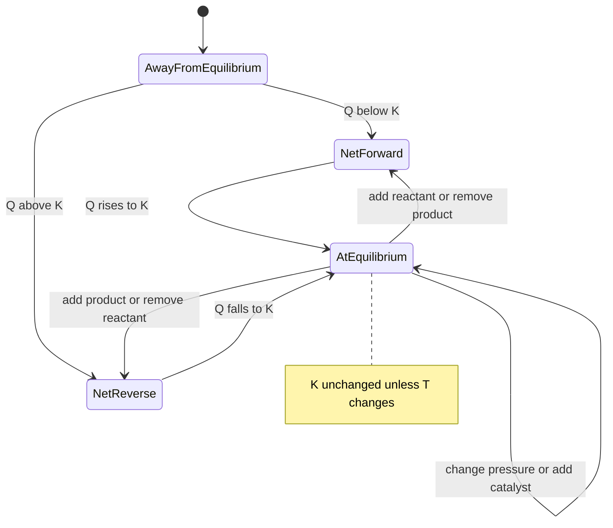
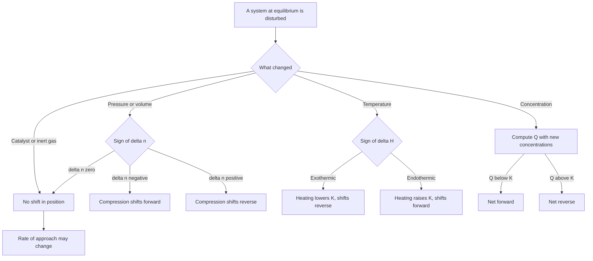
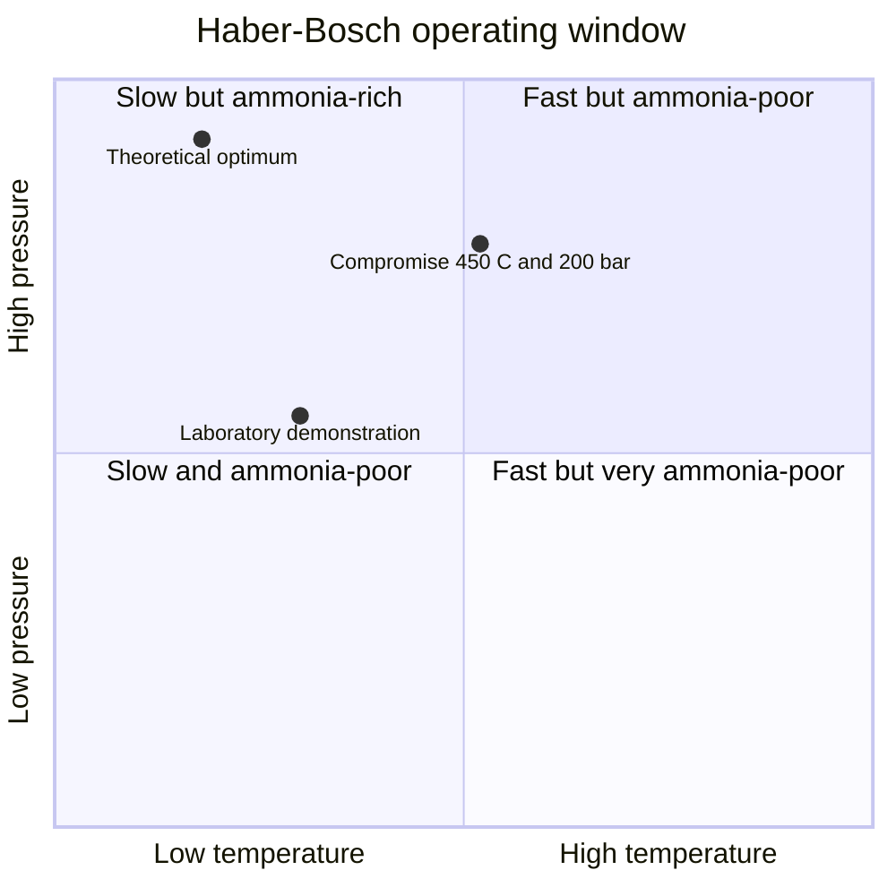

# Chapter 10 — Chemical Equilibrium and Le Châtelier's Principle

> **Level:** Intermediate (Level 2 — High School / Intermediate Chemistry)
> **Estimated study time:** 8 hours (5 h reading + 3 h exercises)
> **Prerequisites:** [Level 2 overview](README.md); [Chapter 9 — Reaction Rates](09-reaction-rates.md) and Chapters 1–3 (mole, stoichiometry, solutions)
> **Related chapters:** [Acid–Base Chemistry, pH and pOH](11-acid-base-chemistry-and-ph.md), [Oxidation–Reduction and Electrochemistry Fundamentals](12-redox-reactions-and-electrochemistry-fundamentals.md), [Solubility and Precipitation](13-solubility-and-precipitation.md)
> **Difficulty:** ★★★★☆ (4/5)

---

## 1. Learning Objectives

After working through this chapter you will be able to:

- Explain dynamic equilibrium at the level of individual particles and distinguish
  it from a reaction that has stopped.
- Write $K_c$ and $K_p$ for homogeneous and heterogeneous reactions, and justify
  the exclusion of pure solids and liquids.
- Convert between the two constants with $K_p = K_c(RT)^{\Delta n}$.
- Compute the reaction quotient $Q$ and use it to predict the direction of change.
- Apply Le Châtelier's principle to concentration, pressure, volume and temperature
  changes, and explain each shift at the particle level.
- State why temperature alone changes $K$, and why a catalyst does not.
- Solve equilibrium problems with ICE tables.
- Analyse the Haber–Bosch process as a compromise between thermodynamics, kinetics
  and economics, and relate $K$ to $\Delta G^\circ$ qualitatively.

---

## 2. Introduction

In 1909 Fritz Haber showed that nitrogen and hydrogen combine over osmium at high pressure
to give ammonia; by 1913 Carl Bosch had turned the demonstration into an industrial plant at
Oppau. Roughly half of the nitrogen atoms in the protein of an average human being has
passed through a Haber–Bosch reactor. Ammonia synthesis consumes on the order of 1–2 % of
global primary energy and emits a similar share of global carbon dioxide, because its
hydrogen is still made mostly from natural gas.

The process is the natural entry point to equilibrium because every condition in the plant
is a compromise between requirements that pull in opposite directions. Low temperature
favours ammonia, because the reaction is exothermic; low temperature also makes it so slow
that the reactor would produce nothing. High pressure favours ammonia, because four moles of
gas become two; high pressure also costs steel, compressors and money. The industrial answer
— an iron catalyst, about 450 °C, 150–300 bar, recycle of unreacted gas — is neither the
thermodynamic nor the kinetic optimum but the economic one.

Equilibrium is the second half of the answer to "what happens in a reaction?". Kinetics asks
*how fast*, equilibrium asks *how far*; the questions are independent, since cellulose
oxidation by air is favourable and immeasurably slow while sodium with water is fast and
complete. Only for reversible reactions do the two meet, at equal forward and reverse rates.

---

## 3. Fundamental Concepts

### 3.1 Reversible reactions and dynamic equilibrium

A **reversible reaction** is one in which products can regenerate reactants under the
conditions of the experiment; it is written with $\ce{<=>}$. Whether a reaction *appears* to
run to completion depends on how far the equilibrium lies towards products: neutralisation of
a strong acid by a strong base has $K \approx 10^{14}$ and is complete for practical
purposes, esterification of acetic acid with ethanol has $K_c \approx 4$, and the
autoionisation of water has $K_w = 1.0\times10^{-14}$ at 25 °C.

**Dynamic equilibrium** is the state of a closed system in which the forward and reverse
rates are equal, so all concentrations remain constant with time. Three features of the
definition carry the idea. *Closed* means no matter enters or leaves; an open system can
reach a steady state but not equilibrium. *Rate*, not amount, is what becomes equal: the
reactions do not stop, and isotopic labelling proves it — $\ce{^{18}O}$-labelled water added
to equilibrated $\ce{SO2}/\ce{SO3}$ appears in both compounds. *Concentrations* are constant
but need not be equal; equilibrium says nothing about how much of each species is present,
which is the job of $K$.

Equilibrium can be reached from either direction and gives the same final composition, a
strong experimental test of the model: the macroscopic stillness is the consequence of
microscopic activity, not evidence of inactivity.

### 3.2 The equilibrium constant $K_c$

For the homogeneous reaction $\ce{aA + bB <=> cC + dD}$,

$$
K_c = \frac{[\ce{C}]^{c}\,[\ce{D}]^{d}}{[\ce{A}]^{a}\,[\ce{B}]^{b}}
$$

where each bracket is a molar concentration *at equilibrium*, and the exponents are the
stoichiometric coefficients. This is the **law of mass action** of Guldberg and Waage
(1864); its modern justification is thermodynamic (Section 4.1).

Four properties are used constantly.

1. **Magnitude.** $K \gg 1$ means equilibrium lies towards products, $K \ll 1$
   towards reactants. Values beyond about $10^{3}$ or below $10^{-3}$ justify
   "essentially complete" or "essentially no reaction".
2. **Dependence on the equation as written.** Reversing inverts $K$; doubling all
   coefficients squares it; adding two equations multiplies their constants.
3. **Dependence on temperature only.** Concentration, pressure, volume, catalyst
   and surface area do not change $K$.

| Reaction as written | $K$ at 298 K | Comment |
|---|---|---|
| $\ce{N2(g) + 3H2(g) <=> 2NH3(g)}$ | $6\times10^{5}\ \text{bar}^{-2}$ | Industrial synthesis |
| $\ce{H2(g) + I2(g) <=> 2HI(g)}$ | $5.4\times10^{1}$ at 700 K | $\Delta n = 0$, dimensionless |
| $\ce{N2O4(g) <=> 2NO2(g)}$ | $0.15\ \text{bar}$ | $\Delta n = +1$ |
| $\ce{CaCO3(s) <=> CaO(s) + CO2(g)}$ | $\approx10^{-23}\ \text{bar}$ | Heterogeneous |
| $\ce{CH3COOH(aq) <=> H+(aq) + CH3COO-(aq)}$ | $1.8\times10^{-5}$ | Weak-acid ionisation |
| $\ce{AgCl(s) <=> Ag+(aq) + Cl-(aq)}$ | $1.8\times10^{-10}$ | Solubility product |

**Table 10.1 — Equilibrium constants span more than thirty orders of magnitude.** The same
mathematical form covers a reaction complete to twelve significant figures and one that
barely proceeds; the number, not the qualitative label, is the chemistry.

Strictly, $K$ is defined through dimensionless *activities*, so the thermodynamic constant
has no units; using concentrations is the **ideal-solution approximation**, and the resulting
$K_c$ carries units of $(\text{mol dm}^{-3})^{\Delta n}$.

### 3.3 Partial pressures and $K_p$

For gas-phase reactions it is convenient to use **partial pressures**. The partial pressure
of component $i$ in an ideal mixture is the pressure it would exert alone in the same
volume:

$$
p_i = x_i p_{\text{total}}, \qquad p_i V = n_i RT
$$

For $\ce{aA(g) + bB(g) <=> cC(g) + dD(g)}$,

$$
K_p = \frac{p_{\ce{C}}^{c}\,p_{\ce{D}}^{d}}{p_{\ce{A}}^{a}\,p_{\ce{B}}^{b}}
$$

with every pressure in the same unit, conventionally **bar** ($p^\circ = 10^{5}\ \text{Pa}$;
older tables use 1 atm, a 1 % difference). Because $p_i = c_iRT$, substituting gives the
bridge between the constants:

$$
K_p = K_c(RT)^{\Delta n}, \qquad \Delta n = (c+d) - (a+b)
$$

where $\Delta n$ counts **gaseous** moles only. With $K_c$ in $\text{mol dm}^{-3}$ and $p$
in bar, use $R = 0.08314\ \text{L bar K}^{-1}\text{mol}^{-1}$; with $\text{mol m}^{-3}$ and
pascals, use $8.314\ \text{J K}^{-1}\text{mol}^{-1}$.

If $\Delta n = 0$, then $K_p = K_c$ numerically, as for $\ce{H2 + I2 <=> 2HI}$. For the
Haber equilibrium $\Delta n = -2$, so $K_p = K_c/(RT)^{2}$, a factor of about
$3.4\times10^{3}$ at 700 K.

### 3.4 Heterogeneous equilibria

A **heterogeneous equilibrium** involves more than one phase. The rule is that pure solids
and pure liquids are omitted from the equilibrium expression, because their **activity** is
fixed at unity. A pure solid has a definite density and molar mass, so its amount per unit
volume is a constant of the substance, not a variable of the experiment; adding more calcium
carbonate makes the pile taller, not the concentration higher. The same applies to a pure
liquid, including water when it is the solvent.

For $\ce{CaCO3(s) <=> CaO(s) + CO2(g)}$ the expression collapses to

$$
K_p = p_{\ce{CO2}}, \qquad K_c = [\ce{CO2}]
$$

so the equilibrium pressure of carbon dioxide depends only on temperature, provided that some
of each solid remains. This is the model for the solubility product of Chapter 13 and the
weak-acid constant of Chapter 11, where the solvent is likewise omitted. If the solid is
entirely consumed the constraint disappears and the pressure can fall below the equilibrium
value.

---

## 4. Detailed Scientific Explanation

### 4.1 Thermodynamic origin and the reaction quotient

$$
\Delta G = \Delta G^\circ + RT\ln Q
$$

where $\Delta G^\circ$ is the standard Gibbs energy change (all species in their standard
states: gas at 1 bar, solute at 1 mol dm⁻³, pure condensed phase) and $Q$ is the **reaction
quotient**, which has the algebraic form of $K$ but is evaluated with instantaneous
concentrations:

$$
Q = \frac{[\ce{C}]^{c}[\ce{D}]^{d}}{[\ce{A}]^{a}[\ce{B}]^{b}}
$$

At equilibrium $\Delta G = 0$ and $Q = K$, so

$$
\Delta G^\circ = -RT\ln K
$$

This relation explains the properties of Section 3.2: $\Delta G^\circ$ belongs to the
reaction as written at a stated temperature, so $K$ does too, and reversing or doubling the
equation transforms $\Delta G^\circ$ exactly as it inverts or squares $K$.

The comparison of $Q$ with $K$ is the most useful diagnostic in the subject:

| Condition | Meaning | Net change | Sign of $\Delta G$ |
|---|---|---|---|
| $Q < K$ | Too few products | Forward | Negative |
| $Q = K$ | At equilibrium | None | Zero |
| $Q > K$ | Too many products | Reverse | Positive |

**Table 10.2 — Predicting direction.** Since $\Delta G = RT\ln(Q/K)$, the reaction moves in
the direction that lowers the Gibbs energy, and the comparison remains valid far from
equilibrium where Le Châtelier's principle becomes unreliable.

### 4.2 Le Châtelier's principle: concentration changes

**Le Châtelier's principle** states that a system at equilibrium responds to a change in
conditions in the direction that partially offsets the change. *Partially* is essential: the
system accommodates the perturbation, it does not cancel it.

Adding a reactant raises the denominator of $Q$, so $Q < K$ and the net reaction runs
forward until $Q$ returns to $K$. At the particle level, more reactant molecules mean more
collisions per second, so the forward rate rises immediately while the reverse rate is
momentarily unchanged; as products accumulate the forward rate falls and the reverse rate
rises until they meet again. Removing a product has the same effect for the opposite reason.
The shift never restores the original concentration of the species that was changed: added
reactant remains in excess at the new equilibrium.

### 4.3 Pressure and volume changes

Compressing a gas mixture at constant temperature raises every partial pressure by the same
factor $f = V_{\text{initial}}/V_{\text{final}}$, so

$$
Q_{\text{after}} = Q_{\text{before}} \times f^{\Delta n}
$$

and the direction depends only on the sign of $\Delta n$:

| Change | $\Delta n < 0$ | $\Delta n = 0$ | $\Delta n > 0$ |
|---|---|---|---|
| Compress | $Q$ falls, shifts forward | No change | $Q$ rises, shifts reverse |
| Expand | $Q$ rises, shifts reverse | No change | $Q$ falls, shifts forward |

**Table 10.3 — Pressure effects follow from the exponent $\Delta n$.** In $\ce{N2 + 3H2 <=>
2NH3}$ the forward rate depends on the fourth power of concentration in total and the
reverse on the second, so compression accelerates the forward reaction more. For $\ce{H2 +
I2 <=> 2HI}$ both rates scale as the square and the balance is unchanged.

An inert gas added at **constant volume** changes no partial pressure and has no effect,
although the total pressure rises. Added at **constant pressure** it forces the vessel to
expand, lowering every partial pressure, so the system shifts towards the side with more gas
moles.

### 4.4 Temperature changes

Temperature is different in kind. Concentration, pressure and volume move the system along
the same equilibrium law; temperature changes the law itself.

- For an **exothermic** forward reaction ($\Delta H^\circ < 0$), raising $T$
  decreases $K$ and the mixture becomes poorer in products.
- For an **endothermic** forward reaction ($\Delta H^\circ > 0$), raising $T$
  increases $K$.

At the particle level, a higher temperature gives a larger fraction of collisions enough
energy to surmount the barrier, so both rates rise. But the reverse reaction has the larger
activation energy when the forward reaction is exothermic, $E_{a,\text{reverse}} =
E_{a,\text{forward}} + |\Delta H^\circ|$, so its rate rises by the larger factor. The
reverse reaction outpaces the forward one until a new, product-poorer equilibrium is
established. Equivalently, $\ln K = -\Delta H^\circ/(RT) + \Delta S^\circ/R$: for negative
$\Delta H^\circ$, $K$ falls as $T$ rises.

At the instant of heating, $Q$ has not changed but $K$ has, so the system is no longer at
equilibrium and moves to restore $Q = K$. The changes that alter the *position* without
altering $K$ are: adding or removing species, changing volume or total pressure, adding an
inert gas, adding a catalyst, changing surface area, stirring. **Only temperature changes
$K$**, which is the most common conceptual error in the topic.

### 4.5 Catalysts

A **catalyst** increases the rate without being consumed, providing a pathway of lower
activation energy. It lowers the activation energies of the forward and reverse reactions by
the *same* amount, because their difference is fixed by the enthalpy of reaction:

$$
\Delta H^\circ = E_{a,\text{forward}} - E_{a,\text{reverse}}
$$

If both fall by $\delta$, the difference is unchanged, so $k_{\text{f}}/k_{\text{r}}$ and
therefore $K$ are unchanged. A catalyst cannot make an unfavourable reaction favourable; it
makes a favourable reaction happen sooner.

### 4.6 The Haber–Bosch process

$$
\ce{N2(g) + 3H2(g) <=> 2NH3(g)} \qquad \Delta H^\circ = -92.4\ \text{kJ mol}^{-1}
$$

Here $\Delta n = -2$ and $\Delta S^\circ \approx -198\ \text{J K}^{-1}\text{mol}^{-1}$. At
298 K, $\Delta G^\circ \approx -33\ \text{kJ mol}^{-1}$ and $K \approx 6\times10^{5}\
\text{bar}^{-2}$; at 700 K, $K$ has fallen to about $3\times10^{-4}\ \text{bar}^{-2}$. The
constant drops by nine orders of magnitude over 400 K, the quantitative form of "low
temperature favours ammonia".

Three requirements conflict. **Thermodynamics** wants low temperature (large $K$) and high
pressure ($\Delta n < 0$). **Kinetics** wants high temperature, because the $\ce{N2}$ triple
bond (bond enthalpy $945\ \text{kJ mol}^{-1}$) makes the uncatalysed reaction hopelessly
slow even at 700 K. **Economics** wants moderate pressure, because compressors and
thick-walled reactors are expensive, and a cheap, long-lived catalyst.

The industrial compromise is 400–500 °C (673–773 K), 150–300 bar, and a promoted iron
catalyst (iron with $\ce{K2O}$, $\ce{Al2O3}$ and $\ce{CaO}$). The gas leaving the reactor
contains 15–20 % ammonia by volume — below the equilibrium value, because the reactor does
not reach equilibrium at its operating space velocity. Unreacted gas is recycled after the
ammonia is condensed, so overall conversion is high even though per-pass conversion is
modest.

$$
\ce{CH4(g) + H2O(g) -> CO(g) + 3H2(g)} \qquad \Delta H^\circ = +206\ \text{kJ mol}^{-1}
$$

followed by the water–gas shift and removal of $\ce{CO2}$. "Green" ammonia replaces this
with electrolytic hydrogen, but the equilibrium constraints inside the ammonia loop are
unchanged.

## 5. Visual Diagrams

**Figure 10.1 — The state machine of an equilibrium system.** Every perturbation moves the
system into one of two net-change states, from which it returns to $Q = K$. The self-loop is
the important one: pressure, volume or catalyst changes leave the system at equilibrium
because neither $Q$ nor $K$ has changed. Only a temperature change alters $K$.

**Figure 10.2 — Decision procedure for a disturbance.** The temperature branch is separated
from the rest because it is the only one that changes $K$ rather than $Q$. The chart forces
the student to compute $Q$ when concentrations change instead of guessing, and prevents
pressure changes being mistaken for changes to the constant.

**Figure 10.3 — The Haber–Bosch compromise.** The horizontal axis is temperature and the
vertical axis is pressure. The top-left quadrant is thermodynamically ideal and kinetically
useless; the top-right is fast but gives little ammonia. The industrial point sits between
them, and the "theoretical optimum" cannot be reached because the rate there is negligible.

---

## 6. Mathematical Formulas

### 6.1 The equilibrium constant

$$
K_c = \frac{[\ce{C}]^{c}[\ce{D}]^{d}}{[\ce{A}]^{a}[\ce{B}]^{b}}
$$

| Symbol | Meaning | SI unit |
|---|---|---|
| $[\ce{X}]$ | Equilibrium molar concentration | $\text{mol dm}^{-3}$ (SI: $\text{mol m}^{-3}$) |
| $a,b,c,d$ | Stoichiometric coefficients | dimensionless |
| $K_c$ | Concentration equilibrium constant | $(\text{mol dm}^{-3})^{\Delta n}$ |

**Assumptions.** Ideal solution; activities replaced by concentrations; temperature
specified; the system is at equilibrium, otherwise use $Q$.

### 6.2 Pressure constant and conversion

$$
K_p = \frac{p_{\ce{C}}^{c}p_{\ce{D}}^{d}}{p_{\ce{A}}^{a}p_{\ce{B}}^{b}}, \qquad K_p =
K_c(RT)^{\Delta n}
$$

| Symbol | Meaning | SI unit |
|---|---|---|
| $p_i$ | Partial pressure | Pa (practical: bar) |
| $\Delta n$ | Gaseous product moles minus gaseous reactant moles | dimensionless |
| $R$ | Gas constant | $8.314\ \text{J K}^{-1}\text{mol}^{-1}$ or $0.08314\ \text{L bar K}^{-1}\text{mol}^{-1}$ |
| $T$ | Thermodynamic temperature | K |

**Assumptions.** Ideal gas; one pressure unit throughout; $\Delta n$ counts gases only.
Mixing $R$ values with the wrong units is the commonest arithmetic error: $0.08314$ belongs
with litres and bar, $8.314$ with cubic metres and pascals.

### 6.3 Thermodynamic link and temperature dependence

$$
\Delta G^\circ = -RT\ln K, \qquad \ln\frac{K_2}{K_1} = -\frac{\Delta H^\circ}{R}
\left(\frac{1}{T_2} - \frac{1}{T_1}\right)
$$

where $\Delta G^\circ$ is in $\text{J mol}^{-1}$, $K$ is dimensionless, $\Delta H^\circ$ is
in $\text{J mol}^{-1}$ and $T_1, T_2$ are in kelvin. **Assumptions:** standard states are
defined and $\Delta H^\circ$ is constant over the interval, which is good over a few hundred
kelvin and poor over thousands.

### 6.4 The ICE framework

| | $\ce{A}$ | $\ce{B}$ | $\ce{C}$ | $\ce{D}$ |
|---|---|---|---|---|
| **I**nitial | $c_{\ce{A},0}$ | $c_{\ce{B},0}$ | $c_{\ce{C},0}$ | $c_{\ce{D},0}$ |
| **C**hange | $-ax$ | $-bx$ | $+cx$ | $+dx$ |
| **E**quilibrium | $c_{\ce{A},0}-ax$ | $c_{\ce{B},0}-bx$ | $c_{\ce{C},0}+cx$ | $c_{\ce{D},0}+dx$ |

The framework is bookkeeping, not chemistry, but it reduces every problem to two steps:
express equilibrium concentrations in terms of one extent variable $x$, then substitute into
$K$. If $K$ is very small, $x$ may be neglected in the denominator (the **small-$x$
approximation**, developed for acids in Chapter 11), acceptable when $x$ is under about 5 %
of the initial concentration.

---

## 7. Chemical Equations

$$
\ce{N2(g) + 3H2(g) <=> 2NH3(g)} \qquad \Delta H^\circ = -92.4\ \text{kJ mol}^{-1}
$$

$$
\ce{2SO2(g) + O2(g) <=> 2SO3(g)} \qquad \Delta H^\circ = -198\ \text{kJ mol}^{-1}
$$

$$
\ce{H2(g) + I2(g) <=> 2HI(g)} \qquad \Delta H^\circ = +53\ \text{kJ mol}^{-1}
$$

$$
\ce{N2O4(g) <=> 2NO2(g)} \qquad \Delta H^\circ = +57\ \text{kJ mol}^{-1}
$$

$$
\ce{CaCO3(s) <=> CaO(s) + CO2(g)} \qquad \Delta H^\circ = +178\ \text{kJ mol}^{-1}
$$

$$
\ce{FeO(s) + CO(g) <=> Fe(s) + CO2(g)} \qquad \Delta H^\circ = -17\ \text{kJ mol}^{-1}
$$

The first two are the industrial cases. The third and fourth are endothermic with
$\Delta n = 0$ or small, so both give more product when heated and neither is sensitive to
pressure. Limestone decomposition is the heterogeneous example, with
$K_p = p_{\ce{CO2}}$, and the last equation is the redox equilibrium of Worked Example 10.4.

---

## 8. Worked Examples

### Worked Example 10.1 — Calculating $K_c$ from an equilibrium composition

**Problem.** In a $1.00\ \text{dm}^{3}$ flask at $700\ \text{K}$, $1.00\ \text{mol}$ of
$\ce{H2}$ and $1.00\ \text{mol}$ of $\ce{I2}$ reach equilibrium. Analysis gives $[\ce{HI}] =
1.574\ \text{mol dm}^{-3}$. Calculate $K_c$ for $\ce{H2(g) + I2(g) <=> 2HI(g)}$.

**Strategy.** The stoichiometry is $1:1:2$, so if $x$ moles per litre of $\ce{H2}$ react,
$2x$ of $\ce{HI}$ form. The measured $[\ce{HI}]$ fixes $x$.

**Solution.** Initial concentrations are $1.00\ \text{mol dm}^{-3}$ each.

| | $\ce{H2}$ | $\ce{I2}$ | $\ce{HI}$ |
|---|---|---|---|
| **I**nitial / $\text{mol dm}^{-3}$ | 1.00 | 1.00 | 0 |
| **C**hange / $\text{mol dm}^{-3}$ | $-x$ | $-x$ | $+2x$ |
| **E**quilibrium / $\text{mol dm}^{-3}$ | $1.00-x$ | $1.00-x$ | $2x$ |

From $2x = 1.574$, $x = 0.787$, so $[\ce{H2}] = [\ce{I2}] = 0.213\ \text{mol dm}^{-3}$.

$$
K_c = \frac{(1.574)^{2}}{(0.213)^{2}} = \frac{2.477}{0.04537} = 5.46\times10^{1}
$$

**Check.** The tabulated value at 700 K is $5.4\times10^{1}$, so the arithmetic is consistent
with experiment; with $\Delta n = 0$, $K_c$ is dimensionless and the change column is in the
ratio $1:1:2$.

### Worked Example 10.2 — An ICE table with a perfect square

**Problem.** In a non-aqueous solvent at a fixed temperature, acetic acid and ethanol give
ethyl acetate and water with $K_c = 4.00$. Initially $1.00\ \text{mol}$ of each reactant is
present in $1.00\ \text{dm}^{3}$, with no products. Find the equilibrium composition.

**Strategy.** The stoichiometry is $1:1:1:1$, so one variable describes all four changes.
Substitution gives a ratio of squares, solved by taking the square root.

**Solution.**

| | $\ce{CH3COOH}$ | $\ce{C2H5OH}$ | $\ce{CH3COOC2H5}$ | $\ce{H2O}$ |
|---|---|---|---|---|
| **I**nitial / $\text{mol dm}^{-3}$ | 1.00 | 1.00 | 0 | 0 |
| **C**hange / $\text{mol dm}^{-3}$ | $-x$ | $-x$ | $+x$ | $+x$ |
| **E**quilibrium / $\text{mol dm}^{-3}$ | $1.00-x$ | $1.00-x$ | $x$ | $x$ |

$$
\frac{x^{2}}{(1.00-x)^{2}} = 4.00 \quad\Longrightarrow\quad \frac{x}{1.00-x} = 2.00
\quad\Longrightarrow\quad x = 0.667
$$

The equilibrium mixture contains $0.667\ \text{mol dm}^{-3}$ of ester and of water, and
$0.333\ \text{mol dm}^{-3}$ of each reactant.

**Check.** Back-substitution gives $0.4449/0.1109 = 4.01$, which is $K_c$ within rounding.
The two-thirds conversion is what $K = 4$ implies for a $1:1$ reaction, and acetate groups
balance at $1.00\ \text{mol dm}^{-3}$ in total.

### Worked Example 10.3 — Converting $K_c$ to $K_p$

**Problem.** For $\ce{N2(g) + 3H2(g) <=> 2NH3(g)}$ at $700\ \text{K}$, $K_c =
2.8\times10^{-4}\ (\text{mol dm}^{-3})^{-2}$. Calculate $K_p$ in $\text{bar}^{-2}$.

**Strategy.** Use $K_p = K_c(RT)^{\Delta n}$ with $R = 0.08314\ \text{L bar
K}^{-1}\text{mol}^{-1}$ and $\Delta n = 2 - 4 = -2$.

**Solution.**

$$
RT = (0.08314)(700) = 58.2\ \text{L bar mol}^{-1}
$$

$$
K_p = (2.8\times10^{-4})(58.2)^{-2} = (2.8\times10^{-4})(2.95\times10^{-4}) =
8.3\times10^{-8}\ \text{bar}^{-2}
$$

**Check.** Reversing the conversion gives $K_c = K_p(RT)^{2} = 8.3\times10^{-8} \times
3.39\times10^{3} = 2.8\times10^{-4}$, recovering the input. The direction is also right:
$\Delta n$ is negative and 1 bar is only about $0.017\ \text{mol dm}^{-3}$ at this
temperature, so $K_p \ll K_c$.

### Worked Example 10.4 — Using $Q$ in a heterogeneous system

**Problem.** At $1000\ \text{K}$, $\ce{FeO(s) + CO(g) <=> Fe(s) + CO2(g)}$ has $K_p =
0.403$. A gas mixture over excess $\ce{FeO}$ and $\ce{Fe}$ has $p_{\ce{CO}} = 0.500\
\text{bar}$ and $p_{\ce{CO2}} = 0.300\ \text{bar}$. In which direction does the net reaction
proceed?

**Strategy.** Omit the two solids, compute $Q$ and compare with $K_p$.

**Solution.** With pure solids at unit activity,

$$
K_p = \frac{p_{\ce{CO2}}}{p_{\ce{CO}}}, \qquad Q = \frac{0.300}{0.500} = 0.600
$$

Since $Q > K_p$, the reaction proceeds in the **reverse** direction: $\ce{CO2}$ oxidises
iron to $\ce{FeO}$ and is reduced to $\ce{CO}$, until $Q$ falls to 0.403.

**Check.** The Gibbs criterion agrees: $\Delta G = RT\ln(Q/K) =
(8.314)(1000)\ln(0.600/0.403) = +3.3\ \text{kJ mol}^{-1}$, so the forward reaction is
non-spontaneous as written. The small magnitude shows the system is close to equilibrium.

### Worked Example 10.5 — Adding reactant: how much of it reacts?

**Problem.** The equilibrium mixture of Worked Example 10.1 has $[\ce{H2}] = [\ce{I2}] =
0.213$ and $[\ce{HI}] = 1.574\ \text{mol dm}^{-3}$, with $K_c = 54.6$. A further $0.500\
\text{mol}$ of $\ce{H2}$ is injected into the $1.00\ \text{dm}^{3}$ flask at the same
temperature. Find the new equilibrium concentrations and the percentage of added hydrogen
that reacts.

**Strategy.** Use the old equilibrium as the new initial state, compute $Q$ to confirm the
direction, then solve a fresh ICE table for the additional extent $y$.

**Solution.** Immediately after injection, $[\ce{H2}] = 0.713$ while the others are
unchanged, so

$$
Q = \frac{(1.574)^{2}}{(0.713)(0.213)} = \frac{2.477}{0.152} = 16.3 < K
$$

The reaction runs forward.

| | $\ce{H2}$ | $\ce{I2}$ | $\ce{HI}$ |
|---|---|---|---|
| **I**nitial / $\text{mol dm}^{-3}$ | 0.713 | 0.213 | 1.574 |
| **C**hange / $\text{mol dm}^{-3}$ | $-y$ | $-y$ | $+2y$ |
| **E**quilibrium / $\text{mol dm}^{-3}$ | $0.713-y$ | $0.213-y$ | $1.574+2y$ |

$$
\frac{(1.574+2y)^{2}}{(0.713-y)(0.213-y)} = 54.6
$$

Expanding gives $50.6y^{2} - 56.9y + 5.81 = 0$, so

$$
y = \frac{56.9 - \sqrt{(56.9)^{2} - 4(50.6)(5.81)}}{2(50.6)} = \frac{56.9 - 45.3}{101.2} =
0.114
$$

The other root exceeds the available $\ce{I2}$ and is rejected. Hence $[\ce{H2}] = 0.599$,
$[\ce{I2}] = 0.099$ and $[\ce{HI}] = 1.802\ \text{mol dm}^{-3}$. The fraction of added
hydrogen consumed is $0.114/0.500 = 22.8\,\%$.

**Check.** Substituting gives $1.802^{2}/(0.599 \times 0.0992) = 3.247/0.0594 = 54.7$, which
is $K$ within rounding. The new $[\ce{H2}]$ (0.599) exceeds the old (0.213) even though some
added hydrogen reacted: the perturbation is offset, not cancelled.

---

## 9. Real-World Applications

**Fertiliser and food security.** About 80 % of industrial ammonia becomes urea, ammonium
nitrate and ammonium phosphates. Without Haber–Bosch the world could support perhaps half
its present population by the pre-industrial routes of guano and Chile saltpetre, so the
equilibrium analysis of Section 4.6 is the calculation behind a pillar of global food
supply.

**Sulfuric acid.** The contact process oxidises $\ce{SO2}$ over vanadium(V) oxide at 420–450
°C and 1–2 bar; the reaction is exothermic with $\Delta n = -1$, and a second absorber stage
achieves the required overall conversion more cheaply than higher pressure would.

**Blood and the oceans.** Haemoglobin binding, $\ce{Hb + 4O2 <=> Hb(O2)4}$, is shifted by
$p_{\ce{O2}}$ between lungs (about 13 kPa) and tissue (about 5 kPa). In the ocean,
$\ce{CO2(aq) + H2O(l) <=> H+(aq) + HCO3-(aq)}$ shifts right as atmospheric
$p_{\ce{CO2}}$ rises; ocean pH has fallen by about 0.1 units since the industrial revolution.

---

## 10. Common Mistakes

| Mistake | Why it happens | Correct approach |
|---|---|---|
| Thinking equilibrium means the reaction has stopped | Constant concentrations look like inactivity | Rates are equal, not zero; tracer experiments prove both directions continue |
| Assuming equilibrium concentrations are equal | "Equilibrium" suggests balance of amounts | Rates balance; amounts are set by $K$ and the initial composition |
| Including pure solids or liquids in $K$ | They appear in the balanced equation | Their activity is 1; omit them |
| Believing a catalyst raises the equilibrium yield | Catalysts are marketed as improving reactions | $K$ and position are unchanged; only the time to reach equilibrium falls |
| Believing pressure changes $K$ | Pressure changes concentrations, so it feels like a change to the constant | Pressure changes $Q$ only; $K$ depends on temperature alone |
| Counting solids and liquids in $\Delta n$ | The count is taken from the full equation | Count gaseous moles only |
| Mixing $R$ unit systems in $K_p$ | $R$ is quoted in several units | $0.08314$ with litres and bar; $8.314$ with cubic metres and pascals |
| Applying Le Châtelier far from equilibrium | It is taught as a universal rule | Compute $Q$ and compare with $K$; the principle is a near-equilibrium corollary |
| Quoting $K$ without a temperature | Tables often omit it | $K$ is a function of $T$; an unqualified value is incomplete |

---

## 11. Chapter Summary

- A reversible reaction reaches **dynamic equilibrium**, where forward and reverse
  rates are equal and concentrations are constant.
- $K_c = [\ce{C}]^{c}[\ce{D}]^{d}/[\ce{A}]^{a}[\ce{B}]^{b}$ at equilibrium;
  $K$ depends only on temperature and on how the equation is written, so reversing
  inverts it and doubling coefficients squares it.
- $K_p = K_c(RT)^{\Delta n}$, with $\Delta n$ counting gaseous moles only; the two
  are numerically equal when $\Delta n = 0$.
- Pure solids and liquids have unit activity and are omitted; for
  $\ce{CaCO3(s) <=> CaO(s) + CO2(g)}$, $K_p = p_{\ce{CO2}}$.
- $Q$ has the form of $K$ but uses instantaneous concentrations: $Q < K$ means net
  forward, $Q > K$ means net reverse.
- Le Châtelier's principle: a system responds to a disturbance in the direction
  that partially offsets it. Concentration, pressure and volume move $Q$; only
  temperature changes $K$.
- A catalyst lowers $E_a$ for both directions equally, so $K$ is unchanged and
  equilibrium is reached sooner.
- $\Delta G^\circ = -RT\ln K$ links equilibrium to thermodynamics; $K > 1$
  corresponds to $\Delta G^\circ < 0$.
- Haber–Bosch is the canonical compromise: 400–500 °C, 150–300 bar, promoted iron,
  recycle, 15–20 % ammonia per pass.

---

## 12. Exercises

### 12.1 Conceptual questions

1. Explain in terms of particles why an equilibrium mixture shows no change in
   concentration although both reactions continue. Why must the system be closed?
2. For $\ce{CaCO3(s) <=> CaO(s) + CO2(g)}$, explain why the mass of solid does not
   appear in $K_p$, and state what happens if all the carbonate decomposes.
3. A student claims that a catalyst raises the Haber yield because it "speeds up
   the forward reaction more than the reverse". Identify two errors and give the
   correct account.

### 12.2 Basic problems

4. Write $K_c$ for: (a) $\ce{2NO(g) + O2(g) <=> 2NO2(g)}$;
   (b) $\ce{NH4HS(s) <=> NH3(g) + H2S(g)}$;
   (c) $\ce{CH3COOH(aq) + H2O(l) <=> H3O+(aq) + CH3COO-(aq)}$.
5. For each reaction in Question 4, state $\Delta n$ (gases only) and write $K_p$.
6. A vessel contains $[\ce{SO2}] = 0.20$, $[\ce{O2}] = 0.10$ and
   $[\ce{SO3}] = 0.40\ \text{mol dm}^{-3}$. Given $K_c = 28$ for
   $\ce{2SO2 + O2 <=> 2SO3}$, state the direction of net change.

### 12.3 Intermediate problems

7. For the Haber equilibrium, predict the effect on the ammonia present at
   equilibrium of (a) raising $T$, (b) compressing, (c) removing ammonia, (d) adding
   argon at constant volume, (e) adding argon at constant pressure. Justify each.
8. Explain at the particle level why compression favours ammonia in
   $\ce{N2 + 3H2 <=> 2NH3}$ but has no effect on $\ce{H2 + I2 <=> 2HI}$.

### 12.4 Advanced problems

9. Derive $K_p = K_c(RT)^{\Delta n}$ from $p_i = c_iRT$, stating the assumptions and
   explaining why the relation is exact only for ideal gases.
10. Use $\Delta G^\circ = -RT\ln K$ to show that a catalyst cannot change the
    position of equilibrium, referring to the definition of $\Delta G^\circ$ and to
    the activation energies.

### 12.5 Calculation problems

11. At a given temperature, an equilibrium mixture for
    $\ce{2SO2(g) + O2(g) <=> 2SO3(g)}$ in $1.00\ \text{dm}^{3}$ contains
    $0.344\ \text{mol}$ of $\ce{SO2}$, $0.172\ \text{mol}$ of $\ce{O2}$ and
    $0.755\ \text{mol}$ of $\ce{SO3}$. Calculate $K_c$ and state its units.
12. For $\ce{N2O4(g) <=> 2NO2(g)}$ at $298\ \text{K}$,
    $K_c = 6.05\times10^{-3}\ \text{mol dm}^{-3}$. (a) Calculate $K_p$ in bar.
    (b) Calculate $\Delta G^\circ$. (c) State where the equilibrium lies at standard
    conditions.

### 12.6 Answers

1. Forward and reverse rates are equal, so each particle formed is matched by one
   consumed; concentrations are constant but not static. A closed system is needed
   because matter leaving would prevent the reverse process balancing the forward.
2. The activity of a pure solid is 1 and its concentration is fixed by its density.
   If all the solid is consumed the constraint disappears and $p_{\ce{CO2}}$ can
   fall below the equilibrium value.
3. A catalyst does not speed up the forward reaction more than the reverse; it
   lowers both activation energies equally. It does not change $K$ or the yield,
   only the time needed to reach equilibrium.
4. (a) $[\ce{NO2}]^{2}/([\ce{NO}]^{2}[\ce{O2}])$;
   (b) $[\ce{NH3}][\ce{H2S}]$;
   (c) $[\ce{H3O+}][\ce{CH3COO-}]/[\ce{CH3COOH}]$.
5. (a) $\Delta n = -1$, $K_p = p_{\ce{NO2}}^{2}/(p_{\ce{NO}}^{2}p_{\ce{O2}})$;
   (b) $\Delta n = +2$, $K_p = p_{\ce{NH3}}p_{\ce{H2S}}$; (c) no gases, so $K_p$ is
   undefined.
6. $Q = (0.40)^{2}/[(0.20)^{2}(0.10)] = 40 > 28$, so net reverse.
7. (a) $K$ falls, less ammonia; (b) $Q$ falls, more ammonia; (c) $Q$ falls, more ammonia;
   (d) no effect; (e) partial pressures fall, so the system shifts towards more gas moles
   and ammonia decreases.
8. Compression multiplies every partial pressure by $f$; the forward rate scales as
   $f^{4}$ and the reverse as $f^{2}$, so the forward rate gains more. For
   $\ce{H2 + I2}$ both scale as $f^{2}$ and the balance is unchanged.
9. Substituting $p_i = c_iRT$ gives
   $K_p = (c_{\ce{C}}RT)^{c}(c_{\ce{D}}RT)^{d}/((c_{\ce{A}}RT)^{a}(c_{\ce{B}}RT)^{b})
   = K_c(RT)^{\Delta n}$. Ideal-gas behaviour is assumed; real gases need fugacities, but
   $\Delta n$ still fixes the direction of the pressure effect.
10. $\Delta G^\circ$ is fixed by the standard states and is path-independent, so
    $K = \exp(-\Delta G^\circ/RT)$ is fixed too. Since
    $E_{a,\text{forward}} - E_{a,\text{reverse}} = \Delta H^\circ$ is fixed, both activation
    energies fall by equal amounts and $k_{\text{f}}/k_{\text{r}}$ is unchanged.
11. $K_c = (0.755)^{2}/[(0.344)^{2}(0.172)] = 0.570/0.0204 =
    2.80\times10^{1}\ (\text{mol dm}^{-3})^{-1}$.
12. (a) $\Delta n = +1$, $RT = 24.78\ \text{L bar mol}^{-1}$, so
    $K_p = 6.05\times10^{-3} \times 24.78 = 0.150\ \text{bar}$.
    (b) $\Delta G^\circ = -(8.314)(298)\ln(0.150) = +4.70\ \text{kJ mol}^{-1}$.
    (c) $K_p < 1$ and $\Delta G^\circ > 0$, so the equilibrium lies towards
    $\ce{N2O4}$ at standard conditions.

> Worked solutions for this level are maintained in the `solutions/` directory of the level.

---

## 13. Further Reading

- OpenStax, *Chemistry 2e*, Rice University, Chapter 13 ("Fundamental Equilibrium Concepts"). <https://openstax.org/details/books/chemistry-2e>
- Atkins, P.; Jones, L. *Chemical Principles: The Quest for Insight*, 7th ed., W. H. Freeman. The chapters on equilibrium and thermodynamic equilibrium constants.
- Atkins, P.; de Paula, J. *Physical Chemistry*, Oxford University Press. The treatment of equilibrium constants in terms of activities and the van't Hoff equation.
- Brown, T. L.; LeMay, H. E.; Bursten, B. E. *Chemistry: The Central Science*, Pearson. The chapter on chemical equilibrium and its industrial case studies.
- IUPAC. *Compendium of Chemical Terminology* (the "Gold Book"), 2nd ed. (corrected version), entries "equilibrium constant", "activity", "standard state". <https://goldbook.iupac.org/>
- NIST. *NIST-JANAF Thermochemical Tables*. <https://janaf.nist.gov/> Standard Gibbs energies of formation used in the numerical checks.
- International Energy Agency. *The Future of Hydrogen*, 2019. <https://www.iea.org/reports/the-future-of-hydrogen> Context for the energy and emissions figures in Section 2.
- [CURRICULUM.md](../CURRICULUM.md) — where this chapter sits in the full programme.
- [REFERENCES.md](../REFERENCES.md) — the repository's verified source list.

> Only sources that can be checked are cited here. No DOI, page number or edition is invented.
