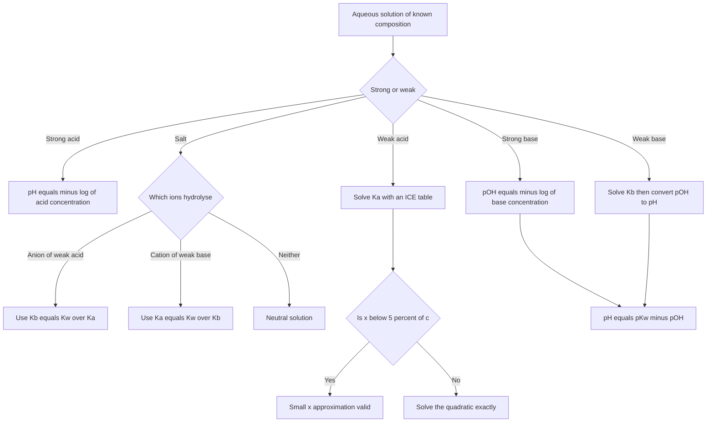
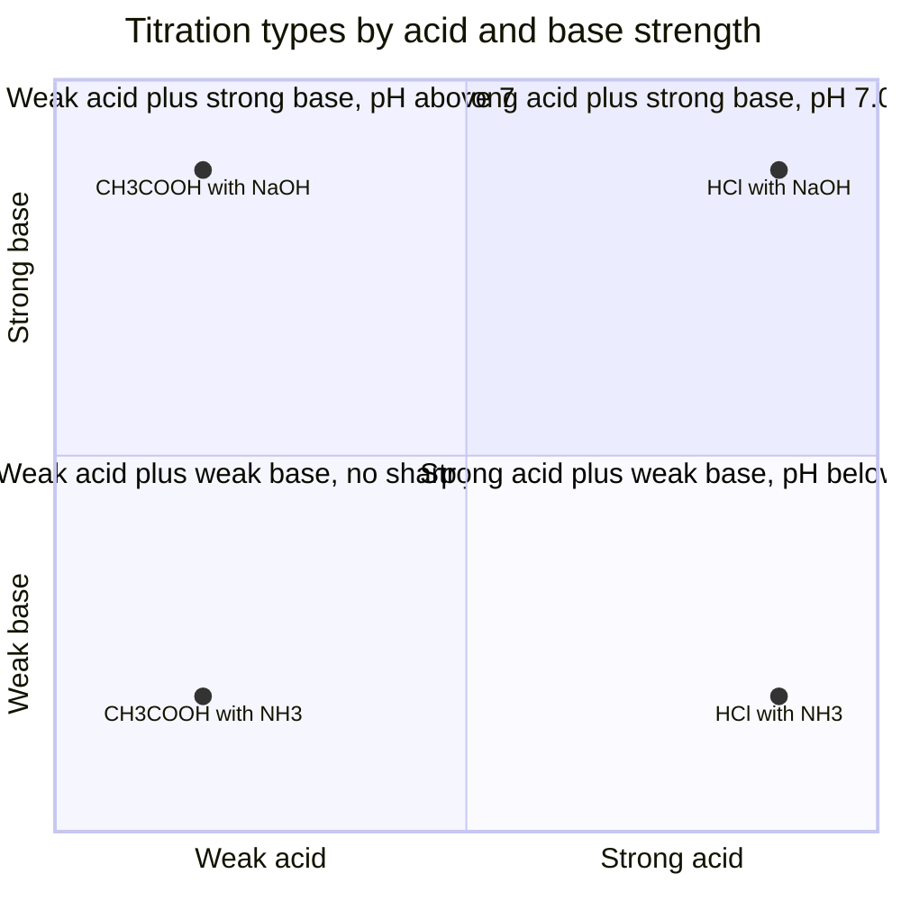
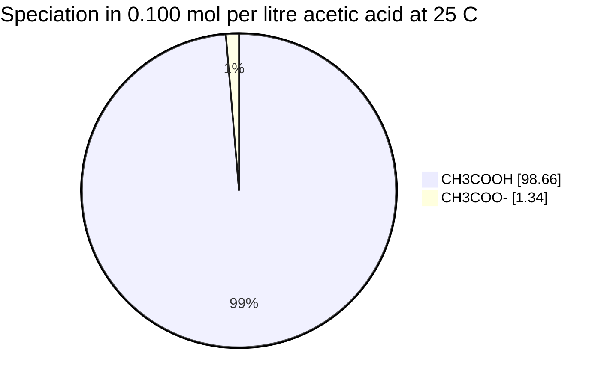

# Chapter 11 — Acid–Base Chemistry, pH and pOH

> **Level:** Intermediate (Level 2 — High School / Intermediate Chemistry)
> **Estimated study time:** 8 hours (5 h reading + 3 h exercises)
> **Prerequisites:** [Level 2 overview](README.md); [Chapter 3 — Solutions](03-solutions-concentration-and-dilution.md) and [Chapter 10 — Equilibrium](10-chemical-equilibrium-and-le-chateliers-principle.md)
> **Related chapters:** [Chemical Equilibrium and Le Châtelier's Principle](10-chemical-equilibrium-and-le-chateliers-principle.md), [Solubility and Precipitation](13-solubility-and-precipitation.md), [Oxidation–Reduction and Electrochemistry Fundamentals](12-redox-reactions-and-electrochemistry-fundamentals.md)
> **Difficulty:** ★★★★☆ (4/5)

---

## 1. Learning Objectives

After working through this chapter you will be able to:

- Apply the Brønsted–Lowry and Lewis definitions of acids and bases, and identify
  conjugate acid–base pairs.
- Explain the autoionisation of water and use $K_w$ at temperatures other than 25 °C.
- Define pH, pOH, $\mathrm{p}K_a$ and $\mathrm{p}K_b$, and use
  $\mathrm{pH} + \mathrm{pOH} = \mathrm{p}K_w$.
- Calculate the pH of strong and weak acids and bases, testing the validity of the
  small-$x$ approximation.
- Calculate percent ionisation and explain its dependence on dilution.
- Treat polyprotic acids and salt hydrolysis quantitatively.
- Explain the levelling effect and choose an indicator for a given titration.
- Describe the shape of strong and weak acid–base titration curves and explain what
  a buffer is.

---

## 2. Introduction

The pH of human arterial blood is held between 7.35 and 7.45. A fall of 0.3 units — less
than a factor of two in hydrogen-ion concentration — is enough to cause acidosis,
disorientation and, untreated, death. The control system is a buffer: the carbon
dioxide–hydrogencarbonate equilibrium, tuned by breathing and by the kidney. The same
equilibrium, at a different scale, sets the pH of the ocean, which has fallen by about 0.1
units since 1750 as seawater has absorbed anthropogenic $\ce{CO2}$.

This chapter makes the acid–base equilibria of Chapter 10 quantitative. The equilibrium law
is the same; the only new ingredient is that one of the species is always a proton. The
chapter moves from definitions to the autoionisation of water, then through strong and weak
acids and bases, salts, polyprotic acids and titrations to buffers, which are treated
quantitatively in Level 3. Throughout, the small-$x$ approximation is presented as a tool
with a stated domain of validity rather than as a trick, because most errors in this topic
come from applying it where it fails.

You need the equilibrium constant, the reaction quotient, and the mole and concentration
from earlier chapters. Nothing else is assumed. The arithmetic is dominated by logarithms,
so a calculator with a $\log$ key and a careful eye for significant figures — the number of
decimal places in a pH equals the number of significant figures in the concentration — is
essential.

---

## 3. Fundamental Concepts

### 3.1 Brønsted–Lowry acids and bases

A **Brønsted–Lowry acid** is a proton donor and a **Brønsted–Lowry base** is a proton
acceptor. The definition is about behaviour, not about composition: any species that can
give up $\ce{H+}$ is an acid in that reaction, and any species that can take it up is a
base.

Every acid–base reaction therefore involves two conjugate pairs. When acetic acid donates a
proton to water,

$$
\ce{CH3COOH(aq) + H2O(l) <=> CH3COO-(aq) + H3O+(aq)}
$$

acetic acid and acetate are a **conjugate acid–base pair**, and water and the hydronium ion
are the other. The acid on the left gives the base on the right; removing $\ce{H+}$ from an
acid produces its conjugate base, and adding $\ce{H+}$ to a base produces its conjugate
acid.

| Acid | Conjugate base | Base | Conjugate acid |
|---|---|---|---|
| $\ce{HCl}$ | $\ce{Cl-}$ | $\ce{H2O}$ | $\ce{H3O+}$ |
| $\ce{CH3COOH}$ | $\ce{CH3COO-}$ | $\ce{NH3}$ | $\ce{NH4+}$ |
| $\ce{H2CO3}$ | $\ce{HCO3-}$ | $\ce{CO3^2-}$ | $\ce{HCO3-}$ |
| $\ce{H2O}$ | $\ce{OH-}$ | $\ce{H2PO4-}$ | $\ce{H3PO4}$ |
| $\ce{H3O+}$ | $\ce{H2O}$ | $\ce{HSO4-}$ | $\ce{H2SO4}$ |

**Table 11.1 — Conjugate pairs.** Note the two amphiprotic entries: $\ce{H2O}$ and
$\ce{HCO3-}$ appear once as an acid and once as a base. An **amphiprotic** species can
donate or accept a proton, which is why water is both the acid and the base in its own
autoionisation.

### 3.2 Lewis acids and bases

The **Lewis** definition widens the scope: an acid is an electron-pair acceptor and a base
is an electron-pair donor. A proton is a Lewis acid because it accepts an electron pair to
form a bond. The definition also covers reactions with no proton transfer at all:

$$
\ce{BF3(g) + NH3(g) -> F3B<-NH3(s)}
$$

and it explains why $\ce{AlCl3}$ and $\ce{FeCl3}$ catalyse reactions that need an
electron-pair acceptor, and why $\ce{CO2}$ dissolves in water: the oxygen lone pairs attack
the electron-poor carbon. Lewis acidity is the language of coordination chemistry (Level 4)
and of organic mechanisms (Level 5). The Brønsted–Lowry definition remains the working
definition here, because every calculation in this chapter involves protons in water.

### 3.3 The autoionisation of water and $K_w$

Water reacts with itself to a very small extent:

$$
\ce{2H2O(l) <=> H3O+(aq) + OH-(aq)}
$$

The equilibrium expression omits the solvent, so

$$
K_w = [\ce{H3O+}][\ce{OH-}] = 1.0\times10^{-14}\ \text{at } 25\ ^\circ\text{C}
$$

In pure water the two ions are formed in equal amounts, so $[\ce{H3O+}] = [\ce{OH-}] =
1.0\times10^{-7}\ \text{mol dm}^{-3}$ and the pH is 7.00. The value $1.0\times10^{-14}$ is a
convention rounded from $1.01\times10^{-14}$; three significant figures are enough for all
work in this chapter.

The autoionisation is **endothermic** ($\Delta H^\circ = +55.8\ \text{kJ mol}^{-1}$), so
$K_w$ increases with temperature: it is $1.1\times10^{-15}$ at 0 °C, $1.0\times10^{-14}$ at
25 °C, $5.5\times10^{-14}$ at 50 °C and $5.5\times10^{-13}$ at 100 °C, corresponding to
$\mathrm{p}K_w$ values of 14.94, 14.00, 13.26 and 12.26.

Neutrality means $[\ce{H3O+}] = [\ce{OH-}]$, *not* pH 7: at 100 °C neutral water has pH
6.13. Any statement that "pH 7 is neutral" is a statement about 25 °C, and this is the
reason the relation $\mathrm{pH} + \mathrm{pOH} = 14$ is also a statement about 25 °C.

### 3.4 pH, pOH, $\mathrm{p}K_a$ and $\mathrm{p}K_b$

The **pH** of a solution is defined as

$$
\mathrm{pH} = -\log_{10} a(\ce{H+}) \approx -\log_{10}\frac{[\ce{H3O+}]}{c^\circ}
$$

where $a$ is the activity and $c^\circ = 1\ \text{mol dm}^{-3}$ makes the argument
dimensionless. In dilute solution the activity coefficient is close to unity, and the
working definition is $\mathrm{pH} = -\log_{10}[\ce{H3O+}]$ with the concentration in
$\text{mol dm}^{-3}$. The **pOH** is defined analogously, and the operator generalises: for
any quantity $X$, $\mathrm{p}X = -\log_{10}X$.

Because $K_w = [\ce{H3O+}][\ce{OH-}]$, taking negative logarithms gives

$$
\mathrm{pH} + \mathrm{pOH} = \mathrm{p}K_w = 14.00\ \text{at } 25\ ^\circ\text{C}
$$

This is a consequence of $K_w$, not an independent law. At 100 °C the sum is 12.26, and a
solution with pH 10 at that temperature has pOH 2.26 — still basic, but far less basic than
pH 10 at room temperature.

The strength of a weak acid is expressed by

$$
K_a = \frac{[\ce{H3O+}][\ce{A-}]}{[\ce{HA}]}, \qquad \mathrm{p}K_a = -\log_{10}K_a
$$

and that of a weak base by the analogous $K_b$ and $\mathrm{p}K_b$. The p-scale compresses
large ranges, and $\mathrm{p}K_a$ marks the pH at which a species is half-dissociated —
the fact that makes buffers work.

---

## 4. Detailed Scientific Explanation

### 4.1 Strong acids and bases

A **strong acid** is one that is fully dissociated in water: for $\ce{HCl}$, $[\ce{H3O+}] =
c(\ce{HCl})$ to within experimental error. The same applies to $\ce{HBr}$, $\ce{HI}$,
$\ce{HNO3}$, $\ce{HClO4}$ and the first proton of $\ce{H2SO4}$. A **strong base** is fully
ionised: the Group 1 hydroxides and, in elementary work, $\ce{Ba(OH)2}$ and $\ce{Ca(OH)2}$
(the second is only sparingly soluble, so its saturated solution is limited by $K_{sp}$,
Chapter 13).

For a strong acid, $\mathrm{pH} = -\log_{10}c_{\text{acid}}$; for a strong base,
$\mathrm{pOH} = -\log_{10}c_{\text{base}}$ and then $\mathrm{pH} = 14.00 - \mathrm{pOH}$ at
25 °C. The calculation is trivial, which is exactly why it is worth checking the assumption
of complete dissociation: hydrofluoric acid, with $K_a = 6.8\times10^{-4}$, is weak despite
being a halogen acid, and $\ce{H2SO4}$ is strong only in its first dissociation.

A subtlety appears at very low concentrations. In $1.0\times10^{-8}\ \text{mol dm}^{-3}$
$\ce{HCl}$, the acid contributes less $\ce{H+}$ than water does, and the pH is about 6.98,
not 8.00. The correct treatment solves $[\ce{H+}]^{2} - c[\ce{H+}] - K_w = 0$. For
concentrations above about $10^{-6}\ \text{mol dm}^{-3}$ the water contribution is
negligible.

### 4.2 Weak acids and the small-$x$ approximation

For a weak monoprotic acid $\ce{HA}$ of formal concentration $c$, let $x$ be the
concentration that ionises:

$$
\ce{HA(aq) + H2O(l) <=> H3O+(aq) + A-(aq)}
$$

| | $\ce{HA}$ | $\ce{H3O+}$ | $\ce{A-}$ |
|---|---|---|---|
| **I**nitial / $\text{mol dm}^{-3}$ | $c$ | $\approx 0$ | 0 |
| **C**hange / $\text{mol dm}^{-3}$ | $-x$ | $+x$ | $+x$ |
| **E**quilibrium / $\text{mol dm}^{-3}$ | $c-x$ | $x$ | $x$ |

$$
K_a = \frac{x^{2}}{c-x}
$$

If $x \ll c$, the denominator may be replaced by $c$, giving the **small-$x$
approximation**:

$$
x \approx \sqrt{K_a c}, \qquad \mathrm{pH} \approx \tfrac{1}{2}\left(\mathrm{p}K_a -
\log_{10}c\right)
$$

**Validity test.** The approximation is acceptable when $x$ is less than about 5 % of $c$,
because then the error in the denominator is below 5 %, and the error in $x \propto
\sqrt{c-x}$ is about half that. The test is performed *after* solving: if $x/c > 0.05$,
solve the quadratic $x^{2} + K_a x - K_a c = 0$ exactly. The 5 % rule is a convention, not a
law; for work requiring three significant figures, a stricter threshold is appropriate.

The approximation fails for very weak acids at low concentration (where $x$ approaches $c$)
and for acids with $K_a$ above about $10^{-2}$ (where dissociation is substantial even at
moderate concentration). Worked Example 11.2 demonstrates both the approximation and the
exact solution for the same problem.

### 4.3 Weak bases and the link between $K_a$ and $K_b$

A weak base $\ce{B}$ reacts with water:

$$
\ce{B(aq) + H2O(l) <=> BH+(aq) + OH-(aq)}, \qquad K_b =
\frac{[\ce{BH+}][\ce{OH-}]}{[\ce{B}]}
$$

The calculation mirrors the weak acid: $x \approx \sqrt{K_b c}$ gives $[\ce{OH-}]$, then
$\mathrm{pOH} = -\log_{10}x$ and $\mathrm{pH} = 14.00 - \mathrm{pOH}$ at 25 °C.

For a conjugate pair, multiplying the acid dissociation of $\ce{BH+}$ by the base
dissociation of $\ce{B}$ gives

$$
K_a(\ce{BH+}) \cdot K_b(\ce{B}) = K_w
$$

so $\mathrm{p}K_a + \mathrm{p}K_b = 14.00$ at 25 °C. For ammonia, $K_b = 1.8\times10^{-5}$
and $\mathrm{p}K_b = 4.74$, hence $K_a(\ce{NH4+}) = 5.6\times10^{-10}$ and $\mathrm{p}K_a =
9.25$, the quantitative statement that a strong base has a weak conjugate acid.

### 4.4 Percent ionisation

The **percent ionisation** of a weak acid is
$\alpha \times 100\,\%$, where $\alpha = [\ce{H3O+}]/c_{\text{acid}}$. For a fixed $K_a$,
dilution raises $\alpha$: Ostwald's dilution law, $K_a = \alpha^{2}c/(1-\alpha)$, requires
$\alpha$ to rise as $c$ falls, because diluting lowers every concentration and the
equilibrium responds by producing more particles. A $0.0100\ \text{mol dm}^{-3}$ solution of
acetic acid is about 4.2 % ionised, against 1.3 % at $0.100\ \text{mol dm}^{-3}$, so a
tenfold dilution raises the pH by only 0.5 units rather than a full unit.

### 4.5 Polyprotic acids

A **polyprotic acid** can donate more than one proton. The protons are lost stepwise, and
each step has its own constant, always smaller than the previous one because removing a
positive charge from an already negative ion costs energy. Successive constants fall by four
to seven orders of magnitude: for $\ce{H3PO4}$, $K_{a1} = 7.1\times10^{-3}$,
$K_{a2} = 6.3\times10^{-8}$ and $K_{a3} = 4.5\times10^{-13}$.

For most polyprotic acids the pH is therefore calculated from $K_{a1}$ alone, with the first
dissociation treated as a weak monoprotic acid, because the second and third protons
contribute negligibly to $[\ce{H3O+}]$. Sulfuric acid is the exception: its second
dissociation, $K_{a2} = 1.2\times10^{-2}$, is strong enough to lower the pH of a
$0.0500\ \text{mol dm}^{-3}$ solution from 1.30 to 1.23. For an anion such as $\ce{HCO3-}$,
the relevant constant is that of the step that produces it.

### 4.6 Salt hydrolysis

A salt dissolves to give ions that may themselves be acids or bases. **Hydrolysis** is the
reaction of such an ion with water; it is the reason that "neutral salt" is not a synonym
for "salt of a strong acid and strong base" in every case.

The logic is entirely conjugate:

| Salt type | Example | Ions in water | Character of solution |
|---|---|---|---|
| Strong acid + strong base | $\ce{NaCl}$ | $\ce{Na+}$, $\ce{Cl-}$, both spectators | Neutral, pH 7 |
| Weak acid + strong base | $\ce{CH3COONa}$ | $\ce{CH3COO-}$ is a base | Basic, pH > 7 |
| Strong acid + weak base | $\ce{NH4Cl}$ | $\ce{NH4+}$ is an acid | Acidic, pH < 7 |
| Weak acid + weak base | $\ce{NH4CH3COO}$ | Both hydrolyse | Depends on $K_a$ vs $K_b$ |

**Table 11.2 — The four salt types.** For the last row, compare $K_a(\ce{NH4+}) =
5.6\times10^{-10}$ with $K_b(\ce{CH3COO-}) = 5.6\times10^{-10}$; they are equal here, so the
solution is very nearly neutral. When they differ, the larger constant wins.

Quantitatively, for the anion of a weak acid, $K_b(\ce{A-}) = K_w/K_a(\ce{HA})$, and the
calculation proceeds like any weak base with $x = \sqrt{K_b c_{\text{salt}}}$. For the cation
of a weak base, $K_a(\ce{BH+}) = K_w/K_b(\ce{B})$ and the calculation proceeds like any weak
acid.

### 4.7 The levelling effect

In water, the strongest acid that can exist in measurable concentration is $\ce{H3O+}$ and
the strongest base is $\ce{OH-}$. Any acid stronger than $\ce{H3O+}$ simply transfers its
proton to water completely, so perchloric acid, hydroiodic acid, hydrobromic acid and
hydrochloric acid all appear equally strong in dilute aqueous solution — their
$\mathrm{p}K_a$ values cannot be distinguished, because the solvent has *levelled* them.
This is the **levelling effect**. It also sets a floor on measurable basicity: any base
stronger than $\ce{OH-}$ is converted into $\ce{OH-}$, so the amide ion cannot exist in
water.

### 4.8 Titration curves and indicators

An **acid–base titration** delivers a standard solution from a burette to a measured volume
of analyte until the reaction is stoichiometrically complete. The **equivalence point** is
the point at which the amounts added are in the molar ratio of the balanced equation; the
**end point** is the observable change, usually an indicator colour. A well-chosen indicator
makes the two coincide.

The shape of the curve is controlled by three regions.

- **Before the equivalence point** the pH is set by the excess of the species
  originally present. For a weak acid this region is a buffer region, and at
  half-neutralisation $\mathrm{pH} = \mathrm{p}K_a$.
- **At the equivalence point** the pH is set by the salt formed: pH 7.00 for strong
  acid + strong base, above 7 for weak acid + strong base, below 7 for strong acid +
  weak base.
- **After the equivalence point** the pH is set by excess titrant and approaches the
  pH of the titrant itself.

| Titration | pH at equivalence (0.1 mol dm⁻³) | Suitable indicator |
|---|---|---|
| Strong acid + strong base | 7.00 | Bromothymol blue (6.0–7.6) |
| Weak acid + strong base | about 8.7 | Phenolphthalein (8.3–10.0) |
| Weak base + strong acid | about 5.3 | Methyl orange (3.1–4.4) |
| Weak acid + weak base | about 7, but no sharp jump | No simple indicator; use a pH meter |

**Table 11.3 — Indicator choice follows the equivalence pH.** An indicator is itself a weak
acid whose two forms have different colours, so it changes over the range $\mathrm{p}K_a \pm
1$. The indicator must change within the steep part of the titration curve; if it does not,
the end point is displaced from the equivalence point and the result is systematically
wrong.

The steep part of a strong acid–strong base curve spans roughly pH 3 to 11, which is why
several indicators work. For a weak acid–strong base titration the jump is smaller and
shifted upward, so methyl orange would change early and give a low result. A weak acid–weak
base titration has no steep region at all and must be followed with a pH meter.

### 4.9 Buffers introduced

A **buffer** is a solution that resists changes in pH when small amounts of acid or base are
added. It contains a weak acid and its conjugate base in comparable amounts, or a weak base
and its conjugate acid. The quantitative treatment belongs to Level 3; the essential result,
the **Henderson–Hasselbalch equation**, is

$$
\mathrm{pH} = \mathrm{p}K_a + \log_{10}\frac{[\ce{A-}]}{[\ce{HA}]}
$$

For an equimolar mixture of acetic acid and sodium acetate, $\mathrm{pH} = \mathrm{p}K_a =
4.74$. The buffer works because added acid converts some $\ce{A-}$ into $\ce{HA}$ and added
base converts some $\ce{HA}$ into $\ce{A-}$; the ratio changes only slightly, so the
logarithm changes only slightly. Buffer capacity is greatest when the ratio is close to 1,
that is when $\mathrm{pH} \approx \mathrm{p}K_a$.

---

## 5. Visual Diagrams

**Figure 11.1 — Choosing the calculation route for a pH problem.** The first branch is the
definition of the species: a strong acid needs no equilibrium calculation, whereas a weak
acid requires an ICE table. The validity loop is the step most often omitted.

**Figure 11.2 — Comparing the four titration types.** Each quadrant fixes the salt formed at
the equivalence point, and hence the pH there. Only the strong acid–strong base case jumps
through pH 7; the others are displaced, which is why methyl orange suits a weak base
titration and phenolphthalein a weak acid one.

**Figure 11.3 — Speciation in a weak acid solution.** Only 1.34 % of the acid is ionised at
this concentration, which is why the pH is 2.87 rather than the 1.00 that a strong acid of
the same concentration would give. The pie is a picture of the small-$x$ approximation:
replacing $c - x$ by $c$ is justified because the ionised slice is tiny.

---

## 6. Mathematical Formulas

### 6.1 The pH scale

$$
\mathrm{pH} = -\log_{10}[\ce{H3O+}], \qquad \mathrm{pOH} = -\log_{10}[\ce{OH-}], \qquad
\mathrm{pH} + \mathrm{pOH} = \mathrm{p}K_w
$$

| Symbol | Meaning | SI unit |
|---|---|---|
| $[\ce{H3O+}]$ | Hydronium ion concentration | $\text{mol dm}^{-3}$ |
| $[\ce{OH-}]$ | Hydroxide ion concentration | $\text{mol dm}^{-3}$ |
| $K_w$ | Ion product of water | $(\text{mol dm}^{-3})^{2}$ |
| $\mathrm{p}K_w$ | $-\log_{10}K_w$ | dimensionless |

**Assumptions.** Dilute aqueous solution at a stated temperature; activity coefficients
taken as unity; the temperature is 25 °C wherever 14.00 appears.

### 6.2 Weak acid and weak base

$$
K_a = \frac{[\ce{H3O+}][\ce{A-}]}{[\ce{HA}]}, \qquad [\ce{H3O+}] \approx \sqrt{K_a c},
\qquad K_a K_b = K_w
$$

| Symbol | Meaning | SI unit |
|---|---|---|
| $K_a$, $K_b$ | Acid and base dissociation constants | $\text{mol dm}^{-3}$ (dimensionless as activity quotients) |
| $c$ | Formal concentration of the acid or base | $\text{mol dm}^{-3}$ |

**Assumptions.** Monoprotic acid; $x \ll c$ for the square-root form; no other source of the
common ion; water autoionisation negligible when $[\ce{H3O+}] \gg 10^{-6}\ \text{mol dm}^{-3}$.

---

## 7. Chemical Equations

$$
\ce{HCl(aq) + H2O(l) -> H3O+(aq) + Cl-(aq)}
$$

$$
\ce{CH3COOH(aq) + H2O(l) <=> H3O+(aq) + CH3COO-(aq)}
$$

$$
\ce{NH3(aq) + H2O(l) <=> NH4+(aq) + OH-(aq)}
$$

$$
\ce{CH3COO-(aq) + H2O(l) <=> CH3COOH(aq) + OH-(aq)}
$$

$$
\ce{NH4+(aq) + H2O(l) <=> NH3(aq) + H3O+(aq)}
$$

The first three equations set the pattern for strong acid, weak acid and weak base; the
autoionisation that fixes $K_w$ is given in Section 3.3. The last two show hydrolysis of the
conjugate base of a weak acid and of the conjugate acid of a weak base — the reactions that
make sodium acetate basic and ammonium chloride acidic. A titration of a strong acid by a
strong base reduces to $\ce{H+(aq) + OH-(aq) -> H2O(l)}$.

---

## 8. Worked Examples

### Worked Example 11.1 — A strong acid and a strong base

**Problem.** Calculate the pH at 25 °C of (a) $0.0250\ \text{mol dm}^{-3}$ $\ce{HCl}$ and
(b) $0.0150\ \text{mol dm}^{-3}$ $\ce{Ba(OH)2}$.

**Strategy.** Both are fully ionised. For the acid, $[\ce{H3O+}] = c$; for the base,
$[\ce{OH-}] = 2c$ because each formula unit gives two hydroxide ions, then convert with
$\mathrm{pH} = 14.00 - \mathrm{pOH}$.

**Solution.**

(a) $[\ce{H3O+}] = 0.0250\ \text{mol dm}^{-3}$, so $\mathrm{pH} = -\log_{10}(0.0250) =
1.602$.

(b) $[\ce{OH-}] = 2(0.0150) = 0.0300\ \text{mol dm}^{-3}$, so $\mathrm{pOH} =
-\log_{10}(0.0300) = 1.523$ and $\mathrm{pH} = 14.00 - 1.523 = 12.477$.

**Check.** The acid is more concentrated than $10^{-2}$ and its pH is below 2; the base is
of similar concentration and its pH is above 12. Both are consistent with the order of
magnitude expected. Note the significant figures: $0.0250$ has three, so the pH has three
decimal places, 1.602.

### Worked Example 11.2 — A weak acid, with the validity test

**Problem.** Calculate the pH and percent ionisation of $0.100\ \text{mol dm}^{-3}$ acetic
acid at 25 °C, given $K_a = 1.8\times10^{-5}$. Then solve exactly and compare.

**Strategy.** Set up the ICE table, apply $x = \sqrt{K_a c}$, test $x/c < 0.05$, and then
solve the quadratic for comparison.

**Solution.** With $x = [\ce{H3O+}] = [\ce{CH3COO-}]$ and $[\ce{CH3COOH}] = 0.100 - x$,

$$
x \approx \sqrt{(1.8\times10^{-5})(0.100)} = \sqrt{1.8\times10^{-6}} = 1.34\times10^{-3}\
\text{mol dm}^{-3}
$$

$$
\mathrm{pH} = -\log_{10}(1.34\times10^{-3}) = 2.87
$$

$$
\text{percent ionisation} = \frac{1.34\times10^{-3}}{0.100} \times 100 = 1.34\,\%
$$

The validity test passes: $1.34\,\% < 5\,\%$.

The exact equation is $x^{2} + K_a x - K_a c = 0$:

$$
x = \frac{-1.8\times10^{-5} + \sqrt{(1.8\times10^{-5})^{2} + 4(1.8\times10^{-5})(0.100)}}{2}
= 1.33\times10^{-3}
$$

which gives $\mathrm{pH} = 2.875$.

**Check.** The approximation and the exact solution differ by 0.003 pH units, far below the
precision of the data, so the approximation was justified. A useful independent check is the
mass balance: $[\ce{CH3COOH}] + [\ce{CH3COO-}] = 0.100$, and $0.0987 + 0.0013 = 0.100$. The
pH is also consistent with the rule $\mathrm{pH} \approx \tfrac{1}{2}(\mathrm{p}K_a - \log
c) = \tfrac{1}{2}(4.74 + 1.00) = 2.87$.

### Worked Example 11.3 — A weak base

**Problem.** Calculate the pH of $0.200\ \text{mol dm}^{-3}$ aqueous ammonia at 25 °C, given
$K_b = 1.8\times10^{-5}$. State the percent ionisation.

**Strategy.** Treat it exactly like a weak acid, but solve for $[\ce{OH-}]$ and convert with
$K_w$.

**Solution.**

$$
[\ce{OH-}] \approx \sqrt{K_b c} = \sqrt{(1.8\times10^{-5})(0.200)} = 1.90\times10^{-3}\
\text{mol dm}^{-3}
$$

$$
\mathrm{pOH} = -\log_{10}(1.90\times10^{-3}) = 2.72, \qquad \mathrm{pH} = 14.00 - 2.72 =
11.28
$$

$$
\text{percent ionisation} = \frac{1.90\times10^{-3}}{0.200} \times 100 = 0.95\,\%
$$

**Check.** The validity test passes ($0.95\,\% < 5\,\%$). The conjugate acid $\ce{NH4+}$ has
$\mathrm{p}K_a = 14.00 - 4.74 = 9.26$, consistent with the value quoted in Section 4.3 to
within rounding. As an independent check, the base is moderately concentrated but weak, so a
pH just above 11 is reasonable — a strong base of the same concentration would give 13.30.

### Worked Example 11.4 — Salt hydrolysis

**Problem.** Calculate the pH of $0.100\ \text{mol dm}^{-3}$ sodium acetate at 25 °C, given
$K_a(\ce{CH3COOH}) = 1.8\times10^{-5}$.

**Strategy.** The sodium ion is a spectator; the acetate ion is the conjugate base of a weak
acid, so it hydrolyses with $K_b = K_w/K_a$. Then proceed as a weak base.

**Solution.**

$$
K_b = \frac{1.0\times10^{-14}}{1.8\times10^{-5}} = 5.6\times10^{-10}
$$

$$
[\ce{OH-}] \approx \sqrt{(5.6\times10^{-10})(0.100)} = 7.5\times10^{-6}\ \text{mol dm}^{-3}
$$

$$
\mathrm{pOH} = 5.13, \qquad \mathrm{pH} = 14.00 - 5.13 = 8.87
$$

**Check.** The solution is basic, as required for the salt of a weak acid and a strong base.
The approximation is excellent: $7.5\times10^{-6}$ is $0.0075\,\%$ of $0.100$. A useful
cross-check is that the conjugate relationship gives $\mathrm{pH} = 7 +
\tfrac{1}{2}(\mathrm{p}K_a + \log c) = 7 + \tfrac{1}{2}(4.74 - 1.00) = 8.87$, which
reproduces the result.

### Worked Example 11.5 — Dilution and percent ionisation

**Problem.** Calculate the pH and percent ionisation of $0.0100\ \text{mol dm}^{-3}$ acetic
acid ($K_a = 1.8\times10^{-5}$) and compare with the $0.100\ \text{mol dm}^{-3}$ solution of
Worked Example 11.2.

**Strategy.** Repeat the weak-acid calculation at the lower concentration and check the 5 %
validity condition carefully, because it is close to failing.

**Solution.**

$$
[\ce{H3O+}] \approx \sqrt{(1.8\times10^{-5})(0.0100)} = 4.24\times10^{-4}\ \text{mol
dm}^{-3}
$$

$$
\mathrm{pH} = 3.37, \qquad \text{percent ionisation} = \frac{4.24\times10^{-4}}{0.0100}
\times 100 = 4.24\,\%
$$

**Check.** The validity test passes, but only just: 4.24 % is close to the 5 % threshold, so
a more precise treatment would solve the quadratic. Comparing with Worked Example 11.2, a
tenfold dilution has raised the percent ionisation from 1.34 % to 4.24 % — a factor of 3.2,
not 10 — while the pH rose by only 0.5 units. Both observations are exactly what Ostwald's
dilution law predicts.

---

## 9. Real-World Applications

**Blood pH and the carbon dioxide system.** The principal extracellular buffer is
$\ce{CO2/HCO3-}$, with $\mathrm{p}K_a = 6.1$ for $\ce{CO2(aq) + H2O <=> H+ + HCO3-}$.
Because the buffer ratio is about 20:1, blood pH (7.4) sits well above the $\mathrm{p}K_a$;
the system works because the lungs regulate $p_{\ce{CO2}}$ and the kidneys regulate
bicarbonate, so both terms of the ratio are independently controlled.

**Ocean acidification.** Seawater is buffered by the carbonate system at pH 8.1–8.4.
Dissolved $\ce{CO2}$ forms carbonic acid, which dissociates to bicarbonate and releases
$\ce{H+}$; the hydrogen ions combine with carbonate to form more bicarbonate, so the
carbonate concentration falls. Corals and molluscs build $\ce{CaCO3}$ skeletons from
carbonate, and a lower carbonate concentration makes calcification harder — a chemical
consequence of a pH shift of 0.1 units.

The pH scale covers the whole range of ordinary chemistry, from the concentrated acid in a
car battery to the dilute base of a cleaning fluid:

| Substance | pH at 25 °C |
|---|---|
| Gastric acid | 1.5–3.5 |
| Lemon juice | 2.0–2.6 |
| Vinegar | 2.4–3.4 |
| Black coffee | 4.5–5.5 |
| Milk | 6.5–6.8 |
| Blood plasma | 7.35–7.45 |
| Seawater | 8.1–8.4 |
| Household ammonia | 11–12 |
| $0.1\ \text{mol dm}^{-3}$ $\ce{NaOH}$ | 13.0 |

**Table 11.4 — pH of common substances.** The table is a calibration of intuition: a change
of one pH unit is a tenfold change in hydrogen-ion concentration, so the difference between
coffee and gastric acid is a factor of about a thousand.

---

## 10. Common Mistakes

| Mistake | Why it happens | Correct approach |
|---|---|---|
| Saying pH 7 is neutral at every temperature | The value 14.00 is memorised with pH 7 | Neutrality means $[\ce{H3O+}] = [\ce{OH-}]$; the pH is $\tfrac{1}{2}\mathrm{p}K_w$ |
| Using pH + pOH = 14 at 60 °C | The relation is taught without its condition | Use $\mathrm{pH} + \mathrm{pOH} = \mathrm{p}K_w$ at the stated temperature |
| Treating a weak acid as strong | All acids are written the same way | Check $K_a$; only a large $K_a$ justifies $[\ce{H3O+}] = c$ |
| Applying $x = \sqrt{K_a c}$ without the validity test | The formula is easy and always gives a number | Check $x/c < 0.05$; otherwise solve the quadratic |
| Forgetting that $\ce{Ba(OH)2}$ gives two $\ce{OH-}$ | The formula is read as one hydroxide | Multiply the concentration by 2 before taking pOH |
| Taking $\mathrm{pH} = 14 - \mathrm{pOH}$ for a salt | The salt calculation is treated as an acid | Identify which ion hydrolyses, then use $K_b$ or $K_a$ |
| Choosing an indicator by colour preference | Colour change is memorable, the pH range is not | Match the indicator range to the equivalence pH |
| Reporting pH to four decimal places | Calculators return many digits | The number of decimals equals the significant figures in the concentration |
| Using concentrations instead of activities in concentrated solutions | Activities are introduced later | For precise work above about 0.1 mol dm⁻³ use activities or a calibrated meter |

---

## 11. Chapter Summary

- A Brønsted–Lowry acid donates a proton and a base accepts one, in conjugate pairs; the
  Lewis definition extends this to electron pairs.
- Water autoionises with $K_w = 1.0\times10^{-14}$ at 25 °C, and $K_w$ rises with
  temperature; $\mathrm{pH} + \mathrm{pOH} = \mathrm{p}K_w$, so neutrality is pH 7 only
  at 25 °C.
- Weak acids obey $K_a = x^{2}/(c-x)$; $x = \sqrt{K_a c}$ is valid when $x < 5\,\%$ of
  $c$, and for a conjugate pair $K_aK_b = K_w$; percent ionisation rises on dilution.
- Salt hydrolysis follows the conjugate logic: an anion of a weak acid is basic, a
  cation of a weak base is acidic.
- Titration curves are set by the salt at the equivalence point; the indicator must
  change within the steep region. A buffer is a weak acid and its conjugate base, with
  $\mathrm{pH} \approx \mathrm{p}K_a$ when they are equimolar.

---

## 12. Exercises

### 12.1 Conceptual questions

1. Explain why $\ce{HCO3-}$ is amphiprotic, and write one equation for it acting as
   an acid and one as a base.
2. Why is pH 7 not neutral at 50 °C? Calculate the pH of neutral water at that
   temperature.
3. A student dilutes a weak acid tenfold and predicts that the pH will rise by
   exactly one unit. Explain why the prediction is wrong.

### 12.2 Basic problems

4. Identify the conjugate base of each acid: $\ce{H2SO4}$, $\ce{HCO3-}$, $\ce{NH4+}$,
   $\ce{H2O}$.
5. Calculate the pH of $0.0050\ \text{mol dm}^{-3}$ $\ce{HNO3}$ and of
   $0.020\ \text{mol dm}^{-3}$ $\ce{KOH}$ at 25 °C.
6. Write the hydrolysis equation for the fluoride ion and state whether
   $0.1\ \text{mol dm}^{-3}$ $\ce{NaF}$ is acidic, basic or neutral.

### 12.3 Intermediate problems

7. Calculate the pH of $0.150\ \text{mol dm}^{-3}$ formic acid
   ($K_a = 1.8\times10^{-4}$) and test the validity of the approximation.
8. Explain why an equimolar mixture of $\ce{NH4Cl}$ and $\ce{NH3}$ resists a change in
   pH, and identify the conjugate pair responsible.

### 12.4 Advanced problems

9. Derive the relation $K_aK_b = K_w$ for a conjugate pair, starting from the two
   equilibrium expressions and the autoionisation of water.
10. A $0.10\ \text{mol dm}^{-3}$ solution of a sodium salt has pH 9.00. Estimate
    $K_a$ of the parent acid, stating any assumptions.

### 12.5 Calculation problems

11. Calculate the pH of $0.0500\ \text{mol dm}^{-3}$ ammonia
    ($K_b = 1.8\times10^{-5}$) and the percent ionisation.
12. $25.00\ \text{cm}^{3}$ of $0.100\ \text{mol dm}^{-3}$ acetic acid is titrated with
    $0.100\ \text{mol dm}^{-3}$ $\ce{NaOH}$. Calculate the pH (a) before any base is
    added, (b) after $12.50\ \text{cm}^{3}$, and (c) at the equivalence point.

### 12.6 Answers

1. It can lose a proton to give $\ce{CO3^2-}$ (acid) or accept one to give
   $\ce{H2CO3}$ (base). Acid: $\ce{HCO3- + H2O <=> H3O+ + CO3^2-}$; base:
   $\ce{HCO3- + H2O <=> H2CO3 + OH-}$.
2. $K_w = 5.5\times10^{-14}$ at 50 °C, so $[\ce{H3O+}] = 2.3\times10^{-7}$ and the pH
   of neutral water is 6.63.
3. Dilution increases the percent ionisation, so $[\ce{H3O+}]$ falls by less than a
   factor of ten; the pH rises by about 0.5 units.
4. $\ce{HSO4-}$, $\ce{CO3^2-}$, $\ce{NH3}$, $\ce{OH-}$.
5. $\ce{HNO3}$: pH $= -\log(0.0050) = 2.30$. $\ce{KOH}$: pOH $= 1.70$, pH $= 12.30$.
6. $\ce{F- + H2O <=> HF + OH-}$, so the solution is basic
   ($K_b = K_w/K_a = 1.5\times10^{-11}$).
7. $[\ce{H3O+}] = \sqrt{(1.8\times10^{-4})(0.150)} = 5.2\times10^{-3}$,
   $x/c = 3.5\,\%$, so the approximation is valid; pH $= 2.28$.
8. The mixture contains $\ce{NH4+}/\ce{NH3}$, a conjugate acid–base pair. Added acid
   converts $\ce{NH3}$ to $\ce{NH4+}$ and added base does the reverse, so the ratio
   changes little.
9. $K_a = [\ce{H3O+}][\ce{B}]/[\ce{BH+}]$ and
   $K_b = [\ce{BH+}][\ce{OH-}]/[\ce{B}]$; their product is
   $[\ce{H3O+}][\ce{OH-}] = K_w$.
10. pOH $= 5.00$, so $[\ce{OH-}] = 1.0\times10^{-5}$ and
    $K_b = (1.0\times10^{-5})^{2}/0.10 = 1.0\times10^{-9}$; hence
    $K_a = 1.0\times10^{-5}$. Assumes hydrolysis is small and the salt is fully
    dissociated.
11. $[\ce{OH-}] = \sqrt{(1.8\times10^{-5})(0.0500)} = 9.5\times10^{-4}$,
    pOH $= 3.02$, pH $= 10.98$; percent ionisation $= 1.9\,\%$.
12. (a) pH $= 2.87$ (Worked Example 11.2). (b) Half-neutralisation, so
    pH $= \mathrm{p}K_a = 4.74$. (c) The acetate concentration is
    $0.0500\ \text{mol dm}^{-3}$, giving pH $= 8.72$.

> Worked solutions for this level are maintained in the `solutions/` directory of the level.

---

## 13. Further Reading

- OpenStax, *Chemistry 2e*, Rice University, Chapter 14 ("Acid-Base Equilibria"). <https://openstax.org/details/books/chemistry-2e>
- Atkins, P.; Jones, L. *Chemical Principles: The Quest for Insight*, 7th ed., W. H. Freeman. The chapters on acids and bases and on aqueous equilibria.
- Brown, T. L.; LeMay, H. E.; Bursten, B. E. *Chemistry: The Central Science*, Pearson. The chapters on aqueous equilibria and titration curves.
- Harris, D. C. *Quantitative Chemical Analysis*, W. H. Freeman. The treatment of pH measurement, buffers and titration curves.
- IUPAC. *Compendium of Chemical Terminology* (the "Gold Book"), 2nd ed. (corrected version), entries "pH", "acid dissociation constant", "buffer". <https://goldbook.iupac.org/>
- NIST. *CODATA Internationally Recommended Values of the Fundamental Physical Constants*. <https://physics.nist.gov/cuu/Constants/>
- [CURRICULUM.md](../CURRICULUM.md) — where this chapter sits in the full programme.
- [REFERENCES.md](../REFERENCES.md) — the repository's verified source list.

> Only sources that can be checked are cited here. No DOI, page number or edition is invented.
