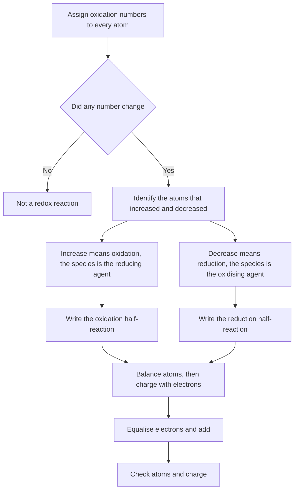
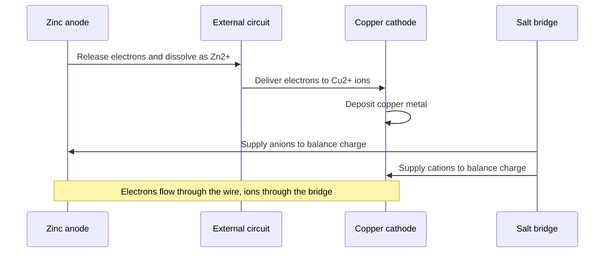
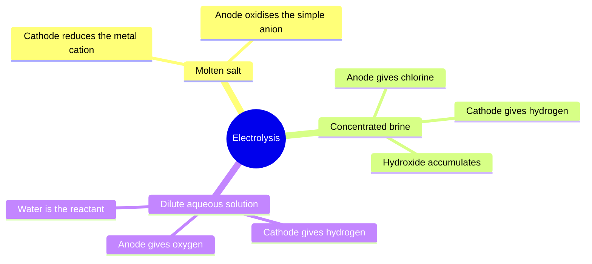

# Chapter 12 — Oxidation–Reduction and Electrochemistry Fundamentals

> **Level:** Intermediate (Level 2 — High School / Intermediate Chemistry)
> **Estimated study time:** 8 hours (5 h reading + 3 h exercises)
> **Prerequisites:** [Level 2 overview](README.md); [Chapter 2 — Stoichiometry](02-stoichiometry-and-limiting-reactants.md) and [Chapter 10 — Equilibrium](10-chemical-equilibrium-and-le-chateliers-principle.md)
> **Related chapters:** [Chemical Equilibrium and Le Châtelier's Principle](10-chemical-equilibrium-and-le-chateliers-principle.md), [Acid–Base Chemistry, pH and pOH](11-acid-base-chemistry-and-ph.md), [Solubility and Precipitation](13-solubility-and-precipitation.md)
> **Difficulty:** ★★★★☆ (4/5)

---

## 1. Learning Objectives

After working through this chapter you will be able to:

- Assign oxidation numbers using the full rule set, including peroxides, superoxides
  and fractional values in mixed oxides.
- Define oxidation and reduction both as electron transfer and as change in oxidation
  number, and identify the oxidising and reducing agents in a reaction.
- Balance redox equations by the half-reaction method in acidic and in basic media.
- Interpret standard electrode potentials, describe the standard hydrogen electrode
  and write cell notation.
- Calculate $E^\circ_{\text{cell}}$ from standard potentials and use it to decide
  whether a reaction is spontaneous.
- Distinguish galvanic from electrolytic cells, and describe the chemistry of common
  batteries.
- Explain corrosion and cathodic protection in electrochemical terms.
- Apply Faraday's laws to electrolysis calculations with $Q = It$ and $n = Q/(zF)$.

---

## 2. Introduction

A lithium-ion cell the size of a AA battery stores about $10\ \text{kJ}$ and delivers it at
3.7 V with an energy efficiency above 95 %. A blast furnace reduces iron ore with carbon at
1500 °C, releasing the chemical energy of the ore as heat. Both are redox processes: the
same electron transfer, run in opposite directions and at wildly different rates. Redox
chemistry is the chemistry of electron bookkeeping, and it underlies energy storage, metal
extraction, corrosion, respiration and photosynthesis.

The economic stakes are large. Corrosion is estimated to cost 3–4 % of global GDP each year,
and a substantial fraction of that is preventable by electrochemical design — protective
coatings, sacrificial anodes, impressed currents. Aluminium, which cannot be smelted by
carbon because it is too reactive, is produced electrolytically at about 4 % of world
electricity demand. Understanding why aluminium must be electrolysed but iron can be reduced
with coke is entirely a matter of electrode potentials, the subject of this chapter.

The chapter begins with oxidation numbers, which are a bookkeeping device rather than a
physical observable, and then shows how the same idea becomes quantitative: half reactions,
standard potentials, cells and Faraday's laws. The equilibrium theory of Chapter 10 is the
foundation — a cell potential is a direct measure of the Gibbs energy change of the cell
reaction, and a battery is an equilibrium system that is deliberately prevented from
reaching equilibrium.

You need stoichiometry, the mole, concentration and the equilibrium constant. No previous
electrochemistry is assumed, but you should be comfortable with charge conservation and with
the idea that a mole of electrons carries a definite charge.

---

## 3. Fundamental Concepts

### 3.1 Oxidation numbers

An **oxidation number** (or oxidation state) is the charge an atom would carry if all its
bonds were treated as fully ionic. It is a formalism: in $\ce{CO2}$ the carbon is assigned
$+4$ even though the bonds are polar covalent and the real charge on carbon is far smaller.
The formalism is useful because electron bookkeeping becomes arithmetic.

The rules, in order of precedence:

| Rule | Statement | Example |
|---|---|---|
| 1 | Free element: oxidation number 0 | $\ce{O2}$, $\ce{Fe}$, $\ce{S8}$ |
| 2 | Monatomic ion: equal to the charge | $\ce{Na+}$ is $+1$, $\ce{S^2-}$ is $-2$ |
| 3 | Group 1 $+1$; Group 2 $+2$; Al $+3$ | $\ce{K2SO4}$: K is $+1$ |
| 4 | Fluorine always $-1$ in compounds | $\ce{NaF}$, $\ce{OF2}$ |
| 5 | Hydrogen $+1$ with non-metals, $-1$ with metals | $\ce{CH4}$: H $+1$; $\ce{NaH}$: H $-1$ |
| 6 | Oxygen $-2$, except peroxide $-1$, superoxide $-\tfrac{1}{2}$, $\ce{OF2}$ $+2$ | $\ce{H2O2}$: O $-1$ |
| 7 | Halogens $-1$, except with O or F | $\ce{HClO4}$: Cl $+7$ |
| 8 | Sum of oxidation numbers equals overall charge | $\ce{SO4^2-}$: S $+6$ |

**Table 12.1 — The oxidation-number rules.** Apply them in order: rule 1 or 2 first, then
the fixed elements, then the unknown. When two rules conflict, the earlier rule wins — that
is why oxygen is $+2$ in $\ce{OF2}$ rather than $-2$.

Worked assignments for common species:

| Species | Element | Oxidation number | Reasoning |
|---|---|---|---|
| $\ce{KMnO4}$ | Mn | $+7$ | K $+1$, four O at $-2$ give $-8$; sum 0 |
| $\ce{K2Cr2O7}$ | Cr | $+6$ | $2(+1) + 2x + 7(-2) = 0$ |
| $\ce{Na2S2O3}$ | S | $+2$ | $2(+1) + 2x + 3(-2) = 0$ |
| $\ce{Fe3O4}$ | Fe | $+\tfrac{8}{3}$ | Mixed $\ce{FeO}$ and $\ce{Fe2O3}$; average value |
| $\ce{NH4NO3}$ | N | $-3$ and $+5$ | Two distinct nitrogen environments |
| $\ce{H2O2}$ | O | $-1$ | Peroxide rule |
| $\ce{HClO4}$ | Cl | $+7$ | H $+1$, four O at $-2$ |

**Table 12.2 — Worked oxidation-number assignments.** The fractional value for $\ce{Fe3O4}$
is not a physical charge on an atom; it is the average over two crystallographically
distinct iron sites, one $\ce{Fe^2+}$ and two $\ce{Fe^3+}$ per formula unit. Fractional
oxidation numbers are a signal that the species is mixed-valent.

### 3.2 Oxidation and reduction

**Oxidation** is the loss of electrons; **reduction** is the gain of electrons. The mnemonic
OIL RIG — oxidation is loss, reduction is gain — is reliable. Equivalently, and more
usefully for balancing, oxidation is an *increase* in oxidation number and reduction is a
*decrease*. The two definitions always agree because electrons are negative: losing them
raises the oxidation number.

An **oxidising agent** (oxidant) is the species that accepts electrons and is itself
reduced. A **reducing agent** (reductant) donates electrons and is itself oxidised. The
agent is always the *other* species: in

$$
\ce{Zn(s) + Cu^2+(aq) -> Zn^2+(aq) + Cu(s)}
$$

zinc is oxidised (0 to $+2$) and is the reducing agent; copper(II) is reduced ($+2$ to 0)
and is the oxidising agent. Students routinely reverse these labels, because the agent is
named after what it does *to the other substance*, not what happens to itself.

A reaction in which one species is oxidised and another reduced is a **redox reaction**.
Disproportionation is the special case in which the same element is both oxidised and
reduced, as in

$$
\ce{2H2O2(aq) -> 2H2O(l) + O2(g)}
$$

where oxygen goes from $-1$ to $-2$ and to 0.

### 3.3 Oxidising and reducing agents in practice

Strong oxidising agents are species with a high affinity for electrons: $\ce{F2}$,
$\ce{O3}$, $\ce{H2O2}$, $\ce{MnO4-}$ in acid, $\ce{Cr2O7^2-}$, $\ce{Cl2}$, concentrated
$\ce{HNO3}$. Strong reducing agents are species that give up electrons easily: the reactive
metals ($\ce{Na}$, $\ce{Mg}$, $\ce{Al}$, $\ce{Zn}$), $\ce{H2}$, carbon and carbon monoxide,
and $\ce{SO2}$.

---

## 4. Detailed Scientific Explanation

### 4.1 Balancing in acidic medium

The **half-reaction method** balances redox equations by separating the oxidation and
reduction processes, balancing each for atoms and charge, and then combining them so that
the electrons cancel. The procedure in acid is:

1. Write the unbalanced skeleton and split it into two half-reactions.
2. Balance all atoms except O and H.
3. Balance O by adding $\ce{H2O}$.
4. Balance H by adding $\ce{H+}$.
5. Balance charge by adding electrons.
6. Multiply each half-reaction so that the electrons cancel, then add.
7. Check atoms and charge.

For the oxidation of iron(II) by permanganate:

$$
\ce{MnO4-(aq) + 8H+(aq) + 5e- -> Mn^2+(aq) + 4H2O(l)}
$$

$$
\ce{Fe^2+(aq) -> Fe^3+(aq) + e-}
$$

Multiplying the second by five and adding gives the balanced equation of Section 7. Note
that the medium matters: in acid the product is $\ce{Mn^2+}$, whereas in neutral or basic
solution it is $\ce{MnO2}$.

### 4.2 Balancing in basic medium

Two routes are acceptable. The first balances as though the solution were acidic and then
neutralises: add $\ce{OH-}$ to both sides to consume every $\ce{H+}$, combine $\ce{H+}$ and
$\ce{OH-}$ into $\ce{H2O}$, and cancel water. The second works in hydroxide from the start,
balancing O with $\ce{H2O}$ and H with $\ce{OH-}$. Both give the same result; the first is
less error-prone for beginners.

A useful check is that the final equation must contain neither $\ce{H+}$ nor electrons, and
that charge must balance. For the oxidation of sulfite by permanganate in base, the
half-reactions are

$$
\ce{MnO4-(aq) + 2H2O(l) + 3e- -> MnO2(s) + 4OH-(aq)}
$$

$$
\ce{SO3^2-(aq) + 2OH-(aq) -> SO4^2-(aq) + H2O(l) + 2e-}
$$

and the balanced overall equation appears in Section 7. The appearance of $\ce{OH-}$ on the
left of the oxidation half-reaction is characteristic of basic media: the hydroxide is a
reactant, not a spectator.

### 4.3 Standard electrode potentials and the standard hydrogen electrode

A **standard electrode potential** $E^\circ$ is the potential of a half-cell measured
relative to the **standard hydrogen electrode** (SHE) under standard conditions: $1\
\text{bar}$ for gases, $1\ \text{mol dm}^{-3}$ for solutes, 298 K, and a platinum electrode
for the hydrogen couple

$$
\ce{2H+(aq) + 2e- <=> H2(g)} \qquad E^\circ \equiv 0.00\ \text{V}
$$

By convention, electrode potentials are quoted as **reduction potentials**: the
half-reaction is written with electrons on the left, and $E^\circ$ describes that reduction.
The more positive $E^\circ$, the greater the tendency of the oxidised form to accept
electrons, so the stronger the oxidising agent.

| Half-reaction | $E^\circ$ / V |
|---|---|
| $\ce{F2(g) + 2e- -> 2F-(aq)}$ | $+2.87$ |
| $\ce{MnO4-(aq) + 8H+ + 5e- -> Mn^2+(aq) + 4H2O}$ | $+1.51$ |
| $\ce{Cl2(g) + 2e- -> 2Cl-(aq)}$ | $+1.36$ |
| $\ce{O2(g) + 4H+ + 4e- -> 2H2O(l)}$ | $+1.23$ |
| $\ce{Ag+(aq) + e- -> Ag(s)}$ | $+0.80$ |
| $\ce{Cu^2+(aq) + 2e- -> Cu(s)}$ | $+0.34$ |
| $\ce{2H+ + 2e- -> H2(g)}$ | $0.00$ |
| $\ce{Pb^2+(aq) + 2e- -> Pb(s)}$ | $-0.13$ |
| $\ce{Fe^2+(aq) + 2e- -> Fe(s)}$ | $-0.44$ |
| $\ce{Zn^2+(aq) + 2e- -> Zn(s)}$ | $-0.76$ |
| $\ce{Al^3+(aq) + 3e- -> Al(s)}$ | $-1.66$ |
| $\ce{Na+(aq) + e- -> Na(s)}$ | $-2.71$ |

**Table 12.3 — Standard reduction potentials at 298 K.** The table can be read as a league
table of electron hunger. Fluorine tops it; sodium ion bottoms it. Any species on the left
of a half-reaction can oxidise any species on the right of a half-reaction that lies below
it, which is the basis of the displacement reactions met in elementary chemistry.

### 4.4 Galvanic cells and cell notation

A **galvanic (voltaic) cell** converts the Gibbs energy of a spontaneous redox reaction into
electrical work. It consists of two half-cells connected by a wire (electron path) and a
salt bridge or porous frit (ion path). Oxidation occurs at the **anode**, reduction at the
**cathode**; in a galvanic cell the anode is negative and the cathode positive, because
electrons flow from anode to cathode through the external circuit.

For the Daniell cell, $\ce{Zn(s) + Cu^2+(aq) -> Zn^2+(aq) + Cu(s)}$, the notation is

$$
\ce{Zn(s) | Zn^2+(aq) || Cu^2+(aq) | Cu(s)}
$$

where a single bar marks a phase boundary, a double bar the salt bridge, and the anode is
written on the left by convention. The cell potential is

$$
E^\circ_{\text{cell}} = E^\circ_{\text{cathode}} - E^\circ_{\text{anode}} = 0.34 - (-0.76) =
1.10\ \text{V}
$$

The subtraction is easy to get wrong. It follows from writing both potentials as reductions:
the cathode accepts electrons (reduction) and the anode supplies them (oxidation, the
reverse of the tabulated reduction), so the cell potential is the cathode value minus the
anode value. Equivalently, $E^\circ_{\text{cell}} = E^\circ_{\text{reduction}} +
E^\circ_{\text{oxidation}}$ with the oxidation potential the negative of the tabulated
reduction potential.

A positive $E^\circ_{\text{cell}}$ means $\Delta G^\circ < 0$, because

$$
\Delta G^\circ = -zFE^\circ_{\text{cell}}
$$

where $z$ is the number of moles of electrons transferred per mole of reaction and $F =
96\,485\ \text{C mol}^{-1}$ is the Faraday constant. For the Daniell cell, $\Delta G^\circ =
-2(96\,485)(1.10) = -212\ \text{kJ mol}^{-1}$.

### 4.5 Electrolytic cells

An **electrolytic cell** drives a non-spontaneous reaction using an external power supply.
The external supply forces electrons from the anode to the cathode against the cell's own
tendency. In an electrolytic cell the anode is positive (it attracts anions) and the cathode
negative, the reverse of the galvanic convention.

The minimum voltage needed is the thermodynamic cell potential, but the operating voltage is
higher because of **overpotential** — an extra voltage needed to drive the electrode
reactions at a useful rate — and because of ohmic losses in the electrolyte and contacts.
Overpotential is why water can be electrolysed between platinum electrodes at about 1.6–1.8
V rather than the thermodynamic 1.23 V, and why hydrogen evolution on mercury requires
nearly a volt more than on platinum. The concept is the electrochemical analogue of
activation energy.

### 4.6 Batteries

A **battery** is a galvanic cell (or a stack of cells) packaged for use. The chemistry of
the common types follows directly from the potentials of Table 12.3.

| Battery | Cell reaction (discharge) | Nominal voltage | Notes |
|---|---|---|---|
| Leclanché (zinc–carbon) | $\ce{Zn + 2MnO2 + 2NH4+ -> Zn(NH3)2Cl2 + 2MnOOH}$ | 1.5 V | Cheap; voltage falls steadily; not rechargeable |
| Alkaline | $\ce{Zn + 2MnO2 + H2O -> ZnO + 2MnOOH}$ | 1.5 V | Alkaline electrolyte; longer life, better load tolerance |
| Lead–acid | $\ce{Pb + PbO2 + 2H2SO4 -> 2PbSO4 + 2H2O}$ | 2.05 V per cell | Rechargeable; six cells give 12 V; heavy |
| Lithium-ion | $\ce{Li_{1-x}CoO2 + Li_xC6 <=> LiCoO2 + C6}$ | 3.6–3.8 V | Rechargeable; high energy density; needs protection circuits |

**Table 12.4 — Four battery chemistries.** The lead–acid battery is the clearest
illustration of a rechargeable cell: charging reverses every half-reaction, depositing lead
at the negative plate and lead dioxide at the positive plate while regenerating sulfuric
acid. Lithium-ion cells work by intercalation rather than by dissolution and deposition,
which is why they survive thousands of cycles.

### 4.7 Corrosion and cathodic protection

Iron rusts by an electrochemical mechanism, not by direct reaction with oxygen. On a iron
surface exposed to water and air, small anodic and cathodic regions form:

$$
\ce{Fe(s) -> Fe^2+(aq) + 2e-} \qquad\text{(anode)}
$$

$$
\ce{O2(g) + 2H2O(l) + 4e- -> 4OH-(aq)} \qquad\text{(cathode)}
$$

The iron(II) ions are then oxidised further by air to iron(III) and precipitate as hydrated
iron(III) oxide, the familiar brown rust. The process requires an electrolyte — salt
accelerates it dramatically, which is why cars corrode faster on salted roads — and it
requires an electron path, which is why a single scratch in a coating can concentrate
attack.

**Cathodic protection** prevents corrosion by making the structure the cathode of a cell.
Two methods are used. In **sacrificial anode** protection, a block of a more reactive metal
(zinc, magnesium or aluminium) is connected to the steel; the block becomes the anode and
corrodes, while the steel is protected. In **impressed current** protection, an external
supply holds the steel at a cathodic potential. Both are applications of Table 12.3: the
protected metal must lie below the sacrificial one in the table.

### 4.8 Electrolysis of molten sodium chloride, aqueous sodium chloride and water

The products of electrolysis depend on which species can reach the electrodes and on their
potentials.

**Molten $\ce{NaCl}$.** There is no water, so the only ions present are $\ce{Na+}$ and
$\ce{Cl-}$. At the cathode, $\ce{Na+}$ is reduced to sodium metal; at the anode, $\ce{Cl-}$
is oxidised to chlorine:

$$
\ce{2NaCl(l) -> 2Na(l) + Cl2(g)}
$$

This is the Downs process, operated at about 600 °C to keep the salt molten and to keep the
sodium liquid. It is the industrial route to sodium.

**Aqueous $\ce{NaCl}$ (brine).** Water now competes. At the cathode, reduction of water is
favoured over reduction of $\ce{Na+}$ because the sodium potential is far too negative;
hydrogen is evolved and hydroxide accumulates. At the anode, chloride is oxidised in
preference to water when the brine is concentrated:

$$
\ce{2NaCl(aq) + 2H2O(l) -> 2NaOH(aq) + H2(g) + Cl2(g)}
$$

This is the chlor-alkali process, one of the largest electrolytic industries; its products
are chlorine, hydrogen and sodium hydroxide.

**Water.** With a dilute electrolyte to carry current (dilute sulfuric acid or sodium
hydroxide), both electrode reactions involve water:

$$
\ce{2H2O(l) -> 2H2(g) + O2(g)}
$$

Hydrogen is evolved at the cathode and oxygen at the anode in a 2:1 volume ratio, exactly
the ratio in the formula of water.

### 4.9 Faraday's laws

**Faraday's first law** states that the amount of substance deposited or liberated at an
electrode is proportional to the charge passed. **Faraday's second law** states that, for a
given charge, the amounts of different substances are in the ratio of their equivalent
weights, that is, inversely proportional to the number of electrons per formula unit.

Quantitatively,

$$
Q = It, \qquad n = \frac{Q}{zF}
$$

where $Q$ is charge in coulombs, $I$ current in amperes, $t$ time in seconds, $n$ the amount
in moles, $z$ the number of electrons per formula unit and $F = 96\,485\ \text{C mol}^{-1}$.
The product $zF$ is the charge carried by one mole of the substance's reaction units.

The relation is exact and needs no equilibrium constant; it is simply charge accounting. Its
practical value is that it links an easily measured electrical quantity to a chemical
amount, which is the basis of electrogravimetry, coulometry and electroplating control.

---

## 5. Visual Diagrams

**Figure 12.1 — A workflow for analysing any redox reaction.** The first decision is
bookkeeping, and worth making explicitly: many reactions that look like redox
(precipitation, acid–base neutralisation) leave every oxidation number unchanged. Keeping
the two middle branches separate makes the agent labels fall out automatically.

**Figure 12.2 — Charge transport in the Daniell cell.** Two circuits are needed: electrons
travel through the wire and ions through the salt bridge. Without the bridge the cell would
polarise within seconds as charge accumulated at the electrodes.

**Figure 12.3 — Product map for electrolysis.** At each electrode the species with the more
favourable potential reacts. Molten salts offer no competition, concentrated brine sends
chloride to the anode, and in dilute solution water reacts at both electrodes.

---

## 6. Mathematical Formulas

### 6.1 Cell potential and Gibbs energy

$$
E^\circ_{\text{cell}} = E^\circ_{\text{cathode}} - E^\circ_{\text{anode}}, \qquad \Delta
G^\circ = -zFE^\circ_{\text{cell}}
$$

| Symbol | Meaning | SI unit |
|---|---|---|
| $E^\circ_{\text{cell}}$ | Standard cell potential | V |
| $E^\circ_{\text{cathode}}$, $E^\circ_{\text{anode}}$ | Standard reduction potentials | V |
| $z$ | Moles of electrons per mole of reaction | dimensionless |
| $F$ | Faraday constant | $96\,485\ \text{C mol}^{-1}$ |
| $\Delta G^\circ$ | Standard Gibbs energy change | $\text{J mol}^{-1}$ |

**Assumptions.** Standard conditions (1 bar, $1\ \text{mol dm}^{-3}$, 298 K), ideal
solutions, no liquid-junction potential. The relation $E^\circ = E_{\text{cathode}} -
E_{\text{anode}}$ uses tabulated *reduction* potentials for both electrodes.

### 6.2 Faraday's laws

$$
Q = It, \qquad n = \frac{Q}{zF}, \qquad m = nM
$$

| Symbol | Meaning | SI unit |
|---|---|---|
| $Q$ | Electric charge passed | C |
| $I$ | Current | A |
| $t$ | Time | s |
| $n$ | Amount of substance | mol |
| $z$ | Electrons per formula unit | dimensionless |
| $M$ | Molar mass | $\text{g mol}^{-1}$ |

**Assumptions.** Current efficiency of 100 %; no competing electrode reaction. In practice,
competing reactions (such as hydrogen evolution during metal deposition) reduce the current
efficiency, and the calculated mass is an upper bound.

---

## 7. Chemical Equations

$$
\ce{Zn(s) + Cu^2+(aq) -> Zn^2+(aq) + Cu(s)}
$$

$$
\ce{MnO4-(aq) + 5Fe^2+(aq) + 8H+(aq) -> Mn^2+(aq) + 5Fe^3+(aq) + 4H2O(l)}
$$

$$
\ce{2MnO4-(aq) + 3SO3^2-(aq) + H2O(l) -> 2MnO2(s) + 3SO4^2-(aq) + 2OH-(aq)}
$$

$$
\ce{Cr2O7^2-(aq) + 14H+(aq) + 6e- -> 2Cr^3+(aq) + 7H2O(l)}
$$

$$
\ce{Pb(s) + PbO2(s) + 2H2SO4(aq) -> 2PbSO4(s) + 2H2O(l)}
$$

$$
\ce{2NaCl(l) -> 2Na(l) + Cl2(g)}
$$

$$
\ce{2NaCl(aq) + 2H2O(l) -> 2NaOH(aq) + H2(g) + Cl2(g)}
$$

$$
\ce{2H2O(l) -> 2H2(g) + O2(g)}
$$

The first equation is the Daniell cell; the second and third are the acidic and basic
permanganate oxidations balanced in Sections 4.1 and 4.2; the fourth is the dichromate
half-reaction, included because it is the standard oxidant in volumetric analysis. The fifth
is the lead–acid cell discharge, and the last three are the electrolysis cases of Section
4.8. Every equation is balanced for atoms and charge; the last three carry no electrons
because they are complete cell reactions.

---

## 8. Worked Examples

### Worked Example 12.1 — Balancing in acidic solution

**Problem.** Balance $\ce{MnO4-(aq) + Fe^2+(aq) -> Mn^2+(aq) + Fe^3+(aq)}$ in acidic
solution.

**Strategy.** Split into half-reactions; balance O with water, H with $\ce{H+}$, charge with
electrons; equalise electrons; add.

**Solution.** Reduction:

$$
\ce{MnO4- + 8H+ + 5e- -> Mn^2+ + 4H2O}
$$

Oxidation:

$$
\ce{Fe^2+ -> Fe^3+ + e-}
$$

Multiplying the oxidation by 5 and adding:

$$
\ce{MnO4- + 5Fe^2+ + 8H+ -> Mn^2+ + 5Fe^3+ + 4H2O}
$$

**Check.** Atoms: Mn 1, Fe 5, O 4, H 8 on both sides. Charge: left $-1 + 10 + 8 = +17$;
right $+2 + 15 = +17$. Both balances hold. The stoichiometric ratio 1:5 is the one used in
permanganometry.

### Worked Example 12.2 — Balancing in basic solution

**Problem.** Balance $\ce{MnO4-(aq) + SO3^2-(aq) -> MnO2(s) + SO4^2-(aq)}$ in basic
solution.

**Strategy.** Balance in acid first, then remove $\ce{H+}$ by adding $\ce{OH-}$ to both
sides and combining.

**Solution.** Reduction:

$$
\ce{MnO4- + 4H+ + 3e- -> MnO2 + 2H2O}
$$

Oxidation:

$$
\ce{SO3^2- + H2O -> SO4^2- + 2H+ + 2e-}
$$

Equalising electrons (2 × reduction, 3 × oxidation) and adding:

$$
\ce{2MnO4- + 8H+ + 3SO3^2- + 3H2O -> 2MnO2 + 4H2O + 3SO4^2- + 6H+}
$$

Cancelling $\ce{H+}$ and $\ce{H2O}$:

$$
\ce{2MnO4- + 2H+ + 3SO3^2- -> 2MnO2 + H2O + 3SO4^2-}
$$

Adding $2\ce{OH-}$ to both sides and combining with the $2\ce{H+}$ gives the basic form:

$$
\ce{2MnO4- + 3SO3^2- + H2O -> 2MnO2 + 3SO4^2- + 2OH-}
$$

**Check.** Mn 2, S 3, O $8 + 9 + 1 = 18$ on the left and $4 + 12 + 2 = 18$ on the right; H 2
on both sides. Charge: left $-2 - 6 = -8$; right $-6 - 2 = -8$. The equation contains no
$\ce{H+}$, as a basic-medium equation must not.

### Worked Example 12.3 — Cell potential and spontaneity

**Problem.** For the Daniell cell, calculate $E^\circ_{\text{cell}}$ and $\Delta G^\circ$ at
298 K, and state whether the reaction is spontaneous under standard conditions.

**Strategy.** Identify cathode and anode from the direction of electron flow: copper is
reduced, zinc oxidised. Use the tabulated reduction potentials and $\Delta G^\circ =
-zFE^\circ$.

**Solution.** $E^\circ_{\text{cathode}} = +0.34\ \text{V}$ for $\ce{Cu^2+/Cu}$ and
$E^\circ_{\text{anode}} = -0.76\ \text{V}$ for $\ce{Zn^2+/Zn}$, so

$$
E^\circ_{\text{cell}} = 0.34 - (-0.76) = 1.10\ \text{V}
$$

Two electrons are transferred, so

$$
\Delta G^\circ = -(2)(96\,485)(1.10) = -2.12\times10^{5}\ \text{J mol}^{-1} = -212\ \text{kJ
mol}^{-1}
$$

**Check.** A positive $E^\circ_{\text{cell}}$ and a negative $\Delta G^\circ$ agree, as they
must. The magnitude is typical of a battery: $1.1\ \text{V}$ at $2\ \text{mol}$ of
electrons gives about $200\ \text{kJ mol}^{-1}$, the energy scale of a chemical bond.

### Worked Example 12.4 — Electrolytic deposition of copper

**Problem.** A current of $2.50\ \text{A}$ is passed through copper(II) sulfate solution for
$1.50\ \text{h}$. Calculate the mass of copper deposited at the cathode.

**Strategy.** Convert time to seconds, compute $Q = It$, then $n(\ce{Cu}) = Q/(zF)$ with $z
= 2$, and convert with $M = 63.55\ \text{g mol}^{-1}$.

**Solution.**

$$
Q = (2.50\ \text{A})(1.50 \times 3600\ \text{s}) = 1.35\times10^{4}\ \text{C}
$$

$$
n(\ce{Cu}) = \frac{1.35\times10^{4}}{2(96\,485)} = 6.996\times10^{-2}\ \text{mol}
$$

$$
m = (6.996\times10^{-2})(63.55) = 4.45\ \text{g}
$$

**Check.** One faraday ($96\,485\ \text{C}$) deposits half a mole of copper, and
$1.35\times10^{4}\ \text{C}$ is about $0.14\ \text{F}$, which is $0.07\ \text{mol}$.

## 9. Real-World Applications

**Energy storage.** Lithium-ion cells dominate portable electronics and electric vehicles
because their 3.7 V potential and low mass give a high energy density. The chemistry is
intercalation: lithium ions move between graphite and a metal oxide without dissolving
either electrode, which is why the cells survive many cycles.

**Metal extraction.** Aluminium is produced by the Hall–Héroult process, electrolysing
alumina in molten cryolite at about 950 °C; the cell potential is only about 4 V but the
currents are hundreds of kiloamps. Iron and zinc, by contrast, are reduced chemically with
carbon because their oxides are reducible at accessible temperatures.

**Corrosion engineering.** Pipelines, ship hulls, hot-water tanks and reinforced concrete
are protected by sacrificial anodes or impressed current. The design rule is
electrochemical: the protected metal must be the cathode, so the sacrificial metal must have
a more negative potential.

---

## 10. Common Mistakes

| Mistake | Why it happens | Correct approach |
|---|---|---|
| Calling the oxidising agent the species that is oxidised | The name describes the effect on the partner | The oxidising agent is itself reduced |
| Reversing anode and cathode in a galvanic cell | Both are "where something happens" | Oxidation at the anode, reduction at the cathode |
| Using $E^\circ_{\text{cell}} = E_{\text{anode}} - E_{\text{cathode}}$ | The formula is recalled loosely | Always cathode minus anode, with both as reduction potentials |
| Forgetting to multiply $E^\circ$ by $z$ in $\Delta G^\circ$ | The factor looks like a detail | $\Delta G^\circ = -zFE^\circ$; $z$ changes the energy, not the voltage |
| Leaving $\ce{H+}$ in a basic-medium equation | The acidic procedure is followed mechanically | Neutralise with $\ce{OH-}$ and cancel water |
| Assuming the metal ion is always reduced at the cathode in aqueous solution | The simplest ion is assumed to react | Compare potentials; water is reduced in preference to $\ce{Na+}$ |
| Treating an oxidation number as a real charge | The formalism is taught as if it were a measurement | It is a bookkeeping device, useful but not a physical observable |
| Using $t$ in minutes in $Q = It$ | Units are not converted | Convert to seconds; $1\ \text{A} = 1\ \text{C s}^{-1}$ |

---

## 11. Chapter Summary

- Oxidation numbers are assigned by a fixed rule set; the sum equals the overall
  charge, and fractional values indicate mixed-valent species.
- Oxidation is loss of electrons (increase in oxidation number); reduction is gain.
  The oxidising agent is reduced, the reducing agent oxidised.
- Half-reaction balancing conserves atoms and charge; in basic medium the $\ce{H+}$ is
  removed with $\ce{OH-}$.
- Standard electrode potentials are reduction potentials relative to the SHE, which is
  defined as 0.00 V.
- $E^\circ_{\text{cell}} = E^\circ_{\text{cathode}} - E^\circ_{\text{anode}}$, and
  $\Delta G^\circ = -zFE^\circ_{\text{cell}}$; a positive cell potential means a
  spontaneous reaction.
  electrical work to drive non-spontaneous reactions, and need extra voltage to
  overcome overpotential.
- Corrosion is an electrochemical cell on a metal surface; cathodic protection makes
  the structure the cathode.
- Electrolysis products depend on which species can reach the electrode and on their
  potentials: molten salt, concentrated brine and dilute aqueous solutions behave
  differently.
- Faraday's laws link charge to amount: $Q = It$ and $n = Q/(zF)$.

---

## 12. Exercises

### 12.1 Conceptual questions

1. Explain why the oxidation number of oxygen is $+2$ in $\ce{OF2}$ but $-1$ in
   $\ce{H2O2}$.
2. A reaction consumes $\ce{Cl2}$ and produces $\ce{Cl-}$. Is chlorine oxidised or
   reduced, and is it the oxidising or the reducing agent?
3. Why does a galvanic cell stop producing current when the salt bridge is removed,
   even though the electrodes are still connected by a wire?

### 12.2 Basic problems

4. Assign oxidation numbers: (a) S in $\ce{H2SO4}$; (b) N in $\ce{NO2}$; (c) Cr in
   $\ce{CrO4^2-}$; (d) C in $\ce{CH3OH}$.
5. Identify the oxidising and reducing agents in
   $\ce{2Al(s) + 3Cl2(g) -> 2AlCl3(s)}$.
6. Write the cell notation for a cell made from $\ce{Ag+/Ag}$ and $\ce{Zn^2+/Zn}$.

### 12.3 Intermediate problems

7. Balance $\ce{Cu(s) + NO3-(aq) -> Cu^2+(aq) + NO2(g)}$ in acidic solution.
8. Balance $\ce{Cl2(g) + OH-(aq) -> Cl-(aq) + ClO3-(aq) + H2O(l)}$ and state which
   element is disproportionating.

### 12.4 Advanced problems

9. Use standard potentials to explain why $\ce{Fe^3+}$ oxidises $\ce{I-}$ but not
   $\ce{Cl-}$.
10. Explain why the operating voltage of a water electrolyser exceeds $1.23\ \text{V}$
    and why the excess depends on the electrode material.

### 12.5 Calculation problems

11. Calculate $E^\circ_{\text{cell}}$ and $\Delta G^\circ$ for
    $\ce{2Ag+(aq) + Cu(s) -> 2Ag(s) + Cu^2+(aq)}$.
12. A current of $0.750\ \text{A}$ passes through molten $\ce{NaCl}$ for
    $2.00\ \text{h}$. Calculate the mass of sodium and the volume of chlorine at room
    temperature and pressure ($24.0\ \text{dm}^{3}\ \text{mol}^{-1}$).

### 12.6 Answers

1. Fluorine is more electronegative than oxygen, so oxygen is positive; in the peroxide
   ion the O–O bond makes each oxygen $-1$.
2. Chlorine gains electrons, so it is reduced and is the oxidising agent.
3. Without the bridge, charge builds up and the cell potential collapses.
4. (a) $+6$; (b) $+4$; (c) $+6$; (d) $-2$.
5. $\ce{Cl2}$ is reduced (oxidising agent); $\ce{Al}$ is oxidised (reducing agent).
6. $\ce{Zn(s) | Zn^2+(aq) || Ag+(aq) | Ag(s)}$.
7. $\ce{Cu + 4H+ + 2NO3- -> Cu^2+ + 2NO2 + 2H2O}$.
8. $\ce{3Cl2 + 6OH- -> 5Cl- + ClO3- + 3H2O}$; chlorine is both oxidised and reduced.
9. $E^\circ(\ce{Fe^3+/Fe^2+}) = +0.77\ \text{V}$ lies above $E^\circ(\ce{I2/I-}) =
   +0.54\ \text{V}$, so iodide is oxidised; it lies below $E^\circ(\ce{Cl2/Cl-}) =
   +1.36\ \text{V}$, so chloride is not.
10. Overpotential drives the electrode reactions at a useful rate; it depends on the
    electrocatalyst and is larger for oxygen evolution than for hydrogen evolution.
11. $E^\circ_{\text{cell}} = 0.80 - 0.34 = 0.46\ \text{V}$;
    $\Delta G^\circ = -(2)(96\,485)(0.46) = -89\ \text{kJ mol}^{-1}$.
12. $Q = (0.750)(7200) = 5400\ \text{C}$; $n(\ce{Na}) = 5400/96\,485 = 0.0560\ \text{mol}$,
    so $m = 1.29\ \text{g}$; $n(\ce{Cl2}) = 0.0280\ \text{mol}$, so
    $V = 0.672\ \text{dm}^{3}$.

> Worked solutions for this level are maintained in the `solutions/` directory of the level.

---

## 13. Further Reading

- OpenStax, *Chemistry 2e*, Rice University, Chapters 17 ("Electrochemistry") and 4 ("Stoichiometry of Chemical Reactions", oxidation–reduction section). <https://openstax.org/details/books/chemistry-2e>
- Atkins, P.; Jones, L. *Chemical Principles: The Quest for Insight*, 7th ed., W. H. Freeman. The chapters on oxidation–reduction and electrochemistry.
- Bard, A. J.; Faulkner, L. R. *Electrochemical Methods: Fundamentals and Applications*, Wiley. The standard reference for electrode potentials and overpotential.
- Brown, T. L.; LeMay, H. E.; Bursten, B. E. *Chemistry: The Central Science*, Pearson. The chapters on redox reactions and electrochemistry.
- IUPAC. *Compendium of Chemical Terminology* (the "Gold Book"), 2nd ed. (corrected version), entries "oxidation state", "standard electrode potential", "electrochemical cell". <https://goldbook.iupac.org/>
- NIST. *CODATA Internationally Recommended Values of the Fundamental Physical Constants*. <https://physics.nist.gov/cuu/Constants/>
- [CURRICULUM.md](../CURRICULUM.md) — where this chapter sits in the full programme.
- [REFERENCES.md](../REFERENCES.md) — the repository's verified source list.

> Only sources that can be checked are cited here. No DOI, page number or edition is invented.
