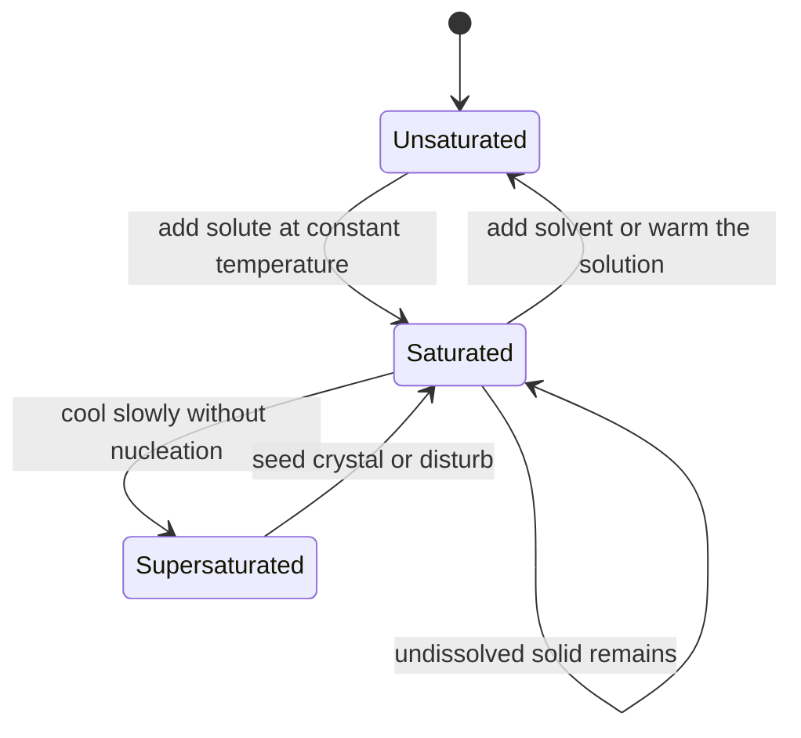
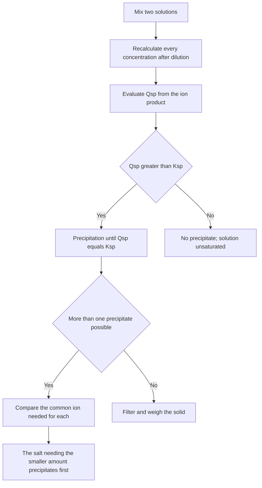
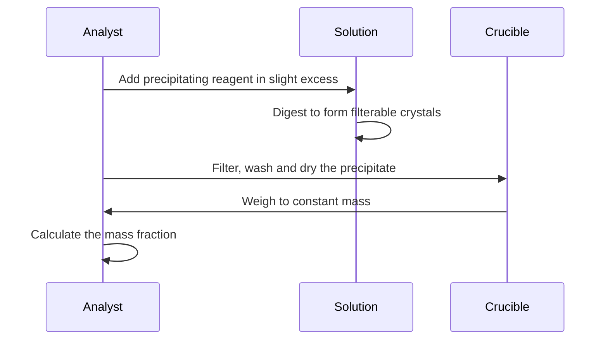

# Chapter 13 — Solubility and Precipitation

> **Level:** Intermediate (Level 2 — High School / Intermediate Chemistry)
> **Estimated study time:** 6 hours (4 h reading + 2 h exercises)
> **Prerequisites:** [Level 2 overview](README.md); [Chapter 3 — Solutions](03-solutions-concentration-and-dilution.md) and [Chapter 10 — Equilibrium](10-chemical-equilibrium-and-le-chateliers-principle.md)
> **Related chapters:** [Chemical Equilibrium and Le Châtelier's Principle](10-chemical-equilibrium-and-le-chateliers-principle.md), [Acid–Base Chemistry, pH and pOH](11-acid-base-chemistry-and-ph.md), [Oxidation–Reduction and Electrochemistry Fundamentals](12-redox-reactions-and-electrochemistry-fundamentals.md)
> **Difficulty:** ★★★★☆ (4/5)

---

## 1. Learning Objectives

After working through this chapter you will be able to:

- Distinguish solubility from the solubility product, and use the correct units for
  each.
- Apply the solubility rules and explain why they are rules of thumb rather than laws.
- Write $K_{sp}$ expressions for any sparingly soluble salt.
- Calculate molar solubility from $K_{sp}$ and $K_{sp}$ from solubility, including
  salts of the $1:2$ and $1:3$ types.
- Predict precipitation by comparing $Q_{sp}$ with $K_{sp}$.
- Quantify the common-ion effect and the effect of pH on solubility.
- Explain dissolution in terms of lattice enthalpy and hydration enthalpy.
- Describe the group separation scheme of qualitative analysis and the principles of
  recrystallisation and gravimetric analysis.

---

## 2. Introduction

Kidney stones are crystals. Most of them are calcium oxalate, a salt so sparingly soluble
that a healthy kidney must keep its concentration below about $5\times10^{-5}\ \text{mol
dm}^{-3}$ to avoid precipitation. When urine becomes too concentrated, or too acidic, or too
low in citrate — the natural inhibitor — the solution crosses saturation and crystals
nucleate. The same chemistry explains the scale inside a kettle, the white deposit on a
shower head, the stalactites in a limestone cave and the cloudiness that identifies a
positive test for chloride.

Solubility is where the equilibrium theory of Chapter 10 meets the analytical tradition of
the laboratory. A saturated solution of a sparingly soluble salt is an equilibrium system
with an equilibrium constant that happens to be very small; the expression for that constant
is called the **solubility product**, and every qualitative observation about precipitation
becomes a comparison between a reaction quotient and that constant. The link is exact, not
metaphorical.

This chapter develops that link quantitatively. It begins with the vocabulary and the
solubility rules, then derives the $K_{sp}$ expressions and the calculations that follow
from them. The common-ion effect and the pH dependence of solubility are treated as
applications of Le Châtelier's principle, and the chapter closes with the thermodynamics of
dissolution and with three laboratory applications: qualitative analysis, recrystallisation
and gravimetric analysis.

You need concentration, the mole, the equilibrium constant and the reaction quotient. The
chapter is shorter than its neighbours because the underlying theory has already been built;
what is new is the arithmetic of a particular kind of heterogeneous equilibrium, and the
laboratory judgement that goes with it.

---

## 3. Fundamental Concepts

### 3.1 Solubility and saturation

**Solubility** is the concentration of a solute in a saturated solution at a stated
temperature. It is a property of the *system*, not a constant of the substance: it depends
on temperature, on the solvent and on the presence of other solutes.

Three states of a solution must be distinguished.

- **Unsaturated**: more solute could dissolve; the solution is below saturation.
- **Saturated**: the solution is in equilibrium with undissolved solute; the
  dissolved concentration is the solubility.
- **Supersaturated**: the solution contains more solute than the equilibrium
  solubility, usually because it has been cooled carefully; it is metastable and
  crystallises when seeded or disturbed.

Solubility is expressed in several units, and confusing them is a common error.

| Unit | Typical use | Conversion |
|---|---|---|
| $\text{g dm}^{-3}$ | General chemistry | Divide by molar mass for $\text{mol dm}^{-3}$ |
| $\text{mol dm}^{-3}$ | Equilibrium calculations | Multiply by molar mass for $\text{g dm}^{-3}$ |
| $\text{g per 100 g solvent}$ | Older tables, industrial work | Requires the solvent mass, not the solution volume |
| $\text{mol kg}^{-1}$ (molality) | Precise physical chemistry | Independent of temperature |

**Table 13.1 — Units of solubility.** The solubility product uses molar concentration only.
A value quoted in grams per litre must be converted before it can be compared with $K_{sp}$.

The **solubility product** $K_{sp}$ is the equilibrium constant for the dissolution
reaction. It is a true constant at a given temperature, whereas the solubility is not:
solubility changes when a common ion is added, but $K_{sp}$ does not.

### 3.2 The solubility rules

The rules below summarise which ionic compounds are sparingly soluble in water. They are
empirical generalisations with many exceptions, and they say nothing about *how* sparingly
soluble a salt is.

| Compound class | General solubility | Main exceptions |
|---|---|---|
| Nitrates, acetates, perchlorates | Soluble | Few; $\ce{KClO4}$ is moderately soluble |
| Group 1 and ammonium salts | Soluble | Some lithium salts are limited |
| Chlorides, bromides, iodides | Soluble | $\ce{Ag+}$, $\ce{Pb^2+}$, $\ce{Hg2^2+}$ salts insoluble |
| Sulfates | Soluble | $\ce{BaSO4}$, $\ce{PbSO4}$, $\ce{CaSO4}$ (sparingly) |
| Carbonates, phosphates, sulfides | Insoluble | Group 1 and ammonium salts soluble |
| Hydroxides | Insoluble | Group 1 soluble; $\ce{Ba(OH)2}$, $\ce{Ca(OH)2}$ moderately |

**Table 13.2 — Solubility rules.** "Insoluble" means sparingly soluble: every "insoluble"
salt has a finite $K_{sp}$ and therefore a finite solubility. The rules are useful for
predicting what will precipitate, not for deciding whether the precipitation is
quantitative.

### 3.3 The solubility product

For a sparingly soluble salt $\ce{M_xA_y}$ dissolving in water,

$$
\ce{M_xA_y(s) <=> xM^{y+}(aq) + yA^{x-}(aq)}
$$

the equilibrium expression omits the solid, so

$$
K_{sp} = [\ce{M^{y+}}]^{x}[\ce{A^{x-}}]^{y}
$$

For silver chloride, $\ce{AgCl(s) <=> Ag+(aq) + Cl-(aq)}$ and $K_{sp} = [\ce{Ag+}][\ce{Cl-}]
= 1.8\times10^{-10}$. For calcium fluoride, $\ce{CaF2(s) <=> Ca^2+(aq) + 2F-(aq)}$ and
$K_{sp} = [\ce{Ca^2+}][\ce{F-}]^{2} = 3.9\times10^{-11}$.

Two points follow from the definition. First, the units of $K_{sp}$ depend on the
stoichiometry: $(\text{mol dm}^{-3})^{2}$ for a $1:1$ salt and $(\text{mol dm}^{-3})^{3}$
for a $1:2$ salt. Second, the value alone does not rank solubilities, because the exponent
differs. Silver chloride has $K_{sp} = 1.8\times10^{-10}$ and silver chromate has $K_{sp} =
1.1\times10^{-12}$, yet silver chromate is the *more* soluble of the two in pure water,
because its expression contains the square of a concentration. This is the single most
important cautionary point in the chapter.

---

## 4. Detailed Scientific Explanation

### 4.1 Predicting precipitation with $Q_{sp}$

The **ion product** $Q_{sp}$ has the form of $K_{sp}$ but uses the concentrations
immediately after mixing, before any precipitation has occurred. Comparing the two gives the
direction of change, exactly as in Chapter 10:

| Condition | Meaning | Behaviour |
|---|---|---|
| $Q_{sp} < K_{sp}$ | Unsaturated | No precipitate; more solid would dissolve |
| $Q_{sp} = K_{sp}$ | Saturated | At equilibrium; no net change |
| $Q_{sp} > K_{sp}$ | Supersaturated | Precipitation occurs until $Q_{sp} = K_{sp}$ |

**Table 13.3 — The precipitation criterion.** The comparison is reliable and quantitative.
It is also the basis of **selective precipitation**: when two salts share a common ion, the
one that requires the smaller concentration of the common ion reaches its $K_{sp}$ first and
precipitates first.

When two solutions are mixed, every concentration must be recalculated for the dilution
before $Q_{sp}$ is evaluated. Mixing equal volumes halves each concentration; this step is
the commonest source of error in precipitation problems.

### 4.2 Molar solubility from $K_{sp}$

For a $1:1$ salt such as $\ce{AgCl}$, let $s$ be the molar solubility. Then $[\ce{Ag+}] =
[\ce{Cl-}] = s$ and

$$
K_{sp} = s^{2} \quad\Longrightarrow\quad s = \sqrt{K_{sp}}
$$

For a $1:2$ salt such as $\ce{CaF2}$, dissolution gives $s$ of $\ce{Ca^2+}$ and $2s$ of
$\ce{F-}$, so

$$
K_{sp} = (s)(2s)^{2} = 4s^{3} \quad\Longrightarrow\quad s = \sqrt[3]{\frac{K_{sp}}{4}}
$$

For a $2:1$ salt such as $\ce{Ag2CrO4}$, the same algebra applies with the roles exchanged:
$K_{sp} = (2s)^{2}(s) = 4s^{3}$ and $s = \sqrt[3]{K_{sp}/4}$. For a $1:3$ salt such as
$\ce{Fe(OH)3}$, $K_{sp} = 27s^{4}$ and $s = \sqrt[4]{K_{sp}/27}$.

The general result for $\ce{M_xA_y}$ is $K_{sp} = x^{x}y^{y}s^{x+y}$. The numerical factor
is easy to forget, and forgetting it produces errors of a factor of 4 to 27.

### 4.3 $K_{sp}$ from solubility

The reverse calculation is the standard way to obtain a $K_{sp}$ that is not in the tables.
Convert the solubility to $\text{mol dm}^{-3}$, write the concentrations in terms of $s$,
and substitute. If the solubility is given in $\text{g per 100 cm}^{3}$, convert to $\text{g
dm}^{-3}$ by multiplying by 10, then divide by the molar mass.

Two practical cautions apply. First, the calculation assumes that all dissolved salt is
fully dissociated and that no ion pairs form; for salts such as $\ce{CaSO4}$ this is a
significant approximation. Second, it assumes the solid is pure and that the solution is
ideal, which fails at ionic strengths above about $0.01\ \text{mol dm}^{-3}$.

### 4.4 The common-ion effect

Adding a salt that shares an ion with the precipitate lowers the solubility of the
precipitate. The effect is a direct consequence of Le Châtelier's principle: raising the
concentration of a product shifts the dissolution equilibrium to the left.

Quantitatively, for $\ce{CaF2}$ in a solution already containing $0.010\ \text{mol dm}^{-3}$
$\ce{NaF}$, the fluoride concentration is fixed by the added salt because the amount
produced by dissolution is negligible:

$$
s = \frac{K_{sp}}{[\ce{F-}]^{2}} = \frac{3.9\times10^{-11}}{(0.010)^{2}} = 3.9\times10^{-7}\
\text{mol dm}^{-3}
$$

compared with $2.1\times10^{-4}\ \text{mol dm}^{-3}$ in pure water, a decrease by a factor
of about 550.

The common-ion effect is used deliberately in gravimetric analysis (Section 4.8): the
precipitating reagent is added in slight excess so that the precipitate is quantitatively
formed and its solubility loss is minimised. It also explains why "insoluble" salts are
never *absolutely* insoluble, and why washing a precipitate with pure water can dissolve a
measurable fraction of it.

### 4.5 The effect of pH on solubility

The solubility of a salt that contains a basic anion rises in acid, because the acid removes
the anion by protonation and the dissolution equilibrium shifts to the right. Carbonates and
hydroxides are the standard examples.

For a carbonate,

$$
\ce{CaCO3(s) + 2H+(aq) -> Ca^2+(aq) + CO2(g) + H2O(l)}
$$

the removal of $\ce{CO3^2-}$ as $\ce{CO2}$ drives the solid into solution; this is why acid
rain dissolves limestone and why dilute acid is used to clean scale.

For a hydroxide,

$$
\ce{Mg(OH)2(s) + 2H+(aq) -> Mg^2+(aq) + 2H2O(l)}
$$

At pH 9.5 the hydroxide concentration is $3.2\times10^{-5}\ \text{mol dm}^{-3}$, and the
solubility of $\ce{Mg(OH)2}$ ($K_{sp} = 5.6\times10^{-12}$) is
$5.6\times10^{-12}/(3.2\times10^{-5})^{2} = 5.6\times10^{-3}\ \text{mol dm}^{-3}$, compared
with $1.1\times10^{-4}\ \text{mol dm}^{-3}$ in pure water at pH 10.35.

Amphoteric hydroxides such as $\ce{Al(OH)3}$ and $\ce{Zn(OH)2}$ redissolve in excess strong
base, because the hydroxide acts as a ligand:

$$
\ce{Al(OH)3(s) + OH-(aq) -> [Al(OH)4]-(aq)}
$$

so their solubility has a minimum at intermediate pH and rises on both sides. This is why
the qualitative analysis of aluminium uses carefully controlled ammonia rather than excess
hydroxide.

### 4.6 The thermodynamics of dissolution

Dissolution is opposed by the **lattice enthalpy**, the energy needed to separate the ions
from the crystal, and favoured by the **hydration enthalpy**, the energy released when water
molecules surround the ions. The enthalpy of solution is the sum:

$$
\Delta H_{\text{soln}} = \Delta H_{\text{lattice}} + \Delta H_{\text{hydration}}
$$

with the lattice term positive and the hydration term negative. For sodium chloride, $\Delta
H_{\text{lattice}} \approx +787\ \text{kJ mol}^{-1}$ and $\Delta H_{\text{hydration}}
\approx -769\ \text{kJ mol}^{-1}$, so $\Delta H_{\text{soln}} \approx +18\ \text{kJ
mol}^{-1}$: the dissolution is slightly endothermic, and yet sodium chloride is very
soluble, because the entropy of solution is large and positive — ions dispersed in solution
have far more microstates than ions locked in a lattice.

The Gibbs criterion is therefore

$$
\Delta G_{\text{soln}} = \Delta H_{\text{soln}} - T\Delta S_{\text{soln}}
$$

and the corresponding equilibrium constant is the solubility product. The relation

$$
\Delta G^\circ = -RT\ln K_{sp}
$$

gives the numerical link. For $\ce{AgCl}$, $\Delta G^\circ =
-(8.314)(298)\ln(1.8\times10^{-10}) = +55.6\ \text{kJ mol}^{-1}$, which is why the salt is
sparingly soluble: the positive Gibbs energy reflects a lattice that is hard to break and a
hydration energy that does not compensate.

Two qualitative predictions follow. Salts of small, highly charged ions have large lattice
enthalpies and are usually sparingly soluble, unless the hydration enthalpy is also large.
Salts whose dissolution produces more particles than it consumes have a favourable entropy
term, which is why some endothermic dissolutions are nevertheless spontaneous.

### 4.7 Qualitative analysis by group separation

**Qualitative analysis** identifies which ions are present. The classical scheme separates
cations into groups by precipitating one group at a time, exploiting differences in $K_{sp}$
and in the pH dependence of solubility.

| Group | Cations | Precipitant | Precipitate |
|---|---|---|---|
| I | $\ce{Ag+}$, $\ce{Pb^2+}$, $\ce{Hg2^2+}$ | Dilute $\ce{HCl}$ | Chlorides |
| II | $\ce{Pb^2+}$, $\ce{Cu^2+}$, $\ce{Bi^3+}$, $\ce{Cd^2+}$, $\ce{Sn^2+}$ | $\ce{H2S}$ in acid | Sulfides |
| III | $\ce{Al^3+}$, $\ce{Cr^3+}$, $\ce{Fe^3+}$ | $\ce{NH3}$ buffer | Hydroxides |
| IV | $\ce{Ca^2+}$, $\ce{Sr^2+}$, $\ce{Ba^2+}$ | Ammonium carbonate | Carbonates |
| V | $\ce{Mg^2+}$, $\ce{Na+}$, $\ce{K+}$, $\ce{NH4+}$ | No common precipitant | Identified by flame or spot tests |

**Table 13.4 — The classical cation groups.** The order matters: each group is removed
before the next precipitant is added, so that later reagents do not precipitate ions that
should already have been separated. Within Group II the acidity is controlled because the
sulfide concentration depends on pH, which is the $K_{sp}$-driven selectivity of Section 4.1
in practice.

### 4.8 Recrystallisation and gravimetric analysis

**Recrystallisation** purifies a solid by dissolving it in the minimum volume of hot solvent
and cooling the solution slowly. The compound crystallises; most impurities remain in the
mother liquor because they are present at low concentration and do not reach their own
saturation. The yield is

$$
\text{percentage yield} = \frac{\text{mass of pure crystals}}{\text{mass of crude solid}}
\times 100\,\%
$$

and the loss can be estimated from the solubility at the final temperature. Slow cooling
gives larger, purer crystals; rapid cooling gives a better yield but traps impurities.

**Gravimetric analysis** determines the amount of an ion by precipitating it quantitatively,
filtering, drying or igniting to constant mass, and weighing. The requirements are strict:
the precipitate must be quantitatively formed (usually by a slight excess of reagent),
sufficiently insoluble that washing loses nothing significant, pure, and of known
composition after drying. The mass fraction is then

$$
w(\ce{X}) = \frac{m(\text{precipitate}) \times
\dfrac{M(\ce{X})}{M(\text{precipitate})}}{m(\text{sample})}
$$

The method is absolute — no standard solution is needed — which is why it remains a
reference method in analytical chemistry.

---

## 5. Visual Diagrams

**Figure 13.1 — The three saturation states and the transitions between them.** The diagram
separates the equilibrium state (saturated, with solid present) from the metastable one
(supersaturated, with no solid). Crystallisation from a supersaturated solution is not a
change in equilibrium position but the nucleation of the phase that should already have been
present, which is why seeding or scratching the glass is so effective.

**Figure 13.2 — Deciding whether, and what, will precipitate.** The dilution step is the one
most often skipped, and it changes $Q_{sp}$ by a factor of four when equal volumes are
mixed. The selective-precipitation branch is the basis of both qualitative analysis and the
industrial separation of metal ions.

**Figure 13.3 — The gravimetric analysis workflow.** Each step protects the two quantities
that matter: completeness of precipitation and purity of the weighed solid. "Constant mass"
means repeated drying and weighing until successive masses agree.

---

## 6. Mathematical Formulas

### 6.1 The solubility product

$$
K_{sp} = [\ce{M^{y+}}]^{x}[\ce{A^{x-}}]^{y} \quad\text{for } \ce{M_xA_y(s)}
$$

| Symbol | Meaning | SI unit |
|---|---|---|
| $[\ce{M^{y+}}]$ | Cation concentration at saturation | $\text{mol dm}^{-3}$ |
| $[\ce{A^{x-}}]$ | Anion concentration at saturation | $\text{mol dm}^{-3}$ |
| $x, y$ | Stoichiometric coefficients | dimensionless |
| $K_{sp}$ | Solubility product | $(\text{mol dm}^{-3})^{x+y}$ |

**Assumptions.** Pure solid present; ideal solution; complete dissociation; constant
temperature. Activities replace concentrations in precise work.

### 6.2 Solubility from the solubility product

$$
s = \sqrt{K_{sp}}\ (1:1), \qquad s = \sqrt[3]{\frac{K_{sp}}{4}}\ (1:2 \text{ or } 2:1),
\qquad s = \sqrt[4]{\frac{K_{sp}}{27}}\ (1:3)
$$

| Symbol | Meaning | SI unit |
|---|---|---|
| $s$ | Molar solubility | $\text{mol dm}^{-3}$ |
| $K_{sp}$ | Solubility product | as above |

**Assumptions.** No common ion; no hydrolysis of the anion; no complex formation. The
general form is $K_{sp} = x^{x}y^{y}s^{x+y}$.

### 6.3 The common-ion effect

$$
s = \frac{K_{sp}}{[\ce{A^{x-}}]^{y}} \quad\text{(common anion in excess)}
$$

| Symbol | Meaning | SI unit |
|---|---|---|
| $s$ | Molar solubility in the presence of the common ion | $\text{mol dm}^{-3}$ |
| $[\ce{A^{x-}}]$ | Concentration fixed by the added salt | $\text{mol dm}^{-3}$ |

**Assumptions.** The common ion concentration is set by the added salt and is not changed
appreciably by dissolution; this requires $s$ to be much smaller than the added
concentration.

### 6.4 The thermodynamic link

$$
\Delta G^\circ = -RT\ln K_{sp}, \qquad \Delta H_{\text{soln}} = \Delta H_{\text{lattice}} +
\Delta H_{\text{hydration}}
$$

| Symbol | Meaning | SI unit |
|---|---|---|
| $\Delta G^\circ$ | Standard Gibbs energy of dissolution | $\text{J mol}^{-1}$ |
| $K_{sp}$ | Solubility product | dimensionless in the activity convention |
| $\Delta H_{\text{lattice}}$ | Lattice enthalpy (positive) | $\text{kJ mol}^{-1}$ |
| $\Delta H_{\text{hydration}}$ | Hydration enthalpy (negative) | $\text{kJ mol}^{-1}$ |

**Assumptions.** Standard states and ideal behaviour. The lattice and hydration terms are
large and of opposite sign, so their small difference is sensitive to the model used; the
equation is used here qualitatively.

---

## 7. Chemical Equations

$$
\ce{AgCl(s) <=> Ag+(aq) + Cl-(aq)} \qquad K_{sp} = 1.8\times10^{-10}
$$

$$
\ce{PbI2(s) <=> Pb^2+(aq) + 2I-(aq)} \qquad K_{sp} = 7.1\times10^{-9}
$$

$$
\ce{CaF2(s) <=> Ca^2+(aq) + 2F-(aq)} \qquad K_{sp} = 3.9\times10^{-11}
$$

$$
\ce{Ag2CrO4(s) <=> 2Ag+(aq) + CrO4^2-(aq)} \qquad K_{sp} = 1.1\times10^{-12}
$$

$$
\ce{CaCO3(s) + 2H+(aq) -> Ca^2+(aq) + CO2(g) + H2O(l)}
$$

$$
\ce{Mg(OH)2(s) + 2H+(aq) -> Mg^2+(aq) + 2H2O(l)}
$$

$$
\ce{Al(OH)3(s) + OH-(aq) -> [Al(OH)4]-(aq)}
$$

$$
\ce{Ag+(aq) + Cl-(aq) -> AgCl(s)}
$$

The first four equations are the $K_{sp}$ equilibria used in the worked examples; note that
the first three are $1:1$, $1:2$ and $1:2$ types and the fourth is $2:1$, which is why its
solubility is not ranked by its $K_{sp}$ alone. The next three show the effect of pH:
carbonate and hydroxide dissolve in acid, while the amphoteric aluminium hydroxide also
dissolves in excess base. The last equation is the gravimetric precipitation of chloride,
written as the reverse of the first.

---

## 8. Worked Examples

### Worked Example 13.1 — $K_{sp}$ from solubility

**Problem.** The solubility of silver chloride at 25 °C is $1.92\times10^{-3}\ \text{g
dm}^{-3}$. Calculate $K_{sp}$.

**Strategy.** Convert grams per litre to moles per litre, then apply $K_{sp} = s^{2}$ for a
$1:1$ salt.

**Solution.** With $M(\ce{AgCl}) = 143.32\ \text{g mol}^{-1}$,

$$
s = \frac{1.92\times10^{-3}}{143.32} = 1.34\times10^{-5}\ \text{mol dm}^{-3}
$$

$$
K_{sp} = (1.34\times10^{-5})^{2} = 1.8\times10^{-10}
$$

**Check.** The tabulated value is $1.8\times10^{-10}$, so the arithmetic is right. Note the
unit conversion and the significant figures: the solubility has three significant figures,
so $K_{sp}$ is quoted to two because squaring halves the relative precision.

### Worked Example 13.2 — Solubility from $K_{sp}$ for a $1:2$ salt

**Problem.** Calculate the molar solubility and the mass solubility of calcium fluoride at
25 °C, given $K_{sp} = 3.9\times10^{-11}$ and $M = 78.07\ \text{g mol}^{-1}$.

**Strategy.** Write the dissolution, express the ion concentrations in terms of $s$, and
solve $K_{sp} = 4s^{3}$.

**Solution.**

$$
K_{sp} = (s)(2s)^{2} = 4s^{3} \quad\Longrightarrow\quad s =
\sqrt[3]{\frac{3.9\times10^{-11}}{4}} = 2.1\times10^{-4}\ \text{mol dm}^{-3}
$$

$$
\text{mass solubility} = (2.1\times10^{-4})(78.07) = 1.7\times10^{-2}\ \text{g dm}^{-3}
$$

**Check.** Substituting back, $4(2.1\times10^{-4})^{3} = 3.7\times10^{-11}$, which is
$K_{sp}$ within rounding. The factor of 4 is essential: omitting it would give $s =
3.4\times10^{-4}$, an error of 60 %.

### Worked Example 13.3 — The common-ion effect

**Problem.** Calculate the solubility of calcium fluoride in $0.010\ \text{mol dm}^{-3}$
sodium fluoride solution at 25 °C and compare it with the value in pure water.

**Strategy.** The fluoride concentration is fixed by the added salt, so $s =
K_{sp}/[\ce{F-}]^{2}$.

**Solution.**

$$
s = \frac{3.9\times10^{-11}}{(0.010)^{2}} = 3.9\times10^{-7}\ \text{mol dm}^{-3}
$$

The ratio to the pure-water value is $2.1\times10^{-4}/3.9\times10^{-7} \approx
5.5\times10^{2}$.

**Check.** The assumption that dissolution does not change $[\ce{F-}]$ is justified: the
added $0.010\ \text{mol dm}^{-3}$ is more than four orders of magnitude larger than $s$. The
direction of the effect is what Le Châtelier's principle requires, and the magnitude —
several hundredfold — is typical when the common ion is in hundredfold excess.

### Worked Example 13.4 — Predicting precipitation on mixing

**Problem.** $50.0\ \text{cm}^{3}$ of $2.0\times10^{-3}\ \text{mol dm}^{-3}$ $\ce{AgNO3}$ is
mixed with $50.0\ \text{cm}^{3}$ of $2.0\times10^{-3}\ \text{mol dm}^{-3}$ $\ce{NaCl}$ at 25
°C. Will silver chloride precipitate?

**Strategy.** Dilution halves each concentration; compute $Q_{sp}$ and compare with $K_{sp}
= 1.8\times10^{-10}$.

**Solution.** After mixing, the total volume is $100.0\ \text{cm}^{3}$, so

$$
[\ce{Ag+}] = [\ce{Cl-}] = 1.0\times10^{-3}\ \text{mol dm}^{-3}
$$

$$
Q_{sp} = (1.0\times10^{-3})^{2} = 1.0\times10^{-6}
$$

Since $Q_{sp} = 1.0\times10^{-6} > K_{sp}$, precipitation occurs until the ion product falls
to $1.8\times10^{-10}$.

**Check.** The conclusion is qualitative but the arithmetic is decisive: $Q_{sp}$ is four
orders of magnitude above $K_{sp}$, so precipitation is substantial, not marginal. Had the
solutions been diluted a hundredfold more, $Q_{sp}$ would have fallen below $K_{sp}$ and no
precipitate would have formed.

### Worked Example 13.5 — Solubility and pH

**Problem.** Calculate the solubility of magnesium hydroxide in water at 25 °C and in a
buffer of pH 9.50. Take $K_{sp} = 5.6\times10^{-12}$.

**Strategy.** In pure water, $K_{sp} = 4s^{3}$ and $[\ce{OH-}] = 2s$. In the buffer,
$[\ce{OH-}]$ is fixed by the pH, so the expression becomes $s = K_{sp}/[\ce{OH-}]^{2}$.

**Solution.** In pure water,

$$
s = \sqrt[3]{\frac{5.6\times10^{-12}}{4}} = 1.1\times10^{-4}\ \text{mol dm}^{-3}
$$

so $[\ce{OH-}] = 2.2\times10^{-4}\ \text{mol dm}^{-3}$ and pH $= 10.35$; the solution is
saturated and basic, as expected for a hydroxide.

At pH 9.50, $\mathrm{pOH} = 4.50$ and $[\ce{OH-}] = 3.2\times10^{-5}\ \text{mol dm}^{-3}$:

$$
s = \frac{5.6\times10^{-12}}{(3.2\times10^{-5})^{2}} = 5.6\times10^{-3}\ \text{mol dm}^{-3}
$$

**Check.** Lowering the pH by 0.85 units raises the solubility fiftyfold, which is the Le
Châtelier shift predicted when hydroxide is removed. The buffer calculation assumes that
dissolving the hydroxide does not change the pH appreciably, valid here because
$5.6\times10^{-3}\ \text{mol dm}^{-3}$ of hydroxide is small compared with the buffer
capacity.

---

## 9. Real-World Applications

**Hard water and scale.** Calcium and magnesium ions in hard water precipitate as carbonates
and hydroxides when heated, because the solubility of the carbonate falls as $\ce{CO2}$ is
driven off and the pH rises. Kettle scale, boiler scale and the deposits in hot-water pipes
are all $\ce{CaCO3}$ and $\ce{Mg(OH)2}$; the same chemistry is used deliberately in water
softening by lime addition.

**Kidney stones.** Calcium oxalate ($K_{sp} = 2.7\times10^{-9}$) and calcium phosphate are
the commonest stones. Their formation depends on urine volume, pH and the concentration of
inhibitors such as citrate, which complexes calcium and keeps the ion product below
$K_{sp}$. Treatment includes dilution (drinking water), dietary change and citrate
supplements.

**Water treatment and environmental chemistry.** Phosphate removal from wastewater uses
precipitation with iron(III) or aluminium(III) salts, forming sparingly soluble phosphates.
Heavy-metal removal from industrial effluent works the same way, often as hydroxides at
controlled pH; the amphoteric behaviour of $\ce{Al(OH)3}$ and $\ce{Zn(OH)2}$ sets the
optimum pH window.

**Qualitative and quantitative analysis.** The group scheme of Table 13.4 is still taught as
an exercise in systematic separation, and gravimetric analysis remains a primary reference
method: chloride as $\ce{AgCl}$, sulfate as $\ce{BaSO4}$, nickel as the dimethylglyoxime
complex. The requirement that the precipitate be quantitatively formed is exactly the
common-ion effect of Section 4.4 applied deliberately.

**Pharmaceuticals and materials.** Drug bioavailability depends on solubility, so salt
selection (hydrochloride, sodium, mesylate) is a standard formulation strategy. Controlled
precipitation also makes pigments, catalysts and nanoparticles, whose size depends on the
relative rates of nucleation and growth.

---

## 10. Common Mistakes

| Mistake | Why it happens | Correct approach |
|---|---|---|
| Ranking solubility by $K_{sp}$ alone | The constant looks like a single scale | Compare salts of the same stoichiometry; otherwise calculate $s$ |
| Forgetting the factor $4$ or $27$ | The algebra of $(2s)^{2}$ is skipped | Use $K_{sp} = x^{x}y^{y}s^{x+y}$ |
| Using grams per litre directly with $K_{sp}$ | Units are not checked | Convert to $\text{mol dm}^{-3}$ first |
| Forgetting dilution on mixing | Each solution's concentration is used as given | Recalculate for the total volume before computing $Q_{sp}$ |
| Including the solid in $K_{sp}$ | It appears in the equation | Pure solids have unit activity and are omitted |
| Assuming a precipitate is complete | "Insoluble" is read as "zero solubility" | Check the residual concentration against $K_{sp}$ |
| Ignoring hydrolysis of the anion | The salt is treated as a simple $1:1$ case | Consider protonation of $\ce{CO3^2-}$, $\ce{S^2-}$, $\ce{PO4^3-}$ |

---

## 11. Chapter Summary

- Solubility is the concentration of a saturated solution; the solubility product is
  the equilibrium constant of dissolution. Only $K_{sp}$ is constant at a given
  temperature.
- Pure solids are omitted from $K_{sp}$ because their activity is unity.
- The ion product $Q_{sp}$ decides whether precipitation occurs: $Q_{sp} > K_{sp}$
  means precipitation, $Q_{sp} < K_{sp}$ means no precipitate.
- Solubility follows from $K_{sp}$ through the stoichiometry: $s = \sqrt{K_{sp}}$ for
  $1:1$, $s = \sqrt[3]{K_{sp}/4}$ for $1:2$ and $2:1$, and
  $s = \sqrt[4]{K_{sp}/27}$ for $1:3$.
- $K_{sp}$ values cannot be compared directly unless the stoichiometries match.
- The common-ion effect lowers solubility, and the effect can be large.
- Acid raises the solubility of carbonates and hydroxides by removing the anion;
  amphoteric hydroxides redissolve in excess base.
- Dissolution is governed by the balance of lattice enthalpy and hydration enthalpy,
  and by the entropy of dispersion; $\Delta G^\circ = -RT\ln K_{sp}$ links the two.
- Qualitative analysis separates cations into groups by controlled precipitation;
  recrystallisation and gravimetric analysis exploit the same equilibrium in the
  laboratory.

---

## 12. Exercises

### 12.1 Conceptual questions

1. Explain why $K_{sp}$ is a constant but solubility is not.
2. Silver chloride has a larger $K_{sp}$ than silver chromate, yet silver chromate is
   more soluble. Explain, with the expressions.
3. Why does the solubility of calcium carbonate increase when the solution is made
   acidic?

### 12.2 Basic problems

4. Write the $K_{sp}$ expression for (a) $\ce{PbI2}$, (b) $\ce{Ag2CrO4}$,
   (c) $\ce{Fe(OH)3}$.
5. Calculate the molar solubility of $\ce{AgCl}$ in pure water at 25 °C
   ($K_{sp} = 1.8\times10^{-10}$).
6. Will a precipitate form when equal volumes of
   $1.0\times10^{-4}\ \text{mol dm}^{-3}$ $\ce{BaCl2}$ and
   $1.0\times10^{-3}\ \text{mol dm}^{-3}$ $\ce{Na2SO4}$ are mixed?
   ($K_{sp}(\ce{BaSO4}) = 1.1\times10^{-10}$.)

### 12.3 Intermediate problems

7. The solubility of $\ce{PbI2}$ is $1.2\times10^{-3}\ \text{mol dm}^{-3}$ at 25 °C.
   Calculate $K_{sp}$.
8. Calculate the solubility of $\ce{AgCl}$ in $0.10\ \text{mol dm}^{-3}$ $\ce{NaCl}$
   and compare it with the value in pure water.

### 12.4 Advanced problems

9. Explain why the solubility of $\ce{Al(OH)3}$ has a minimum at intermediate pH, and
   write the equation for its dissolution in excess hydroxide.
10. A gravimetric determination of chloride gave a precipitate of $\ce{AgCl}$ weighing
    $0.5000\ \text{g}$ from a $0.2500\ \text{g}$ sample. Calculate the mass fraction of
    chloride, stating the assumptions.

### 12.5 Calculation problems

11. Calculate the solubility of $\ce{CaF2}$ in water and in
    $0.050\ \text{mol dm}^{-3}$ $\ce{Ca(NO3)2}$, taking
    $K_{sp} = 3.9\times10^{-11}$.
12. A saturated solution of $\ce{Mg(OH)2}$ has pH 10.35 at 25 °C. Calculate $K_{sp}$.

### 12.6 Answers

1. $K_{sp}$ depends only on temperature; solubility also changes with common ions, pH
   and ionic strength.
2. $K_{sp}(\ce{AgCl}) = s^{2}$ and $K_{sp}(\ce{Ag2CrO4}) = 4s^{3}$; the cubic
   dependence means a smaller constant can still give a larger $s$.
3. Acid protonates carbonate to hydrogencarbonate and carbonic acid, removing
   $\ce{CO3^2-}$ and shifting dissolution to the right.
4. (a) $[\ce{Pb^2+}][\ce{I-}]^{2}$; (b) $[\ce{Ag+}]^{2}[\ce{CrO4^2-}]$;
   (c) $[\ce{Fe^3+}][\ce{OH-}]^{3}$.
5. $s = \sqrt{1.8\times10^{-10}} = 1.3\times10^{-5}\ \text{mol dm}^{-3}$.
6. After dilution $[\ce{Ba^2+}] = 5.0\times10^{-5}$ and
   $[\ce{SO4^2-}] = 5.0\times10^{-4}$, so $Q_{sp} = 2.5\times10^{-8} > K_{sp}$:
   a precipitate forms.
7. $K_{sp} = 4s^{3} = 4(1.2\times10^{-3})^{3} = 6.9\times10^{-9}$.
8. $s = 1.8\times10^{-10}/0.10 = 1.8\times10^{-9}\ \text{mol dm}^{-3}$, about $10^{4}$
   times smaller than in pure water.
9. At low pH the hydroxide dissolves as $\ce{Al^3+}$; at high pH it dissolves as
   $\ce{[Al(OH)4]-}$, so the minimum lies between;
   $\ce{Al(OH)3(s) + OH-(aq) -> [Al(OH)4]-(aq)}$.
10. $n(\ce{AgCl}) = 0.5000/143.32 = 3.489\times10^{-3}\ \text{mol}$, so
    $m(\ce{Cl-}) = 0.1237\ \text{g}$ and the mass fraction is $49.5\,\%$; the
    precipitate is assumed pure and stoichiometric.
11. In water $s = \sqrt[3]{3.9\times10^{-11}/4} = 2.1\times10^{-4}$; in
    $0.050\ \text{mol dm}^{-3}$ calcium,
    $K_{sp} = (0.050)(2s)^{2}$ gives $s = 1.4\times10^{-5}\ \text{mol dm}^{-3}$.
12. pH 10.35 gives pOH 3.65 and $[\ce{OH-}] = 2.2\times10^{-4}$; then
    $[\ce{Mg^2+}] = 1.1\times10^{-4}$ and
    $K_{sp} = (1.1\times10^{-4})(2.2\times10^{-4})^{2} = 5.3\times10^{-12}$.

> Worked solutions for this level are maintained in the `solutions/` directory of the level.

---

## 13. Further Reading

- OpenStax, *Chemistry 2e*, Rice University, Chapter 15 ("Equilibria of Other Reaction Classes"). <https://openstax.org/details/books/chemistry-2e>
- Atkins, P.; Jones, L. *Chemical Principles: The Quest for Insight*, 7th ed., W. H. Freeman. The sections on solubility equilibria and on the thermodynamics of dissolution.
- Harris, D. C. *Quantitative Chemical Analysis*, W. H. Freeman. Gravimetric analysis and the treatment of solubility in analytical practice.
- Vogel, A. I. *Vogel's Qualitative Inorganic Analysis*, revised by G. Svehla, Longman. The classical group separation scheme.
- IUPAC. *Compendium of Chemical Terminology* (the "Gold Book"), 2nd ed. (corrected version), entries "solubility product", "activity", "precipitation". <https://goldbook.iupac.org/>
- Atkins, P.; de Paula, J. *Physical Chemistry*, Oxford University Press. Lattice and hydration enthalpies, and the thermodynamics of dissolution.
- [CURRICULUM.md](../CURRICULUM.md) — where this chapter sits in the full programme.
- [REFERENCES.md](../REFERENCES.md) — the repository's verified source list.

> Only sources that can be checked are cited here. No DOI, page number or edition is invented.
