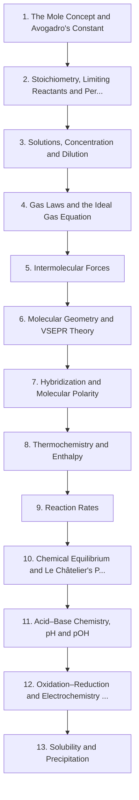

# Level 2 — High School / Intermediate Chemistry

> **Audience:** High school / first-year university  
> **Chapters:** 13  
> **Estimated study time:** ≈ 90 h  
> **Difficulty:** ★★★☆☆ – ★★★★☆

Quantitative chemistry: the mole, stoichiometry, solutions, gases, intermolecular forces, molecular shape, thermochemistry, rates, equilibrium, pH, redox and solubility.

This is where chemistry becomes quantitative. Every chapter from here on assumes you can convert between mass, moles and number of particles without hesitation, and that you can carry units through an algebraic manipulation. If one skill in the whole repository deserves over-learning, it is dimensional analysis.

---

## Chapters

| # | Chapter | Difficulty | Hours | Prerequisites |
|---|---|---|---|---|
| 1 | [The Mole Concept and Avogadro's Constant](01-the-mole-concept.md) | ★★★☆☆ | 6 | Level 1 in full |
| 2 | [Stoichiometry, Limiting Reactants and Percentage Yield](02-stoichiometry-and-limiting-reactants.md) | ★★★☆☆ | 8 | Ch. 1 |
| 3 | [Solutions, Concentration and Dilution](03-solutions-concentration-and-dilution.md) | ★★★☆☆ | 6 | Ch. 1–2 |
| 4 | [Gas Laws and the Ideal Gas Equation](04-gas-laws-and-the-ideal-gas-equation.md) | ★★★☆☆ | 7 | Ch. 1–3 |
| 5 | [Intermolecular Forces](05-intermolecular-forces.md) | ★★★☆☆ | 6 | Level 1 Ch. 5 |
| 6 | [Molecular Geometry and VSEPR Theory](06-molecular-geometry-and-vsepr-theory.md) | ★★★☆☆ | 6 | Level 1 Ch. 3, 6 |
| 7 | [Hybridization and Molecular Polarity](07-hybridization-and-molecular-polarity.md) | ★★★★☆ | 7 | Ch. 5–6 |
| 8 | [Thermochemistry and Enthalpy](08-thermochemistry-and-enthalpy.md) | ★★★★☆ | 8 | Ch. 2, 4 |
| 9 | [Reaction Rates](09-reaction-rates.md) | ★★★☆☆ | 6 | Ch. 2, 8 |
| 10 | [Chemical Equilibrium and Le Châtelier's Principle](10-chemical-equilibrium-and-le-chateliers-principle.md) | ★★★★☆ | 8 | Ch. 9 |
| 11 | [Acid–Base Chemistry, pH and pOH](11-acid-base-chemistry-and-ph.md) | ★★★★☆ | 8 | Ch. 3, 10 |
| 12 | [Oxidation–Reduction and Electrochemistry Fundamentals](12-redox-reactions-and-electrochemistry-fundamentals.md) | ★★★★☆ | 8 | Ch. 2, 10 |
| 13 | [Solubility and Precipitation](13-solubility-and-precipitation.md) | ★★★★☆ | 6 | Ch. 3, 10 |

---

## Knowledge map

The chain is the *recommended* order. Chapters that share prerequisites can be
read out of order; the table above tells you what each one actually needs.

---

## Study routine for this level

1. Read the chapter once without taking notes, to see the shape of the argument.
2. Re-read with the chapter's learning objectives in front of you and answer them in writing.
3. Reproduce every Mermaid diagram from memory, then check it.
4. Do the exercises **before** opening the solutions file.
5. Record every mistake in a log; re-test yourself on those specific items a week later.

---

## Practice

- Exercise set: [`exercises/level-2-exercises.md`](exercises/level-2-exercises.md)
- Worked solutions: [`solutions/level-2-solutions.md`](solutions/level-2-solutions.md)

---

## Navigation

- Level index: [CURRICULUM.md](../CURRICULUM.md)
- Study methods: [00-learning-guide](../00-learning-guide/learning-path.md)
- Terminology: [GLOSSARY.md](../GLOSSARY.md)
- Sources: [REFERENCES.md](../REFERENCES.md)
