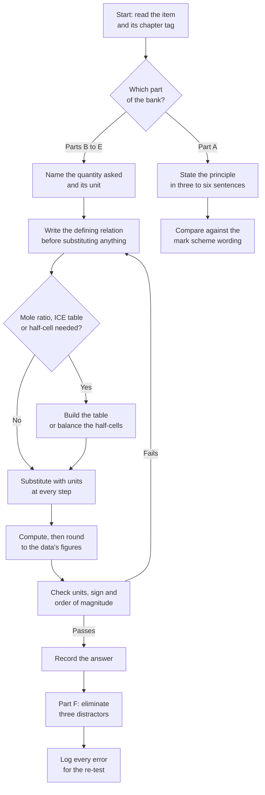

# Level 2 — Exercise Bank

> **Level:** Intermediate (Level 2 — Intermediate Chemistry)
> **Estimated time:** 150 minutes
> **Items:** 60
> **Covers:** [Ch. 1](../01-the-mole-concept.md), [Ch. 2](../02-stoichiometry-and-limiting-reactants.md), [Ch. 3](../03-solutions-concentration-and-dilution.md), [Ch. 4](../04-gas-laws-and-the-ideal-gas-equation.md), [Ch. 5](../05-intermolecular-forces.md), [Ch. 6](../06-molecular-geometry-and-vsepr-theory.md), [Ch. 7](../07-hybridization-and-molecular-polarity.md), [Ch. 8](../08-thermochemistry-and-enthalpy.md), [Ch. 9](../09-reaction-rates.md), [Ch. 10](../10-chemical-equilibrium-and-le-chateliers-principle.md), [Ch. 11](../11-acid-base-chemistry-and-ph.md), [Ch. 12](../12-redox-reactions-and-electrochemistry-fundamentals.md), [Ch. 13](../13-solubility-and-precipitation.md)
> **Solutions:** [`../solutions/level-2-solutions.md`](../solutions/level-2-solutions.md)

Work through the bank without reference material open. Every item names the chapter
that supplies the method, so a wrong answer can be traced to a specific section
rather than to "chemistry" in general.

**Figure 1 — Working order for this bank.** The loop on the left is the one that
costs marks: a failed check sends you back to the relation, not to the arithmetic.

---

## Data sheet

| Constant or quantity | Value |
|---|---|
| Molar gas constant, $R$ | $8.314\ \text{J mol}^{-1}\ \text{K}^{-1}$ |
| Faraday constant, $F$ | $96\,485\ \text{C mol}^{-1}$ |
| Avogadro constant, $N_{\text{A}}$ | $6.022\times10^{23}\ \text{mol}^{-1}$ |
| Molar volume at STP ($273.15\ \text{K}$, $10^{5}\ \text{Pa}$) | $22.71\ \text{dm}^{3}\ \text{mol}^{-1}$ |
| Molar volume at SATP ($298.15\ \text{K}$, $10^{5}\ \text{Pa}$) | $24.79\ \text{dm}^{3}\ \text{mol}^{-1}$ |
| Specific heat capacity of water | $4.18\ \text{J g}^{-1}\ \text{K}^{-1}$ |

Standard enthalpies of formation, $\Delta H^{\circ}_{\text{f}}$ / kJ mol⁻¹:
$\ce{C2H5OH(l)}$ −277.7; $\ce{CO2(g)}$ −393.5; $\ce{H2O(l)}$ −285.8.

Mean bond enthalpies / kJ mol⁻¹: $\ce{C-H}$ 414; $\ce{O=O}$ 498; $\ce{C=O}$ 799;
$\ce{O-H}$ 463.

Acid dissociation constants at 298 K: $\ce{CH3COOH}$ $1.8\times10^{-5}$;
$\ce{HF}$ $6.8\times10^{-4}$; $\ce{NH4+}$ $5.6\times10^{-10}$.

Solubility products at 298 K: $\ce{AgCl}$ $1.8\times10^{-10}$;
$\ce{PbI2}$ $7.1\times10^{-9}$; $\ce{Ag2CrO4}$ $1.1\times10^{-12}$;
$\ce{Fe(OH)3}$ $2.8\times10^{-39}$.

Standard reduction potentials at 298 K: $\ce{F2}/\ce{F-}$ $+2.87\ \text{V}$;
$\ce{Ag+}/\ce{Ag}$ $+0.80\ \text{V}$; $\ce{Cu^2+}/\ce{Cu}$ $+0.34\ \text{V}$;
$\ce{Zn^2+}/\ce{Zn}$ $-0.76\ \text{V}$.

---

## Part A — Conceptual questions

1. **[Ch. 1]** Distinguish the Avogadro constant from the Avogadro number, and
   explain why the 2019 definition of the mole fixed $N_{\text{A}}$ exactly instead
   of defining the mole through the mass of carbon-12.

2. **[Ch. 2]** Explain why the theoretical yield is calculated from the limiting
   reactant, and why a process can have an atom economy of 100 % and a percentage
   yield of only 40 %.

3. **[Ch. 3]** Distinguish molarity from molality. Explain why colligative
   properties and precise physical-chemistry work use molality.

4. **[Ch. 4]** State two assumptions of the ideal-gas model and explain how the
   van der Waals parameters $a$ and $b$ correct for their failure.

5. **[Ch. 5]** The normal boiling points are $\ce{HF}$ 19.5 °C, $\ce{HCl}$ −85.1 °C,
   $\ce{HBr}$ −66.8 °C and $\ce{HI}$ −35.4 °C. Account for the trend and for the
   anomaly at $\ce{HF}$.

6. **[Ch. 6]** Explain why $\ce{SF4}$ is see-saw shaped while $\ce{XeF4}$ is square
   planar, although both central atoms carry lone pairs.

7. **[Ch. 7]** Both $\ce{CO2}$ and $\ce{H2O}$ contain polar bonds. Explain why
   $\ce{CO2}$ has no net dipole moment while $\ce{H2O}$ has one, and state the
   hybridisation of the central atom in each.

8. **[Ch. 8]** Explain why a reaction enthalpy obtained from standard enthalpies of
   formation is usually more reliable than one obtained from mean bond enthalpies.

9. **[Ch. 11]** Both $0.100\ \text{mol dm}^{-3}$ $\ce{HCl}$ and
   $0.100\ \text{mol dm}^{-3}$ $\ce{CH3COOH}$ have the same formal concentration.
   Compare their pH, their electrical conductivity, and the effect of a tenfold
   dilution on the extent of ionisation.

10. **[Ch. 13]** $\ce{AgCl}$ has $K_{sp} = 1.8\times10^{-10}$ and $\ce{Ag2CrO4}$ has
    $K_{sp} = 1.1\times10^{-12}$, yet $\ce{Ag2CrO4}$ is the more soluble salt in
    pure water. Explain, and state the condition under which two $K_{sp}$ values
    may be compared directly.

---

## Part B — Basic problems

11. **[Ch. 1]** Calculate the amount of substance and the number of molecules in
    $25.0\ \text{g}$ of glucose, $\ce{C6H12O6}$.

12. **[Ch. 1]** Calculate the mass of $3.00\times10^{22}$ molecules of carbon
    dioxide.

13. **[Ch. 2]** Aluminium reacts with chlorine according to

    $$
    \ce{2Al(s) + 3Cl2(g) -> 2AlCl3(s)}
    $$

    Calculate the mass of aluminium chloride formed from $5.40\ \text{g}$ of
    aluminium with chlorine in excess.

14. **[Ch. 2]** Nitrogen and hydrogen are mixed as $10.0\ \text{g}$ of $\ce{N2}$ and
    $2.00\ \text{g}$ of $\ce{H2}$ and allowed to react to completion:

    $$
    \ce{N2(g) + 3H2(g) -> 2NH3(g)}
    $$

    Identify the limiting reactant, calculate the mass of ammonia formed, and
    calculate the mass of the excess reactant remaining.

15. **[Ch. 3]** $25.0\ \text{cm}^{3}$ of $2.00\ \text{mol dm}^{-3}$ hydrochloric acid
    is diluted to $250.0\ \text{cm}^{3}$. Calculate the concentration of the diluted
    acid.

16. **[Ch. 3]** $5.85\ \text{g}$ of sodium chloride is dissolved in water and the
    solution made up to $250.0\ \text{cm}^{3}$. Calculate the molar concentration of
    the solution.

17. **[Ch. 4]** Calculate the volume occupied by $0.250\ \text{mol}$ of an ideal gas
    at $100\ \text{kPa}$ and $298.15\ \text{K}$.

18. **[Ch. 4]** A fixed amount of gas occupies $200\ \text{cm}^{3}$ at $100\ \text{kPa}$
    and $273\ \text{K}$. Calculate its volume at $95.0\ \text{kPa}$ and $250\ \text{K}$.

19. **[Ch. 6]** For each species, state the number of electron domains, the
    electron-domain geometry, the molecular geometry and the approximate bond angle:
    (a) $\ce{SO2}$; (b) $\ce{PF5}$; (c) $\ce{BrF5}$.

20. **[Ch. 8]** Calculate the heat required to raise the temperature of
    $150\ \text{g}$ of water from $21.0\ ^\circ\text{C}$ to $45.0\ ^\circ\text{C}$.

21. **[Ch. 11]** At 25 °C, calculate the pH and pOH of (a)
    $0.0150\ \text{mol dm}^{-3}$ $\ce{HCl}$ and (b) $0.0150\ \text{mol dm}^{-3}$
    $\ce{NaOH}$.

22. **[Ch. 12]** Assign the oxidation number of the element named in brackets in each
    species: (a) $\ce{K2Cr2O7}$ (Cr); (b) $\ce{MnO4-}$ (Mn); (c) $\ce{Na2S2O3}$ (S);
    (d) $\ce{NH4NO3}$ (both N atoms); (e) $\ce{H2O2}$ (O).

---

## Part C — Intermediate problems

23. **[Ch. 2]** $25.0\ \text{g}$ of an impure calcium carbonate sample, 85.0 % by
    mass $\ce{CaCO3}$, is heated until the carbonate decomposes completely:

    $$
    \ce{CaCO3(s) -> CaO(s) + CO2(g)}
    $$

    The calcium oxide obtained has mass $10.8\ \text{g}$. Calculate the theoretical
    mass of $\ce{CaO}$ and the percentage yield.

24. **[Ch. 3]** $25.0\ \text{cm}^{3}$ of dilute sulfuric acid is exactly neutralised
    by $23.40\ \text{cm}^{3}$ of $0.1000\ \text{mol dm}^{-3}$ sodium hydroxide.
    Calculate the concentration of the acid and the mass of $\ce{H2SO4}$ in the
    $25.0\ \text{cm}^{3}$ sample.

25. **[Ch. 4]** $2.65\ \text{g}$ of zinc reacts completely with excess hydrochloric
    acid, and the hydrogen is collected over water at $25\ ^\circ\text{C}$. The total
    pressure is $101.3\ \text{kPa}$ and the vapour pressure of water at
    $25\ ^\circ\text{C}$ is $3.17\ \text{kPa}$. Calculate the volume of gas collected.

26. **[Ch. 7]** The dipole moment of $\ce{H2O}$ is $1.85\ \text{D}$ and the bond
    dipole of an $\ce{O-H}$ bond is $1.51\ \text{D}$. Treating the two bond dipoles
    as equal vectors, estimate the $\ce{H-O-H}$ bond angle.

27. **[Ch. 5]** The vapour pressure of a liquid is $8.00\ \text{kPa}$ at
    $350\ \text{K}$ and $20.0\ \text{kPa}$ at $370\ \text{K}$. Calculate its enthalpy
    of vaporisation, stating the assumption required.

28. **[Ch. 7]** For each molecule state the hybridisation of the central atom, the
    molecular geometry and whether the molecule is polar: (a) $\ce{BeCl2}$;
    (b) $\ce{BF3}$; (c) $\ce{NF3}$; (d) $\ce{CH2Cl2}$.

29. **[Ch. 8]** Using the standard enthalpies of formation in the data sheet,
    calculate $\Delta H^{\circ}$ for the complete combustion of ethanol:

    $$
    \ce{C2H5OH(l) + 3O2(g) -> 2CO2(g) + 3H2O(l)}
    $$

30. **[Ch. 8]** $50.0\ \text{cm}^{3}$ of $1.00\ \text{mol dm}^{-3}$ hydrochloric acid
    is mixed with $50.0\ \text{cm}^{3}$ of $1.00\ \text{mol dm}^{-3}$ sodium
    hydroxide in a coffee-cup calorimeter. The temperature rises by $6.80\ \text{K}$.
    The combined solution has mass $100.0\ \text{g}$ and specific heat capacity
    $4.18\ \text{J g}^{-1}\ \text{K}^{-1}$. Calculate the enthalpy of neutralisation
    per mole of water formed.

31. **[Ch. 9]** The initial rates below were measured at constant temperature for
    $\ce{A + B -> products}$.

    | Experiment | $[\ce{A}]_0$ / mol dm⁻³ | $[\ce{B}]_0$ / mol dm⁻³ | Initial rate / mol dm⁻³ s⁻¹ |
    |---|---|---|---|
    | 1 | 0.10 | 0.10 | $2.0\times10^{-3}$ |
    | 2 | 0.20 | 0.10 | $8.0\times10^{-3}$ |
    | 3 | 0.10 | 0.20 | $4.0\times10^{-3}$ |

    Determine the order with respect to each reactant, the overall order, the rate
    law and the value of $k$ with its units.

32. **[Ch. 9]** A decomposition is first order with $k = 1.20\times10^{-3}\ \text{s}^{-1}$
    at a given temperature. Calculate the half-life and the percentage of reactant
    remaining after $2000\ \text{s}$.

33. **[Ch. 10]** For the equilibrium

    $$
    \ce{H2(g) + I2(g) <=> 2HI(g)}
    $$

    $K_c = 54.6$ at $700\ \text{K}$. Equal amounts of $\ce{H2}$ and $\ce{I2}$ are
    mixed so that each initial
    concentration is $0.500\ \text{mol dm}^{-3}$. Calculate the equilibrium
    concentration of each species.

34. **[Ch. 10]** At $700\ \text{K}$ the Haber equilibrium

    $$
    \ce{N2(g) + 3H2(g) <=> 2NH3(g)}
    $$

    has $K_c = 0.500$. A vessel contains
    $[\ce{N2}] = 0.200$, $[\ce{H2}] = 0.300$ and $[\ce{NH3}] = 0.0500\ \text{mol dm}^{-3}$.
    Calculate $Q_c$, state the direction of net change, and state the effect on
    $K_c$ of raising the temperature, given that the forward reaction is exothermic.

35. **[Ch. 11]** Calculate the pH and the percentage ionisation of
    $0.0500\ \text{mol dm}^{-3}$ hydrofluoric acid at 25 °C. Test whether the
    approximation $[\ce{H3O+}] = \sqrt{K_a c}$ is acceptable, and solve exactly if
    it is not.

36. **[Ch. 13]** Calculate the molar solubility and the mass solubility of lead(II)
    iodide in pure water at 298 K. $M(\ce{PbI2}) = 461.0\ \text{g mol}^{-1}$.

---

## Part D — Advanced problems

37. **[Ch. 2]** The thermite reaction is

    $$
    \ce{Fe2O3(s) + 2Al(s) -> 2Fe(l) + Al2O3(s)}
    $$

    $25.0\ \text{g}$ of iron(III) oxide is mixed with $10.0\ \text{g}$ of aluminium.
    (a) Identify the limiting reactant. (b) Calculate the theoretical mass of iron.
    (c) The actual mass of iron is $15.2\ \text{g}$; calculate the percentage yield.
    (d) Calculate the mass of aluminium oxide formed and the mass of aluminium
    remaining.

38. **[Ch. 3]** Concentrated sulfuric acid is 98.0 % by mass $\ce{H2SO4}$ and has
    density $1.84\ \text{g cm}^{-3}$. (a) Calculate its molar concentration.
    (b) Calculate the volume of this acid needed to prepare
    $500.0\ \text{cm}^{3}$ of $0.500\ \text{mol dm}^{-3}$ acid. (c) Calculate the
    volume of $0.250\ \text{mol dm}^{-3}$ sodium hydroxide required to neutralise
    $25.0\ \text{cm}^{3}$ of the diluted acid.

39. **[Ch. 4]** $1.00\ \text{mol}$ of carbon dioxide occupies $1.00\ \text{dm}^{3}$ at
    $300\ \text{K}$. (a) Calculate the pressure predicted by the ideal-gas equation.
    (b) Recalculate with the van der Waals equation using
    $a = 0.364\ \text{Pa m}^{6}\ \text{mol}^{-2}$ and
    $b = 4.27\times10^{-5}\ \text{m}^{3}\ \text{mol}^{-1}$. (c) Calculate the
    compressibility factor and state which intermolecular effect dominates.

40. **[Ch. 5]** $\Delta H^{\circ}_{\text{vap}}(\ce{H2O}) = 40.7\ \text{kJ mol}^{-1}$
    and $\Delta H^{\circ}_{\text{vap}}(\ce{H2S}) = 18.7\ \text{kJ mol}^{-1}$ at their
    normal boiling points. (a) Account for the difference in terms of
    intermolecular forces. (b) In liquid water each molecule makes on average 3.4
    hydrogen bonds, each bond being shared between two molecules. Estimate the mean
    hydrogen-bond enthalpy. (c) State one reason why this estimate is an upper bound.

41. **[Ch. 8]** (a) Using the mean bond enthalpies in the data sheet, estimate
    $\Delta H^{\circ}$ for

    $$
    \ce{CH4(g) + 2O2(g) -> CO2(g) + 2H2O(g)}
    $$

    (b) Compare the result with the calorimetric value $-802.3\ \text{kJ mol}^{-1}$
    for water as a gas and explain the discrepancy. (c) Using the accepted value
    $-890.3\ \text{kJ mol}^{-1}$ for liquid water, calculate $\Delta U^{\circ}$ at
    $298.15\ \text{K}$.

42. **[Ch. 9]** For a reaction, $k = 2.50\times10^{-3}\ \text{s}^{-1}$ at
    $300\ \text{K}$ and $k = 1.10\times10^{-2}\ \text{s}^{-1}$ at $320\ \text{K}$.
    Calculate the activation energy and the pre-exponential factor $A$, stating the
    assumption made about $A$ and $E_a$ over the interval.

43. **[Ch. 10]** $0.100\ \text{mol}$ of $\ce{N2O4}$ is sealed in a
    $1.00\ \text{dm}^{3}$ vessel and equilibrium is established at $350\ \text{K}$:

    $$
    \ce{N2O4(g) <=> 2NO2(g)}
    $$

    The equilibrium concentration of $\ce{N2O4}$ is $0.0400\ \text{mol dm}^{-3}$.
    (a) Calculate $K_c$. (b) Calculate $K_p$ at $350\ \text{K}$, taking care with the
    units of $R$.

44. **[Ch. 11]** A buffer is $0.100\ \text{mol dm}^{-3}$ in a weak acid
    $\ce{HA}$ ($\mathrm{p}K_a = 4.76$ at 25 °C) and $0.100\ \text{mol dm}^{-3}$ in
    $\ce{NaA}$; its volume is $1.00\ \text{dm}^{3}$ at 25 °C. (a) Calculate the initial pH.
    (b) Calculate the pH after $0.0100\ \text{mol}$ of $\ce{HCl}$ is added and the
    volume is unchanged. (c) Calculate the pH of $1.00\ \text{dm}^{3}$ of pure water
    to which the same amount of $\ce{HCl}$ is added, and comment.

45. **[Ch. 12]** For the Daniell cell,

    $$
    \ce{Zn(s) + Cu^2+(aq) -> Zn^2+(aq) + Cu(s)}
    $$

    $E^{\circ}_{\text{cell}} = 1.10\ \text{V}$. (a) Calculate $\Delta G^{\circ}$ per
    mole of reaction. (b) Calculate the mass of zinc consumed when the cell delivers
    $0.500\ \text{A}$ for $2.00\ \text{h}$ at 100 % current efficiency.

46. **[Ch. 13]** Equal volumes of $0.0100\ \text{mol dm}^{-3}$ $\ce{AgNO3}$ and
    $0.0100\ \text{mol dm}^{-3}$ $\ce{NaCl}$ are mixed at 298 K. (a) Calculate the
    reaction quotient immediately after mixing. (b) State whether a precipitate
    forms. (c) Calculate $[\ce{Ag+}]$ remaining at equilibrium and the percentage of
    silver removed from solution.

---

## Part E — Calculation problems

47. **[Ch. 1]** Calculate the molar mass of $\ce{MgSO4.7H2O}$, the mass percentage
    of water in it, and the mass of anhydrous $\ce{MgSO4}$ left when
    $10.0\ \text{g}$ of the hydrate is heated to constant mass.

48. **[Ch. 2]** Ethanol is produced by fermentation:

    $$
    \ce{C6H12O6(aq) -> 2C2H5OH(aq) + 2CO2(g)}
    $$

    (a) Calculate the atom economy for ethanol. (b) Calculate the percentage yield
    when $100\ \text{g}$ of glucose gives $40.0\ \text{g}$ of ethanol.

49. **[Ch. 3]** $20.0\ \text{g}$ of sodium chloride is dissolved in
    $180\ \text{g}$ of water. Calculate the molality of the solution and the mole
    fraction of sodium chloride.

50. **[Ch. 4]** Calculate the root-mean-square speed of nitrogen molecules at
    $300\ \text{K}$, taking $M(\ce{N2}) = 28.014\ \text{g mol}^{-1}$.

51. **[Ch. 8]** For the ammonia synthesis

    $$
    \ce{N2(g) + 3H2(g) -> 2NH3(g)}
    $$

    $\Delta H^{\circ} = -92.4\ \text{kJ mol}^{-1}$ at $298\ \text{K}$ and
    $\Delta C_p^{\circ} = -60\ \text{J K}^{-1}\ \text{mol}^{-1}$. Calculate
    $\Delta H^{\circ}$ at $700\ \text{K}$ using Kirchhoff's law.

52. **[Ch. 10]** For the equilibrium

    $$
    \ce{N2(g) + 3H2(g) <=> 2NH3(g)}
    $$

    $K_c = 0.500$ at $800\ \text{K}$. Calculate $K_p$ at that temperature, giving the
    units implied by the convention used.

53. **[Ch. 12]** A current of $2.50\ \text{A}$ is passed for $1.50\ \text{h}$ through
    aqueous silver nitrate with inert electrodes. Calculate the mass of silver
    deposited at the cathode, assuming 100 % current efficiency.

54. **[Ch. 13]** Calculate the molar solubility of iron(III) hydroxide in pure water
    at 298 K and the corresponding concentration of $\ce{Fe^3+}$ in
    $\text{mg dm}^{-3}$. $M(\ce{Fe(OH)3}) = 106.87\ \text{g mol}^{-1}$.

---

## Part F — Multiple-choice self-check

55. **[Ch. 1]** Which $1.00\ \text{g}$ sample contains the greatest number of atoms?
    - A. $1.00\ \text{g}$ of $\ce{H2}$
    - B. $1.00\ \text{g}$ of $\ce{He}$
    - C. $1.00\ \text{g}$ of $\ce{C}$
    - D. $1.00\ \text{g}$ of $\ce{O2}$

56. **[Ch. 6]** Which species has a square-planar molecular geometry?
    - A. $\ce{SF4}$
    - B. $\ce{XeF4}$
    - C. $\ce{NH3}$
    - D. $\ce{PCl5}$

57. **[Ch. 9]** For a reaction that is second order overall, the units of the rate
    constant are:
    - A. $\text{s}^{-1}$
    - B. $\text{mol dm}^{-3}\ \text{s}^{-1}$
    - C. $\text{dm}^{3}\ \text{mol}^{-1}\ \text{s}^{-1}$
    - D. $\text{dm}^{6}\ \text{mol}^{-2}\ \text{s}^{-1}$

58. **[Ch. 11]** The pH of $0.100\ \text{mol dm}^{-3}$ ammonium chloride at 25 °C,
    given $K_a(\ce{NH4+}) = 5.6\times10^{-10}$, is closest to:
    - A. 2.87
    - B. 5.13
    - C. 7.00
    - D. 8.87

59. **[Ch. 12]** Using the standard reduction potentials in the data sheet, the
    strongest oxidising agent is:
    - A. $\ce{Ag+(aq)}$
    - B. $\ce{Cu^2+(aq)}$
    - C. $\ce{Zn^2+(aq)}$
    - D. $\ce{F2(g)}$

60. **[Ch. 13]** The molar solubility of $\ce{AgCl}$ in $0.100\ \text{mol dm}^{-3}$
    $\ce{NaCl}$ compared with its solubility in pure water is:
    - A. larger, because of the ionic strength
    - B. smaller by a factor of about $7.5\times10^{3}$
    - C. unchanged, because $K_{sp}$ is constant
    - D. smaller by a factor of about $5.6\times10^{7}$

---

## Marks

| Part | Type | Items | Marks per item | Total |
|---|---|---|---|---|
| A | Conceptual | 10 | 2 | 20 |
| B | Basic problems | 12 | 3 | 36 |
| C | Intermediate problems | 14 | 5 | 70 |
| D | Advanced problems | 10 | 8 | 80 |
| E | Calculation problems | 8 | 6 | 48 |
| F | Multiple-choice | 6 | 2 | 12 |
| **Total** | | **60** | | **266** |

**Total marks: 266**

**Solutions:** [`../solutions/level-2-solutions.md`](../solutions/level-2-solutions.md)
