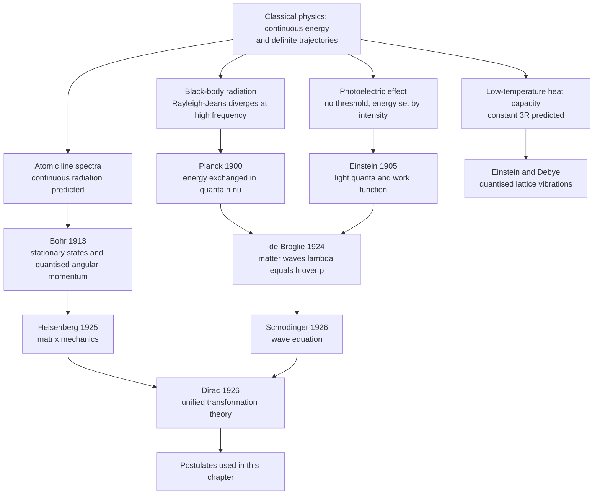
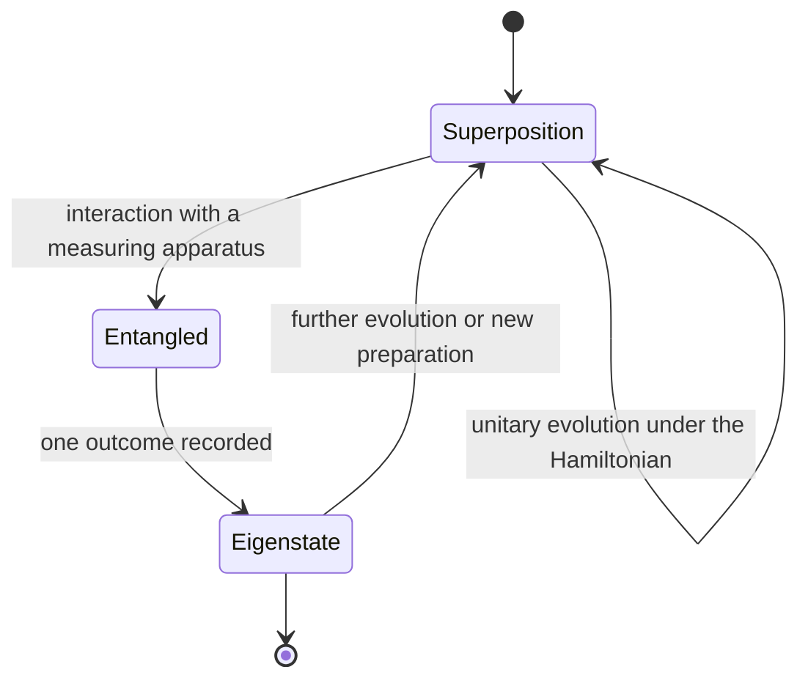
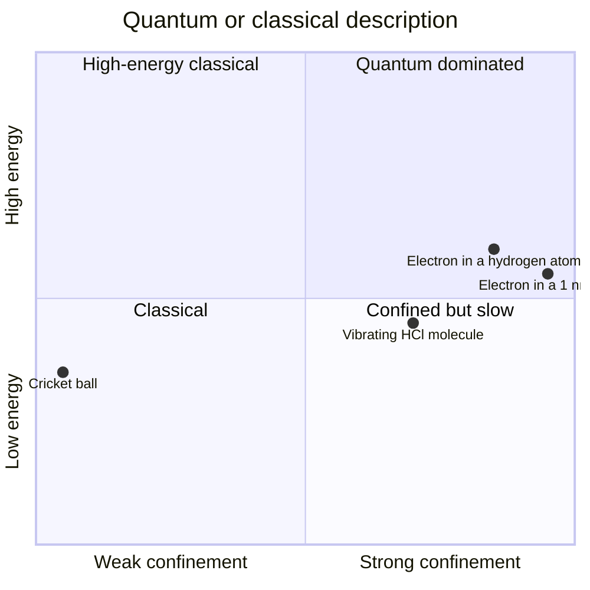

# Chapter 1 — Quantum Mechanics Foundations

> **Level:** Advanced (Level 3 — Undergraduate core)
> **Estimated study time:** 10 hours (7 h reading + 3 h exercises)
> **Prerequisites:** [Atomic Structure](../02-elementary-chemistry/01-atomic-structure.md); single-variable calculus (differentiation, integration and simple differential equations)
> **Related chapters:** [Atomic Orbitals, Quantum Numbers and Advanced Configurations](02-atomic-orbitals-and-quantum-numbers.md), [Molecular Orbital Theory](03-molecular-orbital-theory.md), [Level 3 index](README.md)
> **Difficulty:** ★★★★★ (5/5)

---

## 1. Learning Objectives

After working through this chapter you will be able to:

- State the four experimental failures of classical physics — black-body radiation, the photoelectric effect, atomic line spectra and low-temperature heat capacities — and explain precisely which classical prediction fails in each case.
- Apply Planck's quantisation hypothesis, $E = h\nu$, and compute photon energies, wavelengths and fluxes with correct SI units.
- Use the de Broglie relation $\lambda = h/p$ for electrons, atoms and macroscopic objects, and judge when the wave nature of matter is observable.
- Describe the electron double-slit experiment and explain what it rules out about classical trajectories.
- Write the time-independent Schrödinger equation as a postulate, identify the Hamiltonian, and explain why the equation cannot be derived from classical mechanics.
- Interpret the wavefunction according to the Born rule, normalise a given wavefunction and compute expectation values of position, momentum and energy.
- Solve the particle in a one-dimensional box completely: boundary conditions, normalisation, energies, nodes and zero-point energy.
- Apply the box model semi-quantitatively to conjugated dyes and state where it fails.
- State the Heisenberg uncertainty principle in terms of standard deviations as $\sigma_x\sigma_p \ge \hbar/2$, and distinguish it from experimental imprecision.
- Explain superposition, measurement and the correspondence principle, and identify which of these ideas are postulates and which are consequences.

---

## 2. Introduction

Classical mechanics is a remarkably successful theory. It predicts the orbit of Mars, the period of a pendulum and the pressure of a gas, and it remains the correct description of every object large enough to be seen. Yet by 1900 four experimental results had accumulated that classical physics could not explain: the spectrum of radiation from a hot body, the emission of electrons from a metal surface illuminated by light, the sharp discrete lines in atomic emission spectra, and the collapse of heat capacities at low temperature. Each failure had the same signature. Classical theory predicted a *continuous* distribution of energies; experiment showed *discrete* values.

The resolution, built between 1900 and 1926, replaced trajectories with wavefunctions and definite values with probabilities. Planck introduced energy quanta to fit the black-body spectrum; Einstein extended quantisation to the electromagnetic field itself; Bohr grafted quantised angular momentum onto the planetary atom; de Broglie proposed that matter has a wavelength; and Schrödinger wrote the wave equation whose solutions are the orbitals used throughout the rest of chemistry. Heisenberg supplied the uncertainty relation that governs what can be known simultaneously.

This chapter is the gateway to everything that follows in physical chemistry. Chapter 2 solves the Schrödinger equation for the hydrogen atom and produces atomic orbitals and quantum numbers. Chapter 3 combines atomic orbitals into molecular orbitals. Chapter 10 interprets spectroscopic transitions as differences between quantised energy levels. Without the postulates developed here, those chapters become lists of rules to memorise; with them, the rules are consequences.

The mathematics required is modest but not optional: differentiation, integration, complex numbers and one elementary differential equation. Every derivation is shown in full, every symbol is defined at first use, and each model is accompanied by an explicit statement of its assumptions and the point at which it fails. That last habit matters more in quantum mechanics than anywhere else in chemistry, because the subject is full of models that are exactly solvable and physically wrong, and of approximations that are physically right and analytically intractable. Knowing which is which is the difference between using quantum mechanics and quoting it.

---

## 3. Fundamental Concepts

### 3.1 The failure of classical physics

Classical physics rests on two assumptions that were never stated explicitly because they seemed self-evident: energy is a continuous variable, and a particle has a definite position and momentum at every instant. Both assumptions fail at the atomic scale, and the four problems below are the historical evidence.

**Black-body radiation.** A black body absorbs all incident radiation and re-emits a spectrum that depends only on its temperature. Classical electromagnetism and statistical mechanics predict the Rayleigh–Jeans law,

$$
\rho(\nu)\,\mathrm{d}\nu = \frac{8\pi\nu^{2}}{c^{3}} k_\mathrm{B}T\,\mathrm{d}\nu
$$

where $\rho(\nu)$ is the energy density per unit frequency, $c$ is the speed of light and $k_\mathrm{B}$ is the Boltzmann constant. The law agrees with experiment at low frequency but diverges as $\nu \to \infty$: the predicted total energy $\int_0^\infty \rho\,\mathrm{d}\nu$ is infinite. This divergence is the *ultraviolet catastrophe*. In reality the spectrum peaks at a frequency proportional to $T$ (Wien's displacement law) and falls exponentially at high frequency. Planck's law, derived in 1900 by assuming that oscillators exchange energy only in multiples of $h\nu$, fits the entire curve.

**The photoelectric effect.** When ultraviolet light strikes a clean metal surface, electrons are emitted. Classical wave theory predicts three things: emission should occur at any frequency provided the intensity is high enough; the kinetic energy of the emitted electrons should increase with intensity; and emission should begin only after the surface has absorbed enough energy, producing a measurable delay. Experiment contradicts all three. Emission occurs only above a threshold frequency $\nu_0$ characteristic of the metal; the maximum kinetic energy depends linearly on $\nu$ and not at all on intensity; and emission is instantaneous. Einstein explained the observations in 1905 by treating light as a stream of quanta of energy $h\nu$, each ejecting one electron.

**Atomic line spectra.** A hydrogen discharge lamp emits a series of sharp lines rather than a continuous spectrum. Their wavenumbers obey the Rydberg formula,

$$
\tilde{\nu} = \frac{1}{\lambda} = R_\mathrm{H}\left(\frac{1}{n_1^{2}} - \frac{1}{n_2^{2}}\right), \qquad n_2 > n_1
$$

with $R_\mathrm{H} = 1.096\,776 \times 10^{7}\ \mathrm{m^{-1}}$. Classical electrodynamics requires an orbiting electron to radiate continuously and spiral into the nucleus within about $10^{-11}\ \mathrm{s}$, producing a continuous spectrum. Bohr's 1913 model repaired this by postulating stationary states of quantised angular momentum, $L = n\hbar$, and radiation only on transition between them. The model reproduces the Rydberg formula and the correct Bohr radius, but it fails for helium, cannot explain fine structure, and offers no account of intensities or selection rules. It is a scaffold, not a theory.

**Heat capacities.** The Dulong–Petit law, derived from the equipartition theorem, predicts a molar heat capacity of $3R \approx 24.9\ \mathrm{J\,K^{-1}\,mol^{-1}}$ for every solid. The prediction is accurate at room temperature and above, but every solid falls towards zero as $T \to 0$. Equipartition also predicts that a diatomic gas should have $C_{V,m} = \tfrac{7}{2}R$ once vibration is excited, whereas at room temperature most diatomic gases show $\tfrac{5}{2}R$: the vibrational modes are frozen out. Einstein (1907) and Debye (1912) explained both observations by quantising the vibrational oscillators. When $h\nu \gg k_\mathrm{B}T$, a mode cannot be excited at all, and its contribution to the heat capacity vanishes.

| Observation | Classical prediction | Observed behaviour | Quantum resolution |
|---|---|---|---|
| Black-body spectrum | Energy density diverges as $\nu^{2}$ | Peaks at $\nu_\text{max} \propto T$, falls at high $\nu$ | Oscillator energies restricted to $nh\nu$ |
| Photoelectric effect | Threshold on intensity, energy rises with intensity | Threshold on frequency, energy linear in $\nu$ | Light arrives as quanta of energy $h\nu$ |
| Atomic spectra | Continuous radiation, collapse in $10^{-11}\ \mathrm{s}$ | Sharp discrete lines, stable atoms | Stationary states with quantised energy |
| Heat capacity at low $T$ | Constant $3R$ | Falls to zero as $T \to 0$ | Vibrational quanta freeze out when $h\nu \gg k_\mathrm{B}T$ |

### 3.2 Planck's quantum hypothesis

Planck modelled the walls of a black body as a collection of harmonic oscillators, each of frequency $\nu$. He assumed that an oscillator of energy $E$ can only change its energy by exchanging a quantum $h\nu$, so that the permitted energies are $0, h\nu, 2h\nu, \ldots$ This single assumption changes the average energy of an oscillator from the classical $k_\mathrm{B}T$ to

$$
\langle E\rangle = \frac{h\nu}{e^{h\nu/k_\mathrm{B}T} - 1}
$$

At low frequency, $h\nu \ll k_\mathrm{B}T$, expansion of the exponential gives $\langle E \rangle \approx k_\mathrm{B}T$ and the classical result is recovered. At high frequency the average energy falls exponentially, which suppresses the ultraviolet divergence. Multiplying by the density of modes $8\pi\nu^{2}/c^{3}$ gives Planck's radiation law,

$$
\rho(\nu) = \frac{8\pi h\nu^{3}}{c^{3}}\frac{1}{e^{h\nu/k_\mathrm{B}T} - 1}
$$

The constant $h$ is Planck's constant, now fixed exactly by the 2019 revision of the SI:

$$
h = 6.626\,070\,15 \times 10^{-34}\ \mathrm{J\,s}, \qquad \hbar = \frac{h}{2\pi} = 1.054\,571\,817 \times 10^{-34}\ \mathrm{J\,s}
$$

Two features of Planck's hypothesis deserve emphasis. First, the quantisation condition applies to the *exchange* of energy between matter and radiation, not to the energy of a free electromagnetic field, which was Einstein's later step. Second, the classical limit is recovered continuously as $h\nu/k_\mathrm{B}T \to 0$; quantum mechanics does not replace classical mechanics, it contains it as a limiting case.

### 3.3 Photons and the photoelectric effect

Einstein's 1905 paper treated light itself as composed of localised quanta, later called photons. A photon of frequency $\nu$ carries energy and momentum

$$
E = h\nu = \frac{hc}{\lambda}, \qquad p = \frac{h}{\lambda} = \frac{h\nu}{c}
$$

The photoelectric equation follows from energy conservation for a single photon–electron event:

$$
h\nu = \Phi + E_{k,\mathrm{max}}
$$

where $\Phi$ is the work function of the metal, the minimum energy needed to remove an electron from the surface. The threshold frequency is $\nu_0 = \Phi/h$; below it no single photon carries enough energy, and increasing the intensity only increases the number of photons, not their individual energy. The stopping potential $V_\mathrm{s}$ satisfies $eV_\mathrm{s} = E_{k,\mathrm{max}}$, so a plot of $V_\mathrm{s}$ against $\nu$ is a straight line of slope $h/e$ and intercept $-\Phi/e$. Millikan's measurements of exactly this line, published in 1916, confirmed the relation and provided one of the most precise early values of $h$.

The photon picture is quantitatively successful but should not be taken too literally. A photon is not a small billiard ball with a definite position; it is a quantum of the electromagnetic field, described by a mode function whose spatial extent can be macroscopic. What is localised is the *detection event*, not the field.

### 3.4 The de Broglie relation

In 1924 de Broglie proposed the converse of the photon relation: if a wave can behave as a particle, a particle should behave as a wave with

$$
\lambda = \frac{h}{p} = \frac{h}{mv}
$$

For a non-relativistic particle of kinetic energy $E_k$, $p = \sqrt{2mE_k}$, so

$$
\lambda = \frac{h}{\sqrt{2mE_k}}
$$

The prediction was confirmed by Davisson and Germer in 1927, who observed diffraction maxima when electrons of about $50\ \mathrm{eV}$ scattered from a nickel crystal, and independently by G. P. Thomson, who obtained diffraction rings from thin metal films. The wavelength of a $100\ \mathrm{eV}$ electron is $123\ \mathrm{pm}$, comparable to the spacing of atoms in a crystal, which is why electron diffraction works. A cricket ball of mass $0.16\ \mathrm{kg}$ moving at $30\ \mathrm{m\,s^{-1}}$ has $\lambda \approx 1.4 \times 10^{-34}\ \mathrm{m}$, twenty orders of magnitude smaller than a proton; no conceivable experiment could detect it.

The relation is universal. It applies to electrons, neutrons, atoms, buckyballs and, in principle, to people. What changes with mass is not the validity of the relation but the practicality of observing interference.

### 3.5 Wave–particle duality and the electron double slit

The double-slit experiment is the cleanest demonstration that a particle does not possess a definite trajectory between source and screen. Electrons are fired one at a time at a barrier with two narrow slits, and a detector records the position of each arrival on a fluorescent screen. Each electron arrives as a single localised flash, so the detection event is particle-like. But the distribution of many thousands of flashes is an interference pattern, with maxima where the path difference $\Delta s = d\sin\theta$ equals an integer multiple of $\lambda$ and minima where it equals a half-integer multiple. If either slit is closed, the pattern is a single-slit envelope with no fringes.

The implications are severe. A classical particle must pass through one slit or the other, and the resulting distribution would be the sum of the two single-slit patterns. The observed pattern is not that sum; it contains regions that are *less* likely when both slits are open than when one is closed. The only consistent description is that the electron's state is a superposition of the two path amplitudes, $\psi = \psi_1 + \psi_2$, and the probability density $|\psi|^{2}$ contains the cross term $2\,\mathrm{Re}(\psi_1^{*}\psi_2)$ responsible for interference.

If a detector is placed at the slits to record which path the electron took, the interference pattern disappears and the sum of two single-slit patterns is recovered. This is complementarity: the interference and which-path information are mutually exclusive, not because the detector is clumsy, but because obtaining the information entangles the electron with the apparatus and destroys the phase relation between the two amplitudes.

### 3.6 The wavefunction and the Born interpretation

Quantum mechanics describes a system by a wavefunction $\psi(\mathbf{r}, t)$, a complex-valued function of position and time. The Born interpretation, proposed in 1926, states that

$$
\mathrm{d}P = |\psi(\mathbf{r},t)|^{2}\,\mathrm{d}\tau
$$

is the probability of finding the particle in the volume element $\mathrm{d}\tau$ at position $\mathbf{r}$. The quantity $|\psi|^{2} = \psi^{*}\psi$ is the probability density, with SI unit $\mathrm{m^{-3}}$. Because a probability of one is certain,

$$
\int_{\text{all space}} |\psi|^{2}\,\mathrm{d}\tau = 1
$$

which is the normalisation condition. A wavefunction that satisfies it is normalised; one that does not can be multiplied by a constant $N$ chosen so that it does.

Not every mathematical function is an acceptable wavefunction. It must be single-valued, because a probability cannot have two values at one point; continuous, because the probability density cannot jump; finite everywhere, so that it can be normalised; and its first derivative must be continuous wherever the potential is finite, because the Schrödinger equation relates the second derivative to $V - E$. At an infinite potential step the derivative may jump. These conditions are not aesthetic preferences: they are precisely the constraints that produce quantisation, as the particle in a box will show.

The wavefunction itself is not directly observable. Only probability densities and expectation values are. Whether $\psi$ represents a physical field, information, or a calculational device is a question of interpretation, not of the formalism; the predictions are the same in the Copenhagen, Everettian and decoherent-histories readings.

### 3.7 Operators and observables

In quantum mechanics every measurable quantity is represented by a Hermitian operator. Position acts by multiplication, $\hat{x}\psi = x\psi$, while the momentum and kinetic-energy operators in one dimension are

$$
\hat{p}_x = -i\hbar\frac{\mathrm{d}}{\mathrm{d}x}, \qquad \hat{T} = \frac{\hat{p}_x^{2}}{2m} = -\frac{\hbar^{2}}{2m}\frac{\mathrm{d}^{2}}{\mathrm{d}x^{2}}
$$

and the total energy operator, the Hamiltonian, is $\hat{H} = \hat{T} + \hat{V}$.

Hermitian operators have two properties that make them suitable for observables. Their eigenvalues are real, so measured values are real numbers. Their eigenfunctions belonging to different eigenvalues are orthogonal, so states with different definite energies are distinguishable. If $\psi$ is an eigenfunction of $\hat{A}$ with eigenvalue $a$, then a measurement of $A$ certainly returns $a$; the state has a definite value of that observable. If $\psi$ is not an eigenfunction, no definite value exists, and the expectation value is

$$
\langle A \rangle = \frac{\int \psi^{*}\hat{A}\psi\,\mathrm{d}\tau}{\int \psi^{*}\psi\,\mathrm{d}\tau}
$$

For a normalised wavefunction the denominator is one and can be omitted.

Two operators that do not commute cannot in general be assigned simultaneous definite values. The commutator is $[\hat{A},\hat{B}] = \hat{A}\hat{B} - \hat{B}\hat{A}$; for position and momentum,

$$
[\hat{x},\hat{p}_x] = i\hbar
$$

This algebraic fact is the origin of the uncertainty principle, derived formally in Section 4.5.

### 3.8 The Schrödinger equation as a postulate

The time-dependent Schrödinger equation is

$$
i\hbar\frac{\partial\psi}{\partial t} = \hat{H}\psi = \left[-\frac{\hbar^{2}}{2m}\nabla^{2} + V(\mathbf{r},t)\right]\psi
$$

and the time-independent form, obtained when $V$ does not depend on time, is

$$
\hat{H}\psi = E\psi
$$

Here $\nabla^{2}$ is the Laplacian, $V(\mathbf{r})$ the potential energy, $m$ the mass and $E$ the energy eigenvalue. The equation is a *postulate*: it cannot be derived from classical mechanics, and its justification is that its consequences agree with experiment to extraordinary precision. Textbooks sometimes "derive" it from the classical wave equation or from a plane-wave ansatz, but such arguments are motivational reconstructions, not proofs.

The time-independent equation has the form of an eigenvalue problem: $\hat{H}$ acts on $\psi$ and returns the same function multiplied by a number. Its solutions exist only for particular values of $E$, the eigenvalues, and the corresponding functions $\psi_n$ are the eigenfunctions. This is the mathematical origin of quantisation. It is not an extra rule bolted onto mechanics; it is what happens when a wave is confined.

For a time-independent Hamiltonian the solutions separate as

$$
\Psi(\mathbf{r},t) = \psi(\mathbf{r})\,e^{-iEt/\hbar}
$$

so the probability density $|\Psi|^{2} = |\psi|^{2}$ is constant in time. Such states are called *stationary states*. They are the orbitals of Chapter 2 and the energy levels of every spectroscopic transition.

### 3.9 Superposition and measurement

The Schrödinger equation is linear. If $\psi_1$ and $\psi_2$ are solutions, so is $c_1\psi_1 + c_2\psi_2$ for any complex constants $c_1$ and $c_2$. This superposition principle is not a separate postulate; it follows from linearity. It is, however, responsible for the most counter-intuitive features of the theory.

Suppose a system is in a superposition $\Psi = c_1\psi_1 + c_2\psi_2$ of two energy eigenstates with eigenvalues $E_1$ and $E_2$. A measurement of energy does not return some average value. It returns $E_1$ with probability $|c_1|^{2}$ or $E_2$ with probability $|c_2|^{2}$, provided the eigenfunctions are orthonormal. Immediately after the measurement the state is the eigenfunction corresponding to the result, a change known as state reduction or collapse. Repeated measurement on identically prepared systems yields the distribution $|c_n|^{2}$, and the expectation value is

$$
\langle E\rangle = \sum_n |c_n|^{2}E_n
$$

The coefficients are obtained by projection, $c_n = \int \psi_n^{*}\Psi\,\mathrm{d}\tau$, using orthonormality. The distinction between a superposition and a mixture is crucial: a superposition has definite relative phase and can produce interference, whereas a statistical mixture of the same two states cannot. The double-slit experiment is the demonstration that nature uses superpositions.

Measurement remains the least settled part of quantum mechanics. The formalism predicts probabilities for outcomes with unmatched accuracy, but the mechanism by which one outcome is selected, and whether collapse is physical, depends on the interpretation. Decoherence theory explains why macroscopic objects do not show interference: their environment continuously measures them, and phase coherence leaks away on timescales far shorter than any observation. It does not by itself select a single outcome, but it removes the practical paradox.

### 3.10 The Heisenberg uncertainty principle

Heisenberg's 1927 relation is often stated loosely as "one cannot measure position and momentum simultaneously without disturbing the system". That formulation is misleading, because it suggests the limitation is experimental. The precise statement is a theorem about the spread of measurement outcomes on identically prepared states:

$$
\sigma_x\,\sigma_p \ge \frac{\hbar}{2}
$$

where $\sigma_x$ and $\sigma_p$ are the standard deviations of position and momentum. If a state has a small spread in position, it necessarily has a large spread in momentum, regardless of how careful the apparatus is. The bound follows from the commutator $[\hat{x},\hat{p}] = i\hbar$ by the Cauchy–Schwarz inequality, and it is saturated by a Gaussian wavepacket.

An energy–time relation is often quoted in the form

$$
\sigma_E\,\sigma_t \ge \frac{\hbar}{2}
$$

but its meaning is subtle, because time is a parameter rather than an operator in ordinary quantum mechanics. A safe operational reading is that a state with lifetime $\tau$ has an energy uncertainty of order $\hbar/\tau$, which produces the natural linewidth of a spectral transition. For a lifetime of $1\ \mathrm{ns}$, the linewidth is about $7 \times 10^{-7}\ \mathrm{eV}$, or roughly $1.6 \times 10^{8}\ \mathrm{Hz}$.

The uncertainty principle is not a statement that quantum mechanics is imprecise. It is a statement about what kinds of state exist. A state of perfectly definite momentum is a plane wave extending over all space; a state of perfectly definite position is a delta function of infinite momentum spread. Neither is normalisable. Every physical state is a compromise, and the compromise is quantified by $\hbar$.

### 3.11 The correspondence principle

Bohr's correspondence principle asserts that quantum mechanics must reproduce classical mechanics in the limit of large quantum numbers or large masses. It is not an independent axiom; it is a consistency requirement, and it holds for every correct quantum theory.

For the hydrogen atom, the frequency of the photon emitted in the transition $n \to n-1$ tends to the classical orbital frequency as $n \to \infty$. For the particle in a box, the probability density for a highly excited state oscillates so rapidly that any measurement with finite resolution records the classical uniform distribution. For a harmonic oscillator, the mean position and momentum follow the classical equations of motion. In each case the classical world emerges not because quantum mechanics switches off, but because the quantum numbers are large and $\hbar$ is small compared with the actions involved.

The correspondence principle is a useful check on any new quantum model: if it does not reduce to the classical result in the appropriate limit, it is wrong. It is also a reminder that the classical/quantum boundary is not a boundary in nature but a boundary in description.

---

## 4. Detailed Scientific Explanation

### 4.1 The particle in a one-dimensional box: assumptions

The particle in a box is the simplest exactly solvable quantum model, and it is the template for every confined system, from a dye molecule to a quantum dot. Consider a particle of mass $m$ constrained to the region $0 < x < L$ and subject to the potential

$$
V(x) = \begin{cases} 0, & 0 < x < L \\ \infty, & x \le 0 \text{ or } x \ge L \end{cases}
$$

The infinite walls mean the particle cannot leave the region. The model assumes no interactions, no internal structure, and a perfectly sharp potential. Those assumptions are unrealistic for a real molecule, but they isolate the essential physics: confinement produces quantisation.

Inside the box the Schrödinger equation is

$$
-\frac{\hbar^{2}}{2m}\frac{\mathrm{d}^{2}\psi}{\mathrm{d}x^{2}} = E\psi
$$

which rearranges to

$$
\frac{\mathrm{d}^{2}\psi}{\mathrm{d}x^{2}} = -k^{2}\psi, \qquad k^{2} = \frac{2mE}{\hbar^{2}}
$$

This is the equation of simple harmonic motion, with general solution

$$
\psi(x) = A\sin kx + B\cos kx
$$

where $A$ and $B$ are constants fixed by the boundary conditions.

### 4.2 Boundary conditions and quantisation

At $x = 0$ the wavefunction must vanish, because the particle cannot be found in the infinite-potential region and $\psi$ must be continuous:

$$
\psi(0) = A\sin 0 + B\cos 0 = B = 0
$$

so $\psi(x) = A\sin kx$. At $x = L$,

$$
\psi(L) = A\sin kL = 0
$$

A trivial solution $A = 0$ would give $\psi = 0$ everywhere, which cannot be normalised. Therefore $\sin kL = 0$, which requires

$$
kL = n\pi, \qquad n = 1, 2, 3, \ldots
$$

The integer $n$ is a quantum number. It arises not from an extra assumption but from the requirement that the wave fit between the walls with a node at each end.

### 4.3 The energies

Substituting $k = n\pi/L$ into the definition of $k$ gives

$$
\frac{2mE}{\hbar^{2}} = \frac{n^{2}\pi^{2}}{L^{2}}
$$

and therefore

$$
E_n = \frac{n^{2}\pi^{2}\hbar^{2}}{2mL^{2}} = \frac{n^{2}h^{2}}{8mL^{2}}
$$

using $\hbar = h/2\pi$. This is the complete energy spectrum. Several features follow immediately.

- **Quantisation.** Only discrete energies are allowed. The spacing increases with $n$, because $E_{n+1} - E_n = (2n+1)h^{2}/(8mL^{2})$.
- **Zero-point energy.** The lowest allowed energy is $E_1 = h^{2}/(8mL^{2})$, not zero. A confined quantum particle cannot be at rest. This is a direct consequence of the uncertainty principle: localising the particle within $L$ forces a momentum spread of at least $\hbar/(2L)$, and hence a minimum kinetic energy.
- **Scaling.** $E_n \propto 1/L^{2}$ and $\propto 1/m$. Tight confinement and small mass raise the energy. This is why quantum effects are prominent for electrons in nanometre-scale structures and negligible for a marble in a box.
- **Node count.** The wavefunction $\psi_n$ has $n-1$ nodes inside the box, at $x = jL/n$ for $j = 1, \ldots, n-1$.

### 4.4 Normalisation

The constant $A$ follows from the normalisation condition:

$$
\int_0^L |\psi_n|^{2}\,\mathrm{d}x = A^{2}\int_0^L \sin^{2}\!\left(\frac{n\pi x}{L}\right)\mathrm{d}x = 1
$$

Using $\sin^{2}\theta = \tfrac{1}{2}(1 - \cos 2\theta)$,

$$
\int_0^L \sin^{2}\!\left(\frac{n\pi x}{L}\right)\mathrm{d}x = \frac{L}{2} - \frac{L}{4n\pi}\sin(2n\pi) = \frac{L}{2}
$$

so $A^{2}L/2 = 1$ and, choosing $A$ real and positive,

$$
\psi_n(x) = \sqrt{\frac{2}{L}}\sin\!\left(\frac{n\pi x}{L}\right), \qquad 0 \le x \le L
$$

and $\psi_n = 0$ outside. The functions are orthonormal:

$$
\int_0^L \psi_m^{*}\psi_n\,\mathrm{d}x = \delta_{mn}
$$

### 4.5 Expectation values and the uncertainty check

For any state $\psi_n$, symmetry about the centre of the box gives $\langle x\rangle = L/2$, and direct integration gives

$$
\langle x^{2}\rangle = L^{2}\left(\frac{1}{3} - \frac{1}{2n^{2}\pi^{2}}\right)
$$

so the variance is

$$
\sigma_x^{2} = \langle x^{2}\rangle - \langle x\rangle^{2} = L^{2}\left(\frac{1}{12} - \frac{1}{2n^{2}\pi^{2}}\right)
$$

For the momentum, $\langle p\rangle = 0$ because the wavefunction is real and the integrand of $\int \psi^{*}\hat{p}\psi\,\mathrm{d}x$ is a total derivative that vanishes at the boundaries. The mean square momentum is

$$
\langle p^{2}\rangle = \int_0^L \psi_n\left(-\hbar^{2}\frac{\mathrm{d}^{2}}{\mathrm{d}x^{2}}\right)\psi_n\,\mathrm{d}x = \hbar^{2}k_n^{2} = \frac{n^{2}\pi^{2}\hbar^{2}}{L^{2}}
$$

so $\sigma_p = n\pi\hbar/L$. The product is

$$
\sigma_x\sigma_p = \frac{n\pi\hbar}{L}\sqrt{L^{2}\left(\frac{1}{12} - \frac{1}{2n^{2}\pi^{2}}\right)} = \hbar\sqrt{\frac{n^{2}\pi^{2}}{12} - \frac{1}{2}}
$$

For $n = 1$ this is $\hbar\sqrt{\pi^{2}/12 - 1/2} \approx 0.568\hbar$, comfortably above $\hbar/2 = 0.5\hbar$. The ground state is not a minimum-uncertainty state; the Gaussian wavepacket is. The check confirms that the formalism is internally consistent.

### 4.6 The wavefunctions and the classical limit

The first three wavefunctions are

$$
\psi_1 = \sqrt{\frac{2}{L}}\sin\frac{\pi x}{L}, \qquad \psi_2 = \sqrt{\frac{2}{L}}\sin\frac{2\pi x}{L}, \qquad \psi_3 = \sqrt{\frac{2}{L}}\sin\frac{3\pi x}{L}
$$

The ground state has no interior node and a single maximum at the centre. The first excited state has one node at $x = L/2$, so the particle is never found at the centre in that state. The second excited state has two nodes.

The probability density of the ground state is largest at the centre, whereas a classical particle in a box moves at constant speed and is equally likely to be found anywhere; the quantum density vanishes at the walls, where the wavefunction must be zero. The correspondence principle becomes visible at high $n$: the density $|\psi_n|^{2}$ oscillates rapidly, and any detector with a resolution wider than the oscillation spacing records the average value $1/L$, which is the classical uniform distribution. The classical limit is not a different theory; it is the coarse-grained limit of this one.

### 4.7 Application to conjugated dyes

A conjugated polyene has a chain of $p$ orbitals, each contributing one electron, delocalised along the molecule. The free-electron model treats the $\pi$ electrons as independent particles in a box whose length is the chain length, and uses the box energies to estimate the lowest electronic transition.

For a chain of $N$ carbon atoms with mean bond length $l$, the box length is approximately $L = Nl$. Each carbon contributes one $\pi$ electron, so there are $N$ electrons. They fill the lowest $N/2$ levels (for even $N$), two per level. The highest occupied level is $n = N/2$ and the lowest unoccupied level is $n = N/2 + 1$. The transition energy is

$$
\Delta E = E_{N/2+1} - E_{N/2} = \frac{(N+1)h^{2}}{8mL^{2}}
$$

and the absorption wavelength is $\lambda = hc/\Delta E$. Because $L \propto N$, the gap falls roughly as $1/N$, so longer conjugated chains absorb at longer wavelength and appear more coloured. This is the qualitative basis of the observed bathochromic shift from ethene (absorbing in the far ultraviolet) through $\beta$-carotene (absorbing blue light, hence appearing orange).

The model is quantitatively rough. It ignores electron–electron repulsion, the alternation of bond lengths, the finite depth of the molecular potential and the difference between the substrate and the vacuum. It typically predicts a wavelength 20–40 per cent too long. It nevertheless reproduces the correct trend and the correct order of magnitude, which is why it survives as a teaching model and as a first estimate in dye design.

### 4.8 Where the model fails

The infinite square well is exactly solvable and physically artificial. Four limitations should be stated explicitly.

**Infinite walls.** Real confinement potentials are finite, so a finite well has a finite number of bound states and wavefunctions that leak into the classically forbidden region (quantum tunnelling). **One dimension.** Real systems are three-dimensional, with energies $E_{n_x n_y n_z} = (h^{2}/8m)(n_x^{2}/a^{2} + n_y^{2}/b^{2} + n_z^{2}/c^{2})$ and degeneracies when the box is cubic. **No interactions.** Electrons repel one another, and the independent-particle picture is corrected by configuration interaction or density functional theory. **Sharp boundaries.** A molecule has no walls; its potential is the electrostatic field of the nuclei and the other electrons, which varies smoothly over the molecular scale.

The model is valuable for what it reveals, not for what it predicts precisely: confinement quantises energy, the ground state has zero-point energy, nodes count excitations, and shorter confinement means larger gaps.

---

## 5. Visual Diagrams

**Figure 1.1 — From classical failure to quantum postulate.** The branches list four observations that classical physics could not accommodate; the arrows trace the theoretical response to each. The arrows converge on the two formulations of 1925–1926, which were later shown to be equivalent. The diagram is a map of the argument of Section 3, not a chronological claim: the Bohr model was superseded by Schrödinger's equation, and matrix and wave mechanics are two representations of the same theory.

**Figure 1.2 — Superposition, entanglement and measurement.** A prepared state evolves unitarily and may remain in a superposition of energy eigenstates. Coupling to an apparatus entangles the system with the environment; when a record is made, the state is described by the eigenstate corresponding to the outcome, with probability given by the squared amplitude. The diagram deliberately avoids asserting a physical collapse mechanism: it shows the operational description common to all interpretations.

**Figure 1.3 — When quantum mechanics matters.** The horizontal axis measures confinement, the vertical axis the energy scale relative to $k_\mathrm{B}T$ and to the spacing of levels. Quantum effects dominate when the confinement length is comparable to the de Broglie wavelength and when level spacings exceed thermal energy. The boundaries are qualitative; the point is that the classical description is a limit, not a separate domain. A cricket ball is classical not because quantum mechanics fails but because its action is enormous compared with $\hbar$.

---

## 6. Mathematical Formulas

### 6.1 Photons and quantisation

$$
E = h\nu = \frac{hc}{\lambda}, \qquad p = \frac{h}{\lambda}, \qquad h\nu = \Phi + E_{k,\mathrm{max}}
$$

| Symbol | Meaning | SI unit |
|---|---|---|
| $E$ | photon energy | J |
| $h$ | Planck constant, $6.626\,070\,15 \times 10^{-34}$ | J s |
| $\nu$ | frequency | Hz = s⁻¹ |
| $\lambda$ | wavelength | m |
| $c$ | speed of light in vacuum, $2.997\,924\,58 \times 10^{8}$ | m s⁻¹ |
| $p$ | momentum | kg m s⁻¹ |
| $\Phi$ | work function | J |
| $E_{k,\mathrm{max}}$ | maximum kinetic energy of the photoelectron | J |

Assumptions: the photon is treated as a single quantum, the electron is initially bound by $\Phi$, and no inelastic losses occur before the electron escapes. The relation fails for very intense fields, where multi-photon ionisation and attosecond dynamics require a time-dependent treatment.

### 6.2 Matter waves

$$
\lambda = \frac{h}{p} = \frac{h}{mv}, \qquad \lambda = \frac{h}{\sqrt{2mE_k}}
$$

| Symbol | Meaning | SI unit |
|---|---|---|
| $\lambda$ | de Broglie wavelength | m |
| $m$ | particle mass | kg |
| $v$ | speed | m s⁻¹ |
| $E_k$ | non-relativistic kinetic energy | J |

Validity: the non-relativistic form requires $v \ll c$. For electrons above about $100\ \mathrm{keV}$ the relativistic momentum $p = \gamma mv$ must be used. For photons the relation $\lambda = h/p$ holds exactly, but $p = E/c$ rather than $mv$.

### 6.3 The Schrödinger equation

$$
i\hbar\frac{\partial\Psi}{\partial t} = \hat{H}\Psi, \qquad \hat{H} = -\frac{\hbar^{2}}{2m}\nabla^{2} + V(\mathbf{r}), \qquad \hat{H}\psi = E\psi
$$

| Symbol | Meaning | SI unit |
|---|---|---|
| $\Psi$, $\psi$ | wavefunction | m⁻³ᐟ² (three dimensions) |
| $\hbar$ | reduced Planck constant, $h/2\pi$ | J s |
| $\hat{H}$ | Hamiltonian operator | J |
| $V$ | potential energy | J |
| $E$ | energy eigenvalue | J |
| $m$ | particle mass | kg |
| $\nabla^{2}$ | Laplacian | m⁻² |

The equation is a postulate. The time-independent form applies when $V$ has no explicit time dependence; otherwise the full time-dependent equation is required.

### 6.4 Born rule, expectation values and uncertainty

$$
P = \int |\psi|^{2}\,\mathrm{d}\tau, \qquad \langle A\rangle = \int \psi^{*}\hat{A}\psi\,\mathrm{d}\tau, \qquad \sigma_A^{2} = \langle A^{2}\rangle - \langle A\rangle^{2}
$$

$$
[\hat{x},\hat{p}_x] = i\hbar, \qquad \sigma_x\sigma_p \ge \frac{\hbar}{2}
$$

| Symbol | Meaning | SI unit |
|---|---|---|
| $P$ | probability | dimensionless |
| $\langle A\rangle$ | expectation value of observable $A$ | unit of $A$ |
| $\sigma_A$ | standard deviation of $A$ | unit of $A$ |
| $[\hat{A},\hat{B}]$ | commutator $\hat{A}\hat{B} - \hat{B}\hat{A}$ | unit of $\hat{A}\hat{B}$ |

The uncertainty relation is an inequality, not an equation; equality holds only for a Gaussian wavepacket. The symbols $\sigma_x$ and $\sigma_p$ refer to standard deviations over many identically prepared measurements, not to the error of a single measurement.

### 6.5 Particle in a one-dimensional box

$$
\psi_n(x) = \sqrt{\frac{2}{L}}\sin\!\left(\frac{n\pi x}{L}\right), \qquad E_n = \frac{n^{2}h^{2}}{8mL^{2}}, \qquad n = 1, 2, 3, \ldots
$$

| Symbol | Meaning | SI unit |
|---|---|---|
| $L$ | box length | m |
| $n$ | principal quantum number | dimensionless |
| $\psi_n$ | normalised wavefunction | m⁻¹ᐟ² |
| $E_n$ | energy eigenvalue | J |

Assumptions: infinite walls, constant zero potential inside, one dimension, one non-interacting particle. The model does not apply to a finite well without modification, and it ignores the internal structure of the particle.

---

## 7. Chemical Equations

Quantum mechanics enters chemical equations through the energy of photons absorbed or emitted. In each equation below the photon is written explicitly on the appropriate side; the stoichiometry of the chemical species is balanced independently of the photon.

### 7.1 Photodissociation of chlorine

$$
\ce{Cl2(g) ->[h\nu] 2Cl(g)}
$$

The bond dissociation enthalpy of $\ce{Cl2}$ is $242\ \mathrm{kJ\,mol^{-1}}$, so the longest wavelength capable of breaking the bond is $\lambda_\mathrm{max} = N_\mathrm{A}hc/D_0 \approx 495\ \mathrm{nm}$. Light of shorter wavelength supplies more energy than the minimum, and the excess appears as kinetic energy of the two chlorine atoms. This reaction initiates the radical chain that destroys stratospheric ozone and the chain that chlorinates methane.

### 7.2 Stratospheric ozone photolysis

$$
\ce{O3(g) ->[h\nu] O2(g) + O(g)}
$$

$$
\ce{O(g) + O2(g) -> O3(g)}
$$

The first step requires ultraviolet light below about $320\ \mathrm{nm}$, which is why ozone absorbs the biologically damaging UV-B band. The second step is exothermic and requires a third body, usually $\ce{N2}$ or $\ce{O2}$, to carry away the excess energy; without it the newly formed ozone would immediately dissociate.

### 7.3 Hydrogen emission

$$
\ce{H^{*}(g) -> H(g)} + h\nu
$$

The asterisk denotes an electronically excited atom. The emitted photon has energy equal to the difference between the two levels, $h\nu = E_{n_2} - E_{n_1}$, which for the Balmer series ($n_1 = 2$) lies in the visible region. The discrete wavelengths are the direct spectroscopic signature of quantised energy levels and the historical evidence that led to the Bohr model.

### 7.4 Photosynthesis

$$
\ce{6CO2(g) + 6H2O(l) ->[h\nu] C6H12O6(s) + 6O2(g)}
$$

The reaction is balanced in atoms and charge. The photon is not a stoichiometric reactant in the usual sense: about eight photons are required per molecule of $\ce{O2}$ evolved, and the overall quantum requirement is a measured quantity rather than a coefficient in a balanced equation. Writing $h\nu$ over the arrow records that the reaction is photochemically driven without pretending that one photon suffices.

---

## 8. Worked Examples

### Worked Example 8.1 — Photon energy and photon flux

**Problem.** A green laser pointer emits light of wavelength $532\ \mathrm{nm}$ at a power of $5.0\ \mathrm{mW}$. Calculate the energy of one photon and the number of photons emitted per second.

**Strategy.** Convert the wavelength to metres, use $E = hc/\lambda$ for one photon, then divide the total power by the photon energy.

**Solution.** With $\lambda = 532 \times 10^{-9}\ \mathrm{m}$,

$$
E = \frac{hc}{\lambda} = \frac{(6.626 \times 10^{-34}\ \mathrm{J\,s})(2.998 \times 10^{8}\ \mathrm{m\,s^{-1}})}{5.32 \times 10^{-7}\ \mathrm{m}} = 3.73 \times 10^{-19}\ \mathrm{J}
$$

In electronvolts, $E = 3.73 \times 10^{-19}/1.602 \times 10^{-19} = 2.33\ \mathrm{eV}$. The photon flux is

$$
\dot{N} = \frac{P}{E} = \frac{5.0 \times 10^{-3}\ \mathrm{J\,s^{-1}}}{3.73 \times 10^{-19}\ \mathrm{J}} = 1.34 \times 10^{16}\ \mathrm{s^{-1}}
$$

**Check.** A $5\ \mathrm{mW}$ beam delivers $5\ \mathrm{mJ}$ per second. At roughly $3.7 \times 10^{-19}\ \mathrm{J}$ per photon, the number must be about $1.3 \times 10^{16}$, consistent with the calculation. The photon energy lies in the visible range, as it must for $532\ \mathrm{nm}$.

### Worked Example 8.2 — The photoelectric effect in caesium

**Problem.** Caesium has a work function of $2.14\ \mathrm{eV}$. Light of wavelength $400\ \mathrm{nm}$ strikes a clean caesium surface. Calculate the maximum kinetic energy of the emitted electrons, the stopping potential, and the threshold wavelength.

**Strategy.** Convert the photon energy to electronvolts, subtract the work function, then use $eV_\mathrm{s} = E_{k,\mathrm{max}}$ and $\lambda_0 = hc/\Phi$.

**Solution.** The photon energy is

$$
E = \frac{1240\ \mathrm{eV\,nm}}{400\ \mathrm{nm}} = 3.10\ \mathrm{eV}
$$

using the convenient product $hc = 1240\ \mathrm{eV\,nm}$. Then

$$
E_{k,\mathrm{max}} = 3.10 - 2.14 = 0.96\ \mathrm{eV}
$$

The stopping potential is

$$
V_\mathrm{s} = \frac{E_{k,\mathrm{max}}}{e} = 0.96\ \mathrm{V}
$$

and the threshold wavelength is

$$
\lambda_0 = \frac{hc}{\Phi} = \frac{1240\ \mathrm{eV\,nm}}{2.14\ \mathrm{eV}} = 579\ \mathrm{nm}
$$

**Check.** The incident wavelength $400\ \mathrm{nm}$ is shorter than the threshold $579\ \mathrm{nm}$, so emission occurs and the electron kinetic energy is positive. Doubling the intensity would double the number of photoelectrons but would leave $0.96\ \mathrm{eV}$ and $0.96\ \mathrm{V}$ unchanged, which is the qualitative signature that distinguishes the photon model from the classical wave model.

### Worked Example 8.3 — de Broglie wavelengths of an electron and a cricket ball

**Problem.** Calculate the de Broglie wavelength of (a) an electron accelerated through a potential difference of $100\ \mathrm{V}$ and (b) a cricket ball of mass $0.160\ \mathrm{kg}$ moving at $30.0\ \mathrm{m\,s^{-1}}$. Comment on the observability of diffraction in each case.

**Strategy.** For the electron, the kinetic energy is $eV$; use $\lambda = h/\sqrt{2mE_k}$. For the ball, use $\lambda = h/(mv)$.

**Solution.** (a) The kinetic energy is $E_k = e(100\ \mathrm{V}) = 1.602 \times 10^{-17}\ \mathrm{J}$. Then

$$
p = \sqrt{2mE_k} = \sqrt{2(9.109 \times 10^{-31})(1.602 \times 10^{-17})} = 5.40 \times 10^{-24}\ \mathrm{kg\,m\,s^{-1}}
$$

$$
\lambda = \frac{6.626 \times 10^{-34}}{5.40 \times 10^{-24}} = 1.23 \times 10^{-10}\ \mathrm{m} = 123\ \mathrm{pm}
$$

(b) For the ball,

$$
\lambda = \frac{6.626 \times 10^{-34}}{(0.160)(30.0)} = 1.38 \times 10^{-34}\ \mathrm{m}
$$

**Check.** The electron wavelength is comparable to atomic spacings ($\sim 200\ \mathrm{pm}$) and to the lattice spacing of nickel, which is why Davisson and Germer could observe diffraction. The ball wavelength is $10^{20}$ times smaller than a proton, so no diffraction experiment is conceivable. The difference is entirely due to mass: the electron mass is smaller by a factor of about $1.8 \times 10^{30}$.

### Worked Example 8.4 — The box model applied to hexatriene

**Problem.** 1,3,5-Hexatriene has six conjugated carbon atoms and six $\pi$ electrons. Treat the $\pi$ system as a one-dimensional box of length $L = 6l$, with $l = 0.140\ \mathrm{nm}$. Estimate the wavelength of the lowest allowed electronic transition and compare it with the experimental value of $258\ \mathrm{nm}$.

**Strategy.** Fill the levels two electrons at a time. With six electrons the highest occupied level is $n = 3$ and the lowest unoccupied level is $n = 4$. Use $\Delta E = E_4 - E_3$ and $\lambda = hc/\Delta E$.

**Solution.** The box length is

$$
L = 6(0.140\ \mathrm{nm}) = 0.840\ \mathrm{nm} = 8.40 \times 10^{-10}\ \mathrm{m}
$$

The energy gap is

$$
\Delta E = \frac{(4^{2} - 3^{2})h^{2}}{8mL^{2}} = \frac{7h^{2}}{8mL^{2}}
$$

Substituting $h = 6.626 \times 10^{-34}\ \mathrm{J\,s}$ and $m = 9.109 \times 10^{-31}\ \mathrm{kg}$,

$$
\Delta E = \frac{7(4.390 \times 10^{-67})}{8(9.109 \times 10^{-31})(7.056 \times 10^{-19})} = \frac{3.073 \times 10^{-66}}{5.142 \times 10^{-48}} = 5.98 \times 10^{-19}\ \mathrm{J}
$$

This is $3.73\ \mathrm{eV}$. The wavelength is

$$
\lambda = \frac{hc}{\Delta E} = \frac{1.986 \times 10^{-25}\ \mathrm{J\,m}}{5.98 \times 10^{-19}\ \mathrm{J}} = 3.32 \times 10^{-7}\ \mathrm{m} = 332\ \mathrm{nm}
$$

**Check.** The model predicts absorption in the near ultraviolet, as observed, but overestimates the wavelength by about 29 per cent ($332$ versus $258\ \mathrm{nm}$). The discrepancy is in the expected direction: the real potential is not infinite, the electrons repel one another, and the bond lengths alternate, so the effective box is shorter and the gap larger than the model assumes. Using $L = 5l$ would give $230\ \mathrm{nm}$, bracketing the experimental value; the model is a one-parameter fit, not a prediction from first principles.

### Worked Example 8.5 — Confinement energy and the uncertainty principle

**Problem.** Estimate the minimum kinetic energy of an electron confined to a region of width $100\ \mathrm{pm}$, using the uncertainty principle. Repeat for confinement to a nucleus of diameter $1.0\ \mathrm{fm}$ and comment on whether electrons can be nuclear constituents.

**Strategy.** Take $\sigma_x \approx \Delta x/2$ for a rough estimate, apply $\sigma_x\sigma_p \ge \hbar/2$, and convert the momentum spread to kinetic energy with $E = p^{2}/2m$.

**Solution.** For $\Delta x = 100\ \mathrm{pm}$, a reasonable estimate is $\sigma_x \approx 50\ \mathrm{pm} = 5.0 \times 10^{-11}\ \mathrm{m}$. Then

$$
\sigma_p \ge \frac{\hbar}{2\sigma_x} = \frac{1.055 \times 10^{-34}}{1.0 \times 10^{-10}} = 1.06 \times 10^{-24}\ \mathrm{kg\,m\,s^{-1}}
$$

$$
E \approx \frac{\sigma_p^{2}}{2m} = \frac{(1.06 \times 10^{-24})^{2}}{2(9.109 \times 10^{-31})} = 6.2 \times 10^{-19}\ \mathrm{J} \approx 3.8\ \mathrm{eV}
$$

For $\Delta x = 1.0\ \mathrm{fm}$, $\sigma_x \approx 5.0 \times 10^{-16}\ \mathrm{m}$, so

$$
\sigma_p \ge \frac{1.055 \times 10^{-34}}{1.0 \times 10^{-15}} = 1.06 \times 10^{-19}\ \mathrm{kg\,m\,s^{-1}}
$$

$$
E \approx \frac{(1.06 \times 10^{-19})^{2}}{2(9.109 \times 10^{-31})} = 6.2 \times 10^{-9}\ \mathrm{J} \approx 39\ \mathrm{MeV}
$$

**Check.** The first result, a few electronvolts, is the correct order for atomic binding energies, which is why atoms are about $10^{-10}\ \mathrm{m}$ across. The second, tens of megaelectronvolts, exceeds typical nuclear binding energies of a few megaelectronvolts per nucleon, so an electron cannot be confined within a nucleus. The historical inference that nuclei contain only protons and neutrons follows from this estimate, and the uncertainty principle supplies the quantitative argument.

---

## 9. Real-World Applications

**Lasers and LEDs.** A laser requires a population inversion between two quantised levels and an optical cavity that selects a single mode. The emission wavelength is fixed by the level separation, which is engineered by choosing the semiconductor alloy: $\ce{GaAs}$ emits in the near infrared, $\ce{GaN}$ in the blue, and quantum-well structures tune the gap between them. Every DVD player, fibre-optic link and LED lamp is an application of $E = h\nu$.

**Quantum dots.** Colloidal semiconductor nanocrystals confine electrons in three dimensions. Because the confinement energy scales as $1/L^{2}$, the emission colour depends on particle size rather than composition: the same $\ce{CdSe}$ material emits red when the dots are large and blue when they are small. Quantum dots are used in displays, biological imaging and photovoltaic absorbers. The box model of Section 4 is the first-order design equation.

**Magnetic resonance imaging.** Nuclear spins are quantised: a proton in a magnetic field has two allowed orientations, and the energy gap is proportional to the field strength. Radio-frequency photons drive transitions between them, and the relaxation times depend on the surrounding tissue. MRI is a direct application of quantised angular momentum and superposition.

**Photosynthesis.** Light harvesting converts a photon into an electronic excitation, which is funnelled through pigment–protein complexes to a reaction centre where charge separation occurs. The efficiency of transfer depends on quantum coherence between weakly coupled chromophores, a phenomenon that only makes sense in a wavefunction language.

**Computational chemistry.** Density functional theory and wavefunction methods solve approximate versions of the electronic Schrödinger equation for molecules. They are used to design catalysts, predict drug binding and screen battery electrolytes. The output of a DFT calculation is an approximate wavefunction or electron density, and its accuracy is limited by the approximations made, not by the equation itself.

---

## 10. Common Mistakes

| Mistake | Why it happens | Correct approach |
|---|---|---|
| Saying that quantum mechanics applies only to small objects | The word "quantum" suggests a domain rather than a description | Quantum mechanics applies to all matter; for large objects the level spacing is so small relative to thermal energy that the classical limit is exact for practical purposes |
| Treating the photon as a tiny classical particle | Textbooks draw photons as dots or waves | A photon is a quantum of the field; it has energy and momentum but no definite position |
| Confusing $\Delta x$ in the uncertainty principle with instrument error | The symbol $\Delta$ is used for error in experimental contexts | $\sigma_x$ and $\sigma_p$ are standard deviations of the state itself, not measurement errors |
| Believing that a superposition is a statistical mixture | Both are written as sums of states | A superposition has a definite relative phase and shows interference; a mixture does not |
| Thinking the wavefunction is a physical vibration of a material medium | The wave equation resembles a classical wave equation | $\psi$ is a probability amplitude; only $\lvert\psi\rvert^{2}$ has direct physical meaning |
| Assuming $E_1 = 0$ for a confined particle | Zero energy seems natural for a ground state | The ground state has zero-point energy $h^{2}/8mL^{2}$; confinement forces momentum uncertainty |
| Using the non-relativistic de Broglie formula for high-energy electrons | The formula is simple and familiar | Above about $100\ \mathrm{keV}$ use $p = \gamma mv$; the error becomes large quickly |
| Quoting $\Delta E\,\Delta t \ge \hbar/2$ as if $t$ were an operator | The relation is widely repeated | Time is a parameter; use the lifetime–linewidth relation with the understanding that it is approximate |

---

## 11. Chapter Summary

- Classical physics assumes continuous energy and definite trajectories; both assumptions fail for atomic systems.
- Four experiments forced quantisation: black-body radiation, the photoelectric effect, atomic line spectra and low-temperature heat capacities.
- Planck quantised the exchange of energy between matter and radiation; Einstein quantised the radiation field itself; de Broglie quantised matter.
- Matter has a wavelength $\lambda = h/p$, confirmed by electron diffraction; the effect is unobservable for macroscopic objects because their momentum is enormous.
- The double-slit experiment shows that a single electron interferes with itself and that which-path information destroys interference.
- The wavefunction is a probability amplitude; $|\psi|^{2}$ is a probability density, and normalisation fixes its scale.
- The time-independent Schrödinger equation is a postulate whose eigenvalue problem produces quantisation.
- For a particle in a box, $E_n = n^{2}h^{2}/(8mL^{2})$; the ground state has zero-point energy and the wavefunction has $n-1$ nodes.
- The uncertainty principle $\sigma_x\sigma_p \ge \hbar/2$ is a consequence of non-commuting operators, not of clumsy measurement.
- Superposition, measurement and the correspondence principle complete the interpretative framework; classical mechanics is the large-$n$ limit.

---

## 12. Exercises

### 12.1 Conceptual questions

1. Why does the Rayleigh–Jeans law fail at high frequency, and what assumption in its derivation is responsible?
2. Explain why the photoelectric effect cannot be explained by a classical wave model, referring to the threshold frequency, the intensity dependence and the delay time.

### 12.2 Basic problems

3. Calculate the energy of a photon of wavelength $250\ \mathrm{nm}$ in joules and electronvolts.
4. Calculate the de Broglie wavelength of a neutron with kinetic energy $0.025\ \mathrm{eV}$ at $298\ \mathrm{K}$.
5. How many nodes does the $n = 5$ wavefunction of a particle in a box have, and at which positions do they occur?

### 12.3 Intermediate problems

6. A metal has a threshold wavelength of $300\ \mathrm{nm}$. What is its work function in electronvolts, and what stopping potential is required for incident light of $200\ \mathrm{nm}$?
7. The lowest electronic transition of a conjugated dye is modelled as a box of length $1.20\ \mathrm{nm}$ containing eight $\pi$ electrons. Estimate the absorption wavelength.
8. Show that the expectation value of momentum is zero for every eigenstate of the particle in a box, and explain why this does not contradict the fact that the particle is moving.

### 12.4 Advanced problems

9. Derive the uncertainty product for the $n = 1$ state of the box and show that it exceeds $\hbar/2$. Why is the ground state not a minimum-uncertainty state?
10. A wavepacket is a superposition of two box eigenstates, $\Psi = (\psi_1 + \psi_2)/\sqrt{2}$. Show that the probability density oscillates in time and find the oscillation frequency.

### 12.5 Calculation problems

11. Electrons are accelerated through $200\ \mathrm{V}$ and diffracted from a crystal with lattice spacing $0.200\ \mathrm{nm}$. At what angle is the first-order maximum expected, assuming $d\sin\theta = \lambda$?
12. The lifetime of an excited atomic state is $2.5\ \mathrm{ns}$. Estimate the natural linewidth in hertz and in electronvolts, and the corresponding wavelength uncertainty at $500\ \mathrm{nm}$.

### 12.6 Answers

1. The Rayleigh–Jeans law assumes that every electromagnetic mode can be excited with average energy $k_\mathrm{B}T$. At high frequency the modes are not excited because $h\nu \gg k_\mathrm{B}T$; the correct average energy falls exponentially, removing the divergence.
2. A classical wave delivers energy continuously, so any intensity should eventually eject electrons and brighter light should give faster electrons. Experiment shows a frequency threshold, intensity-independent kinetic energy and no measurable delay, all consistent with single-photon absorption.
3. $E = hc/\lambda = 7.95 \times 10^{-19}\ \mathrm{J} = 4.96\ \mathrm{eV}$.
4. $E_k = 0.025\ \mathrm{eV} = 4.01 \times 10^{-21}\ \mathrm{J}$; $p = \sqrt{2mE_k} = 3.66 \times 10^{-24}\ \mathrm{kg\,m\,s^{-1}}$; $\lambda = 1.81 \times 10^{-10}\ \mathrm{m} = 0.181\ \mathrm{nm}$.
5. Four nodes, at $x = L/5$, $2L/5$, $3L/5$ and $4L/5$.
6. $\Phi = 1240/300 = 4.13\ \mathrm{eV}$; photon energy at $200\ \mathrm{nm}$ is $6.20\ \mathrm{eV}$; $E_{k,\mathrm{max}} = 2.07\ \mathrm{eV}$, so $V_\mathrm{s} = 2.07\ \mathrm{V}$.
7. $N = 8$, $L = 1.20\ \mathrm{nm}$, $\Delta E = 9h^{2}/(8mL^{2}) = 3.76 \times 10^{-19}\ \mathrm{J}$, so $\lambda = 528\ \mathrm{nm}$.
8. $\langle p\rangle = \int \psi_n(-i\hbar\,\mathrm{d}\psi_n/\mathrm{d}x)\,\mathrm{d}x$ is purely imaginary times a real integral that vanishes by symmetry; the expectation value of momentum is zero because the state is a standing wave with equal components travelling in opposite directions. The kinetic energy $\langle p^{2}\rangle/2m$ is positive.
9. $\sigma_x^{2} = L^{2}(1/12 - 1/2\pi^{2})$, so $\sigma_x = 0.181L$; $\sigma_p = \pi\hbar/L$; the product is $0.568\hbar > \hbar/2$. A Gaussian minimises the product; the box ground state is not Gaussian because it must vanish at the walls.
10. $|\Psi|^{2} = \tfrac{1}{2}(\psi_1^{2} + \psi_2^{2}) + \psi_1\psi_2\cos[(E_2 - E_1)t/\hbar]$, so the density oscillates at angular frequency $\omega = (E_2 - E_1)/\hbar$.
11. $\lambda = 1.23/\sqrt{200} = 0.087\ \mathrm{nm}$ for $200\ \mathrm{V}$ (since $\lambda \propto V^{-1/2}$); $\sin\theta = 0.087/0.200 = 0.435$, so $\theta = 25.8^\circ$.
12. $\Delta\nu \approx 1/(2\pi\tau) = 6.4 \times 10^{7}\ \mathrm{Hz}$; $\Delta E = h\Delta\nu = 4.2 \times 10^{-26}\ \mathrm{J} = 2.6 \times 10^{-7}\ \mathrm{eV}$; $\Delta\lambda = \lambda^{2}\Delta\nu/c = 5.3 \times 10^{-14}\ \mathrm{m}$.

> Worked solutions for this level are maintained in the `solutions/` directory of the level.

---

## 13. Further Reading

- Atkins, P. W.; de Paula, J.; Keeler, J. *Atkins' Physical Chemistry*, 11th ed., Oxford University Press, 2018. Chapters 7–8 cover quantum theory and the particle in a box.
- McQuarrie, D. A.; Simon, J. D. *Physical Chemistry: A Molecular Approach*, University Science Books, 1997. Chapters 1–3 give a careful derivation of the postulates and the box model.
- Levine, I. N. *Quantum Chemistry*, 7th ed., Pearson, 2014. Chapters 1–3 treat the Schrödinger equation, operators and exactly solvable models.
- Griffiths, D. J.; Schroeter, D. F. *Introduction to Quantum Mechanics*, 3rd ed., Cambridge University Press, 2018. A rigorous treatment of the formalism and the uncertainty principle.
- IUPAC. *Compendium of Chemical Terminology* (the "Gold Book"), 2nd ed. (corrected version). <https://goldbook.iupac.org/>
- NIST. *CODATA Internationally Recommended Values of the Fundamental Physical Constants*. <https://physics.nist.gov/cuu/Constants/>
- [CURRICULUM.md](../CURRICULUM.md) — where this chapter sits in the full programme.
- [REFERENCES.md](../REFERENCES.md) — the repository's source list.
