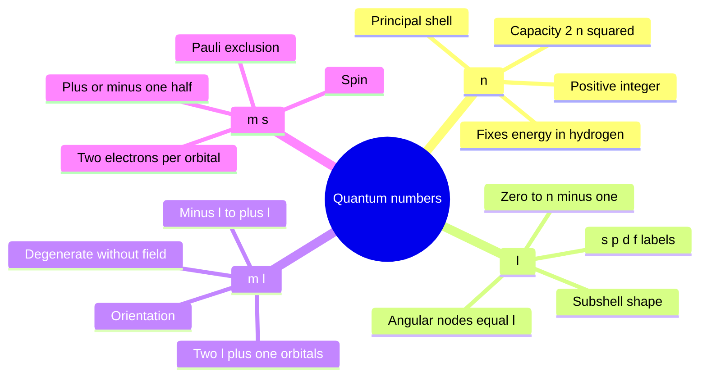
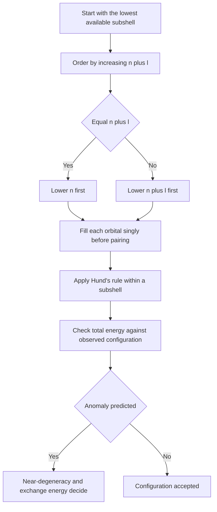
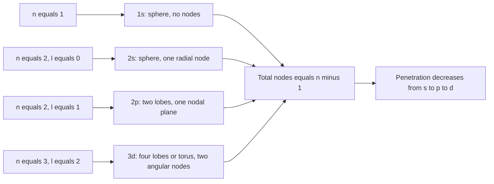

# Chapter 2 — Atomic Orbitals, Quantum Numbers and Advanced Configurations

> **Level:** Advanced (Level 3 — Undergraduate core)
> **Estimated study time:** 8 hours (6 h reading + 2 h exercises)
> **Prerequisites:** [Quantum Mechanics Foundations](01-quantum-mechanics-foundations.md); [Atomic Structure](../02-elementary-chemistry/01-atomic-structure.md)
> **Related chapters:** [Molecular Orbital Theory](03-molecular-orbital-theory.md), [Introduction to the Periodic Table](../01-foundations/07-introduction-to-the-periodic-table.md), [Level 3 index](README.md)
> **Difficulty:** ★★★★☆ (4/5)

---

## 1. Learning Objectives

After working through this chapter you will be able to:

- State the four quantum numbers, their allowed values and the physical quantity each labels.
- Relate $n$, $l$ and $m_l$ to the energy, orbital shape and orientation of a hydrogenic orbital.
- Count radial and angular nodes from the quantum numbers and confirm the count from a sketch of the wavefunction.
- Interpret radial distribution functions, identify the most probable radius, and explain penetration and its consequences.
- Calculate hydrogenic energies from $E_n = -R_\mathrm{H}/n^{2}$ and convert between joules, electronvolts and molar units.
- Apply Slater's rules to estimate the effective nuclear charge of a chosen electron.
- Use the $(n+l)$ rule and the Madelung ordering to predict electron configurations, and write noble-gas shorthand.
- Explain the anomalous configurations of Cr, Cu, Pd, Gd, Pt and Au using near-degeneracy and exchange energy, without invoking a fictitious rule that "half-filled shells are magic".
- Interpret trends and discontinuities in successive ionisation energies as evidence for shells and subshells.
- Write configurations for cations and anions, including the removal of 4s before 3d in transition-metal cations.
- Assign ground-state term symbols for light atoms using Hund's rules (extension).

---

## 2. Introduction

The Bohr model gave hydrogen a single quantum number and a circular orbit. It predicted the Rydberg formula correctly and failed everywhere else. The Schrödinger equation replaces the orbit with an orbital: a mathematical function whose squared modulus gives the probability of finding the electron in a region of space. The three-dimensional solutions carry three integer labels, and a fourth label is needed to account for spin. These four quantum numbers organise the entire periodic table.

The purpose of this chapter is to connect three levels of description that are often taught separately. At the mathematical level, orbitals are products of a radial function and a spherical harmonic, labelled by $n$, $l$ and $m_l$. At the pictorial level, they are the familiar spheres, dumbbells and clover leaves drawn in textbooks. At the chemical level, they determine ionisation energies, oxidation states, magnetic behaviour, colour and the shape of the periodic table. A student who knows only the pictures can name orbitals but cannot predict anything; a student who knows only the mathematics cannot recognise a $3d_{xy}$ orbital in a diagram. The chapter builds both, and insists on the translation between them.

The chapter also confronts the place where the simple story breaks. The Aufbau principle, the $(n+l)$ rule and the "4s before 3d" mnemonic are bookkeeping devices that summarise the configurations of most elements. They are not laws. Chromium, copper, palladium, gadolinium, platinum and gold disobey the simple ordering, and the reasons are instructive: orbital energies depend on the occupation of the orbitals themselves, and exchange energy favours parallel spins. An honest treatment states the rule, states its exceptions, and explains both.

Prerequisites are the previous chapter and elementary calculus. No group theory is assumed; the spherical harmonics are quoted and interpreted, not derived. The treatment is non-relativistic except where relativistic effects are explicitly discussed, and electron correlation is acknowledged as the principal reason why the independent-particle picture is approximate.

---

## 3. Fundamental Concepts

### 3.1 From the hydrogen atom to quantum numbers

The hydrogen atom consists of one electron moving in the Coulomb potential of a proton,

$$
V(r) = -\frac{Ze^{2}}{4\pi\varepsilon_0 r}
$$

with $Z = 1$ for hydrogen and $Z > 1$ for hydrogen-like ions such as $\ce{He+}$ or $\ce{Li^2+}$. Because the potential depends only on the distance $r$, it is spherically symmetric, and the Schrödinger equation separates in spherical polar coordinates:

$$
\psi_{nlm_l}(r,\theta,\phi) = R_{nl}(r)\,Y_{lm_l}(\theta,\phi)
$$

The separation introduces three integers. The radial equation fixes $n$ and $l$; the angular equation fixes $l$ and $m_l$. A fourth quantum number, $m_s$, is required by experiment and by relativistic theory to describe the electron's intrinsic angular momentum. The set $(n, l, m_l, m_s)$ labels a spin-orbital uniquely.

The separation is exact only for a one-electron atom. In a many-electron atom the electron–electron repulsion couples the coordinates and destroys the clean separation. The orbital picture survives as an approximation: each electron is assigned its own one-electron function in an averaged field produced by the nucleus and the other electrons. That approximation is the foundation of all of chemistry, and its limitations are discussed in Section 4.10.

### 3.2 The four quantum numbers

**Principal quantum number $n$.** A positive integer, $n = 1, 2, 3, \ldots$ It fixes the shell, controls the average distance from the nucleus and, in the hydrogenic atom, fixes the energy. The maximum number of electrons in shell $n$ is $2n^{2}$.

**Orbital angular momentum quantum number $l$.** An integer running from $0$ to $n-1$. It fixes the magnitude of the orbital angular momentum, $L = \sqrt{l(l+1)}\,\hbar$, and the shape of the orbital. The spectroscopic labels are s ($l=0$), p ($l=1$), d ($l=2$), f ($l=3$), and thereafter alphabetical (g, h, i).

**Magnetic quantum number $m_l$.** An integer from $-l$ to $+l$, giving $2l+1$ values. It fixes the $z$ component of angular momentum, $L_z = m_l\hbar$, and therefore the orientation of the orbital in space. In the absence of an external field the $2l+1$ orientations are degenerate in energy.

**Spin quantum number $m_s$.** Two values, $+\tfrac{1}{2}$ and $-\tfrac{1}{2}$, conventionally called spin up and spin down. The magnitude of the spin angular momentum is $\sqrt{s(s+1)}\,\hbar$ with $s = \tfrac{1}{2}$, and its $z$ component is $m_s\hbar$.

| Quantum number | Symbol | Allowed values | Physical meaning | Determines |
|---|---|---|---|---|
| Principal | $n$ | $1, 2, 3, \ldots$ | Shell, average radius, energy | Size and energy |
| Orbital angular momentum | $l$ | $0$ to $n-1$ | Magnitude of angular momentum | Shape and subshell label |
| Magnetic | $m_l$ | $-l$ to $+l$ | Projection of angular momentum | Orientation |
| Spin | $m_s$ | $+\tfrac{1}{2}, -\tfrac{1}{2}$ | Intrinsic angular momentum | Spin state |

The number of orbitals in a subshell is $2l+1$: one s orbital, three p orbitals, five d orbitals and seven f orbitals. Each orbital holds two electrons, so a subshell holds $2(2l+1)$ electrons, and a shell holds $\sum_{l=0}^{n-1} 2(2l+1) = 2n^{2}$.

### 3.3 Orbital shapes

The angular part $Y_{lm_l}$ determines the shape; the radial part determines the size and the number of radial nodes. For the s orbitals ($l=0$) the angular function is constant, so the orbital is spherically symmetric. The 1s orbital is a simple exponential,

$$
\psi_{1s} = \frac{1}{\sqrt{\pi}}\left(\frac{Z}{a_0}\right)^{3/2} e^{-Zr/a_0}
$$

with no nodes. The 2s orbital has the same spherical symmetry but contains one radial node: the wavefunction changes sign at $r = 2a_0/Z$, and the probability density has an inner shell and an outer shell separated by a spherical nodal surface.

For $l=1$ the angular functions are proportional to $\sin\theta\cos\phi$, $\sin\theta\sin\phi$ and $\cos\theta$. Taking real linear combinations gives the three p orbitals, each with two lobes of opposite phase separated by a nodal plane through the nucleus. The $2p_z$ orbital lies along the $z$ axis, and $2p_x$ and $2p_y$ lie along their respective axes. The phase (sign) of the lobes is not a charge; it is the sign of the wavefunction, and it becomes decisive when orbitals overlap to form bonds.

For $l=2$ the five d orbitals have four lobes in most cases, arranged either between the axes ($d_{xy}$, $d_{xz}$, $d_{yz}$, $d_{x^{2}-y^{2}}$) or along the axes with a torus ($d_{z^{2}}$). The f orbitals are more complex and are rarely drawn in introductory courses; their shapes matter for lanthanide chemistry and for the f-block contraction.

**Nodes.** Two kinds of node must be distinguished. A *radial node* is a spherical surface on which $R_{nl}(r) = 0$; there are $n - l - 1$ of them. An *angular node* is a plane or cone on which $Y_{lm_l} = 0$; there are $l$ of them. The total number of nodes is $n - 1$.

| Orbital | $n$ | $l$ | Radial nodes | Angular nodes | Total nodes |
|---|---|---|---|---|---|
| 1s | 1 | 0 | 0 | 0 | 0 |
| 2s | 2 | 0 | 1 | 0 | 1 |
| 2p | 2 | 1 | 0 | 1 | 1 |
| 3s | 3 | 0 | 2 | 0 | 2 |
| 3p | 3 | 1 | 1 | 1 | 2 |
| 3d | 3 | 2 | 0 | 2 | 2 |
| 4s | 4 | 0 | 3 | 0 | 3 |
| 4f | 4 | 3 | 0 | 3 | 3 |

### 3.4 Radial distribution functions and penetration

The probability of finding the electron in a thin spherical shell between $r$ and $r + \mathrm{d}r$ is

$$
P(r)\,\mathrm{d}r = r^{2}|R_{nl}(r)|^{2}\,\mathrm{d}r
$$

The factor $r^{2}$ is the volume of the shell; it vanishes at the nucleus and grows with distance. The product $r^{2}R^{2}$ is the radial distribution function (RDF). For the 1s orbital,

$$
P_{1s}(r) = \frac{4Z^{3}}{a_0^{3}}r^{2}e^{-2Zr/a_0}
$$

Differentiating and setting the derivative to zero gives the most probable radius $r_\text{mp} = a_0/Z$, the Bohr radius. The mean radius is larger, $\langle r\rangle_{1s} = 3a_0/(2Z)$, because the distribution has a tail to large $r$.

For the 2s orbital the RDF has two maxima, separated by the radial node. For the 3s orbital there are three maxima. The inner maxima mean that an s electron spends part of its time close to the nucleus, inside the charge cloud of the inner shells. This ability to penetrate the core is the origin of the ordering of subshell energies in many-electron atoms.

Penetration decreases in the order s > p > d > f for a given $n$. An electron that penetrates feels a larger effective nuclear charge, is bound more tightly and lies lower in energy. In hydrogen the penetration has no energetic consequence because the $1/r$ potential makes all orbitals of a given $n$ degenerate. In a many-electron atom the inner electrons screen the nucleus, and the screening is less complete for penetrating orbitals; the degeneracy is lifted and the subshell energies separate.

### 3.5 Hydrogen energy levels and the Rydberg constant

For a one-electron atom of nuclear charge $Z$, the energy eigenvalues are

$$
E_n = -\frac{Z^{2}R_\mathrm{H}}{n^{2}} = -\frac{Z^{2}}{n^{2}}\left(\frac{m_e e^{4}}{8\varepsilon_0^{2}h^{2}}\right)
$$

The constant $R_\mathrm{H}$ is the Rydberg energy, $2.179\,872 \times 10^{-18}\ \mathrm{J} = 13.6057\ \mathrm{eV} = 1312\ \mathrm{kJ\,mol^{-1}}$. The corresponding wavenumber constant is

$$
R_\infty = \frac{m_e e^{4}}{8\varepsilon_0^{2}h^{3}c} = 1.097\,373\,156\,816 \times 10^{7}\ \mathrm{m^{-1}}
$$

for an infinitely heavy nucleus. For hydrogen the finite proton mass requires the reduced mass $\mu = m_e m_p/(m_e + m_p)$, giving $R_\mathrm{H} = R_\infty/(1 + m_e/m_p) = 1.096\,776 \times 10^{7}\ \mathrm{m^{-1}}$. The difference is about 0.05 per cent and was historically important as evidence for the reduced-mass correction.

Energies are negative because the zero of energy is taken at infinite separation with the electron at rest. A transition from $n_2$ to $n_1$ emits a photon of energy

$$
h\nu = E_{n_2} - E_{n_1} = R_\mathrm{H}\left(\frac{1}{n_1^{2}} - \frac{1}{n_2^{2}}\right)
$$

which is the Rydberg formula in energy units. The degeneracy of level $n$ is $n^{2}$ (without spin) or $2n^{2}$ (with spin). The degeneracy in $l$ is a special property of the pure Coulomb potential; any deviation from $1/r$, such as the screened potential of a many-electron atom, lifts it.

### 3.6 Shielding and effective nuclear charge

In a many-electron atom an electron does not experience the full nuclear charge $Z$; the other electrons screen it. The effective nuclear charge is defined by

$$
Z_\text{eff} = Z - \sigma
$$

where $\sigma$ is the screening constant. The concept is approximate because screening is not a simple subtraction: the electron density is continuous and the effective charge depends on the orbital and on the instantaneous positions of the other electrons. It is nevertheless the single most useful qualitative tool for understanding periodic trends.

Slater's rules provide a numerical estimate. Electrons are grouped as (1s), (2s, 2p), (3s, 3p), (3d), (4s, 4p), and so on. For the electron of interest:

- electrons in the same group contribute $0.35$ each, except in the 1s group where the contribution is $0.30$;
- electrons in the $n-1$ shell contribute $0.85$ each;
- electrons in shells further inside contribute $1.00$ each;
- for a d or f electron, all electrons in groups to its left contribute $1.00$ each, and electrons to its right contribute nothing.

The rules are empirical, fitted to atomic spectra, and they fail for heavy elements and for highly charged ions. They are introduced here because they explain the trends, not because they are accurate to better than about 0.5 units of charge.

### 3.7 The $(n+l)$ rule and the Madelung ordering

The order in which subshells are occupied in the ground state of most neutral atoms is summarised by the Madelung rule: orbitals fill in order of increasing $n+l$, and for equal $n+l$ in order of increasing $n$. The resulting sequence is

$$
1s < 2s < 2p < 3s < 3p < 4s < 3d < 4p < 5s < 4d < 5p < 6s < 4f < 5d < 6p < 7s < 5f < 6d < 7p
$$

The rule is a summary of spectroscopic ground-state configurations, not a consequence of the Schrödinger equation. It works because the energy of an orbital in a many-electron atom depends on both its principal quantum number and its penetration: 4s penetrates more than 3d and is therefore lower in energy for potassium and calcium, where the 3d subshell is empty. Once the 3d subshell begins to fill, the balance changes and 3d falls below 4s. The ordering is therefore occupation-dependent, which is why the rule has exceptions and why the naive statement "4s fills before 3d" is an oversimplification.

### 3.8 Anomalous configurations

The Madelung rule predicts the configurations of most elements. The important exceptions among the first transition series and the heavier elements are listed below.

| Element | $Z$ | Predicted | Observed | Unpaired electrons |
|---|---|---|---|---|
| Cr | 24 | $[\ce{Ar}]\,3d^{4}4s^{2}$ | $[\ce{Ar}]\,3d^{5}4s^{1}$ | 6 |
| Cu | 29 | $[\ce{Ar}]\,3d^{9}4s^{2}$ | $[\ce{Ar}]\,3d^{10}4s^{1}$ | 1 |
| Nb | 41 | $[\ce{Kr}]\,4d^{3}5s^{2}$ | $[\ce{Kr}]\,4d^{4}5s^{1}$ | 5 |
| Mo | 42 | $[\ce{Kr}]\,4d^{4}5s^{2}$ | $[\ce{Kr}]\,4d^{5}5s^{1}$ | 6 |
| Ru | 44 | $[\ce{Kr}]\,4d^{6}5s^{2}$ | $[\ce{Kr}]\,4d^{7}5s^{1}$ | 3 |
| Rh | 45 | $[\ce{Kr}]\,4d^{7}5s^{2}$ | $[\ce{Kr}]\,4d^{8}5s^{1}$ | 4 |
| Pd | 46 | $[\ce{Kr}]\,4d^{8}5s^{2}$ | $[\ce{Kr}]\,4d^{10}$ | 0 |
| Ag | 47 | $[\ce{Kr}]\,4d^{9}5s^{2}$ | $[\ce{Kr}]\,4d^{10}5s^{1}$ | 1 |
| La | 57 | $[\ce{Xe}]\,4f^{1}6s^{2}$ | $[\ce{Xe}]\,5d^{1}6s^{2}$ | 1 |
| Ce | 58 | $[\ce{Xe}]\,4f^{2}6s^{2}$ | $[\ce{Xe}]\,4f^{1}5d^{1}6s^{2}$ | 2 |
| Gd | 64 | $[\ce{Xe}]\,4f^{8}6s^{2}$ | $[\ce{Xe}]\,4f^{7}5d^{1}6s^{2}$ | 8 |
| Pt | 78 | $[\ce{Xe}]\,4f^{14}5d^{8}6s^{2}$ | $[\ce{Xe}]\,4f^{14}5d^{9}6s^{1}$ | 2 |
| Au | 79 | $[\ce{Xe}]\,4f^{14}5d^{9}6s^{2}$ | $[\ce{Xe}]\,4f^{14}5d^{10}6s^{1}$ | 1 |

The honest explanation has two parts. First, the $n s$ and $(n-1)d$ orbitals are close in energy, and the ordering changes with occupation and with the nuclear charge, so the energy difference between the two configurations is small — often less than $1\ \mathrm{eV}$. Second, exchange energy favours parallel spins: every pair of electrons with parallel spin in different orbitals avoids one another by the Pauli principle and lowers the energy. A configuration with five parallel d electrons gains four extra exchange pairs relative to one with four, which can be enough to outweigh the promotion energy of an s electron. The details depend on the balance of orbital, exchange and correlation energies, and cannot be captured by a counting rule.

This is why statements such as "half-filled and fully filled subshells are especially stable" are descriptions after the fact, not explanations. Half-filled shells are common among the anomalies because exchange energy is unusually favourable for them, but the pattern is not universal: Pd is $4d^{10}$ with no 5s electrons at all, and Pt is $5d^{9}6s^{1}$ rather than the fully filled $5d^{10}6s^{0}$ or $5d^{8}6s^{2}$. The correct statement is that near-degeneracy plus exchange can override the simple ordering, and the outcome must be determined by calculation or spectroscopy.

### 3.9 Ionisation energies and the evidence for orbital energies

The first ionisation energy is the minimum energy required to remove the most loosely bound electron from a gaseous atom:

$$
\ce{X(g) -> X+(g) + e-}
$$

The successive ionisation energies of an element show sharp jumps whenever a new shell is breached. For sodium the first ionisation energy is $496\ \mathrm{kJ\,mol^{-1}}$ and the second is $4562\ \mathrm{kJ\,mol^{-1}}$, a factor of 9.2. Removing the 3s electron leaves the closed 2s²2p⁶ core, and removing a 2p electron from that core costs far more. The pattern is direct evidence for the shell structure that the quantum numbers describe.

Ionisation energies also reveal subshell structure. Across the second period the first ionisation energy rises from Li to Ne with two interruptions: it falls from Be to B, and from N to O. The Be–B fall occurs because boron's electron is removed from a 2p orbital, which is higher in energy than the 2s orbital occupied in beryllium. The N–O fall occurs because oxygen has a paired 2p electron; the electron–electron repulsion within the doubly occupied orbital makes removal easier than the half-filled stability of nitrogen would suggest. These irregularities are not noise: they are the fingerprint of orbital energies and electron pairing.

### 3.10 Electron configurations of ions

Cations are formed by removing electrons. For main-group elements the electrons are removed from the highest-$n$ shell first. For transition metals the 4s electrons are removed before the 3d electrons, even though 4s was occupied first in the neutral atom. This apparent contradiction is resolved by noting that the 4s and 3d energies cross as the nuclear charge increases and as the d subshell fills. In the cation the 3d orbitals are lower in energy, so they retain their electrons while the 4s electrons, which are further out, are lost.

$$
\ce{Fe}: [\ce{Ar}]\,3d^{6}4s^{2} \quad \longrightarrow \quad \ce{Fe^2+}: [\ce{Ar}]\,3d^{6} \quad \longrightarrow \quad \ce{Fe^3+}: [\ce{Ar}]\,3d^{5}
$$

The half-filled $3d^{5}$ configuration of $\ce{Fe^3+}$ is unusually stable, which is why iron(III) is common in aqueous chemistry and in minerals. The same logic applies to $\ce{Cu+}$ ($3d^{10}$), $\ce{Zn^2+}$ ($3d^{10}$) and $\ce{Ag+}$ ($4d^{10}$).

Anions are formed by adding electrons to the lowest available subshell. The oxide ion $\ce{O^2-}$ is $1s^{2}2s^{2}2p^{6}$, isoelectronic with neon. The hydride ion $\ce{H-}$ is $1s^{2}$, isoelectronic with helium. In an isoelectronic series the ionic radius decreases as the nuclear charge increases, because the same number of electrons is pulled by a larger positive charge: $\ce{N^3-} > \ce{O^2-} > \ce{F-} > \ce{Ne} > \ce{Na+} > \ce{Mg^2+} > \ce{Al^3+}$.

### 3.11 Term symbols: an extension

A configuration such as $2p^{2}$ does not specify a unique state, because the two electrons can be arranged in several ways among the three p orbitals and two spin orientations. The fifteen microstates group into terms labelled by $S$, $L$ and $J$. The term symbol is

$$
^{2S+1}L_J
$$

where $2S+1$ is the spin multiplicity, $L$ is the total orbital angular momentum (written S, P, D, F for $L = 0, 1, 2, 3$) and $J$ is the total angular momentum, $J = |L - S|, \ldots, L + S$.

Hund's rules give the ground term for a light atom. Maximise $S$ first, because parallel spins are kept apart by the Pauli principle and reduce electron–electron repulsion. Then maximise $L$ for that $S$. Then, for a subshell that is less than half full, take the smallest $J$; for a subshell more than half full, take the largest $J$. For carbon, $2p^{2}$ gives $S = 1$, $L = 1$ and $J = 0$, so the ground term is $^{3}P_{0}$. The other terms of $p^{2}$ are $^{1}D_{2}$ and $^{1}S_{0}$, and their energies can be measured spectroscopically. Term symbols become essential in Chapter 9, where they classify the states of transition-metal complexes and account for their magnetic and spectroscopic properties.

---

## 4. Detailed Scientific Explanation

### 4.1 The hydrogenic wavefunctions

The radial functions for hydrogen ($Z = 1$) are

$$
R_{10} = 2a_0^{-3/2}e^{-r/a_0}
$$

$$
R_{20} = \frac{1}{2\sqrt{2}}a_0^{-3/2}\left(2 - \frac{r}{a_0}\right)e^{-r/2a_0}
$$

$$
R_{21} = \frac{1}{2\sqrt{6}}a_0^{-3/2}\frac{r}{a_0}e^{-r/2a_0}
$$

and the first few spherical harmonics are

$$
Y_{00} = \frac{1}{\sqrt{4\pi}}, \qquad Y_{10} = \sqrt{\frac{3}{4\pi}}\cos\theta, \qquad Y_{1\pm1} = \mp\sqrt{\frac{3}{8\pi}}\sin\theta\,e^{\pm i\phi}
$$

The $1s$ wavefunction is therefore spherically symmetric and decays exponentially with a decay length $a_0$. The $2s$ function changes sign at $r = 2a_0$; the $2p$ function vanishes at the nucleus and has its maximum at $r = 4a_0$ along the chosen axis. The radial functions are orthogonal, $\int_0^\infty R_{n'l}R_{nl}r^{2}\,\mathrm{d}r = 0$ for $n' \ne n$, and each is normalised.

The angular functions are also orthogonal, which is why the three p orbitals are independent: $\int Y_{1m'}^{*}Y_{1m}\,\mathrm{d}\Omega = \delta_{m'm}$. The real combinations

$$
p_x = \frac{1}{\sqrt{2}}(Y_{1,-1} - Y_{1,1}), \qquad p_y = \frac{i}{\sqrt{2}}(Y_{1,-1} + Y_{1,1}), \qquad p_z = Y_{10}
$$

are the familiar directional orbitals. They are not eigenfunctions of $\hat{L}_z$, but they are eigenfunctions of $\hat{L}^{2}$, which is what matters for chemistry.

### 4.2 Radial nodes and the shape of the 2s orbital

The 2s wavefunction is proportional to $(2 - r/a_0)e^{-r/2a_0}$. It is positive at the nucleus, crosses zero at $r = 2a_0$, and is negative beyond. The probability density therefore has an inner lobe concentrated within about $a_0$ and an outer lobe beyond $2a_0$, with a spherical nodal surface between them. The radial distribution function has two maxima: one near $r \approx 0.8a_0$ and one near $r \approx 5a_0$. The inner maximum is the penetration that makes the 2s orbital lower in energy than 2p in a many-electron atom.

The experimental signature of the radial node is visible in the X-ray emission spectra of atoms and in the shape of the electron density obtained by diffraction. For hydrogen the 2s and 2p levels are degenerate, so the node has no energetic consequence; for lithium and beyond, the 2s orbital is occupied in preference to 2p, and the node becomes chemically decisive.

### 4.3 Orbital shapes and the d orbitals

The five d orbitals are products of a radial function with $l=2$ and the five spherical harmonics $Y_{2m}$. In their real forms they are

$$
d_{z^{2}} \propto (3z^{2} - r^{2}), \qquad d_{x^{2}-y^{2}} \propto (x^{2} - y^{2}), \qquad d_{xy} \propto xy, \qquad d_{xz} \propto xz, \qquad d_{yz} \propto yz
$$

The $d_{z^{2}}$ orbital has two lobes along the $z$ axis and a torus in the $xy$ plane; the other four have four lobes each, arranged between or along the axes. All five have two angular nodes: two nodal planes for the four-lobed orbitals, and two conical nodal surfaces for $d_{z^{2}}$. The shapes matter because ligands approach along particular directions: in an octahedral complex the $d_{z^{2}}$ and $d_{x^{2}-y^{2}}$ orbitals point at the ligands and are raised in energy, while the $d_{xy}$, $d_{xz}$ and $d_{yz}$ orbitals point between them and are lowered. That splitting is the basis of crystal field theory in Chapter 9.

The f orbitals have $l=3$ and three angular nodes. There are seven of them, and their shapes are intricate; they are occupied in the lanthanides and actinides, where they are buried beneath the filled 5s and 5p shells and therefore participate only weakly in bonding. That burial is why the lanthanides have such similar chemistry.

### 4.4 Hydrogen-like energies and degeneracy

The energy depends only on $n$, so all orbitals with the same $n$ are degenerate. For $n=2$ the degeneracy is four ($2s$, $2p_x$, $2p_y$, $2p_z$), or eight if spin is included. For $n=3$ it is nine, or eighteen with spin.

The degeneracy is a consequence of the $1/r$ potential and of a hidden symmetry associated with the Laplace–Runge–Lenz vector. It is lifted by any effect that makes the potential deviate from $1/r$: screening by other electrons, the finite size of the nucleus, or relativistic corrections. In hydrogen the lifting is small but measurable: the Dirac equation predicts fine structure, and the Lamb shift splits $2s_{1/2}$ from $2p_{1/2}$ by about $1058\ \mathrm{MHz}$. These splittings are negligible for chemical energetics but essential for precision spectroscopy and for the definition of the second.

### 4.5 Many-electron atoms and the central-field approximation

The Hamiltonian for an $N$-electron atom is

$$
\hat{H} = \sum_{i=1}^{N}\left(-\frac{\hbar^{2}}{2m}\nabla_i^{2} - \frac{Ze^{2}}{4\pi\varepsilon_0 r_i}\right) + \sum_{i<j}\frac{e^{2}}{4\pi\varepsilon_0 r_{ij}}
$$

The electron–electron terms couple all the coordinates, and the equation cannot be solved analytically. The standard approximation replaces the repulsion by an average central field, so each electron moves independently in a potential $V_\text{eff}(r)$ that includes the averaged repulsion of the others. The solutions are one-electron orbitals with energies that now depend on both $n$ and $l$. This is the orbital approximation, and it is remarkably successful for describing configurations, ionisation energies and periodic trends.

The approximation neglects *electron correlation*: the instantaneous avoidance of electrons that is not captured by an averaged field. Correlation energies are typically of the order of $1\ \mathrm{eV}$ per electron pair, small compared with total binding energies but comparable to the energy differences that decide configurations and reaction outcomes. This is why the anomalies of Section 3.8 cannot be predicted reliably by a simple rule.

### 4.6 The Aufbau principle and its limits

The Aufbau principle states that the ground-state configuration is built by filling the lowest available orbitals, two electrons per orbital, subject to the Pauli exclusion principle. Combined with the Madelung ordering and Hund's rule, it predicts the configurations of most elements.

Its limits should be stated plainly. First, the ordering of orbital energies is not fixed: it depends on $Z$ and on the occupation. Second, the Aufbau principle compares total energies of configurations, not individual orbital energies; a configuration is favoured when its total energy is lowest, and orbital energies are only a guide. Third, near-degeneracies mean that small correlation and exchange terms can decide the outcome, which is exactly what happens in the anomalous cases. Fourth, the principle says nothing about excited states, which may have different configurations and different orderings.

A useful diagnostic is to compare the predicted and observed configurations for the first transition series. The predictions are correct for Sc, Ti, V, Mn, Fe, Co, Ni and Zn; they fail for Cr and Cu. The failures are not random: both involve a move of one 4s electron into 3d to reach a half-filled or filled d subshell, which maximises exchange energy.

### 4.7 Evidence from ionisation energies

Successive ionisation energies provide the most direct experimental map of orbital energies. For a given element, the $k$th ionisation energy is the energy needed to remove the $k$th electron from the gaseous ion. Plotting $\log(\mathrm{IE}_k)$ against $k$ produces a series of steps: the energy rises steadily within a shell and jumps sharply when the next inner shell is breached.

For sodium the jumps occur after the first electron (3s), after the ninth (2p), and after the eleventh (1s). The pattern confirms the shell capacities 2, 8, 8. Within a shell the rise is gradual because removing an electron increases the effective nuclear charge felt by the remaining electrons, so each successive removal costs more. The jump between shells is much larger because the inner electrons are much more tightly bound.

Ionisation energies also provide a route to approximate orbital energies. Koopmans' theorem states that, in the Hartree–Fock approximation, the ionisation energy of an electron from orbital $i$ is approximately $-\varepsilon_i$, the negative of the orbital energy. The theorem neglects orbital relaxation and electron correlation, which partially cancel, and it is accurate to roughly $0.5\ \mathrm{eV}$ for valence electrons. It is the conceptual link between the orbital diagram and the photoelectron spectrum.

### 4.8 Configurations of ions and the 4s/3d question

The apparent paradox of the transition metals is worth stating precisely. In potassium and calcium the 4s orbital is occupied before 3d because it is lower in energy. In scandium and beyond the 3d orbital is lower in energy than 4s, yet the neutral atoms still have the configuration $3d^{x}4s^{2}$ because the total energy of that configuration is lower than the alternative with electrons in 4s alone. When the atom is ionised, the 4s electrons are removed first because they are the most weakly bound in the cation.

The resolution is that orbital energies and total energies are different quantities. The 4s orbital may be higher in energy than 3d in the neutral atom, but the total energy includes electron–electron repulsion, exchange and correlation, and the configuration that minimises the total energy is not necessarily the one that fills the lowest orbital first. The "4s before 3d" rule is a bookkeeping convention that reproduces the configurations of the early transition metals and the ionisation behaviour; it is not a statement about orbital energies.

A second consequence is that the configurations of transition-metal ions are usually simpler than those of the atoms: the 4s shell is empty, and the d electrons determine the magnetic and spectroscopic properties. $\ce{Ti^2+}$ is $3d^{2}$, $\ce{V^3+}$ is $3d^{2}$, $\ce{Cr^3+}$ is $3d^{3}$, $\ce{Mn^2+}$ is $3d^{5}$ and $\ce{Ni^2+}$ is $3d^{8}$. The number of unpaired d electrons, and hence the magnetic moment, follows directly from Hund's rule applied to the d subshell.

### 4.9 Term symbols and Hund's rules

For light atoms the spin–orbit coupling is weak, and $S$ and $L$ are approximately good quantum numbers. The ground term follows Hund's rules, stated in Section 3.11. The rules are empirical but have a physical basis: parallel spins keep electrons apart because the Pauli principle forces the spatial wavefunction to be antisymmetric, which reduces the Coulomb repulsion; high $L$ corresponds to electrons circulating in the same sense and avoiding one another; and the $J$ rule follows from the sign of the spin–orbit coupling.

For carbon the ground term is $^{3}P_{0}$. The first excited term is $^{1}D_{2}$, about $1.26\ \mathrm{eV}$ above the ground term, and the next is $^{1}S_{0}$, about $2.68\ \mathrm{eV}$ above. These energies are measured by atomic spectroscopy and are reproduced by calculations that include electron correlation; a simple orbital picture does not predict them.

Term symbols are not merely bookkeeping. They determine the selection rules for electronic transitions, the magnetic moments of atoms and ions, and the fine structure of spectral lines. In transition-metal chemistry they classify the states of dⁿ configurations and explain why some complexes are coloured and others are not.

### 4.10 Where the orbital model fails

The orbital model is the most useful approximation in chemistry, and it is still an approximation. Four limitations are worth naming.

1. **Electron correlation.** Independent electrons in an averaged field miss the instantaneous repulsion that keeps electrons apart. The error is small for total energies but large for energy differences, and it is the main reason why density functional theory and wavefunction methods are needed for quantitative predictions.
2. **Configuration interaction.** The true wavefunction is a mixture of configurations. A single configuration such as $2p^{2}$ is not an eigenstate of the full Hamiltonian; the terms $^{3}P$, $^{1}D$ and $^{1}S$ arise from mixtures of configurations.
3. **Relativistic effects.** For heavy elements the inner electrons move at a substantial fraction of the speed of light. The relativistic mass increase contracts the s and p orbitals, which lowers the energy of the 6s orbital and is responsible for the colour of gold, the liquidity of mercury and the inert-pair behaviour of thallium and lead.
4. **Broken spherical symmetry.** In a molecule the potential is not spherical, and the atomic orbitals are not solutions. They are used as basis functions, which is the subject of Chapter 3.

---

## 5. Visual Diagrams

**Figure 2.1 — The four quantum numbers and what each controls.** The map separates the quantum numbers by the question each answers: how big and how energetic ($n$), what shape ($l$), which orientation ($m_l$), and which spin ($m_s$). The capacity $2n^{2}$ follows from counting the orbitals and doubling for spin, not from a separate rule.

**Figure 2.2 — Applying the Madelung and Hund rules.** The flowchart makes explicit that the rules produce a candidate configuration which must then be checked. The decision diamond at the end is the honest part of the procedure: the rules are a first approximation, and the anomalous elements listed in Section 3.8 show where the check fails.

**Figure 2.3 — From quantum numbers to shape and node count.** Each orbital is identified by the pair $(n,l)$, and the node count follows from the same pair. The bottom of the diagram states the trend that governs subshell energies in many-electron atoms: for a given $n$, s orbitals penetrate most and d orbitals least.

**Figure 2.4 — Ionisation of a first-row transition metal.** The diagram uses iron as the example. The 4s electrons are removed first even though 4s was occupied first in the neutral atom, because in the cation the 3d orbitals lie lower and the 4s electrons are the most weakly bound. The half-filled $3d^{5}$ configuration of $\ce{Fe^3+}$ is a particularly stable endpoint.

---

## 6. Mathematical Formulas

### 6.1 Quantum numbers and capacities

$$
n = 1, 2, \ldots; \qquad l = 0, \ldots, n-1; \qquad m_l = -l, \ldots, +l; \qquad m_s = \pm\tfrac{1}{2}
$$

| Symbol | Meaning | Allowed values | SI unit |
|---|---|---|---|
| $n$ | principal quantum number | positive integer | dimensionless |
| $l$ | orbital angular momentum quantum number | $0$ to $n-1$ | dimensionless |
| $m_l$ | magnetic quantum number | $-l$ to $+l$ | dimensionless |
| $m_s$ | spin quantum number | $\pm\tfrac{1}{2}$ | dimensionless |

The number of orbitals in a subshell is $2l+1$, the number of electrons in a subshell is $2(2l+1)$, and the number of electrons in a shell is $2n^{2}$.

### 6.2 Nodes and radial distributions

$$
\text{radial nodes} = n - l - 1, \qquad \text{angular nodes} = l, \qquad \text{total nodes} = n - 1
$$

$$
P(r) = r^{2}|R_{nl}(r)|^{2}
$$

| Symbol | Meaning | SI unit |
|---|---|---|
| $P(r)$ | radial distribution function | m⁻¹ |
| $R_{nl}(r)$ | radial wavefunction | m⁻³ᐟ² |
| $r$ | radial distance | m |

The radial distribution function is normalised, $\int_0^\infty P(r)\,\mathrm{d}r = 1$. Its maxima give the most probable radii; its integral between two radii gives the probability of finding the electron in that shell.

### 6.3 Hydrogenic energies and the Rydberg constant

$$
E_n = -\frac{Z^{2}R_\mathrm{H}}{n^{2}}, \qquad R_\mathrm{H} = \frac{m_e e^{4}}{8\varepsilon_0^{2}h^{2}} = 2.179\,872 \times 10^{-18}\ \mathrm{J}
$$

| Symbol | Meaning | SI unit |
|---|---|---|
| $E_n$ | energy of level $n$ | J |
| $Z$ | nuclear charge number | dimensionless |
| $R_\mathrm{H}$ | Rydberg energy | J |
| $m_e$ | electron mass | kg |
| $e$ | elementary charge | C |
| $\varepsilon_0$ | vacuum permittivity | F m⁻¹ |
| $h$ | Planck constant | J s |

The expression assumes a one-electron atom with an infinitely heavy nucleus. The finite nuclear mass is corrected by replacing $m_e$ with the reduced mass $\mu$. The formula is invalid for many-electron atoms, where screening and correlation shift the levels.

### 6.4 Effective nuclear charge

$$
Z_\text{eff} = Z - \sigma
$$

| Symbol | Meaning | SI unit |
|---|---|---|
| $Z_\text{eff}$ | effective nuclear charge | dimensionless (e) |
| $Z$ | actual nuclear charge | dimensionless (e) |
| $\sigma$ | screening constant | dimensionless |

Slater's rules give $\sigma$ by summing the contributions of the other electrons in the groups defined in Section 3.6. The resulting $Z_\text{eff}$ is a qualitative guide; it is not the charge felt at every point in space, and it should not be used for quantitative calculations of energies.

### 6.5 Madelung ordering and term symbols

$$
\text{fill by increasing } (n+l), \text{ then by increasing } n
$$

$$
^{2S+1}L_J, \qquad J = |L-S|, \ldots, L+S
$$

| Symbol | Meaning | SI unit |
|---|---|---|
| $S$ | total spin quantum number | dimensionless |
| $L$ | total orbital angular momentum quantum number | dimensionless |
| $J$ | total angular momentum quantum number | dimensionless |
| $2S+1$ | spin multiplicity | dimensionless |

Hund's rules apply to the ground term of a light atom in the Russell–Saunders coupling scheme, valid when spin–orbit coupling is small compared with electron–electron repulsion. For heavy atoms, $j$–$j$ coupling is more appropriate and the term symbols of the Russell–Saunders scheme are no longer good labels.

---

## 7. Chemical Equations

### 7.1 First ionisation of sodium

$$
\ce{Na(g) -> Na+(g) + e-} \qquad \Delta H^\circ = +495.8\ \mathrm{kJ\,mol^{-1}}
$$

The electron is removed from the 3s orbital, the highest occupied orbital. The positive enthalpy change is the ionisation energy at $0\ \mathrm{K}$ in the absence of kinetic corrections; tabulated values are usually adiabatic ionisation energies at $0\ \mathrm{K}$ or enthalpy changes at $298\ \mathrm{K}$, and the two differ slightly.

### 7.2 Successive ionisation of magnesium

$$
\ce{Mg(g) -> Mg+(g) + e-} \qquad \Delta H^\circ = +737.7\ \mathrm{kJ\,mol^{-1}}
$$

$$
\ce{Mg+(g) -> Mg^2+(g) + e-} \qquad \Delta H^\circ = +1450.7\ \mathrm{kJ\,mol^{-1}}
$$

The second ionisation energy is almost twice the first because the electron is removed from the same 3s orbital but from a cation with a higher effective nuclear charge. A much larger jump would signal the breaching of an inner shell, as in sodium.

### 7.3 Electron affinity of chlorine

$$
\ce{Cl(g) + e- -> Cl-(g)} \qquad \Delta H^\circ = -349.0\ \mathrm{kJ\,mol^{-1}}
$$

The negative sign means that energy is released. The added electron enters the half-filled 3p subshell, and the attraction to the nucleus outweighs the repulsion from the existing electrons. The electron affinity of fluorine is smaller in magnitude than that of chlorine, a counter-intuitive result caused by the compactness of the 2p subshell and the resulting electron–electron repulsion.

### 7.4 Formation of iron ions

$$
\ce{Fe(g) -> Fe^2+(g) + 2e-} \qquad \Delta H^\circ = +2324\ \mathrm{kJ\,mol^{-1}}
$$

$$
\ce{Fe^2+(g) -> Fe^3+(g) + e-} \qquad \Delta H^\circ = +2957\ \mathrm{kJ\,mol^{-1}}
$$

The values are approximate sums of the successive ionisation energies. The third ionisation energy is not dramatically larger than the second because the electron is removed from the same 3d subshell; the jump that would indicate a change of shell occurs at much higher energies.

---

## 8. Worked Examples

### Worked Example 8.1 — The Balmer $\alpha$ line

**Problem.** Calculate the wavelength and photon energy of the $n = 3 \to n = 2$ transition of hydrogen, using $R_\mathrm{H} = 1.096\,78 \times 10^{7}\ \mathrm{m^{-1}}$.

**Strategy.** Apply the Rydberg formula in wavenumbers, invert to obtain the wavelength, then convert to energy with $E = hc/\lambda$.

**Solution.**

$$
\tilde{\nu} = R_\mathrm{H}\left(\frac{1}{2^{2}} - \frac{1}{3^{2}}\right) = R_\mathrm{H}\left(\frac{1}{4} - \frac{1}{9}\right) = R_\mathrm{H}\frac{5}{36}
$$

$$
\tilde{\nu} = (1.096\,78 \times 10^{7})(0.138\,889) = 1.5233 \times 10^{6}\ \mathrm{m^{-1}}
$$

$$
\lambda = \frac{1}{\tilde{\nu}} = 6.565 \times 10^{-7}\ \mathrm{m} = 656.5\ \mathrm{nm}
$$

The photon energy is

$$
E = \frac{hc}{\lambda} = \frac{1.986 \times 10^{-25}}{6.565 \times 10^{-7}} = 3.03 \times 10^{-19}\ \mathrm{J} = 1.89\ \mathrm{eV}
$$

**Check.** The Balmer $\alpha$ line is the red line of the hydrogen spectrum at $656.3\ \mathrm{nm}$, so the calculation agrees to within the rounding of the constants. The energy is below $13.6\ \mathrm{eV}$, as it must be for a transition between excited levels.

### Worked Example 8.2 — Quantum numbers and node counts

**Problem.** For an electron in a $4d$ orbital, state the possible values of $n$, $l$ and $m_l$, calculate the number of radial and angular nodes, and state how many electrons the $4d$ subshell can hold.

**Strategy.** Use the definitions: the letter d means $l=2$; $m_l$ runs from $-l$ to $+l$; node counts follow from the formulas.

**Solution.** The principal quantum number is $n=4$ and the orbital quantum number is $l=2$. The magnetic quantum number takes the five values $m_l = -2, -1, 0, +1, +2$, corresponding to the five d orbitals. The number of radial nodes is

$$
n - l - 1 = 4 - 2 - 1 = 1
$$

and the number of angular nodes is $l = 2$. The total is $n-1 = 3$. Each orbital holds two electrons, so the subshell holds $2(2l+1) = 10$ electrons.

**Check.** The total node count $1+2=3$ agrees with $n-1=3$. The capacity of 10 matches the ten electrons of a filled d subshell, as in $\ce{Zn^2+}$ ($3d^{10}$).

### Worked Example 8.3 — Slater's rules for sodium and scandium

**Problem.** Estimate the effective nuclear charge felt by (a) the 3s electron of sodium and (b) a 3d electron of scandium.

**Strategy.** Write the configuration, group the electrons as prescribed, sum the screening contributions and subtract from $Z$.

**Solution.** (a) Sodium is $1s^{2}2s^{2}2p^{6}3s^{1}$. For the 3s electron there are no other electrons in the same group. The eight electrons in the $n=2$ shell contribute $0.85$ each, and the two 1s electrons contribute $1.00$ each:

$$
\sigma = 8(0.85) + 2(1.00) = 6.80 + 2.00 = 8.80
$$

$$
Z_\text{eff} = 11 - 8.80 = 2.20
$$

(b) Scandium is $[\ce{Ar}]\,3d^{1}4s^{2}$. For the 3d electron, all electrons in groups to its left contribute $1.00$ each: the eight 3s3p electrons, the eight 2s2p electrons and the two 1s electrons. The 4s electrons lie to the right and contribute nothing, and there is only one 3d electron:

$$
\sigma = 8(1.00) + 8(1.00) + 2(1.00) = 18.00
$$

$$
Z_\text{eff} = 21 - 18.00 = 3.00
$$

**Check.** The sodium value, about 2.2, is consistent with the chemical observation that the 3s electron is easily removed. The scandium 3d electron feels a larger effective charge than the sodium 3s electron, which is why the 3d orbital is compact and why transition-metal chemistry is dominated by d electrons. The values are estimates; spectroscopic effective charges differ by a few tenths.

### Worked Example 8.4 — Configurations of chromium, copper and gadolinium

**Problem.** Write the ground-state configurations of Cr ($Z=24$), Cu ($Z=29$) and Gd ($Z=64$), identify the anomalies relative to the Madelung prediction, and count the unpaired electrons.

**Strategy.** Use the noble-gas core, fill according to the Madelung sequence, then apply the observed anomalies and count unpaired spins using Hund's rule.

**Solution.** For chromium the Madelung prediction is $[\ce{Ar}]\,3d^{4}4s^{2}$; the observed configuration is $[\ce{Ar}]\,3d^{5}4s^{1}$. The five 3d electrons are all unpaired and the single 4s electron is unpaired, giving six unpaired electrons. For copper the prediction is $[\ce{Ar}]\,3d^{9}4s^{2}$; the observed configuration is $[\ce{Ar}]\,3d^{10}4s^{1}$, with one unpaired electron. For gadolinium the prediction is $[\ce{Xe}]\,4f^{8}6s^{2}$; the observed configuration is $[\ce{Xe}]\,4f^{7}5d^{1}6s^{2}$. The seven 4f electrons are all unpaired, the 5d electron is unpaired and the two 6s electrons are paired, giving eight unpaired electrons.

**Check.** Chromium's six unpaired electrons agree with the measured magnetic moment of the free atom, and the half-filled $3d^{5}$ and $4f^{7}$ subshells are consistent with the exchange-energy argument. Copper's single unpaired electron gives a magnetic moment close to the spin-only value for $S = \tfrac{1}{2}$, as observed.

### Worked Example 8.5 — Successive ionisation energies of sodium

**Problem.** The first three ionisation energies of sodium are $495.8$, $4562$ and $6912\ \mathrm{kJ\,mol^{-1}}$. Assign each to an orbital and explain the size of the jump between the first and second.

**Strategy.** Compare the energies with the shell structure and use the effective nuclear charge to explain the trend.

**Solution.** The first ionisation removes the 3s electron, leaving the neon-like core $1s^{2}2s^{2}2p^{6}$. The second removes a 2p electron from that closed shell, and the third removes another 2p electron. The jump from $495.8$ to $4562\ \mathrm{kJ\,mol^{-1}}$ is a factor of 9.2. The 2p electrons are much closer to the nucleus, experience a much larger effective nuclear charge and are not shielded efficiently by the 1s electrons; removing one therefore costs far more than removing the diffuse 3s electron.

**Check.** The ratio of the second to the first ionisation energy is a standard diagnostic for a change of shell: a factor of roughly 5–10 indicates that the electron has come from a principal shell closer to the nucleus. The third ionisation energy is only 1.5 times the second, consistent with removal from the same 2p subshell.

### Worked Example 8.6 — The ground term of carbon

**Problem.** Show that the ground term of the $2p^{2}$ configuration of carbon is $^{3}P_{0}$.

**Strategy.** Apply Hund's rules in order: maximise $S$, then $L$, then choose $J$ according to the filling of the subshell.

**Solution.** Two electrons in a p subshell can be placed in different orbitals with parallel spins, giving $S = 1$ and multiplicity $2S+1 = 3$. With the spins parallel, the Pauli principle requires the spatial part to be antisymmetric, which is achieved by occupying two different p orbitals. The maximum total orbital angular momentum for two p electrons in different orbitals is $L = 1$, corresponding to a P term. The subshell is less than half full (two electrons out of six), so the lowest $J$ lies lowest: $J = |L-S| = 0$. Hence the ground term is $^{3}P_{0}$.

**Check.** The fifteen microstates of $p^{2}$ split into $^{3}P$ (nine states), $^{1}D$ (five states) and $^{1}S$ (one state), and $9+5+1=15$. The $^{3}P_{0}$ assignment agrees with the observed atomic spectrum of carbon, in which the $^{3}P_{0}$–$^{3}P_{1}$ splitting is about $16\ \mathrm{cm^{-1}}$.

---

## 9. Real-World Applications

**Periodic trends.** Atomic and ionic radii, ionisation energies and electronegativities all follow from the interplay of nuclear charge and screening. The diagonal relationships in the periodic table, the lanthanide contraction and the inert-pair effect are consequences of the same physics described in this chapter.

**Magnetic materials.** The number of unpaired d or f electrons determines whether a substance is paramagnetic, ferromagnetic or diamagnetic. Permanent magnets based on $\ce{Nd2Fe14B}$ exploit the large magnetic moment of neodymium, which arises from its partly filled 4f subshell.

**Phosphors and lasers.** The sharp 4f–4f transitions of lanthanide ions are used in phosphors for displays and in solid-state lasers such as $\ce{Nd:YAG}$. The 4f orbitals are shielded from the ligand environment, so the transitions are narrow and the colour is relatively insensitive to the host.

**MRI contrast agents.** Gadolinium(III) has seven unpaired 4f electrons and is strongly paramagnetic. Chelated gadolinium complexes shorten the relaxation times of nearby water protons and are used as contrast agents in magnetic resonance imaging.

**Relativistic chemistry.** The colour of gold, the low melting point of mercury and the stability of the $6s^{2}$ pair in lead all depend on relativistic contraction of the 6s orbital. Relativistic quantum chemistry is now a standard tool for heavy-element compounds.

**Catalysis.** Transition-metal catalysts rely on the availability of d orbitals at accessible energies. The orbital picture explains why platinum, palladium and rhodium are effective hydrogenation catalysts and why first-row metals often behave differently from their heavier congeners.

---

## 10. Common Mistakes

| Mistake | Why it happens | Correct approach |
|---|---|---|
| Saying "4s always fills before 3d" | The mnemonic is taught as an immutable rule | The ordering is occupation-dependent; 4s lies below 3d for K and Ca, but 3d lies below 4s for Sc and beyond, and the rule summarises total energies |
| Treating orbitals as trajectories | The Bohr model is visual and memorable | An orbital is a probability amplitude; the electron does not follow a path |
| Drawing p orbitals as figure-of-eight orbits | The lobe shape suggests a path | The lobes are regions of high probability density with opposite phase, not trajectories |
| Confusing the number of orbitals with $2l+1$ and the number of electrons with $2(2l+1)$ | Capacities are memorised without the count | A p subshell has three orbitals and holds six electrons; a d subshell has five and holds ten |
| Swapping radial and angular node formulas | The two counts look similar | Radial nodes are $n-l-1$; angular nodes are $l$ |
| Explaining Cr and Cu by "half-filled shells are magic" | The pattern is taught as a rule | The explanation is near-degeneracy plus exchange energy; the pattern is not universal, as Pd and Pt show |
| Assuming $Z_\text{eff}$ is the charge at the nucleus | The name suggests a physical charge | $Z_\text{eff}$ is a screened average; the actual field varies with distance |
| Removing 3d before 4s when forming transition-metal cations | 3d was filled after 4s | The 4s electrons are removed first; $\ce{Fe^2+}$ is $3d^{6}$, not $3d^{4}4s^{2}$ |
| Treating term symbols as optional decoration | They appear advanced and abstract | They determine selection rules, magnetic moments and fine structure; they become essential in Chapter 9 |

---

## 11. Chapter Summary

- The four quantum numbers $n$, $l$, $m_l$ and $m_s$ label a spin-orbital and determine energy, shape, orientation and spin.
- A subshell holds $2(2l+1)$ electrons and a shell holds $2n^{2}$.
- Radial nodes number $n-l-1$; angular nodes number $l$; the total is $n-1$.
- The radial distribution function $r^{2}R^{2}$ gives the probability of finding the electron in a shell; its maxima identify the most probable radii.
- Penetration decreases from s to p to d to f, and is the reason subshell energies split in many-electron atoms.
- Hydrogenic energies are $E_n = -Z^{2}R_\mathrm{H}/n^{2}$, with $R_\mathrm{H} = 13.6\ \mathrm{eV}$; the $l$ degeneracy is a special feature of the $1/r$ potential.
- $Z_\text{eff} = Z - \sigma$ and Slater's rules give a qualitative estimate of screening.
- The Madelung ordering follows increasing $n+l$, then increasing $n$, and predicts most configurations.
- Chromium, copper, palladium, gadolinium, platinum and gold are among the exceptions; near-degeneracy and exchange energy explain them, and the simple rule is not a law.
- Successive ionisation energies reveal shell structure through their discontinuities.
- Cations lose the highest-$n$ electrons first; transition-metal cations lose 4s before 3d.
- Term symbols $^{2S+1}L_J$ classify the states of a configuration and follow Hund's rules.

---

## 12. Exercises

### 12.1 Conceptual questions

1. Explain why the $2s$ and $2p$ orbitals are degenerate in hydrogen but not in lithium.
2. Why does the first ionisation energy of oxygen lie below that of nitrogen, despite oxygen having the larger nuclear charge?

### 12.2 Basic problems

3. State the allowed values of $l$ and $m_l$ for $n=3$, and list the subshells present in the third shell.
4. How many radial and angular nodes does a $4f$ orbital have? How many electrons can the $4f$ subshell hold?
5. Write the ground-state configuration of $\ce{Cl-}$, $\ce{K+}$ and $\ce{Ca^2+}$ and identify the isoelectronic series.

### 12.3 Intermediate problems

6. Use Slater's rules to estimate $Z_\text{eff}$ for a 2p electron in fluorine and for a 3s electron in magnesium.
7. Predict the ground-state configuration of tungsten ($Z=74$) and state whether it is an anomaly relative to the Madelung rule.
8. Explain why the third ionisation energy of calcium is much larger than the second, while the third ionisation energy of scandium is not.

### 12.4 Advanced problems

9. The observed configuration of palladium is $[\ce{Kr}]\,4d^{10}$. Explain why the Madelung rule fails, and why the analogous $5d^{10}$ configuration is not observed for platinum.
10. Derive the number of microstates for a $d^{2}$ configuration and identify the terms expected under Russell–Saunders coupling.

### 12.5 Calculation problems

11. Calculate the wavelength of the $n = 4 \to n = 2$ transition of hydrogen and identify the spectral series.
12. Estimate the effective nuclear charge of the 3d electron in $\ce{Fe}$ ($Z=26$) using Slater's rules, and comment on the result.

### 12.6 Answers

1. In hydrogen the potential is exactly $1/r$ and the energy depends only on $n$; in lithium the inner 1s electrons screen the nucleus unevenly, so the 2s electron penetrates the core more than the 2p electron and is lower in energy.
2. Oxygen has four 2p electrons, so one orbital is doubly occupied; the repulsion between the paired electrons outweighs the increase in nuclear charge, making the first ionisation energy lower than nitrogen's.
3. $l = 0, 1, 2$; for $l=0$, $m_l = 0$; for $l=1$, $m_l = -1, 0, +1$; for $l=2$, $m_l = -2, \ldots, +2$. The subshells are 3s, 3p and 3d.
4. $4f$: $l=3$, radial nodes $=4-3-1=0$, angular nodes $=3$; capacity $2(2l+1)=14$ electrons.
5. $\ce{Cl-}$: $[\ce{Ar}]$; $\ce{K+}$: $[\ce{Ar}]$; $\ce{Ca^2+}$: $[\ce{Ar}]$. All three are isoelectronic with argon.
6. Fluorine $1s^{2}2s^{2}2p^{5}$: for a 2p electron, six same-shell electrons contribute $6(0.35)=2.10$ and two 1s electrons contribute $2(0.85)=1.70$, so $\sigma=3.80$ and $Z_\text{eff}=9-3.80=5.20$. Magnesium $1s^{2}2s^{2}2p^{6}3s^{2}$: for the 3s electron, one same-shell electron contributes $0.35$, eight $n=2$ electrons contribute $6.80$ and two 1s electrons contribute $2.00$, so $\sigma=9.15$ and $Z_\text{eff}=12-9.15=2.85$.
7. Tungsten is $[\ce{Xe}]\,4f^{14}5d^{4}6s^{2}$, which follows the Madelung rule; it is not an anomaly.
8. Calcium's third ionisation removes a 3p electron from the closed argon core, which costs far more than removing the 4s electron. Scandium's third ionisation removes a 3d electron from the same valence region, so the increase is moderate.
9. Palladium's $4d^{10}$ configuration avoids the cost of occupying the 5s orbital and gains the exchange energy of a filled d subshell; the 5s and 4d orbitals are close in energy and the total energy favours $4d^{10}$. Platinum is $5d^{9}6s^{1}$ because relativistic effects and the greater spatial extent of 5d change the balance, so the fully filled $5d^{10}$ is not favoured.
10. A $d^{2}$ configuration has $\binom{10}{2}=45$ microstates, which split into the terms $^{3}F$, $^{3}P$, $^{1}G$, $^{1}D$ and $^{1}S$.
11. $\tilde{\nu}=R_\mathrm{H}(1/4-1/16)=R_\mathrm{H}(3/16)=2.056\times10^{6}\ \mathrm{m^{-1}}$, so $\lambda=486.3\ \mathrm{nm}$, the Balmer $\beta$ line.
12. Iron is $[\ce{Ar}]\,3d^{6}4s^{2}$; for a 3d electron all 18 electrons to its left contribute $1.00$ and the five other 3d electrons contribute $5(0.35)=1.75$, so $\sigma=19.75$ and $Z_\text{eff}=26-19.75=6.25$. The value is larger than for scandium, consistent with the greater binding of 3d electrons across the series.

> Worked solutions for this level are maintained in the `solutions/` directory of the level.

---

## 13. Further Reading

- Atkins, P. W.; de Paula, J.; Keeler, J. *Atkins' Physical Chemistry*, 11th ed., Oxford University Press, 2018. Chapters 8–9 cover atomic orbitals and many-electron atoms.
- McQuarrie, D. A.; Simon, J. D. *Physical Chemistry: A Molecular Approach*, University Science Books, 1997. Chapters 3–4 derive the hydrogenic wavefunctions and discuss screening.
- Levine, I. N. *Quantum Chemistry*, 7th ed., Pearson, 2014. Chapters 6–7 treat angular momentum, term symbols and atomic spectra.
- Housecroft, C. E.; Sharpe, A. G. *Inorganic Chemistry*, 5th ed., Pearson, 2018. Chapter 1 covers atomic structure and periodic trends.
- IUPAC. *Compendium of Chemical Terminology* (the "Gold Book"), 2nd ed. (corrected version). <https://goldbook.iupac.org/>
- NIST. *CODATA Internationally Recommended Values of the Fundamental Physical Constants*. <https://physics.nist.gov/cuu/Constants/>
- [CURRICULUM.md](../CURRICULUM.md) — where this chapter sits in the full programme.
