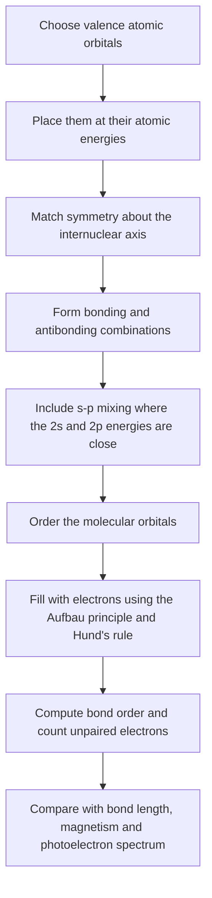
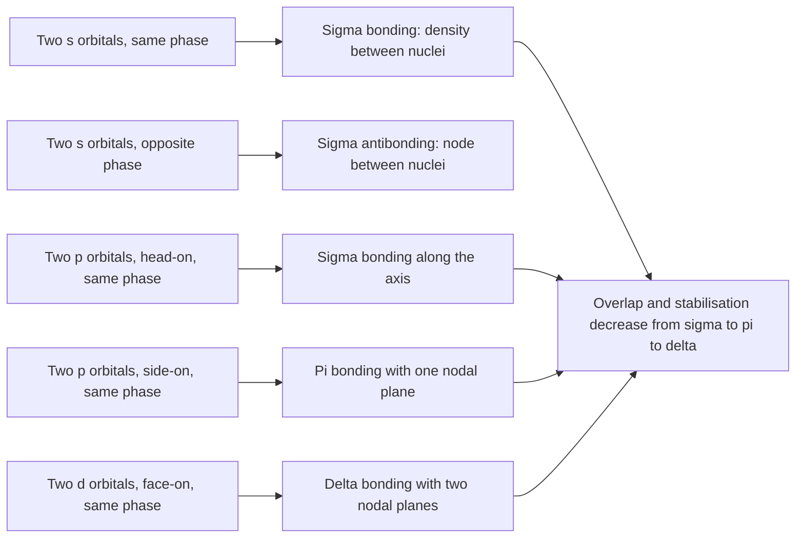
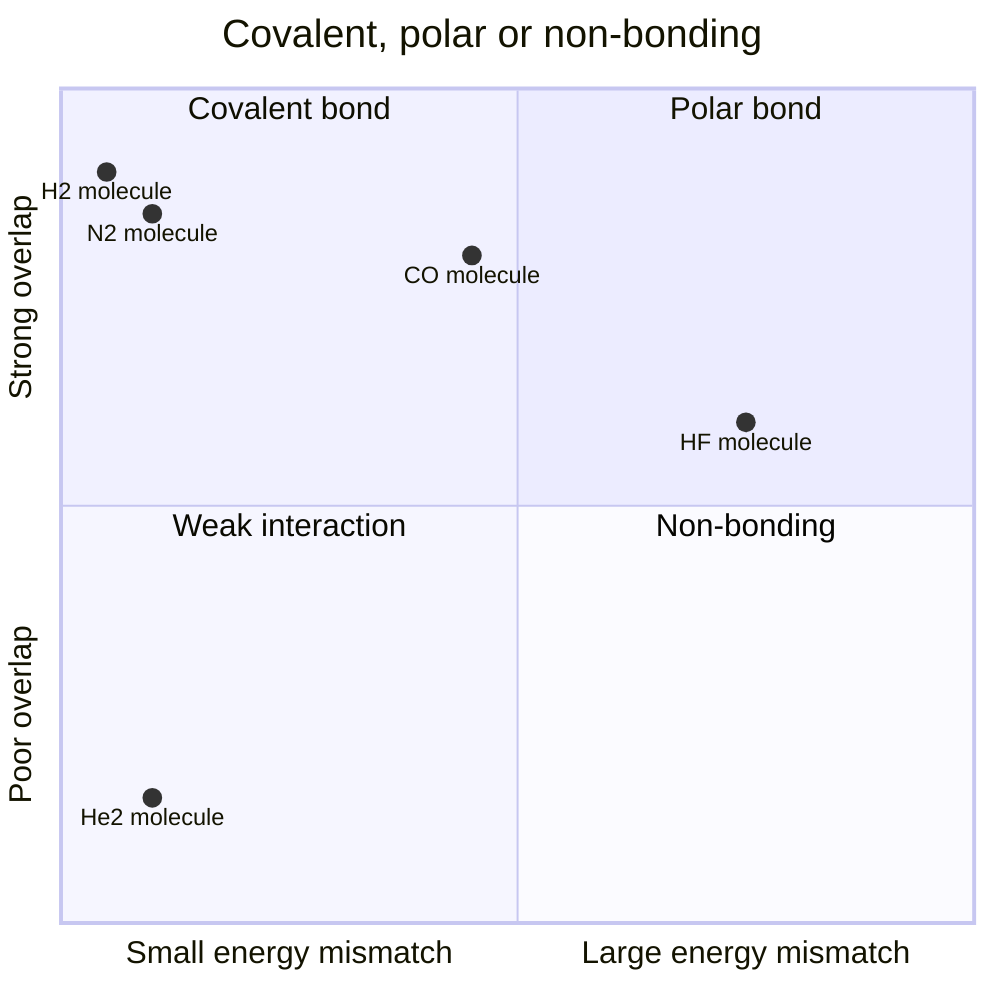
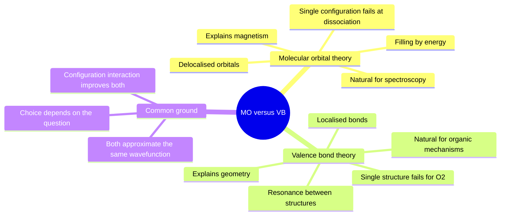

# Chapter 3 — Molecular Orbital Theory

> **Level:** Advanced (Level 3 — Undergraduate core)
> **Estimated study time:** 9 hours (6.5 h reading + 2.5 h exercises)
> **Prerequisites:** [Atomic Orbitals, Quantum Numbers and Advanced Configurations](02-atomic-orbitals-and-quantum-numbers.md); [Lewis Structures and Chemical Formulas](../02-elementary-chemistry/06-lewis-structures-and-chemical-formulas.md)
> **Related chapters:** [Quantum Mechanics Foundations](01-quantum-mechanics-foundations.md), [Chemical Thermodynamics](04-chemical-thermodynamics.md), [Level 3 index](README.md)
> **Difficulty:** ★★★★★ (5/5)

---

## 1. Learning Objectives

After working through this chapter you will be able to:

- Explain the LCAO approximation and set up the secular determinant for a two-orbital problem.
- Distinguish bonding, antibonding and non-bonding combinations by phase and by symmetry.
- Identify σ, π and δ overlap and state which orbital pairs can combine along a given axis.
- Construct molecular orbital diagrams for the second-period homonuclear diatomics and place the electrons correctly.
- Calculate bond order and spin-only magnetic moments, and use them to predict stability, bond length and magnetism.
- Explain the s–p mixing effect and why the orbital ordering in $\ce{N2}$ differs from that in $\ce{O2}$.
- Describe the polarisation of coefficients in heteronuclear diatomics and apply it to HF, CO and NO.
- Set up and solve the Hückel determinant for ethene and butadiene, and interpret the resulting π energies and bond orders.
- Compare the molecular orbital and valence bond descriptions, and explain why MO theory accounts for the paramagnetism of $\ce{O2}$.
- Interpret a simple photoelectron spectrum in terms of orbital energies and correlation diagrams.
- State the approximations in MO theory and the situations in which it fails.

---

## 2. Introduction

Lewis structures describe a molecule as a set of localised bonds and lone pairs. The model is enormously successful: it predicts connectivity, formal charge, geometry (with VSEPR) and much of organic reactivity. It cannot, however, explain why oxygen is paramagnetic. A Lewis structure for $\ce{O2}$ with a double bond and two lone pairs on each oxygen has every electron paired, so it predicts diamagnetism. The measured magnetic moment of oxygen corresponds to two unpaired electrons. Valence bond theory can be patched to accommodate the observation, but the patch is not natural. Molecular orbital theory predicts it directly, from the filling of two degenerate antibonding π orbitals.

The central idea of MO theory is that electrons in a molecule occupy molecular orbitals that extend over the whole framework, just as electrons in an atom occupy atomic orbitals that extend over the whole atom. Molecular orbitals are constructed by combining atomic orbitals, and the coefficients of the combination determine where the electron density is concentrated. Bonding orbitals concentrate density between nuclei and lower the energy; antibonding orbitals have a node between nuclei and raise it. Filling the orbitals in order of increasing energy gives the configuration, and the configuration gives bond order, magnetism and spectroscopic behaviour.

The LCAO approximation is variational: the best coefficients are those that minimise the energy, which leads to a secular determinant whose roots are the orbital energies. For two orbitals the determinant is $2 \times 2$ and can be solved exactly; for a molecule with many orbitals it is solved numerically. The same mathematics underlies Hückel theory for π systems, the band theory of solids and modern computational chemistry. The two-orbital problem is therefore worth solving carefully, because every later method is a generalisation of it.

This chapter builds the theory from the two-orbital case, applies it systematically to the second-period diatomics, and then extends it to heteronuclear molecules and conjugated π systems. It closes with photoelectron spectroscopy, which provides direct experimental evidence for the orbital energies the theory predicts, and with an honest account of what the approximation neglects.

---

## 3. Fundamental Concepts

### 3.1 The LCAO approximation

A molecular orbital $\psi$ is approximated as a linear combination of atomic orbitals $\phi_i$:

$$
\psi = \sum_i c_i\phi_i
$$

For a diatomic molecule built from orbitals $\phi_A$ and $\phi_B$,

$$
\psi = c_A\phi_A + c_B\phi_B
$$

The coefficients are found by the variational principle: the best wavefunction is the one that gives the lowest energy. Multiplying the Schrödinger equation $\hat{H}\psi = E\psi$ by $\phi_A^{*}$ and integrating, then repeating with $\phi_B^{*}$, gives the secular equations

$$
c_A(H_{AA} - E) + c_B(H_{AB} - ES_{AB}) = 0
$$

$$
c_A(H_{AB} - ES_{AB}) + c_B(H_{BB} - E) = 0
$$

where

$$
H_{AA} = \int \phi_A^{*}\hat{H}\phi_A\,\mathrm{d}\tau, \qquad H_{AB} = \int \phi_A^{*}\hat{H}\phi_B\,\mathrm{d}\tau, \qquad S_{AB} = \int \phi_A^{*}\phi_B\,\mathrm{d}\tau
$$

$H_{AA}$ is the Coulomb integral, approximately the energy of an electron in $\phi_A$; $H_{AB}$ is the resonance or hopping integral, negative for orbitals of the same phase that overlap; and $S_{AB}$ is the overlap integral, between 0 and 1. A non-trivial solution requires the determinant to vanish:

$$
\begin{vmatrix}
H_{AA} - E & H_{AB} - ES_{AB} \\
H_{AB} - ES_{AB} & H_{BB} - E
\end{vmatrix} = 0
$$

For a homonuclear molecule $H_{AA} = H_{BB} = \alpha$ and $H_{AB} = \beta$, and the roots are

$$
E_\pm = \frac{\alpha \pm \beta}{1 \pm S}
$$

Neglecting overlap ($S = 0$) gives the familiar result $E_\pm = \alpha \pm \beta$. Since $\beta < 0$, the lower root $E_+ = \alpha + \beta$ lies below the atomic energy and is the bonding orbital; the upper root $E_- = \alpha - \beta$ lies above it and is the antibonding orbital. The corresponding coefficients are $c_A = c_B = 1/\sqrt{2}$ for the homonuclear case, so the electron is shared equally.

The labels are conventions: some texts define $\beta$ as a positive quantity and write $E_\pm = \alpha \pm \beta$ with the bonding root at $\alpha - \beta$. What matters is that one combination is stabilised by approximately $|\beta|$ and the other destabilised by approximately $|\beta|$. The antibonding destabilisation is slightly larger than the bonding stabilisation when overlap is included, which is why $\ce{He2}$ is not bound.

### 3.2 Phase, symmetry and the meaning of overlap

Each atomic orbital has a sign, its phase. When two orbitals of the same phase overlap, the combination $\phi_A + \phi_B$ increases the electron density between the nuclei, produces a bonding orbital and lowers the energy. When they overlap with opposite phase, the combination $\phi_A - \phi_B$ has a node between the nuclei, produces an antibonding orbital and raises the energy.

The overlap integral quantifies the spatial match:

$$
S_{AB} = \int \phi_A^{*}\phi_B\,\mathrm{d}\tau
$$

It is large when the orbitals point at one another, have similar sizes and have the same symmetry about the internuclear axis. It is zero by symmetry when the positive and negative lobes cancel exactly. A zero overlap does not mean zero interaction in a full calculation — the interaction can occur through other orbitals — but it does mean that the direct two-orbital combination is non-bonding.

Symmetry also gives the orbitals their labels. For a homonuclear diatomic, inversion through the centre of the bond either leaves the orbital unchanged (gerade, subscript g) or changes its sign (ungerade, subscript u). The bonding σ orbital built from two s orbitals is g; the corresponding antibonding orbital is u. The π bonding orbitals are u and the π antibonding orbitals are g. These labels become selection rules in spectroscopy.

### 3.3 σ, π and δ overlap

Overlap is classified by the number of nodal planes containing the internuclear axis.

- **σ overlap** has no nodal plane containing the axis. It arises from s–s, s–p$_z$, p$_z$–p$_z$ or hybrid orbitals pointing along the axis. σ bonds are the strongest and allow free rotation about the bond.
- **π overlap** has one nodal plane containing the axis. It arises from p$_x$–p$_x$ or p$_y$–p$_y$ side-on overlap. π bonds are weaker than σ bonds and restrict rotation.
- **δ overlap** has two nodal planes containing the axis. It arises from d$_{xy}$–d$_{xy}$ or d$_{x^{2}-y^{2}}$–d$_{x^{2}-y^{2}}$ face-on overlap. δ bonds are weak and are found in quadruple bonds of transition metals.

The strength ordering σ > π > δ follows from the extent of overlap: head-on overlap is more effective than side-on, and side-on is more effective than face-on. The ordering is not a law of nature but a consequence of orbital shapes at typical bond distances.

### 3.4 Homonuclear diatomic molecules of the second period

The second-period atoms have 2s and 2p valence orbitals. Combining them produces a set of molecular orbitals whose ordering depends on the relative energies of the atomic orbitals and on the strength of the s–p mixing. Two orderings are needed.

**Ordering without strong s–p mixing** ($\ce{O2}$, $\ce{F2}$, $\ce{Ne2}$):

$$
\sigma_{g}(2s) < \sigma_{u}^{*}(2s) < \sigma_{g}(2p) < \pi_{u}(2p) < \pi_{g}^{*}(2p) < \sigma_{u}^{*}(2p)
$$

**Ordering with strong s–p mixing** ($\ce{B2}$, $\ce{C2}$, $\ce{N2}$):

$$
\sigma_{g}(2s) < \sigma_{u}^{*}(2s) < \pi_{u}(2p) < \sigma_{g}(2p) < \pi_{g}^{*}(2p) < \sigma_{u}^{*}(2p)
$$

The difference is the position of the $\sigma_g(2p)$ orbital relative to the $\pi_u(2p)$ pair. In the first case σ lies below π; in the second it lies above. The switch occurs because the 2s and 2p atomic orbitals are close in energy for the lighter elements, so the $\sigma_g(2p)$ orbital mixes with the $\sigma_u^{*}(2s)$ orbital and is pushed upwards.

| Molecule | Valence electrons | Configuration (valence) | Bond order | Magnetism | Bond length / pm |
|---|---|---|---|---|---|
| $\ce{H2}$ | 2 | $\sigma_g(1s)^{2}$ | 1 | Diamagnetic | 74 |
| $\ce{He2}$ | 4 | $\sigma_g^{2}\sigma_u^{*2}$ | 0 | Diamagnetic | not bound |
| $\ce{Li2}$ | 6 | $\sigma_g^{2}\sigma_u^{*2}\sigma_g(2s)^{2}$ | 1 | Diamagnetic | 267 |
| $\ce{Be2}$ | 8 | $\sigma_g^{2}\sigma_u^{*2}$ | 0 | Diamagnetic | not bound |
| $\ce{B2}$ | 10 | $\sigma_g^{2}\sigma_u^{*2}\pi_u^{2}$ | 1 | Paramagnetic | 159 |
| $\ce{C2}$ | 12 | $\sigma_g^{2}\sigma_u^{*2}\pi_u^{4}$ | 2 | Diamagnetic | 124 |
| $\ce{N2}$ | 14 | $\sigma_g^{2}\sigma_u^{*2}\pi_u^{4}\sigma_g^{2}$ | 3 | Diamagnetic | 110 |
| $\ce{O2}$ | 16 | $\sigma_g^{2}\sigma_u^{*2}\sigma_g^{2}\pi_u^{4}\pi_g^{*2}$ | 2 | Paramagnetic | 121 |
| $\ce{F2}$ | 18 | $\sigma_g^{2}\sigma_u^{*2}\sigma_g^{2}\pi_u^{4}\pi_g^{*4}$ | 1 | Diamagnetic | 142 |
| $\ce{Ne2}$ | 20 | all bonding and antibonding filled | 0 | Diamagnetic | not bound |

The table repays study. Bond order correlates with bond length within an isoelectronic series: as bonding electrons are removed or antibonding electrons added, the bond lengthens. Magnetism correlates with unpaired electrons: $\ce{B2}$ and $\ce{O2}$ are paramagnetic, the rest are diamagnetic. The two molecules with bond order zero, $\ce{He2}$ and $\ce{Ne2}$, are held together only by dispersion forces; $\ce{Be2}$ is a marginal case with a very weak bond, and modern calculations find a shallow minimum.

### 3.5 The s–p mixing effect

The 2s and 2p orbitals on the same atom have different energies but the same symmetry with respect to the molecular axis when combined in a σ fashion. The $\sigma_g(2p)$ molecular orbital and the $\sigma_u^{*}(2s)$ molecular orbital both have $\sigma_g$ symmetry, and they mix. The mixing is a second-order perturbation: the two levels repel one another, the lower is pushed down and the upper is pushed up.

The size of the effect depends on the energy gap between 2s and 2p. For boron, carbon and nitrogen the gap is relatively small and the mixing is strong; for oxygen and fluorine the larger effective nuclear charge lowers the 2s orbital and reduces the mixing. The consequence is the reordering shown in Section 3.4.

The reordering is not a cosmetic detail. It changes the occupancy of the π and σ orbitals and therefore changes magnetism. In $\ce{B2}$ the two π electrons occupy degenerate $\pi_u$ orbitals singly, giving two unpaired electrons and a paramagnetic molecule. If the $\sigma_g(2p)$ orbital were lower, the two electrons would pair in it and $\ce{B2}$ would be diamagnetic. The observed paramagnetism of $\ce{B2}$ at high temperature is evidence for the s–p mixing.

### 3.6 Heteronuclear diatomic molecules

When the two atoms differ, $H_{AA} \ne H_{BB}$, and the secular determinant gives

$$
E_\pm = \frac{H_{AA} + H_{BB}}{2} \pm \sqrt{\left(\frac{H_{AA} - H_{BB}}{2}\right)^{2} + \beta^{2}}
$$

taking $S = 0$ for simplicity. The bonding orbital is closer in energy to the lower atomic orbital, and its coefficient on that atom is larger. The electron density is therefore polarised toward the more electronegative atom, which is the MO description of a polar bond.

For HF, the F 2p orbital lies about $5\ \mathrm{eV}$ below the H 1s orbital, so the bonding σ orbital is predominantly F 2p and the antibonding σ* is predominantly H 1s. The remaining two F 2p orbitals are non-bonding because they have the wrong symmetry to combine with H 1s. The eight valence electrons occupy the bonding σ, the F 2s and the two non-bonding 2p orbitals, giving a bond order of one.

For CO, the MO diagram is qualitatively that of $\ce{N2}$, with ten valence electrons and a bond order of three. The HOMO is a σ orbital localised mainly on carbon, and the LUMO is a π* orbital. The molecule has a small dipole moment of $0.122\ \mathrm{D}$ with the negative end on carbon, opposite to the direction predicted by electronegativity alone. The MO explanation is that the σ lone pair on carbon contributes a large moment toward carbon, while the π electrons are polarised toward oxygen; the σ contribution wins.

For NO, there are eleven valence electrons, one more than in CO. The extra electron enters a π* orbital, giving a bond order of $2.5$ and one unpaired electron. NO is therefore paramagnetic, and its bond is longer and weaker than that of $\ce{NO+}$, which has ten valence electrons, a bond order of three and a bond length of $106\ \mathrm{pm}$ compared with $115\ \mathrm{pm}$ in NO.

### 3.7 Hückel theory for π systems

Hückel theory applies the LCAO method to the π electrons of planar conjugated molecules. It assumes that the σ framework is fixed and that the π electrons move in the field of the nuclei and the σ electrons. Each carbon contributes one 2p orbital perpendicular to the plane. The Coulomb integral is set to $\alpha$ for every carbon, the resonance integral to $\beta$ for every adjacent pair, and zero for non-adjacent pairs; overlap is neglected.

For ethene the secular determinant is

$$
\begin{vmatrix}
\alpha - E & \beta \\
\beta & \alpha - E
\end{vmatrix} = 0
$$

which gives $E = \alpha \pm \beta$. The two π electrons occupy the bonding orbital, so the π energy is $2\alpha + 2\beta$.

For butadiene the determinant is $4 \times 4$, and the roots are

$$
E = \alpha + 1.618\beta, \quad \alpha + 0.618\beta, \quad \alpha - 0.618\beta, \quad \alpha - 1.618\beta
$$

The four π electrons fill the two lower orbitals, giving a total π energy of $4\alpha + 4.472\beta$. Two isolated ethene molecules would give $4\alpha + 4\beta$, so the delocalisation energy is $0.472\beta$. With $\beta \approx -75\ \mathrm{kJ\,mol^{-1}}$, this is about $35\ \mathrm{kJ\,mol^{-1}}$, larger than the experimental resonance energy of butadiene (about $15\ \mathrm{kJ\,mol^{-1}}$). Hückel theory overestimates delocalisation because it neglects electron–electron repulsion and the alternation of bond lengths.

For benzene the six roots are $\alpha + 2\beta$, $\alpha + \beta$ (twice) and $\alpha - \beta$ (twice), $\alpha - 2\beta$. The six π electrons fill the three lowest orbitals, giving $6\alpha + 8\beta$, compared with $6\alpha + 6\beta$ for three ethene units: a delocalisation energy of $2\beta$. The equal bond orders of $2/3$ in the Hückel picture correspond to the equal bond lengths observed in benzene.

Hückel theory is quantitatively crude but qualitatively powerful. It predicts the ordering of π orbitals, the existence of a delocalisation energy, the nodal patterns of the molecular orbitals and the rough distribution of electron density. It is the conceptual ancestor of the frontier orbital theory used to rationalise reactivity.

### 3.8 Molecular orbital versus valence bond theory

Valence bond theory builds a molecule from localised bonds, each formed by overlap of two atomic orbitals, and uses resonance between structures to describe delocalisation. It is close to the chemist's Lewis picture and natural for explaining geometry, hybridisation and the shapes of organic molecules. Molecular orbital theory builds delocalised orbitals over the whole molecule and fills them with electrons. It is natural for explaining spectroscopy, magnetism and delocalised electronic structure.

The two theories are approximations to the same exact wavefunction and converge when both are taken to their limits. At the simple level, they differ in emphasis. Valence bond theory with a single covalent structure gives a poor binding energy at equilibrium because it omits the ionic terms; MO theory with a single configuration predicts a wrong dissociation limit because it gives equal weight to ionic and covalent terms at large separation. Both failures are cured by configuration interaction, which mixes the appropriate terms.

For oxygen, the MO picture is decisively better. A single-configuration MO description with two unpaired electrons in the π* orbitals reproduces the paramagnetism and the bond order. A single valence bond structure does not; a superposition of several structures can reproduce the result, but the paramagnetism is then a consequence of the specific superposition rather than of the bonding model itself.

### 3.9 Photoelectron spectroscopy and correlation diagrams

Photoelectron spectroscopy (PES) measures the kinetic energy of electrons ejected by photons of known energy:

$$
E_\text{kin} = h\nu - E_\text{b}
$$

where $E_\text{b}$ is the binding energy of the electron. Under Koopmans' theorem, the binding energy is approximately the negative of the orbital energy, so a PES spectrum is a map of the occupied molecular orbitals. Each peak corresponds to an orbital, and its vibrational fine structure reveals the bonding character of that orbital.

For $\ce{N2}$ the valence region shows three bands at about $15.6$, $16.9$ and $18.8\ \mathrm{eV}$, assigned to the $3\sigma_g$, $1\pi_u$ and $2\sigma_u^{*}$ orbitals respectively. The $3\sigma_g$ and $1\pi_u$ orbitals are bonding, so ionisation from them weakens the bond; the $2\sigma_u^{*}$ orbital is antibonding, so ionisation from it strengthens the bond. The vibrational spacings in the photoelectron spectrum confirm these assignments: removing a bonding electron lengthens the bond and lowers the vibrational frequency, while removing an antibonding electron shortens it.

A correlation diagram connects the orbitals of the separated atoms to those of the united atom through the molecular orbitals of the diatomic. It is a useful bookkeeping device because it shows which atomic orbitals correlate with which molecular orbitals and which avoided crossings occur. The non-crossing rule states that two orbitals of the same symmetry cannot cross as the internuclear distance changes; they repel one another instead. That rule is why the $\sigma_g(2p)$ and $\sigma_u^{*}(2s)$ orbitals mix rather than pass through each other.

### 3.10 Where molecular orbital theory fails

The LCAO-MO picture described here is an independent-electron approximation. It neglects electron correlation, and it uses a minimal basis of atomic orbitals. Four consequences should be stated.

1. **Wrong dissociation limit.** A single configuration of $\ce{H2}$ gives equal ionic and covalent weight at large separation, so the calculated energy is too high. Configuration interaction corrects this.
2. **Poor excited states.** Single-configuration energies for excited states are often badly wrong because the states mix strongly. Spectroscopic assignments usually require multi-reference methods.
3. **Basis-set dependence.** The accuracy of a calculation depends on the size of the basis set. A minimal basis cannot describe polarisation or diffuse electron density.
4. **Static correlation.** Molecules with near-degenerate orbitals, such as stretched bonds and some transition-metal complexes, require more than one configuration even qualitatively. The single-configuration MO diagram is then misleading.

None of this diminishes the explanatory power of the simple diagrams. It defines their domain: they are reliable for ground-state trends, magnetism and qualitative spectroscopy, and unreliable for quantitative energetics.

---

## 4. Detailed Scientific Explanation

### 4.1 Solving the two-orbital problem

The secular determinant for two orbitals is

$$
(H_{AA} - E)(H_{BB} - E) - (H_{AB} - ES_{AB})^{2} = 0
$$

Expanding and collecting terms in $E$ gives a quadratic. For the homonuclear case with $H_{AA} = H_{BB} = \alpha$, $H_{AB} = \beta$ and overlap $S$,

$$
(\alpha - E)^{2} - (\beta - ES)^{2} = 0
$$

so that $(\alpha - E) = \pm(\beta - ES)$. Solving for $E$,

$$
E_\pm = \frac{\alpha \pm \beta}{1 \pm S}
$$

The bonding orbital has energy $E_+ = (\alpha + \beta)/(1 + S)$ and the antibonding orbital $E_- = (\alpha - \beta)/(1 - S)$. Because $S > 0$, the antibonding orbital is destabilised more than the bonding orbital is stabilised. Substituting $E_+$ back into the secular equations gives $c_A = c_B$, and normalisation gives $c_A = c_B = 1/\sqrt{2(1+S)}$. The bonding combination is therefore

$$
\psi_+ = \frac{1}{\sqrt{2(1+S)}}(\phi_A + \phi_B)
$$

and the antibonding combination is the same with a minus sign. The electron density between the nuclei is $|\psi_+|^2 \propto 1 + 2S$, enhanced relative to the separated atoms; for $\psi_-$ it is $1 - 2S$, depleted, with a node at the midpoint.

When the atoms differ, the same algebra gives

$$
E_\pm = \frac{\alpha_A + \alpha_B}{2} \pm \sqrt{\left(\frac{\alpha_A - \alpha_B}{2}\right)^{2} + \beta^{2}}
$$

and the coefficients satisfy $c_B/c_A = (E - \alpha_A)/\beta$. The bonding orbital has the larger coefficient on the atom with the lower (more negative) orbital energy. This is the mathematical origin of bond polarity.

### 4.2 Constructing a molecular orbital diagram

A reliable construction follows five steps.

1. **Choose the valence atomic orbitals** and place them at their atomic energies. For second-period diatomics these are 2s and 2p.
2. **Match symmetry.** Orbitals can combine only if they have the same symmetry about the internuclear axis. The 2s orbitals combine with each other and with the 2p$_z$ orbitals; the 2p$_x$ and 2p$_y$ orbitals combine with their counterparts on the other atom.
3. **Form the combinations.** s–s and s–p$_z$ and p$_z$–p$_z$ give σ orbitals; p$_x$–p$_x$ and p$_y$–p$_y$ give π orbitals.
4. **Order the orbitals** using the two orderings of Section 3.4, choosing the one appropriate to the element. Include s–p mixing explicitly or apply the empirical ordering.
5. **Fill with electrons** in order of increasing energy, two per orbital, following Hund's rule within degenerate sets. Count bonding and antibonding electrons and compute the bond order.

The procedure is mechanical once the ordering is known, but the ordering is the part that requires chemical judgement. It depends on the identity of the atoms, and for the second period it changes between nitrogen and oxygen.

### 4.3 Bond order, magnetism and bond length

The bond order is defined as

$$
\text{BO} = \frac{N_\text{bonding} - N_\text{antibonding}}{2}
$$

where the counts refer to valence electrons in bonding and antibonding molecular orbitals. A bond order of zero indicates no net bonding; a bond order of three corresponds to a triple bond.

The spin-only magnetic moment is

$$
\mu_\text{so} = \sqrt{n(n+2)}\,\mu_\mathrm{B}
$$

where $n$ is the number of unpaired electrons and $\mu_\mathrm{B} = 9.274 \times 10^{-24}\ \mathrm{J\,T^{-1}}$ is the Bohr magneton. The formula assumes that the orbital contribution is quenched, which is usually true for light diatomics but not for transition-metal complexes.

Bond length correlates inversely with bond order within a series of related molecules. For the oxygen family, $\ce{O2+}$ (BO 2.5) has a bond length of $112\ \mathrm{pm}$, $\ce{O2}$ (BO 2) $121\ \mathrm{pm}$, $\ce{O2-}$ (BO 1.5) $128\ \mathrm{pm}$ and $\ce{O2^2-}$ (BO 1) $149\ \mathrm{pm}$. The correlation is not exact across different elements because atomic radii differ, but within an isoelectronic or related series it is reliable.

### 4.4 Heteronuclear molecules and coefficient polarisation

The two-orbital result shows that the bonding orbital is weighted toward the atom with the lower orbital energy. For HF, using $\alpha_\mathrm{H} = -13.6\ \mathrm{eV}$, $\alpha_\mathrm{F} = -18.6\ \mathrm{eV}$ and $\beta = -8.0\ \mathrm{eV}$, the roots are $-24.5\ \mathrm{eV}$ and $-7.7\ \mathrm{eV}$. The bonding orbital has $c_\mathrm{F}/c_\mathrm{H} \approx 1.36$, so the electron density is about 65 per cent on fluorine. The bond is polarised toward fluorine, as electronegativity predicts.

For CO the situation is more subtle. The σ HOMO is localised on carbon because the carbon 2p orbital is higher in energy and the σ combination is dominated by it. The π orbitals are polarised toward oxygen because oxygen 2p is lower. The total dipole moment is small and points with the negative end on carbon. This is a case where a simple electronegativity argument fails and the orbital-by-orbital analysis succeeds.

For NO the extra electron occupies a π* orbital that is more concentrated on nitrogen, so the unpaired electron is largely nitrogen-centred. This is why NO behaves as a radical ligand in coordination chemistry and why it binds readily to transition metals.

### 4.5 Hückel theory in detail

Hückel theory assumes that the π system can be treated separately from the σ framework. The secular determinant for $n$ carbon 2p orbitals is an $n \times n$ determinant with $\alpha - E$ on the diagonal and $\beta$ on the off-diagonal for adjacent atoms. Dividing by $\beta$ and setting $x = (\alpha - E)/\beta$ gives a determinant that depends only on the connectivity.

For ethene, $x^{2} - 1 = 0$, so $x = \pm 1$ and $E = \alpha \mp \beta$. For butadiene, expanding the $4 \times 4$ determinant gives

$$
x^{4} - 3x^{2} + 1 = 0
$$

whose roots are $x = \pm 1.618$ and $x = \pm 0.618$. For benzene, the roots are $x = \pm 2, \pm 1, \pm 1$, which follow from the symmetry of the ring and can be obtained by a discrete Fourier transform.

The coefficients are obtained by solving the secular equations for each root. For butadiene the bonding orbitals are

$$
\psi_1 = 0.372\phi_1 + 0.602\phi_2 + 0.602\phi_3 + 0.372\phi_4
$$

$$
\psi_2 = 0.602\phi_1 + 0.372\phi_2 - 0.372\phi_3 - 0.602\phi_4
$$

and the π bond orders follow from $P_{rs} = \sum_i n_i c_{ri}c_{si}$, where $n_i$ is the occupancy of orbital $i$. For butadiene, $P_{12} = 0.894$ and $P_{23} = 0.448$: the terminal bonds have more double-bond character than the central bond, consistent with the observed bond lengths ($134\ \mathrm{pm}$ terminal, $146\ \mathrm{pm}$ central).

The limitations of Hückel theory are severe: it neglects electron–electron repulsion, assumes a uniform σ framework, uses a single $\beta$ for all bonds and ignores overlap. Its virtues are equally real: it is analytically transparent, it predicts the correct nodal structure and ordering of π orbitals, and it gives a quantitative account of delocalisation that is good to perhaps a factor of two.

### 4.6 Photoelectron spectroscopy and orbital energies

In a photoelectron experiment a molecule is irradiated with photons of known energy, usually from a helium discharge lamp ($21.22\ \mathrm{eV}$) or a synchrotron. The kinetic energy distribution of the ejected electrons is measured, and the binding energy of each electron is obtained from $E_\text{b} = h\nu - E_\text{kin}$.

The spectrum of $\ce{N2}$ shows three bands in the valence region. The band at $15.6\ \mathrm{eV}$ is assigned to the $3\sigma_g$ orbital, the band at $16.9\ \mathrm{eV}$ to the degenerate $1\pi_u$ orbital and the band at $18.8\ \mathrm{eV}$ to the $2\sigma_u^{*}$ orbital. The assignment follows from the MO diagram and is confirmed by the vibrational structure: ionisation from a bonding orbital weakens the bond and increases the vibrational spacing, whereas ionisation from an antibonding orbital strengthens it.

The correlation diagram provides the theoretical link. As the internuclear distance decreases from infinity to the equilibrium bond length, the atomic orbitals of the separated atoms evolve into the molecular orbitals. Orbitals of the same symmetry avoid crossing, and the resulting diagram explains the ordering and the mixing. The same diagram, read from right to left, describes photodissociation.

### 4.7 Delocalisation and resonance in MO language

Resonance in valence bond theory and delocalisation in MO theory describe the same physical phenomenon: electrons are not confined to a single Lewis structure. In MO language, the π electrons occupy molecular orbitals that extend over several centres, and the bond order is distributed according to the squares of the coefficients.

For benzene, the six π electrons occupy three delocalised orbitals, and the π bond order is $2/3$ on every edge. For butadiene, the bond orders are unequal, with the terminal bonds closer to double and the central bond closer to single. For the allyl radical, the unpaired electron occupies a non-bonding orbital with coefficients $1/\sqrt{2}$ on the terminal carbons and zero on the central carbon, which predicts that radical attack occurs at the termini.

This is the origin of the frontier orbital picture: reactions are controlled by the shapes and energies of the highest occupied and lowest unoccupied molecular orbitals. The HOMO is where the electrons are available; the LUMO is where incoming electrons can go. The overlap between them determines the regiochemistry. That idea is developed in organic chemistry, but its mathematical basis is the LCAO expansion of this chapter.

---

## 5. Visual Diagrams

**Figure 3.1 — Constructing a molecular orbital diagram.** The sequence separates the physics (symmetry and overlap) from the bookkeeping (filling and counting). The step that most often goes wrong is the fifth: the ordering is not universal, and the choice between the two second-period orderings must be justified by the strength of s–p mixing.

**Figure 3.2 — The three overlap types.** The left column shows same-phase combinations and the resulting bonding orbitals; the antibonding partners are obtained by changing the sign of one orbital. The bottom node records the trend in overlap strength, which is the reason σ bonds dominate molecular frameworks while δ bonds appear only when the geometry forces face-on contact.

**Figure 3.3 — Overlap against energy match.** A strong covalent bond requires both good overlap and similar orbital energies (upper left). A large energy mismatch with good overlap gives a polar bond (upper right). Poor overlap gives a weak interaction regardless of the energy match (lower left), and a large mismatch with poor overlap gives essentially no interaction (lower right). The axes are qualitative; the diagram is a map of the two parameters that enter the secular determinant.

**Figure 3.4 — Two descriptions of the same molecule.** The map is not a contest. Each theory answers a different class of question well, and each fails in a characteristic way. The final branch states the practical rule: choose the description that makes the question tractable, and state the approximation being made.

---

## 6. Mathematical Formulas

### 6.1 The two-orbital LCAO problem

$$
E_\pm = \frac{\alpha_A + \alpha_B}{2} \pm \sqrt{\left(\frac{\alpha_A - \alpha_B}{2}\right)^{2} + \beta^{2}}
$$

| Symbol | Meaning | SI unit |
|---|---|---|
| $E_\pm$ | molecular orbital energies | J |
| $\alpha_A$, $\alpha_B$ | Coulomb integrals for orbitals A and B | J |
| $\beta$ | resonance integral, negative for same-phase overlap | J |
| $S$ | overlap integral | dimensionless |

The formula assumes a two-orbital basis and neglects overlap in the explicit expression; the exact two-orbital result with overlap is $E_\pm = (\alpha \pm \beta)/(1 \pm S)$ for the homonuclear case. The approximation is good when $S \ll 1$.

### 6.2 Bond order and magnetic moment

$$
\text{BO} = \frac{N_\text{b} - N_\text{a}}{2}, \qquad \mu_\text{so} = \sqrt{n(n+2)}\,\mu_\mathrm{B}
$$

| Symbol | Meaning | SI unit |
|---|---|---|
| $N_\text{b}$ | number of bonding valence electrons | dimensionless |
| $N_\text{a}$ | number of antibonding valence electrons | dimensionless |
| $n$ | number of unpaired electrons | dimensionless |
| $\mu_\text{so}$ | spin-only magnetic moment | J T⁻¹ (often quoted in Bohr magnetons) |
| $\mu_\mathrm{B}$ | Bohr magneton, $9.274\,010 \times 10^{-24}$ | J T⁻¹ |

The bond order is a bookkeeping quantity, not a direct observable. The magnetic moment formula assumes quenched orbital angular momentum; it fails for many transition-metal complexes, where the orbital contribution is significant.

### 6.3 Hückel determinants

$$
\begin{vmatrix}
x & 1 & 0 & \cdots \\
1 & x & 1 & \cdots \\
0 & 1 & x & \cdots \\
\vdots & \vdots & \vdots & \ddots
\end{vmatrix} = 0, \qquad x = \frac{\alpha - E}{\beta}
$$

| Symbol | Meaning | SI unit |
|---|---|---|
| $x$ | reduced energy | dimensionless |
| $\alpha$ | Coulomb integral for a carbon 2p orbital | J |
| $\beta$ | resonance integral for adjacent carbons | J |
| $E$ | π orbital energy | J |

The determinant assumes a linear or cyclic conjugated hydrocarbon with one 2p orbital per carbon, equal $\alpha$ and $\beta$ for all centres and neglect of overlap. It does not apply to heteroatoms without modification of $\alpha$ and $\beta$.

### 6.4 Photoelectron spectroscopy

$$
E_\text{kin} = h\nu - E_\text{b}, \qquad E_\text{b} \approx -\varepsilon_i
$$

| Symbol | Meaning | SI unit |
|---|---|---|
| $E_\text{kin}$ | kinetic energy of the ejected electron | J |
| $h\nu$ | photon energy | J |
| $E_\text{b}$ | binding energy | J |
| $\varepsilon_i$ | orbital energy from the calculation | J |

Koopmans' theorem is approximate: it neglects the relaxation of the remaining electrons after ionisation and the difference between correlation energies in the neutral and the ion. The two errors partly cancel, and the theorem is usually accurate to a few tenths of an electronvolt for valence orbitals.

---

## 7. Chemical Equations

### 7.1 Photoelectron spectroscopy of nitrogen

$$
\ce{N2(g) ->[h\nu] N2+(g) + e-}
$$

The photon energy must exceed the binding energy of the orbital being probed. With a helium discharge lamp at $21.22\ \mathrm{eV}$, all three valence bands of $\ce{N2}$ are accessible. The reaction is written per molecule ionised; the kinetic energy of the electron carries the difference between the photon energy and the binding energy.

### 7.2 Photoionisation of oxygen

$$
\ce{O2(g) ->[h\nu] O2+(g) + e-}
$$

The first ionisation energy of $\ce{O2}$ is $12.07\ \mathrm{eV}$, lower than that of $\ce{N2}$ ($15.58\ \mathrm{eV}$) because the electron is removed from an antibonding π* orbital. The resulting $\ce{O2+}$ has a bond order of $2.5$ and a shorter bond than $\ce{O2}$.

### 7.3 Haber synthesis

$$
\ce{N2(g) + 3H2(g) <=>[Fe catalyst][450 ^\circ C, 200 atm] 2NH3(g)}
$$

The reaction is included because the strength of the $\ce{N2}$ triple bond, which the MO diagram explains, is the reason the Haber process requires a catalyst and high pressure. The bond order of three corresponds to a bond enthalpy of $945\ \mathrm{kJ\,mol^{-1}}$, one of the highest for a diatomic molecule.

### 7.4 Oxidation of nitric oxide

$$
\ce{2NO(g) + O2(g) -> 2NO2(g)}
$$

NO is a radical with one unpaired electron in a π* orbital. Its reaction with $\ce{O2}$ is fast and is responsible for the formation of nitrogen dioxide in combustion plumes and in the atmosphere. The unpaired electron is the frontier orbital that initiates the reaction.

---

## 8. Worked Examples

### Worked Example 8.1 — The molecular orbital diagram of oxygen

**Problem.** Construct the MO diagram of $\ce{O2}$, determine its bond order and magnetism, and predict the bond orders of $\ce{O2+}$ and $\ce{O2^2-}$.

**Strategy.** Count the 16 valence electrons, fill the orbitals in the ordering for $\ce{O2}$ and $\ce{F2}$, then remove or add electrons to the π* orbitals.

**Solution.** The valence configuration is

$$
\sigma_g(2s)^{2}\sigma_u^{*}(2s)^{2}\sigma_g(2p)^{2}\pi_u(2p)^{4}\pi_g^{*}(2p)^{2}
$$

There are eight bonding electrons (two in $\sigma_g(2s)$, two in $\sigma_g(2p)$, four in $\pi_u$) and four antibonding electrons (two in $\sigma_u^{*}(2s)$, two in $\pi_g^{*}$), so

$$
\text{BO} = \frac{8 - 4}{2} = 2
$$

The two π* electrons occupy two degenerate orbitals singly, by Hund's rule, so there are two unpaired electrons and

$$
\mu_\text{so} = \sqrt{2(4)}\,\mu_\mathrm{B} = 2.83\,\mu_\mathrm{B}
$$

For $\ce{O2+}$ one π* electron is removed, leaving one unpaired electron and $\text{BO} = (8-3)/2 = 2.5$. For $\ce{O2^2-}$ two electrons are added to the π* set, giving $\text{BO} = (8-6)/2 = 1$ and a diamagnetic ion.

**Check.** The calculated moment of $2.83\ \mu_\mathrm{B}$ agrees with the measured value for $\ce{O2}$ of about $2.8\ \mu_\mathrm{B}$, and the bond orders follow the observed bond lengths: $\ce{O2+}$ $112\ \mathrm{pm}$, $\ce{O2}$ $121\ \mathrm{pm}$, $\ce{O2^2-}$ $149\ \mathrm{pm}$. The Lewis structure, which pairs all electrons, cannot reproduce the paramagnetism.

### Worked Example 8.2 — Bond order and bond length in the oxygen family

**Problem.** The bond lengths of $\ce{O2+}$, $\ce{O2}$, $\ce{O2-}$ and $\ce{O2^2-}$ are $112$, $121$, $128$ and $149\ \mathrm{pm}$. Calculate the bond order of each species and show that the trend is consistent with the MO picture.

**Strategy.** Use the $\ce{O2}$ configuration and add or remove electrons from the π* orbitals, then apply the bond-order formula.

**Solution.** $\ce{O2}$ has $\text{BO} = 2$. Removing one π* electron gives $\ce{O2+}$ with $N_\text{a} = 3$ and $\text{BO} = 2.5$. Adding one electron gives $\ce{O2-}$ with $N_\text{a} = 5$ and $\text{BO} = 1.5$. Adding two gives $\ce{O2^2-}$ with $N_\text{a} = 6$ and $\text{BO} = 1$. The order is therefore $2.5 > 2 > 1.5 > 1$, matching the bond-length order $112 < 121 < 128 < 149\ \mathrm{pm}$.

**Check.** Bond length decreases as bond order increases, as expected. The magnitude of the change is consistent: the difference between bond orders 2.5 and 1 is $1.5$, and the length difference is $37\ \mathrm{pm}$, about $25\ \mathrm{pm}$ per unit of bond order, a typical value for first-row diatomics.

### Worked Example 8.3 — Polarisation in hydrogen fluoride

**Problem.** Using $\alpha_\mathrm{H} = -13.6\ \mathrm{eV}$, $\alpha_\mathrm{F} = -18.6\ \mathrm{eV}$ and $\beta = -8.0\ \mathrm{eV}$, calculate the energies and coefficients of the bonding and antibonding orbitals of HF, and estimate the charge on fluorine.

**Strategy.** Apply the two-orbital formula, then use $c_\mathrm{F}/c_\mathrm{H} = (E - \alpha_\mathrm{H})/\beta$ and normalise.

**Solution.** The mean energy is $(-13.6 - 18.6)/2 = -16.1\ \mathrm{eV}$, and the half-difference is $2.5\ \mathrm{eV}$. Then

$$
E_\pm = -16.1 \pm \sqrt{(2.5)^{2} + (-8.0)^{2}} = -16.1 \pm 8.38
$$

so $E_\text{bond} = -24.5\ \mathrm{eV}$ and $E_\text{anti} = -7.7\ \mathrm{eV}$. For the bonding orbital,

$$
\frac{c_\mathrm{F}}{c_\mathrm{H}} = \frac{E - \alpha_\mathrm{H}}{\beta} = \frac{-24.5 + 13.6}{-8.0} = 1.36
$$

Normalising with $S = 0$ gives $c_\mathrm{H} = 0.592$ and $c_\mathrm{F} = 0.806$. The electron density on fluorine in the bonding orbital is $2c_\mathrm{F}^{2} = 1.30$ electrons, so fluorine carries a charge of about $-0.30$ and hydrogen $+0.30$.

**Check.** The bond is polarised toward fluorine, as expected from electronegativity. The estimated dipole moment, using $0.30e$ and a bond length of $92\ \mathrm{pm}$, is about $4.4 \times 10^{-30}\ \mathrm{C\,m}$, or $1.3\ \mathrm{D}$; the experimental value is $1.83\ \mathrm{D}$. The underestimate is expected because the calculation neglects overlap, the F 2s orbital and electron correlation.

### Worked Example 8.4 — Hückel treatment of butadiene

**Problem.** Solve the Hückel determinant for butadiene, calculate the total π energy, the delocalisation energy relative to two ethene molecules, and the π bond orders.

**Strategy.** Set up the $4 \times 4$ determinant with $x = (\alpha - E)/\beta$, solve the polynomial, fill the two lowest orbitals and evaluate the bond orders.

**Solution.** The determinant is

$$
\begin{vmatrix}
x & 1 & 0 & 0 \\
1 & x & 1 & 0 \\
0 & 1 & x & 1 \\
0 & 0 & 1 & x
\end{vmatrix} = x^{4} - 3x^{2} + 1 = 0
$$

The roots are $x = \pm 1.618$ and $x = \pm 0.618$, so the orbital energies are $\alpha + 1.618\beta$, $\alpha + 0.618\beta$, $\alpha - 0.618\beta$ and $\alpha - 1.618\beta$. The four π electrons fill the two lowest orbitals:

$$
E_\pi = 2(\alpha + 1.618\beta) + 2(\alpha + 0.618\beta) = 4\alpha + 4.472\beta
$$

Two ethene molecules give $2(2\alpha + 2\beta) = 4\alpha + 4\beta$, so the delocalisation energy is $0.472\beta \approx -35\ \mathrm{kJ\,mol^{-1}}$ for $\beta = -75\ \mathrm{kJ\,mol^{-1}}$. The bond orders are $P_{12} = 0.894$ and $P_{23} = 0.448$.

**Check.** The bond orders predict that the terminal bonds are shorter than the central bond, which agrees with the experimental lengths of $134$ and $146\ \mathrm{pm}$. The delocalisation energy is larger than the experimental resonance energy of about $15\ \mathrm{kJ\,mol^{-1}}$, a known overestimate of the simple Hückel model.

### Worked Example 8.5 — Assigning the photoelectron spectrum of nitrogen

**Problem.** The valence photoelectron spectrum of $\ce{N2}$ shows bands at $15.6$, $16.9$ and $18.8\ \mathrm{eV}$. Assign each band to an orbital and calculate the bond order of the resulting ion.

**Strategy.** Use the MO diagram of $\ce{N2}$ and Koopmans' theorem, then remove the electron from the assigned orbital and recompute the bond order.

**Solution.** The valence configuration of $\ce{N2}$ is $\sigma_g(2s)^{2}\sigma_u^{*}(2s)^{2}\pi_u(2p)^{4}\sigma_g(2p)^{2}$. The highest occupied orbital is $3\sigma_g$, followed by the degenerate $1\pi_u$ and then the antibonding $2\sigma_u^{*}$. The band at $15.6\ \mathrm{eV}$ is therefore $3\sigma_g$, the band at $16.9\ \mathrm{eV}$ is $1\pi_u$ and the band at $18.8\ \mathrm{eV}$ is $2\sigma_u^{*}$.

Removing one electron from $3\sigma_g$ (bonding) gives $\text{BO} = 2.5$. Removing one from $1\pi_u$ (bonding) also gives $\text{BO} = 2.5$. Removing one from $2\sigma_u^{*}$ (antibonding) gives $\text{BO} = 3.5$.

**Check.** The vibrational structure of the $15.6\ \mathrm{eV}$ band shows a lower vibrational frequency than the neutral molecule, consistent with a weakened bond. The $18.8\ \mathrm{eV}$ band shows a higher frequency, consistent with a strengthened bond. The assignment is therefore self-consistent.

### Worked Example 8.6 — Nitric oxide versus the nitrosonium ion

**Problem.** Compare the bond order, magnetism and bond length of NO and $\ce{NO+}$.

**Strategy.** Count valence electrons, fill the MO diagram analogous to $\ce{N2}$, and compare the occupancy of the π* orbitals.

**Solution.** NO has 11 valence electrons: the $\ce{N2}$ configuration plus one electron in a π* orbital. Its bond order is

$$
\text{BO} = \frac{8 - 3}{2} = 2.5
$$

and it has one unpaired electron, so it is paramagnetic. $\ce{NO+}$ has 10 valence electrons, the $\ce{N2}$ configuration, with $\text{BO} = 3$ and no unpaired electrons. The bond length decreases from $115\ \mathrm{pm}$ in NO to $106\ \mathrm{pm}$ in $\ce{NO+}$.

**Check.** The bond order increases by 0.5 on removing an antibonding electron, and the bond length decreases by $9\ \mathrm{pm}$, consistent with the trend. The magnetic moment of NO corresponds to one unpaired electron, as observed.

---

## 9. Real-World Applications

**Oxygen transport and toxicity.** The paramagnetism of $\ce{O2}$ is a direct consequence of its partially filled π* orbitals, and the same frontier orbitals control its binding to haemoglobin and its reduction to superoxide. The reactivity of oxygen in biology is the chemistry of a diradical.

**Band theory and semiconductors.** Extending MO theory to a periodic lattice produces bands rather than discrete orbitals. The gap between the highest filled band and the lowest empty band determines whether a material is a metal, a semiconductor or an insulator. Silicon, gallium arsenide and the organic semiconductors used in displays are all described in this language.

**Colour and dyes.** The colour of a molecule is determined by the energy gap between its highest occupied and lowest unoccupied molecular orbitals. Extending conjugation lowers the gap, which is why long polyenes and cyanine dyes absorb visible light. The Hückel and free-electron models give the same qualitative trend.

**Photoelectron spectroscopy.** PES is a standard surface and gas-phase analytical technique. It measures orbital binding energies directly and is used to characterise catalysts, thin films and atmospheric species.

**Catalysis.** The d-band model of transition-metal catalysis relates the reactivity of a metal surface to the energy of its d states relative to the Fermi level. The same MO reasoning that explains the bonding in diatomic molecules explains why platinum and ruthenium are good catalysts for particular reactions.

**Conducting polymers.** Polyacetylene becomes conducting when doped, because the π system can carry delocalised charge. The mechanism is described by the same Hückel and Peierls physics that explains the alternation of bond lengths in polyenes.

---

## 10. Common Mistakes

| Mistake | Why it happens | Correct approach |
|---|---|---|
| Always filling σ before π | The mnemonic is taught without the s–p mixing caveat | For $\ce{B2}$, $\ce{C2}$ and $\ce{N2}$ the π orbitals lie below σ(2p); for $\ce{O2}$ and $\ce{F2}$ the order is reversed |
| Treating an antibonding orbital as empty space | The node is drawn as a gap | An antibonding orbital is a real orbital with electron density; occupation raises the energy |
| Thinking a bond order of 2.5 is impossible | Bond order is taught as an integer count | Fractional bond orders arise when the electron count is odd; $\ce{O2+}$ and NO are examples |
| Predicting $\ce{O2}$ to be diamagnetic from its Lewis structure | The Lewis structure pairs all electrons | MO theory predicts two unpaired π* electrons, confirmed by the measured magnetic moment |
| Ignoring s–p mixing | The two orderings are not always taught | Use the correct ordering for the element; the $\ce{B2}$ paramagnetism is the diagnostic |
| Assuming equal coefficients in a heteronuclear bond | Homonuclear diagrams are drawn first | The bonding orbital is weighted toward the more electronegative atom |
| Confusing the sign of $\beta$ | Different textbooks use different conventions | Fix the convention at the start; $\beta$ negative means same-phase overlap is stabilising |
| Equating bond order with bond enthalpy | Both increase together in simple series | Bond order is a count; bond enthalpy also depends on the atoms, the overlap and the correlation energy |
| Assuming MO theory replaces Lewis structures | The two are taught as rivals | Use Lewis structures for connectivity and geometry, MO theory for magnetism and spectroscopy |

---

## 11. Chapter Summary

- Molecular orbitals are built as linear combinations of atomic orbitals; the coefficients are found by the variational principle.
- Bonding combinations have enhanced density between nuclei and lower energy; antibonding combinations have a node and higher energy.
- The two-orbital problem gives $E_\pm = (\alpha \pm \beta)/(1 \pm S)$; the antibonding destabilisation exceeds the bonding stabilisation.
- σ, π and δ overlap are classified by the number of nodal planes containing the bond axis, with σ > π > δ in strength.
- The second-period diatomics require two orderings because s–p mixing is strong for B, C and N and weak for O and F.
- Bond order is $(N_\text{b} - N_\text{a})/2$, and it correlates with bond length within related series.
- $\ce{O2}$ is paramagnetic with two unpaired π* electrons, which the Lewis structure cannot explain.
- Heteronuclear orbitals are polarised toward the atom with the lower orbital energy; CO is a case where the σ and π polarisations oppose one another.
- Hückel theory gives the π orbital energies and delocalisation energies of conjugated systems; it is qualitatively reliable and quantitatively crude.
- Photoelectron spectroscopy maps occupied orbital energies, and correlation diagrams connect atomic and molecular orbitals.
- MO theory neglects electron correlation and can fail badly for dissociation and excited states.

---

## 12. Exercises

### 12.1 Conceptual questions

1. Why does the antibonding orbital rise in energy by more than the bonding orbital falls?
2. Explain why $\ce{B2}$ is paramagnetic while $\ce{C2}$ is diamagnetic.
3. Why is the bond order of NO $2.5$ rather than $2$ or $3$?

### 12.2 Basic problems

4. Write the valence MO configuration and bond order of $\ce{Li2}$, $\ce{Be2}$ and $\ce{F2}$.
5. Calculate the spin-only magnetic moment of $\ce{O2-}$ and $\ce{N2+}$.
6. Sketch the shapes of the σ and π bonding orbitals of $\ce{N2}$ and describe their nodal surfaces.

### 12.3 Intermediate problems

7. Construct the MO diagram of $\ce{HF}$ and identify which orbitals are non-bonding.
8. Explain why the first ionisation energy of $\ce{O2}$ is lower than that of $\ce{N2}$.
9. Calculate the Hückel π energy of benzene and compare it with three ethene molecules.

### 12.4 Advanced problems

10. Show that the two-orbital secular determinant gives $E_\pm = (\alpha \pm \beta)/(1 \pm S)$ for a homonuclear molecule, and explain why the antibonding orbital is destabilised more than the bonding orbital is stabilised.
11. The photoelectron spectrum of $\ce{N2}$ shows vibrational structure in the $15.6\ \mathrm{eV}$ band but not in the $18.8\ \mathrm{eV}$ band. Explain the difference.

### 12.5 Calculation problems

12. For $\ce{O2}$, $\ce{O2+}$ and $\ce{O2-}$, calculate the bond order and the spin-only magnetic moment, and rank the bond lengths.

### 12.6 Answers

1. Because $S > 0$, the normalisation factor $1/(1-S)$ for the antibonding orbital is larger than $1/(1+S)$ for the bonding orbital, so the destabilisation $|\beta|/(1-S)$ exceeds the stabilisation $|\beta|/(1+S)$.
2. $\ce{B2}$ has two electrons in degenerate π orbitals, which occupy them singly by Hund's rule, giving two unpaired electrons. $\ce{C2}$ has four π electrons, which fill the π orbitals as two pairs, giving a diamagnetic molecule.
3. NO has 11 valence electrons, one more than the 10-electron $\ce{N2}$ configuration; the extra electron occupies a π* orbital, so $N_\text{a}$ rises from 2 to 3 and the bond order falls from 3 to 2.5.
4. $\ce{Li2}$: $\sigma_g^{2}\sigma_u^{*2}\sigma_g^{2}$, BO 1, diamagnetic. $\ce{Be2}$: $\sigma_g^{2}\sigma_u^{*2}$, BO 0. $\ce{F2}$: $\sigma_g^{2}\sigma_u^{*2}\sigma_g^{2}\pi_u^{4}\pi_g^{*4}$, BO 1, diamagnetic.
5. $\ce{O2-}$ has one unpaired electron, $\mu = \sqrt{3} = 1.73\ \mu_\mathrm{B}$. $\ce{N2+}$ has one unpaired electron, $\mu = 1.73\ \mu_\mathrm{B}$.
6. The σ orbital is a head-on combination of p$_z$ orbitals with a single maximum along the axis and no nodal plane containing it. The π orbitals are side-on combinations with one nodal plane containing the axis; the two π orbitals are perpendicular to one another.
7. The F 2p$_z$ combines with H 1s to give σ and σ*; the F 2s and the two F 2p orbitals perpendicular to the axis are non-bonding because they lack the correct symmetry.
8. The highest occupied orbital of $\ce{O2}$ is a π* orbital, which is antibonding and higher in energy than the σ orbital that is highest in $\ce{N2}$; removing an antibonding electron costs less energy.
9. Benzene: $E_\pi = 6\alpha + 8\beta$. Three ethene molecules: $6\alpha + 6\beta$. The delocalisation energy is $2\beta$, about $-150\ \mathrm{kJ\,mol^{-1}}$ with $\beta = -75\ \mathrm{kJ\,mol^{-1}}$.
10. The determinant $(\alpha - E)^{2} - (\beta - ES)^{2} = 0$ gives $\alpha - E = \pm(\beta - ES)$, and solving for $E$ gives $E_\pm = (\alpha \pm \beta)/(1 \pm S)$. Since $1/(1-S) > 1/(1+S)$ for $S > 0$, the antibonding term is larger in magnitude.
11. The $15.6\ \mathrm{eV}$ band removes an electron from the bonding $3\sigma_g$ orbital, which lengthens the bond and changes the vibrational frequency, producing vibrational progressions. The $18.8\ \mathrm{eV}$ band removes an antibonding electron, which hardly changes the bond length, so the vibrational structure is weak.
12. $\ce{O2}$: BO 2, two unpaired, $\mu = 2.83\ \mu_\mathrm{B}$. $\ce{O2+}$: BO 2.5, one unpaired, $\mu = 1.73\ \mu_\mathrm{B}$. $\ce{O2-}$: BO 1.5, one unpaired, $\mu = 1.73\ \mu_\mathrm{B}$. Bond lengths: $\ce{O2+} < \ce{O2} < \ce{O2-}$.

> Worked solutions for this level are maintained in the `solutions/` directory of the level.

---

## 13. Further Reading

- Atkins, P. W.; de Paula, J.; Keeler, J. *Atkins' Physical Chemistry*, 11th ed., Oxford University Press, 2018. Chapters 9–10 cover molecular orbital theory and diatomic molecules.
- McQuarrie, D. A.; Simon, J. D. *Physical Chemistry: A Molecular Approach*, University Science Books, 1997. Chapters 5–6 develop the LCAO method and Hückel theory.
- Levine, I. N. *Quantum Chemistry*, 7th ed., Pearson, 2014. Chapters 8–9 treat molecular orbital theory and photoelectron spectroscopy.
- Cotton, F. A. *Chemical Applications of Group Theory*, 3rd ed., Wiley, 1990. Symmetry and orbital combinations.
- Hoffmann, R.; Woodward, R. B. *The Conservation of Orbital Symmetry*, Verlag Chemie, 1970. The frontier-orbital approach in its original form.
- IUPAC. *Compendium of Chemical Terminology* (the "Gold Book"), 2nd ed. (corrected version). <https://goldbook.iupac.org/>
- [CURRICULUM.md](../CURRICULUM.md) — where this chapter sits in the full programme.
