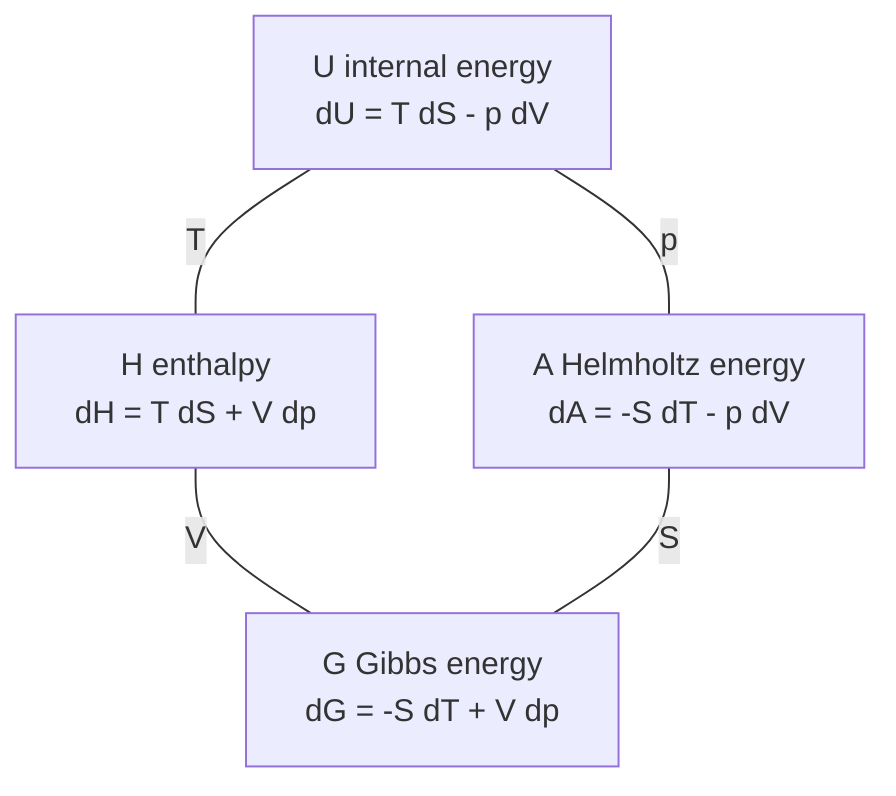
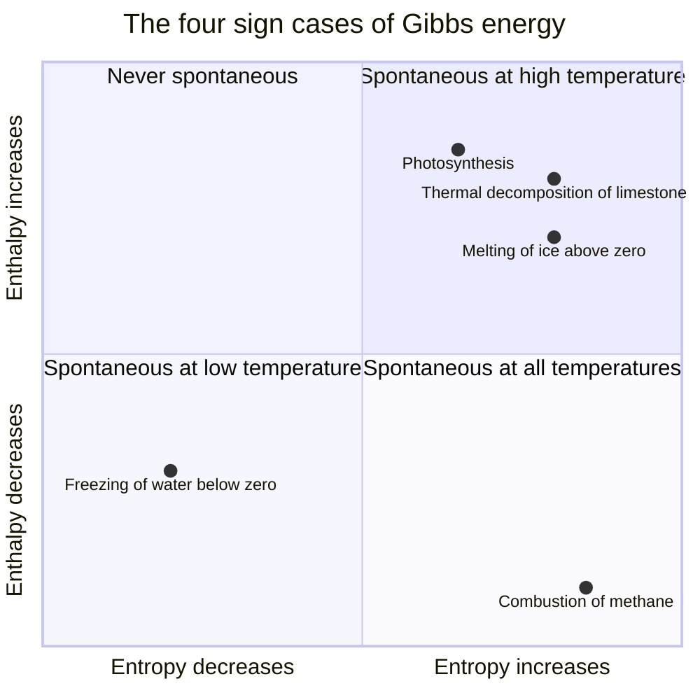
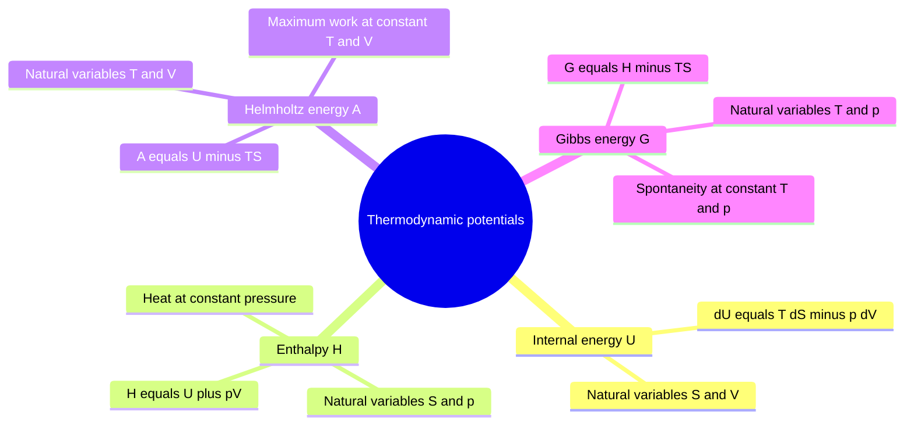

# Chapter 4 — Chemical Thermodynamics: Entropy and Gibbs Energy

> **Level:** Advanced (Level 3 — Undergraduate core)
> **Estimated study time:** 10 hours (7 h reading + 3 h exercises)
> **Prerequisites:** [Physical and Chemical Properties and Changes](../01-foundations/04-physical-and-chemical-properties-and-changes.md); [Chemical Reactions and Balancing Equations](../02-elementary-chemistry/08-chemical-reactions-and-balancing-equations.md)
> **Related chapters:** [Chemical Kinetics and Reaction Mechanisms](05-chemical-kinetics-and-reaction-mechanisms.md), [Quantum Mechanics Foundations](01-quantum-mechanics-foundations.md), [Level 3 index](README.md)
> **Difficulty:** ★★★★☆ (4/5)

---

## 1. Learning Objectives

After working through this chapter you will be able to:

- State the first law in differential form and distinguish state functions from path functions.
- Test whether a differential is exact and explain why the test matters for thermodynamics.
- Compare reversible and irreversible expansions, and compute the work and heat for each.
- State the second law in the Kelvin–Planck and Clausius forms, and use the Clausius inequality.
- Define entropy as $q_\mathrm{rev}/T$ and as $k_\mathrm{B}\ln W$, and show that the two definitions agree for a simple model.
- Apply the third law to obtain absolute entropies, and explain residual entropy.
- Use standard molar entropies to calculate the entropy change of a reaction.
- Derive the criterion of spontaneity at constant $T$ and $p$ in terms of the Gibbs energy.
- Apply $\Delta G = \Delta H - T\Delta S$ to the four sign cases and calculate the crossover temperature.
- Relate $\Delta G^\circ$ to the equilibrium constant and use the van 't Hoff equation to predict $K$ at another temperature.
- Use the Gibbs–Helmholtz equation, the Maxwell relations and the thermodynamic square.
- Define chemical potential and activity, and write the condition for chemical equilibrium.
- Estimate the thermodynamic efficiency of a fuel and distinguish it from the Carnot limit.

---

## 2. Introduction

A reaction can be exothermic and yet not occur. Hydrogen and oxygen mixtures are thermodynamically unstable at room temperature but can sit unchanged for years; a spark triggers an explosion. The enthalpy change tells us how much heat a reaction releases, not whether it will proceed. Something else decides the direction of spontaneous change, and that something is entropy.

The second law of thermodynamics states that the entropy of an isolated system never decreases. The criterion is deceptively simple. It acquires its power when applied to a system and its surroundings together, because a process can decrease the entropy of the system provided it increases the entropy of the surroundings by at least as much. At constant temperature and pressure, that bookkeeping is packaged into a single function, the Gibbs energy, whose decrease measures the maximum non-expansion work a process can do. The condition $\Delta G < 0$ at constant $T$ and $p$ is the working criterion of chemical spontaneity.

The chapter develops thermodynamics as a deductive structure. The first law defines internal energy and restricts the possible changes; the second law defines entropy and selects the direction; the combination produces the Gibbs and Helmholtz energies, the Maxwell relations and the equilibrium constant. The mathematical demands are modest — partial derivatives and exact differentials — but the logic is tight, and each result follows from the previous one rather than from a separate assumption.

The applications are everywhere: the feasibility of an industrial synthesis, the voltage of a battery, the folding of a protein, the efficiency of a fuel cell and the stability of a mineral. The chapter also distinguishes thermodynamics from kinetics. Thermodynamics says whether a change is favourable and how far it can go; kinetics says how fast it will get there. A negative $\Delta G$ is a statement about the equilibrium position, not about the rate. Confusing the two is the most common error in the subject, and it is addressed explicitly in Section 10.

---

## 3. Fundamental Concepts

### 3.1 The first law and state functions

The first law of thermodynamics is the principle of energy conservation. In differential form, for a closed system,

$$
\mathrm{d}U = \mathrm{d}q + \mathrm{d}w
$$

where $\mathrm{d}U$ is the infinitesimal change in internal energy, $\mathrm{d}q$ the heat supplied to the system and $\mathrm{d}w$ the work done on the system. Heat and work are path functions: their values depend on the route between two states, not only on the endpoints. Internal energy is a state function: its change depends only on the initial and final states.

For a reversible change in volume against an external pressure $p_\text{ext}$,

$$
\mathrm{d}w = -p_\text{ext}\,\mathrm{d}V
$$

where the negative sign follows the IUPAC convention that work done on the system is positive. If the process is reversible, $p_\text{ext}$ equals the pressure $p$ of the system at every stage, and $\mathrm{d}w = -p\,\mathrm{d}V$.

A state function has an exact differential. For a function $f(x,y)$,

$$
\mathrm{d}f = \left(\frac{\partial f}{\partial x}\right)_y\mathrm{d}x + \left(\frac{\partial f}{\partial y}\right)_x\mathrm{d}y = M\,\mathrm{d}x + N\,\mathrm{d}y
$$

and the differential is exact if and only if

$$
\left(\frac{\partial M}{\partial y}\right)_x = \left(\frac{\partial N}{\partial x}\right)_y
$$

This Euler reciprocity condition is the test that distinguishes state functions from path functions. For an ideal gas, $\mathrm{d}U = C_V\,\mathrm{d}T$ satisfies the test because $U$ depends only on $T$; heat and work do not satisfy it because they are not state functions.

### 3.2 Reversible and irreversible processes

A reversible process is a sequence of equilibrium states, carried out infinitely slowly, so that the system is always infinitesimally close to equilibrium with its surroundings. It is an idealisation: no real process is reversible. Its importance is that it defines the maximum work a system can do and the minimum work required to bring about a change.

For the isothermal reversible expansion of an ideal gas from $V_1$ to $V_2$,

$$
w_\text{rev} = -\int_{V_1}^{V_2} p\,\mathrm{d}V = -nRT\ln\frac{V_2}{V_1}
$$

Because $\Delta U = 0$ for an ideal gas at constant temperature, $q_\text{rev} = -w_\text{rev} = nRT\ln(V_2/V_1)$.

For an irreversible expansion against a constant external pressure $p_\text{ext}$,

$$
w_\text{irr} = -p_\text{ext}(V_2 - V_1)
$$

The irreversible work is smaller in magnitude than the reversible work for the same change of volume. The difference is the energy that could have been extracted as work but was dissipated as heat.

### 3.3 The second law and the Clausius inequality

The second law has several equivalent statements. The Kelvin–Planck statement says that no cyclic process can convert heat completely into work. The Clausius statement says that heat cannot flow spontaneously from a colder body to a hotter body. Both express the same asymmetry: some processes have a direction.

For any cyclic process,

$$
\oint \frac{\mathrm{d}q}{T} \le 0
$$

with equality for a reversible cycle. This is the Clausius inequality. It implies that a new state function, the entropy, can be defined by

$$
\mathrm{d}S = \frac{\mathrm{d}q_\text{rev}}{T}
$$

and that for an irreversible process between the same two states,

$$
\mathrm{d}S > \frac{\mathrm{d}q}{T}
$$

For an isolated system, $\mathrm{d}q = 0$, so $\mathrm{d}S \ge 0$: the entropy of an isolated system never decreases. For a system in contact with surroundings at temperature $T$, the total entropy change is

$$
\Delta S_\text{univ} = \Delta S_\text{sys} + \Delta S_\text{surr} \ge 0
$$

where $\Delta S_\text{surr} = -q_\text{sys}/T$ for a process in which the surroundings exchange heat reversibly at constant temperature. The criterion of spontaneous change is the positivity of $\Delta S_\text{univ}$, not the positivity of $\Delta S_\text{sys}$.

### 3.4 The statistical definition of entropy

Boltzmann's relation connects the macroscopic entropy to the number of microscopic arrangements consistent with the macroscopic state:

$$
S = k_\mathrm{B}\ln W
$$

where $W$ is the number of microstates and $k_\mathrm{B} = 1.380\,649 \times 10^{-23}\ \mathrm{J\,K^{-1}}$ is the Boltzmann constant. The relation is engraved on Boltzmann's tombstone and is the bridge between thermodynamics and statistical mechanics.

The statistical definition explains why entropy increases. A macrostate with many compatible microstates is overwhelmingly more probable than one with few. For a system of $N$ spins, the number of arrangements with $n$ spins up is $\binom{N}{n}$, and the entropy is maximal when $n = N/2$. For one mole of spins, the difference between the most probable and a macroscopically distinguishable alternative is a factor of order $10^{10^{23}}$, so the second law is a statement about overwhelming probability rather than an absolute prohibition.

The statistical definition also explains the third law. At $T = 0$, a perfect crystal occupies a single microstate, $W = 1$, and $S = 0$. If the crystal has frozen-in disorder, as in carbon monoxide with its molecules pointing randomly, $W > 1$ and a residual entropy remains. The measured residual entropy of CO is about $4.6\ \mathrm{J\,K^{-1}\,mol^{-1}}$, close to $R\ln 2 = 5.76\ \mathrm{J\,K^{-1}\,mol^{-1}}$; the difference reflects partial ordering.

### 3.5 The third law and absolute entropies

The third law states that the entropy of a perfect crystalline substance is zero at absolute zero:

$$
\lim_{T \to 0} S = 0
$$

The law provides an absolute scale for entropy, because the entropy at any temperature can be obtained by integrating the heat capacity:

$$
S(T) = \int_0^T \frac{C_p(T')}{T'}\,\mathrm{d}T' + \sum_\text{transitions}\frac{\Delta H_\text{trs}}{T_\text{trs}}
$$

The resulting values are standard molar entropies, $S^\circ$, usually tabulated at $298.15\ \mathrm{K}$ and $1\ \mathrm{bar}$. Unlike standard enthalpies of formation, which are relative to elements in their standard states, standard entropies are absolute.

Standard molar entropies show systematic trends. Gases have much larger entropies than liquids, and liquids larger than solids, because the number of accessible translational and rotational states increases with the freedom of motion. Entropy increases with molar mass at constant physical state, because the translational energy levels are closer together. Entropy increases with molecular complexity, because more vibrational modes are available. Dissolved ions have lower entropies than the corresponding gaseous ions but higher entropies than the solids, and the entropy of hydration is negative because water molecules become ordered around the ion.

| Substance | State | $S^\circ$ / J K⁻¹ mol⁻¹ |
|---|---|---|
| $\ce{C(s, graphite)}$ | solid | 5.7 |
| $\ce{H2O(s)}$ | solid | 41.0 |
| $\ce{H2O(l)}$ | liquid | 69.9 |
| $\ce{H2O(g)}$ | gas | 188.8 |
| $\ce{CH4(g)}$ | gas | 186.3 |
| $\ce{C2H6(g)}$ | gas | 229.6 |
| $\ce{NaCl(s)}$ | solid | 72.1 |
| $\ce{Na+(aq)}$ | aqueous | 59.0 |
| $\ce{Cl-(aq)}$ | aqueous | 56.5 |

### 3.6 The Gibbs energy and the criterion of spontaneity

At constant temperature and pressure, the combined first and second laws give a new state function,

$$
G = H - TS
$$

the Gibbs energy. Its differential is

$$
\mathrm{d}G = \mathrm{d}H - T\,\mathrm{d}S - S\,\mathrm{d}T
$$

At constant $T$ and $p$, $\mathrm{d}H = \mathrm{d}q_p$ and $\mathrm{d}G = \mathrm{d}q_p - T\,\mathrm{d}S$. Since $\mathrm{d}S \ge \mathrm{d}q/T$ by the second law,

$$
\mathrm{d}G \le 0
$$

with equality at equilibrium. A process at constant $T$ and $p$ is spontaneous in the direction of decreasing $G$, and equilibrium corresponds to the minimum of $G$. This is the most useful criterion in chemistry, because most reactions are carried out at constant pressure and temperature.

For a finite change,

$$
\Delta G = \Delta H - T\Delta S
$$

and the sign of $\Delta G$ depends on the balance between the enthalpy and entropy terms. Four cases arise.

| $\Delta H$ | $\Delta S$ | $\Delta G$ | Behaviour |
|---|---|---|---|
| Negative | Positive | Always negative | Spontaneous at all temperatures |
| Positive | Negative | Always positive | Non-spontaneous at all temperatures |
| Negative | Negative | Negative at low $T$, positive at high $T$ | Spontaneous at low temperature |
| Positive | Positive | Positive at low $T$, negative at high $T$ | Spontaneous at high temperature |

The crossover temperature, where $\Delta G = 0$, is

$$
T_\text{cross} = \frac{\Delta H}{\Delta S}
$$

provided $\Delta H$ and $\Delta S$ are approximately constant over the range. The approximation fails near phase transitions and over wide temperature ranges.

### 3.7 Equilibrium and the reaction quotient

For a reaction with reaction quotient $Q$, the Gibbs energy change at arbitrary composition is

$$
\Delta G = \Delta G^\circ + RT\ln Q
$$

where $\Delta G^\circ$ is the standard Gibbs energy change, the value when all activities are unity. At equilibrium $\Delta G = 0$ and $Q = K$, so

$$
\Delta G^\circ = -RT\ln K
$$

This relation is the bridge between thermodynamics and equilibrium. A negative $\Delta G^\circ$ corresponds to $K > 1$, a positive $\Delta G^\circ$ to $K < 1$. The equilibrium constant is dimensionless because it is defined in terms of activities relative to standard states; the numerical value depends on the choice of standard state.

The temperature dependence of $K$ follows from the van 't Hoff equation,

$$
\frac{\mathrm{d}\ln K}{\mathrm{d}(1/T)} = -\frac{\Delta H^\circ}{R}
$$

which integrates to

$$
\ln\frac{K_2}{K_1} = -\frac{\Delta H^\circ}{R}\left(\frac{1}{T_2} - \frac{1}{T_1}\right)
$$

for a constant standard enthalpy of reaction. An exothermic reaction has $\Delta H^\circ < 0$, so $K$ decreases as $T$ increases; an endothermic reaction has the opposite behaviour. This is Le Chatelier's principle in quantitative form.

### 3.8 Fuels and efficiency

The maximum non-expansion work obtainable from a process at constant $T$ and $p$ is $-\Delta G$. For a fuel cell, the electrical work is therefore bounded by $-\Delta G$, and the thermodynamic efficiency is

$$
\eta_\text{thermo} = \frac{\Delta G}{\Delta H}
$$

For the combustion of hydrogen to liquid water at $298\ \mathrm{K}$, $\Delta G^\circ = -237.1\ \mathrm{kJ\,mol^{-1}}$ and $\Delta H^\circ = -285.8\ \mathrm{kJ\,mol^{-1}}$, so the maximum efficiency is 83 per cent. For methane the corresponding values are $-818.0$ and $-890.3\ \mathrm{kJ\,mol^{-1}}$, giving 92 per cent. These efficiencies exceed the Carnot limit for a heat engine operating between the same temperatures, because a fuel cell converts chemical energy directly into electrical work rather than passing it through a heat engine.

---

## 4. Detailed Scientific Explanation

### 4.1 Exact differentials and the internal energy of an ideal gas

The internal energy of a substance can be written as a function of $T$ and $V$:

$$
\mathrm{d}U = \left(\frac{\partial U}{\partial T}\right)_V\mathrm{d}T + \left(\frac{\partial U}{\partial V}\right)_T\mathrm{d}V
$$

The first coefficient is $C_V$, the heat capacity at constant volume. The second is the internal pressure, $\pi_T = (\partial U/\partial V)_T$. For an ideal gas, the Joule experiment shows that $\pi_T = 0$: the internal energy depends only on temperature. The exactness of $\mathrm{d}U$ then requires

$$
\left(\frac{\partial C_V}{\partial V}\right)_T = \left(\frac{\partial \pi_T}{\partial T}\right)_V
$$

which is satisfied trivially when both sides vanish.

For a real gas, $\pi_T$ is not zero. Its value can be obtained from an equation of state using the thermodynamic identity

$$
\left(\frac{\partial U}{\partial V}\right)_T = T\left(\frac{\partial p}{\partial T}\right)_V - p
$$

which follows from the Maxwell relation for $\mathrm{d}A$. This identity is an example of the power of the formalism: a quantity that is difficult to measure directly is expressed in terms of the equation of state.

### 4.2 Entropy changes for reversible and irreversible processes

The entropy change of the system between two states is the same for all paths, because entropy is a state function. Only the heat exchanged with the surroundings differs, and therefore only $\Delta S_\text{surr}$ differs.

Consider one mole of an ideal gas expanding isothermally from $V_1$ to $V_2$ at temperature $T$. For the reversible path,

$$
\Delta S_\text{sys} = \frac{q_\text{rev}}{T} = nR\ln\frac{V_2}{V_1}
$$

and the surroundings lose heat $q_\text{rev}$, so

$$
\Delta S_\text{surr} = -\frac{q_\text{rev}}{T} = -nR\ln\frac{V_2}{V_1}
$$

The total entropy change is zero, as it must be for a reversible process. For the irreversible expansion against a constant pressure $p_\text{ext} = p_2$,

$$
w_\text{irr} = -p_2(V_2 - V_1), \qquad q_\text{irr} = -w_\text{irr}
$$

and $\Delta S_\text{surr} = -q_\text{irr}/T$. The system's entropy change is still $nR\ln(V_2/V_1)$, but the surroundings lose less heat, so $\Delta S_\text{univ} > 0$. The irreversible path generates entropy; the reversible path does not.

The same logic applies to the mixing of two ideal gases, the freezing of supercooled water and the discharge of a battery. In each case the system's entropy change is path-independent, and the spontaneity is decided by the total.

### 4.3 Entropy changes with temperature and phase

For a substance heated at constant pressure with no phase change,

$$
\Delta S = \int_{T_1}^{T_2}\frac{nC_p}{T}\,\mathrm{d}T = nC_p\ln\frac{T_2}{T_1}
$$

if $C_p$ is constant. At a phase transition at temperature $T_\text{trs}$, the entropy change is

$$
\Delta S_\text{trs} = \frac{\Delta H_\text{trs}}{T_\text{trs}}
$$

because the transition occurs reversibly at constant temperature and pressure. For melting ice at $273.15\ \mathrm{K}$, $\Delta H_\text{fus} = 6.01\ \mathrm{kJ\,mol^{-1}}$, so $\Delta S_\text{fus} = 22.0\ \mathrm{J\,K^{-1}\,mol^{-1}}$. For vaporisation at $373.15\ \mathrm{K}$, $\Delta H_\text{vap} = 40.66\ \mathrm{kJ\,mol^{-1}}$, so $\Delta S_\text{vap} = 109.0\ \mathrm{J\,K^{-1}\,mol^{-1}}$. The much larger entropy of vaporisation reflects the much greater increase in translational freedom.

Trouton's rule states that $\Delta S_\text{vap} \approx 85\ \mathrm{J\,K^{-1}\,mol^{-1}}$ for many liquids at their normal boiling points. Water is an exception because of hydrogen bonding; its higher value reflects the additional order in the liquid that is lost on vaporisation.

### 4.4 Absolute entropies and reaction entropies

Standard molar entropies are absolute, so the entropy change of a reaction is simply

$$
\Delta S^\circ = \sum_i \nu_i S_i^\circ
$$

with $\nu_i$ positive for products and negative for reactants. For the formation of water,

$$
\ce{2H2(g) + O2(g) -> 2H2O(l)}
$$

the standard entropies are $130.7$, $205.2$ and $69.9\ \mathrm{J\,K^{-1}\,mol^{-1}}$, giving

$$
\Delta S^\circ = 2(69.9) - [2(130.7) + 205.2] = -326.8\ \mathrm{J\,K^{-1}\,mol^{-1}}
$$

The entropy of the system decreases because three moles of gas are converted into two moles of liquid. The reaction is nevertheless spontaneous because the enthalpy term dominates: $\Delta H^\circ = -571.6\ \mathrm{kJ\,mol^{-1}}$ and $\Delta G^\circ = -474.2\ \mathrm{kJ\,mol^{-1}}$.

### 4.5 Deriving the Gibbs criterion

The Gibbs energy is defined as $G = H - TS = U + pV - TS$. Its differential is

$$
\mathrm{d}G = \mathrm{d}U + p\,\mathrm{d}V + V\,\mathrm{d}p - T\,\mathrm{d}S - S\,\mathrm{d}T
$$

Substituting the first law $\mathrm{d}U = \mathrm{d}q + \mathrm{d}w$ and the reversible work $\mathrm{d}w = -p\,\mathrm{d}V$, and restricting to a reversible path, gives

$$
\mathrm{d}G = \mathrm{d}q_\text{rev} - T\,\mathrm{d}S + V\,\mathrm{d}p - S\,\mathrm{d}T
$$

At constant $T$ and $p$, the last two terms vanish and, with $\mathrm{d}q_\text{rev} = T\,\mathrm{d}S$, so does the remainder. For an irreversible path at constant $T$ and $p$, $\mathrm{d}q < T\,\mathrm{d}S$, so $\mathrm{d}G < 0$. Hence $\mathrm{d}G \le 0$ for any spontaneous change, with equality at equilibrium.

The argument shows that the Gibbs criterion is not an independent postulate. It is the second law rewritten for the constraints that chemists usually impose. For constant $T$ and $V$, the same reasoning gives the Helmholtz criterion $\mathrm{d}A \le 0$.

### 4.6 The equilibrium constant and its temperature dependence

Combining $\Delta G = \Delta G^\circ + RT\ln Q$ with the equilibrium condition $\Delta G = 0$ gives $\Delta G^\circ = -RT\ln K$. The relation can be rearranged to

$$
K = e^{-\Delta G^\circ/RT}
$$

which shows that $K$ is determined by the standard Gibbs energy change and the temperature. A reaction with $\Delta G^\circ = -20\ \mathrm{kJ\,mol^{-1}}$ at $298\ \mathrm{K}$ has $K = e^{8.07} = 3.2 \times 10^{3}$; a reaction with $\Delta G^\circ = +20\ \mathrm{kJ\,mol^{-1}}$ has $K = 3.1 \times 10^{-4}$.

The van 't Hoff equation follows by differentiating $\ln K = -\Delta G^\circ/(RT)$ with respect to $T$ and using the Gibbs–Helmholtz equation. The result,

$$
\frac{\mathrm{d}\ln K}{\mathrm{d}T} = \frac{\Delta H^\circ}{RT^{2}}
$$

is equivalent to the form given in Section 3.7. The integrated form assumes that $\Delta H^\circ$ is constant over the interval; if $C_p$ differs between reactants and products, $\Delta H^\circ$ varies with temperature and the integration must include $\Delta C_p$.

### 4.7 The Gibbs–Helmholtz equation

The Gibbs–Helmholtz equation is obtained by differentiating $G/T$:

$$
\frac{\partial}{\partial T}\left(\frac{G}{T}\right)_p = \frac{1}{T}\left(\frac{\partial G}{\partial T}\right)_p - \frac{G}{T^{2}} = -\frac{S}{T} - \frac{G}{T^{2}} = -\frac{H}{T^{2}}
$$

using $(\partial G/\partial T)_p = -S$ and $G = H - TS$. The equation is exact and applies to any thermodynamic state.

Its practical use is to extrapolate standard Gibbs energies. If $\Delta H^\circ$ is constant, then

$$
\frac{\Delta G^\circ(T_2)}{T_2} - \frac{\Delta G^\circ(T_1)}{T_1} = \Delta H^\circ\left(\frac{1}{T_2} - \frac{1}{T_1}\right)
$$

which is the integrated form used for extrapolation. For a reaction with $\Delta G^\circ = -33.3\ \mathrm{kJ\,mol^{-1}}$ at $298\ \mathrm{K}$ and $\Delta H^\circ = -92.4\ \mathrm{kJ\,mol^{-1}}$, the Gibbs energy at $700\ \mathrm{K}$ is obtained without any spectroscopic data. The result is positive, consistent with the small equilibrium constant of ammonia synthesis at that temperature.

### 4.8 Maxwell relations and the thermodynamic square

The four thermodynamic potentials and their natural variables are

$$
U(S,V), \qquad H(S,p), \qquad A(T,V), \qquad G(T,p)
$$

from which the differentials follow:

$$
\mathrm{d}U = T\,\mathrm{d}S - p\,\mathrm{d}V, \qquad \mathrm{d}H = T\,\mathrm{d}S + V\,\mathrm{d}p
$$

$$
\mathrm{d}A = -S\,\mathrm{d}T - p\,\mathrm{d}V, \qquad \mathrm{d}G = -S\,\mathrm{d}T + V\,\mathrm{d}p
$$

Each differential is exact, so the mixed second derivatives are equal. For $G$,

$$
\left(\frac{\partial S}{\partial p}\right)_T = -\left(\frac{\partial V}{\partial T}\right)_p
$$

which is one of the four Maxwell relations. The others are obtained similarly.

The thermodynamic square is a mnemonic for the differentials. Place $U$ at the top left, $H$ at the top right, $A$ at the bottom left and $G$ at the bottom right. Along the top edge write $T$, along the left edge $p$, along the right edge $V$ and along the bottom edge $S$. The differential of each corner is read from the two adjacent edges: the coefficient is the variable on the adjacent edge, the differential is the variable on the opposite edge, and the sign is fixed by the arrows. The square is a convenience, not a substitute for the derivation, but it prevents the sign errors that plague memorised formulas.

### 4.9 Chemical potential and the direction of change

The chemical potential is the thermodynamic analogue of a potential energy per particle. Matter flows from a region of high chemical potential to one of low chemical potential, just as charge flows from high to low electric potential. At equilibrium the chemical potential of each species is the same in every phase.

For a reaction, the condition $\sum_i \nu_i\mu_i = 0$ is equivalent to $\Delta G = 0$. Substituting $\mu_i = \mu_i^\circ + RT\ln a_i$ gives

$$
\Delta G = \Delta G^\circ + RT\ln Q = 0
$$

with $Q = \prod_i a_i^{\nu_i}$, which recovers the equilibrium relation. The chemical potential therefore contains the equilibrium constant as a special case.

The concept becomes indispensable in phase equilibria and electrochemistry. The condition $\mu_\text{liquid} = \mu_\text{vapour}$ determines the vapour pressure; the condition $\mu_\text{left} = \mu_\text{right}$ across a membrane determines osmotic equilibrium; the electrochemical potential $\tilde{\mu}_i = \mu_i + z_iF\phi$ determines the cell voltage.

### 4.10 Calorimetry, enthalpy and the limits of the model

The thermodynamic treatment in this chapter assumes that the system is in equilibrium, that the only work is pressure–volume work, and that the standard state is well defined. Real calorimetry adds complications: heat losses, incomplete combustion and side reactions. The values tabulated in databases are the result of careful correction and are usually accurate to a few tenths of a kilojoule per mole.

The model also assumes that $\Delta H$ and $\Delta S$ are independent of temperature over the range of interest. This is often a good approximation over a few hundred kelvin, but it fails when a phase change occurs, when $C_p$ changes significantly, or when the reaction involves a change in the number of gaseous species at high pressure. In those cases the temperature dependence must be integrated explicitly using heat-capacity data.

Finally, thermodynamics says nothing about mechanism. A reaction with a negative $\Delta G$ may be immeasurably slow because of a high activation barrier. The conversion of diamond to graphite is thermodynamically favourable at room pressure, but the barrier is so large that diamond persists for geological times. Thermodynamics gives the destination; kinetics gives the timetable.

---

## 5. Visual Diagrams

**Figure 4.1 — The thermodynamic square.** Each corner is a thermodynamic potential, and each edge carries the variable that connects the two adjacent potentials. The differential of a potential is read from the two edges meeting at its corner: the coefficient comes from the adjacent edge, the differential from the opposite edge, and the signs are fixed by the arrows. The square is a mnemonic for the four exact differentials and the Maxwell relations that follow from them; the equations in the labels are the authoritative statement.

**Figure 4.2 — The four sign cases.** The horizontal axis is the sign and magnitude of $\Delta S$, the vertical axis the sign and magnitude of $\Delta H$. The diagonal quadrants contain the temperature-dependent cases, where the crossover temperature decides the direction. The point for photosynthesis is placed in the endothermic, entropy-increasing quadrant because the overall reaction is driven by light; without the photon input the reaction is not spontaneous, which shows the limits of a purely thermal analysis.

**Figure 4.3 — Potentials and their natural variables.** Each potential is adapted to a different pair of experimental constraints. The Gibbs energy is the one used in chemistry because most reactions are run at constant pressure and temperature. The map shows that the potentials are not independent functions but Legendre transforms of one another.

---

## 6. Mathematical Formulas

### 6.1 The first law and entropy

$$
\mathrm{d}U = \mathrm{d}q + \mathrm{d}w, \qquad \mathrm{d}w = -p_\text{ext}\,\mathrm{d}V, \qquad \mathrm{d}S = \frac{\mathrm{d}q_\text{rev}}{T}
$$

| Symbol | Meaning | SI unit |
|---|---|---|
| $U$ | internal energy | J |
| $q$ | heat supplied to the system | J |
| $w$ | work done on the system | J |
| $p_\text{ext}$ | external pressure | Pa |
| $V$ | volume | m³ |
| $S$ | entropy | J K⁻¹ |
| $T$ | thermodynamic temperature | K |

The first law applies to closed systems with no change in kinetic or potential energy of the system as a whole. The entropy definition requires a reversible path between the same two states.

### 6.2 Gibbs energy and spontaneity

$$
G = H - TS, \qquad \Delta G = \Delta H - T\Delta S, \qquad T_\text{cross} = \frac{\Delta H}{\Delta S}
$$

| Symbol | Meaning | SI unit |
|---|---|---|
| $G$ | Gibbs energy | J |
| $H$ | enthalpy | J |
| $T$ | thermodynamic temperature | K |
| $\Delta G$ | Gibbs energy change | J |
| $\Delta H$ | enthalpy change | J |
| $\Delta S$ | entropy change | J K⁻¹ |

The criterion $\Delta G < 0$ applies at constant $T$ and $p$ with no non-expansion work. If electrical work is done, the criterion must be modified to include it.

### 6.3 Equilibrium and temperature dependence

$$
\Delta G = \Delta G^\circ + RT\ln Q, \qquad \Delta G^\circ = -RT\ln K
$$

$$
\ln\frac{K_2}{K_1} = -\frac{\Delta H^\circ}{R}\left(\frac{1}{T_2} - \frac{1}{T_1}\right)
$$

| Symbol | Meaning | SI unit |
|---|---|---|
| $\Delta G^\circ$ | standard Gibbs energy change | J |
| $Q$ | reaction quotient | dimensionless |
| $K$ | equilibrium constant | dimensionless |
| $R$ | gas constant, $8.314\,462\,618$ | J K⁻¹ mol⁻¹ |
| $T$ | thermodynamic temperature | K |

The equilibrium constant is dimensionless because activities are dimensionless. The van 't Hoff integration assumes that $\Delta H^\circ$ is constant over the temperature interval.

### 6.4 Maxwell relations and chemical potential

$$
\left(\frac{\partial S}{\partial p}\right)_T = -\left(\frac{\partial V}{\partial T}\right)_p, \qquad \mu_i = \mu_i^\circ + RT\ln a_i
$$

| Symbol | Meaning | SI unit |
|---|---|---|
| $\mu_i$ | chemical potential of component $i$ | J mol⁻¹ |
| $\mu_i^\circ$ | standard chemical potential | J mol⁻¹ |
| $a_i$ | activity | dimensionless |
| $p$ | pressure | Pa |
| $V$ | volume | m³ |

The Maxwell relation quoted is derived from $\mathrm{d}G$; the other three follow from $\mathrm{d}A$, $\mathrm{d}H$ and $\mathrm{d}U$. The activity of a pure solid or liquid is one; the activity of an ideal gas is $p/p^\circ$.

---

## 7. Chemical Equations

### 7.1 Combustion of methane

$$
\ce{CH4(g) + 2O2(g) -> CO2(g) + 2H2O(l)}
$$

$$
\Delta H^\circ = -890.3\ \mathrm{kJ\,mol^{-1}}, \qquad \Delta G^\circ = -818.0\ \mathrm{kJ\,mol^{-1}}
$$

The reaction is spontaneous at $298\ \mathrm{K}$ because the large negative enthalpy change outweighs the negative entropy change associated with converting three moles of gas into one mole of gas and two moles of liquid. The maximum electrical work available from a methane fuel cell is $818\ \mathrm{kJ\,mol^{-1}}$, 92 per cent of the enthalpy of combustion.

### 7.2 Formation of water in a fuel cell

$$
\ce{H2(g) + 1/2 O2(g) -> H2O(l)}
$$

$$
\Delta H^\circ = -285.8\ \mathrm{kJ\,mol^{-1}}, \qquad \Delta G^\circ = -237.1\ \mathrm{kJ\,mol^{-1}}
$$

The difference between the enthalpy and Gibbs energy changes, $48.7\ \mathrm{kJ\,mol^{-1}}$, is the heat that must be removed to keep the cell isothermal. The theoretical cell voltage is $\Delta G^\circ/(2F) = 1.23\ \mathrm{V}$, and the practical voltage under load is lower.

### 7.3 Ammonia synthesis

$$
\ce{N2(g) + 3H2(g) <=> 2NH3(g)}
$$

$$
\Delta H^\circ = -92.4\ \mathrm{kJ\,mol^{-1}}, \qquad \Delta G^\circ = -33.3\ \mathrm{kJ\,mol^{-1}}
$$

The reaction is exothermic and has a negative entropy change because four moles of gas become two. It is spontaneous at low temperature and becomes non-spontaneous at high temperature; the industrial process runs at about $700\ \mathrm{K}$ for kinetic reasons and accepts a modest equilibrium conversion, removing ammonia to drive the equilibrium forward.

### 7.4 Thermal decomposition of limestone

$$
\ce{CaCO3(s) -> CaO(s) + CO2(g)}
$$

$$
\Delta H^\circ = +178.3\ \mathrm{kJ\,mol^{-1}}, \qquad \Delta S^\circ = +160.5\ \mathrm{J\,K^{-1}\,mol^{-1}}
$$

The reaction is endothermic and entropy-increasing, so it becomes spontaneous above $T = \Delta H^\circ/\Delta S^\circ = 1111\ \mathrm{K}$. Industrial lime kilns operate at about $1170\ \mathrm{K}$, above the crossover temperature, because the rate becomes practical there and because the equilibrium is shifted by removing carbon dioxide.

---

## 8. Worked Examples

### Worked Example 8.1 — Reversible and irreversible expansion

**Problem.** One mole of an ideal gas expands isothermally at $300\ \mathrm{K}$ from $10.0\ \mathrm{dm^{3}}$ to $20.0\ \mathrm{dm^{3}}$. Calculate $\Delta S_\text{sys}$, $\Delta S_\text{surr}$ and $\Delta S_\text{univ}$ for (a) a reversible expansion and (b) an irreversible expansion against a constant external pressure equal to the final pressure.

**Strategy.** Use $\Delta S_\text{sys} = nR\ln(V_2/V_1)$ for both paths, compute the heat exchanged for each path, and obtain the surroundings' entropy change from $-q/T$.

**Solution.** For both paths,

$$
\Delta S_\text{sys} = nR\ln\frac{V_2}{V_1} = (1)(8.314)\ln 2 = 5.76\ \mathrm{J\,K^{-1}}
$$

(a) Reversible:

$$
q_\text{rev} = nRT\ln\frac{V_2}{V_1} = (1)(8.314)(300)\ln 2 = 1729\ \mathrm{J}
$$

$$
\Delta S_\text{surr} = -\frac{1729}{300} = -5.76\ \mathrm{J\,K^{-1}}, \qquad \Delta S_\text{univ} = 0
$$

(b) Irreversible against $p_\text{ext} = p_2 = nRT/V_2 = 124.7\ \mathrm{kPa}$:

$$
w = -p_\text{ext}(V_2 - V_1) = -(124.7)(10.0 \times 10^{-3}) = -1247\ \mathrm{J}
$$

$$
q = -w = 1247\ \mathrm{J}, \qquad \Delta S_\text{surr} = -\frac{1247}{300} = -4.16\ \mathrm{J\,K^{-1}}
$$

$$
\Delta S_\text{univ} = 5.76 - 4.16 = +1.60\ \mathrm{J\,K^{-1}}
$$

**Check.** The reversible path gives $\Delta S_\text{univ} = 0$ by construction, and the irreversible path gives a positive total, as the second law requires. The system's entropy change is the same in both cases, confirming that entropy is a state function.

### Worked Example 8.2 — Entropy of heating and vaporisation

**Problem.** Calculate the entropy change when one mole of liquid water is heated from $298\ \mathrm{K}$ to $373\ \mathrm{K}$ and then vaporised at $373\ \mathrm{K}$. Use $C_p(\ce{H2O(l)}) = 75.3\ \mathrm{J\,K^{-1}\,mol^{-1}}$ and $\Delta H_\text{vap} = 40.66\ \mathrm{kJ\,mol^{-1}}$.

**Strategy.** Integrate $C_p/T$ over the heating step, then add $\Delta H_\text{vap}/T_\text{vap}$ for the phase change.

**Solution.** For the heating step,

$$
\Delta S_1 = C_p\ln\frac{T_2}{T_1} = 75.3\ln\frac{373}{298} = 75.3(0.2247) = 16.9\ \mathrm{J\,K^{-1}\,mol^{-1}}
$$

For vaporisation,

$$
\Delta S_2 = \frac{\Delta H_\text{vap}}{T_\text{vap}} = \frac{40\,660}{373} = 109.0\ \mathrm{J\,K^{-1}\,mol^{-1}}
$$

The total is $125.9\ \mathrm{J\,K^{-1}\,mol^{-1}}$.

**Check.** The entropy of gaseous water at $373\ \mathrm{K}$ should be close to the tabulated standard entropy at $298\ \mathrm{K}$ plus the changes calculated. The vaporisation term dominates, as expected, because the translational freedom of the gas is much greater than that of the liquid. Trouton's rule gives about $85\ \mathrm{J\,K^{-1}\,mol^{-1}}$ for a normal liquid; water's value of $109$ reflects its hydrogen-bonded structure.

### Worked Example 8.3 — Crossover temperature for limestone

**Problem.** For the decomposition of calcium carbonate, $\Delta H^\circ = +178.3\ \mathrm{kJ\,mol^{-1}}$ and $\Delta S^\circ = +160.5\ \mathrm{J\,K^{-1}\,mol^{-1}}$. Calculate the temperature at which the reaction becomes spontaneous at standard pressure, and comment on the difference from the industrial operating temperature of about $1170\ \mathrm{K}$.

**Strategy.** Set $\Delta G^\circ = 0$ and solve for $T$.

**Solution.**

$$
T_\text{cross} = \frac{\Delta H^\circ}{\Delta S^\circ} = \frac{178\,300}{160.5} = 1111\ \mathrm{K}
$$

Above $1111\ \mathrm{K}$, $\Delta G^\circ < 0$ and the decomposition is spontaneous at standard pressure.

**Check.** The industrial temperature of about $1170\ \mathrm{K}$ is above the crossover, as it must be for the reaction to proceed. The difference is explained by three factors: the kiln is not at standard pressure, the reactants and products are not in their standard states, and a finite rate requires a temperature above the thermodynamic threshold. The calculation also assumes that $\Delta H^\circ$ and $\Delta S^\circ$ are constant, which is approximate over a range of nearly $900\ \mathrm{K}$.

### Worked Example 8.4 — Equilibrium constant and its temperature dependence

**Problem.** For $\ce{N2(g) + 3H2(g) <=> 2NH3(g)}$, $\Delta G^\circ = -33.3\ \mathrm{kJ\,mol^{-1}}$ and $\Delta H^\circ = -92.4\ \mathrm{kJ\,mol^{-1}}$ at $298\ \mathrm{K}$. Calculate $K$ at $298\ \mathrm{K}$ and estimate $K$ at $700\ \mathrm{K}$, assuming $\Delta H^\circ$ is constant.

**Strategy.** Use $\Delta G^\circ = -RT\ln K$ at $298\ \mathrm{K}$, then the van 't Hoff equation for the second temperature.

**Solution.** At $298\ \mathrm{K}$,

$$
\ln K = -\frac{\Delta G^\circ}{RT} = \frac{33\,300}{(8.314)(298)} = 13.44
$$

$$
K = e^{13.44} = 6.9 \times 10^{5}
$$

For the second temperature,

$$
\ln\frac{K_2}{K_1} = -\frac{\Delta H^\circ}{R}\left(\frac{1}{700} - \frac{1}{298}\right) = -\frac{-92\,400}{8.314}(-0.001\,927) = -21.4
$$

$$
\ln K_2 = 13.44 - 21.4 = -7.96, \qquad K_2 = 3.5 \times 10^{-4}
$$

**Check.** The equilibrium constant falls by nine orders of magnitude between $298$ and $700\ \mathrm{K}$, consistent with the exothermic nature of the reaction. The industrial process operates at high pressure to compensate for the small $K$ at high temperature, and removes ammonia continuously to drive the equilibrium to the right.

---

## 9. Real-World Applications

**Industrial synthesis.** The Haber process is a case study in applied thermodynamics. The equilibrium constant falls with temperature, so the reactor is run at the lowest temperature that gives an acceptable rate, and the pressure is raised to favour the side with fewer gas molecules. Ammonia is condensed and removed, which keeps the reaction quotient below the equilibrium constant.

**Energy storage and conversion.** Batteries and fuel cells convert chemical Gibbs energy into electrical work. The cell voltage is $\Delta G/(nF)$ under reversible conditions, and the actual voltage is lower because of overpotentials. Lithium-ion batteries, redox flow cells and solid-oxide fuel cells are all designed around this relation.

**Refrigeration and heat pumps.** A refrigerator uses work to move heat from a cold reservoir to a hot one, against the spontaneous direction. The coefficient of performance is bounded by the second law, and the design of refrigerants is constrained by their thermodynamic and environmental properties.

**Biochemistry.** Protein folding, membrane transport and ATP hydrolysis are driven by Gibbs energy changes. The hydrolysis of ATP has $\Delta G^\circ \approx -30.5\ \mathrm{kJ\,mol^{-1}}$ under standard conditions, and coupling to an unfavourable reaction can drive it forward. The actual $\Delta G$ in a cell depends on the concentrations, which is why the distinction between $\Delta G^\circ$ and $\Delta G$ matters.

**Materials and metallurgy.** The Ellingham diagram plots $\Delta G^\circ$ of oxide formation against temperature and is used to decide which reducing agent can extract a metal from its ore. The crossover of two lines gives the temperature at which one metal can reduce the oxide of another.

**Environmental chemistry.** The fate of pollutants, the solubility of minerals and the partitioning of species between air, water and soil are governed by chemical potentials and activities. Acid rain, ocean acidification and heavy-metal speciation are thermodynamic problems with kinetic complications.

---

## 10. Common Mistakes

| Mistake | Why it happens | Correct approach |
|---|---|---|
| Saying a negative $\Delta G$ means the reaction is fast | Spontaneity and rate are conflated | $\Delta G$ says whether the equilibrium lies to the right; kinetics says how fast it gets there |
| Assuming a negative $\Delta H$ guarantees spontaneity | Enthalpy is the most familiar driving force | Entropy also matters; an endothermic reaction can be spontaneous if $\Delta S$ is positive and $T$ is high |
| Applying $\Delta S \ge 0$ to the system alone | The second law is stated for isolated systems | Use $\Delta S_\text{univ} = \Delta S_\text{sys} + \Delta S_\text{surr} \ge 0$ |
| Treating $\Delta G^\circ$ as the actual Gibbs energy change | The superscript is easy to overlook | Use $\Delta G = \Delta G^\circ + RT\ln Q$ for the actual composition |
| Getting the sign of work wrong | Two conventions are in use | Fix the IUPAC convention: work done on the system is positive, $\mathrm{d}w = -p_\text{ext}\mathrm{d}V$ |
| Using $K$ with units | $K$ is often written with concentration units | $K$ is dimensionless when defined with activities; the numerical value depends on the standard state |
| Assuming $K$ is independent of temperature | The relation $\Delta G^\circ = -RT\ln K$ hides the temperature dependence | Use the van 't Hoff equation; $K$ changes strongly with $T$ for reactions with large $\Delta H^\circ$ |
| Ignoring residual entropy at $0\ \mathrm{K}$ | The third law is stated for perfect crystals | Disordered solids retain entropy; CO and ice are standard examples |
| Treating $\Delta H^\circ$ and $\Delta S^\circ$ as exactly constant | The approximation is convenient | Integrate heat capacities when the temperature range is wide or a phase change intervenes |

---

## 11. Chapter Summary

- The first law, $\mathrm{d}U = \mathrm{d}q + \mathrm{d}w$, expresses energy conservation; $U$ is a state function, while $q$ and $w$ are path functions.
- Exact differentials satisfy Euler reciprocity; the test distinguishes state functions from path functions.
- Reversible processes do maximum work; irreversible expansions generate entropy.
- The second law, expressed by the Clausius inequality, defines entropy as $\mathrm{d}S = \mathrm{d}q_\text{rev}/T$ and requires $\Delta S_\text{univ} \ge 0$.
- Boltzmann's relation $S = k_\mathrm{B}\ln W$ connects entropy to the number of microstates and explains the third law.
- Standard molar entropies are absolute and increase from solid to liquid to gas, and with mass and complexity.
- At constant $T$ and $p$, spontaneity corresponds to $\Delta G < 0$, with $\Delta G = \Delta H - T\Delta S$.
- The four sign cases and the crossover temperature $T = \Delta H/\Delta S$ summarise the competition between enthalpy and entropy.
- $\Delta G^\circ = -RT\ln K$ links thermodynamics to equilibrium; the van 't Hoff equation gives the temperature dependence.
- The Gibbs–Helmholtz equation and the Maxwell relations connect measurable quantities to inaccessible ones.
- The chemical potential and activity generalise the Gibbs energy to mixtures and provide the condition $\sum\nu_i\mu_i = 0$ for equilibrium.
- Fuel-cell efficiency is $\Delta G/\Delta H$ and can exceed the Carnot limit because chemical energy is converted directly into electrical work.

---

## 12. Exercises

### 12.1 Conceptual questions

1. Explain why the entropy of the universe is the correct criterion for spontaneity, whereas the entropy of the system alone is not.
2. Why is the Gibbs energy more useful than the Helmholtz energy for describing a reaction carried out in an open beaker?

### 12.2 Basic problems

3. State whether each process increases or decreases the entropy of the system: (a) water freezing; (b) a gas expanding into a vacuum; (c) $\ce{CaCO3}$ decomposing; (d) protein folding.
4. Calculate $\Delta S^\circ$ for $\ce{N2(g) + 3H2(g) -> 2NH3(g)}$ using $S^\circ$ values of $191.6$, $130.7$ and $192.5\ \mathrm{J\,K^{-1}\,mol^{-1}}$.
5. For a reaction with $\Delta H^\circ = -50.0\ \mathrm{kJ\,mol^{-1}}$ and $\Delta S^\circ = -100\ \mathrm{J\,K^{-1}\,mol^{-1}}$, calculate the crossover temperature.

### 12.3 Intermediate problems

6. One mole of an ideal gas expands isothermally and reversibly from $5.0$ to $15.0\ \mathrm{dm^{3}}$ at $350\ \mathrm{K}$. Calculate $q$, $w$, $\Delta U$, $\Delta S_\text{sys}$ and $\Delta S_\text{univ}$.
7. Use the Maxwell relation $(\partial S/\partial V)_T = (\partial p/\partial T)_V$ to calculate the entropy change when one mole of an ideal gas expands isothermally from $1.0$ to $5.0\ \mathrm{dm^{3}}$ at $300\ \mathrm{K}$.
8. The standard Gibbs energy of formation of $\ce{H2O(l)}$ is $-237.1\ \mathrm{kJ\,mol^{-1}}$. Calculate the equilibrium constant for $\ce{2H2(g) + O2(g) -> 2H2O(l)}$ at $298\ \mathrm{K}$.

### 12.4 Advanced problems

9. Derive the relation $\Delta G = \Delta H - T\Delta S$ from $G = H - TS$ and the second law, stating the constraints under which it applies.
10. Show that for an ideal gas the entropy change on isothermal expansion is $nR\ln(V_2/V_1)$, and explain why the same expression applies to a reversible and an irreversible path.

### 12.5 Calculation problems

11. Calculate the entropy change when $100\ \mathrm{g}$ of water at $25\ ^\circ\mathrm{C}$ is heated to $75\ ^\circ\mathrm{C}$. Use $C_p = 75.3\ \mathrm{J\,K^{-1}\,mol^{-1}}$.
12. A fuel cell uses methanol according to $\ce{CH3OH(l) + 3/2 O2(g) -> CO2(g) + 2H2O(l)}$ with $\Delta H^\circ = -726.6\ \mathrm{kJ\,mol^{-1}}$ and $\Delta G^\circ = -702.5\ \mathrm{kJ\,mol^{-1}}$. Calculate its thermodynamic efficiency.

### 12.6 Answers

1. The second law applies to the universe, not to an open system. A system can decrease its entropy if the surroundings increase theirs by more; only the total is constrained.
2. A beaker is open to the atmosphere, so the pressure is constant; the Gibbs energy is the potential that is minimised at constant $T$ and $p$, whereas the Helmholtz energy applies at constant $T$ and $V$.
3. (a) decreases; (b) increases; (c) increases; (d) decreases.
4. $\Delta S^\circ = 2(192.5) - [191.6 + 3(130.7)] = -198.7\ \mathrm{J\,K^{-1}\,mol^{-1}}$.
5. $T = -50\,000/(-100) = 500\ \mathrm{K}$.
6. $q = -w = nRT\ln 3 = 3199\ \mathrm{J}$; $\Delta U = 0$; $\Delta S_\text{sys} = q/T = 9.14\ \mathrm{J\,K^{-1}}$; $\Delta S_\text{univ} = 0$.
7. $(\partial S/\partial V)_T = nR/V$, so $\Delta S = nR\ln 5 = 13.4\ \mathrm{J\,K^{-1}}$.
8. $\Delta G^\circ = 2(-237.1) = -474.2\ \mathrm{kJ\,mol^{-1}}$; $\ln K = 474\,200/(8.314 \times 298) = 191.4$; $K = e^{191.4}$, an astronomically large number consistent with the near-complete reaction.
9. From $G = H - TS$, at constant $T$, $\Delta G = \Delta H - T\Delta S$. The criterion $\Delta G \le 0$ follows from $\mathrm{d}G = \mathrm{d}H - T\mathrm{d}S$ at constant $T$ and $p$ and the inequality $\mathrm{d}S \ge \mathrm{d}q/T = \mathrm{d}H/T$.
10. For an ideal gas at constant $T$, $\Delta U = 0$ and $q = -w = nRT\ln(V_2/V_1)$; entropy is a state function, so $\Delta S = q_\text{rev}/T = nR\ln(V_2/V_1)$ regardless of path.
11. $100\ \mathrm{g}$ is $5.55\ \mathrm{mol}$; $\Delta S = 5.55(75.3)\ln(348/298) = 418\ln(1.168) = 64.7\ \mathrm{J\,K^{-1}}$.
12. $\eta = 702.5/726.6 = 0.967$, or 96.7 per cent.

> Worked solutions for this level are maintained in the `solutions/` directory of the level.

---

## 13. Further Reading

- Atkins, P. W.; de Paula, J.; Keeler, J. *Atkins' Physical Chemistry*, 11th ed., Oxford University Press, 2018. Chapters 3–6 cover the first, second and third laws, Gibbs energy and equilibrium.
- McQuarrie, D. A.; Simon, J. D. *Physical Chemistry: A Molecular Approach*, University Science Books, 1997. Chapters 19–22 treat thermodynamics and chemical equilibrium.
- Levine, I. N. *Physical Chemistry*, 6th ed., McGraw-Hill, 2009. Chapters 3–6 provide a rigorous treatment of the thermodynamic potentials and Maxwell relations.
- Callen, H. B. *Thermodynamics and an Introduction to Thermostatistics*, 2nd ed., Wiley, 1985. A formal and elegant development of the axiomatic structure.
- IUPAC. *Compendium of Chemical Terminology* (the "Gold Book"), 2nd ed. (corrected version). <https://goldbook.iupac.org/>
- NIST. *CODATA Internationally Recommended Values of the Fundamental Physical Constants*. <https://physics.nist.gov/cuu/Constants/>
- [CURRICULUM.md](../CURRICULUM.md) — where this chapter sits in the full programme.
