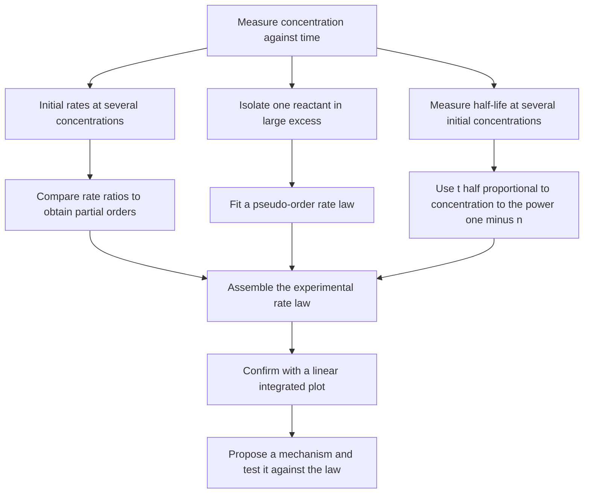
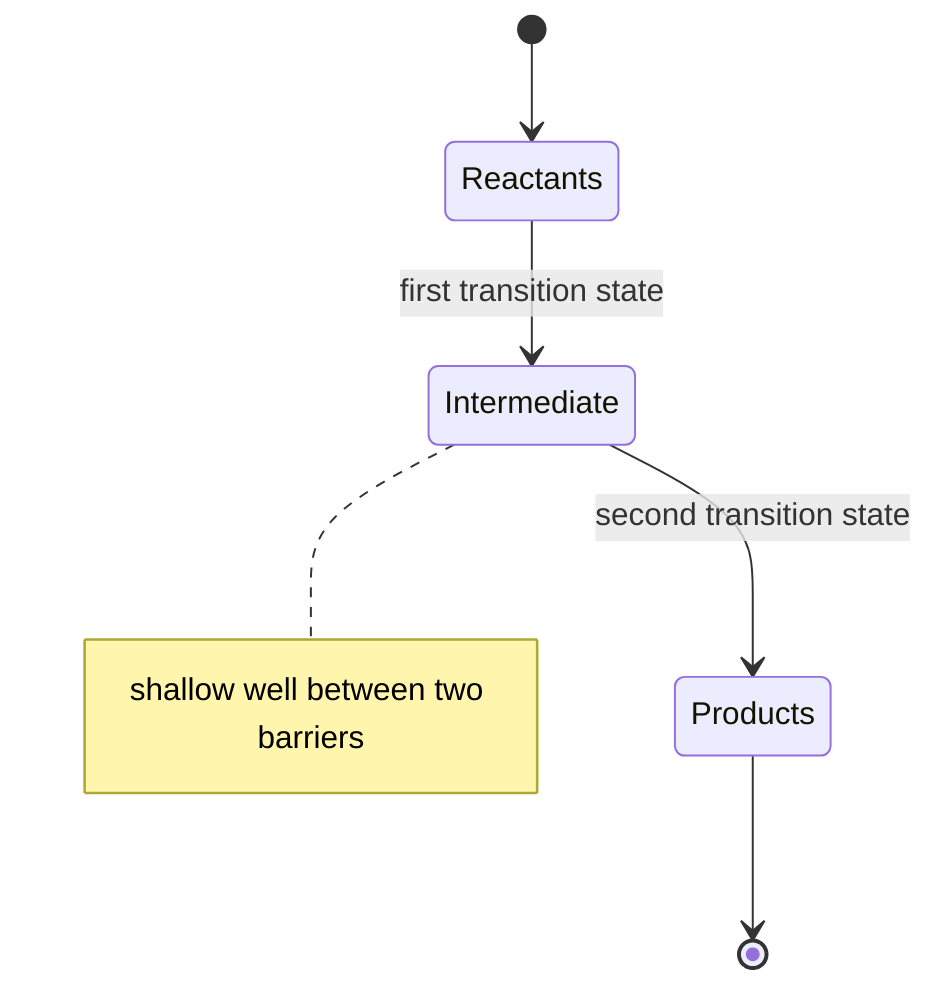
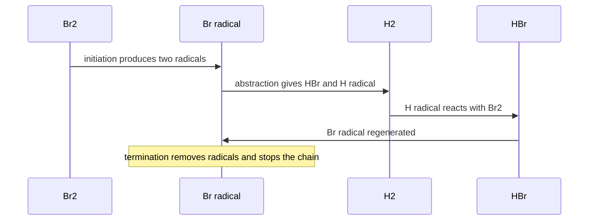
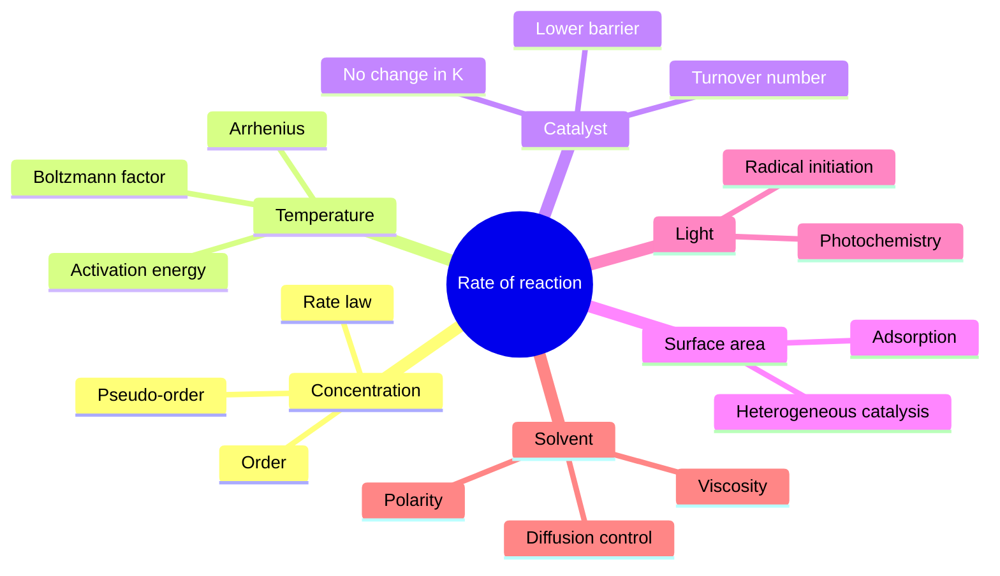

# Chapter 5 — Chemical Kinetics and Reaction Mechanisms

> **Level:** Advanced (Level 3 — Undergraduate core)
> **Estimated study time:** 9 hours (6.5 h reading + 2.5 h exercises)
> **Prerequisites:** [Chemical Thermodynamics: Entropy and Gibbs Energy](04-chemical-thermodynamics.md); [Chemical Reactions and Balancing Equations](../02-elementary-chemistry/08-chemical-reactions-and-balancing-equations.md)
> **Related chapters:** [Molecular Orbital Theory](03-molecular-orbital-theory.md), [Quantum Mechanics Foundations](01-quantum-mechanics-foundations.md), [Level 3 index](README.md)
> **Difficulty:** ★★★★☆ (4/5)

---

## 1. Learning Objectives

After working through this chapter you will be able to:

- Define the rate of a reaction for a general stoichiometry and convert between rates of appearance and disappearance.
- Distinguish the rate law from the stoichiometric equation and state why reaction order must be measured.
- Integrate the rate laws for zero-, first- and second-order reactions and use linear plots to diagnose the order.
- Calculate half-lives and explain how their concentration dependence identifies the order.
- Determine reaction order from initial-rate data, the isolation method and half-life ratios.
- Apply the Arrhenius equation, extract the activation energy from two temperatures, and interpret the pre-exponential factor.
- Explain collision theory and the steric factor, and identify their limitations.
- Use transition-state theory and the Eyring equation to obtain $\Delta G^\ddagger$, $\Delta H^\ddagger$ and $\Delta S^\ddagger$.
- Explain how a catalyst changes the rate without changing the equilibrium constant.
- Distinguish elementary steps from overall reactions, and apply molecularity and the rate-determining step.
- Derive rate laws using the pre-equilibrium and steady-state approximations.
- Describe chain reactions, the Lindemann mechanism, kinetic isotope effects and the Hammond postulate.

---

## 2. Introduction

Thermodynamics answers whether a reaction can proceed and how far it will go. It says nothing about how quickly. A mixture of hydrogen and oxygen at room temperature has a large negative Gibbs energy of reaction and is yet stable for years; the same mixture detonates in the presence of a spark. The difference is the activation barrier, and the study of that barrier is chemical kinetics.

Kinetics is an empirical science before it is a theoretical one. The rate law of a reaction must be measured; it cannot be deduced from the balanced equation. The decomposition of dinitrogen pentoxide is first order in $\ce{N2O5}$ even though the stoichiometry involves two molecules; the oxidation of nitric oxide is third order overall, first in $\ce{O2}$ and second in $\ce{NO}$, because the mechanism involves a dimeric intermediate. The stoichiometry says what is consumed and produced; the mechanism says how.

The chapter builds from the definition of rate to the interpretation of mechanism. It derives the integrated rate laws, shows how to determine order from data, and introduces the two theoretical frameworks — collision theory and transition-state theory — that connect the rate constant to molecular properties. It then develops the tools of mechanism analysis: elementary steps, molecularity, the rate-determining step, the pre-equilibrium approximation and the steady-state approximation. It closes with chain reactions, the Lindemann mechanism, kinetic isotope effects and potential energy surfaces.

The treatment is quantitative throughout. Every rate law is accompanied by its units, every derivation states its assumptions, and every model is assessed against the experiments it is meant to explain. The mathematics required is differentiation, integration and simple algebra; the conceptual difficulty lies in distinguishing what is measured from what is inferred.

---

## 3. Fundamental Concepts

### 3.1 The rate of reaction

For the general reaction

$$
\ce{aA + bB -> cC + dD}
$$

the rate of reaction is defined as

$$
v = -\frac{1}{a}\frac{\mathrm{d}[\ce{A}]}{\mathrm{d}t} = -\frac{1}{b}\frac{\mathrm{d}[\ce{B}]}{\mathrm{d}t} = \frac{1}{c}\frac{\mathrm{d}[\ce{C}]}{\mathrm{d}t} = \frac{1}{d}\frac{\mathrm{d}[\ce{D}]}{\mathrm{d}t}
$$

The stoichiometric coefficients make the rate independent of which species is monitored. Concentrations are usually expressed in $\mathrm{mol\,dm^{-3}}$, so the rate has units $\mathrm{mol\,dm^{-3}\,s^{-1}}$, often abbreviated $\mathrm{M\,s^{-1}}$.

The distinction between average and instantaneous rate matters. The average rate over an interval is $\Delta[\ce{A}]/\Delta t$; the instantaneous rate is the derivative, obtained from the slope of the tangent to the concentration–time curve. Rate laws refer to instantaneous rates.

Rates are measured by following a physical property proportional to concentration: absorbance in the ultraviolet–visible region, conductivity, pressure for gas-phase reactions, optical rotation for chiral substances, or the intensity of an NMR signal. The choice depends on the speed of the reaction and the sensitivity of the method.

### 3.2 Rate laws and order

A rate law expresses the rate as a function of concentrations:

$$
v = k[\ce{A}]^{m}[\ce{B}]^{n}
$$

where $k$ is the rate constant and $m$ and $n$ are the partial orders with respect to A and B. The overall order is $m + n$. The orders are usually small integers or half-integers, but they can be zero, fractional or negative.

The rate constant is not constant in the fullest sense: it depends on temperature, on the solvent and on the presence of a catalyst. At fixed conditions it is a constant of proportionality whose units depend on the overall order:

| Overall order | Units of $k$ |
|---|---|
| 0 | $\mathrm{mol\,dm^{-3}\,s^{-1}}$ |
| 1 | $\mathrm{s^{-1}}$ |
| 2 | $\mathrm{dm^{3}\,mol^{-1}\,s^{-1}}$ |
| 3 | $\mathrm{dm^{6}\,mol^{-2}\,s^{-1}}$ |

The most important fact about order is that it is not the stoichiometric coefficient. The reaction $\ce{2N2O5 -> 4NO2 + O2}$ is first order in $\ce{N2O5}$; the reaction $\ce{H2 + I2 -> 2HI}$ is first order in each reactant; the reaction $\ce{2NO(g) + O2(g) -> 2NO2(g)}$ is second order in NO and first order in $\ce{O2}$. Each order reflects the mechanism, and each must be measured.

### 3.3 Integrated rate laws

The rate law is a differential equation, and its solution gives the concentration as a function of time. For a single reactant A with rate $v = k[\ce{A}]^{n}$, the integrated forms are as follows.

**Zero order** ($n = 0$):

$$
[\ce{A}] = [\ce{A}]_0 - kt, \qquad t_{1/2} = \frac{[\ce{A}]_0}{2k}
$$

**First order** ($n = 1$):

$$
\ln[\ce{A}] = \ln[\ce{A}]_0 - kt, \qquad t_{1/2} = \frac{\ln 2}{k} \approx \frac{0.693}{k}
$$

**Second order** ($n = 2$):

$$
\frac{1}{[\ce{A}]} = \frac{1}{[\ce{A}]_0} + kt, \qquad t_{1/2} = \frac{1}{k[\ce{A}]_0}
$$

Each order gives a different linear plot: $[\ce{A}]$ against $t$ for zero order, $\ln[\ce{A}]$ against $t$ for first order, and $1/[\ce{A}]$ against $t$ for second order. The order is diagnosed by which plot is linear.

The half-life is the time required for the concentration to fall to half its initial value. For a first-order reaction it is independent of the initial concentration; for zero and second order it depends on $[\ce{A}]_0$. This dependence is a rapid diagnostic: if doubling the initial concentration doubles the half-life, the reaction is zero order; if it halves the half-life, the reaction is second order; if it leaves the half-life unchanged, the reaction is first order.

### 3.4 Determining the order experimentally

Four methods are standard.

**Initial rates.** Measure the initial rate at several initial concentrations. If doubling $[\ce{A}]$ while holding $[\ce{B}]$ constant multiplies the rate by $2^{m}$, the order in A is $m$. The method is direct and requires no integration, but it is sensitive to errors in the early part of the reaction.

**Isolation method.** Set the concentration of all reactants except one in large excess. The concentration of the excess species is effectively constant, so the rate law reduces to a pseudo-order law in the isolated reactant. Repeating for each reactant gives the complete rate law.

**Half-life method.** Measure $t_{1/2}$ at several initial concentrations. Since $t_{1/2} \propto [\ce{A}]_0^{1-n}$, a plot of $\log t_{1/2}$ against $\log[\ce{A}]_0$ has slope $1-n$.

**Graphical method.** Plot the three integrated forms and identify the linear one. The method is convenient when a full concentration–time curve is available.

The methods should agree. Disagreement usually signals a change of mechanism over the concentration range, a failure to maintain constant temperature, or the presence of a catalyst or inhibitor.

### 3.5 The Arrhenius equation

The temperature dependence of the rate constant is described empirically by

$$
k = A e^{-E_\mathrm{a}/RT}
$$

where $A$ is the pre-exponential factor, $E_\mathrm{a}$ the activation energy and $R$ the gas constant. Taking logarithms,

$$
\ln k = \ln A - \frac{E_\mathrm{a}}{RT}
$$

so a plot of $\ln k$ against $1/T$ is a straight line of slope $-E_\mathrm{a}/R$ and intercept $\ln A$. The two-point form,

$$
\ln\frac{k_2}{k_1} = -\frac{E_\mathrm{a}}{R}\left(\frac{1}{T_2} - \frac{1}{T_1}\right)
$$

allows $E_\mathrm{a}$ to be obtained from measurements at two temperatures.

The activation energy is the minimum excess energy that colliding molecules must possess for a reaction to occur. It is not the same as $\Delta G^\circ$ or $\Delta H^\circ$; it is a kinetic barrier, not a thermodynamic driving force. A reaction with a large negative $\Delta G^\circ$ can still be slow if $E_\mathrm{a}$ is large.

### 3.6 Collision theory and the steric factor

Collision theory models a bimolecular reaction as a collision between hard spheres. The rate is the product of the collision frequency, the fraction of collisions with sufficient energy and the fraction with the correct orientation:

$$
v = P Z e^{-E_\mathrm{a}/RT}[\ce{A}][\ce{B}]
$$

where $Z$ is the collision frequency per unit concentration, and $P$ is the steric factor, a dimensionless number between 0 and 1 that accounts for orientation. For simple reactions such as the recombination of atoms, $P \approx 1$; for reactions involving large molecules, $P$ can be $10^{-6}$ or smaller.

Collision theory explains the exponential temperature dependence and the existence of a threshold energy. It fails for reactions in solution, for reactions with complex potential energy surfaces, and for reactions whose rate is controlled by the rate of activation rather than by the collision frequency. It also provides no independent way to calculate $P$; the steric factor is fitted, not predicted.

### 3.7 Transition-state theory

Transition-state theory (TST) replaces the hard-sphere collision with a potential energy surface. The reactants pass through a transition state at the saddle point of the surface, and the rate constant is

$$
k = \frac{k_\mathrm{B}T}{h}e^{-\Delta G^\ddagger/RT}
$$

where $\Delta G^\ddagger$ is the Gibbs energy of activation, the difference between the transition state and the reactants. This is the Eyring equation. Using $\Delta G^\ddagger = \Delta H^\ddagger - T\Delta S^\ddagger$,

$$
k = \frac{k_\mathrm{B}T}{h}e^{\Delta S^\ddagger/R}e^{-\Delta H^\ddagger/RT}
$$

The entropy of activation measures the change in order on going to the transition state. A negative $\Delta S^\ddagger$ indicates an associative, ordered transition state; a positive $\Delta S^\ddagger$ indicates a dissociative, loose one.

The relation between the activation energy and the activation enthalpy depends on molecularity. For a unimolecular reaction, $E_\mathrm{a} = \Delta H^\ddagger + RT$; for a bimolecular reaction in solution, $E_\mathrm{a} = \Delta H^\ddagger + 2RT$. The difference is small compared with typical activation energies but matters for precise work.

TST assumes that the transition state is in equilibrium with the reactants and that every trajectory crossing the saddle point proceeds to products. The first assumption is good for slow reactions with a well-defined barrier; the second fails when trajectories recross the barrier, which is common in solution and at high temperature.

### 3.8 Catalysis

A catalyst increases the rate of a reaction without being consumed. It does so by providing an alternative mechanism with a lower activation barrier. The catalyst may be homogeneous (in the same phase as the reactants), heterogeneous (a solid surface) or biological (an enzyme).

The crucial point is that a catalyst does not change $\Delta G^\circ$, the equilibrium constant or the position of equilibrium. It accelerates the forward and reverse reactions by the same factor, so the ratio $k_\text{forward}/k_\text{reverse}$ remains equal to $K$. A catalyst changes the path, not the destination.

Catalysts are characterised by their turnover number, the number of substrate molecules converted per active site per unit time, and by their selectivity. Industrial catalysis, enzyme kinetics and surface science are treated in later chapters.

### 3.9 Elementary steps, molecularity and the rate-determining step

An elementary step is a single molecular event with a well-defined transition state. Its molecularity is the number of species that collide in that step: unimolecular, bimolecular or, rarely, termolecular. A bimolecular elementary step has the rate law $v = k[\ce{A}][\ce{B}]$; the order and the molecularity coincide for an elementary step, but not for an overall reaction.

The rate-determining step (RDS) is the slowest step in a mechanism. If the first step is slow, the rate law is simply that of the first step. If a later step is slow, the rate law may involve intermediates, and the pre-equilibrium or steady-state approximation is needed to eliminate them.

The RDS approximation is not universal. When several steps have comparable rates, no single step controls the rate, and the full steady-state treatment is required. The concept is most useful when one barrier is much higher than the others.

### 3.10 Chain reactions

A chain reaction proceeds through initiation, propagation and termination steps. In the radical halogenation of methane,

$$
\ce{CH4(g) + Cl2(g) ->[h\nu] CH3Cl(g) + HCl(g)}
$$

the mechanism is

$$
\ce{Cl2 ->[h\nu] 2Cl.}
$$

$$
\ce{Cl. + CH4 -> HCl + CH3.}
$$

$$
\ce{CH3. + Cl2 -> CH3Cl + Cl.}
$$

$$
\ce{2Cl. -> Cl2} \qquad \ce{CH3. + Cl. -> CH3Cl} \qquad \ce{2CH3. -> C2H6}
$$

The propagation steps regenerate the chain carrier, so a single photon can lead to many product molecules. The quantum yield, the number of product molecules per absorbed photon, can be thousands. Termination removes radicals and eventually stops the chain.

The rates of chain reactions are sensitive to trace inhibitors that scavenge radicals, which is why radical polymerisation and combustion require careful control of impurities.

### 3.11 The Lindemann mechanism

Unimolecular reactions such as the isomerisation of cyclopropane have first-order kinetics at high pressure but second-order kinetics at low pressure. The Lindemann mechanism explains the change:

$$
\ce{A + M ->[k_1] A^{*} + M}
$$

$$
\ce{A^{*} + M ->[k_{-1}] A + M}
$$

$$
\ce{A^{*} ->[k_2] P}
$$

The reactant is activated by collision with a bath gas M. Applying the steady-state approximation to $\ce{A^{*}}$ gives

$$
[\ce{A^{*}}] = \frac{k_1[\ce{A}][\ce{M}]}{k_{-1}[\ce{M}] + k_2}
$$

and

$$
v = \frac{k_1k_2[\ce{A}][\ce{M}]}{k_{-1}[\ce{M}] + k_2}
$$

At high pressure, $k_{-1}[\ce{M}] \gg k_2$, so $v = (k_1k_2/k_{-1})[\ce{A}]$, first order. At low pressure, $k_{-1}[\ce{M}] \ll k_2$, so $v = k_1[\ce{A}][\ce{M}]$, second order. The mechanism reproduces both limits and predicts the fall-off curve observed experimentally.

### 3.12 Kinetic isotope effects

Replacing an atom by a heavier isotope changes the zero-point vibrational energy and therefore the activation energy. For a C–H bond, the zero-point energy is higher than for a C–D bond by about $4.3\ \mathrm{kJ\,mol^{-1}}$, so breaking the C–D bond requires more energy and proceeds more slowly. The primary kinetic isotope effect is

$$
\frac{k_\mathrm{H}}{k_\mathrm{D}} = e^{(E_{\mathrm{a,D}} - E_{\mathrm{a,H}})/RT}
$$

which gives a ratio of about 5.7 at $298\ \mathrm{K}$ for a difference of $4.3\ \mathrm{kJ\,mol^{-1}}$. Values in the range 2–10 are typical for primary C–H cleavage; much larger values suggest tunnelling, in which the lighter isotope passes through the barrier more efficiently.

A kinetic isotope effect near one indicates that the bond to the isotopic atom is not broken in the rate-determining step. The measurement is therefore a diagnostic of mechanism, not merely a curiosity.

### 3.13 Potential energy surfaces and the Hammond postulate

A potential energy surface plots the energy of a system as a function of the nuclear coordinates. For a reaction with two coordinates, the surface is a landscape with valleys corresponding to reactants, intermediates and products, and saddle points corresponding to transition states. The reaction coordinate is the path of minimum energy connecting the valleys.

The Hammond postulate states that the transition state resembles the species to which it is closest in energy. An endothermic reaction has a product-like transition state, because the barrier is close in energy to the products; an exothermic reaction has a reactant-like transition state. The postulate is qualitative, but it correctly predicts changes in selectivity when substituents stabilise or destabilise the products.

---

## 4. Detailed Scientific Explanation

### 4.1 Determining order from initial rates

The initial-rate method is best illustrated with data. Suppose the reaction $\ce{A + B -> P}$ gives the following rates at $298\ \mathrm{K}$:

| Experiment | $[\ce{A}]_0$ / M | $[\ce{B}]_0$ / M | Initial rate / M s⁻¹ |
|---|---|---|---|
| 1 | 0.10 | 0.10 | $2.0 \times 10^{-4}$ |
| 2 | 0.20 | 0.10 | $8.0 \times 10^{-4}$ |
| 3 | 0.10 | 0.20 | $4.0 \times 10^{-4}$ |

Comparing experiments 1 and 2, doubling $[\ce{A}]$ quadruples the rate, so the order in A is two. Comparing experiments 1 and 3, doubling $[\ce{B}]$ doubles the rate, so the order in B is one. The rate law is $v = k[\ce{A}]^{2}[\ce{B}]$, and the rate constant is

$$
k = \frac{2.0 \times 10^{-4}}{(0.10)^{2}(0.10)} = 2.0 \times 10^{-1}\ \mathrm{M^{-2}\,s^{-1}}
$$

The example is developed as a worked example in Section 8.

### 4.2 Transition-state theory and the Eyring plot

The Eyring equation can be written in linear form as

$$
\ln\frac{k}{T} = \ln\frac{k_\mathrm{B}}{h} + \frac{\Delta S^\ddagger}{R} - \frac{\Delta H^\ddagger}{RT}
$$

A plot of $\ln(k/T)$ against $1/T$ has slope $-\Delta H^\ddagger/R$ and intercept $\ln(k_\mathrm{B}/h) + \Delta S^\ddagger/R$. This is the Eyring plot, and it is the standard way to extract the activation parameters.

At $298\ \mathrm{K}$, $k_\mathrm{B}T/h = 6.17 \times 10^{12}\ \mathrm{s^{-1}}$. This enormous prefactor is the reason why a barrier of $100\ \mathrm{kJ\,mol^{-1}}$ still gives a measurable rate: the exponential factor is about $10^{-18}$, but the prefactor is $10^{13}$, so $k \approx 10^{-5}\ \mathrm{s^{-1}}$.

The activation parameters have physical meaning. A positive $\Delta H^\ddagger$ is the enthalpy required to reach the transition state. A negative $\Delta S^\ddagger$ indicates that the transition state is more ordered than the reactants, as in an association reaction; a positive $\Delta S^\ddagger$ indicates a looser transition state, as in a dissociation. The sign and magnitude of $\Delta S^\ddagger$ are often more informative about mechanism than the value of $\Delta G^\ddagger$ alone.

### 4.3 Pre-equilibrium and steady-state treatments of a two-step mechanism

Consider the oxidation of nitric oxide:

$$
\ce{2NO(g) + O2(g) -> 2NO2(g)}
$$

The observed rate law is $v = k[\ce{NO}]^{2}[\ce{O2}]$. A mechanism consistent with this law is

$$
\ce{2NO(g) <=>[k_1][k_{-1}] N2O2(g)}
$$

$$
\ce{N2O2(g) + O2(g) ->[k_2] 2NO2(g)}
$$

**Pre-equilibrium treatment.** If the dimerisation is fast and the second step is slow, the first step is at equilibrium:

$$
K = \frac{[\ce{N2O2}]}{[\ce{NO}]^{2}}
$$

so $[\ce{N2O2}] = K[\ce{NO}]^{2}$ and

$$
v = k_2[\ce{N2O2}][\ce{O2}] = k_2K[\ce{NO}]^{2}[\ce{O2}]
$$

This is the observed third-order law, with $k_\text{obs} = k_2K$.

**Steady-state treatment.** Without assuming equilibrium, apply the steady-state approximation to the intermediate:

$$
\frac{\mathrm{d}[\ce{N2O2}]}{\mathrm{d}t} = k_1[\ce{NO}]^{2} - k_{-1}[\ce{N2O2}] - k_2[\ce{N2O2}][\ce{O2}] \approx 0
$$

$$
[\ce{N2O2}] = \frac{k_1[\ce{NO}]^{2}}{k_{-1} + k_2[\ce{O2}]}
$$

$$
v = \frac{k_1k_2[\ce{NO}]^{2}[\ce{O2}]}{k_{-1} + k_2[\ce{O2}]}
$$

When $k_{-1} \gg k_2[\ce{O2}]$, the denominator is approximately $k_{-1}$ and the pre-equilibrium result is recovered. When $k_2[\ce{O2}] \gg k_{-1}$, the rate becomes $v = k_1[\ce{NO}]^{2}$, independent of oxygen: the reaction is saturated. The steady-state result therefore predicts a change of order at high oxygen concentration, a prediction that can be tested.

### 4.4 Chain reactions: the hydrogen–bromine reaction

The reaction $\ce{H2 + Br2 -> 2HBr}$ has the empirical rate law

$$
v = \frac{k[\ce{H2}][\ce{Br2}]^{1/2}}{1 + k'[\ce{HBr}]/[\ce{Br2}]}
$$

The mechanism is

$$
\ce{Br2 ->[k_1] 2Br.}
$$

$$
\ce{Br. + H2 ->[k_2] HBr + H.}
$$

$$
\ce{H. + Br2 ->[k_3] HBr + Br.}
$$

$$
\ce{H. + HBr ->[k_4] H2 + Br.}
$$

$$
\ce{2Br. ->[k_5] Br2}
$$

Applying the steady-state approximation to $\ce{H.}$ and $\ce{Br.}$ gives the rate law above. The derivation is lengthy but instructive: the $[\ce{Br2}]^{1/2}$ dependence arises from the initiation–termination balance, and the inhibition term $k'[\ce{HBr}]/[\ce{Br2}]$ arises from the reverse propagation step. The example shows that a rate law with a half-order dependence is a signature of a radical chain with bimolecular termination.

### 4.5 Kinetic isotope effects and tunnelling

The primary kinetic isotope effect arises from the difference in zero-point energy between bonds to different isotopes. For a harmonic oscillator of frequency $\nu$, the zero-point energy is $\tfrac{1}{2}h\nu$. Replacing H by D reduces the frequency by a factor of about $\sqrt{2}$ because the reduced mass increases, so the C–D bond is lower in energy and requires more energy to break.

The ratio of rate constants is approximately

$$
\frac{k_\mathrm{H}}{k_\mathrm{D}} \approx e^{\Delta E_0/RT}
$$

where $\Delta E_0$ is the difference in zero-point energy. For a C–H stretching frequency of about $3000\ \mathrm{cm^{-1}}$, the difference is about $4.3\ \mathrm{kJ\,mol^{-1}}$, giving a ratio of about 5.7 at $298\ \mathrm{K}$.

Deviations from this estimate are informative. A ratio much larger than the semiclassical value suggests quantum tunnelling, in which the lighter isotope penetrates the barrier rather than passing over it. Tunnelling is important in enzymatic hydrogen transfer and in some atmospheric reactions. A ratio near one indicates that the bond is not broken in the rate-determining step.

---

## 5. Visual Diagrams

**Figure 5.1 — Determining a rate law.** The three experimental routes should agree. The final step is the one that connects kinetics to chemistry: a rate law is only useful when it can be derived from a plausible mechanism, and a mechanism is only credible when it reproduces the measured law.

**Figure 5.2 — A two-step mechanism on the energy landscape.** The intermediate occupies a shallow well between two transition states. If the second barrier is much higher than the first, the second step is rate-determining and the intermediate accumulates; if the barriers are comparable, the steady-state treatment is required. The diagram is a state picture of a potential energy surface, not a literal molecular trajectory.

**Figure 5.3 — The propagation cycle of a radical chain.** The sequence shows why a single initiation event can produce many product molecules: the radical is regenerated in each propagation step. Termination, shown as a note rather than a message, removes the carrier and ends the chain. The same logic applies to polymerisation, combustion and atmospheric radical chemistry.

**Figure 5.4 — Factors that control the rate.** The map separates thermodynamic variables (temperature) from compositional ones (concentration, catalyst) and from physical ones (surface area, light, solvent). Each branch corresponds to a term in the rate law or in the Arrhenius equation; none of them changes the equilibrium constant except through temperature.

---

## 6. Mathematical Formulas

### 6.1 Rate laws and units

$$
v = k[\ce{A}]^{m}[\ce{B}]^{n}, \qquad \text{overall order} = m + n
$$

| Symbol | Meaning | SI unit |
|---|---|---|
| $v$ | rate of reaction | mol dm⁻³ s⁻¹ |
| $k$ | rate constant | depends on order |
| $[\ce{A}]$ | concentration of A | mol dm⁻³ |
| $m$, $n$ | partial orders | dimensionless |

The rate constant units are $\mathrm{mol^{1-N}\,dm^{3(N-1)}\,s^{-1}}$ for overall order $N$. The rate law is empirical; it is not obtained from the stoichiometric equation except for an elementary step.

### 6.2 Integrated rate laws and half-lives

$$
[\ce{A}] = [\ce{A}]_0 - kt \qquad \ln[\ce{A}] = \ln[\ce{A}]_0 - kt \qquad \frac{1}{[\ce{A}]} = \frac{1}{[\ce{A}]_0} + kt
$$

| Order | Linear plot | Slope | Half-life |
|---|---|---|---|
| 0 | $[\ce{A}]$ vs $t$ | $-k$ | $[\ce{A}]_0/(2k)$ |
| 1 | $\ln[\ce{A}]$ vs $t$ | $-k$ | $\ln 2/k$ |
| 2 | $1/[\ce{A}]$ vs $t$ | $k$ | $1/(k[\ce{A}]_0)$ |

The integrated forms assume a single reactant, constant volume and constant temperature. For a reaction with stoichiometry other than 1:1, the rate constant must be defined consistently with the rate expression.

### 6.3 Arrhenius and Eyring equations

$$
k = Ae^{-E_\mathrm{a}/RT}, \qquad \ln\frac{k_2}{k_1} = -\frac{E_\mathrm{a}}{R}\left(\frac{1}{T_2} - \frac{1}{T_1}\right)
$$

$$
k = \frac{k_\mathrm{B}T}{h}e^{-\Delta G^\ddagger/RT}
$$

| Symbol | Meaning | SI unit |
|---|---|---|
| $A$ | pre-exponential factor | same as $k$ |
| $E_\mathrm{a}$ | activation energy | J mol⁻¹ |
| $k_\mathrm{B}$ | Boltzmann constant | J K⁻¹ |
| $h$ | Planck constant | J s |
| $\Delta G^\ddagger$ | Gibbs energy of activation | J mol⁻¹ |
| $\Delta H^\ddagger$ | enthalpy of activation | J mol⁻¹ |
| $\Delta S^\ddagger$ | entropy of activation | J K⁻¹ mol⁻¹ |

The Arrhenius equation assumes that $E_\mathrm{a}$ and $A$ are constant over the temperature range. The Eyring equation assumes that the transition state is in equilibrium with the reactants and that recrossing is negligible.

---

## 7. Chemical Equations

### 7.1 Decomposition of dinitrogen pentoxide

$$
\ce{2N2O5(g) -> 4NO2(g) + O2(g)}
$$

The reaction is first order in $\ce{N2O5}$ at constant volume, with $k \approx 5.0 \times 10^{-4}\ \mathrm{s^{-1}}$ at $318\ \mathrm{K}$. The stoichiometry involves two molecules of reactant, but the rate law involves one, which is direct evidence that the reaction is not elementary.

### 7.2 Chlorination of methane

$$
\ce{CH4(g) + Cl2(g) ->[h\nu] CH3Cl(g) + HCl(g)}
$$

The reaction is a radical chain initiated by photolysis of chlorine. The quantum yield can exceed $10^{3}$, which means that one photon produces many molecules of product. The propagation steps are shown in Section 3.10.

### 7.3 Oxidation of nitric oxide

$$
\ce{2NO(g) + O2(g) -> 2NO2(g)}
$$

The rate law is $v = k[\ce{NO}]^{2}[\ce{O2}]$, third order overall. The mechanism proceeds through a dimeric $\ce{N2O2}$ intermediate, as derived in Section 4.3. The reaction is important in atmospheric chemistry and in the control of nitrogen oxide emissions.

### 7.4 Catalytic decomposition of hydrogen peroxide

$$
\ce{2H2O2(aq) ->[I^-] 2H2O(l) + O2(g)}
$$

The iodide ion catalyses the decomposition by providing an alternative pathway with a lower activation energy. The catalyst is not consumed, and the equilibrium constant is unchanged; only the rate is increased.

---

## 8. Worked Examples

### Worked Example 8.1 — A first-order decomposition

**Problem.** The decomposition of $\ce{N2O5}$ in carbon tetrachloride is first order with $k = 5.0 \times 10^{-4}\ \mathrm{s^{-1}}$ at $318\ \mathrm{K}$. If the initial concentration is $0.100\ \mathrm{M}$, calculate the concentration after $600\ \mathrm{s}$ and the half-life.

**Strategy.** Use the integrated first-order law and the half-life expression.

**Solution.**

$$
[\ce{N2O5}] = [\ce{N2O5}]_0e^{-kt} = 0.100\,e^{-(5.0 \times 10^{-4})(600)} = 0.100\,e^{-0.300}
$$

$$
[\ce{N2O5}] = 0.100(0.741) = 0.0741\ \mathrm{M}
$$

The half-life is

$$
t_{1/2} = \frac{\ln 2}{k} = \frac{0.693}{5.0 \times 10^{-4}} = 1.39 \times 10^{3}\ \mathrm{s}
$$

**Check.** After $600\ \mathrm{s}$, less than one half-life has elapsed, so the concentration should be more than half the initial value; $0.0741\ \mathrm{M}$ is consistent. The units of $k$ are $\mathrm{s^{-1}}$, as required for a first-order reaction.

### Worked Example 8.2 — A second-order reaction

**Problem.** A second-order reaction has an initial concentration of $0.050\ \mathrm{M}$ and reaches $0.025\ \mathrm{M}$ after $100\ \mathrm{s}$. Calculate the rate constant, the half-life at the initial concentration, and the half-life at $0.010\ \mathrm{M}$.

**Strategy.** Use $1/[\ce{A}] = 1/[\ce{A}]_0 + kt$ to obtain $k$, then the second-order half-life expression.

**Solution.**

$$
k = \frac{1}{t}\left(\frac{1}{[\ce{A}]} - \frac{1}{[\ce{A}]_0}\right) = \frac{1}{100}\left(\frac{1}{0.025} - \frac{1}{0.050}\right) = \frac{40 - 20}{100} = 0.20\ \mathrm{M^{-1}\,s^{-1}}
$$

At $[\ce{A}]_0 = 0.050\ \mathrm{M}$,

$$
t_{1/2} = \frac{1}{k[\ce{A}]_0} = \frac{1}{(0.20)(0.050)} = 100\ \mathrm{s}
$$

At $[\ce{A}]_0 = 0.010\ \mathrm{M}$,

$$
t_{1/2} = \frac{1}{(0.20)(0.010)} = 500\ \mathrm{s}
$$

**Check.** The first half-life is exactly the time given for the concentration to halve, as it must be. The second half-life is five times longer because the initial concentration is five times smaller, which is the signature of a second-order reaction.

### Worked Example 8.3 — Determining the rate law from initial rates

**Problem.** Use the data in Section 4.1 to determine the order in A and B, write the rate law and calculate $k$ with units.

**Strategy.** Compare experiments in which one concentration changes while the other is held constant.

**Solution.** Experiments 1 and 2 have the same $[\ce{B}]$ and double $[\ce{A}]$; the rate increases by a factor of four, so the order in A is two:

$$
\frac{v_2}{v_1} = \frac{8.0 \times 10^{-4}}{2.0 \times 10^{-4}} = 4 = 2^{m} \implies m = 2
$$

Experiments 1 and 3 have the same $[\ce{A}]$ and double $[\ce{B}]$; the rate doubles, so the order in B is one:

$$
\frac{v_3}{v_1} = \frac{4.0 \times 10^{-4}}{2.0 \times 10^{-4}} = 2 = 2^{n} \implies n = 1
$$

The rate law is $v = k[\ce{A}]^{2}[\ce{B}]$, and

$$
k = \frac{v}{[\ce{A}]^{2}[\ce{B}]} = \frac{2.0 \times 10^{-4}}{(0.10)^{2}(0.10)} = 0.20\ \mathrm{M^{-2}\,s^{-1}}
$$

**Check.** The units follow from the overall order of three: $\mathrm{M\,s^{-1}}/\mathrm{M^{3}} = \mathrm{M^{-2}\,s^{-1}}$. Substituting the concentrations of experiment 2 gives $0.20(0.20)^{2}(0.10) = 8.0 \times 10^{-4}\ \mathrm{M\,s^{-1}}$, which reproduces the data.

### Worked Example 8.4 — Activation energy from two temperatures

**Problem.** A reaction has $k = 1.0 \times 10^{-3}\ \mathrm{s^{-1}}$ at $300\ \mathrm{K}$ and $k = 4.0 \times 10^{-3}\ \mathrm{s^{-1}}$ at $310\ \mathrm{K}$. Calculate $E_\mathrm{a}$, the pre-exponential factor and the rate constant at $320\ \mathrm{K}$.

**Strategy.** Use the two-point Arrhenius equation, then $A = k e^{E_\mathrm{a}/RT}$, then extrapolate.

**Solution.**

$$
\ln\frac{k_2}{k_1} = \ln 4 = 1.386 = -\frac{E_\mathrm{a}}{8.314}\left(\frac{1}{310} - \frac{1}{300}\right)
$$

$$
\frac{1}{310} - \frac{1}{300} = -1.075 \times 10^{-4}\ \mathrm{K^{-1}}
$$

$$
E_\mathrm{a} = \frac{(1.386)(8.314)}{1.075 \times 10^{-4}} = 1.07 \times 10^{5}\ \mathrm{J\,mol^{-1}} = 107\ \mathrm{kJ\,mol^{-1}}
$$

The pre-exponential factor is

$$
A = k e^{E_\mathrm{a}/RT} = (1.0 \times 10^{-3})\exp\left(\frac{1.07 \times 10^{5}}{(8.314)(300)}\right) = 4.7 \times 10^{15}\ \mathrm{s^{-1}}
$$

At $320\ \mathrm{K}$,

$$
\ln\frac{k_3}{k_1} = -\frac{1.07 \times 10^{5}}{8.314}\left(\frac{1}{320} - \frac{1}{300}\right) = 2.69
$$

$$
k_3 = (1.0 \times 10^{-3})e^{2.69} = 1.5 \times 10^{-2}\ \mathrm{s^{-1}}
$$

**Check.** The rate constant increases by a factor of four for a $10\ \mathrm{K}$ rise near $300\ \mathrm{K}$ and by a further factor of about four at $320\ \mathrm{K}$, consistent with an activation energy of about $100\ \mathrm{kJ\,mol^{-1}}$. The pre-exponential factor is large, as expected for a unimolecular reaction with a positive entropy of activation.

### Worked Example 8.5 — Activation parameters from the Eyring equation

**Problem.** A first-order reaction has $k = 2.0 \times 10^{-3}\ \mathrm{s^{-1}}$ at $298\ \mathrm{K}$ and an Arrhenius activation energy of $95.0\ \mathrm{kJ\,mol^{-1}}$. Calculate $\Delta G^\ddagger$, $\Delta H^\ddagger$ and $\Delta S^\ddagger$.

**Strategy.** Use the Eyring equation for $\Delta G^\ddagger$, the relation $E_\mathrm{a} = \Delta H^\ddagger + RT$ for a unimolecular step, and $\Delta G^\ddagger = \Delta H^\ddagger - T\Delta S^\ddagger$.

**Solution.**

$$
\Delta G^\ddagger = RT\ln\frac{k_\mathrm{B}T}{hk} = (8.314)(298)\ln\frac{(1.381 \times 10^{-23})(298)}{(6.626 \times 10^{-34})(2.0 \times 10^{-3})}
$$

The argument of the logarithm is $3.10 \times 10^{15}$, so

$$
\Delta G^\ddagger = (2478)(35.67) = 8.84 \times 10^{4}\ \mathrm{J\,mol^{-1}} = 88.4\ \mathrm{kJ\,mol^{-1}}
$$

For a unimolecular step,

$$
\Delta H^\ddagger = E_\mathrm{a} - RT = 95.0 - 2.48 = 92.5\ \mathrm{kJ\,mol^{-1}}
$$

$$
\Delta S^\ddagger = \frac{\Delta H^\ddagger - \Delta G^\ddagger}{T} = \frac{(92.5 - 88.4) \times 10^{3}}{298} = 13.8\ \mathrm{J\,K^{-1}\,mol^{-1}}
$$

**Check.** The positive entropy of activation indicates a looser transition state than the reactant, consistent with a bond-breaking step. The values are internally consistent: $\Delta H^\ddagger$ exceeds $\Delta G^\ddagger$ because the entropy term is positive, and the difference is $T\Delta S^\ddagger = 4.1\ \mathrm{kJ\,mol^{-1}}$.

### Worked Example 8.6 — Pre-equilibrium and steady state for nitric oxide oxidation

**Problem.** For the mechanism of Section 4.3, $k_1 = 1.0 \times 10^{3}\ \mathrm{M^{-1}\,s^{-1}}$, $k_{-1} = 2.0 \times 10^{3}\ \mathrm{s^{-1}}$ and $k_2 = 1.0 \times 10^{2}\ \mathrm{M^{-1}\,s^{-1}}$. Calculate the observed third-order rate constant in the pre-equilibrium limit, and the rate when $[\ce{NO}] = 0.010\ \mathrm{M}$ and $[\ce{O2}] = 0.020\ \mathrm{M}$.

**Strategy.** Compute $K = k_1/k_{-1}$, then $k_\text{obs} = k_2K$, then substitute into the rate law.

**Solution.**

$$
K = \frac{k_1}{k_{-1}} = \frac{1.0 \times 10^{3}}{2.0 \times 10^{3}} = 0.50\ \mathrm{M^{-1}}
$$

$$
k_\text{obs} = k_2K = (1.0 \times 10^{2})(0.50) = 50\ \mathrm{M^{-2}\,s^{-1}}
$$

$$
v = k_\text{obs}[\ce{NO}]^{2}[\ce{O2}] = 50(0.010)^{2}(0.020) = 1.0 \times 10^{-4}\ \mathrm{M\,s^{-1}}
$$

**Check.** The pre-equilibrium condition requires $k_{-1} \gg k_2[\ce{O2}]$; here $2.0 \times 10^{3} \gg 2.0$, so the approximation is excellent. The units of $k_\text{obs}$ are $\mathrm{M^{-2}\,s^{-1}}$, as required for a third-order reaction.

---

## 9. Real-World Applications

**Pharmaceutical stability.** The shelf life of a drug is often determined by first-order decomposition. The time for 10 per cent degradation, $t_{0.9} = -\ln(0.9)/k = 0.105/k$, is the basis of expiry dating. Accelerated stability studies use the Arrhenius equation to extrapolate from elevated temperatures to storage conditions.

**Radiocarbon dating.** The decay of carbon-14 is first order with a half-life of 5730 years. The ratio of carbon-14 to carbon-12 in a sample gives its age through $t = (t_{1/2}/\ln 2)\ln(N_0/N)$. The method assumes that the atmospheric ratio has been constant, which is only approximately true.

**Atmospheric chemistry.** Ozone destruction by chlorine radicals is a chain reaction. A single chlorine atom can destroy thousands of ozone molecules before termination, which is why chlorofluorocarbons were so damaging despite their low concentration.

**Combustion and engines.** The rate of fuel oxidation controls ignition timing, knock and emissions. Chain branching, termination and wall effects determine whether a mixture burns smoothly or detonates.

**Enzyme kinetics.** The Michaelis–Menten rate law is a steady-state result for the binding of substrate to enzyme followed by catalysis. Its parameters, $K_\mathrm{M}$ and $k_\text{cat}$, are the kinetic signature of the enzyme and are used in drug design.

**Industrial catalysis.** The Haber process, catalytic cracking and polymerisation all depend on controlling rate and selectivity. Catalyst lifetime is often limited by poisoning, sintering or coking, all of which are kinetic phenomena.

---

## 10. Common Mistakes

| Mistake | Why it happens | Correct approach |
|---|---|---|
| Equating reaction order with stoichiometric coefficients | The balanced equation is the most visible information | Order is empirical; it must be measured, and it reflects the mechanism |
| Using the same units for every rate constant | $k$ is treated as a universal constant | The units depend on the overall order; a first-order $k$ has units s⁻¹, a second-order $k$ has M⁻¹ s⁻¹ |
| Assuming all half-lives are independent of concentration | The first-order result is memorable | Only first-order half-lives are concentration-independent; zero- and second-order half-lives are not |
| Extracting $E_\mathrm{a}$ from a single rate constant | The Arrhenius equation contains two unknowns | Measure $k$ at two or more temperatures, or use the slope of a $\ln k$ versus $1/T$ plot |
| Confusing $\Delta G^\ddagger$ with $\Delta G^\circ$ | Both are Gibbs energy differences | $\Delta G^\ddagger$ is a kinetic barrier; $\Delta G^\circ$ is a thermodynamic driving force |
| Believing a catalyst shifts the equilibrium | Catalysts increase rate | A catalyst lowers $\Delta G^\ddagger$ but leaves $\Delta G^\circ$ and $K$ unchanged |
| Treating the steady state as an equilibrium | Both eliminate intermediates | Steady state assumes a constant, small intermediate concentration; equilibrium assumes forward and reverse rates balance |
| Assuming the first step is always rate-determining | The first step is drawn first | The slowest step may be later; use the pre-equilibrium or steady-state treatment |
| Ignoring the kinetic isotope effect | Isotopes are chemically similar | A primary KIE of 2–10 diagnoses bond breaking in the rate-determining step |
| Using the Lindemann equation outside its range | The model is simple and appealing | The simple Lindemann treatment is qualitative; quantitative fall-off requires RRKM theory |

---

## 11. Chapter Summary

- The rate of reaction is defined with stoichiometric coefficients so that it is independent of the species monitored.
- The rate law is empirical; order is not the stoichiometric coefficient.
- Integrated rate laws give linear plots and half-lives that diagnose zero, first and second order.
- Order can be determined by initial rates, isolation, half-life ratios or integrated plots.
- The Arrhenius equation describes the temperature dependence; $E_\mathrm{a}$ comes from the slope of $\ln k$ against $1/T$.
- Collision theory explains the exponential factor but requires an empirical steric factor.
- Transition-state theory gives the Eyring equation and the activation parameters $\Delta G^\ddagger$, $\Delta H^\ddagger$ and $\Delta S^\ddagger$.
- A catalyst lowers the activation barrier without changing $\Delta G^\circ$ or $K$.
- Elementary steps have molecularity; overall reactions have order, and the two coincide only for an elementary step.
- The rate-determining step, pre-equilibrium and steady-state approximations convert mechanisms into rate laws.
- Chain reactions proceed by initiation, propagation and termination; the Lindemann mechanism explains the pressure dependence of unimolecular reactions.
- Kinetic isotope effects and the Hammond postulate provide mechanistic evidence beyond the rate law.

---

## 12. Exercises

### 12.1 Conceptual questions

1. Explain why the order of a reaction cannot be deduced from its balanced equation.
2. Why does a catalyst not change the equilibrium constant, even though it increases the rate?

### 12.2 Basic problems

3. For the reaction $\ce{2A -> B}$, the rate of disappearance of A is $4.0 \times 10^{-3}\ \mathrm{M\,s^{-1}}$. What is the rate of formation of B and the rate of reaction?
4. A first-order reaction has $k = 2.5 \times 10^{-3}\ \mathrm{s^{-1}}$. Calculate its half-life.
5. A second-order reaction has $k = 0.15\ \mathrm{M^{-1}\,s^{-1}}$ and $[\ce{A}]_0 = 0.20\ \mathrm{M}$. Calculate the half-life.

### 12.3 Intermediate problems

6. The rate of a reaction doubles when the temperature rises from $300$ to $310\ \mathrm{K}$. Estimate $E_\mathrm{a}$.
7. For a reaction with $E_\mathrm{a} = 80\ \mathrm{kJ\,mol^{-1}}$, by what factor does the rate constant increase between $298$ and $308\ \mathrm{K}$?
8. A reaction is first order with $t_{1/2} = 45\ \mathrm{min}$. What fraction remains after $3.0\ \mathrm{h}$?

### 12.4 Advanced problems

9. Derive the rate law for the mechanism $\ce{A <=>[k_1][k_{-1}] I ->[k_2] P}$ using the steady-state approximation, and show that it reduces to the pre-equilibrium result when $k_{-1} \gg k_2$.
10. Explain why the reaction $\ce{2NO(g) + O2(g) -> 2NO2(g)}$ is third order overall and what change of order is predicted at very high oxygen concentration.

### 12.5 Calculation problems

11. The rate constant of a reaction is $3.0 \times 10^{-4}\ \mathrm{s^{-1}}$ at $300\ \mathrm{K}$ and $1.2 \times 10^{-3}\ \mathrm{s^{-1}}$ at $320\ \mathrm{K}$. Calculate $E_\mathrm{a}$ and $A$.
12. For a reaction with $k = 5.0 \times 10^{-4}\ \mathrm{s^{-1}}$ at $298\ \mathrm{K}$ and $E_\mathrm{a} = 90.0\ \mathrm{kJ\,mol^{-1}}$, calculate $\Delta G^\ddagger$, $\Delta H^\ddagger$ and $\Delta S^\ddagger$.

### 12.6 Answers

1. The balanced equation gives the overall stoichiometry, not the sequence of molecular events. The rate law is determined by the mechanism, and different mechanisms can give different orders for the same overall reaction.
2. A catalyst provides an alternative pathway with a lower barrier and accelerates both forward and reverse reactions by the same factor, so the ratio $k_\text{f}/k_\text{r}$ and hence $K$ are unchanged.
3. Rate of formation of B is $2.0 \times 10^{-3}\ \mathrm{M\,s^{-1}}$; the rate of reaction is $2.0 \times 10^{-3}\ \mathrm{M\,s^{-1}}$.
4. $t_{1/2} = 0.693/(2.5 \times 10^{-3}) = 277\ \mathrm{s}$.
5. $t_{1/2} = 1/[(0.15)(0.20)] = 33\ \mathrm{s}$.
6. $E_\mathrm{a} = R\ln 2/(1/300 - 1/310) = 53.6\ \mathrm{kJ\,mol^{-1}}$.
7. $\ln(k_2/k_1) = (80\,000/8.314)(1/298 - 1/308) = 1.05$, so the factor is $e^{1.05} = 2.9$.
8. $3.0\ \mathrm{h} = 180\ \mathrm{min} = 4$ half-lives, so the fraction remaining is $(1/2)^{4} = 1/16 = 0.0625$.
9. $[\ce{I}] = k_1[\ce{A}]/(k_{-1} + k_2)$, so $v = k_1k_2[\ce{A}]/(k_{-1} + k_2)$; when $k_{-1} \gg k_2$, $v = (k_1k_2/k_{-1})[\ce{A}]$, the pre-equilibrium result.
10. The mechanism involves a dimeric $\ce{N2O2}$ intermediate, giving $v = k[\ce{NO}]^{2}[\ce{O2}]$. At high $[\ce{O2}]$ the intermediate is consumed as fast as it forms, the rate becomes independent of $\ce{O2}$ and the order in oxygen falls from one to zero.
11. $\ln(1.2/3.0) = \ln 4 = 1.386 = -(E_\mathrm{a}/8.314)(1/320 - 1/300)$, so $E_\mathrm{a} = 1.386(8.314)/(2.083 \times 10^{-4}) = 55.3\ \mathrm{kJ\,mol^{-1}}$. Then $A = k e^{E_\mathrm{a}/RT} = 3.0 \times 10^{-4}\exp(55\,300/(8.314 \times 300)) = 1.3 \times 10^{6}\ \mathrm{s^{-1}}$.
12. $\Delta G^\ddagger = RT\ln(k_\mathrm{B}T/hk) = 8.314(298)\ln(6.17 \times 10^{12}/5.0 \times 10^{-4}) = 91.8\ \mathrm{kJ\,mol^{-1}}$; $\Delta H^\ddagger = E_\mathrm{a} - RT = 87.5\ \mathrm{kJ\,mol^{-1}}$; $\Delta S^\ddagger = (87.5 - 91.8)/298 = -14.4\ \mathrm{J\,K^{-1}\,mol^{-1}}$.

> Worked solutions for this level are maintained in the `solutions/` directory of the level.

---

## 13. Further Reading

- Atkins, P. W.; de Paula, J.; Keeler, J. *Atkins' Physical Chemistry*, 11th ed., Oxford University Press, 2018. Chapters 17–19 cover rates, mechanisms and reaction dynamics.
- McQuarrie, D. A.; Simon, J. D. *Physical Chemistry: A Molecular Approach*, University Science Books, 1997. Chapters 25–27 treat kinetics and transition-state theory.
- Levine, I. N. *Physical Chemistry*, 6th ed., McGraw-Hill, 2009. Chapters 17–19 cover chemical kinetics and reaction dynamics.
- Steinfeld, J. I.; Francisco, J. S.; Hase, W. L. *Chemical Kinetics and Dynamics*, 2nd ed., Prentice Hall, 1999. A detailed treatment of collision and transition-state theory.
- IUPAC. *Compendium of Chemical Terminology* (the "Gold Book"), 2nd ed. (corrected version). <https://goldbook.iupac.org/>
- NIST. *CODATA Internationally Recommended Values of the Fundamental Physical Constants*. <https://physics.nist.gov/cuu/Constants/>
- [CURRICULUM.md](../CURRICULUM.md) — where this chapter sits in the full programme.
