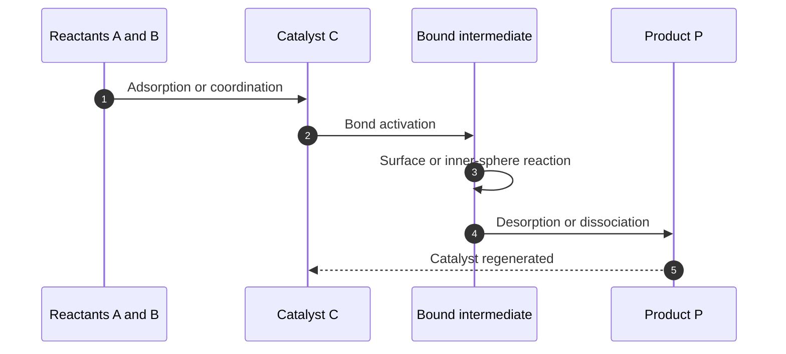
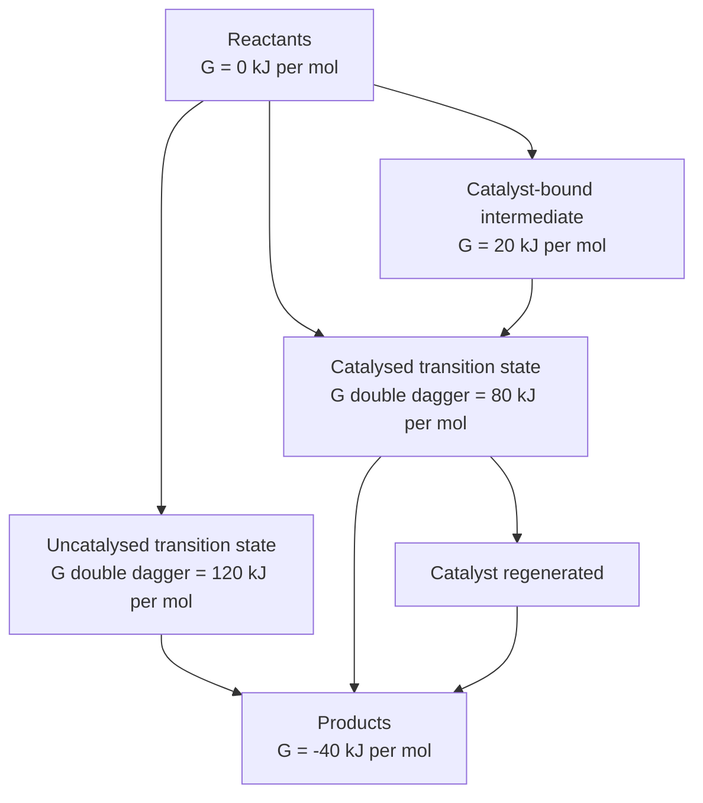
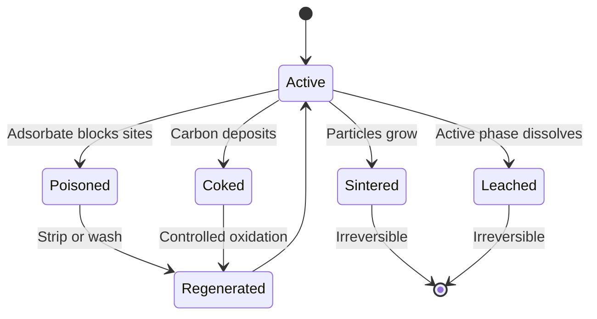

# Chapter 6 — Catalysis

> **Level:** Advanced (Level 3 — Advanced Chemistry)
> **Estimated study time:** 6 hours (4 h reading + 2 h exercises)
> **Prerequisites:** [Chemical Thermodynamics](04-chemical-thermodynamics.md); [Chemical Kinetics and Reaction Mechanisms](05-chemical-kinetics-and-reaction-mechanisms.md); equilibrium constants from Level 2
> **Difficulty:** ★★★★☆ (4/5)
> **Related chapters:** [Level 3 module index](README.md); [Chemical Kinetics and Reaction Mechanisms](05-chemical-kinetics-and-reaction-mechanisms.md); [Advanced Equilibrium](07-advanced-equilibrium-buffers-and-solubility-product.md); [Curriculum map](../CURRICULUM.md)

---

## 1. Learning Objectives

After working through this chapter you will be able to:

- Define a catalyst in the IUPAC sense and state the two thermodynamic constraints that every catalyst must satisfy.
- Explain why a catalyst changes the rate of approach to equilibrium but never the equilibrium position, and prove the statement from the relation between forward and reverse rate constants.
- Distinguish homogeneous, heterogeneous and biological catalysis, and compare them on activity, selectivity, separation and operating conditions.
- Draw and interpret the catalytic cycle for a named industrial process, identifying the resting state and the turnover-limiting step.
- Explain how an alternative pathway with a stabilised transition state lowers $\Delta G^\ddagger$ without stabilising the ground state.
- Derive the Langmuir–Hinshelwood rate law for a bimolecular surface reaction and show its saturation limit.
- Recognise the Michaelis–Menten rate law as the same saturation mathematics applied to an enzyme, and interpret $K_\mathrm{M}$, $k_\mathrm{cat}$ and $k_\mathrm{cat}/K_\mathrm{M}$.
- Calculate turnover numbers, turnover frequencies and atom economies for industrial and laboratory processes.
- Diagnose the four principal modes of catalyst deactivation and describe how promoters, supports and regeneration extend catalyst life.
- Explain autocatalysis and oscillating reactions qualitatively and identify the feedback required for each.

---

## 2. Introduction

Ammonia is produced industrially at a scale of roughly $1.5 \times 10^8$ tonnes per year, and every tonne passes over an iron catalyst at about $450\ ^\circ\mathrm{C}$ and $200$ bar. Without that catalyst the same nitrogen and hydrogen would still be thermodynamically capable of forming ammonia — the equilibrium constant is favourable at room temperature — but the uncatalysed reaction is so slow that a reactor would produce essentially nothing on an industrial timescale. The catalyst does not make the reaction possible in the thermodynamic sense. It makes it possible in the practical sense, by providing a route over the activation barrier that is roughly half as high as the direct route.

This distinction between *whether* a reaction can happen and *how fast* it happens is the intellectual core of catalysis. Thermodynamics fixes the floor and the ceiling: the Gibbs energies of reactants and products, and therefore the equilibrium constant, are properties of the substances themselves and cannot be altered by an additive that is regenerated at the end of each cycle. Kinetics fixes the height of the hill between them. A catalyst is a substance that changes the shape of the hill — the mechanism — while leaving the heights of the two valleys unchanged.

Catalysis is also where chemistry meets economics most directly. Something like 80–90 % of chemical processes by value involve at least one catalytic step, and the catalyst frequently determines not only the rate but the selectivity, the purity of the product, the energy demand and the amount of waste. A process that is thermodynamically allowed but catalytically poor is a laboratory curiosity; a process with a selective, long-lived catalyst is an industry. The same logic operates in biology: enzymes are catalysts that evolved under the constraint that they must work at $37\ ^\circ\mathrm{C}$, in water, at pH near 7, and they achieve rate enhancements of $10^{8}$ to $10^{17}$ over the uncatalysed reactions.

This chapter assumes that you can write a rate law, integrate a first-order equation and use the Arrhenius equation; Chapter 5 supplies all three, and Chapter 4 supplies the Gibbs energy and equilibrium relations that constrain what a catalyst may and may not do. Formulas are derived where the derivation clarifies the assumptions, and those assumptions are stated explicitly, because most errors in catalytic kinetics come from applying a derived rate law outside its regime of validity.

---

## 3. Fundamental Concepts

### 3.1 The definition of a catalyst

The IUPAC definition is compact and worth memorising: a **catalyst** is a substance that increases the rate of a reaction without modifying the overall standard Gibbs energy change in the reaction; it is both a reactant and a product of the reaction. The process is called **catalysis**.

Three parts of that definition carry weight. First, *increases the rate*: a catalyst is a kinetic species, not a thermodynamic one. Second, *without modifying the overall standard Gibbs energy change*: the initial and final states are unchanged. Third, *both a reactant and a product*: the catalyst enters the mechanism and is regenerated, so it appears on both sides of the sum of the elementary steps even though it does not appear in the net equation.

A **catalytic cycle** is the sequence of elementary steps that consumes the catalyst and returns it to its original form. The number of times the cycle repeats per catalyst site is the **turnover number**; the number of repetitions per unit time is the **turnover frequency**. These two quantities, defined precisely in Section 3.8, are the standard measures of catalyst performance.

### 3.2 The two thermodynamic constraints

Every catalyst, natural or synthetic, obeys two constraints.

**Constraint 1 — the catalyst cannot change $\Delta G$ or $K$.** For a reaction with standard Gibbs energy change $\Delta_r G^\circ$ and equilibrium constant $K$,

$$
\Delta_r G^\circ = -RT \ln K
$$

Neither quantity depends on the path. A catalyst that binds reactants, stabilises an intermediate and releases products has added new states to the system, but the chemical potentials of the initial reactants and final products in their standard states are unchanged. Consequently the equilibrium position is unchanged. A catalyst accelerates the forward and reverse reactions by exactly the same factor, so the ratio $k_\mathrm{f}/k_\mathrm{r}$, which equals $K$, is invariant.

This has an immediate practical consequence: **a catalyst cannot make an endergonic reaction proceed to products.** If $\Delta_r G > 0$ under the reaction conditions, the equilibrium lies on the reactant side, and a catalyst merely helps the system reach that unfavourable equilibrium faster. Industrial ammonia synthesis is equilibrium-limited at high temperature; the iron catalyst does not shift the equilibrium, which is why the process uses high pressure and continuous removal of ammonia by condensation.

**Constraint 2 — the catalyst is not consumed overall.** A catalyst may be temporarily modified — reduced, oxidised, coordinated, protonated, adsorbed — but it must be restored in a subsequent step. If the catalyst is destroyed in a side reaction faster than it is regenerated, it is consumed and the process is *stoichiometric* rather than catalytic. The classical example is Friedel–Crafts acylation with more than one equivalent of $\ce{AlCl3}$: the Lewis acid forms a stable complex with the ketone product, so it is consumed stoichiometrically and must be hydrolysed to release the product. The catalytic version requires a true catalyst that does not bind the product irreversibly.

| Quantity | Can a catalyst change it? | Reason |
|---|---|---|
| Rate of reaction | Yes, increases it | Provides a pathway with lower $\Delta G^\ddagger$ |
| $\Delta_r G^\circ$ | No | State function of reactants and products |
| Equilibrium constant $K$ | No | Fixed by $\Delta_r G^\circ$ |
| Equilibrium composition | No | Fixed by $K$ and the mass balance |
| $\Delta_r H^\circ$ | No | State function |
| Reaction mechanism | Yes, necessarily | Catalysis is a change of mechanism |
| Selectivity | Yes, often dramatically | Different pathways have different barriers |
| Activation energy $E_\mathrm{a}$ | Yes, usually lowers it | New rate-determining step |

### 3.3 Classification of catalysis

Catalysts are classified by the phase relationship between catalyst and reactants.

**Homogeneous catalysis.** The catalyst and the reactants are in the same phase, almost always the liquid phase. Examples include acid catalysis of ester hydrolysis in aqueous solution, base catalysis of aldol condensation, and organometallic catalysis such as rhodium-catalysed hydroformylation. Homogeneous catalysts have well-defined molecular structures, uniform active sites and can be tuned by ligand design with exquisite precision. Their weakness is separation: the catalyst is dissolved in the product mixture and must be removed by distillation, extraction or chromatography, which is energy-intensive and can degrade thermally sensitive catalysts.

**Heterogeneous catalysis.** The catalyst is in a different phase, usually a solid in contact with gaseous or liquid reactants. Examples include iron in ammonia synthesis, platinum in catalytic converters, zeolites in fluid catalytic cracking and nickel in hydrogenation. The active sites are surface atoms, often at defects, edges or specific crystal faces. Heterogeneous catalysts are easy to separate, can be used in continuous fixed-bed or fluidised-bed reactors, and tolerate high temperatures. Their weakness is heterogeneity: a real surface presents a distribution of site types with different activities, and characterising which sites actually matter is difficult.

**Biological catalysis.** Enzymes are catalysts produced by living systems. They are usually proteins, occasionally RNA (ribozymes), and they operate in aqueous solution at mild temperature and pH. An enzyme is formally a homogeneous catalyst, but its active site is a folded micro-environment that behaves like a sophisticated heterogeneous pocket: substrates bind by multiple weak interactions, are held in a precise orientation, and are stabilised in the transition state. Enzymes achieve selectivities — including enantioselectivity — that synthetic catalysts rarely match.

| Feature | Homogeneous | Heterogeneous | Enzymatic |
|---|---|---|---|
| Phase | One phase | Two or more phases | Aqueous, dissolved or immobilised |
| Active site | Every molecule identical | Distribution of surface sites | One or a few defined pockets |
| Typical conditions | 25–150 °C, 1–50 bar | 200–600 °C, 1–300 bar | 20–40 °C, pH 5–9 |
| Selectivity | High, tunable by ligands | Moderate, structure-sensitive | Very high, including stereoselective |
| Separation | Difficult | Easy | Difficult unless immobilised |
| Examples | $\ce{H2SO4}$ ester hydrolysis, Rh hydroformylation | Fe ammonia synthesis, Pt converters | Catalase, nitrogenase |

### 3.4 The catalytic cycle

Every catalytic mechanism can be written as a cycle of elementary steps. For a heterogeneous catalyst the cycle is usually:

1. **Transport** of reactants from the bulk fluid to the external surface of the catalyst pellet.
2. **Diffusion** through the pore network to an active site.
3. **Adsorption** of one or more reactants onto the site.
4. **Surface reaction**, often after bond activation or dissociation.
5. **Desorption** of products.
6. **Diffusion and transport** of products away from the site.

For a homogeneous catalyst the analogous steps are coordination of substrate, ligand substitution or insertion, migratory insertion or reductive elimination, and product release. For an enzyme they are substrate binding, chemical transformation in the active site, and product release, often accompanied by a conformational change.

The **resting state** of the catalyst is the form in which it spends most of its time under operating conditions. The **turnover-limiting step** is the elementary step with the largest forward barrier relative to the resting state; it controls the overall rate. Identifying the resting state and the turnover-limiting step is the central task of mechanistic catalysis, and it is not the same as identifying the step with the largest absolute barrier, because the catalyst may accumulate in a stable intermediate before that barrier.

### 3.5 Lowering the barrier without moving the floor

Consider a one-step uncatalysed reaction $\ce{A -> P}$ with activation Gibbs energy $\Delta G^\ddagger_\mathrm{uncat}$. A catalyst $\ce{C}$ introduces a sequence

$$
\ce{A + C <=> AC -> PC -> P + C}
$$

with transition states of lower Gibbs energy than the single uncatalysed transition state. The overall Gibbs energy change is unchanged because the initial state $(\ce{A + C})$ and final state $(\ce{P + C})$ differ by the same $\Delta_r G$ as $\ce{A -> P}$.

The key point is that the catalyst must stabilise the *transition state* relative to the *resting state*, not merely bind the reactant tightly. If the catalyst binds the reactant so strongly that the resulting complex is lower in energy than the transition state by a large margin, the barrier from the complex to the transition state can be *larger* than the uncatalysed barrier, and the catalyst becomes an inhibitor. This is the **Sabatier principle**: optimal catalysts bind intermediates with intermediate strength — strong enough to activate the substrate, weak enough to release the product.

A catalyst also does not lower the ground-state energy of the reactants in a way that changes $\Delta_r G$. It may stabilise a reactive conformer or polarise a bond, but the thermodynamic reference states remain the same. Statements such as "the catalyst lowers the energy of the reactants" are therefore imprecise; the correct statement is "the catalyst provides a lower-energy path between the same initial and final states."

### 3.6 Adsorption and surface catalysis

Heterogeneous catalysis begins with adsorption. **Physisorption** involves van der Waals forces, enthalpies of adsorption of roughly $5$–$40\ \mathrm{kJ\ mol^{-1}}$, and multilayer formation at high pressure. **Chemisorption** involves chemical bond formation between adsorbate and surface, enthalpies of roughly $40$–$800\ \mathrm{kJ\ mol^{-1}}$, and is limited to a monolayer. Only chemisorption can activate a bond sufficiently to catalyse a reaction, although physisorption can precede chemisorption and can concentrate reactants at the surface.

The **Langmuir model** of adsorption assumes that the surface has a fixed number of identical, non-interacting sites, that each site holds at most one adsorbate, and that adsorption and desorption are in dynamic equilibrium. Under those assumptions the fractional coverage by species $\ce{A}$ is

$$
\theta_\mathrm{A} = \frac{K_\mathrm{A} p_\mathrm{A}}{1 + K_\mathrm{A} p_\mathrm{A}}
$$

where $K_\mathrm{A}$ is the adsorption equilibrium constant and $p_\mathrm{A}$ the partial pressure. At low pressure $\theta_\mathrm{A} \approx K_\mathrm{A} p_\mathrm{A}$ (first order in A); at high pressure $\theta_\mathrm{A} \to 1$ (zero order, because every site is occupied).

The **Langmuir–Hinshelwood mechanism** assumes that two adsorbed species react on the surface. If the surface reaction is rate-determining and the adsorbates compete for the same sites, the rate is

$$
r = k \theta_\mathrm{A} \theta_\mathrm{B}
= \frac{k K_\mathrm{A} K_\mathrm{B} p_\mathrm{A} p_\mathrm{B}}{(1 + K_\mathrm{A} p_\mathrm{A} + K_\mathrm{B} p_\mathrm{B})^2}
$$

The squared denominator produces the characteristic **saturation kinetics**: the rate rises with pressure at low coverage, passes through a maximum when the two species compete optimally, and falls at high pressure of one component because that component displaces the other from the surface. This inhibition by excess reactant is a diagnostic signature of a Langmuir–Hinshelwood mechanism and is frequently observed in oxidation and hydrogenation reactions.

An alternative is the **Eley–Rideal mechanism**, in which a gas-phase molecule reacts directly with an adsorbed species without first adsorbing. The rate law is then first order in the gas-phase reactant and first order in the surface coverage of the adsorbed species, without the squared denominator.

### 3.7 Enzymes as catalysts

An enzyme accelerates a reaction by binding the substrate in an active site that is complementary to the transition state, not to the substrate. This is the modern statement of Fischer's **lock-and-key** idea, refined by Koshland's **induced-fit** model: the enzyme changes conformation on substrate binding, and the conformational change positions catalytic groups and excludes water.

The simplest quantitative model is the **Michaelis–Menten** scheme:

$$
\ce{E + S <=>[k_1][k_{-1}] ES ->[k_2] E + P}
$$

with the steady-state assumption $\mathrm{d}[\ce{ES}]/\mathrm{d}t \approx 0$. The result is

$$
v = \frac{V_\mathrm{max}[\ce{S}]}{K_\mathrm{M} + [\ce{S}]},
\qquad
V_\mathrm{max} = k_\mathrm{cat}[\ce{E}]_0,
\qquad
K_\mathrm{M} = \frac{k_{-1} + k_2}{k_1}
$$

The Michaelis constant $K_\mathrm{M}$ is the substrate concentration at which $v = V_\mathrm{max}/2$. It is *not* a thermodynamic dissociation constant unless $k_2 \ll k_{-1}$. The catalytic constant $k_\mathrm{cat}$ is the number of substrate molecules converted per enzyme molecule per second at saturation. The ratio $k_\mathrm{cat}/K_\mathrm{M}$, the **specificity constant**, is the apparent second-order rate constant at low substrate concentration and is the best single measure of catalytic efficiency; it cannot exceed the diffusion limit of roughly $10^{8}$–$10^{10}\ \mathrm{M^{-1}\ s^{-1}}$.

The mathematical form is identical to the Langmuir isotherm with $[\ce{S}]$ replacing $p$ and $K_\mathrm{M}$ replacing $1/K$. Both are saturation functions derived from a binding equilibrium followed by a first-order conversion of the bound species. The analogy is exact only under the stated assumptions; enzymes with multiple substrates, cooperativity or inhibition require more elaborate models.

### 3.8 Measuring catalyst performance

Four quantities are used routinely.

**Conversion** is the fraction of the limiting reactant consumed:

$$
X = \frac{[\ce{A}]_0 - [\ce{A}]}{[\ce{A}]_0}
$$

**Selectivity** is the fraction of consumed reactant that becomes the desired product:

$$
S = \frac{n_\text{desired product formed}}{n_\text{reactant consumed}} \times 100\%
$$

**Turnover number** (TON) is the total number of catalytic cycles per active site before deactivation:

$$
\mathrm{TON} = \frac{n_\text{product formed}}{n_\text{catalyst sites}}
$$

**Turnover frequency** (TOF) is the number of cycles per site per unit time:

$$
\mathrm{TOF} = \frac{\mathrm{TON}}{t} = \frac{n_\text{product}}{n_\text{sites}\,t}
$$

In heterogeneous catalysis the number of sites is often measured by chemisorption of a probe molecule such as CO or H$_2$, which titrates surface metal atoms. The resulting TOF is a *site-normalised* rate and is the only fair way to compare catalysts with different dispersions. A catalyst with high dispersion has more surface atoms per gram and therefore a higher mass-normalised rate even if its intrinsic TOF is lower.

---

## 4. Detailed Scientific Explanation

### 4.1 Why $K$ cannot change: microscopic reversibility

Consider a catalytic cycle with forward and reverse elementary steps. At equilibrium, every elementary step is individually at equilibrium (the principle of detailed balance), so the product of forward rate constants around the cycle equals the product of reverse rate constants. If the catalyst lowers the barrier of the forward step by $\delta G^\ddagger$, it must lower the barrier of the reverse of that same step by exactly the same amount, because both barriers are measured from the same transition state to the same two adjacent minima. Summing around the cycle, the ratio $k_\mathrm{f,net}/k_\mathrm{r,net}$ remains equal to the uncatalysed equilibrium constant.

A useful way to see this is to write the catalytic scheme as a thermodynamic cycle:

$$
\ce{A <=>[k_\mathrm{uncat}] P}
\qquad\text{and}\qquad
\ce{A + C <=> AC -> PC <=> P + C}
$$

The Gibbs energy change around the closed loop is zero. The catalyst-containing path adds states but cannot change the energy difference between $\ce{A}$ and $\ce{P}$. Any claim that a catalyst "drives the equilibrium to the right" is therefore equivalent to claiming a perpetual motion machine: it would allow the catalyst to be used cyclically to separate products against a concentration gradient without work.

### 4.2 The Sabatier principle and volcano plots

The Sabatier principle states that the best catalyst binds the key intermediate neither too weakly nor too strongly. If binding is too weak, the intermediate is not formed in appreciable concentration and the rate is low. If binding is too strong, the intermediate is stabilised so much that the subsequent step — often the turnover-limiting step — has a large barrier, and the catalyst surface becomes saturated with a dead-end species.

Plotting the logarithm of the rate against a descriptor of binding strength, such as the adsorption energy of the intermediate, produces a **volcano plot**: a rise on the weak-binding side and a fall on the strong-binding side, with the optimum near the summit. Volcano plots are used to screen alloys and doped oxides for hydrogen evolution, oxygen reduction, ammonia synthesis and CO oxidation. The iron catalyst for ammonia synthesis sits near the summit of the volcano for nitrogen dissociation; ruthenium is more active per site but more expensive and more sensitive to poisoning.

The Sabatier principle is a heuristic, not a law. It assumes that a single descriptor controls the rate, that the surface is uniform, and that the reaction mechanism does not change across the series. When those assumptions fail, the volcano is distorted or absent.

### 4.3 Langmuir–Hinshelwood kinetics in detail

The derivation of the Langmuir–Hinshelwood rate law rests on four assumptions:

1. The surface is uniform and all sites are equivalent.
2. Each site accommodates at most one adsorbate.
3. Adsorbates do not interact laterally.
4. Adsorption equilibrium is established rapidly relative to the surface reaction.

Under these assumptions, for competitive adsorption of A and B,

$$
\theta_\mathrm{A} = \frac{K_\mathrm{A} p_\mathrm{A}}{1 + K_\mathrm{A} p_\mathrm{A} + K_\mathrm{B} p_\mathrm{B}},
\qquad
\theta_\mathrm{B} = \frac{K_\mathrm{B} p_\mathrm{B}}{1 + K_\mathrm{A} p_\mathrm{A} + K_\mathrm{B} p_\mathrm{B}}
$$

and the rate of the bimolecular surface step is $r = k \theta_\mathrm{A}\theta_\mathrm{B}$. Substitution gives the rate law quoted in Section 3.6.

Three limiting cases are diagnostic.

- **Dilute surface:** $K_\mathrm{A}p_\mathrm{A} + K_\mathrm{B}p_\mathrm{B} \ll 1$, so $r \approx k K_\mathrm{A}K_\mathrm{B}p_\mathrm{A}p_\mathrm{B}$: second order overall, first order in each reactant.
- **A saturates the surface:** $K_\mathrm{A}p_\mathrm{A} \gg 1 + K_\mathrm{B}p_\mathrm{B}$, so $r \approx (k K_\mathrm{B}/K_\mathrm{A})(p_\mathrm{B}/p_\mathrm{A})$: the rate becomes *inverse* first order in A. Adding more A slows the reaction by displacing B.
- **Both saturate:** $\theta_\mathrm{A} \approx \theta_\mathrm{B} \approx 1$, so $r \approx k$: zero order in both reactants. This is the behaviour of many oxidation catalysts at high partial pressures and is exploited in afterburners and catalytic incinerators, where a constant rate independent of pollutant concentration simplifies reactor design.

A linearised form is useful for testing the mechanism:

$$
\frac{1}{r} = \frac{1}{k K_\mathrm{A} K_\mathrm{B} p_\mathrm{A} p_\mathrm{B}} \left(1 + K_\mathrm{A} p_\mathrm{A} + K_\mathrm{B} p_\mathrm{B}\right)^2
$$

For the single-reactant case the Lineweaver–Burk-style plot of $1/r$ against $1/p$ is a straight line, from whose slope and intercept $k$ and $K$ can be extracted.

### 4.4 Michaelis–Menten kinetics in detail

The Michaelis–Menten derivation assumes:

1. The enzyme concentration is much smaller than the substrate concentration, so $[\ce{S}] \approx [\ce{S}]_0$.
2. The steady-state approximation applies to $[\ce{ES}]$.
3. The reaction is irreversible after the $\ce{ES}$ complex, or product release is fast.
4. Only one substrate binds, and there is no inhibition or cooperativity.

The steady-state condition gives

$$
\frac{\mathrm{d}[\ce{ES}]}{\mathrm{d}t} = k_1[\ce{E}][\ce{S}] - (k_{-1} + k_2)[\ce{ES}] = 0
$$

with $[\ce{E}] = [\ce{E}]_0 - [\ce{ES}]$. Solving for $[\ce{ES}]$ and substituting into $v = k_2[\ce{ES}]$ yields the Michaelis–Menten equation.

The two limiting regimes are the same as for Langmuir adsorption. At $[\ce{S}] \ll K_\mathrm{M}$, $v \approx (k_\mathrm{cat}/K_\mathrm{M})[\ce{E}]_0[\ce{S}]$: first order in substrate, with the specificity constant as the apparent second-order rate constant. At $[\ce{S}] \gg K_\mathrm{M}$, $v \approx V_\mathrm{max}$: zero order, with every enzyme active site occupied.

The Lineweaver–Burk transformation,

$$
\frac{1}{v} = \frac{K_\mathrm{M}}{V_\mathrm{max}}\frac{1}{[\ce{S}]} + \frac{1}{V_\mathrm{max}}
$$

linearises the data and allows $K_\mathrm{M}$ and $V_\mathrm{max}$ to be read from the intercepts, but it over-weights low-substrate points and is statistically inferior to nonlinear regression. It remains useful for diagnosing inhibition: competitive inhibitors increase the apparent $K_\mathrm{M}$ without changing $V_\mathrm{max}$; non-competitive inhibitors lower $V_\mathrm{max}$ without changing $K_\mathrm{M}$; uncompetitive inhibitors lower both.

### 4.5 Selectivity

A catalyst that accelerates several reactions indiscriminately is rarely useful. **Chemoselectivity** is the preferential conversion of one functional group in the presence of others. **Regioselectivity** is the preferential formation of one constitutional isomer. **Stereoselectivity** is the preferential formation of one stereoisomer, and **enantioselectivity** is the preferential formation of one enantiomer, usually reported as the enantiomeric excess

$$
\mathrm{ee} = \frac{|R - S|}{R + S} \times 100\%
$$

Selectivity is a kinetic phenomenon: it is the ratio of the rates of competing pathways, and therefore the ratio of their activation Gibbs energies,

$$
\frac{S_1}{S_2} = \frac{k_1}{k_2} = \exp\left(-\frac{\Delta G^\ddagger_1 - \Delta G^\ddagger_2}{RT}\right)
$$

At $298\ \mathrm{K}$, a difference of $5.7\ \mathrm{kJ\ mol^{-1}}$ corresponds to a factor of 10, and a difference of $11.4\ \mathrm{kJ\ mol^{-1}}$ to a factor of 100. This is why asymmetric catalysis is difficult: a stereochemical preference of 95 % ee requires a difference of only about $7\ \mathrm{kJ\ mol^{-1}}$ between the two diastereomeric transition states, which is small compared with typical bond energies but large compared with the errors in a crude model.

Selectivity and conversion are often coupled. In a consecutive reaction $\ce{A -> B -> C}$, where B is desired, high conversion of A inevitably produces more C unless the selectivity for B is extremely high. Reactor design — short residence time, low per-pass conversion, recycle — is therefore as important as catalyst design.

### 4.6 Promoters, supports and formulations

An industrial catalyst is rarely the active phase alone. It is a **formulation** containing the active phase, promoters, supports and binders.

A **promoter** is a substance that improves activity, selectivity or stability without being catalytically active itself. **Textural promoters** inhibit sintering by physically separating active crystallites; alumina in iron ammonia catalysts plays this role. **Electronic promoters** modify the electronic structure of the active phase and thereby its binding energies; potassium oxide in the same catalyst donates electron density to iron and strengthens nitrogen adsorption.

A **support** disperses the active phase over a high-surface-area material, stabilises it against sintering and can participate in the reaction. Common supports are $\gamma$-$\ce{Al2O3}$, $\ce{SiO2}$, $\ce{TiO2}$, carbon and cordierite monoliths. A support that participates chemically produces **bifunctional catalysis**: for example, platinum on acidic alumina catalyses both dehydrogenation (metal) and isomerisation (acid sites) in naphtha reforming.

The choice of support is not neutral. **Strong metal–support interaction** can encapsulate metal particles or transfer charge to them, changing activity and selectivity. A support with narrow pores can impose **shape selectivity**, admitting only molecules of a particular size or orientation; this is the basis of zeolite catalysis.

### 4.7 Deactivation

Catalysts lose activity with time. The four principal mechanisms are chemically distinct and require different remedies.

**Poisoning** is the strong adsorption of an impurity on active sites. It may be reversible (the poison can be desorbed by heating or washing) or irreversible (the poison reacts with the active phase). Sulfur compounds poison nickel and platinum hydrogenation catalysts; lead poisons automotive three-way catalysts; carbon monoxide poisons low-temperature fuel-cell platinum electrodes. Poisoning is often **selective**, affecting only one class of site, which can be used deliberately to suppress an unwanted side reaction.

**Coking** is the deposition of carbonaceous residues on the surface, blocking sites and pores. It is common in hydrocarbon cracking and reforming and is remedied by controlled oxidation (regeneration) or steam treatment.

**Sintering** is the growth of small metal crystallites into larger ones at high temperature, driven by the reduction in surface energy. It lowers the number of exposed active sites and is usually irreversible. Supports with strong metal–support interactions and low metal loadings slow sintering.

**Leaching** is the dissolution of the active phase into the reaction medium, important for homogeneous and for liquid-phase heterogeneous catalysis. It causes both loss of activity and product contamination by metal.

| Mode | Cause | Timescale | Reversible? | Remedy |
|---|---|---|---|---|
| Poisoning | Strong adsorbate or reaction with active phase | Minutes to months | Sometimes | Purify feed; regenerate |
| Coking | Carbon deposition | Hours to days | Usually | Oxidative regeneration |
| Sintering | Particle growth at high temperature | Months to years | No | Lower temperature; stabilised support |
| Leaching | Dissolution in liquid medium | Hours to months | No | Immobilise; change solvent |

### 4.8 Autocatalysis and oscillating reactions

In **autocatalysis** one of the products catalyses the reaction that produces it. The simplest example is

$$
\ce{A -> P}, \qquad r = k[\ce{A}][\ce{P}]
$$

Starting from a trace of P, the rate accelerates as P accumulates, producing a sigmoidal conversion–time curve with an induction period, a rapid acceleration and a final slowing as A is consumed. Autocatalysis is common in acid-catalysed reactions where the product is an acid, in the permanganate oxidation of oxalic acid (catalysed by $\ce{Mn^2+}$), in biological replication and in the polymerase chain reaction.

**Oscillating reactions** require autocatalysis plus a feedback that inhibits the autocatalyst, and they must operate far from equilibrium in an open system or a batch reactor with a slow consumption step. The Belousov–Zhabotinsky reaction — bromate, malonic acid and a one-electron redox catalyst such as cerium or ferroin in acidic aqueous solution — cycles between oxidised and reduced states of the catalyst, producing periodic colour changes and, in a thin layer, travelling spiral waves. The Oregonator model reduces the mechanism to five irreversible steps and reproduces the qualitative dynamics.

Oscillations do not violate thermodynamics. The system is far from equilibrium, and the oscillation is a dissipative structure maintained by the Gibbs energy of the bromate–malonic acid reaction. Entropy production is positive throughout.

### 4.9 Catalysis and green chemistry

Catalysis is one of the twelve principles of green chemistry and the most powerful single tool for reducing waste. Two metrics quantify the benefit.

**Atom economy** (Trost) is the fraction of the mass of the reactants that ends up in the desired product:

$$
\mathrm{AE} = \frac{M_\text{desired product}}{\sum M_\text{reactants}} \times 100\%
$$

A stoichiometric oxidation with permanganate or dichromate has low atom economy because most of the reagent mass becomes waste; a catalytic oxidation with $\ce{O2}$ or $\ce{H2O2}$ has high atom economy because oxygen atoms are incorporated into the product.

**E-factor** (Sheldon) is the mass of waste per mass of product:

$$
E = \frac{m_\text{waste}}{m_\text{product}}
$$

Typical E-factors are 0.1 for bulk petrochemicals, 1–5 for fine chemicals and 25–100 for pharmaceuticals. Catalysis reduces E by increasing selectivity (less by-product), by replacing stoichiometric reagents (less spent reagent) and by enabling solvent-free or aqueous processes.

Catalyst **recovery** is part of the green accounting. A homogeneous catalyst that cannot be separated contaminates the product and is lost; a heterogeneous catalyst can be filtered and reused but may sinter or poison. Immobilised homogeneous catalysts, biphasic systems, supercritical $\ce{CO2}$ and membrane separation are active areas of process development.

### 4.10 Where the models fail

The Langmuir–Hinshelwood model fails when the surface is heterogeneous (real surfaces have edges, steps, defects and multiple crystal facets), when adsorbates interact laterally, when adsorption is activated or irreversible, or when transport limitations make the measured rate a diffusion rate rather than a kinetic rate. In a porous pellet the **effectiveness factor** $\eta$ can be much less than 1, and the apparent activation energy is approximately half the true value in the strong-diffusion regime.

The Michaelis–Menten model fails for allosteric enzymes (sigmoidal kinetics), for enzymes with multiple substrates or products, for significant product inhibition, and when $[\ce{E}]_0$ is comparable to $[\ce{S}]_0$. The Sabatier principle fails when more than one descriptor is needed, when the mechanism changes across a series, or when the surface reconstructs under reaction conditions; modern computational catalysis therefore uses **microkinetic modelling** with coverage-dependent adsorption energies rather than a single volcano descriptor.

---

## 5. Visual Diagrams

**Figure 6.1 — The catalytic cycle as a sequence of elementary steps.** The catalyst is consumed at the start and regenerated at the end, so its net concentration is unchanged. Each arrow is an elementary step with its own rate constant and barrier. The slowest step relative to the resting state is the turnover-limiting step; the most abundant bound form is the resting state. A real cycle may include several bound intermediates and may branch to by-products, but the closing loop is the defining feature.

**Figure 6.2 — Energy profile for an uncatalysed and a catalysed pathway.** Both pathways start and end at the same Gibbs energies, so $\Delta_r G$ and $K$ are unchanged. The catalysed route passes through a bound intermediate and a lower transition state. The barrier that controls the rate is measured from the most stable species on the pathway, which may be the bound intermediate rather than the free reactants; this is why strong binding can inhibit.

**Figure 6.3 — Deactivation pathways of a solid catalyst.** Poisoning and coking are often reversible and can be managed by feed purification or regeneration; sintering and leaching are usually permanent. The diagram is a state diagram, not a mechanism: a real catalyst may enter several states simultaneously, and the dominant pathway depends on temperature, feed composition and time on stream.

---

## 6. Mathematical Formulas

The kinetics of catalysis rests on the Arrhenius and transition-state relations, the Langmuir isotherm and its kinetic analogues, and the thermodynamic constraint on $K$.

**Arrhenius equation.**

$$
k = A \exp\left(-\frac{E_\mathrm{a}}{RT}\right)
$$

**Transition-state theory.** For a unimolecular step with activation Gibbs energy $\Delta G^\ddagger$,

$$
k = \frac{k_\mathrm{B}T}{h}\exp\left(-\frac{\Delta G^\ddagger}{RT}\right)
$$

where $k_\mathrm{B}$ is the Boltzmann constant and $h$ the Planck constant. At $298\ \mathrm{K}$, $k_\mathrm{B}T/h = 6.21 \times 10^{12}\ \mathrm{s^{-1}}$.

**Rate enhancement by lowering the barrier.** For two pathways differing by $\Delta\Delta G^\ddagger$,

$$
\frac{k_\mathrm{cat}}{k_\mathrm{uncat}} = \exp\left(\frac{\Delta\Delta G^\ddagger}{RT}\right)
$$

**Langmuir isotherm and Langmuir–Hinshelwood rate.**

$$
\theta_\mathrm{A} = \frac{K_\mathrm{A}p_\mathrm{A}}{1 + K_\mathrm{A}p_\mathrm{A}},
\qquad
r = \frac{k K_\mathrm{A} K_\mathrm{B} p_\mathrm{A} p_\mathrm{B}}{(1 + K_\mathrm{A}p_\mathrm{A} + K_\mathrm{B}p_\mathrm{B})^2}
$$

**Michaelis–Menten equation and its parameters.**

$$
v = \frac{V_\mathrm{max}[\ce{S}]}{K_\mathrm{M} + [\ce{S}]},
\qquad
k_\mathrm{cat} = \frac{V_\mathrm{max}}{[\ce{E}]_0},
\qquad
\frac{k_\mathrm{cat}}{K_\mathrm{M}} = \frac{k_1 k_2}{k_{-1} + k_2}
$$

**Turnover number and turnover frequency.**

$$
\mathrm{TON} = \frac{n_\text{product}}{n_\text{sites}},
\qquad
\mathrm{TOF} = \frac{n_\text{product}}{n_\text{sites}\,t}
$$

**Atom economy and E-factor.**

$$
\mathrm{AE} = \frac{M_\text{desired product}}{\sum M_\text{reactants}} \times 100\%,
\qquad
E = \frac{m_\text{waste}}{m_\text{product}}
$$

| Symbol | Meaning | SI unit |
|---|---|---|
| $k$ | Rate constant of an elementary step | depends on order; s$^{-1}$ for first order |
| $A$ | Pre-exponential factor | same as $k$ |
| $E_\mathrm{a}$ | Arrhenius activation energy | J mol$^{-1}$ |
| $\Delta G^\ddagger$ | Activation Gibbs energy | J mol$^{-1}$ |
| $k_\mathrm{B}$ | Boltzmann constant | J K$^{-1}$ |
| $h$ | Planck constant | J s |
| $R$ | Molar gas constant | J K$^{-1}$ mol$^{-1}$ |
| $T$ | Thermodynamic temperature | K |
| $K_\mathrm{A}$ | Adsorption equilibrium constant | Pa$^{-1}$ |
| $p_\mathrm{A}$ | Partial pressure of A | Pa |
| $\theta_\mathrm{A}$ | Fractional surface coverage | dimensionless |
| $K_\mathrm{M}$ | Michaelis constant | mol m$^{-3}$ (usually quoted as M) |
| $V_\mathrm{max}$ | Maximum rate at saturation | mol m$^{-3}$ s$^{-1}$ |
| $k_\mathrm{cat}$ | Catalytic constant | s$^{-1}$ |
| $\mathrm{TON}$ | Turnover number | dimensionless |
| $\mathrm{TOF}$ | Turnover frequency | s$^{-1}$ |
| $X$ | Fractional conversion | dimensionless |
| $S$ | Selectivity | dimensionless or % |

**Assumptions and validity.** The Langmuir–Hinshelwood law assumes ideal, non-interacting sites and rate-determining surface reaction; it is valid only when adsorption equilibrium is fast and transport is not limiting. The Michaelis–Menten law assumes a single substrate, steady-state $\ce{ES}$, and $[\ce{E}]_0 \ll [\ce{S}]_0$. The transition-state expression assumes a well-defined barrier and a transmission coefficient of unity.

---

## 7. Chemical Equations

**Ammonia synthesis (Haber–Bosch).**

$$
\ce{N2(g) + 3H2(g) <=> 2NH3(g)}
\qquad
\Delta_r H^\circ = -92.4\ \mathrm{kJ\ mol^{-1}}
$$

The reaction is exergonic at room temperature but has a large activation barrier arising from the strength of the $\ce{N#N}$ bond (about $941\ \mathrm{kJ\ mol^{-1}}$). The iron catalyst dissociates $\ce{N2}$ on the surface; nitrogen dissociation is generally regarded as the turnover-limiting step on iron.

**Ostwald oxidation of ammonia.**

$$
\ce{4NH3(g) + 5O2(g) ->[Pt/Rh] 4NO(g) + 6H2O(g)}
\qquad
\Delta_r H^\circ = -905\ \mathrm{kJ\ mol^{-1}}
$$

The platinum–rhodium gauze catalyst operates at about $900\ ^\circ\mathrm{C}$ and $1$–$10$ bar. The reaction is strongly exothermic and, once ignited, is self-sustaining.

**Catalytic hydrogenation of ethene.**

$$
\ce{C2H4(g) + H2(g) ->[Ni] C2H6(g)}
\qquad
\Delta_r H^\circ = -137\ \mathrm{kJ\ mol^{-1}}
$$

Nickel, palladium or platinum catalyses the addition of hydrogen across the double bond. The metal surface adsorbs and dissociates $\ce{H2}$ and adsorbs the alkene; stepwise hydrogen transfer gives the alkane.

**Ziegler–Natta polymerisation of ethene.**

$$
\ce{n C2H4(g) ->[TiCl4/Al(C2H5)3] [-CH2-CH2-]_n}
$$

The catalyst is a heterogeneous titanium chloride phase activated by an aluminium alkyl. Polymerisation proceeds by migratory insertion of ethene into a titanium–carbon bond. The related propene polymerisation gives isotactic polypropylene when the catalyst site is stereochemically rigid.

**Three-way catalytic converter.**

$$
\ce{2CO(g) + 2NO(g) ->[Pt/Pd/Rh] 2CO2(g) + N2(g)}
$$

$$
\ce{2C8H18(g) + 25O2(g) ->[Pt/Pd] 16CO2(g) + 18H2O(g)}
$$

$$
\ce{2NO(g) + O2(g) ->[Pt] 2NO2(g)}
$$

The converter operates near the stoichiometric air-to-fuel ratio, where the exhaust contains just enough oxidant to oxidise CO and hydrocarbons and just enough reductant to reduce NO. A **lean** mixture exhausts excess $\ce{O2}$ and prevents NO reduction; a **rich** mixture exhausts excess CO and hydrocarbons and prevents their complete oxidation. The window is narrow, which is why modern engines use closed-loop oxygen sensors.

**Fluid catalytic cracking (simplified).**

$$
\ce{C16H34(g) ->[zeolite] C8H18(g) + C8H16(g)}
$$

This is a stoichiometric illustration, not a mechanism. Commercial cracking converts a complex mixture of alkanes over acidic faujasite zeolites at about $500\ ^\circ\mathrm{C}$; the products are a distribution of alkanes and alkenes, and the reaction proceeds through carbocation intermediates on Brønsted acid sites.

**Contact process.**

$$
\ce{2SO2(g) + O2(g) <=>[V2O5] 2SO3(g)}
\qquad
\Delta_r H^\circ = -198\ \mathrm{kJ\ mol^{-1}}
$$

The vanadium(V) oxide catalyst operates at $400$–$450\ ^\circ\mathrm{C}$. Lower temperatures favour the equilibrium but deactivate the catalyst, so the process is run at the lowest temperature compatible with acceptable rate.

**Enzymatic decomposition of hydrogen peroxide.**

$$
\ce{2H2O2(aq) ->[catalase] 2H2O(l) + O2(g)}
$$

Catalase has one of the highest known turnover frequencies, of the order of $10^{5}$–$10^{7}\ \mathrm{s^{-1}}$ per haem site, and protects cells from oxidative damage.

---

## 8. Worked Examples

### Worked Example 8.1 — The thermodynamic ceiling for ammonia synthesis

**Problem.** Calculate $\Delta_r G^\circ$ and $K$ for $\ce{N2(g) + 3H2(g) <=> 2NH3(g)}$ at $298\ \mathrm{K}$ and at $723\ \mathrm{K}$, using $\Delta_f H^\circ(\ce{NH3}) = -45.9\ \mathrm{kJ\ mol^{-1}}$ and the standard entropies $S^\circ(\ce{N2}) = 191.6$, $S^\circ(\ce{H2}) = 130.7$ and $S^\circ(\ce{NH3}) = 192.8\ \mathrm{J\ K^{-1}\ mol^{-1}}$. Hence explain why the industrial catalyst cannot improve the equilibrium yield.

**Strategy.** Calculate $\Delta_r H^\circ$ and $\Delta_r S^\circ$ from the tabulated data, then use $\Delta_r G^\circ = \Delta_r H^\circ - T\Delta_r S^\circ$ and $\Delta_r G^\circ = -RT\ln K$. Assume the standard enthalpies and entropies are independent of temperature over the range, which is the usual approximation for a short extrapolation.

**Solution.**

$$
\Delta_r H^\circ = 2(-45.9) = -91.8\ \mathrm{kJ\ mol^{-1}}
$$

$$
\Delta_r S^\circ = 2(192.8) - [191.6 + 3(130.7)]
= 385.6 - 583.7 = -198.1\ \mathrm{J\ K^{-1}\ mol^{-1}}
$$

At $298\ \mathrm{K}$:

$$
\Delta_r G^\circ = -91.8 - 298(-0.1981) = -91.8 + 59.0 = -32.8\ \mathrm{kJ\ mol^{-1}}
$$

$$
K = \exp\left(\frac{32\,800}{8.314 \times 298}\right) = \exp(13.24) = 5.6 \times 10^{5}
$$

At $723\ \mathrm{K}$:

$$
\Delta_r G^\circ = -91.8 + 723(0.1981) = -91.8 + 143.2 = +51.4\ \mathrm{kJ\ mol^{-1}}
$$

$$
K = \exp\left(-\frac{51\,400}{8.314 \times 723}\right) = \exp(-8.55) = 1.9 \times 10^{-4}
$$

**Check.** The reaction is exothermic with a decrease in the number of gas molecules, so Le Chatelier's principle predicts that low temperature and high pressure favour ammonia. The calculation agrees: $K$ falls by nine orders of magnitude between $298$ and $723\ \mathrm{K}$. The catalyst cannot change either value; it only allows the system to reach the high-temperature equilibrium within a practical residence time. This is why the industrial process uses $150$–$300$ bar and removes ammonia continuously.

### Worked Example 8.2 — Rate enhancement from a lower barrier

**Problem.** An uncatalysed reaction has $\Delta G^\ddagger = 120\ \mathrm{kJ\ mol^{-1}}$; a catalysed pathway has $\Delta G^\ddagger = 80\ \mathrm{kJ\ mol^{-1}}$. Calculate the rate ratio at $298\ \mathrm{K}$ and at $500\ \mathrm{K}$. What barrier reduction is needed for a factor of $10^{6}$ at $298\ \mathrm{K}$?

**Strategy.** Use transition-state theory, $k \propto \exp(-\Delta G^\ddagger/RT)$, so the ratio is $\exp(\Delta\Delta G^\ddagger/RT)$. Assume the pre-exponential factors are equal, which is approximate but adequate for an order-of-magnitude estimate.

**Solution.** With $\Delta\Delta G^\ddagger = 40\ \mathrm{kJ\ mol^{-1}}$:

$$
\frac{k_\mathrm{cat}}{k_\mathrm{uncat}} = \exp\left(\frac{40\,000}{8.314 \times 298}\right)
= \exp(16.15) = 1.0 \times 10^{7}
$$

At $500\ \mathrm{K}$:

$$
\frac{k_\mathrm{cat}}{k_\mathrm{uncat}} = \exp\left(\frac{40\,000}{8.314 \times 500}\right)
= \exp(9.62) = 1.5 \times 10^{4}
$$

For a factor of $10^{6}$ at $298\ \mathrm{K}$:

$$
\Delta\Delta G^\ddagger = RT\ln(10^{6}) = 8.314 \times 298 \times 13.816
= 34.2\ \mathrm{kJ\ mol^{-1}}
$$

**Check.** The rate ratio is smaller at higher temperature because the thermal energy $RT$ is larger and the barrier difference is a smaller fraction of it. The result that $34\ \mathrm{kJ\ mol^{-1}}$ gives $10^{6}$ is consistent with the useful rule of thumb that $5.7\ \mathrm{kJ\ mol^{-1}}$ gives a factor of 10 at room temperature.

### Worked Example 8.3 — Langmuir–Hinshelwood saturation

**Problem.** A bimolecular surface reaction follows $r = k K_\mathrm{A}p_\mathrm{A}/(1 + K_\mathrm{A}p_\mathrm{A})$ at fixed $p_\mathrm{B}$, with $k = 1.0 \times 10^{-3}\ \mathrm{mol\ m^{-2}\ s^{-1}}$ and $K_\mathrm{A} = 5.0\ \mathrm{bar^{-1}}$. Calculate the rate at $p_\mathrm{A} = 0.010$, $0.20$ and $5.0$ bar, and identify the order in A in each regime. At what pressure is the surface half-covered?

**Strategy.** Substitute directly into the isotherm and compare the magnitude of $K_\mathrm{A}p_\mathrm{A}$ with 1. Recognise that half-coverage occurs when $K_\mathrm{A}p_\mathrm{A} = 1$.

**Solution.** At $p_\mathrm{A} = 0.010$ bar, $K_\mathrm{A}p_\mathrm{A} = 0.050$:

$$
r = \frac{(1.0 \times 10^{-3})(0.050)}{1.050}
= 4.8 \times 10^{-5}\ \mathrm{mol\ m^{-2}\ s^{-1}}
$$

At $p_\mathrm{A} = 0.20$ bar, $K_\mathrm{A}p_\mathrm{A} = 1.0$:

$$
r = \frac{(1.0 \times 10^{-3})(1.0)}{2.0}
= 5.0 \times 10^{-4}\ \mathrm{mol\ m^{-2}\ s^{-1}}
$$

At $p_\mathrm{A} = 5.0$ bar, $K_\mathrm{A}p_\mathrm{A} = 25$:

$$
r = \frac{(1.0 \times 10^{-3})(25)}{26}
= 9.6 \times 10^{-4}\ \mathrm{mol\ m^{-2}\ s^{-1}}
$$

Half-coverage occurs at $p_\mathrm{A} = 1/K_\mathrm{A} = 0.20$ bar.

**Check.** The rate at $0.010$ bar is proportional to pressure (first order: doubling pressure would double the rate). At $5.0$ bar the rate is within 4 % of the limiting value $k$, so the reaction is essentially zero order. The half-coverage pressure is exactly the reciprocal of the adsorption constant, as the isotherm requires.

### Worked Example 8.4 — Michaelis–Menten parameters and catalytic efficiency

**Problem.** An enzyme has $V_\mathrm{max} = 1.0\ \mu\mathrm{M\ s^{-1}}$ at $[\ce{E}]_0 = 2.0\ \mathrm{nM}$ and $K_\mathrm{M} = 0.25\ \mathrm{mM}$. Calculate $k_\mathrm{cat}$, $k_\mathrm{cat}/K_\mathrm{M}$ and the rate at $[\ce{S}] = 0.10\ \mathrm{mM}$. Is the enzyme close to catalytic perfection?

**Strategy.** Convert all concentrations to molar, use $k_\mathrm{cat} = V_\mathrm{max}/[\ce{E}]_0$, then the Michaelis–Menten equation. Compare $k_\mathrm{cat}/K_\mathrm{M}$ with the diffusion limit of about $10^{9}\ \mathrm{M^{-1}\ s^{-1}}$.

**Solution.**

$$
k_\mathrm{cat} = \frac{1.0 \times 10^{-6}\ \mathrm{M\ s^{-1}}}{2.0 \times 10^{-9}\ \mathrm{M}}
= 5.0 \times 10^{2}\ \mathrm{s^{-1}}
$$

$$
\frac{k_\mathrm{cat}}{K_\mathrm{M}}
= \frac{5.0 \times 10^{2}\ \mathrm{s^{-1}}}{2.5 \times 10^{-4}\ \mathrm{M}}
= 2.0 \times 10^{6}\ \mathrm{M^{-1}\ s^{-1}}
$$

At $[\ce{S}] = 1.0 \times 10^{-4}\ \mathrm{M}$:

$$
v = \frac{(1.0 \times 10^{-6})(1.0 \times 10^{-4})}{2.5 \times 10^{-4} + 1.0 \times 10^{-4}}
= 2.9 \times 10^{-7}\ \mathrm{M\ s^{-1}}
= 0.29\ \mu\mathrm{M\ s^{-1}}
$$

**Check.** The rate is below $V_\mathrm{max}$, as it must be, and the substrate concentration is below $K_\mathrm{M}$, so the enzyme is operating in the first-order regime. The specificity constant is about $2 \times 10^{6}\ \mathrm{M^{-1}\ s^{-1}}$, which is respectable but roughly $10^{3}$ below the diffusion limit; the enzyme is efficient but not "perfect".

### Worked Example 8.5 — Turnover frequency and catalyst productivity

**Problem.** A 2.0 mg sample of a supported metal catalyst contains 1.5 % metal by mass. The metal has a molar mass of $195\ \mathrm{g\ mol^{-1}}$ and 40 % of its atoms are exposed at the surface. The catalyst converts $8.0 \times 10^{-4}\ \mathrm{mol}$ of substrate in $600\ \mathrm{s}$. Calculate the turnover frequency per surface metal atom.

**Strategy.** Calculate the total moles of metal, multiply by the dispersion to obtain surface moles, then divide the product moles by surface moles and time.

**Solution.**

$$
n_\text{metal} = \frac{2.0 \times 10^{-3}\ \mathrm{g} \times 0.015}{195\ \mathrm{g\ mol^{-1}}}
= 1.54 \times 10^{-7}\ \mathrm{mol}
$$

$$
n_\text{surface} = 0.40 \times 1.54 \times 10^{-7} = 6.15 \times 10^{-8}\ \mathrm{mol}
$$

$$
\mathrm{TOF} = \frac{8.0 \times 10^{-4}}{6.15 \times 10^{-8} \times 600}
= 21.7\ \mathrm{s^{-1}}
$$

**Check.** A TOF of about $20\ \mathrm{s^{-1}}$ is typical for a moderately active supported metal catalyst at moderate temperature; it is far below the $10^{5}\ \mathrm{s^{-1}}$ of catalase but far above the turnover of a typical organocatalyst. If the dispersion were 100 %, the TOF would be $8.7\ \mathrm{s^{-1}}$, so the quoted value depends strongly on the site-counting method.

## 9. Real-World Applications

**Ammonia synthesis.** The Haber–Bosch process fixes atmospheric nitrogen into ammonia, which is used for fertiliser, explosives and, increasingly, as a hydrogen carrier. The catalyst is promoted magnetite reduced to $\alpha$-iron, with potassium oxide as an electronic promoter and alumina as a textural promoter. Operating conditions are a compromise: high pressure favours the equilibrium, high temperature favours the rate, and the catalyst must survive both. Single-train plants produce over $3000$ tonnes per day.

**Ziegler–Natta polymerisation.** Titanium chloride activated by an aluminium alkyl produces high-density polyethylene and isotactic polypropylene at low pressure. The discovery in the 1950s transformed the polymer industry and won Ziegler and Natta the 1963 Nobel Prize in Chemistry. Modern **metallocene** catalysts use a single-site zirconocene activated by methylaluminoxane and give narrower molecular-weight distributions and precise stereocontrol.

**Catalytic converters.** A three-way converter contains platinum and palladium for CO and hydrocarbon oxidation and rhodium for NO reduction, dispersed on a $\gamma$-alumina washcoat on a cordierite honeycomb. It reduces urban CO, hydrocarbon and NO emissions by more than 90 % when new. Lead and sulfur poison it; the phase-out of leaded petrol was driven partly by catalyst compatibility.

**Fluid catalytic cracking.** Zeolite Y catalyses the cracking of heavy gas oil into petrol-range molecules. The catalyst circulates between a reactor at about $500\ ^\circ\mathrm{C}$ and a regenerator where coke is burned off, providing the heat for the endothermic cracking reaction. FCC is the largest-scale catalytic process in the world by throughput.

**Environmental catalysis.** Selective catalytic reduction (SCR) of NO with ammonia over vanadia–titania or copper–zeolite catalysts removes nitrogen oxides from power-plant and diesel exhaust. Catalytic oxidation destroys volatile organic compounds at temperatures far below thermal incineration. Three-way catalysts and SCR are the reason that modern vehicle exhaust is dramatically cleaner than that of the 1960s.

**Pharmaceutical manufacturing.** Asymmetric hydrogenation with chiral rhodium or ruthenium diphosphine catalysts produces enantiopure amino acids and drug intermediates; Knowles, Noyori and Sharpless shared the 2001 Nobel Prize in Chemistry for work on chirally catalysed reactions. Enzymatic catalysis is increasingly used for selective oxidations, transaminations and ester hydrolysis under mild conditions.

---

## 10. Common Mistakes

| Mistake | Why it happens | Correct approach |
|---|---|---|
| "A catalyst lowers the activation energy and therefore makes an unfavourable reaction favourable." | The two effects are conflated because both are described as "lowering energy". | A catalyst lowers $\Delta G^\ddagger$ (kinetics) but not $\Delta_r G$ or $K$ (thermodynamics). An endergonic reaction remains non-spontaneous. |
| "The catalyst is not consumed, so it lasts forever." | The definition says the catalyst is regenerated, which is misread as indestructible. | A catalyst can be poisoned, coked, sintered or leached. Turnover number is finite; catalyst life is an economic parameter. |
| "A catalyst shifts the equilibrium towards the products." | The observed increase in product formation is mistaken for a thermodynamic shift. | The equilibrium composition is unchanged; the system merely reaches it faster. Removing product, not adding catalyst, shifts the equilibrium. |
| "The rate-determining step is the step with the highest barrier." | Transition-state diagrams are read as if every barrier were measured from the reactants. | The rate-determining step is the highest barrier measured from the resting state, which may be a bound intermediate. |
| "$K_\mathrm{M}$ is the dissociation constant of the enzyme–substrate complex." | The Michaelis–Menten formula resembles a binding isotherm. | $K_\mathrm{M} = (k_{-1}+k_2)/k_1$; it equals $K_\mathrm{d}$ only when $k_2 \ll k_{-1}$. |
| "A higher surface area always gives a better catalyst." | Dispersion is confused with intrinsic activity. | High area helps mass-normalised rate but can lower stability; site-normalised TOF is the fair comparison. |
| "Autocatalysis violates the law of mass action." | The sigmoidal rate curve looks unlike first-order decay. | The rate law $r = k[\ce{A}][\ce{P}]$ is ordinary second-order kinetics; the product simply happens to be a catalyst. |

---

## 11. Chapter Summary

- A catalyst increases the rate of a reaction by providing a different mechanism with a lower activation Gibbs energy; it does not change $\Delta_r G$, $\Delta_r H$ or $K$, and it is regenerated at the end of each cycle.
- The two thermodynamic constraints — no change to $\Delta G$ or $K$, and no net consumption — follow from the fact that the initial and final states are unchanged and the cycle closes.
- A catalyst stabilises the transition state relative to the resting state; binding the reactant too strongly inhibits turnover, which is the Sabatier principle.
- Langmuir–Hinshelwood kinetics and Michaelis–Menten kinetics share the same saturation mathematics: a binding equilibrium followed by a first-order conversion.
- Poisoning, coking, sintering and leaching are the four principal deactivation pathways; promoters and supports extend catalyst life and modify selectivity.

---

## 12. Exercises

### 12.1 Conceptual questions

1. A colleague claims that a new catalyst increases the equilibrium yield of ammonia at $450\ ^\circ\mathrm{C}$ by 20 %. Explain why this claim cannot be correct as stated, and describe what the catalyst might actually have changed.
2. Distinguish between the *resting state* and the *turnover-limiting step* of a catalytic cycle. Why can the step with the largest absolute barrier fail to be rate-determining?
3. Explain why the Michaelis constant $K_\mathrm{M}$ is not generally equal to the dissociation constant of the enzyme–substrate complex, and state the condition under which the two coincide.

### 12.2 Basic problems

4. Write the net reaction for the catalytic decomposition of ozone by chlorine radicals, $\ce{Cl + O3 -> ClO + O2}$ and $\ce{ClO + O -> Cl + O2}$, and identify the catalyst.
5. A catalyst lowers the activation energy of a reaction from $95$ to $70\ \mathrm{kJ\ mol^{-1}}$. Calculate the factor by which the rate increases at $300\ \mathrm{K}$, assuming the pre-exponential factor is unchanged.
6. Define turnover number and turnover frequency, and give their SI units for a gas–solid reaction.

### 12.3 Intermediate problems

7. Derive the Langmuir–Hinshelwood rate law for $\ce{A + B -> P}$ on a uniform surface, stating all assumptions. Show that the rate becomes inverse first order in A when A saturates the surface.
8. A catalyst converts $0.050\ \mathrm{mol}$ of substrate over $2.0\ \mathrm{h}$ using $5.0\ \mu\mathrm{mol}$ of active sites. Calculate TON and TOF.
9. Explain why a three-way catalytic converter must operate near the stoichiometric air-to-fuel ratio, and what happens to CO and NO conversion on the rich and lean sides of that ratio.

### 12.4 Advanced problems

10. The Belousov–Zhabotinsky reaction oscillates in a batch reactor for several minutes and then stops. Explain why it stops, why it requires a catalyst, and why the oscillation does not violate the second law of thermodynamics.
11. A heterogeneous catalyst loses 40 % of its activity over 1000 h, and post-mortem analysis shows a 30 % decrease in metal surface area with no change in metal loading. Identify the most likely deactivation mechanism, suggest one diagnostic experiment to confirm it, and propose one mitigation strategy.

### 12.5 Calculation problems

12. For the reaction $\ce{CO(g) + 2H2(g) <=> CH3OH(g)}$, $\Delta_r H^\circ = -90.7\ \mathrm{kJ\ mol^{-1}}$ and $\Delta_r S^\circ = -221\ \mathrm{J\ K^{-1}\ mol^{-1}}$. Calculate $\Delta_r G^\circ$ and $K$ at $500\ \mathrm{K}$, and state whether a catalyst can increase the equilibrium yield at that temperature.

### 12.6 Answers

1. A catalyst cannot change $K$ or the equilibrium composition; it can increase the *rate* of approach to equilibrium, or increase the *selectivity* for ammonia by suppressing a competing reaction, but not the equilibrium yield. At best it allows the plant to operate closer to the equilibrium conversion within a fixed residence time.
2. The resting state is the most abundant catalyst form; the turnover-limiting step is the step with the highest barrier measured from that resting state. A step with a larger absolute barrier may be preceded by an even more stable intermediate, so it is not rate-limiting.
3. $K_\mathrm{M} = (k_{-1}+k_2)/k_1$; it equals $K_\mathrm{d} = k_{-1}/k_1$ only when $k_2 \ll k_{-1}$, that is, when product formation is much slower than substrate dissociation.
4. $\ce{2O3 -> 3O2}$; the catalyst is $\ce{Cl}$ (regenerated), with $\ce{ClO}$ as the intermediate.
5. $\Delta\Delta E_\mathrm{a} = 25\ \mathrm{kJ\ mol^{-1}}$; ratio $= \exp(25000/(8.314 \times 300)) = \exp(10.02) = 2.3 \times 10^{4}$.
6. TON is the number of catalytic cycles per active site (dimensionless); TOF is cycles per site per second ($\mathrm{s^{-1}}$).
7. Assume uniform non-interacting sites, one adsorbate per site, fast adsorption equilibrium and rate-determining surface reaction. Then $r = kK_\mathrm{A}K_\mathrm{B}p_\mathrm{A}p_\mathrm{B}/(1+K_\mathrm{A}p_\mathrm{A}+K_\mathrm{B}p_\mathrm{B})^2$. If $K_\mathrm{A}p_\mathrm{A} \gg 1+K_\mathrm{B}p_\mathrm{B}$, $r \approx (kK_\mathrm{B}/K_\mathrm{A})(p_\mathrm{B}/p_\mathrm{A})$, inverse first order in A.
8. $\mathrm{TON} = 0.050/(5.0 \times 10^{-6}) = 1.0 \times 10^{4}$; $\mathrm{TOF} = 1.0 \times 10^{4}/(2.0 \times 3600) = 1.4\ \mathrm{s^{-1}}$.
9. Near stoichiometry the exhaust contains both oxidants and reductants in the correct proportions. Rich of stoichiometry, CO and hydrocarbons are not fully oxidised; lean of stoichiometry, NO is not fully reduced. The window is narrow, hence closed-loop control with an oxygen sensor.
10. The reactants are consumed and the system relaxes to equilibrium, where oscillations cease; the catalyst is required to provide the redox couple that mediates the feedback. The oscillation is a dissipative structure: the entropy production is positive, and the order is maintained by the Gibbs energy of the bromate oxidation.
11. Sintering, because the loading is unchanged but the surface area has fallen; confirm by X-ray diffraction crystallite-size analysis or chemisorption. Mitigate by lowering the operating temperature or using a support that anchors the metal particles.
12. $\Delta_r G^\circ = -90.7 + 500(0.221) = -90.7 + 110.5 = +19.8\ \mathrm{kJ\ mol^{-1}}$; $K = \exp(-19800/(8.314 \times 500)) = \exp(-4.76) = 8.6 \times 10^{-3}$. A catalyst cannot change this equilibrium; at $500\ \mathrm{K}$ the reaction is endergonic as written.

---

## 13. Further Reading

- Atkins, P.; de Paula, J.; Keeler, J. *Atkins' Physical Chemistry*, 11th ed. Oxford University Press, 2018. Chapters on reaction kinetics and catalysis.
- Chorkendorff, I.; Niemantsverdriet, J. W. *Concepts of Modern Catalysis and Kinetics*, 2nd ed. Wiley-VCH, 2007.
- Thomas, J. M.; Thomas, W. J. *Principles and Practice of Heterogeneous Catalysis*, 2nd ed. Wiley-VCH, 2015.
- Nelson, D. L.; Cox, M. M. *Lehninger Principles of Biochemistry*, 7th ed. Macmillan, 2017. Chapters on enzymes.
- Anastas, P. T.; Warner, J. C. *Green Chemistry: Theory and Practice*. Oxford University Press, 1998.
- IUPAC. *Compendium of Chemical Terminology* ("Gold Book"), 2nd ed. (the "corrected" version), entries "catalyst", "turnover number" and "turnover frequency". <https://goldbook.iupac.org/>
- NIST. *CODATA Internationally Recommended Values of the Fundamental Physical Constants*. <https://physics.nist.gov/cuu/Constants/>

---

**Navigation:** [Level 3 index](README.md) · [Curriculum map](../CURRICULUM.md) · Chemical Thermodynamics (Ch. 4) · Advanced Equilibrium: Buffers and Solubility Product (Ch. 7)
