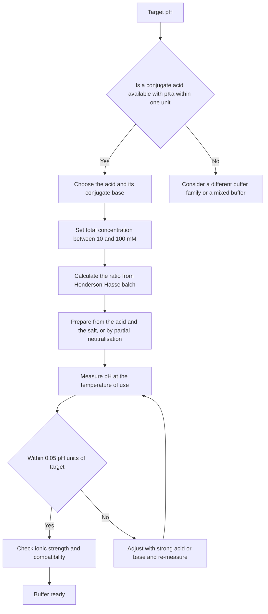
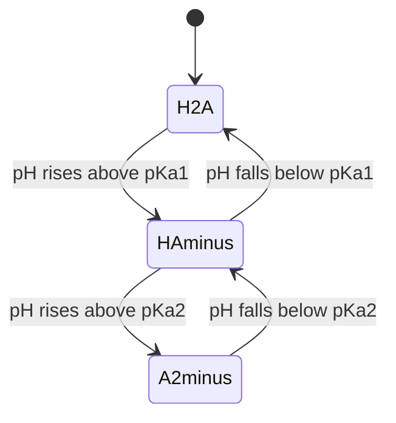
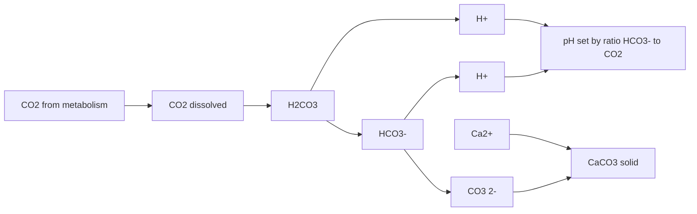
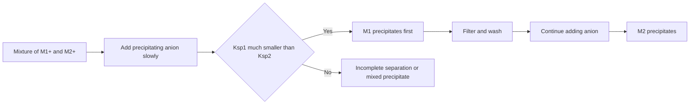

# Chapter 7 — Advanced Equilibrium: Buffers and Solubility Product

> **Level:** Advanced (Level 3 — Advanced Chemistry)
> **Estimated study time:** 8 hours (5 h reading + 3 h exercises)
> **Prerequisites:** Acid–base equilibria, pH and titration curves (Level 2); solubility and precipitation (Level 2); [Gibbs energy and equilibrium](04-chemical-thermodynamics.md)
> **Difficulty:** ★★★★☆ (4/5)
> **Related chapters:** [Level 3 module index](README.md); [Chemical Thermodynamics](04-chemical-thermodynamics.md); [Catalysis](06-catalysis.md); [Electrochemical Cells and the Nernst Equation](08-electrochemical-cells-nernst-equation-and-electrolysis.md); [Curriculum map](../CURRICULUM.md)

---

## 1. Learning Objectives

After working through this chapter you will be able to:

- Write the thermodynamic equilibrium constant in terms of activities and explain why it is dimensionless.
- Calculate ionic strength and use the Debye–Hückel limiting law qualitatively to predict activity coefficients.
- Derive the Henderson–Hasselbalch equation and state each assumption under which it is valid.
- Decide when the Henderson–Hasselbalch equation fails and choose between it and an exact charge-balance calculation.
- Design a buffer for a target pH, including the choice of conjugate acid, the concentration and the preparation procedure.
- Calculate buffer capacity from the buffer composition and explain why it peaks at $\mathrm{pH} = \mathrm{p}K_\mathrm{a}$.
- Analyse polyprotic and amphiprotic systems, and calculate the isoelectric point of an amino acid.
- Write and use $K_\mathrm{sp}$ expressions, including the common-ion effect and the effect of pH and complexation on solubility.
- Predict the order of precipitation in a mixture and calculate the extent of fractional separation.
- Construct and interpret a log-concentration versus pH diagram qualitatively.

---

## 2. Introduction

A buffer is a solution that resists a change in pH when acid or base is added. The statement is deceptively simple. It hides a quantitative question — how much resistance, over what pH range, at what cost in ionic strength — and a set of approximations that are routinely taught as if they were exact. This chapter treats buffers and solubility as coupled equilibrium problems, which is what they are, and it shows where the familiar formulas come from and when they stop working.

The stakes are practical. Human blood is held at pH 7.35–7.45 by a bicarbonate–carbonate dioxide system coupled to haemoglobin and phosphate; a deviation of 0.3 pH units is a medical emergency. Cell culture, protein purification, enzyme assays, pharmaceutical formulation and clinical analysis all depend on buffers whose pH is known to better than 0.05 units and whose ionic strength is controlled. In inorganic analysis, precipitation is used to separate ions, and the completeness of a separation depends on the solubility product and on the concentration of the precipitating ligand, which is often set by a buffer. In environmental chemistry, the solubility of calcium carbonate controls the alkalinity of lakes and the capacity of the ocean to absorb carbon dioxide.

The chapter has three logical movements. First, equilibrium is put on a rigorous footing: activities rather than concentrations, ionic strength, and the Debye–Hückel limiting law. Second, buffers are treated as a coupled acid–base problem, with the Henderson–Hasselbalch equation derived and then criticised. Third, solubility is treated as a heterogeneous equilibrium coupled to acid–base and complexation equilibria, which is the situation in every real analytical separation. The mathematics is algebra and logarithms; the difficulty is in keeping track of which species are present and which approximations are legitimate.

---

## 3. Fundamental Concepts

### 3.1 The thermodynamic equilibrium constant and activities

For a general reaction

$$
\ce{aA + bB <=> cC + dD}
$$

the thermodynamic equilibrium constant is defined in terms of **activities**, not concentrations:

$$
K^\circ = \frac{a_\mathrm{C}^{c}\,a_\mathrm{D}^{d}}{a_\mathrm{A}^{a}\,a_\mathrm{B}^{b}}
$$

The activity of a species is its dimensionless effective concentration relative to a standard state:

$$
a_i = \frac{\gamma_i c_i}{c^\circ}
$$

where $c^\circ = 1\ \mathrm{mol\ dm^{-3}}$ for solutes, $\gamma_i$ is the activity coefficient, and $c_i$ is the analytical concentration. For gases the analogous quantity is the fugacity, $a_i = f_i/p^\circ$ with $p^\circ = 1\ \mathrm{bar}$. Because activities are dimensionless, $K^\circ$ is dimensionless, and $\Delta_r G^\circ = -RT \ln K^\circ$ is dimensionally consistent.

In dilute solution $\gamma_i \to 1$ and activity is numerically equal to concentration in mol dm$^{-3}$, which is why introductory texts write $K_\mathrm{c}$ without a standard state. At ionic strengths above about $0.01\ \mathrm{mol\ dm^{-3}}$ the approximation fails, and the failure is systematic: ions are stabilised by their ionic atmosphere, so $\gamma_i < 1$ and the apparent equilibrium constant calculated from concentrations differs from the thermodynamic one.

### 3.2 Ionic strength and the Debye–Hückel limiting law

The **ionic strength** of a solution is

$$
I = \frac{1}{2}\sum_i c_i z_i^2
$$

where $c_i$ is the concentration of ion $i$ and $z_i$ its charge number. The sum runs over every ion present, including spectator ions. For $0.10\ \mathrm{M}$ NaCl, $I = 0.10\ \mathrm{M}$; for $0.10\ \mathrm{M}$ CaCl$_2$, $I = \frac{1}{2}(0.10 \times 4 + 0.20 \times 1) = 0.30\ \mathrm{M}$; for $0.10\ \mathrm{M}$ Na$_2$SO$_4$, $I = 0.30\ \mathrm{M}$ as well.

The **Debye–Hückel limiting law** for a strong electrolyte gives the mean ionic activity coefficient:

$$
\log_{10}\gamma_\pm = -A\,|z_+ z_-|\sqrt{I}
$$

with $A = 0.509\ \mathrm{M^{-1/2}}$ for water at $25\ ^\circ\mathrm{C}$. The law is exact only in the limit $I \to 0$ and is quantitatively useful below about $I = 0.01\ \mathrm{M}$. The **extended Debye–Hückel equation** divides the right-hand side by $1 + Ba\sqrt{I}$, where $a$ is an ion-size parameter and $B \approx 3.3\ \mathrm{nm^{-1}\ M^{-1/2}}$; it extends the range to about $0.1\ \mathrm{M}$. Beyond that, specific ion pairing and solvent structure dominate and no simple formula is reliable.

Two qualitative consequences matter throughout this chapter. First, adding an inert salt increases the solubility of a sparingly soluble salt — the **diverse-ion effect** — because it lowers the activity coefficients of the dissolving ions. Second, pH measured with a glass electrode is an *operational* quantity calibrated against standard buffers; it approximates $-\log_{10} a_{\ce{H+}}$ only if the calibration and the sample have similar ionic strength and junction potentials.

### 3.3 Coupled equilibria and the systematic approach

Real solutions contain several equilibria at once. A buffer may also contain a precipitating anion; a solubility equilibrium may be coupled to protonation, complexation and hydrolysis. The systematic method for such problems is always the same:

1. List every species present and write every independent equilibrium expression.
2. Write the mass balances for each component and the charge balance (electroneutrality).
3. Specify the known quantities and solve the resulting system.
4. Apply approximations only where they are justified, and check them afterwards.

For a monoprotic buffer of analytical concentration $C_\mathrm{HA}$ and $C_\mathrm{A}$, the charge balance is

$$
[\ce{H+}] + [\ce{Na+}] = [\ce{OH-}] + [\ce{A-}]
$$

where $[\ce{Na+}] = C_\mathrm{A}$ if the salt is fully dissociated. Combined with the mass balance $[\ce{HA}] + [\ce{A-}] = C_\mathrm{HA} + C_\mathrm{A}$ and the $K_\mathrm{a}$ expression, this system has an exact solution. The Henderson–Hasselbalch equation is the approximation obtained by neglecting $[\ce{H+}]$, $[\ce{OH-}]$ and the dissociation of HA in the mass balance.

### 3.4 The Henderson–Hasselbalch equation

For the acid dissociation

$$
\ce{HA(aq) + H2O(l) <=> H3O+(aq) + A-(aq)}
$$

the acid dissociation constant is

$$
K_\mathrm{a} = \frac{a_{\ce{H+}}\,a_{\ce{A-}}}{a_{\ce{HA}}}
\approx \frac{[\ce{H+}][\ce{A-}]}{[\ce{HA}]}
$$

Taking negative logarithms and rearranging gives the **Henderson–Hasselbalch equation**:

$$
\mathrm{pH} = \mathrm{p}K_\mathrm{a} + \log_{10}\frac{[\ce{A-}]}{[\ce{HA}]}
$$

The equation is exact only if concentrations are replaced by activities. Its familiar form rests on five assumptions:

1. The activity coefficients of HA and A$^-$ are equal, so their ratio cancels; this is approximately true for a neutral acid and its anion only at low ionic strength.
2. The equilibrium concentrations of HA and A$^-$ equal their analytical concentrations, which requires that dissociation and hydrolysis are small relative to the buffer concentration.
3. Water autoionisation is negligible, so $[\ce{H+}]$ and $[\ce{OH-}]$ do not perturb the mass balance.
4. The strong acid or base used to adjust the pH is fully dissociated.
5. The system is at equilibrium and the temperature is known, because $\mathrm{p}K_\mathrm{a}$ is temperature-dependent.

Assumption 2 is the one most often violated. For a buffer made from a weak acid alone, the ratio $[\ce{A-}]/[\ce{HA}]$ is not the ratio of formal concentrations, and the pH must be calculated from $K_\mathrm{a}$ and the mass balance. For a buffer made by partial neutralisation, the ratio is the ratio of added base to remaining acid, which is usually a good approximation if both are at least ten times $[\ce{H+}]$ and $[\ce{OH-}]$.

**When Henderson–Hasselbalch fails.** The equation is unreliable when the buffer is very dilute (below about $1\ \mathrm{mM}$), when the pH is more than about one unit from $\mathrm{p}K_\mathrm{a}$ (the ratio exceeds 10 and small errors in concentration produce large errors in pH), when the acid is strong ($\mathrm{p}K_\mathrm{a} < 2$) or the base is strong ($\mathrm{p}K_\mathrm{a} > 12$), when the ionic strength is high or variable, when the solvent is not water, and when the temperature differs substantially from that at which $\mathrm{p}K_\mathrm{a}$ was measured. In those cases, solve the charge-balance equation numerically or use activity-corrected constants.

### 3.5 Buffer capacity

**Buffer capacity** $\beta$ is the number of moles of strong base that must be added per litre to raise the pH by one unit, or equivalently the negative of the moles of strong acid per litre per unit pH:

$$
\beta = \frac{\mathrm{d}n_\mathrm{b}}{\mathrm{dpH}} = -\frac{\mathrm{d}n_\mathrm{a}}{\mathrm{dpH}}
$$

For a monoprotic buffer with total concentration $C = [\ce{HA}] + [\ce{A-}]$, differentiation of the charge balance gives

$$
\beta = 2.303\left([\ce{H+}] + [\ce{OH-}] + \frac{K_\mathrm{a} C [\ce{H+}]}{(K_\mathrm{a} + [\ce{H+}])^2}\right)
$$

The first two terms are the contributions of water and are negligible except at extreme pH. The third term is the buffer term. It is largest when $[\ce{H+}] = K_\mathrm{a}$, that is, at $\mathrm{pH} = \mathrm{p}K_\mathrm{a}$, where

$$
\beta_\mathrm{max} = 0.576\,C
$$

At $\mathrm{pH} = \mathrm{p}K_\mathrm{a} \pm 1$ the ratio $[\ce{A-}]/[\ce{HA}]$ is 10 or 0.1 and the capacity falls to about 33 % of its maximum:

$$
\frac{\beta}{\beta_\mathrm{max}} = \frac{4r}{(1+r)^2}, \qquad r = \frac{[\ce{A-}]}{[\ce{HA}]}
$$

This is the quantitative basis of the **working range**: a buffer is useful within about $\pm 1$ pH unit of its $\mathrm{p}K_\mathrm{a}$, where it retains at least a third of its maximum capacity. Outside that range the pH changes rapidly with added acid or base and the buffer is ineffective.

### 3.6 Designing and preparing a buffer

A buffer design problem has five decisions.

**Choice of conjugate acid.** Select an acid whose $\mathrm{p}K_\mathrm{a}$ lies within one unit of the target pH. For pH 7.4 the candidates include phosphate ($\mathrm{p}K_{\mathrm{a}2} = 7.20$), HEPES ($7.55$) and Tris ($8.06$, too far). For pH 4.5, acetate ($4.76$) is suitable; for pH 9.5, ammonium ($9.25$) or carbonate ($10.33$) may be considered.

**Concentration.** A total buffer concentration of $10$–$100\ \mathrm{mM}$ is typical. Higher concentration gives more capacity but also higher ionic strength, which affects activity coefficients and can inhibit enzymes or cells.

**Ratio.** Use the Henderson–Hasselbalch equation to calculate the required ratio $[\ce{A-}]/[\ce{HA}]$, then the masses or volumes of the conjugate acid and base.

**Preparation.** Either dissolve the weak acid and its conjugate base in the required ratio, or dissolve the weak acid and add a strong base (or dissolve the weak base and add a strong acid) until the target pH is reached. The second method is preferred when the salt is hygroscopic or when the exact concentration is uncertain, because the pH electrode provides direct feedback. Account for the volume change and for the water of crystallisation.

**Verification.** Measure the pH with a calibrated electrode at the temperature of use, check the ionic strength, and adjust if necessary. Buffers are not infinitely stable: dilute buffers can absorb $\ce{CO2}$ from air, and phosphate buffers can precipitate calcium or magnesium from biological media.

### 3.7 Polyprotic acids, amphiprotic salts and isoelectric points

A diprotic acid $\ce{H2A}$ has two dissociation constants, $K_{\mathrm{a}1}$ and $K_{\mathrm{a}2}$, usually separated by several orders of magnitude. The species distribution is a sequence of dominance regions: $\ce{H2A}$ dominates below $\mathrm{p}K_{\mathrm{a}1}$, $\ce{HA-}$ dominates between the two $\mathrm{p}K_\mathrm{a}$ values, and $\ce{A^{2-}}$ dominates above $\mathrm{p}K_{\mathrm{a}2}$. Each $\mathrm{p}K_\mathrm{a}$ is the centre of a buffer region.

An **amphiprotic** species such as $\ce{HA-}$ can both donate and accept a proton. For the salt $\ce{NaHA}$ of a diprotic acid, the pH is approximately

$$
\mathrm{pH} \approx \tfrac{1}{2}\left(\mathrm{p}K_{\mathrm{a}1} + \mathrm{p}K_{\mathrm{a}2}\right)
$$

provided the two $\mathrm{p}K_\mathrm{a}$ values differ by at least about two units and the concentration is not too low. The result follows from combining the two equilibrium expressions and neglecting the concentrations of $\ce{H2A}$ and $\ce{A^{2-}}$ relative to $\ce{HA-}$.

Amino acids are the most important amphiprotic systems in biology. Glycine has $\mathrm{p}K_{\mathrm{a}1} = 2.35$ for the carboxyl group and $\mathrm{p}K_{\mathrm{a}2} = 9.78$ for the ammonium group. At low pH the molecule is cationic ($\ce{+H3N-CH2-COOH}$); at intermediate pH it is a **zwitterion** ($\ce{+H3N-CH2-COO-}$); at high pH it is anionic. The **isoelectric point** is the pH at which the net charge is zero:

$$
\mathrm{pI} = \tfrac{1}{2}\left(\mathrm{p}K_{\mathrm{a}1} + \mathrm{p}K_{\mathrm{a}2}\right)
$$

for a neutral amino acid. At the isoelectric point the molecule does not migrate in an electric field, which is the basis of isoelectric focusing and of the precipitation of proteins at their pI.

### 3.8 The solubility product

For a sparingly soluble salt $\ce{M}_m\ce{X}_x$ dissolving as

$$
\ce{M_mX_x(s) <=> mM^{z+}(aq) + xX^{z-}(aq)}
$$

the thermodynamic solubility product is

$$
K_\mathrm{sp}^\circ = a_{\ce{M^{z+}}}^{m}\,a_{\ce{X^{z-}}}^{x}
$$

In dilute solution, replacing activities by concentrations gives the familiar concentration product

$$
K_\mathrm{sp} = [\ce{M^{z+}}]^m[\ce{X^{z-}}]^x
$$

The **molar solubility** $s$ is the number of moles of salt that dissolve per litre of saturated solution. For a 1:1 salt, $s = \sqrt{K_\mathrm{sp}}$; for a 2:1 salt, $K_\mathrm{sp} = 4s^3$ and $s = (K_\mathrm{sp}/4)^{1/3}$; for a 3:1 salt, $K_\mathrm{sp} = 27s^4$ and $s = (K_\mathrm{sp}/27)^{1/4}$.

The **common-ion effect** follows directly: if the solution already contains one of the ions at concentration $c$, the solubility is reduced to approximately $K_\mathrm{sp}/c^n$ for a salt with $n$ copies of that ion. The approximation is valid when the common-ion concentration is much larger than the solubility, and it fails when the salt is moderately soluble or when complexation consumes the free ion.

The **diverse-ion effect** works in the opposite direction: adding an inert electrolyte lowers activity coefficients, so the concentration product at saturation increases and the salt becomes more soluble in concentration terms even though $K_\mathrm{sp}^\circ$ is unchanged. This is why thermodynamic and apparent solubility products differ in seawater and in biological fluids.

### 3.9 The effect of pH and complexation on solubility

Many sparingly soluble salts contain anions of weak acids or cations that hydrolyse, so their solubility depends strongly on pH.

For a salt of a weak acid, protonation of the anion removes it from the solubility equilibrium and drives dissolution. Calcium carbonate dissolves in acid:

$$
\ce{CaCO3(s) + 2H+(aq) -> Ca^2+(aq) + CO2(g) + H2O(l)}
$$

For a metal hydroxide, the solubility is inversely proportional to a power of $[\ce{OH-}]$ and therefore increases sharply as pH falls. For an amphoteric hydroxide such as $\ce{Al(OH)3}$, solubility also increases at high pH because the metal forms soluble hydroxo complexes:

$$
\ce{Al(OH)3(s) + OH-(aq) -> [Al(OH)4]-(aq)}
$$

Complexation by an added ligand can increase solubility enormously. Silver chloride is almost insoluble in water ($K_\mathrm{sp} = 1.8 \times 10^{-10}$) but dissolves in ammonia because the diamminesilver(I) complex removes free $\ce{Ag+}$:

$$
\ce{AgCl(s) + 2NH3(aq) <=> [Ag(NH3)2]+(aq) + Cl-(aq)}
$$

The equilibrium constant for this reaction is the product $K_\mathrm{sp}K_\mathrm{f}$, where $K_\mathrm{f}$ is the formation constant of the complex. The same principle underlies the use of EDTA to dissolve scale and the use of cyanide to extract gold.

### 3.10 Graphical treatment: log concentration versus pH

A **Sillén diagram** plots $\log_{10}$ of the concentration of each species against pH at fixed total concentration of the component, compressing a large amount of equilibrium information into one figure. For a monoprotic acid of total concentration $C$, $[\ce{HA}] \approx C$ and the line is horizontal well below $\mathrm{p}K_\mathrm{a}$, while $[\ce{A-}] = K_\mathrm{a}C/[\ce{H+}]$ rises with a slope of $+1$; well above $\mathrm{p}K_\mathrm{a}$ the roles reverse and $[\ce{HA}]$ falls with a slope of $-1$. The lines intersect at $\mathrm{pH} = \mathrm{p}K_\mathrm{a}$ and $\log_{10}C_\mathrm{species} = \log_{10}C - 0.30$. For a metal hydroxide, $\log_{10}[\ce{M^{z+}}] = \log_{10}K_\mathrm{sp} - z\log_{10}[\ce{OH-}]$, which is a straight line of slope $-z$ against pH. Horizontal and sloping lines intersect at the pH where precipitation begins, and the vertical distance between a solubility line and a total-concentration line gives the extent of precipitation.

---

## 4. Detailed Scientific Explanation

### 4.1 Exact treatment of a monoprotic buffer

The exact charge balance for a buffer prepared from HA and NaA is

$$
[\ce{H+}] + [\ce{Na+}] = [\ce{OH-}] + [\ce{A-}]
$$

With $[\ce{Na+}] = C_\mathrm{A}$, $[\ce{A-}] = K_\mathrm{a}[\ce{HA}]/[\ce{H+}]$ and $[\ce{HA}] = C_\mathrm{HA}[\ce{H+}]/(K_\mathrm{a}+[\ce{H+}])$, this becomes a cubic in $[\ce{H+}]$. In practice the equation is solved by iteration or with a spreadsheet.

The Henderson–Hasselbalch result is obtained by dropping $[\ce{H+}]$ and $[\ce{OH-}]$ from the charge balance and setting $[\ce{HA}] = C_\mathrm{HA}$ and $[\ce{A-}] = C_\mathrm{A}$. The approximation is self-consistent when

$$
[\ce{H+}], [\ce{OH-}] \ll C_\mathrm{HA}, C_\mathrm{A}
$$

which for a buffer near its $\mathrm{p}K_\mathrm{a}$ means $C \gg 10^{-7}\ \mathrm{M}$ and $C \gg K_\mathrm{a}$ for an acid buffer, or $C \gg K_\mathrm{b}$ for a base buffer. A $10\ \mathrm{mM}$ buffer of an acid with $\mathrm{p}K_\mathrm{a} = 4.76$ satisfies both conditions comfortably; a $0.1\ \mathrm{mM}$ buffer does not.

A useful diagnostic is the **degree of dissociation** $\alpha = [\ce{A-}]/C$. If $\alpha$ is more than about 5 %, the formal ratio and the equilibrium ratio differ and the Henderson–Hasselbalch result must be corrected. For a buffer at $\mathrm{pH} = \mathrm{p}K_\mathrm{a}$, $\alpha = 0.5$ by definition, so it is not $\alpha$ itself but the *change* in $\alpha$ caused by the added acid or base that matters; the exact treatment is required mainly for very dilute buffers and for buffers far from $\mathrm{p}K_\mathrm{a}$.

### 4.2 Buffer capacity: derivation sketch

Consider a volume $V$ of buffer containing total concentration $C$ of the conjugate pair. Adding $\mathrm{d}n_\mathrm{b}$ moles of strong base converts HA to A$^-$:

$$
\mathrm{d}[\ce{A-}] = \frac{\mathrm{d}n_\mathrm{b}}{V}, \qquad \mathrm{d}[\ce{HA}] = -\frac{\mathrm{d}n_\mathrm{b}}{V}
$$

Differentiate the Henderson–Hasselbalch equation:

$$
\mathrm{dpH} = \frac{1}{\ln 10}\left(\frac{\mathrm{d}[\ce{A-}]}{[\ce{A-}]} - \frac{\mathrm{d}[\ce{HA}]}{[\ce{HA}]}\right)
$$

Substituting the differentials and using $[\ce{A-}] + [\ce{HA}] = C$ gives

$$
\beta = \frac{\mathrm{d}n_\mathrm{b}}{\mathrm{dpH}} = \frac{2.303\,[\ce{A-}][\ce{HA}]}{C}
$$

which is equivalent to the buffer-term expression in Section 3.5. At $\mathrm{pH} = \mathrm{p}K_\mathrm{a}$, $[\ce{A-}] = [\ce{HA}] = C/2$, so $\beta_\mathrm{max} = 2.303\,C/4 = 0.576\,C$.

The derivation neglects the water terms and assumes that the added strong base is fully dissociated and does not change the volume. For concentrated buffers the volume change must be included; for very dilute buffers the water terms dominate and the buffer capacity approaches that of pure water, $\beta_\mathrm{water} = 2.303([\ce{H+}] + [\ce{OH-}])$.

### 4.3 Biological buffers

**Phosphate.** The second dissociation of phosphoric acid has $\mathrm{p}K_{\mathrm{a}2} = 7.20$ at $25\ ^\circ\mathrm{C}$, close to physiological pH, and phosphate is a natural intracellular buffer. Its disadvantages are a low solubility of calcium and magnesium phosphates, a significant temperature coefficient, and a second buffer region at $\mathrm{p}K_{\mathrm{a}1} = 2.15$ that can affect acidic compartments.

**HEPES.** $\ce{C8H18N2O4S}$, $\mathrm{p}K_\mathrm{a} = 7.55$ at $25\ ^\circ\mathrm{C}$, is a zwitterionic Good buffer designed for cell culture. It is chemically stable, does not bind divalent cations strongly, and has a small temperature coefficient; it is widely used at $10$–$25\ \mathrm{mM}$. Its principal drawbacks are cost and a tendency to generate hydrogen peroxide on exposure to light.

**Bicarbonate.** The carbon dioxide–bicarbonate system is the principal extracellular buffer of blood. It is an **open system**: $\ce{CO2}$ is exchanged with the lungs, so the total carbonate concentration is not fixed. The relevant equilibrium is

$$
\ce{CO2(g) <=> CO2(aq) + H2O(l) <=> H2CO3(aq) <=> H+(aq) + HCO3-(aq)}
$$

and the pH is given by the **Henderson–Hasselbalch equation for the open system**:

$$
\mathrm{pH} = \mathrm{p}K_\mathrm{a}' + \log_{10}\frac{[\ce{HCO3-}]}{0.030\,p_{\ce{CO2}}}
$$

where $p_{\ce{CO2}}$ is in mmHg, $[\ce{HCO3-}]$ is in mmol dm$^{-3}$, and the solubility coefficient $0.030\ \mathrm{mmol\ dm^{-3}\ mmHg^{-1}}$ converts partial pressure to dissolved $\ce{CO2}$. The apparent $\mathrm{p}K_\mathrm{a}'$ is $6.10$ at $37\ ^\circ\mathrm{C}$, lower than the thermodynamic $\mathrm{p}K_{\mathrm{a}1}$ of $6.35$ at $25\ ^\circ\mathrm{C}$ because it incorporates the hydration equilibrium of $\ce{CO2}$.

At arterial values, $[\ce{HCO3-}] = 24\ \mathrm{mM}$ and $p_{\ce{CO2}} = 40\ \mathrm{mmHg}$, so

$$
\mathrm{pH} = 6.10 + \log_{10}\frac{24}{0.030 \times 40} = 6.10 + \log_{10}20 = 7.40
$$

The open-system character gives bicarbonate an enormous effective capacity: adding acid converts $\ce{HCO3-}$ to $\ce{CO2}$, which is exhaled, so the buffer is continually regenerated. This is why the bicarbonate system, present at only about $25\ \mathrm{mM}$, buffers the entire extracellular fluid.

### 4.4 Solubility products, activity and conditional constants

The thermodynamic $K_\mathrm{sp}^\circ$ is a product of activities. In a solution of high ionic strength, the concentration product at saturation is larger than $K_\mathrm{sp}^\circ$ by the factor $1/(\gamma_\mathrm{M}^m\gamma_\mathrm{X}^x)$. For a 1:1 salt with $\gamma_\pm = 0.75$, the concentration solubility is $K_\mathrm{sp}^\circ/\gamma_\pm^2 = 1.8 K_\mathrm{sp}^\circ$, an 80 % increase. In seawater, with $I \approx 0.7\ \mathrm{M}$, the effect is larger still, and specific ion pairing adds to it.

A **conditional solubility product** $K_\mathrm{sp}'$ absorbs the side reactions of the metal or ligand into an effective constant:

$$
K_\mathrm{sp}' = K_\mathrm{sp}^\circ \cdot \alpha_\mathrm{M}^{-1}\alpha_\mathrm{X}^{-1}
$$

where $\alpha_\mathrm{M}$ is the fraction of the metal not bound in complexes and $\alpha_\mathrm{X}$ is the fraction of the ligand not protonated. Conditional constants are the practical tool for solubility calculations in real media: they allow the simple $K_\mathrm{sp}$ formalism to be used while accounting for pH and complexation.

### 4.5 Selective precipitation and fractional precipitation

When two salts share a common ion, the less soluble salt precipitates first. **Selective precipitation** exploits this difference to separate ions. The criterion for a clean separation is that the first ion is reduced to an acceptable fraction before the second begins to precipitate.

For two 1:1 salts $\ce{M1X}$ and $\ce{M2X}$ with equal initial concentrations $c$, the second salt begins to precipitate when

$$
[\ce{X-}]_\mathrm{onset} = \frac{K_{\mathrm{sp}2}}{c}
$$

At that point the concentration of the first metal is

$$
[\ce{M1+}] = \frac{K_{\mathrm{sp}1}}{[\ce{X-}]_\mathrm{onset}} = c\frac{K_{\mathrm{sp}1}}{K_{\mathrm{sp}2}}
$$

so the fraction remaining is $K_{\mathrm{sp}1}/K_{\mathrm{sp}2}$. A separation is usually regarded as quantitative when this fraction is below $10^{-3}$, which for 1:1 salts at equal concentration requires the solubility products to differ by at least three orders of magnitude; the requirement is more stringent when the stoichiometries differ.

**Fractional precipitation** is the practical version: the precipitating agent is added slowly, the first precipitate is filtered off, and the addition is continued to precipitate the second ion. The method fails when the two solubility products are too close, when mixed crystals form, or when the first precipitate adsorbs the second ion.

### 4.6 Coupled acid–base and complexation equilibria

The solubility of a salt of a weak acid can be written with a conditional constant that depends on pH. For a salt $\ce{MX}$ where $\ce{X-}$ is the conjugate base of a weak acid with $\mathrm{p}K_\mathrm{a}$, the fraction of X present as $\ce{X-}$ is

$$
\alpha_{\ce{X-}} = \frac{K_\mathrm{a}}{K_\mathrm{a} + [\ce{H+}]}
$$

and the conditional solubility product is $K_\mathrm{sp}' = K_\mathrm{sp}/\alpha_{\ce{X-}}$. As pH falls, $\alpha_{\ce{X-}}$ falls and $K_\mathrm{sp}'$ rises, so the salt becomes more soluble. This is the quantitative version of the statement that "carbonates dissolve in acid".

For complexation, the conditional constant is $K_\mathrm{sp}' = K_\mathrm{sp}(1 + \beta_1[\ce{L}] + \beta_2[\ce{L}]^2 + \cdots)$, where $\beta_i$ are the cumulative formation constants of the metal–ligand complexes. The solubility of $\ce{AgCl}$ in ammonia is the classical example: $K_\mathrm{sp}' = K_\mathrm{sp}(1 + \beta_2[\ce{NH3}]^2)$, and the solubility increases approximately linearly with $[\ce{NH3}]$ when the complex dominates.

### 4.7 Reading a Sillén diagram

A Sillén diagram is constructed by plotting, for each species, the logarithm of its concentration against pH at fixed total concentration of the component. The lines are straight in the regions where one species dominates, and the intersections give the $\mathrm{p}K_\mathrm{a}$ values or the precipitation thresholds.

Three rules make the diagram easy to read. First, a line of slope $+1$ in a log C versus pH plot corresponds to a species that gains one proton per unit pH change; a slope of $-1$ corresponds to losing one. Second, horizontal lines indicate a species whose concentration is fixed by the total concentration or by a saturated solid. Third, the point where a solubility line crosses the total-concentration line marks the pH at which precipitation begins or ends.

For an amphoteric hydroxide, the diagram has a V shape: the solubility falls with increasing pH on the acidic side (where the metal is free) and rises again on the basic side (where hydroxo complexes form). The minimum is the pH of minimum solubility, which is the operating point for precipitation gravimetry and for water treatment.

### 4.8 Model limits

The Debye–Hückel theory treats ions as point charges in a continuum dielectric and ignores ion pairing, specific solvation and short-range forces. It is quantitatively reliable only below about $0.01\ \mathrm{M}$ and qualitatively useful to about $0.1\ \mathrm{M}$; beyond that, specific ion effects dominate. The Henderson–Hasselbalch equation inherits these limitations through its use of concentrations. The solubility product assumes a pure solid phase of fixed composition; real precipitates may be hydrated, non-stoichiometric, or contaminated by coprecipitated ions, all of which change the effective $K_\mathrm{sp}$.

Biological systems add further complications: the cytosol is crowded and gel-like, with ionic strength around $0.15\ \mathrm{M}$, and macromolecular activity coefficients are not described by simple electrolyte theory; buffer pH values in cell culture are therefore operational quantities, reported with the temperature and ionic strength at which they were measured.

---

## 5. Visual Diagrams

**Figure 7.1 — Decision process for designing a buffer.** The first decision is thermodynamic: the $\mathrm{p}K_\mathrm{a}$ must lie within one unit of the target pH, otherwise no amount of ratio adjustment gives a useful capacity. The later steps are practical: concentration, preparation route, measurement and verification. The loop back from the measurement step is essential; a buffer is defined by its measured pH, not by the number written on the bottle.

**Figure 7.2 — Speciation of a diprotic acid as pH changes.** The three states are the fully protonated acid, the amphiprotic hydrogen salt and the fully deprotonated salt. The transitions are not sharp; each $\mathrm{p}K_\mathrm{a}$ marks the midpoint of a buffer region in which two species coexist. The diagram is a simplification because it treats pH as an external variable rather than a quantity determined by the acid itself, but it correctly conveys the sequence of dominant species.

**Figure 7.3 — Coupled equilibria in the carbonate system.** Carbon dioxide from metabolism dissolves and hydrates to carbonic acid, which dissociates in two steps. The pH is set by the ratio of bicarbonate to dissolved $\ce{CO2}$, not by the total carbonate concentration alone. In blood the system is open to the lungs, so $\ce{CO2}$ is continuously removed; in a closed vessel the total carbonate is fixed and the pH drifts as $\ce{CO2}$ accumulates.

**Figure 7.4 — Fractional precipitation logic.** The separation succeeds only if the solubility products differ enough that the first ion is reduced to a negligible concentration before the second salt begins to precipitate. When the solubility products are similar, the first precipitate forms slowly and the second begins before the first is fully removed, so the fractions overlap.

---

## 6. Mathematical Formulas

**Acid dissociation and pH.**

$$
K_\mathrm{a} = \frac{a_{\ce{H+}}a_{\ce{A-}}}{a_{\ce{HA}}},
\qquad
\mathrm{pH} = -\log_{10}a_{\ce{H+}},
\qquad
\mathrm{p}K_\mathrm{a} = -\log_{10}K_\mathrm{a}
$$

**Henderson–Hasselbalch equation.**

$$
\mathrm{pH} = \mathrm{p}K_\mathrm{a} + \log_{10}\frac{[\ce{A-}]}{[\ce{HA}]}
$$

**Ionic strength and Debye–Hückel limiting law.**

$$
I = \frac{1}{2}\sum_i c_i z_i^2,
\qquad
\log_{10}\gamma_\pm = -0.509\,|z_+z_-|\sqrt{I}
$$

**Buffer capacity.**

$$
\beta = 2.303\left([\ce{H+}] + [\ce{OH-}] + \frac{K_\mathrm{a}C[\ce{H+}]}{(K_\mathrm{a}+[\ce{H+}])^2}\right),
\qquad
\beta_\mathrm{max} = 0.576\,C
$$

**Amphiprotic pH and isoelectric point.**

$$
\mathrm{pH} \approx \tfrac{1}{2}\left(\mathrm{p}K_{\mathrm{a}1} + \mathrm{p}K_{\mathrm{a}2}\right),
\qquad
\mathrm{pI} = \tfrac{1}{2}\left(\mathrm{p}K_{\mathrm{a}1} + \mathrm{p}K_{\mathrm{a}2}\right)
$$

**Solubility product and molar solubility.**

$$
K_\mathrm{sp} = [\ce{M^{z+}}]^m[\ce{X^{z-}}]^x,
\qquad
s = \left(\frac{K_\mathrm{sp}}{m^m x^x}\right)^{1/(m+x)}
$$

**Conditional solubility product.**

$$
K_\mathrm{sp}' = \frac{K_\mathrm{sp}}{\alpha_\mathrm{M}\alpha_\mathrm{X}},
\qquad
\alpha_{\ce{X-}} = \frac{K_\mathrm{a}}{K_\mathrm{a}+[\ce{H+}]}
$$

**Open bicarbonate system.**

$$
\mathrm{pH} = \mathrm{p}K_\mathrm{a}' + \log_{10}\frac{[\ce{HCO3-}]}{0.030\,p_{\ce{CO2}}}
$$

| Symbol | Meaning | SI unit |
|---|---|---|
| $a_i$ | Activity of species $i$ | dimensionless |
| $\gamma_i$ | Activity coefficient | dimensionless |
| $c_i$ | Amount concentration | mol m$^{-3}$ (usually mol dm$^{-3}$) |
| $I$ | Ionic strength | mol dm$^{-3}$ |
| $K_\mathrm{a}$ | Acid dissociation constant | dimensionless |
| $\mathrm{p}K_\mathrm{a}$ | $-\log_{10}K_\mathrm{a}$ | dimensionless |
| $\beta$ | Buffer capacity | mol dm$^{-3}$ per pH unit |
| $K_\mathrm{sp}$ | Solubility product | depends on stoichiometry |
| $s$ | Molar solubility | mol dm$^{-3}$ |
| $p_{\ce{CO2}}$ | Partial pressure of carbon dioxide | mmHg (clinical) or Pa |
| $\mathrm{pI}$ | Isoelectric point | dimensionless |

**Assumptions.** The Henderson–Hasselbalch equation assumes equal activity coefficients for the conjugate pair, equilibrium concentrations equal to analytical concentrations, negligible water autoionisation and a fully dissociated strong acid or base. The Debye–Hückel limiting law assumes point charges in a continuum solvent and is valid only for $I < 0.01\ \mathrm{M}$. The solubility product assumes a pure solid and ideal solution; conditional constants absorb the deviations.

---

## 7. Chemical Equations

**Acetic acid buffer.**

$$
\ce{CH3COOH(aq) + H2O(l) <=> H3O+(aq) + CH3COO-(aq)}
\qquad
\mathrm{p}K_\mathrm{a} = 4.76
$$

**Phosphoric acid buffer system.**

$$
\ce{H3PO4(aq) <=> H+(aq) + H2PO4-(aq)}
\qquad \mathrm{p}K_{\mathrm{a}1} = 2.15
$$

$$
\ce{H2PO4-(aq) <=> H+(aq) + HPO4^2-(aq)}
\qquad \mathrm{p}K_{\mathrm{a}2} = 7.20
$$

$$
\ce{HPO4^2-(aq) <=> H+(aq) + PO4^3-(aq)}
\qquad \mathrm{p}K_{\mathrm{a}3} = 12.35
$$

**Bicarbonate buffer.**

$$
\ce{CO2(aq) + H2O(l) <=> H2CO3(aq) <=> H+(aq) + HCO3-(aq)}
\qquad \mathrm{p}K_{\mathrm{a}1} = 6.35
$$

**Dissolution of calcium carbonate and its acid reaction.**

$$
\ce{CaCO3(s) <=> Ca^2+(aq) + CO3^2-(aq)}
\qquad K_\mathrm{sp} = 3.3 \times 10^{-9}
$$

$$
\ce{CaCO3(s) + 2H+(aq) -> Ca^2+(aq) + CO2(g) + H2O(l)}
$$

**Amphoteric dissolution of aluminium hydroxide.**

$$
\ce{Al(OH)3(s) <=> Al^3+(aq) + 3OH-(aq)}
\qquad K_\mathrm{sp} = 1.3 \times 10^{-33}
$$

$$
\ce{Al(OH)3(s) + OH-(aq) -> [Al(OH)4]-(aq)}
$$

**Dissolution of silver chloride in ammonia.**

$$
\ce{AgCl(s) <=> Ag+(aq) + Cl-(aq)}
\qquad K_\mathrm{sp} = 1.8 \times 10^{-10}
$$

$$
\ce{Ag+(aq) + 2NH3(aq) <=> [Ag(NH3)2]+(aq)}
\qquad K_\mathrm{f} = 1.7 \times 10^{7}
$$

**Selective precipitation of iodide and chloride.**

$$
\ce{Ag+(aq) + I-(aq) -> AgI(s)}
\qquad K_\mathrm{sp} = 8.5 \times 10^{-17}
$$

$$
\ce{Ag+(aq) + Cl-(aq) -> AgCl(s)}
\qquad K_\mathrm{sp} = 1.8 \times 10^{-10}
$$

---

## 8. Worked Examples

### Worked Example 8.1 — Buffer pH from the Henderson–Hasselbalch equation and the exact charge balance

**Problem.** A buffer is $0.100\ \mathrm{M}$ in acetic acid and $0.100\ \mathrm{M}$ in sodium acetate. Calculate the pH using the Henderson–Hasselbalch equation and check the result against the exact charge balance. Take $K_\mathrm{a} = 1.74 \times 10^{-5}$.

**Strategy.** Apply the Henderson–Hasselbalch equation directly. For the exact treatment, let $x = [\ce{H+}]$ and write $[\ce{A-}] = 0.100 + x$, $[\ce{HA}] = 0.100 - x$, then solve the resulting quadratic.

**Solution.** Henderson–Hasselbalch:

$$
\mathrm{pH} = 4.76 + \log_{10}\frac{0.100}{0.100} = 4.76
$$

Exact:

$$
1.74 \times 10^{-5} = \frac{x(0.100 + x)}{0.100 - x}
$$

$$
x^2 + (0.100 + 1.74 \times 10^{-5})x - 1.74 \times 10^{-6} = 0
$$

The positive root is $x = 1.739 \times 10^{-5}\ \mathrm{M}$, so $\mathrm{pH} = 4.760$.

**Check.** The exact and approximate values agree to three decimal places because $x/0.100 = 0.017\%$, far below the 5 % threshold. The assumption that $[\ce{A-}]$ and $[\ce{HA}]$ equal their formal concentrations is therefore excellent. At ionic strength $0.100\ \mathrm{M}$, however, the activity coefficients are about $0.75$ for the acetate ion and close to 1 for the neutral acid, so the *thermodynamic* pH is about $0.1$ unit lower than the value calculated from concentrations; a pH electrode calibrated with low-ionic-strength standards would read slightly differently.

### Worked Example 8.2 — Adding strong acid to a buffer

**Problem.** To $1.00\ \mathrm{L}$ of the buffer in Worked Example 8.1 is added $0.010\ \mathrm{mol}$ of $\ce{HCl}$ with negligible volume change. Calculate the new pH and compare it with the pH change that the same amount of acid would produce in pure water and in $0.100\ \mathrm{M}$ sodium acetate without acetic acid.

**Strategy.** The strong acid converts acetate to acetic acid in a 1:1 ratio. Calculate the new amounts, then apply Henderson–Hasselbalch. For the comparisons, treat the acid as fully dissociated in water and as fully consumed by acetate in the acetate-only solution.

**Solution.** After addition, $n_{\ce{A-}} = 0.100 - 0.010 = 0.090\ \mathrm{mol}$ and $n_{\ce{HA}} = 0.100 + 0.010 = 0.110\ \mathrm{mol}$ in $1.00\ \mathrm{L}$:

$$
\mathrm{pH} = 4.76 + \log_{10}\frac{0.090}{0.110} = 4.76 - 0.087 = 4.67
$$

The pH change is $0.09$ units.

In pure water, $0.010\ \mathrm{mol\ L^{-1}}$ of strong acid gives $\mathrm{pH} = 2.00$, a change of $5.00$ units from 7.00. In $0.100\ \mathrm{M}$ sodium acetate, the acid converts $0.010\ \mathrm{mol}$ of acetate to acetic acid, leaving $0.090\ \mathrm{M}$ acetate and $0.010\ \mathrm{M}$ acetic acid:

$$
\mathrm{pH} = 4.76 + \log_{10}\frac{0.090}{0.010} = 4.76 + 0.95 = 5.71
$$

which is a change of $1.71$ units from the pH of the acetate solution alone ($8.88$).

**Check.** The buffer changes pH by less than 0.1 unit, the acetate-only solution by 1.7 units and pure water by 5 units. The buffer is effective because it contains both members of the conjugate pair in comparable amounts; the acetate-only solution has no acid reserve and is overwhelmed. The calculation assumes that the added acid is consumed stoichiometrically, which is valid because $K_\mathrm{a}$ is small and the concentrations are far above $[\ce{H+}]$.

### Worked Example 8.3 — Molar solubility and the common-ion effect

**Problem.** The solubility product of silver chromate is $K_\mathrm{sp} = 1.1 \times 10^{-12}$. Calculate its molar solubility in pure water and in $0.010\ \mathrm{M}$ $\ce{AgNO3}$. Give the answers in $\mathrm{mol\ dm^{-3}}$ and in $\mathrm{g\ dm^{-3}}$ (molar mass $331.7\ \mathrm{g\ mol^{-1}}$).

**Strategy.** For $\ce{Ag2CrO4}$, $K_\mathrm{sp} = (2s)^2 s = 4s^3$ in pure water. In the presence of $0.010\ \mathrm{M}$ silver ion, assume $s \ll 0.010$ so that $[\ce{Ag+}] \approx 0.010$ and $K_\mathrm{sp} \approx (0.010)^2 s$.

**Solution.** Pure water:

$$
s = \left(\frac{1.1 \times 10^{-12}}{4}\right)^{1/3}
= (2.75 \times 10^{-13})^{1/3}
= 6.5 \times 10^{-5}\ \mathrm{mol\ dm^{-3}}
$$

$$
6.5 \times 10^{-5} \times 331.7 = 2.2 \times 10^{-2}\ \mathrm{g\ dm^{-3}}
$$

In $0.010\ \mathrm{M}$ $\ce{AgNO3}$:

$$
s = \frac{1.1 \times 10^{-12}}{(0.010)^2} = 1.1 \times 10^{-8}\ \mathrm{mol\ dm^{-3}}
$$

$$
1.1 \times 10^{-8} \times 331.7 = 3.6 \times 10^{-6}\ \mathrm{g\ dm^{-3}}
$$

**Check.** The common ion reduces the solubility by a factor of about $6 \times 10^{3}$. The assumption $s \ll 0.010$ is self-consistent: $1.1 \times 10^{-8} \ll 0.010$. The calculation neglects the formation of $\ce{AgCrO4-}$ and other complexes, which would increase the solubility slightly, and it neglects activity coefficients, which at $I = 0.010\ \mathrm{M}$ are about 0.9.

### Worked Example 8.4 — Selective precipitation of iodide and chloride

**Problem.** A solution is $0.010\ \mathrm{M}$ in both $\ce{I-}$ and $\ce{Cl-}$. Silver nitrate is added slowly. Given $K_\mathrm{sp}(\ce{AgI}) = 8.5 \times 10^{-17}$ and $K_\mathrm{sp}(\ce{AgCl}) = 1.8 \times 10^{-10}$, determine which salt precipitates first, the silver ion concentration at each threshold, and the fraction of iodide remaining when silver chloride begins to precipitate.

**Strategy.** Calculate the silver ion concentration required to saturate each salt at the stated anion concentrations. The smaller value precipitates first. At the chloride threshold, use the iodide solubility product to find the residual iodide.

**Solution.** For $\ce{AgI}$:

$$
[\ce{Ag+}] = \frac{8.5 \times 10^{-17}}{0.010} = 8.5 \times 10^{-15}\ \mathrm{M}
$$

For $\ce{AgCl}$:

$$
[\ce{Ag+}] = \frac{1.8 \times 10^{-10}}{0.010} = 1.8 \times 10^{-8}\ \mathrm{M}
$$

$\ce{AgI}$ precipitates first. When $\ce{AgCl}$ begins to precipitate, $[\ce{Ag+}] = 1.8 \times 10^{-8}\ \mathrm{M}$, so

$$
[\ce{I-}] = \frac{8.5 \times 10^{-17}}{1.8 \times 10^{-8}} = 4.7 \times 10^{-9}\ \mathrm{M}
$$

The fraction remaining is $4.7 \times 10^{-9}/0.010 = 4.7 \times 10^{-7}$, or about $0.00005\%$.

**Check.** The separation is essentially quantitative: iodide is removed to below one part in a million before chloride begins to precipitate. The ratio of the solubility products is $2 \times 10^{6}$, comfortably above the factor of $10^{3}$ usually required. The calculation assumes ideal solutions and no coprecipitation or adsorption of iodide on silver chloride; in practice, some iodide is carried down with the chloride precipitate.

### Worked Example 8.5 — The bicarbonate buffer of blood

**Problem.** Calculate the pH of arterial blood with $[\ce{HCO3-}] = 24\ \mathrm{mmol\ dm^{-3}}$ and $p_{\ce{CO2}} = 40\ \mathrm{mmHg}$ at $37\ ^\circ\mathrm{C}$, taking $\mathrm{p}K_\mathrm{a}' = 6.10$ and a solubility coefficient of $0.030\ \mathrm{mmol\ dm^{-3}\ mmHg^{-1}}$. Recalculate the pH if bicarbonate falls to $15\ \mathrm{mmol\ dm^{-3}}$ at constant $p_{\ce{CO2}}$, and if $p_{\ce{CO2}}$ rises to $60\ \mathrm{mmHg}$ at constant bicarbonate.

**Strategy.** Apply the open-system Henderson–Hasselbalch equation. The denominator is the dissolved $\ce{CO2}$ concentration, not the total carbonate.

**Solution.** At the arterial values:

$$
[\ce{CO2}]_\mathrm{dissolved} = 0.030 \times 40 = 1.2\ \mathrm{mmol\ dm^{-3}}
$$

$$
\mathrm{pH} = 6.10 + \log_{10}\frac{24}{1.2} = 6.10 + 1.30 = 7.40
$$

With $[\ce{HCO3-}] = 15\ \mathrm{mmol\ dm^{-3}}$:

$$
\mathrm{pH} = 6.10 + \log_{10}\frac{15}{1.2} = 6.10 + 1.10 = 7.20
$$

With $p_{\ce{CO2}} = 60\ \mathrm{mmHg}$:

$$
\mathrm{pH} = 6.10 + \log_{10}\frac{24}{1.8} = 6.10 + 1.13 = 7.23
$$

**Check.** The arterial value reproduces the clinical reference of 7.40, which confirms that the apparent $\mathrm{p}K_\mathrm{a}'$ of 6.10 and the solubility coefficient are correctly paired. A fall in bicarbonate to 15 mM produces a metabolic acidosis of pH 7.20; a rise in $\ce{CO2}$ to 60 mmHg produces a respiratory acidosis of pH 7.23. The two patterns are distinguished clinically by measuring both bicarbonate and $p_{\ce{CO2}}$, because a single pH value cannot identify the cause.

---

## 9. Real-World Applications

**Blood acid–base physiology.** The bicarbonate system buffers extracellular fluid, while haemoglobin and phosphate buffer the intracellular compartment. The lungs regulate $p_{\ce{CO2}}$ and the kidneys regulate $[\ce{HCO3-}]$, so the two terms of the Henderson–Hasselbalch equation are controlled by different organs. This division is what makes the system both powerful and vulnerable: a respiratory problem changes $p_{\ce{CO2}}$ within minutes, while a renal problem changes bicarbonate over hours to days.

**Cell culture and biochemistry.** Phosphate-buffered saline, HEPES-buffered media and Tris buffers are chosen for compatibility with cells and proteins. The buffer must not chelate essential metal ions, must not cross membranes, must not absorb light at the wavelengths used for assays, and must have a $\mathrm{p}K_\mathrm{a}$ close to the experimental pH. Good's buffers were designed specifically to meet these criteria.

**Pharmaceutical formulation.** Many drugs are weak acids or weak bases, and their solubility, stability and absorption depend on pH. Buffer selection controls the ionised fraction, which in turn controls membrane permeability and the rate of dissolution. The Henderson–Hasselbalch equation is used to predict the fraction ionised at intestinal pH and to design sustained-release formulations.

**Analytical separation.** Precipitation gravimetry depends on quantitative precipitation, which requires a low conditional solubility product and a controlled pH. Sulfide separations use pH to control the concentration of $\ce{S^2-}$ and thereby the precipitation of metal sulfides. Complexometric titrations with EDTA use a buffer to fix the pH at which the metal–EDTA complex is stable and the indicator changes colour.

**Environmental chemistry.** The carbonate system controls the pH of natural waters, the solubility of calcium carbonate in shells and reefs, and the uptake of atmospheric $\ce{CO2}$ by the ocean. Acid rain lowers the pH of lakes and mobilises aluminium, which is toxic to fish; liming raises the pH and precipitates the aluminium as hydroxide. The same equilibria govern the behaviour of heavy metals in soils and sediments.

---

## 10. Common Mistakes

| Mistake | Why it happens | Correct approach |
|---|---|---|
| Using concentrations in place of activities at high ionic strength. | The two are equal in dilute solution, so the distinction is forgotten. | Use activities or conditional constants, and state the ionic strength at which the calculation is valid. |
| Applying Henderson–Hasselbalch to a buffer made from a weak acid alone. | The formula is memorised without its assumptions. | Calculate the pH from $K_\mathrm{a}$ and the mass balance, or use the exact charge balance. |
| Assuming that a buffer holds pH constant no matter how much acid is added. | "Resists change" is read as "does not change". | Buffer capacity is finite; calculate $\beta$ and the expected pH change, and check the working range. |
| Choosing a buffer whose $\mathrm{p}K_\mathrm{a}$ is several units from the target pH. | Any buffer is assumed to work at any pH if the ratio is adjusted. | The capacity falls to about a third of its maximum one unit from $\mathrm{p}K_\mathrm{a}$ and is negligible beyond two units. |
| Ignoring the common ion produced by the dissolving salt itself. | The background concentration is assumed to dominate. | Check $2s \ll [\ce{OH-}]$ or the equivalent; if not, solve the full equation. |

---

## 11. Chapter Summary

- The thermodynamic equilibrium constant is defined in terms of activities and is dimensionless; concentration-based constants are approximations valid only in dilute solution.
- Ionic strength quantifies the electrostatic environment, and the Debye–Hückel limiting law predicts that activity coefficients fall as $\sqrt{I}$ at low ionic strength.
- A buffer is a mixture of a weak acid and its conjugate base, or a weak base and its conjugate acid, in comparable amounts.
- The Henderson–Hasselbalch equation follows from $K_\mathrm{a}$ by assuming that equilibrium concentrations equal analytical concentrations and that water and activity effects are negligible.
- Buffer capacity is greatest at $\mathrm{pH} = \mathrm{p}K_\mathrm{a}$ and falls to about a third of its maximum one pH unit away, which defines the useful working range.

---

## 12. Exercises

### 12.1 Conceptual questions

1. Explain why the thermodynamic equilibrium constant is dimensionless while the concentration-based $K_\mathrm{c}$ appears to have units. Why does the distinction matter for solubility calculations in seawater?
2. A buffer is prepared by dissolving only a weak acid in water. Explain why the Henderson–Hasselbalch equation in the form $\mathrm{pH} = \mathrm{p}K_\mathrm{a} + \log([\ce{A-}]/[\ce{HA}])$ cannot be applied using the formal concentration of the acid, and describe how to calculate the pH correctly.
3. Explain why the bicarbonate buffer is described as an open system and why this gives it a much larger effective capacity than a closed carbonate buffer of the same concentration.

### 12.2 Basic problems

4. Calculate the pH of a buffer that is $0.050\ \mathrm{M}$ in a weak acid and $0.150\ \mathrm{M}$ in its sodium salt, with $\mathrm{p}K_\mathrm{a} = 5.20$.
5. Calculate the molar solubility of barium sulfate in pure water, given $K_\mathrm{sp} = 1.1 \times 10^{-10}$.
6. Calculate the pH of a solution that is $0.10\ \mathrm{M}$ in ammonia and $0.20\ \mathrm{M}$ in ammonium chloride, taking $\mathrm{p}K_\mathrm{a}(\ce{NH4+}) = 9.25$.

### 12.3 Intermediate problems

7. To $500\ \mathrm{mL}$ of a buffer that is $0.100\ \mathrm{M}$ in acetic acid and $0.100\ \mathrm{M}$ in sodium acetate ($\mathrm{p}K_\mathrm{a} = 4.76$) is added $0.0050\ \mathrm{mol}$ of solid $\ce{NaOH}$. Calculate the new pH, assuming no volume change.
8. Calculate the maximum buffer capacity of a $0.050\ \mathrm{M}$ total phosphate buffer at $\mathrm{pH} = \mathrm{p}K_{\mathrm{a}2}$, and the capacity at $\mathrm{pH} = 8.20$.
9. Calculate the solubility of silver chloride in $0.10\ \mathrm{M}$ sodium chloride and compare it with the solubility in pure water. Explain why the measured solubility in concentrated chloride is higher than the value calculated from $K_\mathrm{sp}$ alone.

### 12.4 Advanced problems

10. You need a buffer at pH 7.00 for an enzyme assay that is inhibited by phosphate and by divalent cations. Evaluate HEPES ($\mathrm{p}K_\mathrm{a} = 7.55$), Tris ($8.06$) and phosphate ($7.20$) as candidates, and propose a composition in $\mathrm{mmol\ dm^{-3}}$ for the best choice.
11. Explain, with equations, why aluminium hydroxide dissolves both in strong acid and in strong base, and sketch the expected shape of its solubility versus pH curve.

### 12.5 Calculation problems

12. A $1.00\ \mathrm{L}$ solution contains $0.020\ \mathrm{mol}$ of $\ce{Ag+}$ and $0.020\ \mathrm{mol}$ of $\ce{Pb^2+}$. Chloride ion is added slowly. Given $K_\mathrm{sp}(\ce{AgCl}) = 1.8 \times 10^{-10}$ and $K_\mathrm{sp}(\ce{PbCl2}) = 1.7 \times 10^{-5}$, determine which chloride precipitates first, the chloride concentration at which the second begins to precipitate, and the fraction of the first metal remaining at that point.

### 12.6 Answers

1. Activities are dimensionless because each is measured relative to a standard state ($c^\circ = 1\ \mathrm{mol\ dm^{-3}}$), so $K^\circ$ is a pure number. In seawater, activity coefficients are far from unity, so the concentration product at saturation differs substantially from $K_\mathrm{sp}^\circ$; using concentrations without correction gives the wrong solubility.
2. The formal concentration of the acid is not the equilibrium $[\ce{HA}]$, because a significant fraction dissociates; and $[\ce{A-}]$ is not known independently. Solve $K_\mathrm{a} = x^2/(C-x)$ for $x = [\ce{H+}]$ (neglecting water), then use the equilibrium concentrations.
3. In blood, $\ce{CO2}$ is exhaled and is not conserved, so the total carbonate is not fixed; the pH is set by the ratio of bicarbonate to dissolved $\ce{CO2}$, and the buffer is continuously regenerated. A closed system accumulates $\ce{CO2}$ and loses capacity as the reaction proceeds.
4. $\mathrm{pH} = 5.20 + \log(0.150/0.050) = 5.20 + 0.477 = 5.68$.
5. $s = \sqrt{1.1 \times 10^{-10}} = 1.05 \times 10^{-5}\ \mathrm{mol\ dm^{-3}}$.
6. $\mathrm{pH} = 9.25 + \log(0.10/0.20) = 9.25 - 0.301 = 8.95$.
7. Moles: acetate $0.0500 + 0.0050 = 0.0550$, acetic acid $0.0500 - 0.0050 = 0.0450$; $\mathrm{pH} = 4.76 + \log(0.0550/0.0450) = 4.76 + 0.087 = 4.85$.
8. $\beta_\mathrm{max} = 0.576 \times 0.050 = 0.0288\ \mathrm{mol\ dm^{-3}}$ per pH unit; at pH 8.20, $r = 10^{1.00} = 10$, so $\beta = 0.0288 \times 0.331 = 0.0095\ \mathrm{mol\ dm^{-3}}$ per pH unit.
9. $s = K_\mathrm{sp}/0.10 = 1.8 \times 10^{-9}\ \mathrm{M}$, compared with $1.34 \times 10^{-5}\ \mathrm{M}$ in water. At high chloride, soluble complexes such as $\ce{[AgCl2]-}$ form and activity coefficients fall, so the measured solubility exceeds the simple common-ion prediction.
10. Phosphate is excluded by the enzyme's inhibition, and Tris has a $\mathrm{p}K_\mathrm{a}$ 1.06 units above the target, so its capacity is low. HEPES is the best choice: $\mathrm{p}K_\mathrm{a} = 7.55$ is 0.55 units above 7.00. Use $20\ \mathrm{mM}$ total HEPES with $[\ce{A-}]/[\ce{HA}] = 10^{-0.55} = 0.28$, i.e. about $4.4\ \mathrm{mM}$ base and $15.6\ \mathrm{mM}$ acid, adjusted to pH 7.00 with $\ce{NaOH}$.
11. $\ce{Al(OH)3(s) + 3H+ -> Al^3+ + 3H2O}$ at low pH; $\ce{Al(OH)3(s) + OH- -> [Al(OH)4]-}$ at high pH. The solubility curve is V-shaped, with a minimum near pH 6–7 where the free $\ce{Al^3+}$ concentration is very low and the hydroxo complexes have not yet formed.
12. $\ce{AgCl}$ precipitates first, at $[\ce{Cl-}] = 1.8 \times 10^{-10}/0.020 = 9.0 \times 10^{-9}\ \mathrm{M}$. $\ce{PbCl2}$ begins at $[\ce{Cl-}] = \sqrt{1.7 \times 10^{-5}/0.020} = 0.029\ \mathrm{M}$. At that point $[\ce{Ag+}] = 1.8 \times 10^{-10}/0.029 = 6.2 \times 10^{-9}\ \mathrm{M}$, which is $3.1 \times 10^{-7}$ of the original $0.020\ \mathrm{M}$.

---

## 13. Further Reading

- Skoog, D. A.; West, D. M.; Holler, F. J.; Crouch, S. R. *Fundamentals of Analytical Chemistry*, 9th ed. Cengage, 2014. Chapters on aqueous solution chemistry, buffers and precipitation.
- Harris, D. C. *Quantitative Chemical Analysis*, 9th ed. W. H. Freeman, 2016. Chapters on acid–base equilibria and solubility.
- Atkins, P.; de Paula, J.; Keeler, J. *Atkins' Physical Chemistry*, 11th ed. Oxford University Press, 2018. Chapters on equilibrium and ionic activity.
- Stumm, W.; Morgan, J. J. *Aquatic Chemistry: Chemical Equilibria and Rates in Natural Waters*, 3rd ed. Wiley, 1996.
- Good, N. E.; Winget, G. D.; Winter, W.; Connolly, T. N.; Izawa, S.; Singh, R. M. M. "Hydrogen ion buffers for biological research." *Biochemistry* 1966, 5, 467–477.
- IUPAC. *Compendium of Chemical Terminology* ("Gold Book"), 2nd ed. (the "corrected" version), entries "buffer", "buffer capacity", "activity coefficient" and "solubility product". <https://goldbook.iupac.org/>
- NIST. *CODATA Internationally Recommended Values of the Fundamental Physical Constants*. <https://physics.nist.gov/cuu/Constants/>

---

**Navigation:** [Level 3 index](README.md) · [Curriculum map](../CURRICULUM.md) · Catalysis (Ch. 6) · Electrochemical Cells and the Nernst Equation (Ch. 8)
