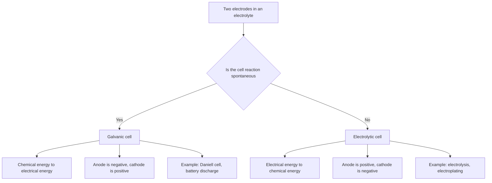
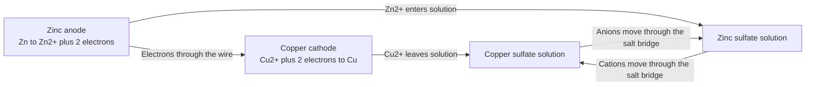
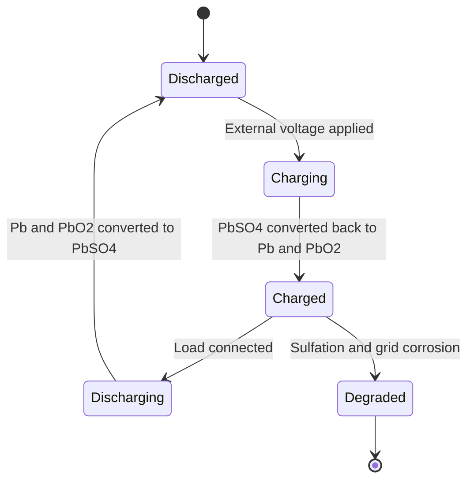
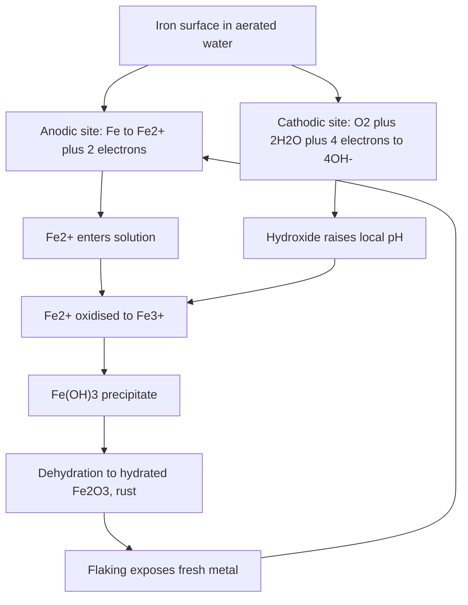

# Chapter 8 — Electrochemical Cells, the Nernst Equation and Electrolysis

> **Level:** Advanced (Level 3 — Advanced Chemistry)
> **Estimated study time:** 9 hours (6 h reading + 3 h exercises)
> **Prerequisites:** Redox reactions and oxidation numbers (Level 2); [Gibbs energy and equilibrium](04-chemical-thermodynamics.md); acid–base equilibria (Level 2); [advanced equilibrium](07-advanced-equilibrium-buffers-and-solubility-product.md) is helpful but not essential
> **Difficulty:** ★★★★☆ (4/5)
> **Related chapters:** [Level 3 module index](README.md); [Chemical Thermodynamics](04-chemical-thermodynamics.md); [Catalysis](06-catalysis.md); [Advanced Equilibrium](07-advanced-equilibrium-buffers-and-solubility-product.md); [Curriculum map](../CURRICULUM.md)

---

## 1. Learning Objectives

After working through this chapter you will be able to:

- Distinguish galvanic from electrolytic cells and identify the anode and cathode in each.
- Write and interpret cell notation, including phase boundaries and the salt bridge.
- Explain the construction and role of the standard hydrogen electrode.
- Use standard reduction potentials to calculate $E^\circ_\text{cell}$, $\Delta_r G^\circ$ and $K$.
- Derive the Nernst equation from $\Delta G = \Delta G^\circ + RT\ln Q$ and apply it to non-standard cells.
- State the assumptions behind the $0.0592\ \mathrm{V}$ shortcut at $298\ \mathrm{K}$ and calculate the coefficient at other temperatures.
- Analyse concentration cells and explain the origin and sign of their potential.
- Distinguish thermodynamic cell potential from the practical decomposition voltage, and explain overpotential.
- Apply Faraday's laws to electrolysis and calculate current efficiency and energy efficiency.
- Describe the chlor-alkali, aluminium and electroplating processes, and explain corrosion as an electrochemical cell.

---

## 2. Introduction

A battery is a device that converts chemical Gibbs energy into electrical work. The reverse device, an electrolytic cell, uses electrical work to drive a non-spontaneous chemical reaction. Both are governed by the same thermodynamic relation, $\Delta G = -zFE$, and both are limited by the same kinetic and transport processes. This symmetry is what makes electrochemistry such a compact subject: one equation connects the cell voltage to the Gibbs energy, and one more connects the Gibbs energy to the equilibrium constant.

The practical importance is hard to overstate. Global battery production is now measured in terawatt-hours per year, driven by electric vehicles and grid storage. Chlor-alkali electrolysis produces chlorine and sodium hydroxide at a scale of tens of millions of tonnes per year. Aluminium is produced exclusively by the Hall–Héroult electrolysis of alumina, consuming about 13–15 kWh per kilogram. Corrosion destroys an estimated 3–4 % of global GDP each year, and every corrosion process is an electrochemical cell operating in the unwanted direction. Biological systems also use electrochemistry: the membrane potential of a neuron is a Nernst potential, and the respiratory chain is a series of redox reactions coupled to proton translocation.

The chapter builds from definitions to calculations to devices. Section 3 establishes conventions, because most errors in electrochemistry are sign errors rather than chemistry errors; Section 4 confronts the thermodynamic potential with electrode kinetics, where it is only the starting point. The treatment assumes that you can balance a redox half-reaction and calculate a Gibbs energy from standard free energies of formation.

---

## 3. Fundamental Concepts

### 3.1 Galvanic and electrolytic cells

An **electrochemical cell** consists of two electrodes immersed in electrolytes, connected externally by a conductor and internally by an ion-conducting medium. The electrode at which oxidation occurs is the **anode**; the electrode at which reduction occurs is the **cathode**. This definition is independent of the cell type, which is why it is the safest one to memorise.

In a **galvanic cell** (also called a voltaic cell), the chemical reaction is spontaneous and drives electrons through the external circuit. The cell converts chemical energy into electrical energy. A battery discharging is a galvanic cell.

In an **electrolytic cell**, an external power supply drives a non-spontaneous reaction. The cell converts electrical energy into chemical energy. Electrolysis of water, brine or molten alumina, and electroplating, are electrolytic processes.

The sign conventions are a common source of confusion. In a galvanic cell the cathode is positive and the anode is negative, because electrons flow from the anode to the cathode through the external circuit. In an electrolytic cell the cathode is negative and the anode is positive, because the power supply forces electrons onto the cathode. The *definitions* of anode and cathode never change; only the signs of the electrodes relative to the external circuit change.

| Feature | Galvanic cell | Electrolytic cell |
|---|---|---|
| Driving force | Spontaneous chemical reaction | External power supply |
| $\Delta_r G$ | Negative | Positive (driven) |
| Anode | Negative electrode | Positive electrode |
| Cathode | Positive electrode | Negative electrode |
| Electron flow (external) | Anode to cathode | Power supply to cathode, anode to supply |
| Examples | Daniell cell, lead–acid battery, fuel cell | Water electrolyser, chlor-alkali cell, electroplating bath |

### 3.2 Cell notation and conventions

A cell is written with the anode on the left and the cathode on the right. A vertical bar represents a phase boundary, and a double vertical bar represents a salt bridge or a liquid junction whose potential is assumed negligible. For the Daniell cell:

$$
\ce{Zn(s) | Zn^2+(aq) || Cu^2+(aq) | Cu(s)}
$$

The left-hand electrode is the anode, where zinc is oxidised. The right-hand electrode is the cathode, where copper(II) is reduced. The cell reaction is

$$
\ce{Zn(s) + Cu^2+(aq) -> Zn^2+(aq) + Cu(s)}
$$

and the cell potential is

$$
E_\text{cell} = E_\text{cathode} - E_\text{anode}
= E^\circ_{\ce{Cu^2+/Cu}} - E^\circ_{\ce{Zn^2+/Zn}}
$$

when both electrodes are at standard conditions. Writing the cell the other way round reverses the sign of $E_\text{cell}$ but does not change the chemistry; the convention is that a positive $E_\text{cell}$ corresponds to a spontaneous reaction as written.

Concentrations or activities are included in the notation when they differ from standard: $\ce{Zn(s) | Zn^2+(0.010\ M) || Cu^2+(0.10\ M) | Cu(s)}$. Gases are written with their partial pressures and an inert electrode such as platinum: $\ce{Pt(s) | H2(g, 1\ bar) | H+(aq, 1\ M) || ...}$.

### 3.3 The standard hydrogen electrode

The absolute potential of a single electrode cannot be measured; only potential differences are accessible. Electrochemists therefore define a reference. The **standard hydrogen electrode** (SHE) is

$$
\ce{Pt(s) | H2(g, } p^\circ\ce{) | H+(aq, } a=1\ce{)}
$$

with $p^\circ = 1\ \mathrm{bar}$, $a_{\ce{H+}} = 1$ and a specified temperature, conventionally $298.15\ \mathrm{K}$. Its potential is defined as exactly $0.000\ \mathrm{V}$ at all temperatures:

$$
\ce{2H+(aq) + 2e- <=> H2(g)}
\qquad E^\circ = 0.000\ \mathrm{V}
$$

The SHE is a hydrogen electrode with a platinised platinum surface, which catalyses the $\ce{H2/H+}$ interconversion. It is cumbersome and sensitive to impurities, so practical measurements use secondary reference electrodes such as silver–silver chloride or calomel, whose potentials are known relative to the SHE.

### 3.4 Standard reduction potentials

The **standard reduction potential** $E^\circ$ of a half-reaction is the potential of a cell in which that half-reaction occurs at the cathode and the SHE at the anode, with all species in their standard states. Values are tabulated as reduction potentials by convention. A selection is given below; more negative values indicate a stronger tendency to be oxidised, and more positive values a stronger tendency to be reduced.

| Half-reaction | $E^\circ$ / V vs SHE |
|---|---|
| $\ce{F2(g) + 2e- -> 2F-(aq)}$ | $+2.87$ |
| $\ce{Cl2(g) + 2e- -> 2Cl-(aq)}$ | $+1.36$ |
| $\ce{O2(g) + 4H+(aq) + 4e- -> 2H2O(l)}$ | $+1.23$ |
| $\ce{Ag+(aq) + e- -> Ag(s)}$ | $+0.799$ |
| $\ce{Cu^2+(aq) + 2e- -> Cu(s)}$ | $+0.340$ |
| $\ce{2H+(aq) + 2e- -> H2(g)}$ | $0.000$ |
| $\ce{Fe^2+(aq) + 2e- -> Fe(s)}$ | $-0.447$ |
| $\ce{Zn^2+(aq) + 2e- -> Zn(s)}$ | $-0.762$ |
| $\ce{Mg^2+(aq) + 2e- -> Mg(s)}$ | $-2.372$ |
| $\ce{Na+(aq) + e- -> Na(s)}$ | $-2.71$ |

Two rules govern the use of the table. First, **reversing a half-reaction changes the sign of $E^\circ$ but not its magnitude**. Second, **multiplying a half-reaction by a stoichiometric factor does not change $E^\circ$**, because potential is an intensive property (energy per charge). The free energy change does scale with the number of electrons, which is why $\Delta G^\circ = -zFE^\circ$ includes $z$.

### 3.5 Cell potential, Gibbs energy and the equilibrium constant

For a cell reaction involving $z$ electrons,

$$
\Delta_r G^\circ = -zFE^\circ_\text{cell}
$$

where $F = 96\,485\ \mathrm{C\ mol^{-1}}$ is the Faraday constant. A positive cell potential therefore corresponds to a negative Gibbs energy change and a spontaneous reaction. Combining this with $\Delta_r G^\circ = -RT\ln K$ gives

$$
E^\circ_\text{cell} = \frac{RT}{zF}\ln K
$$

At $298.15\ \mathrm{K}$, with $2.303RT/F = 0.05916\ \mathrm{V}$,

$$
E^\circ_\text{cell} = \frac{0.0592}{z}\log_{10}K
$$

This relation explains why cells with large positive potentials have enormous equilibrium constants. A cell with $E^\circ = 1.10\ \mathrm{V}$ and $z = 2$ has $\log K = 2(1.10)/0.0592 = 37.2$, so $K \approx 10^{37}$: the reaction is effectively complete.

### 3.6 The Nernst equation

For a general cell reaction with reaction quotient $Q$, the Gibbs energy at arbitrary composition is

$$
\Delta_r G = \Delta_r G^\circ + RT\ln Q
$$

Substituting $\Delta_r G = -zFE$ and $\Delta_r G^\circ = -zFE^\circ$ gives

$$
-zFE = -zFE^\circ + RT\ln Q
$$

and therefore the **Nernst equation**:

$$
E = E^\circ - \frac{RT}{zF}\ln Q
= E^\circ - \frac{2.303RT}{zF}\log_{10}Q
$$

At $298.15\ \mathrm{K}$:

$$
E = E^\circ - \frac{0.0592}{z}\log_{10}Q
$$

The number $z$ is the number of electrons transferred in the *balanced cell reaction as written*, not the number in either half-reaction separately. If the cell reaction is doubled, $z$ doubles and $Q$ is squared, so the Nernst term is unchanged; the potential is intensive.

**The 0.0592 shortcut has caveats.** The coefficient $2.303RT/F$ is $0.05916\ \mathrm{V}$ only at $298.15\ \mathrm{K}$. At $310\ \mathrm{K}$ it is $0.0615\ \mathrm{V}$, a difference of 4 %, which is significant for a pH measurement. The equation also assumes that $Q$ is written in activities, that the electrodes are at equilibrium, that the junction potential is negligible, and that no current flows. In a working cell the measured voltage differs from the Nernst potential by the ohmic drop and the overpotentials.

### 3.7 Concentration cells

A **concentration cell** has identical electrodes in solutions of different concentration. The standard potential is zero because the two half-reactions are identical, but the Nernst term is not. For

$$
\ce{Cu(s) | Cu^2+(c1) || Cu^2+(c2) | Cu(s)}
$$

the cell reaction is the transfer of copper(II) from the concentrated to the dilute side:

$$
\ce{Cu^2+(c2) -> Cu^2+(c1)}
$$

with $Q = c_1/c_2$ and

$$
E = -\frac{0.0592}{2}\log_{10}\frac{c_1}{c_2}
= \frac{0.0592}{2}\log_{10}\frac{c_2}{c_1}
$$

If $c_2 > c_1$, the potential is positive and the concentrated side is the cathode. The cell runs until the concentrations equalise, at which point $E = 0$. Concentration cells are the basis of pH electrodes, ion-selective electrodes and membrane potentials in biology.

### 3.8 Liquid junction potentials

Whenever two electrolyte solutions of different composition meet, a small potential difference develops because ions diffuse at different rates. This **liquid junction potential** is typically $1$–$5\ \mathrm{mV}$ and can be larger at extreme pH. It cannot be eliminated, only minimised: a concentrated potassium chloride salt bridge works because $\ce{K+}$ and $\ce{Cl-}$ have almost equal mobilities, so the junction potential is small. In precise work the junction potential is either calculated with the Henderson equation or cancelled by using the same reference system for calibration and measurement.

### 3.9 Overpotential and the kinetics of electrode reactions

The Nernst equation describes an electrode at equilibrium. When current flows, the electrode potential shifts away from the equilibrium value. The difference is the **overpotential**:

$$
\eta = E - E_\mathrm{eq}
$$

Overpotential has three contributions: **activation overpotential**, arising from the finite rate of electron transfer at the electrode surface; **concentration overpotential**, arising from depletion of reactants or accumulation of products near the electrode; and **ohmic overpotential**, arising from the resistance of the electrolyte and the electrodes. Activation overpotential is often described by the **Tafel equation**:

$$
\eta = a + b\log_{10}j
$$

where $j$ is the current density and $b$ is the Tafel slope, typically $0.06$–$0.12\ \mathrm{V}$ per decade for a one-electron step. The exchange current density $j_0$ is a measure of the intrinsic activity of the electrode: a good electrocatalyst has a large $j_0$ and therefore a small overpotential at a given current.

Overpotential is why the practical decomposition voltage of water is about $1.8$–$2.0\ \mathrm{V}$ rather than the thermodynamic $1.23\ \mathrm{V}$. The extra voltage is dissipated as heat, and it dominates the energy efficiency of electrolysers. It is also why hydrogen evolution is fast on platinum and slow on mercury, and why the choice of electrode material is as important as the thermodynamics.

### 3.10 Electrolysis

**Electrolysis** is the driving of a non-spontaneous reaction by an external voltage. The minimum voltage required is the **reversible decomposition voltage**, equal to the magnitude of the cell potential for the reverse reaction. In practice, the applied voltage must exceed the reversible value by the sum of the overpotentials and the ohmic drop:

$$
V_\text{applied} = |E_\text{rev}| + \eta_\text{anode} + \eta_\text{cathode} + IR
$$

The products of electrolysis depend on the electrode materials, the electrolyte, the concentration and the applied voltage. In aqueous solution, water can be oxidised to oxygen or reduced to hydrogen, and these reactions compete with the oxidation or reduction of the dissolved salt. The outcome is determined by the electrode potentials *and* the overpotentials: a reaction with a more favourable potential may be kinetically suppressed.

**Electrolysis of water.** In acidic solution:

$$
\ce{2H2O(l) -> O2(g) + 4H+(aq) + 4e-} \qquad E^\circ = -1.23\ \mathrm{V}
$$

$$
\ce{4H+(aq) + 4e- -> 2H2(g)} \qquad E^\circ = 0.00\ \mathrm{V}
$$

The overall reaction is $\ce{2H2O(l) -> 2H2(g) + O2(g)}$ with $E^\circ_\text{cell} = -1.23\ \mathrm{V}$, so the minimum applied voltage is $1.23\ \mathrm{V}$. The **thermoneutral voltage**, at which the electrical energy supplied equals the enthalpy change, is $1.48\ \mathrm{V}$; above this voltage the cell could in principle operate without external heat, and below it the cell absorbs heat from the surroundings.

**Electrolysis of brine.** In a membrane chlor-alkali cell, chloride is oxidised at a dimensionally stable anode (often titanium coated with ruthenium oxide) and water is reduced at a steel cathode:

$$
\ce{2Cl-(aq) -> Cl2(g) + 2e-} \qquad E^\circ = -1.36\ \mathrm{V}
$$

$$
\ce{2H2O(l) + 2e- -> H2(g) + 2OH-(aq)} \qquad E^\circ = -0.83\ \mathrm{V}
$$

The overall cell reaction is

$$
\ce{2NaCl(aq) + 2H2O(l) -> 2NaOH(aq) + Cl2(g) + H2(g)}
$$

with a reversible decomposition voltage of about $2.19\ \mathrm{V}$; practical cells run at $3.0$–$3.5\ \mathrm{V}$. The membrane is a cation-exchange polymer that admits $\ce{Na+}$ but not $\ce{Cl-}$, preventing chlorine from reacting with hydroxide.

**Electrolysis of molten salts.** When the solvent is a molten salt, the constraints of water electrolysis disappear. The Hall–Héroult process dissolves alumina in molten cryolite at about $960\ ^\circ\mathrm{C}$ and reduces aluminium at a carbon cathode:

$$
\ce{2Al2O3(l) + 3C(s) -> 4Al(l) + 3CO2(g)}
$$

The reversible decomposition voltage is about $2.2\ \mathrm{V}$, but practical cells operate at $4.0$–$4.5\ \mathrm{V}$ because of overpotential and ohmic losses. The carbon anodes are consumed, producing $\ce{CO2}$; this is one of the largest sources of industrial carbon dioxide emissions after cement and steel.

### 3.11 Faraday's laws

**Faraday's first law** states that the amount of substance produced or consumed at an electrode is proportional to the charge passed:

$$
n = \frac{Q}{zF}
$$

where $Q$ is in coulombs, $z$ is the number of electrons per formula unit, and $F = 96\,485\ \mathrm{C\ mol^{-1}}$. **Faraday's second law** states that for the same charge, the amounts of different substances are inversely proportional to their electron stoichiometries. The charge is related to current and time by

$$
Q = \int I\,\mathrm{d}t \approx I t
$$

for a constant current.

**Current efficiency** is the fraction of the passed charge that produces the desired product:

$$
\eta_\text{current} = \frac{n_\text{actual}}{n_\text{theoretical}} \times 100\%
= \frac{zF n_\text{actual}}{Q} \times 100\%
$$

**Energy efficiency** compares the minimum thermodynamic energy with the actual electrical energy:

$$
\eta_\text{energy} = \frac{|\Delta_r G^\circ| n_\text{actual}}{Q V_\text{applied}} \times 100\%
= \eta_\text{current} \times \frac{|E_\text{rev}|}{V_\text{applied}} \times 100\%
$$

The two efficiencies are different. A cell can have 95 % current efficiency and 50 % energy efficiency if the overpotential is large; the lost energy appears as heat.

### 3.12 Batteries and fuel cells

A **primary battery** is not rechargeable; a **secondary battery** is. The lead–acid battery uses lead and lead dioxide electrodes in sulfuric acid:

$$
\ce{Pb(s) + PbO2(s) + 2H2SO4(aq) -> 2PbSO4(s) + 2H2O(l)}
\qquad E^\circ \approx 2.05\ \mathrm{V}
$$

Six cells in series give the familiar 12 V. The reaction is reversible, which is why the battery can be recharged, but the lead sulfate crystals grow and the electrodes degrade with cycling.

Lithium-ion batteries use intercalation rather than dissolution–deposition. A typical cell has a lithium cobalt oxide cathode and a graphite anode:

$$
\ce{LiCoO2(s) <=> Li_{1-x}CoO2(s) + xLi+(solv) + xe-}
$$

with lithium intercalated into graphite at the anode. The cell voltage is about $3.6$–$3.8\ \mathrm{V}$, and the energy density is several times that of lead–acid. The electrolyte is a non-aqueous lithium salt solution, because water would decompose at these voltages.

A **fuel cell** is a galvanic cell in which the reactants are supplied continuously. The hydrogen–oxygen fuel cell has the overall reaction $\ce{2H2(g) + O2(g) -> 2H2O(l)}$ with $E^\circ = 1.23\ \mathrm{V}$. Practical cells deliver $0.6$–$0.8\ \mathrm{V}$ at operating current because of activation and ohmic losses, giving an efficiency of 50–60 % based on the lower heating value of hydrogen.

### 3.13 Corrosion as an electrochemical cell

Corrosion is an electrochemical process in which a metal is oxidised at an anodic site and an oxidant is reduced at a cathodic site. For iron in aerated neutral water:

$$
\ce{Fe(s) -> Fe^2+(aq) + 2e-} \qquad \text{anodic}
$$

$$
\ce{O2(g) + 2H2O(l) + 4e- -> 4OH-(aq)} \qquad \text{cathodic}
$$

The iron(II) ions are further oxidised by oxygen to iron(III) hydroxide and eventually to hydrated iron(III) oxide, the flaky solid known as rust. The overall reaction is

$$
\ce{4Fe(s) + 3O2(g) + 6H2O(l) -> 4Fe(OH)3(s)}
$$

and the dehydration of the hydroxide gives $\ce{Fe2O3.nH2O}$, written approximately as $\ce{2Fe2O3.3H2O}$.

Corrosion requires an electrolyte, an oxidant and a potential difference between anodic and cathodic regions. The potential difference can arise from differences in oxygen concentration (differential aeration), from contact between dissimilar metals (galvanic coupling), from stress, or from variations in surface composition. **Passivation** occurs when a thin, adherent oxide film protects the metal; stainless steel relies on a chromium-rich passive layer. **Cathodic protection** makes the protected metal the cathode by connecting it to a more active metal (a sacrificial anode such as zinc or magnesium) or by impressing an external current.

---

## 4. Detailed Scientific Explanation

### 4.1 The cell potential as the reaction proceeds

As a galvanic cell discharges, the reaction quotient $Q$ increases and the cell potential falls. When $Q = K$, the Nernst equation gives $E = 0$: the cell is dead. A battery therefore delivers a decreasing voltage as it discharges, unless a voltage regulator or a phase change holds the potential approximately constant.

The relation also explains why a cell cannot be charged beyond its equilibrium voltage without supplying work. To drive the reverse reaction, the applied voltage must exceed the cell potential; the difference is stored as chemical energy. The thermodynamic minimum work is $zFE_\text{rev}$ per mole of reaction, and the actual work is larger because of overpotential and resistance.

### 4.2 Water electrolysis and the energy balance

The overall reaction $\ce{2H2O(l) -> 2H2(g) + O2(g)}$ has $\Delta_r H^\circ = +571.7\ \mathrm{kJ\ mol^{-1}}$ and $\Delta_r G^\circ = +474.3\ \mathrm{kJ\ mol^{-1}}$ at $298\ \mathrm{K}$. The reversible voltage is

$$
E_\text{rev} = \frac{\Delta_r G^\circ}{4F} = \frac{474\,300}{4 \times 96\,485} = 1.23\ \mathrm{V}
$$

The thermoneutral voltage, at which the electrical energy equals the enthalpy change, is

$$
E_\text{tn} = \frac{\Delta_r H^\circ}{4F} = \frac{571\,700}{4 \times 96\,485} = 1.48\ \mathrm{V}
$$

At applied voltages between $1.23$ and $1.48\ \mathrm{V}$, the cell absorbs heat from the surroundings; above $1.48\ \mathrm{V}$, it generates heat. Practical alkaline electrolysers operate at $1.8$–$2.0\ \mathrm{V}$ and $70$–$80\ \%$ efficiency; proton-exchange-membrane electrolysers operate at $1.7$–$2.0\ \mathrm{V}$ and higher current densities. The difference between the reversible and practical voltages is the sum of the oxygen and hydrogen overpotentials and the ohmic drop.

### 4.3 The chlor-alkali process

The chlor-alkali process is one of the largest electrochemical industries. It produces chlorine, sodium hydroxide and hydrogen from brine. The three cell designs are the mercury cell, the diaphragm cell and the membrane cell; the membrane cell dominates new capacity because it avoids mercury and produces concentrated, chloride-free hydroxide.

The anode reaction is chloride oxidation; the cathode reaction is water reduction. The reversible cell voltage is about $2.19\ \mathrm{V}$, but practical cells operate at $3.0$–$3.5\ \mathrm{V}$ because of the oxygen evolution overpotential on the anode, the hydrogen overpotential on the cathode, and the membrane resistance. Current efficiencies exceed $95\ \%$, so the energy efficiency is typically $55$–$65\ \%$.

The membrane is a cation-exchange polymer with sulfonate and carboxylate layers. It conducts $\ce{Na+}$ from the anolyte to the catholyte while blocking $\ce{Cl-}$ and $\ce{OH-}$. The selectivity is essential: if hydroxide migrated into the anolyte, it would react with chlorine to form hypochlorite and chlorate, reducing the yield and contaminating the product.

### 4.4 The Hall–Héroult process

Aluminium cannot be produced by aqueous electrolysis because water is reduced before aluminium ions. The Hall–Héroult process dissolves alumina in molten cryolite ($\ce{Na3AlF6}$) at about $960\ ^\circ\mathrm{C}$, lowering the melting point and the viscosity of the electrolyte. The cathode is carbon-lined steel; the anodes are carbon blocks that are consumed.

The cathode reaction is $\ce{Al^3+ + 3e- -> Al(l)}$, and the anode reaction is the oxidation of oxide ions to oxygen, which reacts with carbon to form $\ce{CO2}$:

$$
\ce{C(s) + 2O^2-(l) -> CO2(g) + 4e-}
$$

The overall reaction is $\ce{2Al2O3(l) + 3C(s) -> 4Al(l) + 3CO2(g)}$. Practical cells operate at $4.0$–$4.5\ \mathrm{V}$ and $200$–$400\ \mathrm{kA}$, with energy consumption of $13$–$15\ \mathrm{kWh\ kg^{-1}}$ of aluminium. The theoretical minimum is about $6.5\ \mathrm{kWh\ kg^{-1}}$, so the process is roughly $50\ \%$ efficient. Inert anodes that would release oxygen rather than $\ce{CO2}$ are an active research target.

### 4.5 Electroplating

Electroplating deposits a thin metal layer by cathodic reduction of metal ions. The mass deposited follows Faraday's law, but uniformity depends on the current distribution, which is controlled by cell geometry, electrolyte conductivity and electrode polarisation. **Throwing power** is the ability of a bath to plate recesses uniformly; complexing baths such as cyanide baths are better than simple acid baths because their deposition is kinetically limited. Additives control grain size, gloss and stress, while hydrogen evolution must be minimised to avoid pitting and embrittlement.

### 4.6 Batteries and fuel cells in more detail

A battery is characterised by its **specific energy** (Wh kg$^{-1}$), **energy density** (Wh L$^{-1}$), **power density** (W kg$^{-1}$), cycle life and safety. Lead–acid batteries have low specific energy (about $35$–$40\ \mathrm{Wh\ kg^{-1}}$) but are cheap and deliver high surge currents. Lithium-ion cells achieve $150$–$250\ \mathrm{Wh\ kg^{-1}}$ but require careful thermal management and protection circuits.

The theoretical specific energy is $w_\text{max} = zFE^\circ/\sum M_i$; for a hydrogen–oxygen fuel cell it is $9.1\ \mathrm{kWh\ kg^{-1}}$, but real systems achieve only a fraction because of the mass of the tank, stack and balance of plant.

### 4.7 Corrosion in detail

The corrosion of iron in aerated water involves two coupled half-reactions separated in space: iron dissolves at the anode, oxygen is reduced at the cathode, and electrons travel through the metal while ions travel through the water film. The rate is controlled by the oxygen supply, the conductivity of the electrolyte and the presence of inhibitors.

**Differential aeration** makes a low-oxygen region anodic relative to a high-oxygen region, which is why corrosion occurs under deposits, in crevices and at the waterline; **galvanic corrosion** occurs when dissimilar metals are in contact, with the more active metal becoming the anode. **Passivation** by a stable, adherent oxide film protects stainless steel, although chloride ions can break the film and cause pitting. Protection methods include barrier coatings, inhibitors, cathodic protection with sacrificial anodes or impressed current, and material selection.

### 4.8 Model limits

The Nernst equation assumes equilibrium at the electrode and negligible current. It is therefore a thermodynamic limit, not a prediction of the operating voltage of a cell. The 0.0592 V coefficient is exact only at $298.15\ \mathrm{K}$ and only for the natural-logarithm-to-decadic conversion; using it at $310\ \mathrm{K}$ introduces a 4 % error in the coefficient.

Standard potentials are defined for unit activity, which is never exactly realised in a real electrolyte. Activity coefficients, liquid junction potentials and complexation shift the apparent potential. In concentrated solutions, the concept of a single-ion activity is itself operationally defined, and the measured potential depends on the reference electrode and the junction.

Electrode kinetics adds overpotential, which depends on the current density, the electrode material and the mass transport. In porous electrodes, the current distribution is non-uniform and the effective overpotential varies with depth. These effects are the subject of electrochemical engineering and are not captured by the Nernst equation alone.

---

## 5. Visual Diagrams

**Figure 8.1 — Classification of electrochemical cells.** The distinction is thermodynamic, not geometrical: the same two electrodes can form a galvanic cell when the reaction is spontaneous and an electrolytic cell when an external supply drives the reverse reaction. Note that the anode is always the site of oxidation, even though its electrical sign reverses between the two modes.

**Figure 8.2 — Electron and ion flow in the Daniell cell.** Electrons travel through the external circuit from zinc to copper, while the salt bridge completes the circuit by carrying cations towards the cathode and anions towards the anode. Without the salt bridge, charge would accumulate and the reaction would stop almost immediately. The figure also shows why the anode is the negative electrode in a galvanic cell.

**Figure 8.3 — Charge and discharge states of a lead–acid battery.** The active materials are converted between lead, lead dioxide and lead sulfate. The degradation pathway is parasitic: lead sulfate recrystallises into a form that is difficult to recharge, and the positive grid corrodes. The diagram is a simplification because the two electrodes change in parallel, but it captures the reversible chemistry that makes the battery rechargeable.

**Figure 8.4 — The corrosion cell on iron.** Oxidation and reduction occur at separate sites on the same metal, connected by electron conduction through the metal and ion conduction through the water film. The rust is not a protective film because it is porous and flaky, so the process continues until the metal is consumed or the oxygen supply is cut off. The loop from flaking back to the anodic site is the reason corrosion is self-accelerating in a damaged coating.

---

## 6. Mathematical Formulas

**Gibbs energy, cell potential and equilibrium.**

$$
\Delta_r G = -zFE,
\qquad
\Delta_r G^\circ = -zFE^\circ,
\qquad
E^\circ = \frac{RT}{zF}\ln K
$$

**Nernst equation.**

$$
E = E^\circ - \frac{RT}{zF}\ln Q
= E^\circ - \frac{2.303RT}{zF}\log_{10}Q
$$

**The 298 K shortcut.**

$$
E = E^\circ - \frac{0.0592}{z}\log_{10}Q
\qquad (\text{valid at } 298.15\ \mathrm{K})
$$

**Concentration cell.**

$$
E = \frac{0.0592}{z}\log_{10}\frac{c_\text{concentrated}}{c_\text{dilute}}
$$

**Faraday's law and charge.**

$$
Q = It,
\qquad
n = \frac{Q}{zF}
$$

**Current and energy efficiency.**

$$
\eta_\text{current} = \frac{zFn_\text{actual}}{Q} \times 100\%,
\qquad
\eta_\text{energy} = \eta_\text{current}\frac{|E_\text{rev}|}{V_\text{applied}} \times 100\%
$$

**Tafel equation.**

$$
\eta = a + b\log_{10}j
$$

**Theoretical specific energy.**

$$
w_\text{max} = \frac{zFE^\circ}{\sum M_i}
$$

| Symbol | Meaning | SI unit |
|---|---|---|
| $E$ | Cell or electrode potential | V (J C$^{-1}$) |
| $E^\circ$ | Standard potential | V |
| $E_\text{rev}$ | Reversible decomposition voltage | V |
| $z$ | Number of electrons in the balanced reaction | dimensionless |
| $F$ | Faraday constant, $96\,485$ | C mol$^{-1}$ |
| $Q$ | Reaction quotient (activities) | dimensionless |
| $K$ | Equilibrium constant | dimensionless |
| $I$ | Current | A (C s$^{-1}$) |
| $\eta$ | Overpotential | V |
| $\eta_\text{energy}$ | Energy efficiency | dimensionless or % |
| $w_\text{max}$ | Theoretical specific energy | J kg$^{-1}$ |

**Assumptions.** The Nernst equation assumes equilibrium at each electrode, negligible current, unit activity of pure solids and liquids, and negligible liquid junction potential. The 0.0592 V coefficient assumes $298.15\ \mathrm{K}$ and the natural logarithm converted with $\ln 10 = 2.3026$. Faraday's law assumes 100 % current efficiency; the actual charge consumed by side reactions is accounted for by $\eta_\text{current}$. The Tafel equation assumes activation control and one dominant reaction.

---

## 7. Chemical Equations

**Daniell cell.**

$$
\ce{Zn(s) + Cu^2+(aq) -> Zn^2+(aq) + Cu(s)}
\qquad E^\circ_\text{cell} = 1.10\ \mathrm{V}
$$

**Standard hydrogen electrode.**

$$
\ce{2H+(aq) + 2e- <=> H2(g)}
\qquad E^\circ = 0.000\ \mathrm{V}
$$

**Electrolysis of water.**

$$
\ce{2H2O(l) -> 2H2(g) + O2(g)}
\qquad E^\circ_\text{cell} = -1.23\ \mathrm{V}
$$

**Chlor-alkali electrolysis.**

$$
\ce{2NaCl(aq) + 2H2O(l) -> 2NaOH(aq) + Cl2(g) + H2(g)}
\qquad E^\circ_\text{cell} \approx -2.19\ \mathrm{V}
$$

**Hall–Héroult electrolysis.**

$$
\ce{2Al2O3(l) + 3C(s) -> 4Al(l) + 3CO2(g)}
\qquad E^\circ_\text{cell} \approx -2.2\ \mathrm{V}
$$

**Lead–acid battery discharge.**

$$
\ce{Pb(s) + PbO2(s) + 2H2SO4(aq) -> 2PbSO4(s) + 2H2O(l)}
\qquad E^\circ_\text{cell} \approx 2.05\ \mathrm{V}
$$

**Hydrogen–oxygen fuel cell.**

$$
\ce{2H2(g) + O2(g) -> 2H2O(l)}
\qquad E^\circ_\text{cell} = 1.23\ \mathrm{V}
$$

**Corrosion of iron.**

$$
\ce{2Fe(s) + O2(g) + 2H2O(l) -> 2Fe(OH)2(s)}
$$

---

## 8. Worked Examples

### Worked Example 8.1 — The Daniell cell: $E^\circ$, $\Delta G^\circ$ and $K$

**Problem.** Calculate $E^\circ_\text{cell}$, $\Delta_r G^\circ$ and $K$ at $298\ \mathrm{K}$ for the Daniell cell, using $E^\circ(\ce{Cu^2+/Cu}) = +0.340\ \mathrm{V}$ and $E^\circ(\ce{Zn^2+/Zn}) = -0.762\ \mathrm{V}$.

**Strategy.** Subtract the anode potential from the cathode potential, then use $\Delta G^\circ = -zFE^\circ$ and $\Delta G^\circ = -RT\ln K$. Identify $z = 2$ from the balanced reaction.

**Solution.**

$$
E^\circ_\text{cell} = 0.340 - (-0.762) = 1.102\ \mathrm{V}
$$

$$
\Delta_r G^\circ = -2(96\,485)(1.102) = -2.127 \times 10^{5}\ \mathrm{J\ mol^{-1}}
= -212.7\ \mathrm{kJ\ mol^{-1}}
$$

$$
\ln K = \frac{zFE^\circ}{RT} = \frac{2(96\,485)(1.102)}{8.314 \times 298}
= 85.85
$$

$$
K = e^{85.85} = 2.0 \times 10^{37}
$$

**Check.** Using the shortcut, $\log K = 2(1.102)/0.0592 = 37.2$, so $K = 10^{37.2} = 1.6 \times 10^{37}$, consistent with the exact value within rounding. The reaction is strongly spontaneous, which is why a Daniell cell delivers a voltage until the zinc is consumed or the copper is depleted.

### Worked Example 8.2 — A non-standard Daniell cell

**Problem.** Calculate the cell potential at $298\ \mathrm{K}$ when $[\ce{Zn^2+}] = 0.010\ \mathrm{M}$ and $[\ce{Cu^2+}] = 0.10\ \mathrm{M}$, using $E^\circ_\text{cell} = 1.102\ \mathrm{V}$.

**Strategy.** Write the reaction quotient for the balanced reaction, $Q = [\ce{Zn^2+}]/[\ce{Cu^2+}]$, and apply the Nernst equation with $z = 2$.

**Solution.**

$$
Q = \frac{0.010}{0.10} = 0.10
$$

$$
E = 1.102 - \frac{0.0592}{2}\log_{10}(0.10)
= 1.102 - (0.0296)(-1)
= 1.132\ \mathrm{V}
$$

**Check.** The potential is higher than the standard value because the reactant $\ce{Cu^2+}$ is at higher activity than the product $\ce{Zn^2+}$, which increases the driving force. The shift is only $30\ \mathrm{mV}$ for a tenfold change in $Q$ with $z = 2$, as the Nernst slope predicts.

### Worked Example 8.3 — A copper concentration cell

**Problem.** A concentration cell consists of two copper electrodes dipping into $0.0010\ \mathrm{M}$ and $1.0\ \mathrm{M}$ $\ce{CuSO4}$ solutions. Calculate the cell potential at $298\ \mathrm{K}$, identify the cathode, and state what happens to the potential as the cell discharges.

**Strategy.** For identical electrodes $E^\circ = 0$. The cell reaction transfers copper(II) from the concentrated to the dilute solution, so $Q = c_\text{dilute}/c_\text{concentrated}$. Apply the Nernst equation with $z = 2$.

**Solution.**

$$
E = 0 - \frac{0.0592}{2}\log_{10}\frac{0.0010}{1.0}
= -0.0296 \times (-3) = +0.0888\ \mathrm{V}
$$

The dilute side is the anode (oxidation of copper to $\ce{Cu^2+}$), and the concentrated side is the cathode (reduction of $\ce{Cu^2+}$ to copper). As the cell discharges, copper dissolves on the dilute side and deposits on the concentrated side, so the concentrations approach each other and the potential falls to zero when they are equal.

**Check.** The sign is positive, as it must be for a spontaneous process: the system lowers its Gibbs energy by diluting the concentrated solution and concentrating the dilute one. The magnitude, about $89\ \mathrm{mV}$ for a three-decade concentration ratio, is consistent with $0.0296\ \mathrm{V}$ per decade for $z = 2$.

### Worked Example 8.4 — Electrolysis of water and Faraday's law

**Problem.** A current of $2.00\ \mathrm{A}$ is passed through an acidic water electrolyser for $1.50\ \mathrm{h}$. Calculate the charge passed, the moles of hydrogen and oxygen produced, their masses, and the minimum electrical energy required at $1.23\ \mathrm{V}$. What is the energy efficiency if the cell operates at $2.00\ \mathrm{V}$?

**Strategy.** Use $Q = It$, then $n_e = Q/F$. Hydrogen requires two electrons per molecule and oxygen four, so $n_{\ce{H2}} = n_e/2$ and $n_{\ce{O2}} = n_e/4$. Energy is $QV$.

**Solution.**

$$
Q = (2.00)(1.50 \times 3600) = 1.08 \times 10^{4}\ \mathrm{C}
$$

$$
n_e = \frac{1.08 \times 10^{4}}{96\,485} = 0.1119\ \mathrm{mol}
$$

$$
n_{\ce{H2}} = 0.05596\ \mathrm{mol}, \qquad m_{\ce{H2}} = 0.05596 \times 2.016 = 0.113\ \mathrm{g}
$$

$$
n_{\ce{O2}} = 0.02798\ \mathrm{mol}, \qquad m_{\ce{O2}} = 0.02798 \times 32.00 = 0.895\ \mathrm{g}
$$

The minimum energy at $1.23\ \mathrm{V}$ is

$$
E_\text{min} = Q E_\text{rev} = (1.08 \times 10^{4})(1.23) = 1.33 \times 10^{4}\ \mathrm{J}
$$

At $2.00\ \mathrm{V}$ the actual energy is $2.16 \times 10^{4}\ \mathrm{J}$, so

$$
\eta_\text{energy} = \frac{1.33 \times 10^{4}}{2.16 \times 10^{4}} \times 100\% = 61.5\%
$$

**Check.** The mass ratio $m_{\ce{H2}}/m_{\ce{O2}} = 0.113/0.895 = 0.126$, close to the stoichiometric mass ratio $4.032/32.00 = 0.126$, as required by the reaction stoichiometry. The efficiency of 61.5 % is typical of a small laboratory electrolyser; industrial alkaline cells reach 70–80 %.

### Worked Example 8.5 — Current efficiency in a chlor-alkali cell

**Problem.** A membrane chlor-alkali cell operates at $10.0\ \mathrm{kA}$ for $24.0\ \mathrm{h}$ and produces $300\ \mathrm{kg}$ of chlorine. Calculate the theoretical mass of chlorine, the current efficiency and the energy consumed per kilogram at a cell voltage of $3.50\ \mathrm{V}$.

**Strategy.** Calculate the charge, convert to moles of electrons, divide by 2 for moles of $\ce{Cl2}$, and compare with the actual mass. Energy is $QV$; divide by the actual mass.

**Solution.**

$$
Q = (10\,000)(24.0 \times 3600) = 8.64 \times 10^{8}\ \mathrm{C}
$$

$$
n_e = \frac{8.64 \times 10^{8}}{96\,485} = 8.953 \times 10^{3}\ \mathrm{mol}
$$

$$
n_{\ce{Cl2}} = \frac{8.953 \times 10^{3}}{2} = 4.476 \times 10^{3}\ \mathrm{mol}
$$

$$
m_\text{theoretical} = 4.476 \times 10^{3} \times 70.90 = 3.174 \times 10^{5}\ \mathrm{g} = 317.4\ \mathrm{kg}
$$

$$
\eta_\text{current} = \frac{300}{317.4} \times 100\% = 94.5\%
$$

$$
E_\text{electrical} = QV = (8.64 \times 10^{8})(3.50) = 3.024 \times 10^{9}\ \mathrm{J} = 840\ \mathrm{kWh}
$$

$$
\frac{840\ \mathrm{kWh}}{300\ \mathrm{kg}} = 2.80\ \mathrm{kWh\ kg^{-1}}
$$

**Check.** The current efficiency is high, as expected for a modern membrane cell. The energy consumption of $2.8\ \mathrm{kWh\ kg^{-1}}$ of chlorine is in the right range for an industrial chlor-alkali plant; the co-product sodium hydroxide accounts for a large part of the economic value. The calculation ignores the energy used in brine purification and product concentration.

## 9. Real-World Applications

**Batteries and energy storage.** Lithium-ion batteries power portable electronics and electric vehicles, and grid-scale storage is increasingly important for integrating wind and solar generation. The cell voltage is set by the difference in chemical potential of lithium in the two intercalation hosts, and the energy density is limited by the mass and volume of the active materials, the electrolyte and the packaging.

**Electrolysers and green hydrogen.** Alkaline and proton-exchange-membrane electrolysers produce hydrogen from water using renewable electricity. The efficiency is limited by the oxygen evolution reaction, which has a large overpotential even on the best catalysts (iridium oxide in acid, nickel–iron layered hydroxides in base). Reducing this overpotential is one of the central problems of electrocatalysis.

**Chlor-alkali and aluminium.** These two processes together consume several percent of global electricity. Chlor-alkali produces chlorine for PVC and water treatment and sodium hydroxide for the chemical industry; aluminium is essential for lightweight transport and packaging. Both industries are under pressure to reduce their carbon footprint, through membrane technology, inert anodes and renewable electricity.

**Corrosion protection.** Cathodic protection is used on pipelines, ship hulls, offshore platforms and reinforced concrete. Sacrificial zinc anodes protect steel until the zinc is consumed; impressed-current systems use a power supply and an inert anode to protect large structures. Protective coatings and corrosion inhibitors complement electrochemical methods.

**Analytical and biomedical sensors.** pH electrodes, ion-selective electrodes and glucose biosensors are electrochemical cells. The glucose sensor uses an enzyme to oxidise glucose and an electrode to detect the product; millions of such sensors are used by people with diabetes every day. Electrochemical detection is also widely used in chromatography and in point-of-care diagnostics.

---

## 10. Common Mistakes

| Mistake | Why it happens | Correct approach |
|---|---|---|
| Adding the two reduction potentials to get $E^\circ_\text{cell}$. | Both values are tabulated as reductions, so students add them. | Subtract the anode potential from the cathode potential: $E^\circ_\text{cell} = E^\circ_\text{cathode} - E^\circ_\text{anode}$. |
| Multiplying $E^\circ$ by the stoichiometric coefficient when doubling a half-reaction. | The free energy scales with the number of electrons, so the potential is assumed to scale too. | Potential is intensive and does not scale; only $\Delta G$ scales, through $z$. |
| Using $0.0592\ \mathrm{V}$ at any temperature. | The shortcut is memorised without its condition. | Use $2.303RT/F$; at $310\ \mathrm{K}$ it is $0.0615\ \mathrm{V}$, not $0.0592\ \mathrm{V}$. |
| Reversing the anode and cathode definitions in an electrolytic cell. | The signs of the electrodes reverse, so the labels are assumed to reverse too. | The anode is always where oxidation occurs; only its electrical sign changes. |
| Equating the calculated cell potential with the voltage needed for electrolysis. | The Nernst potential is treated as the operating voltage. | Add the overpotentials and ohmic drop: $V = |E_\text{rev}| + \eta_\text{a} + \eta_\text{c} + IR$. |

---

## 11. Chapter Summary

- An electrochemical cell converts between chemical and electrical energy; the anode is always the site of oxidation and the cathode the site of reduction.
- In a galvanic cell the reaction is spontaneous and $\Delta_r G < 0$; in an electrolytic cell an external voltage drives a non-spontaneous reaction.
- Standard reduction potentials are measured against the standard hydrogen electrode, whose potential is defined as zero.
- $E^\circ_\text{cell} = E^\circ_\text{cathode} - E^\circ_\text{anode}$, and $\Delta_r G^\circ = -zFE^\circ$ connects the cell potential to thermodynamics.
- The Nernst equation follows from $\Delta G = \Delta G^\circ + RT\ln Q$; at $298\ \mathrm{K}$ the coefficient is $0.0592\ \mathrm{V}$.
- Overpotential is the difference between the operating potential and the equilibrium potential; it arises from activation, concentration and ohmic effects.
- Faraday's laws relate charge to amount of substance; current efficiency and energy efficiency measure how much of the charge and energy produce the desired product.

---

## 12. Exercises

### 12.1 Conceptual questions

1. Explain why the standard electrode potential is an intensive property, and why doubling a half-reaction does not double $E^\circ$ even though it doubles $\Delta G^\circ$.
2. Distinguish between the reversible cell potential and the practical decomposition voltage. Why does water electrolysis require more than $1.23\ \mathrm{V}$?
3. A concentration cell has identical electrodes and identical electrolytes except for concentration. Explain why it produces a voltage and identify which side is the cathode.

### 12.2 Basic problems

4. Calculate $E^\circ_\text{cell}$, $\Delta_r G^\circ$ and $K$ at $298\ \mathrm{K}$ for the cell $\ce{Mg(s) | Mg^2+(aq) || Ag+(aq) | Ag(s)}$, using $E^\circ(\ce{Mg^2+/Mg}) = -2.372\ \mathrm{V}$ and $E^\circ(\ce{Ag+/Ag}) = +0.799\ \mathrm{V}$.
5. Calculate the potential of the Daniell cell at $298\ \mathrm{K}$ when $[\ce{Zn^2+}] = 0.0010\ \mathrm{M}$ and $[\ce{Cu^2+}] = 1.0\ \mathrm{M}$.
6. A current of $5.00\ \mathrm{A}$ is passed through a copper electroplating bath for $2.00\ \mathrm{h}$. Calculate the mass of copper deposited, taking $z = 2$ and $M(\ce{Cu}) = 63.55\ \mathrm{g\ mol^{-1}}$.

### 12.3 Intermediate problems

7. A hydrogen electrode is coupled to a standard hydrogen electrode. The measured cell potential is $0.236\ \mathrm{V}$ at $298\ \mathrm{K}$ with the unknown electrode as the anode. Calculate the pH of the unknown solution.
8. A brine electrolysis cell operates at $5.00\ \mathrm{A}$ for $10.0\ \mathrm{h}$ with a current efficiency of $90\ \%$. Calculate the mass of chlorine produced.
9. The lead–acid cell reaction has $E^\circ = 2.05\ \mathrm{V}$ per cell. Calculate $\Delta_r G^\circ$ for the reaction as written and the theoretical specific energy in $\mathrm{Wh\ kg^{-1}}$, using the molar masses of the reactants.

### 12.4 Advanced problems

10. Explain why a scratch in a galvanised steel sheet can still protect the underlying steel, whereas a scratch in a tin-plated steel sheet accelerates corrosion. Use electrode potentials and the concept of the galvanic series.
11. Calculate the coefficient $2.303RT/F$ at $310\ \mathrm{K}$ and the error introduced by using $0.0592\ \mathrm{V}$ instead, for a one-electron process with $Q = 10$. Comment on the relevance to pH measurements at body temperature.

### 12.5 Calculation problems

12. An aluminium smelter operates a cell at $200\ \mathrm{kA}$ and $4.50\ \mathrm{V}$ for $24.0\ \mathrm{h}$ with a current efficiency of $94\ \%$. Calculate the mass of aluminium produced and the energy consumption per kilogram.

### 12.6 Answers

1. Potential is energy per charge; doubling the half-reaction doubles both the energy and the charge, so the ratio is unchanged. $\Delta G^\circ$ doubles because it is extensive, but $E^\circ$ does not.
2. The reversible potential is the thermodynamic minimum, $1.23\ \mathrm{V}$ for water; the practical decomposition voltage includes the oxygen and hydrogen overpotentials and the ohmic drop, so it is typically $1.8$–$2.0\ \mathrm{V}$.
3. The two half-cells have different concentrations, so the Nernst potentials differ; the cell potential is their difference. The concentrated side is the cathode, where reduction occurs and the concentration falls.
4. $E^\circ = 0.799 - (-2.372) = 3.171\ \mathrm{V}$; $\Delta G^\circ = -2(96\,485)(3.171) = -611.9\ \mathrm{kJ\ mol^{-1}}$; $\log K = 2(3.171)/0.0592 = 107.1$, so $K \approx 1.3 \times 10^{107}$.
5. $E = 1.102 - (0.0592/2)\log(0.0010/1.0) = 1.102 + 0.0888 = 1.191\ \mathrm{V}$.
6. $Q = 5.00 \times 7200 = 3.60 \times 10^{4}\ \mathrm{C}$; $n_e = 0.3731\ \mathrm{mol}$; $n_\ce{Cu} = 0.1866\ \mathrm{mol}$; $m = 11.86\ \mathrm{g}$.
7. $E = 0.0592\,\mathrm{pH}$ for the hydrogen electrode as anode against the SHE, so $\mathrm{pH} = 0.236/0.0592 = 3.99$.
8. $Q = 5.00 \times 36\,000 = 1.80 \times 10^{5}\ \mathrm{C}$; $n_e = 1.865\ \mathrm{mol}$; $n_{\ce{Cl2}} = 0.9326\ \mathrm{mol}$; with 90 % efficiency $0.839\ \mathrm{mol}$; $m = 59.5\ \mathrm{g}$.
9. $z = 2$, so $\Delta G^\circ = -2(96\,485)(2.05) = -395.6\ \mathrm{kJ\ mol^{-1}}$. Reactant molar masses: $\ce{Pb} = 207.2$, $\ce{PbO2} = 239.2$, $2\ce{H2SO4} = 196.2$; total $642.6\ \mathrm{g\ mol^{-1}}$. Specific energy $= 395\,600/642.6 = 615.6\ \mathrm{J\ g^{-1}} = 171\ \mathrm{Wh\ kg^{-1}}$; the practical value is much lower, about $35$–$40\ \mathrm{Wh\ kg^{-1}}$, because of the mass of the electrolyte, grid and casing.
10. Zinc is more active than iron ($E^\circ_{\ce{Zn^2+/Zn}} = -0.762\ \mathrm{V}$ versus $-0.447\ \mathrm{V}$ for iron), so zinc becomes the anode and corrodes preferentially, protecting the exposed steel. Tin is less active than iron ($E^\circ_{\ce{Sn^2+/Sn}} = -0.14\ \mathrm{V}$), so exposed iron becomes the anode and corrodes faster in contact with tin.
11. $2.303RT/F = 2.303 \times 8.314 \times 310/96\,485 = 0.0615\ \mathrm{V}$. Using $0.0592$ underestimates the Nernst slope by $0.0023\ \mathrm{V}$ per decade, or $3.7\ \%$; for a pH electrode this is a systematic error of about $0.04$ pH units per decade of activity, which is significant in clinical measurements.
12. $Q = (2.00 \times 10^{5})(86\,400) = 1.728 \times 10^{10}\ \mathrm{C}$; $n_e = 1.791 \times 10^{5}\ \mathrm{mol}$; $n_\ce{Al} = 5.970 \times 10^{4}\ \mathrm{mol}$; $m_\text{theoretical} = 1.611 \times 10^{3}\ \mathrm{kg}$; actual $= 1.514 \times 10^{3}\ \mathrm{kg}$. Energy $= QV = 7.776 \times 10^{10}\ \mathrm{J} = 2.160 \times 10^{4}\ \mathrm{kWh}$; $14.3\ \mathrm{kWh\ kg^{-1}}$.

---

## 13. Further Reading

- Bard, A. J.; Faulkner, L. R. *Electrochemical Methods: Fundamentals and Applications*, 2nd ed. Wiley, 2001.
- Atkins, P.; de Paula, J.; Keeler, J. *Atkins' Physical Chemistry*, 11th ed. Oxford University Press, 2018. Chapters on electrochemistry.
- Hamann, C. H.; Hamnett, A.; Vielstich, W. *Electrochemistry*, 2nd ed. Wiley-VCH, 2007.
- Newman, J.; Thomas-Alyea, K. E. *Electrochemical Systems*, 3rd ed. Wiley, 2004.
- Pourbaix, M. *Atlas of Electrochemical Equilibria in Aqueous Solutions*. Pergamon, 1966.
- IUPAC. *Compendium of Chemical Terminology* ("Gold Book"), 2nd ed. (the "corrected" version), entries "standard hydrogen electrode", "overpotential" and "electrochemical cell". <https://goldbook.iupac.org/>
- NIST. *CODATA Internationally Recommended Values of the Fundamental Physical Constants*. <https://physics.nist.gov/cuu/Constants/>
- OpenStax. *Chemistry 2e*. Rice University. Chapters on electrochemistry. <https://openstax.org/details/books/chemistry-2e>

---

**Navigation:** [Level 3 index](README.md) · [Curriculum map](../CURRICULUM.md) · Advanced Equilibrium (Ch. 7) · Coordination Chemistry (Ch. 9)
